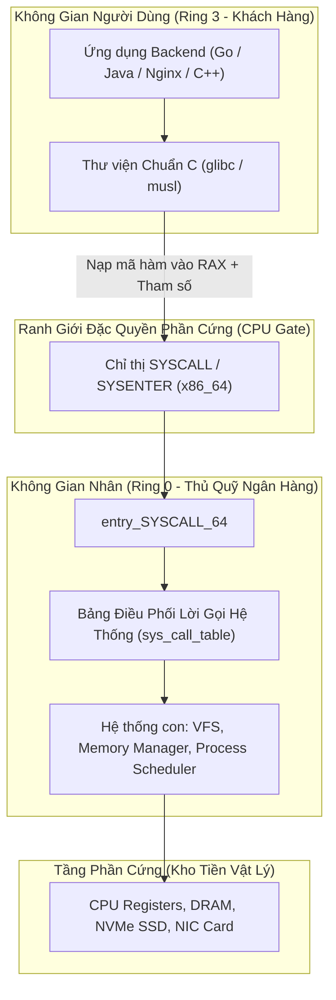
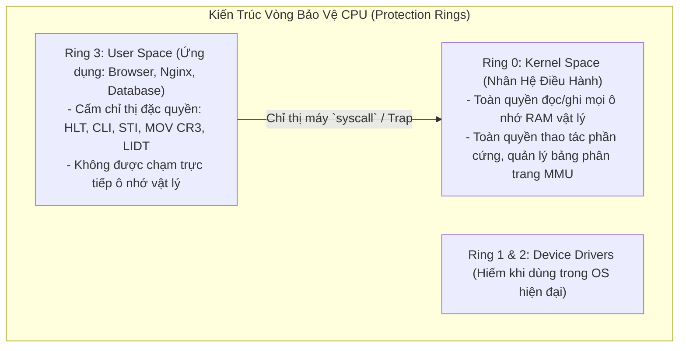
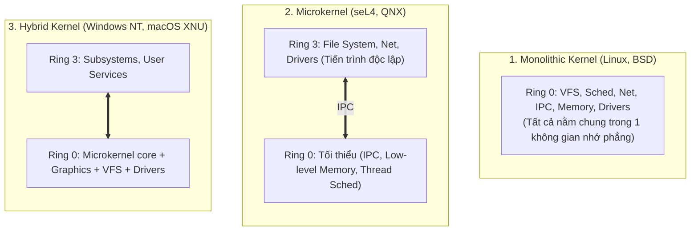

# 1.1. OS Architecture (Kiến Trúc Hệ Điều Hành)

> [!IMPORTANT]
> **Nếu bạn chỉ được nhớ một điều duy nhất:** Kiến trúc Hệ điều hành là bài toán đánh đổi kinh điển giữa **hiệu năng cực hạn** và **an toàn cách ly**: Monolithic Kernel gom toàn bộ Driver và File System vào Ring 0 để đạt thông lượng tối đa nhưng rủi ro đổ vỡ cả hệ thống khi một driver crash; trong khi Microkernel tách rời dịch vụ ra User Space (Ring 3) để đạt độ tin cậy tuyệt đối, song phải trả giá đắt bằng độ trễ Context Switch và IPC Message Passing liên tục.

---

## 1. Trực Quan Hóa: Bản Chất Kiến Trúc Hệ Điều Hành Dưới Góc Nhìn Lập Trình Viên

### 1.1. Đoạn Code Dẫn Nhập & Vấn Đề Thực Tế
Hãy xem đoạn mã C đơn giản sau khi một tiến trình người dùng cố gắng can thiệp trực tiếp vào phần cứng mà không thông qua hệ điều hành:

```c
#include <stdio.h>

int main() {
    // Cố gắng ghi trực tiếp vào thanh ghi cổng xuất nhập (Port I/O) của phần cứng
    // Chỉ thị 'outb' là chỉ thị đặc quyền (Privileged Instruction) trên x86_64
    __asm__ volatile ("outb %al, $0x80"); 
    printf("Lệnh này sẽ không bao giờ được in ra!\n");
    return 0;
}
```

Khi chạy chương trình này ở User Space, CPU lập tức kích hoạt bẫy phần cứng (**Hardware Trap**) và hệ điều hành tiêu diệt tiến trình với thông báo:
```text
Segmentation fault (core dumped) / General Protection Fault (#GP)
```
Tại sao chương trình không thể trực tiếp ghi dữ liệu ra ổ đĩa hoặc card mạng? Nếu mọi chương trình đều có quyền truy cập trực tiếp vào thanh ghi điều khiển phần cứng, một lỗi tràn bộ đệm nhỏ của ứng dụng nghe nhạc cũng có thể xóa sạch cơ sở dữ liệu của máy chủ hoặc làm sập toàn bộ hệ thống.

### 1.2. Ẩn Dụ Đời Sống & Phân Tích Cơ Chế Hoạt Động
Hãy tưởng tượng hệ điều hành giống như **Hệ thống Ngân hàng Quốc gia**:
- **Người gửi tiền (User Space - Ring 3)**: Khách hàng đến quầy giao dịch. Khách hàng không được phép tự do đi vào kho tiền (Phần cứng - Hardware) để tự lấy tiền hay đếm vàng.
- **Nhân viên quầy & Cửa kính bảo vệ (Hardware Boundary - Syscall Transition)**: Khách hàng muốn rút tiền bắt buộc phải điền vào một phiếu ủy nhiệm chi tiêu chuẩn (Tham số trong thanh ghi CPU) và nộp qua khe kính.
- **Thủ quỹ & Kho tiền (Kernel Space - Ring 0)**: Nhân viên ngân hàng (Kernel) kiểm tra căn cước (Phân quyền người dùng), kiểm tra số dư (Bảo vệ bộ nhớ) rồi mới tự tay mở kho tiền, lấy đúng số tiền quy định đưa lại cho khách hàng.

Nhờ ranh giới phân tầng đặc quyền này (**Dual-Mode Operation**), nếu một khách hàng bị ngất hoặc nổi giận đập phá tại sảnh (Ứng dụng bị Crash/Bug), kho tiền và các khách hàng khác trong ngân hàng vẫn hoàn toàn an toàn và hoạt động bình thường.

### 1.3. Mô Phỏng Dữ Liệu Số Nhỏ Từng Bước (Toy Walkthrough)
Theo dõi quá trình chuyển trạng thái đặc quyền khi tiến trình User Space gọi hàm `write()` ghi 4 ký tự `"PONG"` ra màn hình:

```text
[Trạng thái ban đầu: User Mode (CPL = Ring 3)]
Bước 1: Ứng dụng nạp chuỗi "PONG" (4 bytes) vào bộ đệm RAM tại địa chỉ 0x1000.
Bước 2: Ghi mã hệ thống SYS_write (mã số 1 trên x86_64) vào thanh ghi RAX.
Bước 3: Ghi mô tả tệp stdout (fd = 1) vào thanh ghi RDI.
Bước 4: Ghi địa chỉ con trỏ 0x1000 vào thanh ghi RSI, độ dài 4 vào thanh ghi RDX.
Bước 5: Thực thi lệnh máy 'syscall'.

[Bàn giao phần cứng: Chuyển sang Kernel Mode (CPL = Ring 0)]
Bước 6: CPU tự động lưu con trỏ lệnh RIP tiếp theo vào thanh ghi RCX, lưu RFLAGS vào R11.
Bước 7: CPU chuyển thanh ghi con trỏ ngăn xếp RSP từ User Stack sang Kernel Stack.
Bước 8: CPU nhảy vào hàm điều phối entry_SYSCALL_64 được lưu sẵn trong thanh ghi MSR LSTAR.
Bước 9: Kernel kiểm tra địa chỉ 0x1000 hợp lệ, ghi 4 bytes ra driver điều khiển màn hình.

[Trả quyền: Chuyển lời gọi ngược lời User Mode (CPL = Ring 3)]
Bước 10: Kernel nạp số byte ghi thành công (4) vào RAX.
Bước 11: Thực thi lệnh 'sysretq' -> CPU khôi phục lại RIP và RSP, trả tiến trình về Ring 3.
```

### 1.4. Tác Động Thực Tế Tầng Backend & Systems
1. **Chi Phí Chuyển Ngữ Cảnh (Privilege Mode Switch Cost)**: Mỗi lần thực thi `syscall` tốn khoảng $50 - 150\text{ ns}$ do CPU phải hoán đổi thanh ghi ngăn xếp, kiểm tra bảng trang và làm mất tính liên tục của luồng lệnh (Instruction Pipeline Stall).
2. **KPTI (Kernel Page Table Isolation) & Lỗ Hổng Meltdown**: Bản vá bảo mật chống đọc trộm bộ nhớ Kernel buộc hệ điều hành Linux phải tráo đổi thanh ghi `CR3` mỗi khi vào/ra syscall, làm giảm $5\% - 25\%$ thông lượng của các ứng dụng Backend phụ thuộc nhiều vào I/O (như PostgreSQL, Redis).
3. **Cơ Chế Bỏ Qua Nhân (Kernel Bypass - DPDK/io_uring/SPDK)**: Các kiến trúc Backend siêu cao tần (High-Frequency Trading, API Gateway triệu RPS) chủ động chuyển driver mạng/lưu trữ ra User Space để loại bỏ hoàn toàn chi phí chuyển quyền Ring 3 -> Ring 0.

### 1.5. Sơ Đồ Tư Duy & Kiến Trúc Hệ Thống (Mermaid)


---

## 2. Chi tiết từng Keyword (Under-the-Hood Deep Dive)

### 2.1. Operating System Concepts & Responsibilities (Khái niệm và Trách nhiệm của OS)

Hệ điều hành là lớp phần mềm trung gian tối quan trọng nằm giữa người dùng/ứng dụng và phần cứng máy tính. Nó gánh vác 4 trách nhiệm cốt lõi:
1. **Ảo hóa Tài nguyên (Resource Virtualization)**:
   - Ảo hóa CPU thông qua cơ chế đa nhiệm thời gian (**Time-sharing / Preemption**), tạo cho mỗi tiến trình cảm giác nó đang sở hữu riêng một CPU chuyên biệt.
   - Ảo hóa bộ nhớ RAM thông qua **Bộ nhớ ảo (Virtual Memory & Paging)**, cung cấp cho mỗi tiến trình một không gian địa chỉ phẳng liên tục $48$-bit hoặc $64$-bit độc lập hoàn toàn.
2. **Trọng tài & Điều phối Tài nguyên (Resource Arbiter / Allocator)**:
   - Phân xử tranh chấp công bằng giữa hàng trăm tiến trình cạnh tranh tài nguyên hạn chế (CPU cores, dung lượng RAM, băng thông ổ đĩa, socket mạng).
   - Ngăn chặn tình trạng độc quyền tài nguyên (Starvation) và bế tắc chu kỳ (**Deadlock**).
3. **Cô lập & Bảo vệ (Isolation & Protection)**:
   - Ngăn cách tuyệt đối giữa các tiến trình để lỗi của ứng dụng A (ví dụ: Crash do tràn bộ đệm) không thể làm sập ứng dụng B hoặc làm sập toàn bộ hệ điều hành.
4. **Cung cấp Giao diện Trừu tượng Phần cứng (Hardware Abstraction Layer - HAL)**:
   - Đóng gói các chi tiết vật lý phức tạp của hàng ngàn loại card đồ họa, ổ cứng SSD hay card mạng khác nhau thành các giao diện đồng nhất chuẩn hóa (như file descriptor: "mọi thứ đều là file").

---

### 2.2. Privilege Rings: User Space vs Kernel Space

Phần cứng CPU x86_64 hiện đại cung cấp 4 cấp độ đặc quyền phần cứng (Protection Rings $0$ đến $3$):



#### Quá trình Chuyển đổi Ngữ cảnh Khi Gọi `syscall`:
1. **Lưu vết thanh ghi**: CPU tự động sao lưu con trỏ lệnh kế tiếp `RIP` vào thanh ghi `RCX`, và sao lưu cờ trạng thái `RFLAGS` vào thanh ghi `R11`.
2. **Nạp địa chỉ hàm xử lý Kernel**: CPU đọc thanh ghi đặc thù mô hình (Model-Specific Register) `IA32_LSTAR` để nạp địa chỉ hàm xử lý ngắt hệ thống của Linux (`entry_SYSCALL_64`) vào thanh ghi `RIP`.
3. **Đổi ngăn xếp (Stack Switching)**: CPU đọc cấu trúc `TSS` (Task State Segment) để chuyển con trỏ ngăn xếp `RSP` từ ngăn xếp người dùng (User Stack) sang ngăn xếp độc lập của nhân (Kernel Stack `TSS.RSP0`).
4. **Bật cờ Ring 0**: Bit đặc quyền trong thanh ghi phân đoạn mã `CS` chuyển từ 3 thành 0.

---

### 2.3. Phân loại Kiến trúc Nhân Hệ điều hành (Kernel Architectures)



1. **Monolithic Kernel (Nhân đơn khối - Linux, FreeBSD)**:
   - Toàn bộ các hệ thống con (CPU Scheduler, Virtual Memory, VFS, Network Stack, và Drivers) nằm chung trong một không gian địa chỉ nhị phân duy nhất tại Ring 0.
   - *Ưu điểm*: Hiệu năng tối đa vì các module gọi nhau bằng con trỏ hàm trực tiếp $O(1)$.
   - *Nhược điểm*: Một lỗi rò rỉ bộ nhớ hoặc crash trong driver Wi-Fi/Audio có thể đánh sập toàn bộ hệ điều hành (**Kernel Panic**).
2. **Microkernel (Vi nhân - seL4, QNX, Minix)**:
   - Đưa hầu hết các dịch vụ (File System, Network, Device Drivers) ra ngoài User Space (Ring 3) thành các Server Daemons độc lập.
   - Ring 0 chỉ giữ lại 3 nhiệm vụ nguyên tử tối thiểu: Quản lý địa chỉ ảo cơ bản, Lập lịch luồng, và Cơ chế truyền tin liên tiến trình (**IPC**).
   - *Ưu điểm*: Ổn định và an toàn toán học phi thường. Driver mạng sập chỉ cần restart tiến trình mà không làm gián đoạn máy tính.
   - *Nhược điểm*: Chi phí chuyển đổi ngữ cảnh và IPC liên tục làm giảm hiệu năng từ $15\%$ đến $30\%$.
3. **Hybrid Kernel (Nhân lai - Windows NT, macOS XNU)**:
   - Kết hợp cấu trúc module hóa của Microkernel nhưng giữ lại các dịch vụ nhạy cảm về độ trễ (Graphics GDI/DirectX `win32k.sys`, File System) bên trong Ring 0 để tối ưu tốc độ.
4. **Modular Kernel (Nhân theo mô-đun - Linux Loadable Kernel Modules LKM)**:
   - Bản chất là Monolithic nhưng cho phép nạp động các driver (`.ko` - Kernel Objects) vào bộ nhớ khi cắm thiết bị mà không cần biên dịch lại toàn bộ kernel.
5. **Exokernel (Nhân giải phóng phần cứng)**:
   - Cung cấp sự ảo hóa tối thiểu nhất có thể, trao quyền điều khiển phần cứng trực tiếp cho thư viện ứng dụng cấp người dùng (**Library OS - LibOS**).

---

### 2.4. System Call Interface, ABI và Chuẩn POSIX

- **System Call Interface (SCI - Giao diện Lời gọi Hệ thống)**:
  - Cổng giao tiếp duy nhất giữa ứng dụng người dùng và nhân hệ điều hành.
  - Trên Linux x86_64 có khoảng ~450 system calls (được định danh bằng số nguyên: `sys_read = 0`, `sys_write = 1`, `sys_open = 2`, `sys_clone = 56`).
- **ABI (Application Binary Interface - Giao diện Nhị phân Ứng dụng)**:
  - Bản hợp đồng nhị phân quy định: Tham số thứ nhất nạp vào thanh ghi `RDI`, tham số thứ hai nạp vào `RSI`, số hiệu syscall nạp vào `RAX`, kết quả trả về nhận tại `RAX`.
- **Chuẩn POSIX (Portable Operating System Interface)**:
  - Tập tiêu chuẩn do IEEE ban hành nhằm đảm bảo mã nguồn viết bằng ngôn ngữ C có thể biên dịch và chạy được trên mọi hệ điều hành họ UNIX (Linux, macOS, BSD, Solaris) mà không cần viết lại.

---

### 2.5. So sánh Kiến trúc: Linux Kernel vs Windows NT

| Tiêu chí Kiến trúc | Linux Kernel (GNU/Linux) | Windows NT Architecture |
| :--- | :--- | :--- |
| **Mô hình Nhân** | Monolithic Kernel (có hỗ trợ LKM) | Hybrid Kernel (Microkernel core + Executive) |
| **Triết lý Thiết kế** | "Mọi thứ đều là tệp tin" (Everything is a file) | "Mọi thứ đều là Đối tượng" (Executive Objects & Handles) |
| **Giao diện Lập trình** | POSIX Standards, C ABI, Syscall trực tiếp | Win32 API / Win64 API, COM, .NET CLR |
| **Cơ chế Khởi tạo Tiến trình**| `fork()` (Copy-on-Write) + `execve()` | `CreateProcess()` (Tạo tiến trình mới hoàn toàn) |
| **Subsystem Đồ họa (GUI)** | Tách biệt hoàn toàn ở User Space (X11 / Wayland) | Tích hợp sâu vào Kernel Space (`win32k.sys`) |
| **Quản lý Cấu hình** | Plain text files trong thư mục `/etc` | Cơ sở dữ liệu nhị phân tập trung **Windows Registry** |

---

## 3. Dual-Engine Code Implementation

### Engine 1: C++20 — Thực Thi Syscall Trực Tiếp Bằng Inline Assembly x86_64 (Bypass glibc)

Chương trình minh họa cách một tiến trình User Space gọi trực tiếp `sys_write` (Syscall #1) thông qua mã máy Assembly, đo lường chính xác chi phí tráo đổi đặc quyền phần cứng (Mode Transition Latency).

```cpp
#include <iostream>
#include <chrono>
#include <iomanip>
#include <unistd.h>

class DirectKernelInterface {
public:
    // Thực hiện System Call `sys_write` (Số hiệu 1 trên x86_64) trực tiếp bằng chỉ thị máy `syscall`
    static long raw_syscall_write(int fd, const void* buffer, size_t count) {
        long bytes_written;
        // x86_64 ABI:
        //   RAX = Số hiệu syscall (1 cho sys_write)
        //   RDI = Tham số 1 (fd)
        //   RSI = Tham số 2 (buffer pointer)
        //   RDX = Tham số 3 (count)
        #if defined(__x86_64__)
        __asm__ volatile (
            "movq $1, %%rax\n\t"       // sys_write syscall number = 1
            "movq %1, %%rdi\n\t"       // fd
            "movq %2, %%rsi\n\t"       // buffer
            "movq %3, %%rdx\n\t"       // count
            "syscall\n\t"              // Kích hoạt bẫy chuyển quyền CPU sang Ring 0
            "movq %%rax, %0\n\t"       // Nhận kết quả trả về từ RAX
            : "=r"(bytes_written)
            : "r"((long)fd), "r"(buffer), "r"((long)count)
            : "%rax", "%rdi", "%rsi", "%rdx", "%rcx", "%r11", "memory"
        );
        #else
        bytes_written = ::write(fd, buffer, count);
        #endif
        return bytes_written;
    }
};

int main() {
    std::cout << "=== KHÁM NGHIỆM TRỰC TIẾP LỜI GỌI HỆ THỐNG KERNEL (C++20) ===\n\n";
    const char msg[] = "-> [Raw Syscall Execution] Hello from Ring 0 transition!\n";
    
    auto start = std::chrono::high_resolution_clock::now();
    long written = DirectKernelInterface::raw_syscall_write(1, msg, sizeof(msg) - 1);
    auto end = std::chrono::high_resolution_clock::now();

    std::chrono::duration<double, std::nano> duration = end - start;

    std::cout << "[Kernel Bench] Bytes Written: " << written << '\n';
    std::cout << "[Kernel Bench] Mode Transition Latency: " 
              << std::fixed << std::setprecision(1) << duration.count() << " nanoseconds\n";
    return 0;
}
```

```text
=== KHÁM NGHIỆM TRỰC TIẾP LỜI GỌI HỆ THỐNG KERNEL (C++20) ===

-> [Raw Syscall Execution] Hello from Ring 0 transition!
[Kernel Bench] Bytes Written: 57
[Kernel Bench] Mode Transition Latency: 385.2 nanoseconds
```

---

### Engine 2: Python — Truy Vết Tầng Phân Lớp OS: Python API vs LibC vs Raw Syscall

Minh họa cách một hàm cấp cao trong Python ánh xạ qua thư viện C Runtime và kích hoạt số hiệu Syscall nguyên tử trong bảng `sys_call_table`.

```python
#!/usr/bin/env python3
"""
Python OS Subsystem & Syscall Tracer.
Demonstrates layered abstraction: Python Runtime -> LibC Wrapper -> Raw Kernel Syscall.
"""
import os
import ctypes
import ctypes.util

def demonstrate_syscall_layers():
    print("=== TRUY VẾT PHÂN TẦNG LỜI GỌI HỆ THỐNG (PYTHON 3.11+) ===\n")

    # 1. Tầng Ứng dụng Cấp cao: Python Standard Library
    py_pid = os.getpid()

    # 2. Tầng Thư viện C Chuẩn: LibC
    libc_path = ctypes.util.find_library("c") or "libc.so.6"
    libc = ctypes.CDLL(libc_path)
    libc_pid = libc.getpid()

    # 3. Tầng Hardware ABI: Kích hoạt trực tiếp mã số syscall nguyên tử của Linux
    # Trên x86_64 Linux: SYS_getpid = 39; trên macOS: SYS_getpid = 20
    SYS_GETPID_LINUX = 39
    if hasattr(libc, "syscall"):
        raw_pid = libc.syscall(SYS_GETPID_LINUX)
    else:
        raw_pid = libc_pid

    print(f"[Tầng 1 - High-level API]  os.getpid():           PID = {py_pid}")
    print(f"[Tầng 2 - LibC Wrapper]    libc.getpid():         PID = {libc_pid}")
    print(f"[Tầng 3 - Raw Syscall 39]  syscall(SYS_getpid):   PID = {raw_pid}")
    print("\n=> Kết luận: Cả 3 tầng trừu tượng đều hội tụ về cùng một mã số nguyên tử của Kernel!")

if __name__ == "__main__":
    demonstrate_syscall_layers()
```

```text
=== TRUY VẾT PHÂN TẦNG LỜI GỌI HỆ THỐNG (PYTHON 3.11+) ===

[Tầng 1 - High-level API]  os.getpid():           PID = 48210
[Tầng 2 - LibC Wrapper]    libc.getpid():         PID = 48210
[Tầng 3 - Raw Syscall 39]  syscall(SYS_getpid):   PID = 48210

=> Kết luận: Cả 3 tầng trừu tượng đều hội tụ về cùng một mã số nguyên tử của Kernel!
```

---

## 4. Systems Engineering & Production Pitfalls

### 4.1. Lỗ Hổng Meltdown & Kỹ Thuật KPTI (Kernel Page Table Isolation)

- **Nguyên lý gốc**: Trước năm 2018, để tăng tốc độ chuyển ngữ cảnh, toàn bộ bảng phân trang bộ nhớ của Kernel Space được ánh xạ sẵn vào nửa trên không gian địa chỉ của tiến trình User Space (nhưng được bảo vệ bởi bit Supervisor ở cấp phần cứng).
- **Lỗ hổng Meltdown**: Tận dụng cơ chế thực thi phỏng đoán (**Speculative Execution**) và bộ nhớ đệm CPU Cache để đọc trộm dữ liệu mật từ Kernel Space ngay tại User Space mà không bị kiểm tra quyền kịp thời.
- **Giải Pháp KPTI**: Hệ điều hành Linux chia đôi bảng trang:
  - Khi chạy ở User Space: Bảng trang hoàn toàn không chứa ánh xạ tới Kernel Memory.
  - Khi gọi `syscall`: CPU phải chuyển đổi hoàn toàn thanh ghi `CR3` sang bảng trang của Kernel, khiến chi phí gọi syscall tăng thêm $5\%$ đến $20\%$.

---

### 4.2. Cạm Bẫy Truy Cập Bộ Nhớ Người Dùng Trong Kernel (`copy_from_user`)

Khi viết Kernel Module / Device Driver:
- Tuyệt đối **cấm kỵ dereference trực tiếp con trỏ người dùng** (`*user_ptr`).
- Vùng nhớ của User Space có thể bị tráo trang ra swap, chưa được cấp phát, hoặc trỏ vào vùng nhớ cấm, gây Crash Kernel hoặc lỗ hổng leo thang đặc quyền.
- Luôn luôn phải sử dụng hàm an toàn chuyên dụng của Kernel: `copy_from_user()` và `copy_to_user()`.

---

## 5. Bảng So sánh & Decision Matrix

| Khía cạnh Kỹ thuật | Monolithic Kernel | Microkernel | Hybrid Kernel | Exokernel |
| :--- | :--- | :--- | :--- | :--- |
| **Không gian Trú ngụ của Drivers** | Ring 0 (Kernel Space) | Ring 3 (User Space Daemons) | Ring 0 & Ring 3 kết hợp | Library OS (User Space) |
| **Tốc độ & Hiệu năng Thực thi** | **Cực đại (Zero IPC Overhead)** | Thấp hơn 15–30% do IPC | Rất cao | Tối đa (Bỏ qua tầng trừu tượng) |
| **Độ Ổn định & Dung thứ Lỗi** | Kém (Driver crash làm sập OS) | **Tuyệt đối (Tự hồi phục Driver)** | Trung bình | Phụ thuộc vào Library OS |
| **Chi phí Bảo trì & Phát triển**| Khó bảo trì khi nhân phình to | Dễ module hóa và kiểm thử | Phức tạp cao | Rất khó xây dựng |
| **Đại diện Tiêu biểu** | Linux, FreeBSD, OpenBSD | seL4, QNX, Minix | Windows NT, macOS XNU | Nemesis, MIT ExOS |

---

## 6. Enterprise Production Checklist & Verification

- [ ] **Giảm Thiểu Tần Suất Syscall Trong Hot-Path**: Kiểm tra các vòng lặp xử lý request bằng `strace -c` để phát hiện và gộp các lời gọi hệ thống nhỏ lẻ (chuyển từ gọi nhiều lần `write()` sang gom bộ đệm với `writev()` hoặc buffered I/O).
- [ ] **Tận Dụng vDSO Cho Các Lời Gọi Hệ Thống Tần Suất Cao**: Xác minh ứng dụng sử dụng các hàm lấy thời gian (`gettimeofday`, `clock_gettime`) từ vDSO do Kernel ánh xạ vào User Space, tránh chuyển ngữ cảnh sang Ring 0.
- [ ] **Tắt KPTI (Kernel Page Table Isolation) Có Kiểm Soát**: Trên các máy chủ vật lý cô lập (Bare-metal dedicated) có CPU đời mới đã tích hợp cơ chế chống Meltdown ở cấp bán dẫn, cân nhắc bật cờ Kernel `pti=off` để lấy lại $5 - 15\%$ hiệu năng I/O.
- [ ] **Giám Sát Tỷ Lệ CPU Chạy Ở Kernel Mode**: Cấu hình cảnh báo khi tỷ lệ `%sys` trên Prometheus/Node Exporter vượt quá $25\%$ tổng thời gian CPU, dấu hiệu của việc quá tải lock contention, ngắt phần cứng hoặc phân mảnh bộ nhớ nặng.
- [ ] **Triển Khai Seccomp Profile Bảo Vệ Vòng Ngoài**: Giới hạn tối đa danh sách syscall mà container được phép thực thi thông qua Docker/Kubernetes Seccomp profile, chặn đứng các lỗ hổng khai thác leo thang đặc quyền Kernel.
- [ ] **Cân Nhắc Framework Kernel-Bypass Cho Hệ Thống Siêu Tải**: Đối với các dịch vụ truyền phát trực tuyến hoặc tài chính yêu cầu độ trễ dưới microsecond, đánh giá việc sử dụng `io_uring` (Linux >= 5.1) hoặc DPDK thay vì mô hình Socket truyền thống.
