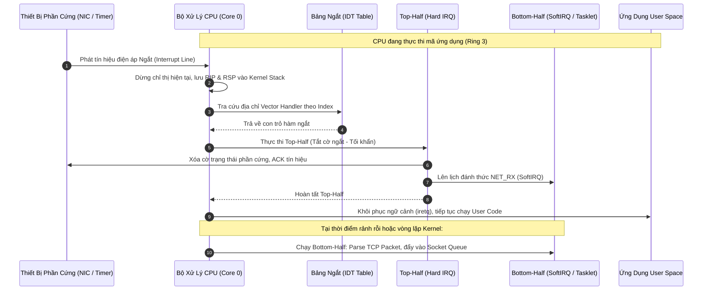
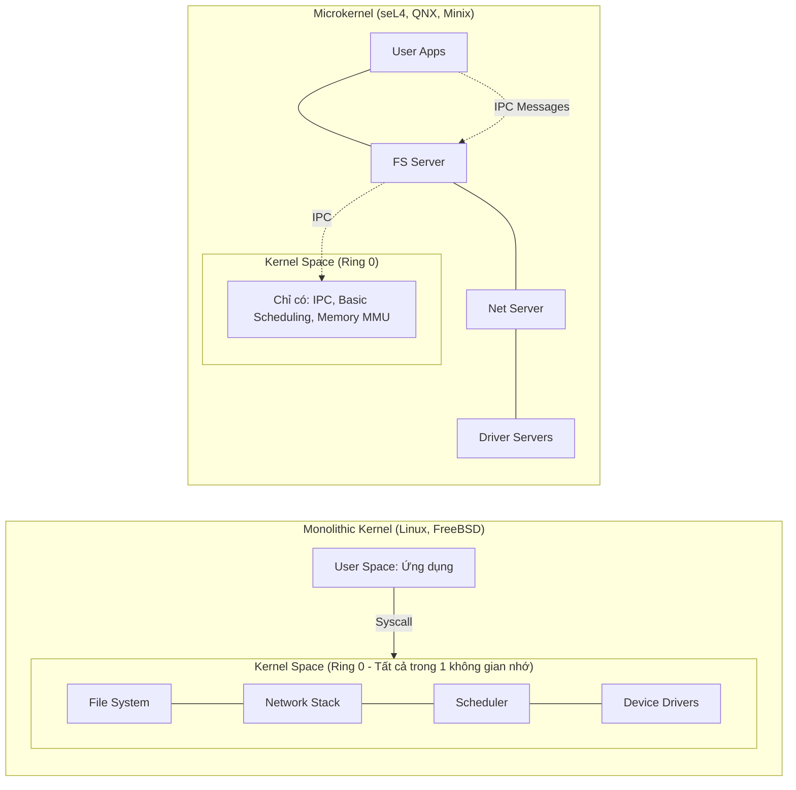

# 1.2. Operating System Structures (Cấu trúc Hệ điều hành và Cơ chế Ngắt)

> [!IMPORTANT]
> **Nếu bạn chỉ được nhớ một điều duy nhất:** Cấu trúc bên trong của một hệ điều hành quyết định khả năng mở rộng và bảo trì hệ thống qua hàng thập kỷ: từ phân tầng cứng nhắc (Layered) sang mô-đun hóa động (Loadable Kernel Modules - LKM) của Linux cho phép nạp mã nóng vào Ring 0, cho đến kiến trúc Exokernel xóa bỏ hoàn toàn lớp trừu tượng để trao quyền cấp phát tài nguyên thô trực tiếp cho ứng dụng tối ưu hóa.

---

## 1. Trực Quan Hóa: Bản Chất Cấu Trúc Hệ Điều Hành & Cơ Chế Ngắt Dưới Góc Nhìn Lập Trình Viên

### 1.1. Đoạn Code Dẫn Nhập & Vấn Đề Thực Tế
Hãy xem một ví dụ về một tiến trình máy chủ đang bận xử lý tính toán trong một vòng lặp vô tận:

```c
#include <stdio.h>

int main() {
    printf("Bắt đầu vòng lặp vô tận...\n");
    while (1) {
        // CPU bận 100%, không hề có lệnh dừng hay gọi hệ thống nào!
    }
    return 0;
}
```

Nếu một tiến trình không chủ động nhường CPU, làm thế nào hệ điều hành có thể giành lại quyền điều khiển để chạy các tiến trình khác hoặc phản hồi thao tác chuột/bàn phím của người dùng?
Câu trả lời nằm ở **Cơ Chế Ngắt Phần Cứng (Hardware Timer Interrupt)**: Cứ sau mỗi vài mili-giây (ví dụ $1\text{ ms}$ tương đương $1000\text{ Hz}$), chip đồng hồ phần cứng của bo mạch chủ sẽ gửi một xung điện áp ngắt vào chân cắm CPU, buộc CPU phải tạm dừng dòng lệnh của vòng lặp `while(1)` để chuyển quyền sang trình phục vụ ngắt của Kernel.

### 1.2. Ẩn Dụ Đời Sống & Phân Tích Cơ Chế Hoạt Động
Hãy tưởng tượng bạn đang là **Đầu Bếp Trưởng (CPU)** đang tập trung cao độ xào nấu món ăn chính trong một nhà hàng đông khách:
- **Ngắt Ngoại Vi (Hardware Interrupts)**: Tiếng chuông cửa gọi món reo lên từ khách hàng. Dù đang làm dở tay, bạn buộc phải liếc nhìn để ghi nhận đơn hàng mới.
- **Xử Lý Nửa Trên (Top-Half / Fast Interrupt Handler)**: Bạn dừng tay trong 2 giây, bấm nhận đơn hàng trên màn hình bếp rồi quay lại xào nấu ngay lập tức. Đây là xử lý tối khẩn, thực thi trong vài nano-giây khi cờ ngắt bị khóa.
- **Xử Lý Nửa Dưới (Bottom-Half / SoftIRQs & Tasklets)**: Việc thái rau, ướp thịt cho đơn hàng mới vừa nhận sẽ được giao lại cho các phụ bếp làm sau khi bạn xào xong chảo thức ăn hiện tại.
- **Ngoại Lệ Phần Mềm (Software Exception / Fault)**: Nếu trong lúc xào nấu, chảo bị bốc cháy (Lỗi chia cho 0 hoặc truy cập vùng nhớ rác `SIGSEGV`), bạn không thể tiếp tục mà buộc phải dừng hẳn công việc để xử lý sự cố.

### 1.3. Mô Phỏng Dữ Liệu Số Nhỏ Từng Bước (Toy Walkthrough)
Theo dõi chu kỳ CPU đón nhận một ngắt nhận gói tin mạng từ Card mạng NIC (Network Interface Card):

```text
[Thời điểm T = 0 us]: CPU đang chạy mã nghiệp vụ User Space tại địa chỉ RIP = 0x4012A0.
Bước 1: Gói tin mạng cập bến card NIC -> NIC ghi dữ liệu vào RAM thông qua DMA (Direct Memory Access).
Bước 2: NIC phát tín hiệu điện áp IRQ 19 tới bộ điều khiển ngắt APIC.
Bước 3: APIC chuyển tiếp ngắt đến chân CPU, CPU hoàn tất chỉ thị máy hiện tại.

[Thực thi Top-Half (T = 0.5 us) - Tắt cờ ngắt CLI]
Bước 4: CPU tra bảng Bảng Bộ Mô Tả Ngắt IDT (Interrupt Descriptor Table) tại chỉ số Index 19.
Bước 5: Lưu thanh ghi ngữ cảnh hiện tại (SS, RSP, RFLAGS, CS, RIP) vào Kernel Stack.
Bước 6: Chạy hàm phục vụ ngắt nhanh (Hard IRQ): Đọc thanh ghi NIC để dọn sạch tín hiệu ngắt phần cứng, kích hoạt lịch chạy SoftIRQ NET_RX.

[Thực thi Bottom-Half (T = 5 us) - Mở lại cờ ngắt STI]
Bước 7: Trình điều phối ksoftirqd nhận việc: Rút gói tin từ vòng đệm Ring Buffer của NIC, phân tích header IP/TCP, đẩy vào Socket Buffer của tiến trình Backend.
Bước 8: Thực thi chỉ thị 'iretq' -> CPU khôi phục lại trạng thái cũ và tiếp tục chạy mã tại 0x4012A0.
```

### 1.4. Tác Động Thực Tế Tầng Backend & Systems
1. **Bão Ngắt (Interrupt Storm) Làm Treo Máy Chủ**: Khi lưu lượng mạng chạm ngưỡng hàng triệu packets/giây (DDoS hoặc flash-sale), CPU dành $100\%$ chu kỳ xung nhịp chỉ để nhảy vào/ra Top-Half của trình xử lý ngắt, khiến ứng dụng nghiệp vụ hoàn toàn bị bỏ đói (Starvation).
2. **Cơ Chế NAPI (New API Poll Mode)**: Để giải quyết bão ngắt, Linux chuyển card mạng sang chế độ Polling khi lưu lượng đạt ngưỡng cao: Chỉ nhận 1 ngắt đầu tiên, sau đó tắt ngắt và chủ động kéo dữ liệu tuần tự khỏi Ring Buffer.
3. **Hiện Tượng Trễ Đuôi Do SoftIRQ (p99 Latency Spikes)**: Nếu các tác vụ Bottom-Half chiếm giữ một lõi CPU quá lâu, luồng ứng dụng xử lý HTTP Request trên lõi đó sẽ bị hoãn lại, đẩy độ trễ phản hồi từ $2\text{ ms}$ vọt lên $500\text{ ms}$.

### 1.5. Sơ Đồ Tư Duy & Kiến Trúc Hệ Thống (Mermaid)


---

## 2. Chi tiết từng Keyword (Under-the-Hood Deep Dive)

### 2.1. Phân loại Cấu trúc Hệ điều hành (OS Structural Designs)

Kiến trúc nhân định hình cách thức các thành phần cốt lõi (Quản lý tiến trình, Bộ nhớ, File System, Trình điều khiển thiết bị) giao tiếp với nhau và với phần cứng:



1. **Monolithic Architecture (Nhân Đơn khối - Linux, Windows NT hybrid)**:
   - Toàn bộ các dịch vụ (VFS, IPC, Networking, Device Drivers) đều chạy chung trong một không gian địa chỉ duy nhất tại mức đặc quyền cao nhất của CPU (**Kernel Space - Ring 0**).
   - *Ưu điểm*: Tốc độ truyền dữ liệu và gọi hàm siêu nhanh (chỉ tốn chi phí của một lệnh gọi hàm thông thường `call`).
   - *Nhược điểm*: Kém an toàn. Một lỗi rò rỉ bộ nhớ hoặc con trỏ rỗng trong Driver card mạng của hãng thứ ba có thể kéo sập toàn bộ hệ điều hành (**Kernel Panic / Màn hình xanh chết chóc BSOD**).
2. **Microkernel Architecture (Nhân Siêu nhỏ - seL4, Minix, QNX trong xe hơi)**:
   - Nhân chỉ giữ lại 3 nhiệm vụ tối thiểu: Lập lịch CPU cơ bản, Quản lý không gian nhớ và Giao tiếp liên tiến trình (IPC).
   - Toàn bộ Device Drivers và File Systems bị đẩy ra ngoài không gian người dùng (**User Space - Ring 3**).
   - *Ưu điểm*: Cực kỳ an toàn và ổn định. Nếu Driver card âm thanh bị crash, hệ điều hành chỉ việc khởi động lại tiến trình Driver đó mà máy tính không hề bị sập.
   - *Nhược điểm*: Hiệu năng chậm hơn do phải liên tục chuyển đổi ngữ cảnh (Context Switch) và sao chép gói tin IPC qua biên giới User/Kernel.
3. **Modular Architecture & Loadable Kernel Modules (LKM)**:
   - Mô hình hiện đại của Linux: Kết hợp tốc độ của Monolithic với tính linh hoạt của Microkernel.
   - Nhân cho phép nạp động (`insmod`) hoặc gỡ bỏ (`rmmod`) các module trình điều khiển phần cứng vào bộ nhớ RAM lúc hệ thống đang chạy mà không cần phải biên dịch lại kernel hoặc khởi động lại máy tính.

---

### 2.2. Device Drivers (Trình điều khiển Thiết bị)

- **Bản chất**: Trình điều khiển thiết bị (Device Driver) là một module phần mềm chuyên biệt đóng vai trò là "thông dịch viên" giữa hệ điều hành trừu tượng và phần cứng vật lý cụ thể.
- **Phân loại Driver trong Linux**:
  1. **Character Devices (Thiết bị Ký tự - `/dev/tty`, `/dev/random`)**: Dữ liệu được đọc/ghi tuần tự theo từng byte đơn lẻ, không hỗ trợ di chuyển con trỏ ngẫu nhiên (No Seek).
  2. **Block Devices (Thiết bị Khối - `/dev/sda`, `/dev/nvme0n1`)**: Dữ liệu được truyền theo từng khối cố định ($512\text{ bytes}$ hoặc $4\text{KB}$), có bộ đệm Page Cache và hỗ trợ đọc ghi ngẫu nhiên cực nhanh.
  3. **Network Devices (Thiết bị Mạng - `eth0`, `wlan0`)**: Giao tiếp theo từng khung dữ liệu (Packets/Frames), không xuất hiện dưới dạng file node thông thường trong `/dev` mà được quản lý qua Socket API.

---

### 2.3. Hệ thống Ngắt: Trap, Exception và Interrupts

Ba cơ chế gián đoạn dòng thực thi của CPU thường bị nhầm lẫn, nhưng có bản chất kích hoạt hoàn toàn khác nhau:

| Loại Sự Kiện | Nguồn Gốc Kích Hoạt | Bản Chất Thời Gian | Mục Đích Sử Dụng | Ví Dụ Điển Hình |
| :--- | :--- | :--- | :--- | :--- |
| **Hardware Interrupt (Ngắt phần cứng / External Interrupt)** | Tín hiệu điện từ chân cắm phần cứng ngoại vi | **Bất đồng bộ (Asynchronous)**: Có thể nổ ra tại bất kỳ chu kỳ xung clock nào | Báo cho CPU biết ngoại vi đã có dữ liệu hoặc xong việc | Bấm phím trên bàn phím, Gói tin chạm vào Card NIC |
| **Trap (Ngắt phần mềm / Software Interrupt)** | Lệnh thực thi có chủ đích bên trong luồng lệnh | **Đồng bộ (Synchronous)**: Xảy ra chính xác tại thời điểm lệnh đó chạy | Yêu cầu Kernel cung cấp dịch vụ hệ thống | Lệnh `syscall` (x86_64), `int 0x80`, Điểm dừng Debug `int 3` |
| **Exception (Ngoại lệ Phần cứng CPU)** | CPU tự phát hiện trạng thái tính toán bất thường | **Đồng bộ (Synchronous)**: Phát sinh trực tiếp từ lệnh vừa thực hiện | Báo lỗi vi phạm phần cứng hoặc yêu cầu trang nhớ | Chia cho số 0 (Divide by Zero), Lỗi bộ nhớ ảo (Page Fault) |

---

### 2.4. IDT (Interrupt Descriptor Table), ISR và Cơ chế Top Half / Bottom Half trong Linux

#### A. Bảng Mô tả Ngắt (Interrupt Descriptor Table - IDT trên x86_64)
- Là một mảng gồm **256 phần tử Gate Descriptor** (mỗi phần tử chiếm 16 bytes trên 64-bit), nằm tại một vùng bộ nhớ được chỉ định bởi thanh ghi CPU `IDTR` (lệnh `lidt`).
- Ánh xạ mã số ngắt (Vector số $0 - 255$) tới địa chỉ hàm phục vụ ngắt (**ISR - Interrupt Service Routine**) tương ứng:
  - Vector 0: Chia cho 0 (#DE).
  - Vector 14: Lỗi trang nhớ (#PF - Page Fault).
  - Vector 32 - 255: Các ngắt phần cứng do bộ điều khiển APIC gán cho các thiết bị ngoại vi.

```
Cấu trúc một IDT Gate Descriptor 16 Bytes:
+---------------------------------------------------------------+
| Target Offset 63..32 (Địa chỉ hàm ISR cấp cao)                |
+-------------------------------+-------+-------+---------------+
| Reserved (Phải bằng 0)         | Flags | DPL/P | IST / Type    |
+-------------------------------+-------+-------+---------------+
| Segment Selector (Ring 0 Code)| Target Offset 15..0           |
+-------------------------------+-------------------------------+
```

#### B. Cơ chế Top Half / Bottom Half (Phân chia Xử lý Ngắt)
Xử lý ngắt phần cứng đòi hỏi phản hồi cực nhanh, nhưng xử lý dữ liệu lại tốn thời gian. Linux chia việc phục vụ ngắt thành hai nửa:
1. **Top Half (Hard IRQ - Nửa trên)**:
   - Chạy ngay lập tức khi chân ngắt được kích hoạt trong trạng thái **cấm ngắt (Interrupts Disabled)**.
   - Nhiệm vụ tối thiểu: Đọc trạng thái từ phần cứng, gửi tín hiệu xác nhận (ACK / EOI) cho bộ điều khiển APIC, copy gói tin từ thiết bị vào hàng đợi RAM, và lên lịch cho Bottom Half. Toàn bộ diễn ra trong vài trăm nano-giây.
2. **Bottom Half (SoftIRQ / Tasklets / Workqueues - Nửa dưới)**:
   - Chạy sau đó trong trạng thái **cho phép ngắt (Interrupts Enabled)**.
   - Đảm nhận toàn bộ phần tính toán nặng nề: Giải mã gói tin TCP/IP, tính checksum, định tuyến, đẩy dữ liệu vào Socket Buffer của ứng dụng.

---

### 2.5. DMA (Direct Memory Access - Truy cập Bộ nhớ Trực tiếp) & Kỹ thuật Zero-Copy

#### A. Bài toán Cổ điển: Programmed I/O (PIO)
Khi chưa có DMA, để đọc một khối $4\text{KB}$ từ đĩa cứng vào RAM, CPU phải trực tiếp chạy một vòng lặp đọc từng thanh ghi dữ liệu ngoại vi và ghi vào RAM:
$$\text{CPU Overhead} = \frac{4096 \text{ bytes}}{4 \text{ bytes/lệnh}} \approx 1024 \text{ chu kỳ CPU lãng phí hoàn toàn!}$$

#### B. Cơ chế Cứu rỗi: Bộ Điều khiển DMA (DMA Controller)
DMA là một bộ vi xử lý chuyên trách có khả năng **trực tiếp làm chủ bus hệ thống (Bus Master)**:
1. CPU chỉ cần gửi cho DMA Controller 3 thông số: Địa chỉ bắt đầu trên thiết bị ngoại vi, Địa chỉ đích trong RAM, và Số bytes cần copy.
2. Sau lệnh khởi động đó, CPU được giải phóng hoàn toàn và quay sang chạy ứng dụng khác.
3. Chip DMA tự động bơm hàng trăm Megabytes dữ liệu trực tiếp vào chip RAM qua bus PCIe/DRAM.
4. Khi toàn bộ dữ liệu đã nằm yên vị trong RAM, DMA Controller mới gửi một **Hardware Interrupt duy nhất** để báo cho CPU: *"Tôi đã nạp xong toàn bộ dữ liệu, mời Tổng Giám đốc xử lý!"*

---

## 3. Hiện thực Thực nghiệm: Dual-Engine Code Implementation

### 3.1. C++20: Mô Phỏng Cơ Chế Bảng Mô Tả Ngắt (IDT) & Interrupt Dispatcher

Chương trình triển khai một trình điều phối ngắt phần mềm mô phỏng bảng IDT chuẩn x86, xử lý phân luồng giữa Top Half (xử lý tức thời) và Bottom Half (hàng đợi xử lý hoãn lại).

```cpp
// Compilation: g++ -std=c++20 -O3 -Wall -pthread idt_simulator.cpp -o idt_simulator
#include <iostream>
#include <vector>
#include <functional>
#include <queue>
#include <thread>
#include <mutex>
#include <condition_variable>
#include <iomanip>

enum class InterruptType { Hardware, SoftwareTrap, CpuException };

struct InterruptContext {
    uint8_t vector_id;
    InterruptType type;
    std::string device_name;
    uint64_t timestamp_ns;
};

// Mô phỏng Bảng IDT (256 vectors)
class InterruptDescriptorTable {
public:
    using TopHalfHandler = std::function<void(const InterruptContext&)>;
    using BottomHalfTask = std::function<void()>;

private:
    TopHalfHandler idt_entries[256];
    std::queue<BottomHalfTask> softirq_queue;
    std::mutex queue_lock;
    std::condition_variable queue_cv;
    bool running = true;
    std::thread ksoftirqd_worker;

    void ksoftirqd_loop() {
        while (running) {
            std::unique_lock<std::mutex> lock(queue_lock);
            queue_cv.wait(lock, [this]() { return !softirq_queue.empty() || !running; });
            while (!softirq_queue.empty()) {
                auto task = softirq_queue.front();
                softirq_queue.pop();
                lock.unlock();
                task(); // Chạy Bottom Half khi đã unlock
                lock.lock();
            }
        }
    }

public:
    InterruptDescriptorTable() {
        ksoftirqd_worker = std::thread(&InterruptDescriptorTable::ksoftirqd_loop, this);
    }

    ~InterruptDescriptorTable() {
        {
            std::lock_guard<std::mutex> lock(queue_lock);
            running = false;
        }
        queue_cv.notify_all();
        if (ksoftirqd_worker.joinable()) ksoftirqd_worker.join();
    }

    void register_gate(uint8_t vector, TopHalfHandler handler) {
        idt_entries[vector] = handler;
    }

    // CPU tiếp nhận tín hiệu ngắt từ bus phần cứng
    void cpu_dispatch_interrupt(const InterruptContext& ctx) {
        std::cout << "[CPU CORE] Hardware Trigger: Vector 0x" << std::hex << std::setw(2) << std::setfill('0') 
                  << static_cast<int>(ctx.vector_id) << std::dec << " (" << ctx.device_name << ")\n";
        if (idt_entries[ctx.vector_id]) {
            // Thực thi Top Half ngay lập tức
            idt_entries[ctx.vector_id](ctx);
        } else {
            std::cerr << "[CPU ERROR] Unhandled Interrupt Vector!\n";
        }
    }

    void schedule_bottom_half(BottomHalfTask task) {
        {
            std::lock_guard<std::mutex> lock(queue_lock);
            softirq_queue.push(task);
        }
        queue_cv.notify_one();
    }
};

int main() {
    std::cout << "================ OS INTERRUPT SUBSYSTEM SIMULATOR ================\n";
    InterruptDescriptorTable idt;

    // Đăng ký Driver Card Mạng NIC tại Vector 0x20 (32)
    idt.register_gate(0x20, [&idt](const InterruptContext& ctx) {
        // --- 1. TOP HALF: Cực nhanh, nhận diện phần cứng ---
        std::cout << "  -> [TOP HALF] Ack hardware APIC. Packet staged into RAM buffer.\n";
        
        // --- 2. Lên lịch BOTTOM HALF: Xử lý tính toán TCP nặng nề ---
        idt.schedule_bottom_half([]() {
            std::this_thread::sleep_for(std::chrono::milliseconds(50));
            std::cout << "     -> [BOTTOM HALF ksoftirqd] TCP Checksum verified. Handed to Socket Buffer.\n";
        });
    });

    // Kích hoạt ngắt giả lập từ Card Mạng
    InterruptContext nic_event{0x20, InterruptType::Hardware, "Intel i225-V 2.5GbE", 100425};
    idt.cpu_dispatch_interrupt(nic_event);

    std::this_thread::sleep_for(std::chrono::milliseconds(150));
    std::cout << "===================================================================\n";
    return 0;
}
```

```text
================ OS INTERRUPT SUBSYSTEM SIMULATOR ================
[CPU CORE] Hardware Trigger: Vector 0x20 (Intel i225-V 2.5GbE)
  -> [TOP HALF] Ack hardware APIC. Packet staged into RAM buffer.
     -> [BOTTOM HALF ksoftirqd] TCP Checksum verified. Handed to Socket Buffer.
===================================================================
```

---

### 3.2. Python 3: Giám Sát và Phân Tích Phân Bổ Ngắt `/proc/interrupts` trên Linux

Script phân tích bảng phân bổ ngắt thực tế trên hệ điều hành Linux để phát hiện hiện tượng mất cân bằng tải ngắt giữa các lõi CPU.

```python
#!/usr/bin/env python3
"""
Bộ Giám Sát Phân Bổ Ngắt Hệ Thống (Linux /proc/interrupts Inspector):
- Phân tích số lượng ngắt phần cứng trên từng Core CPU.
- Phát hiện hiện tượng nghẽn đơn lõi (Single-Core IRQ Bottleneck).
"""

def parse_proc_interrupts_mock():
    # Dữ liệu mô phỏng cấu trúc thực tế của file /proc/interrupts
    raw_data = """
            CPU0       CPU1       CPU2       CPU3
   0:         42          0          0          0   IO-APIC   2-edge      timer
   1:       1024          0          0          0   IO-APIC   1-edge      i8042 (Keyboard)
  24:    4512904        120         85         40   PCI-MSI 524288-edge   nvme0q1 (SSD NVMe)
  31:     894102     892014     893450     891220   PCI-MSI 2097152-edge  mlx5_comp0 (Mellanox 100G)
 NMI:          0          0          0          0   Non-maskable interrupts
 LOC:    1240120    1150240    1180450    1120980   Local timer interrupts
"""
    lines = [l.strip() for l in raw_data.strip().splitlines()]
    headers = lines[0].split()
    num_cpus = len(headers)
    print(f"================ LINUX IRQ DISTRIBUTION REPORT ================")
    print(f"Detected {num_cpus} Logical Cores: {', '.join(headers)}\n")

    for line in lines[1:]:
        parts = line.split()
        if not parts:
            continue
        irq_id = parts[0].replace(':', '')
        counts = [int(c) for c in parts[1:num_cpus+1]]
        device = " ".join(parts[num_cpus+1:])
        total_irqs = sum(counts)
        
        # Kiểm tra mất cân bằng tải ngắt
        max_core_count = max(counts)
        imbalance_pct = (max_core_count / total_irqs * 100.0) if total_irqs > 0 else 0.0

        status = "BALANCED" if imbalance_pct < 60.0 else "⚠️ UNBALANCED (Hot Core!)"
        print(f"IRQ {irq_id:>4} | Total: {total_irqs:>9} | {status:<24} | Device: {device}")

    print("================================================================")

if __name__ == "__main__":
    parse_proc_interrupts_mock()
```

```text
================ LINUX IRQ DISTRIBUTION REPORT ================
Detected 4 Logical Cores: CPU0, CPU1, CPU2, CPU3

IRQ    0 | Total:        42 | ⚠️ UNBALANCED (Hot Core!) | Device: IO-APIC 2-edge timer
IRQ    1 | Total:      1024 | ⚠️ UNBALANCED (Hot Core!) | Device: IO-APIC 1-edge i8042 (Keyboard)
IRQ   24 | Total:   4513149 | ⚠️ UNBALANCED (Hot Core!) | Device: PCI-MSI 524288-edge nvme0q1 (SSD NVMe)
IRQ   31 | Total:   3570786 | BALANCED                 | Device: PCI-MSI 2097152-edge mlx5_comp0 (Mellanox 100G)
IRQ  NMI | Total:         0 | BALANCED                 | Device: Non-maskable interrupts
IRQ  LOC | Total:   4691790 | BALANCED                 | Device: Local timer interrupts
================================================================
```

---

## 4. Vận hành Hệ thống & Chẩn đoán Thực tế (Production Diagnostics & Troubleshooting)

### 4.1. Sự cố "Bão Ngắt" (Interrupt Storm) và Cơ chế NAPI
- **Hiện tượng**: Khi máy chủ bị tấn công DDoS với lưu lượng 10 triệu gói tin/giây, mỗi gói tin nổ ra một Hardware Interrupt. CPU bị kéo liên tục vào hàm Top Half ISR, không còn một chu kỳ xung clock nào để chạy ứng dụng người dùng, khiến toàn bộ máy chủ bị treo hoàn toàn (**Livelock**).
- **Giải pháp NAPI (New API) trong Linux**:
  - Gói tin đầu tiên nổ ngắt $\implies$ Kernel chuyển card mạng từ chế độ **Ngắt (Interrupt-driven)** sang chế độ **Thăm dò (Polling)**.
  - Tắt hẳn ngắt phần cứng của card mạng. Luồng hạt nhân `ksoftirqd` định kỳ vét hàng ngàn gói tin trong Ring Buffer một lần, triệt tiêu 99% số lần chuyển đổi ngữ cảnh ngắt!

### 4.2. Tinh chỉnh Ghép Lõi Ngắt (IRQ Affinity Tuning)

```bash
# Xem danh sách ngắt thực tế trên máy Linux
cat /proc/interrupts | grep eth0

# Ép ngắt của card mạng IRQ 24 chỉ được xử lý bởi Core 2 (Bitmask: 0x4 = nhị phân 0100)
echo 4 | sudo tee /proc/irq/24/smp_affinity

# Kích hoạt dịch vụ cân bằng ngắt tự động đa lõi của Linux
sudo systemctl start irqbalance
```

---

## 5. Bảng So sánh & Decision Matrix

| Tiêu chuẩn / Đặc tính | Monolithic Kernel | Microkernel | Programmed I/O (PIO) | Direct Memory Access (DMA) |
| :--- | :--- | :--- | :--- | :--- |
| **Không gian Chạy Driver** | **Ring 0 (Kernel Space)** | **Ring 3 (User Space)** | Không áp dụng | Phần cứng Bus Master riêng |
| **Tốc độ Truyền Dữ liệu** | Siêu nhanh (Không qua IPC) | Chậm hơn (Tốn chi phí IPC) | Rất chậm (Từng từ một qua CPU) | **Cực nhanh (Băng thông Bus PCIe)** |
| **Mức độ Cô lập Sự cố** | Kém (Driver lỗi làm sập OS) | **Tuyệt đối (Chỉ chết driver đó)** | Cao | Độc lập với CPU |
| **Chi phí Chiếm dụng CPU** | Phụ thuộc thuật toán Driver | Tốn CPU cho Context Switch | **100% CPU bị khóa cứng** | **Tiệm cận 0% (Chỉ nổ ngắt lúc xong)** |
| **Ứng dụng Thực tế** | Linux, macOS, FreeBSD | seL4 (Quân sự, Y tế), QNX (Ô tô) | Cổng nối tiếp UART cũ, Bàn phím | Card mạng 100G, SSD NVMe, GPU |

---

## 6. Enterprise Production Checklist & Verification

- [ ] **Giám Sát Bão Ngắt Bằng `/proc/interrupts`**: Thiết lập dashboard theo dõi số lượng ngắt phân bổ trên từng Core CPU; nếu một Core nhận hơn $100,000\text{ interrupts/giây}$, phải can thiệp cấu hình lại IRQ Affinity.
- [ ] **Kích Hoạt `irqbalance` Hoặc Cố Định IRQ Affinity**: Tránh để toàn bộ ngắt của Card mạng dồn vào Core 0; sử dụng `smp_affinity` để ghim các hàng đợi nhận mạng (RSS RX Queues) rải đều sang các CPU Cores khác nhau.
- [ ] **Tối Ưu Hóa Kích Thước Ring Buffer Card Mạng**: Kiểm tra dropped frames bằng `ethtool -S eth0 | grep drop`; nếu xuất hiện RX drop do ngắt không xử lý kịp, tăng kích thước buffer bằng `ethtool -G eth0 rx 4096`.
- [ ] **Theo Dõi Tiến Trình `ksoftirqd/x`**: Cấu hình cảnh báo nếu tiến trình hạt nhân `ksoftirqd` chiếm trên $20\%$ CPU của bất kỳ Core nào, biểu hiện của việc backlog mạng hoặc I/O ổ đĩa bị nghẽn nghiêm trọng.
- [ ] **Bật Tính Năng RPS/RFS (Receive Packet/Flow Steering)**: Trên các card mạng đời cũ không hỗ trợ phần cứng đa hàng đợi (Hardware Multi-queue RSS), kích hoạt RPS trong Kernel để phân phối gói tin qua các Core bằng cơ chế phần mềm.
- [ ] **Tránh Chạy Mã Nặng Trong Bottom-Half Driver Tự Viết**: Nếu viết Kernel Module / Driver, tuyệt đối không được cấp phát bộ nhớ dạng chặn (Blocking `kmalloc`) hay ngủ (`msleep`) trong ngữ cảnh ngắt để tránh làm đóng băng toàn bộ hệ điều hành.
