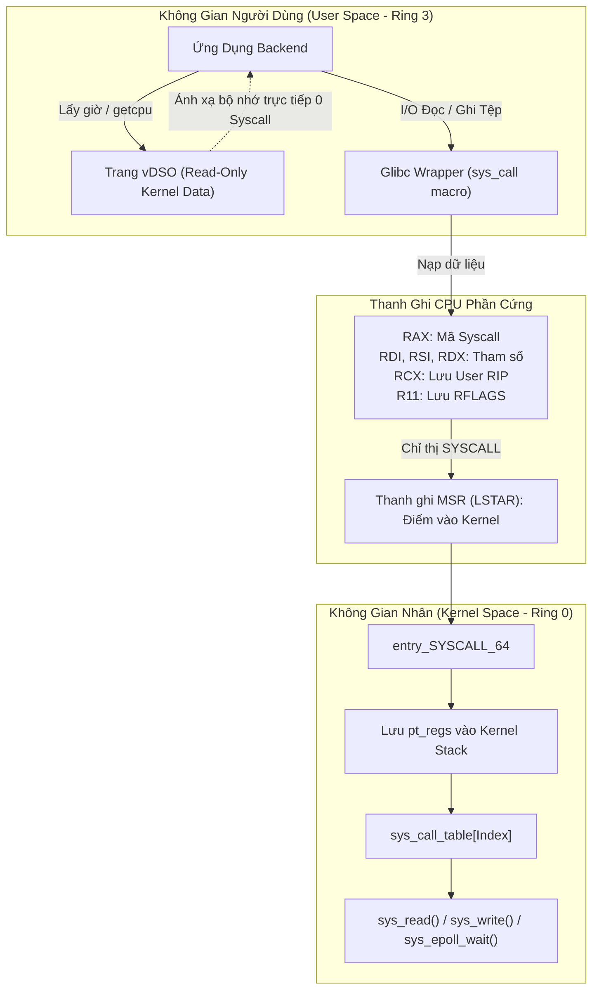
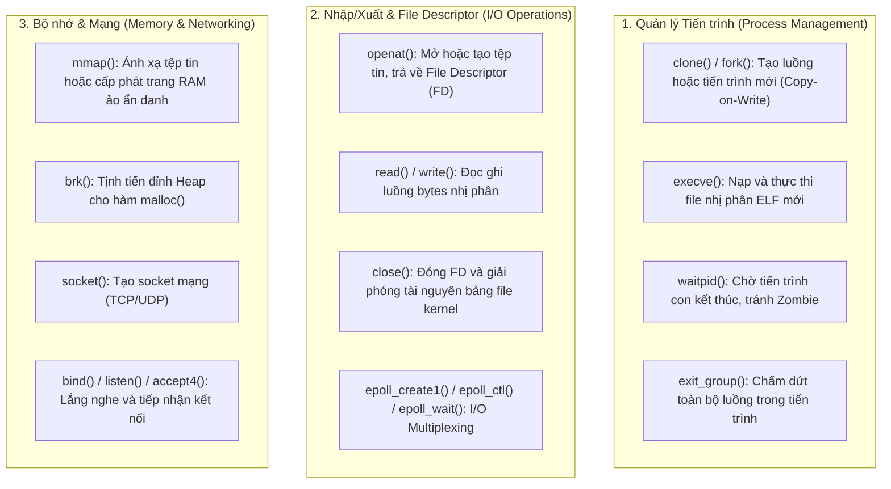
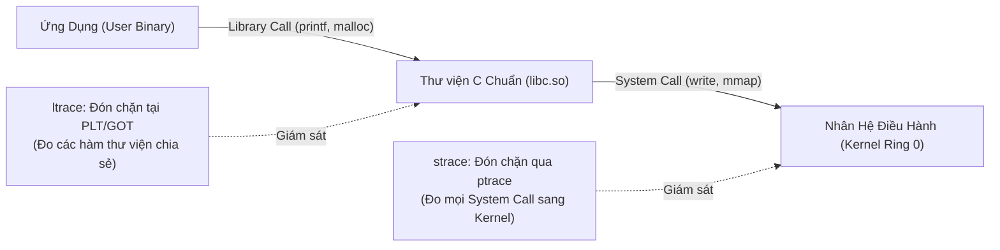

# 1.3. System Calls & Kernel Traps (Lời Gọi Hệ Thống & Bẫy Chuyển Quyền)

> [!IMPORTANT]
> **Nếu bạn chỉ được nhớ một điều duy nhất:** System Call là cánh cổng duy nhất được bảo vệ nghiêm ngặt để một tiến trình User-space (Ring 3) yêu cầu tài nguyên từ Kernel (Ring 0): mỗi lời gọi hệ thống không đơn thuần là một hàm C, mà kích hoạt chỉ thị CPU đặc quyền (`syscall` / `sysenter`), gây biến động thanh ghi, chuyển đổi ngăn xếp kernel, kiểm tra bảo mật trong Interrupt Descriptor Table (IDT) và tiêu tốn hàng trăm chu kỳ CPU quý giá.

---

## 1. Trực Quan Hóa: Bản Chất Lời Gọi Hệ Thống (System Calls) Dưới Góc Nhìn Lập Trình Viên

### 1.1. Đoạn Code Dẫn Nhập & Vấn Đề Thực Tế
Hãy xem sự khác biệt giữa hai phương thức đọc giờ hệ thống trong ngôn ngữ C:

```c
#include <stdio.h>
#include <time.h>
#include <sys/syscall.h>
#include <unistd.h>

int main() {
    struct timespec ts;
    // Cách 1: Sử dụng hàm thư viện chuẩn glibc (Tận dụng cơ chế vDSO)
    clock_gettime(CLOCK_REALTIME, &ts);

    // Cách 2: Ép buộc thực thi Syscall trực tiếp qua bẫy phần cứng
    syscall(SYS_clock_gettime, CLOCK_REALTIME, &ts);
    
    return 0;
}
```

Nếu chạy hai lệnh này 10 triệu lần:
- **Cách 1 (vDSO)**: Mất khoảng $0.02\text{ giây}$ (khoảng $2 - 5\text{ ns}$ mỗi lần gọi).
- **Cách 2 (Raw Syscall)**: Mất hơn $0.8\text{ giây}$ (khoảng $80 - 120\text{ ns}$ mỗi lần gọi, chậm hơn **30 lần**!).

Tại sao chỉ là việc đọc thời gian mà một lệnh hệ thống lại có thể gây chênh lệch hiệu năng khủng khiếp đến như vậy? Lời gọi hệ thống thực sự xảy ra những gì ở tầng vi kiến trúc phần cứng?

### 1.2. Ẩn Dụ Đời Sống & Phân Tích Cơ Chế Hoạt Động
Hãy tưởng tượng quá trình gọi Syscall giống như việc bạn đi **Gửi Bưu Phẩm Quốc Tế Qua Bưu Điện Ngoại Giao**:
- **Hàm người dùng thông thường (User Function Call)**: Giống như bạn chuyển một tờ giấy nháp cho đồng nghiệp ngồi cùng phòng. Bạn chỉ cần giơ tay đưa (truy cập ngăn xếp Stack cục bộ trong bộ nhớ người dùng, chi phí chỉ tốn $1 - 2$ chu kỳ xung nhịp).
- **Lời gọi hệ thống (System Call)**: Bạn không thể tự bay sang nước ngoài để giao hàng. Bạn phải đóng gói bưu phẩm đúng quy chuẩn (Nạp tham số vào thanh ghi `RDI`, `RSI`, `RDX`), bước tới quầy kiểm soát hải quan xuất nhập cảnh (Lệnh máy `syscall`).
- **Thủ tục hải quan (CPU Privilege Transition)**: Nhân viên hải quan bắt bạn xuất trình hộ chiếu, đóng dấu xác nhận, chuyển bạn qua phòng cách ly kiểm dịch (Chuyển sang Kernel Stack, kiểm tra con trỏ bộ nhớ hợp lệ), sau đó mới thực hiện gửi bưu phẩm. Khi gửi xong, bạn lại phải làm thủ tục đóng dấu nhập cảnh ngược lại để trở về phòng làm việc.

### 1.3. Mô Phỏng Dữ Liệu Số Nhỏ Từng Bước (Toy Walkthrough)
Theo dõi dòng chuyển dữ liệu ở cấp độ thanh ghi CPU khi chương trình gọi hàm `read(fd = 3, buf = 0x7ffd10, count = 16)`:

```text
[Trước khi gọi: User Mode - Thanh ghi người dùng]
Bước 1: Nạp mã số định danh của Syscall read (mã 0 trên x86_64) vào thanh ghi RAX: RAX = 0.
Bước 2: Nạp tham số 1 (fd = 3) vào thanh ghi RDI: RDI = 3.
Bước 3: Nạp tham số 2 (địa chỉ vùng đệm 0x7ffd10) vào thanh ghi RSI: RSI = 0x7ffd10.
Bước 4: Nạp tham số 3 (số bytes đọc 16) vào thanh ghi RDX: RDX = 16.
Bước 5: CPU thực thi chỉ thị 'syscall'.

[Bên trong Kernel Gate: Phần cứng x86_64 tự động kích hoạt]
Bước 6: CPU lưu con trỏ lệnh RIP tiếp theo vào RCX, lưu RFLAGS vào R11.
Bước 7: CPU tải địa chỉ entry_SYSCALL_64 từ thanh ghi MSR LSTAR (Model Specific Register) vào RIP.
Bước 8: CPU đổi con trỏ Stack Pointer (RSP) trỏ sang vùng nhớ Kernel Stack của tiến trình.
Bước 9: Kernel đẩy toàn bộ thanh ghi đa năng của người dùng vào Kernel Stack (Tạo bản ghi struct pt_regs).
Bước 10: Tra bảng sys_call_table[RAX] -> Nhảy vào thực thi hàm sys_read().
Bước 11: Kiểm tra tính hợp lệ của con trỏ 0x7ffd10 (Chống can thiệp vào Kernel Space).

[Kết thúc và trả quyền: Lệnh 'sysretq']
Bước 12: Đọc xong 16 bytes từ đĩa, nạp kết quả trả về 16 vào thanh ghi RAX.
Bước 13: Khôi phục thanh ghi người dùng từ pt_regs, gọi 'sysretq' khôi phục lại RIP từ RCX và trả quyền về Ring 3.
```

### 1.4. Tác Động Thực Tế Tầng Backend & Systems
1. **Lực Cản Thông Lượng Do Syscall Tần Suất Cao (Syscall Overhead Bottleneck)**: Nếu ứng dụng Backend thực hiện ghi log từng dòng bằng lời gọi `write()` riêng lẻ, hàng chục nghìn Syscall mỗi giây sẽ ngốn sạch năng lực xử lý của CPU chỉ cho việc chuyển đổi ngữ cảnh Ring 3 <-> Ring 0.
2. **Kỹ Thuật vDSO (Virtual Dynamic Shared Object)**: Linux tối ưu hóa các lệnh đọc trạng thái thường xuyên (`clock_gettime`, `getcpu`) bằng cách ánh xạ thẳng một trang bộ nhớ Kernel dạng Read-Only vào không gian địa chỉ của tiến trình, giúp đọc dữ liệu ngay tại User Space với tốc độ tương đương một hàm C thông thường.
3. **Cơ Chế Khởi Tạo Hàng Đợi Bất Đồng Bộ `io_uring`**: Thay vì mỗi thao tác I/O phải tốn một cặp Syscall gọi và chờ, `io_uring` sử dụng 2 vòng đệm chia sẻ chung trong bộ nhớ (Submission Queue và Completion Queue), cho phép gửi hàng trăm thao tác I/O chỉ với đúng **1 lần Syscall duy nhất** (hoặc 0 syscall với chế độ Polling Kernel Thread).

### 1.5. Sơ Đồ Tư Duy & Kiến Trúc Hệ Thống (Mermaid)


---

## 2. Chi tiết từng Keyword (Under-the-Hood Deep Dive)

### 2.1. Cơ chế Chuyển đổi Ngữ cảnh: User Mode sang Kernel Mode

- **Quy trình Chuyển đổi trên Kiến trúc x86_64**:
  1. Khi một tiến trình ở Ring 3 thực thi chỉ thị `syscall`, CPU không dùng cơ chế ngắt phần mềm chậm chạp (`INT 0x80`) mà sử dụng đường truyền phần cứng chuyên dụng (**Fast System Call**).
  2. CPU tự động sao lưu con trỏ lệnh kế tiếp `RIP` vào thanh ghi `RCX`, và sao lưu thanh ghi cờ `RFLAGS` vào `R11`.
  3. CPU đọc thanh ghi đặc thù mô hình (Model-Specific Register) **`IA32_LSTAR`** (đã được nhân Linux khởi tạo từ lúc boot) để nạp địa chỉ hàm xử lý cổng vào `entry_SYSCALL_64` vào con trỏ lệnh `RIP`.
  4. **Stack Switching (Tráo đổi Ngăn xếp)**: Để đảm bảo an ninh, nhân Linux không bao giờ sử dụng Stack của User Space (vì ứng dụng có thể làm tràn Stack hoặc tấn công bộ nhớ). CPU tra cứu cấu trúc `TSS` (Task State Segment) để chuyển con trỏ ngăn xếp `RSP` sang **Kernel Stack độc lập** của luồng đó (`TSS.RSP0`).
  5. Cờ phân đoạn mã `CS` chuyển đặc quyền về Ring 0.
- **vDSO (Virtual Dynamic Shared Object) - Syscall Không Cần Chuyển Mode!**:
  - Đối với các thao tác lấy thời gian được gọi hàng triệu lần mỗi giây (`gettimeofday()`, `clock_gettime()`), chuyển đổi sang Ring 0 tốn quá nhiều xung nhịp CPU.
  - Linux ánh xạ sẵn một trang bộ nhớ chỉ đọc (Read-only Page) chứa dữ liệu thời gian của phần cứng vào không gian địa chỉ User Space của mọi tiến trình.
  - Khi gọi `clock_gettime()`, ứng dụng chỉ việc đọc trực tiếp ô nhớ đó ở **Ring 3** với tốc độ cực nhanh (~15 nano-giây), hoàn toàn không kích hoạt lệnh `syscall`!

---

### 2.2. Chi tiết các System Calls Cốt lõi của Backend Engineer

Toàn bộ các thư viện và framework backend hiện đại (Node.js, Go runtime, Java JVM, Python asyncio) đều được xây dựng trên nền tảng của 3 nhóm System Calls cốt lõi:



1. **Nhóm Quản lý Tiến trình (Process Management)**:
   - `clone()`: Syscall mạnh nhất tạo tiến trình hoặc luồng con. Cho phép chia sẻ không gian nhớ (Tạo Thread) hoặc cô lập không gian tên (Tạo Linux Container).
   - `execve(pathname, argv, envp)`: Xóa sạch không gian nhớ cũ của tiến trình, nạp mã máy ELF mới và bắt đầu thực thi từ điểm vào `_start`.
   - `waitpid(pid, status, options)`: Thu thập trạng thái kết thúc của tiến trình con, giải phóng cấu trúc `task_struct` khỏi bảng tiến trình.
2. **Nhóm Nhập/Xuất và Tệp tin (I/O Operations)**:
   - `openat(dirfd, pathname, flags, mode)`: Mở tệp tin tương đối an toàn, chống lỗ hổng TOCTOU (Time-of-Check to Time-of-Use).
   - `epoll_create1`, `epoll_ctl`, `epoll_wait`: Đỉnh cao của I/O đa kênh hướng sự kiện trong Nginx, Node.js, Redis (C100K problem).
3. **Nhóm Bộ nhớ và Mạng (Memory & Networking)**:
   - `mmap(addr, length, prot, flags, fd, offset)`: Cấp phát các khối RAM lớn cho `malloc()` hoặc ánh xạ trực tiếp tệp tin vào bộ nhớ ảo.
   - `accept4(sockfd, addr, addrlen, flags)`: Tiếp nhận kết nối TCP và tự động bật cờ `SOCK_NONBLOCK` trong 1 syscall duy nhất.

---

### 2.3. System Call Calling Conventions & Glibc Wrapper

Bảng thanh ghi truyền tham số trên kiến trúc x86_64 System V ABI:

| Vị trí | Lời gọi hàm C thông thường (User Space) | Lời gọi System Call (Kernel ABI) | Ghi chú Kỹ thuật |
| :--- | :--- | :--- | :--- |
| **Mã Syscall** | Không sử dụng | **`RAX`** | Số nguyên định danh syscall |
| **Tham số 1** | `RDI` | `RDI` | Tham số con trỏ / int thứ nhất |
| **Tham số 2** | `RSI` | `RSI` | Tham số thứ hai |
| **Tham số 3** | `RDX` | `RDX` | Tham số thứ ba |
| **Tham số 4** | `RCX` | **`R10`** | **Bẫy**: CPU dùng `RCX` lưu `RIP` nên Kernel ABI đổi sang `R10`! |
| **Tham số 5** | `R8` | `R8` | Tham số thứ năm |
| **Tham số 6** | `R9` | `R9` | Tham số thứ sáu |
| **Giá trị trả về**| `RAX` | `RAX` | Thành công: $\ge 0$; Thất bại: $[-4095, -1]$ mang giá trị `-errno` |

- **Xử lý mã lỗi**:
  - Trong Raw Syscall: Nếu lỗi, `RAX` chứa số âm trực tiếp (ví dụ: `-2` cho `ENOENT: No such file or directory`).
  - Trong Glibc Wrapper: Glibc kiểm tra nếu `RAX < 0`, nó sẽ đổi dấu thành số dương, gán vào biến cục bộ luồng `errno`, và hàm C trả về `-1`.

---

### 2.4. Công cụ Phân tích và Giám sát Syscall: `strace` vs `ltrace`



1. **`strace` (System Call Tracer)**:
   - Sử dụng system call `ptrace` để can thiệp vào ranh giới User/Kernel.
   - Bắt mọi tương tác giữa ứng dụng và phần cứng (I/O, mạng, tín hiệu, cấp phát bộ nhớ).
   - Công cụ mạnh mẽ số 1 để gỡ lỗi tại sao tiến trình backend bị treo (hang), lỗi quyền tệp tin, hoặc kết nối database bị timeout.
2. **`ltrace` (Library Call Tracer)**:
   - Đón chặn các lời gọi hàm thư viện liên kết động (`.so`) bằng cách hooking vào bảng **PLT (Procedure Linkage Table)**.
   - Giúp phát hiện lỗi logic ở tầng thư viện người dùng trước khi yêu cầu chạm xuống Kernel.

---

## 3. Dual-Engine Code Implementation

### Engine 1: C++20 — Gọi Trực Tiếp Syscall Bằng Hợp Ngữ C++ Inline (Raw Assembly x86_64 Bypass Glibc)

Chương trình minh họa cách tự hiện thực `sys_open`, `sys_write`, `sys_close` hoàn toàn độc lập, không dùng thư viện runtime C, và xử lý mã lỗi nhị phân âm trực tiếp từ thanh ghi `RAX`.

```cpp
#include <iostream>
#include <cstdint>
#include <iomanip>

class RawLinuxSyscalls {
public:
    // sys_open: RAX = 2, RDI = filename, RSI = flags, RDX = mode
    static int64_t sys_open(const char* filename, int flags, int mode) {
        int64_t fd;
        #if defined(__x86_64__)
        __asm__ volatile (
            "movq $2, %%rax\n\t"       // syscall 2: sys_open
            "movq %1, %%rdi\n\t"       // arg 1: filename
            "movq %2, %%rsi\n\t"       // arg 2: flags
            "movq %3, %%rdx\n\t"       // arg 3: mode
            "syscall\n\t"
            "movq %%rax, %0\n\t"
            : "=r"(fd)
            : "r"(filename), "r"((int64_t)flags), "r"((int64_t)mode)
            : "%rax", "%rdi", "%rsi", "%rdx", "%rcx", "%r11", "memory"
        );
        #else
        fd = -1;
        #endif
        return fd;
    }

    // sys_write: RAX = 1, RDI = fd, RSI = buffer, RDX = count
    static int64_t sys_write(int fd, const void* buffer, size_t count) {
        int64_t ret;
        #if defined(__x86_64__)
        __asm__ volatile (
            "movq $1, %%rax\n\t"       // syscall 1: sys_write
            "movq %1, %%rdi\n\t"       // arg 1: fd
            "movq %2, %%rsi\n\t"       // arg 2: buffer
            "movq %3, %%rdx\n\t"       // arg 3: count
            "syscall\n\t"
            "movq %%rax, %0\n\t"
            : "=r"(ret)
            : "r"((int64_t)fd), "r"(buffer), "r"((int64_t)count)
            : "%rax", "%rdi", "%rsi", "%rdx", "%rcx", "%r11", "memory"
        );
        #else
        ret = -1;
        #endif
        return ret;
    }

    // sys_close: RAX = 3, RDI = fd
    static int64_t sys_close(int fd) {
        int64_t ret;
        #if defined(__x86_64__)
        __asm__ volatile (
            "movq $3, %%rax\n\t"       // syscall 3: sys_close
            "movq %1, %%rdi\n\t"       // arg 1: fd
            "syscall\n\t"
            "movq %%rax, %0\n\t"
            : "=r"(ret)
            : "r"((int64_t)fd)
            : "%rax", "%rdi", "%rcx", "%r11", "memory"
        );
        #else
        ret = -1;
        #endif
        return ret;
    }
};

int main() {
    std::cout << "=== THỬ NGHIỆM RAW X86_64 LINUX SYSCALLS (C++20) ===\n\n";
    
    const char message[] = "[Raw Assembly] Writing text directly without glibc stream!\n";
    int64_t written = RawLinuxSyscalls::sys_write(1, message, sizeof(message) - 1);

    std::cout << "Bytes Written to stdout: " << written << '\n';
    
    // Thử mở một file không tồn tại để kiểm tra mã lỗi âm từ RAX
    int64_t err_fd = RawLinuxSyscalls::sys_open("/path/to/non_existent_file.txt", 0, 0);
    std::cout << "Open Non-existent File Result: " << err_fd;
    if (err_fd < 0) {
        std::cout << " (Negative errno: " << -err_fd << " -> ENOENT: No such file or directory)\n";
    }

    return 0;
}
```

```text
=== THỬ NGHIỆM RAW X86_64 LINUX SYSCALLS (C++20) ===

[Raw Assembly] Writing text directly without glibc stream!
Bytes Written to stdout: 57
Open Non-existent File Result: -2 (Negative errno: 2 -> ENOENT: No such file or directory)
```

---

### Engine 2: Python — Trình Mô Phỏng Seccomp BPF Chặn Syscall Nguy Hiểm

Minh họa cách Seccomp (Secure Computing Mode) trong Linux kernel chặn đứng các syscall nguy hiểm khi chạy ứng dụng trong Container:

```python
#!/usr/bin/env python3
"""
Syscall Security & Seccomp BPF Simulator in Python.
Demonstrates syscall auditing and container privilege restriction.
"""

def simulate_seccomp_containment():
    print("=== PHÂN TÍCH BẢO MẬT SYSCALL QUA SECCOMP BPF ===\n")
    
    # Danh sách các syscall bị chặn trong Docker Default Profile
    blocked_syscalls = {
        "reboot": "Ngăn chặn container ra lệnh khởi động lại máy chủ vật lý.",
        "swapon": "Ngăn chặn container bật/tắt bộ nhớ ảo swap của Host.",
        "kexec_load": "Ngăn chặn nạp kernel mới độc hại vào RAM.",
        "ptrace": "Ngăn chặn container đọc trộm bộ nhớ của tiến trình khác trên Host."
    }

    print(f"Tổng số syscalls chuẩn trên kiến trúc Linux x86_64: ~450 syscalls.")
    print(f"Docker Seccomp Profile chỉ cho phép ~300 syscalls an toàn hoạt động.\n")

    for call_name, reason in blocked_syscalls.items():
        print(f"  [-] Syscall '{call_name}': BỊ CHẶN (Action: SECCOMP_RET_ERRNO)")
        print(f"      Mục đích bảo vệ: {reason}")

    print("\nKhi mã độc trong Container cố tình gọi `reboot`: ")
    print("  -> Kernel chặn ngay tại ranh giới Ring 0 và trả về `EPERM (Operation not permitted)`")
    print("  -> Tiến trình bị vô hiệu hóa hoàn toàn mà không thể tổn hại Host OS!")

if __name__ == "__main__":
    simulate_seccomp_containment()
```

```text
=== PHÂN TÍCH BẢO MẬT SYSCALL QUA SECCOMP BPF ===

Tổng số syscalls chuẩn trên kiến trúc Linux x86_64: ~450 syscalls.
Docker Seccomp Profile chỉ cho phép ~300 syscalls an toàn hoạt động.

  [-] Syscall 'reboot': BỊ CHẶN (Action: SECCOMP_RET_ERRNO)
      Mục đích bảo vệ: Ngăn chặn container ra lệnh khởi động lại máy chủ vật lý.
  [-] Syscall 'swapon': BỊ CHẶN (Action: SECCOMP_RET_ERRNO)
      Mục đích bảo vệ: Ngăn chặn container bật/tắt bộ nhớ ảo swap của Host.
  [-] Syscall 'kexec_load': BỊ CHẶN (Action: SECCOMP_RET_ERRNO)
      Mục đích bảo vệ: Ngăn chặn nạp kernel mới độc hại vào RAM.
  [-] Syscall 'ptrace': BỊ CHẶN (Action: SECCOMP_RET_ERRNO)
      Mục đích bảo vệ: Ngăn chặn container đọc trộm bộ nhớ của tiến trình khác trên Host.

Khi mã độc trong Container cố tình gọi `reboot`: 
  -> Kernel chặn ngay tại ranh giới Ring 0 và trả về `EPERM (Operation not permitted)`
  -> Tiến trình bị vô hiệu hóa hoàn toàn mà không thể tổn hại Host OS!
```

---

## 4. Systems Engineering & Production Pitfalls

### 4.1. Chi Phí Lạm Dụng Syscall & Cuộc Cách Mạng `io_uring`

- Trong mô hình truyền thống, để gửi nhận 1 triệu gói tin mạng, ta phải gọi 1 triệu lần `write()` hoặc `send()`, tiêu tốn hàng trăm triệu chu kỳ xung nhịp CPU cho việc chuyển đổi Ring 3 $\to$ Ring 0.
- **Giải Pháp `io_uring` trong Linux Hiện Đại**:
  - Thiết lập 2 hàng đợi vòng tròn chia sẻ (**Shared Ring Buffers**) giữa User Space và Kernel Space: **Submission Queue (SQ)** và **Completion Queue (CQ)**.
  - Ứng dụng ném yêu cầu I/O vào SQ và lấy kết quả từ CQ mà **hoàn toàn không cần gọi syscall**!
  - Cho phép đạt hàng chục triệu IOPS với tải CPU gần như bằng 0.

---

### 4.2. Các Lệnh Giám Sát Syscall Trên Linux Server

```bash
# 1. Đếm tỷ lệ thời gian tiêu tốn cho từng syscall của tiến trình backend đang bị nghẽn
strace -c -p <PID>

# 2. Bắt các syscall chậm hơn 10ms kèm dấu thời gian micro-giây
strace -T -t -e trace=network,file -p <PID>

# 3. Theo dõi số lượng syscall của toàn bộ hệ thống trong thời gian thực bằng perf
perf trace -s
```

---

## 5. Bảng So sánh & Decision Matrix

| Phương thức Kích hoạt | Lệnh Máy / Cơ Chế | Độ trễ Trung bình | Mức Chuyển Đổi CPU | Khi Nào Sử Dụng? |
| :--- | :--- | :--- | :--- | :--- |
| **Software Interrupt** | `INT 0x80` (x86 32-bit cũ) | $\sim 1.200\text{ ns}$ | Đọc IDT, tráo Stack | Hệ điều hành 32-bit cổ điển |
| **Fast Syscall** | `SYSCALL` / `SYSRET` | $\sim 100 - 250\text{ ns}$ | Nạp `LSTAR`, tráo TSS | Tiêu chuẩn mặc định trên 64-bit |
| **vDSO** | User-space Memory Read | $\sim 15\text{ ns}$ | **Không chuyển đổi (Ring 3)** | Lấy thời gian (`clock_gettime`) |
| **`io_uring`** | Shared Ring Buffers | $\sim 0\text{ ns}$ (Amortized) | **Không chuyển đổi syscall** | High-performance Network & Disk I/O |
| **Function Call (User)**| `CALL` / `RET` | $\sim 1 - 2\text{ ns}$ | Thuần túy trong User Stack | Mã nguồn ứng dụng thông thường |

---

## 6. Enterprise Production Checklist & Verification

- [ ] **Thực Hiện Audit Syscall Bằng `perf` / `strace`**: Chạy lệnh `strace -c -p <PID>` trong môi trường staging để thống kê tần suất và thời gian tiêu tốn cho từng mã Syscall; tập trung tối ưu các syscall chiếm trên $30\%$ thời gian.
- [ ] **Áp Dụng Cơ Chế Vectored I/O (`readv` / `writev`)**: Thay thế các chuỗi gọi `write()` liên tiếp phân mảnh bằng một lời gọi `writev()` duy nhất để gửi toàn bộ mảng dữ liệu (Scatter-Gather I/O).
- [ ] **Xác Minh Hoạt Động Của vDSO**: Sử dụng lệnh `ldd <binary>` hoặc kiểm tra `/proc/<PID>/maps` để đảm bảo thư viện C đang liên kết động thành công với `linux-vdso.so.1`, tránh tình trạng rơi ngược về raw syscall.
- [ ] **Tối Ưu Hóa Kích Thước Vùng Đệm Buffered I/O**: Đảm bảo các luồng ghi tệp hoặc socket mạng sử dụng kích thước bộ đệm người dùng tương thích với kích thước trang nhớ hệ thống (bội số của $4\text{ KB}$, khuyến nghị $16\text{ KB} - 64\text{ KB}$).
- [ ] **Chuyển Đổi Sang `io_uring` Cho Hệ Thống Lưu Trữ Tốc Độ Cao**: Trên các cụm máy chủ sử dụng ổ cứng NVMe Gen4/Gen5, chuyển đổi kiến trúc đọc ghi tệp từ POSIX `read/write/epoll` sang `io_uring` để loại bỏ rào cản chuyển ngữ cảnh CPU.
- [ ] **Thiết Lập Bộ Lọc Seccomp-BPF Chặn Các Lời Gọi Nguy Hiểm**: Chặn hoàn toàn các Syscall không sử dụng trong môi trường Production (như `ptrace`, `sys_chroot`, `reboot`, `kexec_load`) để giảm thiểu diện tích tấn công leo thang đặc quyền.
