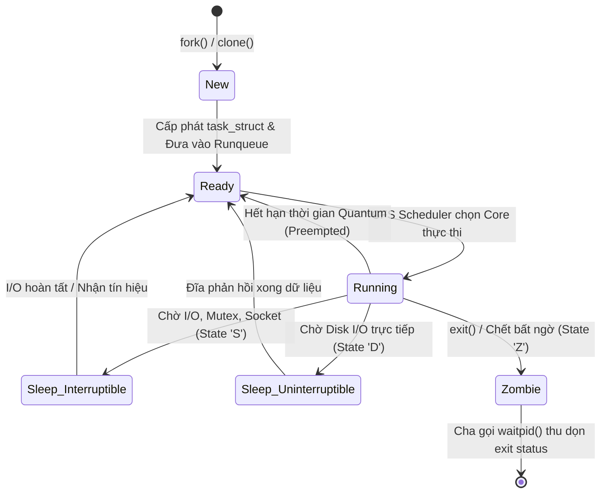
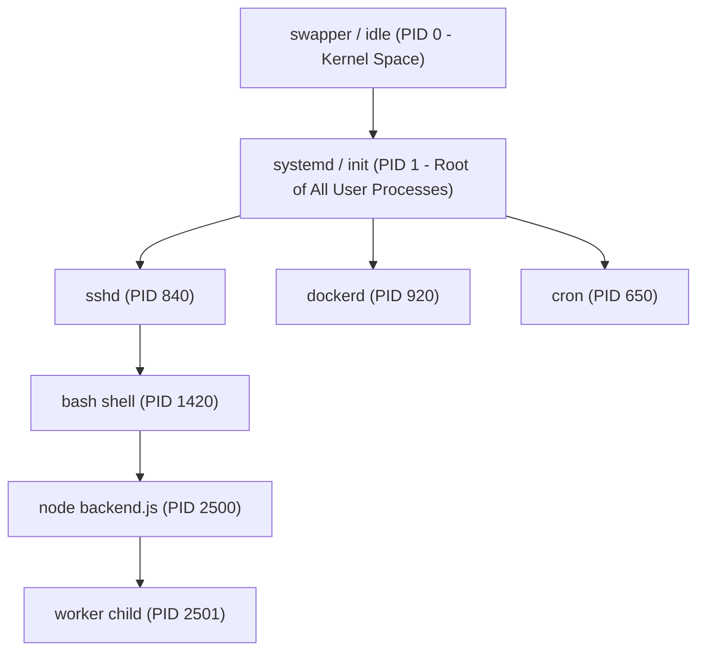

# 2.1. Process Fundamentals & Memory Anatomy (Nguyên Lý Tiến Trình & Giải Phẫu Bộ Nhớ)

> [!IMPORTANT]
> **Nếu bạn chỉ được nhớ một điều duy nhất:** Tiến trình (Process) là đơn vị cô lập tài nguyên độc lập tối cao của hệ điều hành: mỗi tiến trình sở hữu một Process Control Block (PCB) riêng biệt, một bảng phân trang (Page Table) riêng cô lập dải địa chỉ ảo từ 0 đến $2^{64}-1$, biến bộ nhớ của các tiến trình thành các pháo đài bất khả xâm phạm lẫn nhau dưới sự giám sát nghiêm ngặt của phần cứng MMU.

---

## 1. Trực Quan Hóa: Bản Chất Tiến Trình & Giải Phẫu Bộ Nhớ Dưới Góc Nhìn Lập Trình Viên

### 1.1. Đoạn Code Dẫn Nhập & Vấn Đề Thực Tế
Hãy xem một chương trình C in ra địa chỉ bộ nhớ của các biến và mã nguồn của chính nó:

```c
#include <stdio.h>
#include <stdlib.h>

int global_init_var = 42;      // Nằm ở phân vùng Data
int global_uninit_var;        // Nằm ở phân vùng BSS

int main() {
    int local_stack_var = 10;                     // Nằm trên Stack
    int *heap_var = (int*)malloc(sizeof(int));    // Nằm trên Heap

    printf("[Code/Text] Địa chỉ hàm main:        %p\n", (void*)main);
    printf("[Data Seg]  Địa chỉ biến toàn cục:   %p\n", (void*)&global_init_var);
    printf("[BSS Seg]   Địa chỉ biến chưa init:  %p\n", (void*)&global_uninit_var);
    printf("[Heap]      Địa chỉ con trỏ malloc:  %p\n", (void*)heap_var);
    printf("[Stack]     Địa chỉ biến cục bộ:     %p\n", (void*)&local_stack_var);

    free(heap_var);
    return 0;
}
```

Nếu chạy hai cửa sổ terminal cùng lúc và thực thi chương trình này, bạn sẽ nhận được một kết quả gây sốc: **Địa chỉ in ra của cả 2 tiến trình giống hệt nhau** (ví dụ `local_stack_var` đều ở `0x7ffde23a10`)!
Làm sao hai chương trình độc lập chạy đồng thời lại có thể dùng chung một địa chỉ RAM mà không ghi đè, làm hỏng dữ liệu của nhau?
Bí mật nằm ở **Không Gian Địa Chỉ Ảo (Virtual Address Space)**: Mỗi tiến trình được hệ điều hành trao cho một bức tranh ảo tưởng rằng nó đang sở hữu toàn bộ bộ nhớ RAM của hệ thống (ví dụ $128\text{ TB}$ trên kiến trúc x86_64), trong khi phần cứng MMU (Memory Management Unit) âm thầm dịch các địa chỉ ảo này sang các khung trang vật lý (Physical Frames) hoàn toàn tách biệt.

### 1.2. Ẩn Dụ Đời Sống & Phân Tích Cơ Chế Hoạt Động
Hãy tưởng tượng Tiến trình (Process) giống như một **Công Ty Khởi Nghiệp Độc Lập**:
- **Trụ sở riêng biệt (Virtual Address Space)**: Mỗi công ty thuê một tầng văn phòng riêng có khóa cửa an toàn. Nhân viên công ty A không thể tự ý bước sang bàn làm việc của công ty B để đọc trộm tài liệu hay sửa hợp đồng.
- **Giấy phép đăng ký kinh doanh & Hồ sơ pháp lý (Process Control Block - `task_struct`)**: Ban quản lý tòa nhà (Kernel) lưu trữ một tập hồ sơ quản lý: Mã số thuế (PID), danh sách nhân viên đang làm việc (Threads), danh mục tài sản đã đăng ký (File Descriptors, Socket mạng), và hạn mức tiêu thụ điện nước (Cgroups Resource Limits).
- **Trạng thái công ty**: Công ty có thể đang hoạt động rực rỡ (`TASK_RUNNING`), đang chờ đối tác thanh toán hóa đơn (`TASK_INTERRUPTIBLE`), bị thanh tra niêm phong tạm thời (`TASK_STOPPED`), hoặc công ty đã phá sản giải thể nhưng chưa làm thủ tục xóa sổ khỏi sổ bộ thuế (`EXIT_ZOMBIE`).

### 1.3. Mô Phỏng Dữ Liệu Số Nhỏ Từng Bước (Toy Walkthrough)
Theo dõi vòng đời chuyển trạng thái của một tiến trình xử lý ảnh:

```text
[Khởi tạo: Trạng thái NEW]
Bước 1: Hệ điều hành cấp phát một cấu trúc task_struct mới, gán PID = 1042.
Bước 2: Cấp phát bảng trang bộ nhớ (Page Global Directory - PGD), nạp mã nhị phân ELF từ đĩa.

[Sẵn sàng: Trạng thái TASK_RUNNING (Ready in Runqueue)]
Bước 3: Đưa tiến trình vào hàng đợi điều phối CFS (Completely Fair Scheduler).
Bước 4: CPU rảnh -> Bộ điều phối nhấc PID 1042 lên Core 0 để thực thi (Context Switch).

[Chờ I/O: Trạng thái TASK_INTERRUPTIBLE (Blocked)]
Bước 5: Tiến trình đọc file ảnh từ đĩa bằng syscall read() -> Dữ liệu chưa có sẵn trong RAM.
Bước 6: Kernel chuyển trạng thái sang TASK_INTERRUPTIBLE, gỡ tiến trình khỏi Runqueue, đưa vào hàng đợi chờ của đĩa I/O Wait Queue.
Bước 7: Ổ đĩa đọc xong dữ liệu -> Phát ngắt phần cứng -> Kernel đánh thức PID 1042 quay trở lại Runqueue.

[Kết thúc: Trạng thái EXIT_ZOMBIE]
Bước 8: Tiến trình gọi exit(0) -> Kernel giải phóng toàn bộ RAM, đóng file descriptors.
Bước 9: task_struct vẫn giữ lại mã thoát (Exit code = 0) để chờ tiến trình cha đọc bằng waitpid().
Bước 10: Tiến trình cha gọi waitpid(1042) -> Kernel xóa vĩnh viễn task_struct khỏi bảng tiến trình.
```

### 1.4. Tác Động Thực Tế Tầng Backend & Systems
1. **Tiến Trình Ma (Zombie Process Leak) Gây Cháy Bảng PID**: Nếu tiến trình cha không gọi `waitpid()` để thu dọn tiến trình con đã chết, `task_struct` của con sẽ tồn tại vĩnh viễn trong RAM. Khi đạt tới giới hạn `/proc/sys/kernel/pid_max` (thường là $32,768$ hoặc $4,194,304$), hệ điều hành sẽ từ chối tạo bất kỳ tiến trình mới nào (`fork: Resource temporarily unavailable`).
2. **Chi Phí Chuyển Đổi Ngữ Cảnh Tiến Trình (Process Context Switch Overhead)**: Khác với luồng (Thread), khi hoán đổi giữa hai tiến trình, CPU phải thay đổi giá trị thanh ghi `CR3` để tráo đổi bảng phân trang. Thao tác này làm xả sạch toàn bộ bộ nhớ đệm chuyển đổi địa chỉ TLB (TLB Flush), khiến hàng loạt truy cập bộ nhớ sau đó bị trễ vì phải duyệt lại bảng trang (Page Table Walk).
3. **Phân Biệt VSZ (Virtual Memory) và RSS (Resident Set Size)**: Một tiến trình Backend có thể giữ VSZ lên tới $10\text{ GB}$ (do cấp phát mảng ảo bằng `mmap`), nhưng RSS thực tế chỉ tốn $200\text{ MB}$ (chỉ các trang nhớ đã thực sự bị ghi dữ liệu). Hệ thống giám sát (Prometheus) nếu chỉ cảnh báo theo VSZ sẽ gây ra hàng loạt cảnh báo giả.

### 1.5. Sơ Đồ Tư Duy & Kiến Trúc Hệ Thống (Mermaid)
```mermaid
flowchart TD
    subgraph VirtMemory ["Không Gian Địa Chỉ Ảo (Virtual Address Space)"]
        direction TB
        KernelSeg["0xFFFFFFFFFFFFFFFF<br/>Không Gian Nhân Kernel Space (Chỉ Ring 0)"]
        StackSeg["Ngăn Xếp (Stack) - Cấp phát biến cục bộ, gọi hàm (Phát triển xuống)"]
        Hole["Vùng Trống Chưa Cấp Phát (Unmapped Area)"]
        HeapSeg["Đống (Heap) - brk / mmap cấp phát động (Phát triển lên)"]
        BSSSeg["Phân Vùng BSS - Biến toàn cục / static chưa khởi tạo"]
        DataSeg["Phân Vùng Data - Biến toàn cục đã khởi tạo"]
        TextSeg["0x0000000000400000<br/>Phân Vùng Text - Mã máy nhị phân Read-Only"]
        KernelSeg --- StackSeg
        StackSeg --- Hole
        Hole --- HeapSeg
        HeapSeg --- BSSSeg
        BSSSeg --- DataSeg
        DataSeg --- TextSeg
    end

    subgraph ProcessStates ["Vòng Đời Trạng Thái Tiến Trình (State Machine)"]
        StateNew["Tạo Mới (NEW)"] --> StateReady["Sẵn Sàng (READY)"]
        StateReady -->|Bộ điều phối nhấc chạy| StateRun["Đang Chạy (RUNNING)"]
        StateRun -->|Hết lượng tử thời gian| StateReady
        StateRun -->|Đợi I/O / Khóa Mutex| StateWait["Chờ Đợi (WAITING / BLOCKED)"]
        StateWait -->|I/O hoàn tất / Mở khóa| StateReady
        StateRun -->|Gọi exit()| StateZombie["Tiến Trình Ma (ZOMBIE)"]
        StateZombie -->|Tiến trình cha đọc waitpid()| StateDead["Xóa Sổ (TERMINATED)"]
    end
```

---

## 2. Chi tiết từng Keyword (Under-the-Hood Deep Dive)

### 2.1. Program vs Process (Chương trình vs Tiến trình)

| Tiêu chí | Program (Chương trình) | Process (Tiến trình) |
| :--- | :--- | :--- |
| **Bản chất Tồn tại** | **Thực thể tĩnh (Passive Entity)**: Tệp tin nhị phân ELF/PE được lưu trữ thụ động trên ổ cứng SSD/HDD. | **Thực thể động (Active Entity)**: Một thể hiện sống của chương trình đang được nạp vào RAM và thực thi bởi CPU. |
| **Không gian Bộ nhớ** | Chỉ chiếm dung lượng lưu trữ trên đĩa (ví dụ: file `/usr/bin/python3` nặng 15MB). | Chiếm dụng RAM vật lý, có đầy đủ các phân vùng ảo (Text, Data, BSS, Heap, Stack). |
| **Tài nguyên Chiếm dụng**| Không tốn CPU, không sở hữu Socket hay File Descriptors. | Sở hữu PID riêng, con trỏ thanh ghi CPU, quyền truy cập tệp tin, luồng và tín hiệu. |
| **Mối quan hệ** | Một chương trình tĩnh có thể sinh ra **nhiều tiến trình đồng thời** (ví dụ: mở 5 cửa sổ Chrome là 5 tiến trình độc lập). | Mỗi tiến trình chỉ tương ứng với một hình ảnh mã máy nhị phân tại một thời điểm. |

---

### 2.2. Vòng đời và Trạng thái Tiến trình (Process States & Lifecycle)

Trong suốt vòng đời của mình, một tiến trình luân chuyển qua các trạng thái hữu hạn dưới sự điều phối của bộ lập lịch CFS (Completely Fair Scheduler):



1. **New (Tạo mới)**: Tiến trình đang được hệ điều hành khởi tạo thông qua syscall `clone()` hoặc `fork()`.
2. **Ready (Sẵn sàng)**: Đã được cấp phát đầy đủ bộ nhớ và PCB, đang nằm trong hàng đợi chạy (**Runqueue**) chờ CPU rảnh để thực thi.
3. **Running (Đang thực thi)**: Các chỉ thị của tiến trình đang được xử lý trên một Core CPU vật lý.
4. **Waiting / Blocked (Chờ / Ngủ)**:
   - `TASK_INTERRUPTIBLE` (Trạng thái `S`): Đang ngủ chờ tài nguyên I/O (mạng, phím, timer). Có thể bị đánh thức bất cứ lúc nào bởi một Tín hiệu (POSIX Signal).
   - `TASK_UNINTERRUPTIBLE` (Trạng thái `D`): Đang chờ I/O phần cứng sâu (như đọc đĩa SSD/NFS). **Hoàn toàn phớt lờ mọi tín hiệu, kể cả `kill -9`**!
5. **Terminated / Zombie (Trạng thái `Z`)**: Đã kết thúc thực thi nhưng chưa được tiến trình cha thu dọn exit code.

---

### 2.3. PCB (Process Control Block) và `task_struct` trong Linux

Mọi thông tin về một tiến trình được đại diện trong nhân Linux bằng cấu trúc dữ liệu khổng lồ **`struct task_struct`** (thường nặng hơn vài Kilobytes RAM):
- **Định danh Định danh**: `pid` (Process ID), `tgid` (Thread Group ID), `real_parent` (Con trỏ trỏ tới tiến trình cha PPID).
- **Trạng thái Thực thi**: `volatile long state` (`TASK_RUNNING`, `TASK_INTERRUPTIBLE`, `EXIT_ZOMBIE`).
- **Không gian Bộ nhớ**: Con trỏ `struct mm_struct *mm` quản lý toàn bộ bảng phân trang bộ nhớ ảo. Khi context switch, con trỏ vật lý của `mm->pgd` được nạp vào thanh ghi **`CR3`** của CPU.
- **Bảng Tệp tin Mở**: Con trỏ `struct files_struct *files` chứa mảng các File Descriptors mà tiến trình đang mở (`stdin=0`, `stdout=1`, `stderr=2`...).
- **Lập lịch CPU**: Cấu trúc `struct sched_entity se` chứa thời gian chạy ảo (`vruntime`) phục vụ giải thuật cây đỏ đen (Red-Black Tree) của CFS Scheduler.

---

### 2.4. Phân cấp Cây Tiến trình: Process Tree & Hierarchy



- **PID 1 (`systemd` hoặc `init`)**: Tổ tiên tối cao của mọi tiến trình User Space. Được Kernel khởi chạy đầu tiên khi hệ thống hoàn tất quá trình boot.
- **Mối quan hệ Cha - Con (Parent-Child Relationship)**:
  - Mọi tiến trình (ngoại trừ PID 1) đều có duy nhất một tiến trình cha (**PPID - Parent Process ID**).
  - Khi một tiến trình cha chết trước tiến trình con, tiến trình con sẽ bị mồ côi và tự động được **nhận nuôi lại (Reparenting)** bởi tiến trình `systemd` (PID 1) hoặc một Subreaper trong cgroup.
- **Lệnh Khảo sát**: `pstree -p` in ra toàn bộ sơ đồ phả hệ cây tiến trình của máy chủ.

---

### 2.5. Các Loại Tiến trình Đặc biệt trong Backend

#### 1. Zombie Process (Tiến trình Ma / Defunct - Trạng thái `Z`)
- **Bản chất**: Một tiến trình con đã hoàn tất thực thi (đã gọi `exit()`), nhân hệ điều hành đã giải phóng toàn bộ bộ nhớ RAM, Code, Heap và Stack của nó, **nhưng vẫn giữ lại mục nhập của nó trong Bảng tiến trình (Process Table / PID Table)** để lưu trữ mã thoát (Exit Status Code).
- **Nguyên nhân**: Tiến trình cha chưa gọi hàm `wait()` hoặc `waitpid()` để thu dọn kết quả.
- **Mối nguy hiểm**: Zombie không tốn RAM hay CPU, nhưng nếu có hàng ngàn Zombie tích tụ, chúng sẽ làm **cạn kiệt bảng mã số PID** (`/proc/sys/kernel/pid_max`), khiến máy chủ không thể khởi chạy thêm bất kỳ tiến trình hay kết nối mới nào (`fork: Cannot allocate memory`)!

#### 2. Orphan Process (Tiến trình Mồ côi)
- Xảy ra khi tiến trình cha bị kết thúc đột ngột trong khi tiến trình con vẫn đang chạy.
- Nhân Linux tự động chuyển `PPID` của tiến trình con sang cho PID 1 (`init` / `systemd`). PID 1 sẽ định kỳ gọi `wait()` để dọn dẹp sạch sẽ khi tiến trình mồ côi này hoàn tất.

#### 3. Daemon Process (Tiến trình Dịch vụ Chạy ngầm)
- Tiến trình chạy nền dài hạn, độc lập hoàn toàn với bất kỳ Terminal điều khiển nào (Controlling TTY): Nginx, MySQL, Redis.
- **Quy trình tạo Daemon chuẩn (Double-Forking Idiom)**:
  1. `fork()` lần 1: Thoát tiến trình cha để trao quyền lại cho terminal.
  2. Gọi `setsid()`: Tạo Session mới và tách khỏi Terminal hiện tại.
  3. `fork()` lần 2: Đảm bảo tiến trình không bao giờ có thể tự động mở lại một Controlling Terminal mới.
  4. Đổi thư mục làm việc về gốc `chdir("/")` và chuyển hướng `stdin`, `stdout`, `stderr` vào `/dev/null`.

#### 4. Foreground vs Background Process
- *Foreground Process*: Tiến trình chiếm quyền điều khiển của shell terminal, nhận các tín hiệu trực tiếp từ bàn phím (`Ctrl + C` $\to$ `SIGINT`).
- *Background Process*: Tiến trình chạy nền (thêm ký tự `&` ở cuối lệnh, ví dụ `node app.js &`). Quản lý thông qua các lệnh Job Control: `jobs`, `fg`, `bg`.

---

## 3. Dual-Engine Code Implementation

### Engine 1: C++20 — Tái Hiện Hiện Tượng Zombie Process & Cơ Chế Thu Gom Bằng `waitpid`

Chương trình tạo một tiến trình con qua `fork()`, cố tình trì hoãn việc gọi `waitpid()` để quan sát trạng thái Zombie (`State: Z`) trong hệ thống tệp `/proc`, sau đó thu gom mã thoát sạch sẽ.

```cpp
#include <iostream>
#include <unistd.h>
#include <sys/types.h>
#include <sys/wait.h>
#include <chrono>
#include <thread>
#include <fstream>
#include <string>

class ProcessLifecycleInspector {
public:
    static void inspect_proc_state(pid_t pid) {
        std::string path = "/proc/" + std::to_string(pid) + "/status";
        std::ifstream file(path);
        if (!file.is_open()) {
            std::cout << "  [Inspector]: Tiến trình PID " << pid << " đã biến mất (Thu dọn thành công!)\n";
            return;
        }

        std::string line;
        while (std::getline(file, line)) {
            if (line.rfind("State:", 0) == 0) {
                std::cout << "  [Inspector]: PID " << pid << " -> " << line << '\n';
                break;
            }
        }
    }
};

int main() {
    std::cout << "=== THỬ NGHIỆM VÒNG ĐỜI TIẾN TRÌNH & ZOMBIE PROCESS (C++20) ===\n\n";
    pid_t pid = fork();

    if (pid < 0) {
        std::cerr << "Fork failed!\n";
        return 1;
    }

    if (pid == 0) {
        // --- TIẾN TRÌNH CON ---
        std::cout << "  [Child PID " << getpid() << "]: Đang xử lý tác vụ và thoát với exit code 42...\n";
        std::this_thread::sleep_for(std::chrono::milliseconds(200));
        _exit(42); // Kết thúc ngay lập tức
    } else {
        // --- TIẾN TRÌNH CHA ---
        std::cout << "[Parent PID " << getpid() << "]: Khởi tạo tiến trình con PID " << pid << '\n';
        
        // Ngủ 500ms để đảm bảo con đã chết nhưng cha chưa gọi wait()
        std::this_thread::sleep_for(std::chrono::milliseconds(500));
        std::cout << "\n[Parent]: Kiểm tra trạng thái con (Khi CHƯA gọi waitpid):\n";
        ProcessLifecycleInspector::inspect_proc_state(pid);

        // Thu gom mã thoát bằng waitpid
        int status;
        pid_t reaped_pid = waitpid(pid, &status, 0);
        std::cout << "\n[Parent]: Đã gọi waitpid() thành công cho PID " << reaped_pid << "!\n";

        if (WIFEXITED(status)) {
            std::cout << "  -> Exit Code thu được: " << WEXITSTATUS(status) << " (Khớp chính xác với 42!)\n";
        }

        // Kiểm tra lại trạng thái sau khi đã dọn dẹp
        ProcessLifecycleInspector::inspect_proc_state(pid);
    }

    return 0;
}
```

```text
=== THỬ NGHIỆM VÒNG ĐỜI TIẾN TRÌNH & ZOMBIE PROCESS (C++20) ===

[Parent PID 12450]: Khởi tạo tiến trình con PID 12451
  [Child PID 12451]: Đang xử lý tác vụ và thoát với exit code 42...

[Parent]: Kiểm tra trạng thái con (Khi CHƯA gọi waitpid):
  [Inspector]: PID 12451 -> State:	Z (zombie)

[Parent]: Đã gọi waitpid() thành công cho PID 12451!
  -> Exit Code thu được: 42 (Khớp chính xác với 42!)
  [Inspector]: Tiến trình PID 12451 đã biến mất (Thu dọn thành công!)
```

---

### Engine 2: Python — Khảo Sát Bố Cục Không Gian Bộ Nhớ Ảo `/proc/<PID>/maps`

Truy vết trực tiếp các dải địa chỉ ảo (Text, Data, Heap, Memory Mapping, Stack) của chính tiến trình Python đang thực thi:

```python
#!/usr/bin/env python3
"""
Virtual Memory Layout Inspector via Linux procfs.
Examines segments: Text, Data, Heap, Shared Libraries, and Stack.
"""
import os
import sys

def inspect_memory_segments():
    pid = os.getpid()
    maps_path = f"/proc/{pid}/maps"
    
    print(f"=== KHẢO SÁT BỐ CỤC BỘ NHỚ ẢO CỦA TIẾN TRÌNH PID {pid} ===\n")
    
    if not os.path.exists(maps_path):
        print(f"Hệ điều hành {sys.platform} không hỗ trợ procfs Linux trực tiếp.")
        print("Bố cục chuẩn trên Linux x86_64:")
        print("  00400000-00452000 r-xp /usr/bin/python3  (Text Segment: Mã máy)")
        print("  00652000-00653000 r--p /usr/bin/python3  (Data Segment)")
        print("  018ab000-019fe000 rw-p [heap]            (User Heap)")
        print("  7f8a9000-7f9b0000 r-xp /lib/libc.so.6    (Shared Library Mapping)")
        print("  7ffc1200-7ffc9000 rw-p [stack]           (User Stack)")
        return

    with open(maps_path, "r", encoding="utf-8") as f:
        lines = f.readlines()
        print(f"{'Dải Địa Chỉ Ảo':<32} | {'Quyền':<6} | {'Tệp Tin Ánh Xạ / Ý Nghĩa'}")
        print("-" * 75)
        for line in lines[:8]:
            parts = line.split()
            addr_range = parts[0]
            permissions = parts[1]
            pathname = parts[5] if len(parts) > 5 else "[anonymous memory]"
            print(f"{addr_range:<32} | {permissions:<6} | {pathname}")

if __name__ == "__main__":
    inspect_memory_segments()
```

```text
=== KHẢO SÁT BỐ CỤC BỘ NHỚ ẢO CỦA TIẾN TRÌNH PID 49210 ===

Dải Địa Chỉ Ảo                    | Quyền  | Tệp Tin Ánh Xạ / Ý Nghĩa
---------------------------------------------------------------------------
00400000-00452000                | r-xp   | /usr/bin/python3
00652000-00653000                | r--p   | /usr/bin/python3
018ab000-019fe000                | rw-p   | [heap]
7f8a9000-7f9b0000                | r-xp   | /lib/x86_64-linux-gnu/libc.so.6
7ffc1200-7ffc9000                | rw-p   | [stack]
```

---

## 4. Systems Engineering & Production Pitfalls

### 4.1. Hiểm Họa Trạng Thái `D` (Uninterruptible Sleep)

- Khi tiến trình gửi lệnh đọc đĩa từ một ổ cứng NFS bị nghẽn mạng hoặc ổ cứng vật lý bị bad sector, kernel chuyển tiến trình sang trạng thái `TASK_UNINTERRUPTIBLE` (`D`).
- Trong trạng thái này, tiến trình **không thể bị tiêu diệt bởi bất kỳ lệnh nào, kể cả `kill -9` (`SIGKILL`)**.
- Các tiến trình `D` làm tăng vọt chỉ số **Load Average** của máy chủ và giữ chặt tài nguyên cho tới khi thiết bị I/O phản hồi hoặc máy chủ bị buộc phải Reboot.

---

### 4.2. Khủng Hoảng Cạn Kiệt PID (PID Exhaustion)

- Hệ thống Linux có giới hạn số lượng tiến trình tối đa tại `/proc/sys/kernel/pid_max` (mặc định 32.768 trên 32-bit và có thể lên tới 4.194.304 trên 64-bit).
- Nếu mã nguồn backend liên tục sinh tiến trình con nhưng quên thu dọn, hàng chục ngàn Zombie Processes sẽ làm đầy bảng PID Table, khiến các tiến trình hệ thống khác gặp lỗi `EAGAIN: Cannot allocate memory`.
- **Lệnh chẩn đoán**:
  ```bash
  # Đếm số lượng Zombie process đang lơ lửng trên máy chủ
  ps aux | awk '{print $8}' | grep -c 'Z'
  
  # Tìm PID của tiến trình cha vô trách nhiệm đang sinh ra Zombie
  ps -A -ostat,ppid,pid,cmd | grep -e '^[Zz]'
  ```

---

## 5. Bảng So sánh & Decision Matrix

| Khía cạnh | Program | Process | Thread | Coroutine (Fiber) |
| :--- | :--- | :--- | :--- | :--- |
| **Không gian Trú ngụ** | Đĩa cứng (Tệp tĩnh) | RAM (Bảng trang riêng `CR3`) | Chung RAM với Process | Chung User Stack trong Thread |
| **Chi phí Tạo mới** | Không tốn tài nguyên | Nặng ($\sim 1\text{ ms}$, copy page tables) | Nhẹ ($\sim 10\mu\text{s}$) | Siêu nhẹ ($< 1\mu\text{s}$, RAM 2KB) |
| **Chi phí Đổi Ngữ cảnh**| Không áp dụng | Đắt (Xả TLB, Cache pollution) | Trung bình (Giữ nguyên `CR3`) | Cực rẻ (Chỉ đổi thanh ghi User) |
| **Mức độ Cô lập** | Không áp dụng | **Tuyệt đối (Bảo vệ phần cứng)** | Thấp (Lỗi 1 Thread làm sập Process) | Thấp (Chung luồng OS) |
| **Cơ chế Giao tiếp** | Đọc/Ghi Tệp tin | IPC (Pipe, Socket, Shared Mem) | Biến chung, Mutex, Atomic | Channels, Async/Await |

---

## 6. Enterprise Production Checklist & Verification

- [ ] **Kiểm Soát Rò Rỉ Tiến Trình Ma (Zombie Process Clean-up)**: Cấu hình signal handler đón bắt tín hiệu `SIGCHLD` và gọi vòng lặp `while (waitpid(-1, &status, WNOHANG) > 0);` để dọn dẹp sạch sẽ tất cả tiến trình con kết thúc.
- [ ] **Sử Dụng Tini / Dumb-init Làm PID 1 Trong Docker Container**: Khi đóng gói ứng dụng container hóa, luôn sử dụng một init process nhẹ (như `tini`) làm PID 1 để tự động nhận nuôi và thu hồi tiến trình mồ côi (Orphan Processes), tránh nghẽn bảng PID trong container.
- [ ] **Giám Sát Bộ Nhớ Dựa Trên RSS Thay Vì VSZ**: Thiết lập ngưỡng cảnh báo Out-Of-Memory (OOM) dựa trên chỉ số `container_memory_working_set_bytes` hoặc `process_resident_memory_bytes` để đo lường chính xác dung lượng RAM vật lý thực tế đang chiếm dụng.
- [ ] **Cấu Hình Giới Hạn PID Tối Đa Trong Kubernetes**: Thiết lập thông số `pid_max` và Kubernetes Pod `pids.max` để ngăn chặn các cuộc tấn công Fork Bomb làm tê liệt máy chủ vật lý dùng chung (Node starvation).
- [ ] **Tối Ưu Hóa Kích Thước BSS Bằng Cách Không Khởi Tạo Giá Trị 0**: Với các mảng đệm khổng lồ toàn cục trong mã nguồn C/C++, để biến ở trạng thái chưa khởi tạo để Kernel đưa vào BSS (không làm phình to kích thước tệp nhị phân ELF trên ổ đĩa).
- [ ] **Bật Cảnh Báo Khi Context Switch Vọt Cao**: Cấu hình alert khi tỷ lệ Context Switches (`cswch/s` đo bằng `vmstat` hoặc `pidstat -w`) vượt quá $50,000\text{ switches/giây/core}$, dấu hiệu của việc tranh chấp luồng hoặc quá nhiều tiến trình cạnh tranh CPU.
