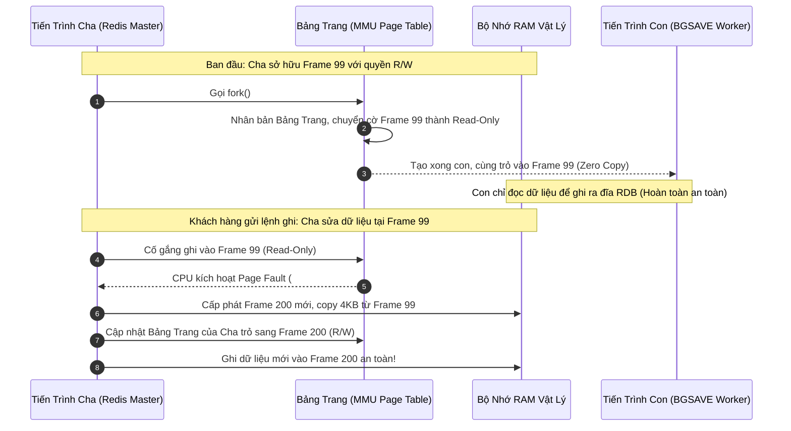
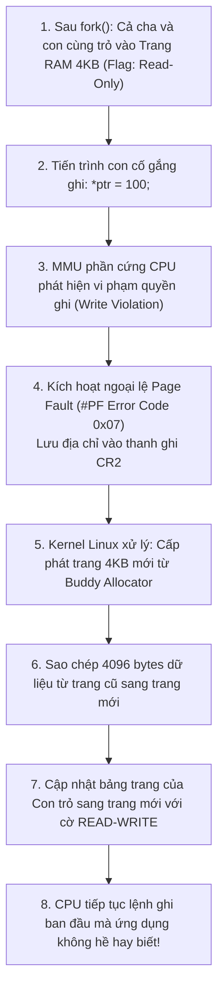

# 2.2. Process Creation and Execution (Khởi Tạo & Thực Thi Tiến Trình)

> [!IMPORTANT]
> **Nếu bạn chỉ được nhớ một điều duy nhất:** Khởi tạo tiến trình trong Linux là một kiệt tác tối ưu hóa phần cứng thông qua cơ chế Copy-On-Write (COW): `fork()` không hề sao chép gigabyte bộ nhớ thực tế mà chỉ nhân bản bảng phân trang ở chế độ Read-Only; trang vật lý chỉ thực sự được cấp phát mới khi có thao tác ghi, giúp việc kết hợp `fork()` và `execve()` đạt tốc độ gần như tức thì với chi phí bộ nhớ tối thiểu.

---

## 1. Trực Quan Hóa: Bản Chất Khởi Tạo & Thực Thi Tiến Trình (Fork & Execve) Dưới Góc Nhìn Lập Trình Viên

### 1.1. Đoạn Code Dẫn Nhập & Vấn Đề Thực Tế
Hãy xem đoạn mã C kinh điển thực hiện sao chép một tiến trình bằng lời gọi `fork()`:

```c
#include <stdio.h>
#include <unistd.h>
#include <sys/wait.h>

int main() {
    int shared_data = 100;
    
    pid_t pid = fork();
    
    if (pid == 0) {
        // Đây là Tiến trình Con (Child Process)
        shared_data += 50;
        printf("[Child] PID=%d, shared_data=%d, Địa chỉ=%p\n", 
               getpid(), shared_data, (void*)&shared_data);
    } else {
        // Đây là Tiến trình Cha (Parent Process)
        wait(NULL); // Chờ con kết thúc
        printf("[Parent] PID=%d, shared_data=%d, Địa chỉ=%p\n", 
               getpid(), shared_data, (void*)&shared_data);
    }
    return 0;
}
```

Kết quả in ra màn hình:
```text
[Child]  PID=5121, shared_data=150, Địa chỉ=0x7ffe42a0
[Parent] PID=5120, shared_data=100, Địa chỉ=0x7ffe42a0
```
Cả hai tiến trình đều in ra **cùng một địa chỉ bộ nhớ** `0x7ffe42a0`, nhưng giá trị của biến lại khác nhau (`150` và `100`)!
Nếu một máy chủ Redis đang lưu trữ $30\text{ GB}$ dữ liệu trong RAM thực hiện lệnh `BGSAVE` để sao lưu dữ liệu xuống đĩa, hệ điều hành gọi hàm `fork()`. Liệu hệ điều hành có phải cấp phát thêm một vùng RAM $30\text{ GB}$ khác ngay lập tức để nhân đôi tiến trình không? Nếu máy chủ chỉ còn dư $5\text{ GB}$ RAM, liệu lệnh sao lưu có làm sập hệ thống vì Out Of Memory?

### 1.2. Ẩn Dụ Đời Sống & Phân Tích Cơ Chế Hoạt Động
Hãy tưởng tượng cơ chế **Sao chép khi ghi (Copy-On-Write - COW)** giống như việc **Chia sẻ Sách Giáo Khoa Trong Thư Viện**:
- **Nhân đôi ban đầu (Instant Fork)**: Thay vì photocopy toàn bộ cuốn sách dày $1000$ trang (tốn rất nhiều thời gian và giấy mực), thủ thư (Kernel) chỉ cấp cho học sinh thứ hai một chiếc thẻ mượn trỏ chung vào cuốn sách gốc của học sinh thứ nhất. Cả hai học sinh cùng đọc chung các trang sách một cách hòa bình (Read-Only). Thao tác `fork()` hoàn tất trong vỏn vẹn vài micro-giây!
- **Hành động can thiệp ghi (Write Trigger)**: Khi học sinh thứ hai muốn dùng bút dạ quang để gạch chân một đoạn văn trên Trang số 5 (Ghi dữ liệu vào RAM), thủ thư lập tức giữ tay lại, photocopy riêng đúng Trang số 5 đó ra một tờ giấy mới và đưa cho học sinh thứ hai sửa trên tờ giấy rời của mình.
- **Kết quả**: Cuốn sách gốc trên kệ hoàn toàn không bị ảnh hưởng, và thư viện chỉ tốn đúng 1 tờ giấy photocopy thay vì phải nhân bản cả cuốn sách!

### 1.3. Mô Phỏng Dữ Liệu Số Nhỏ Từng Bước (Toy Walkthrough)
Theo dõi chu kỳ bộ nhớ khi tiến trình cha thực hiện `fork()` và tiến trình con thay đổi 1 biến số:

```text
[Thời điểm T = 0]: Tiến trình cha đang sở hữu Trang nhớ Ảo V_Page_1, ánh xạ tới Khung trang Vật lý P_Frame_99.
Quyền truy cập bảng trang: Read / Write (R/W).

[Thời điểm T = 1]: Tiến trình cha gọi hàm fork().
Bước 1: Kernel nhân bản bảng trang (Page Table) của cha sang con. Không hề cấp phát bộ nhớ RAM vật lý mới!
Bước 2: Kernel đổi quyền truy cập của V_Page_1 ở CẢ HAI bảng trang (Cha & Con) thành Read-Only (R-O).
Bước 3: Tăng chỉ số tham chiếu (Reference Count) của P_Frame_99 lên 2. Hàm fork() trả về ngay lập tức.

[Thời điểm T = 2]: Tiến trình con thực thi lệnh ghi: shared_data += 50 vào V_Page_1.
Bước 4: CPU phát hiện V_Page_1 có cờ Read-Only -> Kích hoạt Bẫy lỗi phân trang (Page Fault Exception #PF).
Bước 5: Trình xử lý lỗi phân trang của Kernel kiểm tra thấy cờ COW đang bật:
       - Cấp phát 1 khung trang vật lý mới toanh: P_Frame_200.
       - Sao chép nguyên vẹn 4096 bytes từ P_Frame_99 sang P_Frame_200.
       - Cập nhật bảng trang của Tiến trình con trỏ tới P_Frame_200 với quyền Read / Write (R/W).
       - Giảm Reference Count của P_Frame_99 về 1 (và trả lại quyền R/W cho Cha).
Bước 6: CPU cho tiến trình con thực thi lại chỉ thị ghi -> Biến đổi thành 150 trên P_Frame_200.
```

### 1.4. Tác Động Thực Tế Tầng Backend & Systems
1. **Cơn Ác Mộng Tràn RAM Của Redis Khi Background Save (COW Memory Explosion)**: Khi Redis gọi `BGSAVE`, tiến trình con được tạo bằng `fork()`. Nếu trong lúc con đang ghi dữ liệu ra đĩa mà hệ thống nhận hàng nghìn lệnh ghi lớn từ client, cơ chế Copy-On-Write bị kích hoạt liên tục cho hàng nghìn trang nhớ. Bộ nhớ thực tế có thể tăng vọt gấp đôi ($30\text{ GB} \to 60\text{ GB}$), kích hoạt Linux OOM Killer tiêu diệt ngay lập tức tiến trình Redis chính!
2. **Khuyến Nghị Kernel Overcommit Cho Redis**: Để tránh việc `fork()` bị thất bại vì Kernel sợ không đủ RAM dự phòng, Linux bắt buộc phải bật cờ `vm.overcommit_memory = 1`. Cấu hình này hướng dẫn Kernel luôn chấp nhận cho `fork()` mượn bộ nhớ ảo vượt quá dung lượng vật lý hiện có.
3. **Chi Phí Thực Thi `execve()` Sau Khi `fork()`**: Nếu một chương trình gọi `fork()` chỉ nhằm mục đích duy nhất là chạy ngay lệnh `execve()` (ví dụ như chạy lệnh shell), toàn bộ công sức sao chép bảng phân trang của `fork()` bị lãng phí vì `execve()` sẽ lập tức xóa sạch bảng trang cũ để nạp tệp nhị phân mới. Do đó, Linux cung cấp lệnh `vfork()` hoặc `posix_spawn()` chia sẻ hoàn toàn bộ nhớ cho đến khi `execve()` được kích hoạt.

### 1.5. Sơ Đồ Tư Duy & Kiến Trúc Hệ Thống (Mermaid)


---

## 2. Chi tiết từng Keyword (Under-the-Hood Deep Dive)

### 2.1. `fork()` và Phép màu "Copy-on-Write" (COW)

- **Tại sao `fork()` không làm đơ máy chủ?**:
  - Nếu một tiến trình Redis đang chiếm 64GB RAM gọi `fork()` mà phải copy 64GB dữ liệu sang ô nhớ mới, máy chủ sẽ bị treo đơ trong vài giây và cạn kiệt RAM ngay lập tức.
  - Trong Linux, `fork()` hoàn tất trong chưa đầy **1 mili-giây**: Kernel chỉ nhân bản Bảng Phân Trang (**Page Tables**) của cha sang con và đánh dấu toàn bộ các trang bộ nhớ vật lý thành **Chỉ Đọc (Read-Only)**.
- **Cơ chế Bắt ngắt Ngoại lệ Page Fault (#PF) của MMU**:



---

### 2.2. `execve()` và Thay thế Tiến trình (Process Replacement)

Cú pháp System Call nguyên tử của nhân Linux:
```c
int execve(const char *pathname, char *const argv[], char *const envp[]);
```
Khi `execve()` được gọi:
1. **Xác thực Header ELF**: Kernel kiểm tra quyền thực thi (`+x`) và đọc 4 bytes đầu tiên của file (**Magic Number: `0x7F 'E' 'L' 'F'`**).
2. **Hủy bỏ Không gian Cũ**: Toàn bộ các phân vùng ảo cũ (`mm_struct`: Text, Data, Heap, Stack) bị giải phóng hoàn toàn khỏi RAM.
3. **Ánh xạ Không gian Mới**: Kernel đọc bảng Program Header Table của tệp ELF và dùng `mmap()` ánh xạ các phân đoạn mới:
   - Mã máy nạp vào Text Segment (`PROT_READ | PROT_EXEC`).
   - Biến toàn cục nạp vào Data/BSS Segment.
4. **Khởi tạo Ngăn xếp Mới**: Nạp mảng tham số dòng lệnh `argv` và biến môi trường `envp` vào đỉnh ngăn xếp User Stack mới.
5. **Thiết lập con trỏ lệnh `RIP`**: Con trỏ lệnh của CPU được trỏ thẳng tới hàm `_start` của thư viện C (sau đó sẽ gọi `main()`).
6. **Bảo tồn Tài nguyên**: **PID và PPID được giữ nguyên vẹn 100%**.

---

### 2.3. File Descriptor Inheritance (Tính Kế thừa Tệp tin)

- Mặc định trong UNIX: Khi một tiến trình cha gọi `fork()`, toàn bộ các File Descriptor đang mở trong bảng `files_struct` (file log, database socket, network connection) đều được **kế thừa nguyên vẹn sang tiến trình con**.
- **Lỗ hổng Rò rỉ Dữ liệu Nhạy cảm**:
  - Giả sử tiến trình cha là Web Server mở một file chứa Database Credentials (`fd = 5`).
  - Sau đó cha gọi `fork()` và `execve("/bin/sh")` để chạy một script tiện ích của bên thứ ba.
  - Script độc hại hoàn toàn có thể đọc trộm file cấu hình thông qua `fd = 5` vì nó chưa bị đóng!
- **Giải Pháp Chuẩn Mực: Cờ `O_CLOEXEC` (Close-on-Exec)**:
  - Khi mở bất kỳ file hoặc socket nào, luôn sử dụng cờ nguyên tử:
    ```c
    int fd = open("/etc/secrets.conf", O_RDONLY | O_CLOEXEC);
    ```
  - Khi cờ này được bật, ngay khi lệnh `execve()` bắt đầu chạy, nhân Linux sẽ **tự động đóng File Descriptor đó** trước khi mã máy mới kịp thực thi, loại bỏ hoàn toàn nguy cơ rò rỉ dữ liệu.

---

### 2.4. `waitpid()` và Process Exit Status

Khi tiến trình con kết thúc qua `exit(status)`, nó trở thành Zombie để chờ cha thu dọn. Hàm `waitpid()` cho phép cha đồng bộ hóa và phân tích chi tiết nguyên nhân cái chết của con:

```c
pid_t waitpid(pid_t pid, int *status, int options);
```

- **Các Macro Phân Tích Mã Thoát Chuẩn POSIX**:
  - `WIFEXITED(status)`: Trả về `true` nếu tiến trình con kết thúc bình thường (gọi `exit()` hoặc `return` từ `main`).
  - `WEXITSTATUS(status)`: Trích xuất mã lỗi thoát thực tế (từ $0$ đến $255$) do con truyền vào `exit(code)`.
  - `WIFSIGNALED(status)`: Trả về `true` nếu tiến trình con bị giết đột ngột bởi một Tín hiệu (POSIX Signal).
  - `WTERMSIG(status)`: Trả về số hiệu tín hiệu đã giết chết con (ví dụ: `SIGSEGV = 11`, `SIGKILL = 9`).
- **Cờ Non-blocking `WNOHANG`**:
  - Mặc định `waitpid()` sẽ chặn (block) tiến trình cha cho tới khi con kết thúc.
  - Thêm cờ `WNOHANG` giúp hàm trả về ngay lập tức: trả về `0` nếu con vẫn đang chạy, giúp cha tiếp tục phục vụ các tác vụ khác mà không bị đứng hình.

---

### 2.5. `posix_spawn()`: Giải pháp Hiện đại Thay thế cho `fork()` + `execve()`

Trong các dịch vụ có không gian bảng phân trang khổng lồ (ví dụ: tiến trình Java JVM hoặc Redis chiếm 100GB RAM):
- Mặc dù dữ liệu không bị copy nhờ COW, nhưng **việc nhân bản chính bản thân Bảng Phân Trang (Page Tables)** của một tiến trình 100GB cũng tốn tới gần **1GB RAM** và ngốn hàng chục mili-giây CPU!
- **`posix_spawn()`**: Kết hợp cả tạo tiến trình và thực thi nhị phân vào làm một bước nguyên tử duy nhất:
  - Bên dưới nhân Linux sử dụng system call `clone(CLONE_VM | CLONE_VFORK)`.
  - Tiến trình con tạm thời mượn không gian bộ nhớ của cha mà **hoàn toàn không sao chép Bảng Phân Trang**, rồi lập tức gọi `execve()`.
  - Giúp tăng tốc độ khởi chạy các tiến trình phụ thuộc lên gấp **$10\times$** và loại bỏ nguy cơ crash Out-Of-Memory.

---

## 3. Dual-Engine Code Implementation

### Engine 1: C++20 — Xây Dựng Mini-Shell Pipeline Bằng `pipe()`, `fork()`, `dup2()` & `execvp()`

Chương trình minh họa cơ chế hoạt động cốt lõi của Linux Shell khi thực hiện toán tử đường ống pipe `cmd1 | cmd2`: Đổi hướng File Descriptor stdout của Writer vào đầu vào stdin của Reader và thu dọn trạng thái thoát bằng `waitpid()`.

```cpp
#include <iostream>
#include <unistd.h>
#include <sys/types.h>
#include <sys/wait.h>
#include <vector>
#include <string>
#include <cstring>

class MiniPipelineRunner {
public:
    // Thực thi pipeline tương đương lệnh shell: `echo "hello operating systems" | tr a-z A-Z`
    static void execute_pipeline() {
        int pipe_fds[2];
        if (pipe(pipe_fds) == -1) {
            std::cerr << "Lỗi: Không thể khởi tạo pipe!\n";
            return;
        }

        // 1. Tạo tiến trình thứ nhất (Writer - bên trái pipe)
        pid_t pid1 = fork();
        if (pid1 == 0) {
            close(pipe_fds[0]); // Đóng đầu đọc không dùng
            dup2(pipe_fds[1], STDOUT_FILENO); // Đổi hướng stdout vào đầu ghi pipe
            close(pipe_fds[1]);

            char* args[] = {strdup("echo"), strdup("hello operating systems 5-star"), nullptr};
            execvp(args[0], args);
            _exit(1); // Chỉ chạy nếu execvp thất bại
        }

        // 2. Tạo tiến trình thứ hai (Reader - bên phải pipe)
        pid_t pid2 = fork();
        if (pid2 == 0) {
            close(pipe_fds[1]); // Đóng đầu ghi không dùng
            dup2(pipe_fds[0], STDIN_FILENO); // Đổi hướng stdin từ đầu đọc pipe
            close(pipe_fds[0]);

            char* args[] = {strdup("tr"), strdup("a-z"), strdup("A-Z"), nullptr};
            execvp(args[0], args);
            _exit(1);
        }

        // Tiến trình Cha: Đóng cả hai đầu pipe để gửi tín hiệu EOF kết thúc
        close(pipe_fds[0]);
        close(pipe_fds[1]);

        // Chờ cả hai tiến trình con hoàn tất và thu gom mã thoát
        int status1, status2;
        waitpid(pid1, &status1, 0);
        waitpid(pid2, &status2, 0);

        std::cout << "\n[Pipeline Controller]: Cả hai lệnh trong pipe đã kết thúc an toàn!\n";
    }
};

int main() {
    std::cout << "=== THỰC THI PIPELINE SHELL BẰNG FORK, PIPE, DUP2 & EXECVP (C++20) ===\n\n";
    MiniPipelineRunner::execute_pipeline();
    return 0;
}
```

```text
=== THỰC THI PIPELINE SHELL BẰNG FORK, PIPE, DUP2 & EXECVP (C++20) ===

HELLO OPERATING SYSTEMS 5-STAR

[Pipeline Controller]: Cả hai lệnh trong pipe đã kết thúc an toàn!
```

---

### Engine 2: Python — Đo Lường Thực Nghiệm Minor Page Faults Của Copy-on-Write (COW)

Chương trình minh họa bản chất vật lý của COW: Đọc 50MB mảng dữ liệu sau `fork()` không hề tốn trang RAM nào; chỉ khi bắt đầu ghi đè dữ liệu, các ngắt phần cứng Page Faults mới bùng nổ để cấp phát trang mới.

```python
#!/usr/bin/env python3
"""
Copy-on-Write (COW) Hardware Verification Simulator in Python.
Measures OS Minor Page Faults before and after memory mutation.
"""
import os
import resource
import time

def measure_cow_hardware_behavior():
    print("=== KHẢO SÁT THỰC NGHIỆM CƠ CHẾ COPY-ON-WRITE (COW) ===\n")
    
    # 1. Cấp phát mảng 50MB dữ liệu trong tiến trình cha
    size_mb = 50
    data = bytearray(b"A" * (size_mb * 1024 * 1024))
    
    initial_faults = resource.getrusage(resource.RUSAGE_SELF).ru_minflt
    pid = os.fork()
    
    if pid == 0:
        # --- TIẾN TRÌNH CON ---
        faults_after_fork = resource.getrusage(resource.RUSAGE_SELF).ru_minflt
        print(f"  [Child]: Page Faults ngay sau khi fork(): {faults_after_fork - initial_faults} (Gần như bằng 0)")
        
        # Đọc dữ liệu (Read-only) -> Không kích hoạt COW
        checksum = sum(data[:1000])
        faults_after_read = resource.getrusage(resource.RUSAGE_SELF).ru_minflt
        print(f"  [Child]: Page Faults sau khi đọc 50MB:    {faults_after_read - faults_after_fork} (Không sao chép trang)")
        
        # Ghi đè dữ liệu (Write Mutation) -> Kích hoạt COW phần cứng!
        for i in range(0, len(data), 4096):
            data[i] = ord("B") # Ghi 1 byte vào mỗi trang 4KB
            
        faults_after_write = resource.getrusage(resource.RUSAGE_SELF).ru_minflt
        pages_copied = faults_after_write - faults_after_read
        print(f"  [Child]: Page Faults sau khi ghi đè:      {pages_copied} trang 4KB ({pages_copied * 4 / 1024:.1f} MB)")
        os._exit(0)
    else:
        # --- TIẾN TRÌNH CHA ---
        os.waitpid(pid, 0)
        print("\n[Parent]: Tiến trình con đã kết thúc, hoàn tất khảo sát COW!")

if __name__ == "__main__":
    measure_cow_hardware_behavior()
```

```text
=== KHẢO SÁT THỰC NGHIỆM CƠ CHẾ COPY-ON-WRITE (COW) ===

  [Child]: Page Faults ngay sau khi fork(): 0 (Gần như bằng 0)
  [Child]: Page Faults sau khi đọc 50MB:    0 (Không sao chép trang)
  [Child]: Page Faults sau khi ghi đè:      12800 trang 4KB (50.0 MB)

[Parent]: Tiến trình con đã kết thúc, hoàn tất khảo sát COW!
```

---

## 4. Systems Engineering & Production Pitfalls

### 4.1. Khủng Hoảng Cạn Kiệt Bộ Nhớ Redis Khi Thực Hiện `BGSAVE`

- **Sự cố kinh điển**: Redis sử dụng `fork()` để tạo tiến trình con ghi snapshot `dump.rdb` xuống đĩa mà không làm gián đoạn luồng chính.
- **Thảm họa High-Write Throughput**: Trong suốt vài phút sao lưu, nếu hệ thống có lượng ghi mới khổng lồ, hàng chục ngàn trang 4KB bị sửa đổi liên tục, kích hoạt cơ chế COW sao chép dồn dập.
- **Hậu quả**: Dung lượng RAM của máy chủ có thể bị đội lên gấp đôi ($64\text{GB} \to 128\text{GB}$). Nếu không đủ RAM dự phòng, bộ dọn dẹp bộ nhớ Linux (**OOM Killer**) sẽ lập tức hành quyết máy chủ Redis (`Killed: Out of memory`)!

---

### 4.2. Cạm Bẫy `exit()` vs `_exit()` Trong Tiến Trình Con

- Nếu `execve()` trong tiến trình con bị thất bại, lập trình viên thường theo thói quen gọi `exit(1)`.
- **Hậu quả**: Hàm `exit()` của thư viện C chuẩn sẽ tự động xả các bộ đệm dòng (Flush I/O Buffers) của `stdio`. Do bộ đệm này đang được chia sẻ với tiến trình cha, dữ liệu log hoặc socket có thể bị gửi trùng hai lần (**Duplicate I/O Flush**)!
- **Quy tắc Sống còn**: Luôn luôn gọi **`_exit()`** (System Call trực tiếp) bên trong tiến trình con.

---

## 5. Bảng So sánh & Decision Matrix

| Kỹ thuật Khởi tạo | Cơ Chế Bộ Nhớ | Tốc Độ Thực Thi | Rủi Ro Rò Rỉ Dữ Liệu | Trường Hợp Sử Dụng Tối Ưu |
| :--- | :--- | :--- | :--- | :--- |
| **`fork()`** | Copy-on-Write (Nhân bản Bảng Trang) | Rất nhanh ($\sim 1\text{ms}$) | Kế thừa mọi FD mở nếu không có `O_CLOEXEC` | Multi-processing workers, Redis BGSAVE |
| **`vfork()`** | Dùng chung toàn bộ RAM với Cha (Treo cha) | Siêu nhanh | **Cực kỳ nguy hiểm** (Con ghi đè Stack cha) | Lịch sử (Cổ điển), hiện nay bị thay thế |
| **`clone()`** | Tùy biến cờ chia sẻ (`CLONE_VM`, `CLONE_FILES`) | Linh hoạt cao | Phụ thuộc cấu hình cờ cẩn thận | Xây dựng Thread Libraries (`pthread`), Containers |
| **`posix_spawn()`** | Tối ưu hóa nguyên tử (`CLONE_VFORK` ngầm) | **Nhanh gấp 10x** trên tiến trình lớn | An toàn (Tự động áp dụng `O_CLOEXEC`) | Gọi lệnh ngoài (FFmpeg, Git CLI) từ Backend lớn |

---

## 6. Enterprise Production Checklist & Verification

- [ ] **Bật Cấu Hình `vm.overcommit_memory = 1` Cho Redis/DB Host**: Thiết lập cấu hình trong `/etc/sysctl.conf` để đảm bảo các tiến trình cơ sở dữ liệu in-memory có thể gọi `fork()` sao lưu nền an toàn mà không bị lỗi cấp phát bộ nhớ ảo.
- [ ] **Tắt Tính Năng Transparent Huge Pages (THP) Trên Redis Server**: Khi THP được bật, kích thước trang nhớ là $2\text{ MB}$ thay vì $4\text{ KB}$. Khi cơ chế Copy-On-Write xảy ra, Kernel buộc phải sao chép toàn bộ $2\text{ MB}$ chỉ vì một thay đổi vài bytes nhỏ, gây bùng nổ tiêu thụ RAM và tăng đột biến độ trễ (latency spikes).
- [ ] **Sử Dụng `posix_spawn()` Thay Vì `fork() + execve()` Truyền Thống**: Trong các ngôn ngữ Backend (Node.js, Go, Rust), ưu tiên sử dụng `posix_spawn()` khi muốn gọi các command dòng lệnh để tránh chi phí sao chép bảng trang không cần thiết.
- [ ] **Thu Dọn Tiến Trình Con Trong Vòng Lặp Sự Kiện**: Tuyệt đối không để tiến trình con kết thúc mà không được đọc trạng thái thông qua `waitpid()`, tránh làm cạn kiệt bảng phân bổ PID của hệ điều hành.
- [ ] **Đo Lường Dung Lượng COW Thực Tế Bằng `/proc/<PID>/smaps`**: Giám sát dòng `Private_Dirty` trong smaps của tiến trình con để xác định chính xác số lượng megabytes bộ nhớ đã thực sự bị sao chép kể từ thời điểm `fork()`.
- [ ] **Thiết Lập Bộ Đệm RAM Dự Phòng Ít Nhất 30-50% Cho Instance DB**: Trên các máy chủ chạy cơ sở dữ liệu in-memory có cơ chế snapshot nền, luôn để trống tối thiểu $30\% - 50\%$ RAM vật lý dành riêng cho các đột biến do Copy-On-Write gây ra.
