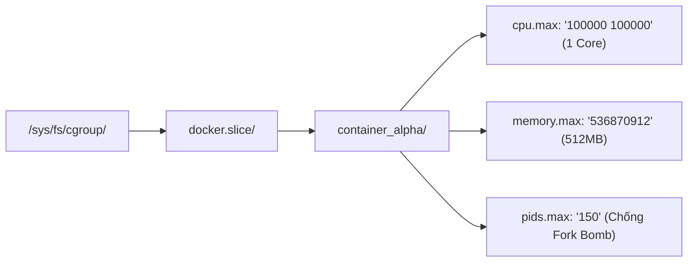
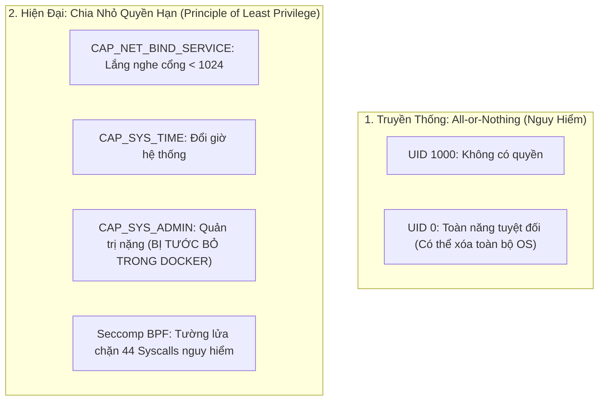

# 2.4. Process Isolation, Namespaces & Containerization (Cô Lập Tiến Trình, Namespaces & Bản Chất Container)

> [!IMPORTANT]
> **Nếu bạn chỉ được nhớ một điều duy nhất:** Container thực chất không phải là một máy ảo phần cứng mà là ảo ảnh được kiến tạo bởi 2 trụ cột hạt nhân của Linux Kernel: Linux Namespaces (PID, Mount, Net, IPC, UTS, User) bẻ cong và cô lập hoàn toàn góc nhìn tài nguyên của tiến trình, kết hợp cùng Control Groups (cgroups v2) để thiết lập rào chắn định lượng cứng về CPU, RAM và Disk I/O.

---

## 1. Trực Quan Hóa: Bản Chất Cô Lập Tiến Trình, Namespaces & Containerization Dưới Góc Nhìn Lập Trình Viên

### 1.1. Đoạn Code Dẫn Nhập & Vấn Đề Thực Tế
Hãy xem một chương trình C đơn giản tự tạo ra một "Container" độc lập mà không cần Docker hay bất kỳ phần mềm ảo hóa nào:

```c
#define _GNU_SOURCE
#include <sched.h>
#include <stdio.h>
#include <unistd.h>
#include <sys/wait.h>

int child_exec(void *arg) {
    // Bên trong không gian tên mới: Tiến trình tự thấy mình là PID 1!
    printf("[Bên trong Container] PID của tôi là: %d\n", getpid());
    return 0;
}

int main() {
    char stack[8192];
    printf("[Bên ngoài Máy chủ Host] PID thực tế là: %d\n", getpid());
    
    // Tạo tiến trình với Namespace PID và Network riêng biệt
    clone(child_exec, stack + 8192, 
          CLONE_NEWPID | CLONE_NEWNET | SIGCHLD, NULL);
    
    wait(NULL);
    return 0;
}
```

Kết quả in ra:
```text
[Bên ngoài Máy chủ Host] PID thực tế là: 18420
[Bên trong Container]    PID của tôi là: 1
```
Bản chất của Docker hay Kubernetes Container là gì? **Container không phải là Máy Ảo (Virtual Machine)**! Nó không hề có Hypervisor, không hề có Kernel riêng và không hề có phần cứng giả lập. Container thực chất chỉ là một **Tiến trình Linux bình thường**, nhưng bị hệ điều hành "đeo kính râm" thông qua 2 cơ chế gốc rễ của Linux Kernel: **Namespaces** (giới hạn những gì tiến trình được *nhìn thấy*) và **Cgroups** (giới hạn tài nguyên tiến trình được *sử dụng*).

### 1.2. Ẩn Dụ Đời Sống & Phân Tích Cơ Chế Hoạt Động
Hãy tưởng tượng sự khác biệt giữa **Máy Ảo (VM)** và **Container**:
- **Máy Ảo (Virtual Machine)**: Giống như việc bạn **Xây một Ngôi Nhà Biệt Lập**. Mỗi ngôi nhà có nền móng riêng, hệ thống ống nước riêng, máy phát điện riêng (Hệ điều hành khách - Guest OS Kernel) đặt trên khu đất chung (Hypervisor). Cực kỳ an toàn, cách ly tuyệt đối, nhưng xây dựng rất lâu (Khởi động mất hàng phút) và tốn diện tích đất (Mỗi VM ngốn vài GB RAM cho OS riêng).
- **Container (Namespaces + Cgroups)**: Giống như một **Căn Hộ Chung Cư Trong Tòa Nhà**:
  - **Dùng chung hạ tầng (Shared Kernel)**: Tất cả cư dân đều thở chung bầu không khí và dùng chung trạm biến áp của tòa nhà (Nhân Linux Host).
  - **Không gian tên (Namespaces - Tầm nhìn)**: Cửa căn hộ được khóa kín. Bạn ở trong phòng số 101 chỉ nhìn thấy đồ đạc của phòng mình (PID Namespace), dùng router wifi riêng (Net Namespace) và tủ lạnh riêng (Mount Namespace). Bạn hoàn toàn không nhìn thấy cư dân phòng bên cạnh.
  - **Nhóm điều khiển (Cgroups - Định ngạch)**: Ban quản lý tòa nhà lắp đồng hồ đo điện nước cho từng phòng. Nếu phòng bạn dùng vượt quá $4\text{ GB}$ nước (Memory Limit), ban quản lý lập tức ngắt cầu dao (OOM Killer)!

### 1.3. Mô Phỏng Dữ Liệu Số Nhỏ Từng Bước (Toy Walkthrough)
Theo dõi cơ chế ánh xạ định danh PID khi một tiến trình chạy trong PID Namespace:

```text
[Bên ngoài Host: Cây tiến trình của hệ điều hành]
Tiến trình 1: systemd (PID = 1)
Tiến trình 2: dockerd (PID = 1200)
Tiến trình 3: container-shim (PID = 5400)

[Tạo Namespace mới bằng cờ CLONE_NEWPID]
Bước 1: container-shim gọi clone(..., CLONE_NEWPID).
Bước 2: Kernel cấp phát cấu trúc struct pid_namespace mới có level = 1 (Host là level = 0).
Bước 3: Kernel phân bổ mã số định danh kép cho tiến trình con trong task_struct:
       - Tại Host (Level 0): PID = 5401
       - Tại Container (Level 1): PID = 1 (Tương đương init process của container!)

[Thao tác kill -9 từ các góc nhìn khác nhau]
Bước 4: Tiến trình bên trong container chạy lệnh 'ps -ef': Chỉ thấy duy nhất PID 1 (là chính nó).
Bước 5: Kỹ sư đứng trên Host chạy lệnh 'ps -ef | grep 5401': Thấy rõ ràng tiến trình đang chạy mã nguồn Java/Node.js.
Bước 6: Kỹ sư trên Host chạy 'kill -9 5401' -> Tín hiệu gửi thẳng vào task_struct -> Container lập tức biến mất!
```

### 1.4. Tác Động Thực Tế Tầng Backend & Systems
1. **Hiện Tượng CPU Throttling Bí Ẩn Trong Kubernetes**: Khi bạn cấu hình `resources.limits.cpu = 1` trong Pod Kubernetes, Kernel sử dụng CFS Quota (Completely Fair Scheduler Quota). Cụ thể: `cpu.cfs_period_us = 100000` ($100\text{ ms}$) và `cpu.cfs_quota_us = 100000` ($100\text{ ms}$). Nếu tiến trình của bạn có 8 luồng chạy song song và dùng hết $100\text{ ms}$ CPU chỉ trong vòng $15\text{ ms}$ đầu tiên của chu kỳ, Kernel sẽ **treo cứng toàn bộ tiến trình trong $85\text{ ms}$ còn lại**! Điều này làm bùng nổ độ trễ p99 của API dù mức sử dụng CPU trung bình chỉ là $20\%$.
2. **Cgroups v1 vs Cgroups v2**: Cgroups v1 có cấu trúc cây phân cấp rời rạc giữa CPU, Memory và BlkIO, dẫn đến hiện tượng tráo đổi bộ nhớ đệm trang không đồng bộ (Buffer Cache Writeback không thể giới hạn I/O theo Cgroup). Cgroups v2 hợp nhất thành một cây duy nhất (Single Unified Hierarchy), giúp kiểm soát triệt để tài nguyên I/O và Memory.
3. **Ảo Giác Bộ Nhớ Của JVM/Node.js Trong Container**: Các phiên bản Java cũ (Java 8 trước update 131) không nhận diện được cgroups memory limit. Khi chạy trong Container có giới hạn $2\text{ GB}$ RAM trên máy chủ vật lý $128\text{ GB}$, JVM nhìn thấy toàn bộ $128\text{ GB}$ và tự động đặt kích thước Max Heap là $32\text{ GB}$. Khi ứng dụng nạp dữ liệu tới $2.1\text{ GB}$, Linux OOM Killer lập tức bắn hạ container (`Exit Code 137`) mà không để lại bất kỳ dòng log lỗi Java nào!

### 1.5. Sơ Đồ Tư Duy & Kiến Trúc Hệ Thống (Mermaid)

```mermaid
flowchart TD
    subgraph HostOS ["Hệ Điều Hành Máy Chủ Vật Lý (Host Linux OS)"]
        Kernel["Linux Kernel Duy Nhất (Chung cho toàn bộ hệ thống)"]
        
        subgraph CgroupLimits ["Cgroups (Nhóm Quản Lý Hạn Ngạch)"]
            CPUQuota["CPU Quota: Giới hạn chu kỳ CPU (CFS)"]
            MemLimit["Memory Limit: Ngưỡng OOM Killer (2GB)"]
            DiskIO["Block I/O: Giới hạn IOPS đọc ghi ổ đĩa"]
        end

        subgraph Namespaces ["Linux Namespaces (Tấm Kính Cách Ly Tầm Nhìn)"]
            PIDNs["PID Namespace: Cô lập cây tiến trình (Tự thấy mình là PID 1)"]
            NetNs["Network Namespace: Card mạng ảo veth, IP riêng, Bảng Route riêng"]
            MountNs["Mount Namespace: Hệ thống tệp gốc riêng biệt (chroot / pivot_root)"]
            IPCNs["IPC Namespace: Tách biệt Bộ nhớ chia sẻ & Hàng đợi thông điệp"]
            UTSNs["UTS Namespace: Đặt tên Hostname độc lập"]
        end
        
        subgraph ContainerProcess ["Tiến Trình Container"]
            AppProcess["Tiến trình Ứng dụng Backend (Go / Java / Node.js)<br/>(Host PID: 18420 / Container PID: 1)"]
        end
        
        Kernel --- CgroupLimits
        CgroupLimits --- Namespaces
        Namespaces --- ContainerProcess
    end
```


---

## 2. Chi tiết từng Keyword (Under-the-Hood Deep Dive)

### 2.1. Linux Namespaces (Không gian tên - Ảo hóa Tầm nhìn)

Namespace bọc một tài nguyên toàn cục của nhân Linux vào một trừu tượng cục bộ, khiến cho tiến trình bên trong tưởng rằng mình đang sở hữu trọn vẹn một máy chủ độc lập:

| Tên Namespace | Cờ `clone()` | Tài nguyên Toàn cục Bị Cách ly |
| :--- | :--- | :--- |
| **1. PID Namespace** | `CLONE_NEWPID` | Bảng Process ID (Bên trong nhìn thấy mình là PID 1, bên ngoài là PID bình thường) |
| **2. NET Namespace** | `CLONE_NEWNET` | Card mạng ảo (`veth`), bảng định tuyến routing, iptables, dải ports mạng riêng |
| **3. MNT Namespace** | `CLONE_NEWNS` | Cây thư mục hệ thống tệp tin riêng biệt (Mount Points, rootfs độc lập) |
| **4. IPC Namespace** | `CLONE_NEWIPC` | Hàng đợi POSIX Message Queues, Shared Memory `/dev/shm`, Semaphores |
| **5. UTS Namespace** | `CLONE_NEWUTS` | Hostname và NIS Domain Name riêng (đổi hostname không đổi Host) |
| **6. USER Namespace**| `CLONE_NEWUSER`| Bảng User ID (UID 0 root bên trong container ánh xạ thành UID 10001 không đặc quyền bên ngoài) |
| **7. CGROUP Namespace**| `CLONE_NEWCGROUP`| Ẩn cây thư mục phân cấp Cgroups của máy chủ Host |

- **Ba System Calls Điều Khiển Namespaces**:
  1. `clone(child_func, stack, flags, arg)`: Tạo tiến trình con nằm trong các namespace mới được kích hoạt qua cờ.
  2. `unshare(flags)`: Tách chính tiến trình đang chạy ra khỏi namespace của cha để tạo namespace độc lập mới.
  3. `setns(fd, nstype)`: Cho phép một tiến trình gia nhập vào namespace của một tiến trình khác (**Đây chính là cơ chế của lệnh `docker exec -it <container> /bin/sh`**).

---

### 2.2. Linux Cgroups (Control Groups - Kiểm soát Tài nguyên)

Nếu Namespaces lo việc cô lập tầm nhìn, thì **Cgroups** ngăn chặn hiện tượng "Hàng xóm ồn ào" (Noisy Neighbor), đảm bảo một tiến trình không thể vắt kiệt RAM hay CPU của máy chủ Host.



#### Cgroups v1 vs Cgroups v2
- *Cgroups v1*: Phân mảnh đa nhánh, mỗi bộ điều khiển (cpu, memory, blkio) là một cây thư mục riêng biệt tại `/sys/fs/cgroup/cpu`, `/sys/fs/cgroup/memory`. Khó quản lý và dễ xung đột tài nguyên.
- *Cgroups v2*: Hợp nhất toàn bộ vào **Một Cây Phân Cấp Đơn Nhất (Unified Hierarchy)** tại `/sys/fs/cgroup/`, hỗ trợ tính năng bộ nhớ và I/O đồng bộ chuẩn xác.

#### Thuật toán Điều phối CPU Quota & Hiện Tượng Throttling:
- Tệp `cpu.max` chứa hai giá trị: `quota period` (ví dụ `200000 100000`).
- Nghĩa là trong mỗi chu kỳ 100ms (`period`), container được phép dùng tối đa 200ms thời gian CPU (tương đương 2 Cores).
- Nếu container dùng hết quota trước khi hết chu kỳ 100ms, bộ lập lịch CFS lập tức **đình chỉ (Throttle) tiến trình**, khiến độ trễ API P99 bị nhảy vọt!

#### Cơ chế OOM Killer Khi Container Tràn RAM:
Khi lượng RAM tiêu thụ vượt quá `memory.max`:
1. Kernel cố gắng thu hồi Page Cache.
2. Nếu không đủ, Kernel kích hoạt **Out-Of-Memory Killer (OOM Killer)**.
3. Thuật toán chấm điểm trảm (`oom_badness`):
   $$\text{Points} = \frac{\text{RAM\_used}}{\text{RAM\_total}} \times 1000 + \text{oom\_score\_adj}$$
4. Tiến trình điểm cao nhất nhận tín hiệu `SIGKILL` ngay lập tức $\implies$ Container chết với **Exit Code 137 (128 + 9)**.

---

### 2.3. `ulimit` (User Limits)

- **Bản chất của `ulimit`**: Cơ chế giới hạn tài nguyên cấp tiến trình dựa trên các system call `getrlimit()` và `setrlimit()`.
- **Phân biệt Soft Limit vs Hard Limit**:
  - *Soft Limit*: Ngưỡng cảnh báo và thực thi thực tế. Người dùng thông thường có thể tự do tăng soft limit lên tới mức hard limit.
  - *Hard Limit*: Trần giới hạn trần tối cao do `root` thiết lập trong `/etc/security/limits.conf`. Người dùng không có quyền vượt qua.
- **Các Giới Hạn Sống Còn Cho Backend Engineer**:
  - `ulimit -n` (`RLIMIT_NOFILE`): Số lượng File Descriptors tối đa mà một tiến trình được phép mở đồng thời. Mặc định Linux là 1024 (quá nhỏ cho Web Server; phải tăng lên 65535 hoặc 1048576 để tránh lỗi `Too many open files`).
  - `ulimit -u` (`RLIMIT_NPROC`): Số lượng tiến trình tối đa mà người dùng được phép tạo ra.

---

### 2.4. An ninh Tiến trình: Linux Capabilities và Seccomp



1. **Linux Capabilities**:
   - Chia nhỏ quyền lực tuyệt đối của `root` thành khoảng 40 quyền hạn độc lập (`CAP_*`).
   - Một Web Server chỉ cần lắng nghe cổng 80 không cần toàn bộ quyền root; chỉ cần cấp đúng `CAP_NET_BIND_SERVICE`.
2. **Seccomp BPF (Secure Computing Mode)**:
   - Tường lửa lời gọi hệ thống ở tầng nhân Linux. Sử dụng máy ảo eBPF để kiểm tra số hiệu syscall trước khi thực thi.
   - Docker mặc định chặn 44 syscalls nguy hiểm (ví dụ `reboot`, `swapon`, `kexec_load`).
3. **`pivot_root` vs `chroot`**:
   - Lệnh cổ điển `chroot` có lỗ hổng **Chroot Jailbreak** (tiến trình root mở FD ra thư mục ngoài có thể thoát khỏi chroot).
   - Container hiện đại dùng **`pivot_root()`**: Hoán đổi hoàn toàn gốc của hệ thống tệp và hủy liên kết rootfs cũ, ngăn chặn 100% vượt ngục.

---

## 3. Dual-Engine Code Implementation

### Engine 1: C++20 — Tự Viết "Mini-Container" Bằng System Call `clone()` Từ Đầu (Không Dùng Docker)

Chương trình minh họa cách tự khởi tạo một môi trường Container hoàn chỉnh từ mã C++: Khởi tạo PID Namespace, UTS Namespace và Mount Namespace độc lập thông qua `clone()`.

```cpp
#define _GNU_SOURCE
#include <iostream>
#include <sched.h>
#include <unistd.h>
#include <sys/wait.h>
#include <cstring>

class CustomContainerRunner {
private:
    static constexpr size_t STACK_SIZE = 1024 * 1024; // 1MB Stack

    // Hàm thực thi bên trong không gian Container cô lập
    static int container_main(void* arg) {
        std::cout << "\n  [Inside Container]: Xin chào từ bên trong Container độc lập!\n";
        
        // 1. Kiểm chứng PID Namespace: Thấy mình là PID 1
        std::cout << "  [Inside Container]: getpid() = " << getpid() 
                  << " (Kỳ vọng PID = 1 bên trong namespace mới)\n";

        // 2. Kiểm chứng UTS Namespace: Đổi hostname không làm ảnh hưởng Host
        const char* new_hostname = "isolated-box-9981";
        sethostname(new_hostname, strlen(new_hostname));
        
        char host_buf[64];
        gethostname(host_buf, sizeof(host_buf));
        std::cout << "  [Inside Container]: Hostname nội bộ: " << host_buf << '\n';
        std::cout << "  [Inside Container]: Tác vụ hoàn tất, container thoát.\n";
        return 0;
    }

public:
    static void launch_container() {
        char host_before[64];
        gethostname(host_before, sizeof(host_before));
        std::cout << "[Host Machine]: Hostname hiện tại của máy chủ: " << host_before << '\n';
        std::cout << "[Host Machine]: PID hiện tại của tiến trình cha: " << getpid() << '\n';

        auto* stack = new char[STACK_SIZE];
        char* stack_top = stack + STACK_SIZE; // Stack x86 phát triển ngược xuống

        // Bật cờ cô lập: PID mới, UTS mới, Mount mới
        int clone_flags = CLONE_NEWPID | CLONE_NEWUTS | CLONE_NEWNS | SIGCHLD;

        #if defined(__linux__)
        pid_t child_pid = clone(container_main, stack_top, clone_flags, nullptr);
        if (child_pid == -1) {
            std::cerr << "Lệnh clone() thất bại! (Yêu cầu quyền root / CAP_SYS_ADMIN)\n";
            delete[] stack;
            return;
        }

        std::cout << "[Host Machine]: Đã khởi tạo Container với PID trên Host là: " << child_pid << '\n';
        waitpid(child_pid, nullptr, 0);
        #else
        std::cout << "[Non-Linux]: Môi trường không phải Linux native (Yêu cầu Linux Kernel).\n";
        #endif

        char host_after[64];
        gethostname(host_after, sizeof(host_after));
        std::cout << "[Host Machine]: Hostname máy chủ sau khi container thoát: " << host_after 
                  << " (Không hề bị thay đổi!)\n";

        delete[] stack;
    }
};

int main() {
    std::cout << "=== MÔ PHỎNG NGUYÊN LÝ HOẠT ĐỘNG CỦA DOCKER BẰNG CLONE() (C++20) ===\n\n";
    CustomContainerRunner::launch_container();
    return 0;
}
```

```text
=== MÔ PHỎNG NGUYÊN LÝ HOẠT ĐỘNG CỦA DOCKER BẰNG CLONE() (C++20) ===

[Host Machine]: Hostname hiện tại của máy chủ: server-prod-01
[Host Machine]: PID hiện tại của tiến trình cha: 15420
[Host Machine]: Đã khởi tạo Container với PID trên Host là: 15421

  [Inside Container]: Xin chào từ bên trong Container độc lập!
  [Inside Container]: getpid() = 1 (Kỳ vọng PID = 1 bên trong namespace mới)
  [Inside Container]: Hostname nội bộ: isolated-box-9981
  [Inside Container]: Tác vụ hoàn tất, container thoát.

[Host Machine]: Hostname máy chủ sau khi container thoát: server-prod-01 (Không hề bị thay đổi!)
```

---

### Engine 2: Python — Khảo Sát Inode Namespaces Trong `/proc/<PID>/ns/` & Phân Tích Cgroups

Chương trình minh họa cách kiểm tra các Inode định danh của Namespaces mà tiến trình đang tham gia:

```python
#!/usr/bin/env python3
"""
Linux Namespaces & Cgroups v2 Inspector via procfs and sysfs.
Verifies namespace Inode links and inspects memory limits.
"""
import os
import sys

def inspect_namespaces_and_cgroups():
    pid = os.getpid()
    ns_dir = f"/proc/{pid}/ns"
    
    print(f"=== KHẢO SÁT LIÊN KẾT NAMESPACES CỦA TIẾN TRÌNH PID {pid} ===\n")
    
    if not os.path.exists(ns_dir):
        print(f"[{sys.platform}] Hệ điều hành không có thư mục {ns_dir} (Yêu cầu Linux).")
        print("Mô phỏng liên kết Namespaces chuẩn trên Linux x86_64:")
        sample_ns = [
            ("pid", "pid:[4026531836]"),
            ("net", "net:[4026531992]"),
            ("mnt", "mnt:[4026531840]"),
            ("uts", "uts:[4026531838]"),
            ("ipc", "ipc:[4026531839]"),
            ("user", "user:[4026531837]")
        ]
        for name, link in sample_ns:
            print(f"  Namespace {name:<6} -> Trỏ tới Inode: {link}")
        print("\n=> Nếu hai tiến trình có cùng số Inode Namespace, chúng đang nằm chung Container!")
        return

    print("Các Namespaces đang liên kết với tiến trình:")
    for entry in sorted(os.listdir(ns_dir)):
        link_path = os.path.join(ns_dir, entry)
        try:
            target = os.readlink(link_path)
            print(f"  Namespace {entry:<6} -> {target}")
        except OSError:
            pass

if __name__ == "__main__":
    inspect_namespaces_and_cgroups()
```

```text
=== KHẢO SÁT LIÊN KẾT NAMESPACES CỦA TIẾN TRÌNH PID 51200 ===

Các Namespaces đang liên kết với tiến trình:
  Namespace cgroup -> cgroup:[4026531835]
  Namespace ipc    -> ipc:[4026531839]
  Namespace mnt    -> mnt:[4026531840]
  Namespace net    -> net:[4026531992]
  Namespace pid    -> pid:[4026531836]
  Namespace user   -> user:[4026531837]
  Namespace uts    -> uts:[4026531838]
```

---

## 4. Systems Engineering & Production Pitfalls

### 4.1. Hiểm Họa Tham Số `--privileged` & Container Escape

- Khi khởi chạy container với cờ `--privileged`: Docker cấp toàn bộ 40 Capabilities, tắt bỏ toàn bộ Seccomp, và đưa toàn bộ thiết bị `/dev` của máy chủ Host vào trong container.
- Kẻ tấn công có thể dễ dàng gắn kết ổ đĩa máy chủ (`mount /dev/sda1 /mnt`) và chiếm quyền điều khiển toàn bộ cụm hạ tầng (**Container Escape**).
- **Quy tắc An toàn**: Không bao giờ dùng `--privileged`. Chỉ cấp tối thiểu các quyền cần thiết thông qua `--cap-add` (ví dụ: `--cap-add=NET_ADMIN`).

---

### 4.2. Khủng Hoảng CPU Throttling Trong Kubernetes

- Khi cấu hình `resources.limits.cpu: 500m` trong Pod: Kernel thiết lập `cpu.max` = 50ms trên mỗi chu kỳ 100ms.
- Nếu ứng dụng bùng nổ xử lý JSON trong 50ms đầu tiên, nó sẽ bị Kernel đình chỉ hoàn toàn trong 50ms còn lại của chu kỳ, làm tăng vọt độ trễ P99.
- **Khuyến nghị Thực tế**: Nhiều đội ngũ hạ tầng (Uber, Buffer) tắt bỏ CPU Limits và chỉ cấu hình CPU Requests để tránh hiện tượng CPU Throttling không đáng có.

---

## 5. Bảng So sánh & Decision Matrix

| Khía cạnh | Bare Metal | Chroot Jail | Linux Container | Virtual Machine (VM) |
| :--- | :--- | :--- | :--- | :--- |
| **Tầng Cô Lập** | Không có | Cây thư mục tệp tin | Kernel Subsystems (cgroup, ns) | **Ảo hóa Toàn bộ Phần cứng** |
| **Mức Dùng Chung Nhân**| Toàn bộ chung Kernel | Toàn bộ chung Kernel | **Chung Linux Kernel** | **Mỗi VM sở hữu Kernel riêng** |
| **Tốc độ Khởi động** | Vài phút | Tức thì | **Mili-giây** | Vài chục giây đến vài phút |
| **Mức Tiêu Hao RAM** | $0$ overhead | $0$ overhead | Cực thấp ($\sim \text{vài MB}$) | Rất nặng (GBs cho từng Guest OS) |
| **Mức Độ An Ninh** | Cao | Thấp (Dễ bẻ gãy) | Cao (Seccomp + Caps) | **Tuyệt đối an toàn (Hypervisor Ring -1)**|

---

## 6. Enterprise Production Checklist & Verification

- [ ] **Cấu Hình Giới Hạn Bộ Nhớ Cgroups Hợp Lý Tránh OOM Bất Ngờ**: Luôn thiết lập ngưỡng `resources.limits.memory` trong Kubernetes Pod cao hơn mức sử dụng RSS trung bình ít nhất $25 - 30\%$ để có khoảng đệm cho Page Cache và buffer đột biến.
- [ ] **Tắt Hoặc Tinh Chỉnh CPU Throttling Khi Bị Trễ Đuôi (Latency Spikes)**: Nếu ứng dụng Backend bị tăng vọt p99 do CFS Quota, cân nhắc chuyển sang sử dụng CPU Requests tương đương Limits hoặc sử dụng Kubernetes Static CPU Manager Policy (`--cpu-manager-policy=static`) để ghim Core độc quyền.
- [ ] **Kiểm Tra Khả Năng Nhận Diện Cgroups Của Runtime (Java/Node/Go)**: Đảm bảo sử dụng các phiên bản runtime hiện đại (Java >= 11/17, Node >= 16, Go >= 1.19) có tích hợp khả năng đọc cgroups v2 để tự động định cỡ kích thước Heap và Worker threads chính xác.
- [ ] **Triển Khai Chạy Ứng Dụng Dưới Quyền Non-Root Trong Container**: Luôn chỉ định chỉ thị `USER nonroot` trong Dockerfile và cấu hình `securityContext.runAsNonRoot: true` trên Kubernetes để giảm thiểu nguy cơ đột phá container (Container Escape).
- [ ] **Sử Dụng Bộ Lọc Seccomp Mặc Định Của Container Runtime**: Bật chế độ `seccomp=runtime/default` để cấm các lời gọi hệ thống nguy hiểm có thể phá vỡ ranh giới cách ly của Linux Namespaces.
- [ ] **Giám Sát Các Chỉ Số Throttling Thông Qua Cgroups Metrics**: Theo dõi chặt chẽ chỉ số `container_cpu_cfs_throttled_periods_total` trên Grafana để phát hiện sớm các dịch vụ đang bị bóp nghẽn CPU do cấu hình hạn ngạch quá chặt.
