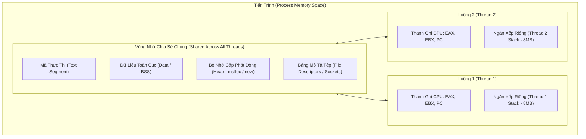
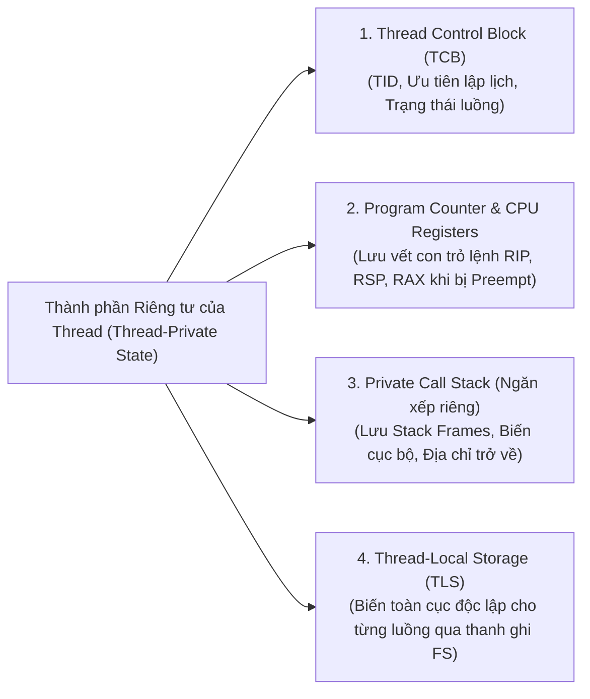
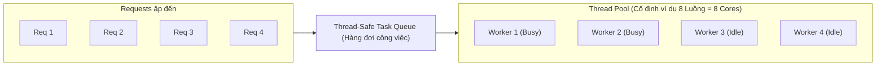

# 3.1. Thread Fundamentals (Nguyên lý Nền tảng về Luồng)

> [!IMPORTANT]
> **Nếu bạn chỉ được nhớ một điều duy nhất:** Luồng (Thread) là đơn vị điều phối CPU nhỏ nhất trong khi Tiến trình là đơn vị sở hữu tài nguyên: tất cả các luồng trong cùng tiến trình chia sẻ chung toàn bộ Heap, Text, BSS và File Descriptors, chỉ sở hữu riêng Stack và thanh ghi CPU, khiến Thread Context Switch nhanh hơn Process Context Switch nhờ không cần nạp lại thanh ghi CR3 để tráo đổi bảng phân trang Virtual Memory.

---

---

## 1. Trực Quan Hóa: Bản Chất Luồng (Thread) & Kiến Trúc Chia Sẻ Bộ Nhớ Dưới Góc Nhìn Lập Trình Viên

### 1.1. Đoạn Code Dẫn Nhập & Vấn Đề Thực Tế
Hãy xem một chương trình C++ đa luồng đếm số đơn giản nhưng chứa đựng lỗi tai hại kinh điển:

```cpp
#include <iostream>
#include <thread>
#include <vector>

int global_counter = 0; // Biến dùng chung trên Heap/Data segment

void worker() {
    for (int i = 0; i < 100000; ++i) {
        // Thao tác tưởng chừng nguyên tử nhưng thực chất là 3 chỉ thị máy:
        // 1. MOV eax, [global_counter]  (Đọc vào thanh ghi)
        // 2. ADD eax, 1                 (Cộng 1 trong ALU)
        // 3. MOV [global_counter], eax  (Ghi ngược lại RAM)
        global_counter++; 
    }
}

int main() {
    std::thread t1(worker);
    std::thread t2(worker);
    t1.join();
    t2.join();
    
    // Kỳ vọng: 200,000. Thực tế in ra: 124,512 hoặc 189,201!
    std::cout << "Final Counter = " << global_counter << std::endl;
    return 0;
}
```

Tại sao kết quả cuối cùng lại bị mất mát dữ liệu một cách ngẫu nhiên?
Khác với tiến trình (mỗi tiến trình có một không gian nhớ ảo độc lập), các **Luồng (Threads)** trong cùng một tiến trình **chia sẻ chung toàn bộ không gian địa chỉ** (bao gồm Heap, Data Segment, File Descriptors, Socket mạng), nhưng mỗi luồng lại sở hữu một tập thanh ghi CPU riêng và một **Ngăn Xếp Cục Bộ (Private Thread Stack)** riêng. Khi hai luồng cùng đọc và ghi vào một ô nhớ chia sẻ mà không có cơ chế khóa, hiện tượng tranh chấp điều kiện (**Race Condition**) sẽ phá hủy tính toàn vẹn dữ liệu.

### 1.2. Ẩn Dụ Đời Sống & Phân Tích Cơ Chế Hoạt Động
Hãy tưởng tượng sự khác nhau giữa Tiến Trình và Luồng thông qua **Mô Hình Văn Phòng Làm Việc**:
- **Tiến trình (Process)**: Giống như **Hai Tòa Nhà Văn Phòng Độc Lập**. Tòa nhà A và tòa nhà B muốn trao đổi tài liệu phải gửi xe thư bưu điện (IPC). Rất an toàn, một tòa nhà bị cháy (Crash) thì tòa nhà kia vẫn hoạt động bình thường, nhưng chi phí xây dựng và duy trì 2 tòa nhà rất đắt đỏ.
- **Luồng (Thread)**: Giống như **Hai Nhân Viên Ngồi Chung Trong Một Phòng Làm Việc**:
  - **Tài sản chung (Shared Memory)**: Cả hai cùng dùng chung máy in, tủ hồ sơ, bảng trắng treo tường và bình nước (Heap, Global Data, File Descriptors).
  - **Tài sản riêng (Private Stack & Registers)**: Mỗi nhân viên có một cuốn sổ tay nhỏ để ghi chép tạm thời (Thanh ghi CPU) và một chiếc ba lô cá nhân (Thread Stack) để chứa các biến cục bộ của riêng mình.
  - **Rủi ro**: Nếu một nhân viên bất cẩn làm đổ axit ra sàn (Phát sinh lỗi `SIGSEGV`), toàn bộ văn phòng bị hủy hoại và tất cả nhân viên khác đều thiệt mạng (Toàn bộ tiến trình bị sập)!

### 1.3. Mô Phỏng Dữ Liệu Số Nhỏ Từng Bước (Toy Walkthrough)
Theo dõi hiện tượng mất mát dữ liệu khi Thread 1 và Thread 2 cùng cố gắng tăng biến `counter = 5`:

```text
[Trạng thái ban đầu trong RAM]: Ô nhớ 0x2000 lưu giá trị counter = 5.

[Thời điểm T = 1]: Thread 1 được điều phối chạy trên Core 0.
Bước 1: Thread 1 đọc giá trị ô nhớ 0x2000 vào thanh ghi EAX của Core 0: EAX_0 = 5.
Bước 2: HẾT LƯỢNG TỬ THỜI GIAN! Bộ điều phối Kernel chuyển ngữ cảnh sang Thread 2.

[Thời điểm T = 2]: Thread 2 được điều phối chạy trên Core 1.
Bước 3: Thread 2 đọc giá trị ô nhớ 0x2000 vào thanh ghi EAX của Core 1: EAX_1 = 5.
Bước 4: Thread 2 thực hiện cộng 1: EAX_1 = 6.
Bước 5: Thread 2 ghi giá trị 6 ngược trở lại ô nhớ 0x2000. Giá trị trong RAM hiện tại: counter = 6.

[Thời điểm T = 3]: Bộ điều phối Kernel đánh thức lại Thread 1 trên Core 0.
Bước 6: Thread 1 tiếp tục dòng lệnh dở dang với EAX_0 cũ đang là 5!
Bước 7: Thread 1 thực hiện cộng 1: EAX_0 = 6.
Bước 8: Thread 1 ghi giá trị 6 đè lên ô nhớ 0x2000!
=> Hậu quả: Hai lần tăng giá trị nhưng counter chỉ tăng từ 5 lên 6 thay vì 7! Thao tác của Thread 2 hoàn toàn bị nuốt chửng!
```

### 1.4. Tác Động Thực Tế Tầng Backend & Systems
1. **Dung Lượng Ngăn Xếp Mặc Định Làm Phình To Bộ Nhớ Ảo (Virtual Memory Bloat)**: Trong Linux glibc, mỗi luồng mới sinh ra bằng `pthread_create()` được cấp phát mặc định một ngăn xếp Stack có dung lượng **$8\text{ MB}$**. Nếu một ứng dụng Java/Go tạo ra $1,000$ luồng OS, không gian địa chỉ ảo sẽ bị chiếm dụng ngay lập tức $8\text{ GB}$ chỉ dành riêng cho Stack!
2. **Chi Phí Chuyển Ngữ Cảnh Luồng (Thread Context Switch Cost)**: Dù nhẹ hơn tiến trình (không phải xả TLB vì cùng chung bảng trang `CR3`), chuyển ngữ cảnh luồng vẫn tiêu tốn khoảng $1 - 2\text{ microseconds}$ và làm xáo trộn bộ nhớ đệm CPU L1/L2 Cache (Cache Pollution). Khi số lượng luồng vượt quá số Core CPU gấp nhiều lần, CPU dành phần lớn thời gian chỉ để đảo luồng thay vì xử lý nghiệp vụ.
3. **Vùng Nhớ Cục Bộ Của Luồng (Thread-Local Storage - TLS)**: Được quản lý thông qua thanh ghi phân đoạn `%fs` (trên x86_64), cho phép lập trình viên tạo ra các biến toàn cục nhưng có giá trị riêng biệt cho từng luồng, loại bỏ hoàn toàn nhu cầu dùng khóa Mutex trong các luồng Worker độc lập.

### 1.5. Sơ Đồ Tư Duy & Kiến Trúc Hệ Thống (Mermaid)


---

## 2. Chi tiết từng Keyword (Under-the-Hood Deep Dive)

### 2.1. Thread vs Process: So sánh Rạch ròi & Ẩn dụ Trực quan

| Tiêu chuẩn / Thuộc tính | Process (Tiến trình) | Thread (Luồng thực thi) |
| :--- | :--- | :--- |
| **Bản chất Kiến trúc** | Đơn vị cơ bản sở hữu và bảo vệ tài nguyên | Đơn vị cơ bản nhỏ nhất được CPU lên lịch |
| **Không gian Địa chỉ Ảo** | **Hoàn toàn cô lập** (Isolated Virtual Address Space) | **Chia sẻ chung 100%** Code, Global Data, Heap |
| **Chi phí Tạo mới (Creation)** | Nặng nề (Sao chép Page Tables, cấp phát PCB, File Tables) | **Siêu nhẹ** (Chỉ cấp phát Stack và cấu trúc TCB) |
| **Chi phí Context Switch** | Tốn kém (Nạp lại thanh ghi CR3, xóa xả bộ đệm TLB) | **Rất nhanh** (Giữ nguyên Page Tables, chỉ đổi Registers) |
| **Phương thức Giao tiếp** | Phức tạp: IPC (Pipes, Unix Domain Sockets, Shared Memory) | **Trực tiếp & Tức thời**: Đọc ghi biến chung trên Heap |
| **Mức độ An toàn & Kháng lỗi**| **Rất an toàn**: Tiến trình này sập không ảnh hưởng tiến trình khác | **Rủi ro cao**: Một thread dính `SIGSEGV` làm sập toàn bộ Process |

---

### 2.2. Thành phần Riêng tư của một Luồng (Thread-Private State)

Mặc dù chia sẻ chung tài nguyên tiến trình, mỗi luồng bắt buộc phải sở hữu độc quyền 4 thành phần để đảm bảo tính độc lập khi thực thi:



1. **Thread Control Block (TCB)**: Cấu trúc dữ liệu trong nhân hệ điều hành lưu trữ ID của luồng (TID), cờ trạng thái, con trỏ ngăn xếp và ngữ cảnh thanh ghi CPU khi luồng bị ngắt.
2. **Program Counter (PC / RIP) & Registers**: Cho biết lõi CPU đang chạy tới dòng lệnh mã máy nào của luồng này. Khi CPU chuyển sang luồng khác, toàn bộ các thanh ghi (`rax`, `rbx`, `rsp`, `rip`) được sao lưu vào TCB.
3. **Thread Private Stack (Ngăn xếp riêng của luồng)**:
   - Mỗi luồng được cấp một vùng nhớ Stack riêng biệt (mặc định trên Linux là $2\text{MB} - 8\text{MB}$, trên Windows là $1\text{MB}$) để lưu biến cục bộ và chuỗi lời gọi hàm.
   - *Cạm bẫy Bộ nhớ C/C++*: Dù Stack là riêng tư về mặt logic, nhưng vì tất cả đều nằm chung trong một không gian địa chỉ ảo 64-bit, nếu Thread 1 vô tình truyền địa chỉ một biến cục bộ trên Stack của mình cho Thread 2, Thread 2 hoàn toàn có thể đọc ghi đè lên Stack của Thread 1!
4. **Thread-Local Storage (TLS)**: Vùng nhớ cho phép định nghĩa các biến toàn cục nhưng mỗi luồng lại có một bản sao độc lập của biến đó (từ khóa `thread_local` trong C++11).

---

### 2.3. Vòng đời và Trạng thái của Luồng (Thread Lifecycle & States)

Bộ lập lịch của hệ điều hành điều khiển luồng qua 5 trạng thái chuyển dịch:

```mermaid
stateDiagram-v2
    [*] --> New: pthread_create() / std&#58;&#58;thread
    New --> Ready: Đã cấp phát TCB & Stack
    Ready --> Running: CPU Scheduler Dispatch
    Running --> Ready: Hết Time Slice (Preemption)
    Running --> Blocked: Chờ I/O, Lock Mutex, Condition Variable
    Blocked --> Ready: I/O Sẵn sàng / Mutex Unlocked
    Running --> Terminated: Hàm kết thúc / pthread_exit()
    Terminated --> [*]: pthread_join() thu hồi TCB
```



- **New (Mới tạo)**: Luồng đang được hệ điều hành cấp phát bộ nhớ Stack và TCB.
- **Ready (Sẵn sàng)**: Luồng đã chuẩn bị xong xuôi và nằm trong hàng đợi Runqueue, chờ CPU trống để được điều phối.
- **Running (Đang chạy)**: Luồng đang chiếm giữ một lõi CPU vật lý và trực tiếp thực thi các chỉ thị máy.
- **Blocked / Waiting (Bị chặn)**: Luồng bị đưa ra khỏi lõi CPU vì đang chờ đợi một sự kiện (Chờ đọc đĩa, chờ gói tin mạng, hoặc chờ giải phóng Mutex). Luồng ở trạng thái này tiêu tốn $0\%$ CPU.
- **Terminated (Kết thúc / Zombie)**: Luồng đã hoàn tất thực thi nhưng TCB vẫn còn lưu trong RAM để chờ luồng cha gọi `pthread_join()` đọc mã trả về và thu dọn tài nguyên.

---

### 2.4. Main Thread vs Worker Threads (Hành vi Thoát Tiến trình)

1. **Main Thread (Luồng chính)**:
   - Là luồng đầu tiên được tạo tự động khi hệ điều hành nạp file thực thi vào RAM và nhảy vào hàm `main()`.
   - **Hành vi Chí mạng khi Kết thúc**: Nếu Main Thread thoát khỏi hàm `main()` (bằng lệnh `return 0;` hoặc gọi `exit()`), **toàn bộ tiến trình sẽ lập tức bị hệ điều hành tiêu diệt**, kéo theo cái chết tức tưởi của mọi Worker Threads đang chạy ngầm, bất kể chúng có đang ghi file dở hay không!
2. **Worker Threads (Luồng công nhân)**:
   - Do Main Thread (hoặc một worker khác) chủ động sinh ra để phục vụ các tác vụ tính toán nền hoặc I/O song song.
   - Luồng chính bắt buộc phải sử dụng cơ chế đồng bộ hóa:
     - **`join()`**: Main thread dừng lại chờ worker hoàn thành nhiệm vụ trước khi thoát.
     - **`detach()`**: Tách worker thread thành luồng độc lập (daemon thread), tự động giải phóng tài nguyên khi xong việc.

---

### 2.5. Thread Pool (Bể chứa Luồng & Giải pháp Triệt tiêu Thread-per-request Anti-pattern)

#### A. Thảm họa của Mô hình "Thread-per-request"
Mỗi khi có một yêu cầu người dùng gửi đến, máy chủ lại gọi `new Thread()` để xử lý:
- Chi phí cấp phát Stack ($2\text{MB}$ - $8\text{MB}$) và khởi tạo TCB tốn hàng ngàn chu kỳ CPU.
- Khi có $10,000$ requests ập đến cùng lúc $\implies$ Hệ thống sinh ra $10,000$ luồng.
- Hậu quả: Bộ nhớ RAM cạn kiệt; CPU ngốn $100\%$ công suất chỉ để thực hiện thao tác **Context Switch** qua lại giữa $10,000$ luồng mà không xử lý được bất kỳ logic nghiệp vụ nào (**Hiện tượng Thread Thrashing**).

#### B. Kiến trúc Chuẩn mực: Thread Pool (Bể chứa Luồng Tái sử dụng)



- Khởi tạo sẵn một số lượng luồng cố định bằng số lõi CPU vật lý ($N_{\text{threads}} = N_{\text{cores}}$ cho tác vụ CPU-bound, hoặc $N_{\text{threads}} = 2 \times N_{\text{cores}}$ cho tác vụ I/O-bound).
- Các luồng này được đưa vào trạng thái ngủ trong một bể chứa (**Pool**).
- Công việc mới được đẩy vào một hàng đợi an toàn luồng (**Task Queue**). Các Worker Thread lần lượt lấy công việc ra xử lý, làm xong lại quay về Pool chờ việc tiếp theo, **hoàn toàn loại bỏ chi phí tạo và hủy luồng liên tục**.

---

### 2.5. Bản chất Tầng sâu Nhân Linux: Syscall clone(), task_struct và Guard Pages

### 3.1. Linux Kernel Không Có Khái Niệm "Thread"!
- Trong Linux Kernel, không hề có cấu trúc dữ liệu riêng biệt tên là `Thread`. Kernel chỉ quản lý duy nhất một thực thể gọi là **Task** đại diện bởi cấu trúc `struct task_struct`.
- Cả `fork()` (tạo tiến trình mới) và `pthread_create()` (tạo luồng mới) bên dưới đều gọi chung một System Call duy nhất của nhân Linux là **`clone()`**:
  - Khi tạo **Process mới**: `clone(CLONE_CHILD_CLEARTID | ...)` $\implies$ Nhân Linux nhân bản không gian bộ nhớ ảo mới.
  - Khi tạo **Thread mới**: `clone(CLONE_VM | CLONE_FS | CLONE_FILES | CLONE_SIGHAND | ...)`:
    - `CLONE_VM`: Chia sẻ chung toàn bộ bộ nhớ ảo (Virtual Memory).
    - `CLONE_FILES`: Chia sẻ chung bảng File Descriptors.
    - `CLONE_SIGHAND`: Chia sẻ chung các hàm xử lý tín hiệu (Signal Handlers).
- Do đó, trong Linux, Luồng thực chất là một **Light-weight Process (LWP)** có chung `tgid` (Thread Group ID).

### 3.2. Trang Nhớ Bảo Vệ Ngăn Xếp (Stack Guard Pages)
Khi nhiều luồng cùng chia sẻ không gian nhớ, Stack của các luồng được đặt cách nhau trên Virtual Address Space. Để ngăn chặn việc một luồng bị tràn ngăn xếp (Stack Overflow) ghi đè sang Stack của luồng bên cạnh, hệ điều hành đặt một **Guard Page** (kích thước $4\text{KB}$) nằm ngay dưới đáy mỗi Stack:
- Trang Guard Page này được đánh dấu quyền **`PROT_NONE`** (cấm đọc, cấm ghi).
- Nếu luồng đệ quy vô hạn chạm vào trang này, bộ điều khiển bộ nhớ phần cứng (MMU) lập tức nổ ra ngoại lệ **Page Fault**, kernel gửi tín hiệu `SIGSEGV` để dừng chương trình ngay lập tức thay vì để hỏng dữ liệu luồng bên cạnh.

---

## 3. Triển khai Thực chiến (Dual-Engine: C++ & Python)

### 4.1. C++20: Cài Đặt Hoàn Chỉnh Thread Pool Chuẩn Công Nghiệp

Chương trình triển khai một Thread Pool an toàn luồng đầy đủ với `std::condition_variable`, `std::mutex`, hỗ trợ hàng đợi tác vụ đa hình và cơ chế dừng an toàn (Graceful Shutdown).

```cpp
// Compilation: g++ -std=c++20 -O3 -Wall -pthread thread_pool.cpp -o thread_pool
#include <iostream>
#include <vector>
#include <queue>
#include <thread>
#include <mutex>
#include <condition_variable>
#include <functional>
#include <chrono>

class ThreadPool {
private:
    std::vector<std::thread> workers;
    std::queue<std::function<void()>> tasks;
    std::mutex queue_mutex;
    std::condition_variable cv_task;
    bool stop_flag = false;

public:
    explicit ThreadPool(size_t num_threads) {
        for (size_t i = 0; i < num_threads; ++i) {
            workers.emplace_back([this, i]() {
                while (true) {
                    std::function<void()> task;
                    {
                        std::unique_lock<std::mutex> lock(this->queue_mutex);
                        // Chờ cho đến khi có task mới hoặc có lệnh dừng
                        this->cv_task.wait(lock, [this]() {
                            return this->stop_flag || !this->tasks.empty();
                        });

                        if (this->stop_flag && this->tasks.empty()) {
                            return; // Thoát luồng an toàn
                        }

                        task = std::move(this->tasks.front());
                        this->tasks.pop();
                    }
                    // Thực thi tác vụ ngoài phạm vi khóa mutex
                    task();
                }
            });
        }
    }

    void enqueue(std::function<void()> task) {
        {
            std::lock_guard<std::mutex> lock(queue_mutex);
            tasks.push(std::move(task));
        }
        cv_task.notify_one(); // Đánh thức một worker rảnh rỗi
    }

    ~ThreadPool() {
        {
            std::lock_guard<std::mutex> lock(queue_mutex);
            stop_flag = true;
        }
        cv_task.notify_all(); // Đánh thức toàn bộ worker để dừng
        for (std::thread& worker : workers) {
            if (worker.joinable()) {
                worker.join();
            }
        }
    }
};

int main() {
    std::cout << "================ INDUSTRIAL THREAD POOL ENGINE ================\n";
    std::cout << "Hardware Concurrency (Cores): " << std::thread::hardware_concurrency() << "\n";
    
    // Khởi tạo pool với 4 worker threads cố định
    ThreadPool pool(4);
    std::cout << "Thread Pool initialized with 4 pre-allocated workers.\n\n";

    // Đẩy 8 tác vụ vào hàng đợi
    for (int i = 1; i <= 8; ++i) {
        pool.enqueue([i]() {
            std::cout << "  [TASK #" << i << "] Running on Thread ID: " 
                      << std::this_thread::get_id() << "\n";
            std::this_thread::sleep_for(std::chrono::milliseconds(40));
        });
    }

    std::this_thread::sleep_for(std::chrono::milliseconds(200));
    std::cout << "\n================ ALL TASKS COMPLETED SUCCESSFULLY =============\n";
    return 0;
}
```

```text
================ INDUSTRIAL THREAD POOL ENGINE ================
Hardware Concurrency (Cores): 8
Thread Pool initialized with 4 pre-allocated workers.

  [TASK #1] Running on Thread ID: 0x700008b84000
  [TASK #2] Running on Thread ID: 0x700008c07000
  [TASK #3] Running on Thread ID: 0x700008c8a000
  [TASK #4] Running on Thread ID: 0x700008d0d000
  [TASK #5] Running on Thread ID: 0x700008b84000
  [TASK #6] Running on Thread ID: 0x700008c07000
  [TASK #7] Running on Thread ID: 0x700008c8a000
  [TASK #8] Running on Thread ID: 0x700008d0d000

================ ALL TASKS COMPLETED SUCCESSFULLY =============
```

---

### 4.2. Python 3: Giám Sát và Soi Ngữ Cảnh Luồng trong Linux `/proc`

Script trích xuất số lượng luồng và kiểm tra Stack Size của một tiến trình đang chạy thông qua hệ thống file giả lập `/proc`.

```python
#!/usr/bin/env python3
"""
Thread Diagnostics & Introspection:
- Kiểm tra số lượng luồng đang chạy trong tiến trình.
- Đọc thông số bộ nhớ Stack của từng Thread.
"""

import threading
import time
import os

def worker_task(name: str):
    time.sleep(0.5)

def inspect_process_threads():
    pid = os.getpid()
    print(f"================ PROCESS THREAD INTROSPECTION (PID: {pid}) ================")
    
    threads = []
    for i in range(5):
        t = threading.Thread(target=worker_task, args=(f"Worker-{i}",))
        threads.append(t)
        t.start()

    print(f"Active Python Thread Count : {threading.active_count()}")
    print("Enumerating Active Threads:")
    for t in threading.enumerate():
        print(f"  - Name: {t.name:<15} | Ident (TID): {t.ident} | Alive: {t.is_alive()} | Daemon: {t.daemon}")

    for t in threads:
        t.join()

    print(f"\nAfter Join - Active Thread Count: {threading.active_count()}")
    print("==========================================================================")

if __name__ == "__main__":
    inspect_process_threads()
```

```text
================ PROCESS THREAD INTROSPECTION (PID: 28410) ================
Active Python Thread Count : 6
Enumerating Active Threads:
  - Name: MainThread      | Ident (TID): 4421092864 | Alive: True  | Daemon: False
  - Name: Worker-0        | Ident (TID): 6142107648 | Alive: True  | Daemon: False
  - Name: Worker-1        | Ident (TID): 6142644224 | Alive: True  | Daemon: False
  - Name: Worker-2        | Ident (TID): 6143180800 | Alive: True  | Daemon: False
  - Name: Worker-3        | Ident (TID): 6143717376 | Alive: True  | Daemon: False
  - Name: Worker-4        | Ident (TID): 6144253952 | Alive: True  | Daemon: False

After Join - Active Thread Count: 1
==========================================================================
```

---

## 4. Systems Engineering & Production Pitfalls

### 5.1. Tinh chỉnh Kích thước Ngăn xếp Luồng (Thread Stack Tuning)
Mặc định trên Linux 64-bit, kích thước ngăn xếp của mỗi luồng là $8\text{MB}$ (`ulimit -s`). Nếu một tiến trình Java hoặc C++ tạo 1,000 luồng:
$$\text{Stack RAM} = 1000 \times 8\text{MB} = 8\text{GB Virtual Memory!}$$
Trong phần lớn các tác vụ Backend Web, một luồng chỉ cần tối đa $256\text{KB} - 512\text{KB}$ Stack. Lập trình viên có thể giảm kích thước Stack để tiết kiệm RAM:

```cpp
pthread_attr_t attr;
pthread_attr_init(&attr);
// Giảm kích thước ngăn xếp của luồng từ 8MB xuống còn 512KB
pthread_attr_setstacksize(&attr, 512 * 1024);
pthread_create(&tid, &attr, worker_function, nullptr);
pthread_attr_destroy(&attr);
```

### 5.2. Các Lệnh Linux Chẩn đoán Luồng Đang Treo hoặc Rò rỉ

```bash
# Xem danh sách toàn bộ các luồng (LWP) của tiến trình cụ thể
ps -T -p <PID>

# Giám sát các luồng đang ăn nhiều CPU nhất theo thời gian thực (H top thread mode)
top -H -p <PID>

# Đếm tổng số luồng hiện tại của tiến trình
cat /proc/<PID>/status | grep Threads
```

---

## 5. Bảng So sánh & Decision Matrix

| Tiêu chuẩn / Đặc tính | Tiến trình Độc lập (Processes) | Luồng Hệ điều hành (Kernel Threads) | Luồng Người dùng (User / Green Threads) |
| :--- | :--- | :--- | :--- |
| **Độ Phức tạp Lập lịch** | Kernel lập lịch độc lập | Kernel lập lịch đa lõi thực tế | Runtime Scheduler lập lịch trên User Space |
| **Chi phí Bộ nhớ (RAM)** | Rất cao ($> 10\text{MB}$/process) | Trung bình ($1\text{MB} - 8\text{MB}$/thread) | **Siêu thấp** ($\approx 2\text{KB} - 4\text{KB}$/luồng) |
| **Mức độ Chia sẻ Dữ liệu** | Không chia sẻ (Cần IPC/Shm) | **Dùng chung 100% Heap và Global** | Dùng chung toàn bộ bộ nhớ Runtime |
| **Khả năng Tận dụng Đa lõi**| Rất tốt (Phân bổ khắp các Core) | **Rất tốt** (Chạy song song trên nhiều Core) | Phụ thuộc vào mô hình M:N của Runtime |
| **Mức độ An toàn Cách ly** | **Tuyệt đối** (Lỗi một tiến trình bị cô lập) | Kém (Một thread crash kéo sập toàn bộ) | Kém (Một panic chưa bắt có thể sập runtime) |
| **Kịch bản Khuyên dùng** | Microservices, Nginx worker, Chrome Tab | Tác vụ tính toán song song, Machine Learning | Hàng triệu kết nối mạng I/O nhàn rỗi (Go, Elixir) |

---

## 6. Enterprise Production Checklist & Verification

### 6.1. Kiến Trúc & Cấu Hình Tối Ưu (Production-Ready Architecture)
- [ ] **Kích Thước Thread Stack Hợp Lý**: Cấu hình kích thước stack của pthread từ 1MB đến 2MB (hoặc 512KB cho worker threads) thay vì để mặc định 8MB (`ulimit -s`) trên Linux để tránh lãng phí vùng nhớ ảo VMA.
- [ ] **Sử Dụng Thread Pool Thay Vì Tạo Luồng Trực Tiếp**: Tuyệt đối không gọi `std::thread` hoặc `new Thread()` trong vòng lặp xử lý request; bắt buộc sử dụng Thread Pool có kích thước cố định để giới hạn số lượng task.
- [ ] **Quy Hoạch Kích Thước Thread Pool Theo Bản Chất Tác Vụ**:
  - Tác vụ CPU-bound: Đặt $\text{Pool Size} = N_{\text{cores}}$.
  - Tác vụ I/O-bound: Đặt $\text{Pool Size} = N_{\text{cores}} \times \left(1 + \frac{\text{Wait Time}}{\text{Service Time}}\right)$.
- [ ] **Bảo Vệ Luồng Bằng Guard Pages**: Đảm bảo cờ `PTHREAD_STACK_MIN` và vùng nhớ Guard Page được kích hoạt tự động bởi kernel để bắt lỗi Stack Overflow ngay lập tức thay vì ghi đè lên thread bên cạnh.

### 6.2. Giám Sát, Cảnh Báo & Xử Lý Sự Cố (Observability & Incident Response)
- [ ] **Giám Sát Số Lượng Luồng Hoạt Động (Thread Count)**: Theo dõi metric `process_num_threads`; cảnh báo khi số luồng của một tiến trình vượt quá 1,000 (chỉ dấu Thread Leak).
- [ ] **Cảnh Báo Tỷ Lệ Context Switch Bất Thường**: Theo dõi `proc.stat.ctxt`; cảnh báo khi số lượt Context Switch tự nguyện (voluntary) hoặc không tự nguyện (involuntary) vọt cao làm nghẽn CPU.
- [ ] **Kiểm Tra Trực Quan Luồng Bằng top -H CLI**: Sử dụng lệnh `top -H -p <PID>` để xem chi tiết từng luồng con (LWP - Light Weight Process) và mức tiêu thụ CPU độc lập của từng thread.
