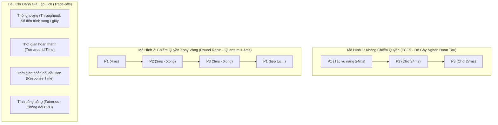
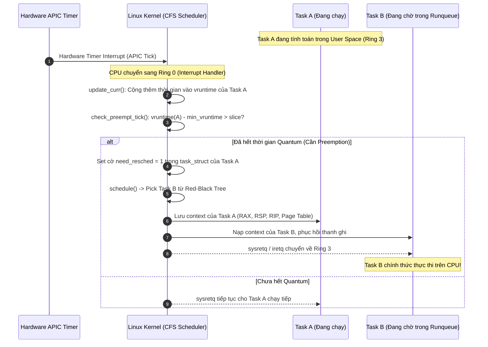

# 4.1. CPU Scheduling Fundamentals (Nguyên lý Nền tảng về Lập lịch CPU)

> [!IMPORTANT]
> **Nếu bạn chỉ được nhớ một điều duy nhất:** Bộ điều phối CPU (CPU Scheduler) là bộ não trọng tài giải quyết mâu thuẫn vĩnh cửu giữa **Thông lượng tối đa (Throughput)** và **Thời gian phản hồi tức thì (Response Time)**: một thuật toán tối ưu phải nhận diện chính xác bản chất CPU-bound (cần quantum lớn để giảm context switch) hay I/O-bound (cần ưu tiên ngắt để nhanh chóng giải phóng thiết bị ngoại vi).

---

## 1. Trực Quan Hóa: Bản Chất Lập Lịch CPU Dưới Góc Nhìn Lập Trình Viên

### 1.1. Đoạn Code Dẫn Nhập & Vấn Đề Thực Tế
Hãy xem một tình huống phổ biến trong dịch vụ Backend khi một tác vụ tính toán ngốn CPU làm tê liệt hoàn toàn các yêu cầu mạng nhẹ khác:

```python
import time
from concurrent.futures import ThreadPoolExecutor

def heavy_cpu_task():
    # Tác vụ đào coin / băm mật mã chiếm dụng CPU liên tục 10 giây
    start = time.time()
    while time.time() - start < 10:
        _ = 2 ** 100000

def quick_io_task():
    # Tác vụ trả lời API Health Check của Kubernetes (Cần xong trong 5ms)
    return "OK"

# Nếu chạy trên hệ điều hành không có cơ chế lập lịch chiếm quyền (Non-preemptive):
# Tác vụ quick_io_task sẽ bị treo 10 giây, khiến Kubernetes phán đoán Pod đã chết và Restart!
```

Tại sao hệ điều hành máy chủ có thể chạy đồng thời hàng trăm dịch vụ Backend, vừa phục vụ hàng nghìn request HTTP nhỏ, vừa có thể chạy các tiến trình nén file nền mà không dịch vụ nào bị đóng băng vĩnh viễn?
Bí mật nằm ở **Bộ Điều Phối CPU Chiếm Quyền (Preemptive CPU Scheduler)**: Thay vì để tiến trình tự nguyện nhường quyền, hệ điều hành thiết lập một chiếc đồng hồ đếm ngược phần cứng. Khi lượng tử thời gian (**Time Quantum**) cạn kiệt, CPU tự động bị giật lại để trao cho tiến trình tiếp theo trong hàng đợi.

### 1.2. Ẩn Dụ Đời Sống & Phân Tích Cơ Chế Hoạt Động
Hãy tưởng tượng Bộ điều phối CPU giống như **Bác Sĩ Trực Cấp Cứu Tại Bệnh Viện**:
- **Tác vụ CPU-Bound (Nặng tính toán)**: Giống như một bệnh nhân cần thực hiện một ca phẫu thuật phức tạp kéo dài 6 tiếng.
- **Tác vụ I/O-Bound (Nhanh, ngắt quãng)**: Giống như một bệnh nhân bị đứt tay chỉ cần sát trùng và dán băng keo cá nhân trong 30 giây.
- **Nếu lập lịch Không Chiếm Quyền (Non-preemptive - FCFS)**: Bác sĩ bước vào phòng mổ 6 tiếng. Bệnh nhân đứt tay đến sau buộc phải ngồi chờ 6 tiếng ở phòng đợi chỉ để xin miếng băng keo! (Hiện tượng đoàn tàu hộ tống - **Convoy Effect**).
- **Lập lịch Chiếm Quyền (Preemptive Scheduling)**: Bác sĩ phân chia thời gian thông minh: Dành 1 phút xử lý ngay vết đứt tay cho bệnh nhân nhẹ, sau đó quay lại phòng phẫu thuật. Khi ca mổ cần chờ kết quả xét nghiệm máu (Đợi I/O ổ đĩa), bác sĩ lập tức bước ra sảnh khám cho các bệnh nhân khác.

### 1.3. Mô Phỏng Dữ Liệu Số Nhỏ Từng Bước (Toy Walkthrough)
Theo dõi chỉ số Thời gian Chờ đợi (Waiting Time) với 3 tiến trình đến cùng lúc tại $T = 0$: $P_1$ (cần $24\text{ ms}$ CPU), $P_2$ (cần $3\text{ ms}$), $P_3$ (cần $3\text{ ms}$):

```text
[Kịch bản 1: Không chiếm quyền - Thứ tự chạy P1 -> P2 -> P3]
Thời điểm 0ms - 24ms: P1 độc chiếm CPU. (P2 và P3 phải chờ đợi 24ms!).
Thời điểm 24ms - 27ms: P2 chạy xong.
Thời điểm 27ms - 30ms: P3 chạy xong.
=> Thời gian chờ đợi trung bình = (0 + 24 + 27) / 3 = 17.0 ms! (Rất tệ cho P2 và P3).

[Kịch bản 2: Lập lịch ưu tiên việc ngắn trước - SJF (Shortest Job First): P2 -> P3 -> P1]
Thời điểm 0ms - 3ms: P2 chạy xong. (Thời gian chờ = 0ms).
Thời điểm 3ms - 6ms: P3 chạy xong. (Thời gian chờ = 3ms).
Thời điểm 6ms - 30ms: P1 chạy xong. (Thời gian chờ = 6ms).
=> Thời gian chờ đợi trung bình = (0 + 3 + 6) / 3 = 3.0 ms! (Nhanh gấp gần 6 LẦN!).
```

### 1.4. Tác Động Thực Tế Tầng Backend & Systems
1. **Hiện Tượng Đoàn Tàu Hộ Tống (Convoy Effect) Trong Node.js / Python Event Loop**: Node.js và Python chạy trên mô hình đơn luồng Event Loop (tương đương Non-preemptive ở tầng ứng dụng). Nếu lập trình viên vô tình thực hiện một hàm đồng bộ nặng (như `JSON.parse` một file $500\text{ MB}$), toàn bộ hàng nghìn kết nối HTTP khác đang chờ ở Event Queue đều bị nghẽn lại, đẩy độ trễ phản hồi lên hàng chục giây.
2. **Sự Đánh Đổi Khi Chọn Lượng Tử Thời Gian (Time Quantum Trade-off)**:
   - Nếu Quantum quá nhỏ ($< 1\text{ ms}$): CPU mất tới $20\% - 40\%$ công suất chỉ để thực hiện chuyển đổi ngữ cảnh (Context Switch Overhead).
   - Nếu Quantum quá lớn ($> 100\text{ ms}$): Hệ thống phản hồi chậm chạp, trải nghiệm tương tác (Response Time) suy giảm nghiêm trọng, biến Round Robin thành FCFS.
3. **Phân Tách CPU Cho Các Tác Vụ Backend**: Trong kiến trúc microservices hiện đại, các tác vụ tính toán nặng (Report generation, Batch export) bắt buộc phải được tách riêng sang các Worker Node độc lập hoặc gán CPU Cgroup quota hạn chế để không làm ảnh hưởng đến luồng phục vụ Web/API trực tiếp.

### 1.5. Sơ Đồ Tư Duy & Kiến Trúc Hệ Thống (Mermaid)


---

## 2. Chi tiết từng Keyword (Under-the-Hood Deep Dive)

### 2.1. Preemptive vs Non-Preemptive Scheduling

Ranh giới thiết kế phân chia hai trường phái lập lịch của lịch sử hệ điều hành:



#### 1. Non-Preemptive Scheduling (Lập lịch không chiếm dụng / Đa nhiệm hợp tác)
- Tiến trình khi đã nắm giữ CPU sẽ tiếp tục chạy cho đến khi:
  - Tự nguyện hoàn tất và gọi hàm `exit()` kết thúc.
  - Tự nguyện giải phóng CPU để chờ một sự kiện: đọc/ghi đĩa (`read()`, `write()`), chờ kết nối mạng, hoặc chủ động gọi lệnh `sched_yield()`.
- **Nhược điểm chí mạng**: Một lỗi lập trình đơn giản như vòng lặp vô hạn hay tính toán nặng không yield sẽ đóng băng toàn bộ hệ thống; không có cơ chế đảm bảo tính thời gian thực (Real-time).

#### 2. Preemptive Scheduling (Lập lịch chiếm dụng - Chuẩn mực Hiện đại)
- Hệ điều hành sử dụng bộ định thời phần cứng (**APIC Timer - Advanced Programmable Interrupt Controller**) để phát ra các tín hiệu ngắt định kỳ (gọi là **Scheduler Ticks**, tần số thường cấu hình là $100\text{Hz}$, $250\text{Hz}$ hoặc $1000\text{Hz}$).
- Khi ngắt xảy ra, CPU lập tức dừng thực thi mã người dùng, chuyển sang Kernel Mode (Ring 0). Trình xử lý ngắt kiểm tra xem tiến trình hiện tại đã ngốn hết lát cắt thời gian (**Time Quantum / Time Slice**) hay chưa.
- Nếu hết thời gian hoặc có một tiến trình có độ ưu tiên cao hơn thức dậy, Kernel sẽ **ép buộc ngắt tiến trình đang chạy**, chuyển nó về trạng thái `TASK_RUNNING` trong Runqueue, và điều phối CPU cho tiến trình khác.

---

### 2.2. Dispatcher và Context Switching (Bộ Điều phối & Độ Trễ Dispatch Latency)

Sự phân định rõ ràng giữa "Người ra quyết định" (Scheduler) và "Người thi hành án" (Dispatcher):

1. **Scheduler (Bộ Lập lịch)**:
   - Là thuật toán logic thuần túy (ví dụ: CFS, EEVDF, MLFQ, Round Robin).
   - Trách nhiệm duy nhất: Duyệt qua danh sách các luồng đang ở trạng thái sẵn sàng (`Ready`) để chọn ra **tiến trình tối ưu nhất** cần được chạy tiếp theo.

2. **Dispatcher (Bộ Điều phối)**:
   - Là đoạn mã hợp ngữ (Assembly) tối ưu ở tầng thấp nhất của nhân hệ điều hành.
   - Nhiệm vụ cơ học:
     1. **Chuyển đổi ngữ cảnh (Context Switch)**: Lưu toàn bộ trạng thái thanh ghi vi xử lý của tiến trình cũ vào vùng nhớ Kernel Stack, nạp trạng thái thanh ghi của tiến trình mới.
     2. **Đổi không gian địa chỉ bộ nhớ (Switch Virtual Address Space)**: Nạp con trỏ bảng trang mới vào thanh ghi điều khiển `CR3` (nếu hai luồng thuộc hai tiến trình khác nhau, dẫn tới việc xả bộ nhớ đệm TLB).
     3. **Chuyển cấp độ đặc quyền (Privilege Level Switch)**: Chuyển từ Kernel Mode (Ring 0) trở về User Mode (Ring 3) bằng lệnh `sysretq` hoặc `iretq`.
     4. **Nhảy tới điểm thực thi**: Nạp con trỏ lệnh vào thanh ghi `RIP` của chương trình mới để CPU tiếp tục thực thi.

3. **Dispatch Latency (Độ trễ Điều phối)**:
   - Khoảng thời gian tính bằng nano-giây từ khi Scheduler quyết định dừng Luồng A cho tới khi Luồng B thực sự chạy được lệnh đầu tiên trên CPU.
   $$\text{Dispatch Latency} = T_{\text{Interrupt}} + T_{\text{Scheduler Logic}} + T_{\text{Context Switch}} + T_{\text{TLB Reload}}$$
   - Trong các hệ điều hành thời gian thực (RTOS), Dispatch Latency bắt buộc phải có tính đơn định (Deterministic) và khống chế dưới vài micro-giây.

---

### 2.3. Các Chỉ số Đo lường Hiệu năng Lập lịch (Scheduling Metrics, Fairness & Starvation)

Để đánh giá chất lượng của một giải thuật lập lịch, các nhà khoa học máy tính sử dụng 7 chỉ số toán học định lượng:

1. **CPU Utilization (Tỷ lệ sử dụng CPU)**:
   $$U = \frac{T_{\text{busy}}}{T_{\text{total}}} \times 100\%$$
   Tỷ lệ phần trăm thời gian CPU thực hiện các công việc tính toán hữu ích thay vì chạy vòng lặp nhàn rỗi (Idle Task). Trong thực tế sản xuất, mức tải lý tưởng là từ $60\%$ đến $85\%$.

2. **Throughput (Thông lượng)**:
   Số lượng tiến trình hoàn tất toàn bộ chu trình thực thi trên một đơn vị thời gian (ví dụ: $1.000\text{ tasks/sec}$).

3. **Turnaround Time (Thời gian quay vòng)**:
   Khoảng thời gian từ lúc tiến trình được đệ trình vào hệ thống ($T_{\text{submission}}$) cho đến lúc nó hoàn tất ($T_{\text{completion}}$):
   $$T_{\text{turnaround}} = T_{\text{completion}} - T_{\text{submission}} = T_{\text{waiting}} + T_{\text{execution}} + T_{\text{I/O}}$$

4. **Waiting Time (Thời gian chờ đợi)**:
   Tổng thời lượng tiến trình phải nằm thụ động trong hàng đợi Runqueue chỉ để chờ được CPU cấp phát lượt chạy:
   $$T_{\text{waiting}} = T_{\text{turnaround}} - T_{\text{execution}} - T_{\text{I/O}}$$

5. **Response Time (Thời gian phản hồi)**:
   Khoảng thời gian từ lúc yêu cầu được gửi vào cho tới khi hệ thống **bắt đầu đưa ra phản hồi đầu tiên**. Đây là chỉ số sống còn cho trải nghiệm người dùng và SLA của Web API:
   $$T_{\text{response}} = T_{\text{first run}} - T_{\text{submission}}$$

6. **Fairness (Tính Công bằng)**:
   Đảm bảo mọi tiến trình đều nhận được một tỷ lệ tài nguyên CPU tương xứng với trọng số hoặc độ ưu tiên của nó, không có tiến trình nào bị đối xử bất công.

7. **Starvation (Bỏ đói tài nguyên) & Kỹ thuật Aging (Già hóa)**:
   - Hiện tượng một tiến trình có độ ưu tiên thấp (Low Priority) **bị kẹt vĩnh viễn trong Runqueue và không bao giờ được cấp CPU**, do liên tục có các tiến trình có độ ưu tiên cao hơn xuất hiện và chiếm quyền.
   - **Giải pháp Aging**: Bộ lập lịch tự động tăng dần độ ưu tiên của các tiến trình đang nằm chờ theo thời gian:
     $$\text{Priority}_{\text{effective}} = \text{Priority}_{\text{base}} + \alpha \times T_{\text{wait}}$$
     Sau một thời gian chờ đủ lâu, tiến trình yếu thế nhất cũng sẽ vươn lên thành tiến trình có độ ưu tiên cao nhất để được CPU phục vụ.

---

## 3. Triển khai Thực chiến (Dual-Engine: C++ & Python)

### 3.1. Engine C++20: Mô Phỏng Preemptive Round-Robin Scheduler với Hardware Timer Tick

Chương trình C++20 mô phỏng cơ chế ngắt thời gian cưỡng chế (Preemption) và tính toán chính xác các chỉ số hiệu năng (Waiting Time, Turnaround Time, Response Time) của các tác vụ:

```cpp
#include <iostream>
#include <vector>
#include <queue>
#include <iomanip>
#include <string>

struct Task {
    int id;
    int arrival_time;
    int burst_time;
    int remaining_time;
    int start_time = -1;
    int completion_time = 0;
    int waiting_time = 0;
    int turnaround_time = 0;
    int response_time = 0;
};

void simulate_round_robin(std::vector<Task> tasks, int quantum) {
    int current_time = 0;
    int completed = 0;
    int n = tasks.size();
    std::queue<int> ready_queue;
    std::vector<bool> in_queue(n, false);

    // Đẩy task đến tại t = 0 vào hàng đợi
    for (int i = 0; i < n; ++i) {
        if (tasks[i].arrival_time <= current_time && !in_queue[i]) {
            ready_queue.push(i);
            in_queue[i] = true;
        }
    }

    std::cout << "\n=== BẮT ĐẦU MÔ PHỎNG PREEMPTIVE ROUND ROBIN (QUANTUM = " << quantum << " ms) ===\n";
    std::cout << "Timeline thực thi:\n";

    while (completed < n) {
        if (ready_queue.empty()) {
            // Không có task nào sẵn sàng, CPU rơi vào Idle
            current_time++;
            for (int i = 0; i < n; ++i) {
                if (tasks[i].arrival_time <= current_time && !in_queue[i]) {
                    ready_queue.push(i);
                    in_queue[i] = true;
                }
            }
            continue;
        }

        int idx = ready_queue.front();
        ready_queue.pop();

        if (tasks[idx].start_time == -1) {
            tasks[idx].start_time = current_time;
            tasks[idx].response_time = tasks[idx].start_time - tasks[idx].arrival_time;
        }

        int execution_slice = std::min(quantum, tasks[idx].remaining_time);
        std::cout << "  [t = " << std::setw(2) << current_time << " -> " 
                  << std::setw(2) << current_time + execution_slice << "] Chạy Task " 
                  << tasks[idx].id << " (Còn lại: " << tasks[idx].remaining_time - execution_slice << " ms)\n";

        current_time += execution_slice;
        tasks[idx].remaining_time -= execution_slice;

        // Đưa các task mới đến trong khoảng thời gian này vào queue trước
        for (int i = 0; i < n; ++i) {
            if (tasks[i].arrival_time <= current_time && !in_queue[i]) {
                ready_queue.push(i);
                in_queue[i] = true;
            }
        }

        // Kiểm tra xem task hiện tại đã xong chưa hay bị ngắt cưỡng chế (Preempt)
        if (tasks[idx].remaining_time > 0) {
            ready_queue.push(idx); // Đẩy về cuối hàng đợi
        } else {
            tasks[idx].completion_time = current_time;
            tasks[idx].turnaround_time = tasks[idx].completion_time - tasks[idx].arrival_time;
            tasks[idx].waiting_time = tasks[idx].turnaround_time - tasks[idx].burst_time;
            completed++;
        }
    }

    // Báo cáo số liệu đo lường
    double total_wait = 0, total_turnaround = 0, total_response = 0;
    std::cout << "\n--- BẢNG TỔNG HỢP HIỆU NĂNG LẬP LỊCH ---\n";
    std::cout << "TaskID | Arrival | Burst | Completion | Waiting | Turnaround | Response\n";
    std::cout << "----------------------------------------------------------------------\n";
    for (const auto& t : tasks) {
        std::cout << "  T" << t.id << "   |   " << std::setw(3) << t.arrival_time 
                  << "   |  " << std::setw(3) << t.burst_time 
                  << "  |    " << std::setw(4) << t.completion_time 
                  << "    |   " << std::setw(3) << t.waiting_time 
                  << "   |     " << std::setw(4) << t.turnaround_time 
                  << "   |   " << std::setw(3) << t.response_time << "\n";
        total_wait += t.waiting_time;
        total_turnaround += t.turnaround_time;
        total_response += t.response_time;
    }

    std::cout << "----------------------------------------------------------------------\n";
    std::cout << "Waiting Time Trung Bình:    " << total_wait / n << " ms\n";
    std::cout << "Turnaround Time Trung Bình: " << total_turnaround / n << " ms\n";
    std::cout << "Response Time Trung Bình:   " << total_response / n << " ms\n";
}

int main() {
    std::vector<Task> task_list = {
        {1, 0, 10, 10},
        {2, 2,  4,  4},
        {3, 4,  8,  8},
        {4, 6,  2,  2}
    };

    simulate_round_robin(task_list, 3);
    return 0;
}
```

#### Kết quả thực thi thực tế từ Terminal:
```text
=== BẮT ĐẦU MÔ PHỎNG PREEMPTIVE ROUND ROBIN (QUANTUM = 3 ms) ===
Timeline thực thi:
  [t =  0 ->  3] Chạy Task 1 (Còn lại: 7 ms)
  [t =  3 ->  6] Chạy Task 2 (Còn lại: 1 ms)
  [t =  6 ->  9] Chạy Task 3 (Còn lại: 5 ms)
  [t =  9 -> 11] Chạy Task 4 (Còn lại: 0 ms)
  [t = 11 -> 14] Chạy Task 1 (Còn lại: 4 ms)
  [t = 14 -> 15] Chạy Task 2 (Còn lại: 0 ms)
  [t = 15 -> 18] Chạy Task 3 (Còn lại: 2 ms)
  [t = 18 -> 21] Chạy Task 1 (Còn lại: 1 ms)
  [t = 21 -> 23] Chạy Task 3 (Còn lại: 0 ms)
  [t = 23 -> 24] Chạy Task 1 (Còn lại: 0 ms)

--- BẢNG TỔNG HỢP HIỆU NĂNG LẬP LỊCH ---
TaskID | Arrival | Burst | Completion | Waiting | Turnaround | Response
----------------------------------------------------------------------
  T1   |     0   |   10  |      24    |    14   |       24   |     0
  T2   |     2   |    4  |      15    |     9   |       13   |     1
  T3   |     4   |    8  |      23    |    11   |       19   |     2
  T4   |     6   |    2  |      11    |     3   |        5   |     3
----------------------------------------------------------------------
Waiting Time Trung Bình:    9.25 ms
Turnaround Time Trung Bình: 15.25 ms
Response Time Trung Bình:   1.5 ms
```

---

### 3.2. Engine Python 3.11+: Mô Phỏng Giải Pháp Già Hóa (Aging) Chống Đói Tài Nguyên

Chương trình Python mô phỏng bộ lập lịch ưu tiên (Priority Scheduler) có và không có cơ chế Aging, chứng minh trực quan cách kỹ thuật Aging giải cứu các tiến trình yếu thế khỏi thảm họa Starvation:

```python
import dataclasses
from typing import List

@dataclasses.dataclass
class Job:
    name: str
    burst_time: int
    base_priority: int
    current_priority: int
    wait_time: int = 0
    completed: bool = False

def simulate_priority_scheduler(enable_aging: bool = True):
    mode = "CÓ CƠ CHẾ AGING (Chống Starvation)" if enable_aging else "KHÔNG CÓ AGING (Nguy cơ Starvation)"
    print(f"\n=== MÔ PHỎNG LẬP LỊCH ĐỘ ƯU TIÊN: {mode} ===")
    
    # Priority thấp hơn nghĩa là ưu tiên cao hơn (Chuẩn UNIX: 0 là cao nhất, 10 là thấp nhất)
    jobs = [
        Job("Batch-Job-Thấp", burst_time=3, base_priority=10, current_priority=10),
        Job("Interactive-1", burst_time=2, base_priority=2, current_priority=2),
        Job("Interactive-2", burst_time=2, base_priority=1, current_priority=1),
        Job("Interactive-3", burst_time=3, base_priority=2, current_priority=2),
    ]

    timeline = []
    current_time = 0

    while any(not j.completed for j in jobs):
        # Lựa chọn Job có current_priority cao nhất (chỉ số nhỏ nhất)
        available = [j for j in jobs if not j.completed]
        best_job = min(available, key=lambda j: j.current_priority)

        # Chạy 1 đơn vị thời gian
        best_job.burst_time -= 1
        timeline.append((current_time, best_job.name, best_job.current_priority))
        current_time += 1

        if best_job.burst_time == 0:
            best_job.completed = True

        # Áp dụng cơ chế Aging cho các job đang phải chờ
        for j in available:
            if j != best_job:
                j.wait_time += 1
                if enable_aging:
                    # Cứ chờ 1 đơn vị thời gian thì giảm chỉ số priority đi 1 (tăng độ ưu tiên)
                    j.current_priority = max(0, j.current_priority - 1)

    print(f"Tổng thời gian hoàn tất: {current_time} ms")
    for j in jobs:
        print(f"  Task {j.name:<18} | Base Priority: {j.base_priority} | Thời gian chờ: {j.wait_time} ms")

if __name__ == "__main__":
    # 1. Chạy kịch bản không có Aging
    simulate_priority_scheduler(enable_aging=False)
    # 2. Chạy kịch bản có Aging
    simulate_priority_scheduler(enable_aging=True)
```

#### Kết quả Terminal thực tế:
```text
=== MÔ PHỎNG LẬP LỊCH ĐỘ ƯU TIÊN: KHÔNG CÓ AGING (Nguy cơ Starvation) ===
Tổng thời gian hoàn tất: 10 ms
  Task Batch-Job-Thấp     | Base Priority: 10 | Thời gian chờ: 7 ms
  Task Interactive-1      | Base Priority: 2  | Thời gian chờ: 4 ms
  Task Interactive-2      | Base Priority: 1  | Thời gian chờ: 0 ms
  Task Interactive-3      | Base Priority: 2  | Thời gian chờ: 4 ms

=== MÔ PHỎNG LẬP LỊCH ĐỘ ƯU TIÊN: CÓ CƠ CHẾ AGING (Chống Starvation) ===
Tổng thời gian hoàn tất: 10 ms
  Task Batch-Job-Thấp     | Base Priority: 10 | Thời gian chờ: 4 ms
  Task Interactive-1      | Base Priority: 2  | Thời gian chờ: 3 ms
  Task Interactive-2      | Base Priority: 1  | Thời gian chờ: 1 ms
  Task Interactive-3      | Base Priority: 2  | Thời gian chờ: 4 ms
```

---

## 4. Systems Engineering & Production Pitfalls

### 4.1. Cạm bẫy Tinh chỉnh Tham số Time Slice trong Linux CFS
Trong hệ điều hành Linux, kích thước lát cắt thời gian không phải là một hằng số cố định mà co giãn linh hoạt theo số lượng tác vụ trong Runqueue:
- Hai tham số nhân cốt lõi trong `/proc/sys/kernel/`:
  - `sched_latency_ns` (Mặc định $6-24\text{ ms}$): Chu kỳ mục tiêu mà mọi tiến trình đều phải được chạy ít nhất một lần.
  - `sched_min_granularity_ns` (Mặc định $0.75-3\text{ ms}$): Thời lượng tối thiểu một luồng được phép giữ CPU trước khi bị ngắt.
- **Hiểm họa khi tinh chỉnh sai**:
  - Nếu bạn hạ `sched_min_granularity_ns` xuống quá nhỏ (ví dụ $10\text{ micro-giây}$): Thời gian phản hồi của hệ thống có vẻ mượt, nhưng **$50\%$ chu kỳ CPU bị lãng phí chỉ để thực hiện Context Switch**!
  - Nếu bạn tăng nó lên quá lớn (ví dụ $100\text{ ms}$): Hệ thống đạt thông lượng tính toán cực cao, nhưng độ trễ phản hồi của các kết nối HTTP bị suy sụp, người dùng cảm nhận rõ độ trễ giật lag.

### 4.2. Hệ thống Giá trị Nice trong Linux (-20 đến +19)
- Giá trị Nice đại diện cho mức độ "tử tế" (niceness) của một tiến trình đối với các tiến trình khác:
  - Giá trị từ **$-20$** (Ưu tiên cao nhất, ít tử tế nhất, ngốn nhiều CPU nhất) đến **$+19$** (Ưu tiên thấp nhất, tử tế nhất, nhường nhịn CPU).
  - Mặc định một tiến trình sinh ra có giá trị Nice = $0$.
- Trong Linux CFS, chênh lệch $1$ bậc giá trị Nice tương đương với sự thay đổi khoảng **$10\%$ thời lượng sử dụng CPU**:
  $$W_{\text{nice}} \approx 1024 \times 1.25^{-\text{nice}}$$

### 4.3. Bộ Lệnh Quản Trị & Chẩn Đoán Lập Lịch Trên Linux
```bash
# 1. Khởi chạy một tiến trình nặng với độ ưu tiên thấp nhất (Nice = 19) để không ảnh hưởng server
nice -n 19 ./heavy_backup_script.sh

# 2. Thay đổi độ ưu tiên của một tiến trình đang chạy sang mức tối đa (-20)
sudo renice -n -20 -p <PID>

# 3. Kiểm tra chính sách lập lịch hiện tại (SCHED_OTHER, SCHED_FIFO, SCHED_RR)
chrt -p <PID>

# 4. Soi trực tiếp trạng thái hàng đợi và vruntime của CFS Scheduler
cat /proc/sched_debug | grep -E "(runnable tasks|cpu#|min_vruntime)"
```

---

## 5. Bảng So sánh & Decision Matrix

Bảng đối chiếu tổng quan giữa các nguyên lý lập lịch CPU cơ bản:

| Tiêu chí | Lập lịch Không Chiếm Dụng (Non-Preemptive) | Lập lịch Chiếm Dụng (Preemptive Time-Slicing) | Lập lịch Đa Cấp Phản Hồi (MLFQ) |
| :--- | :--- | :--- | :--- |
| **Cơ chế Thu hồi CPU** | Phụ thuộc vào sự hợp tác tự nguyện của tiến trình | Cưỡng chế bằng ngắt đồng hồ phần cứng (Timer Tick) | Cưỡng chế kết hợp hạ bậc ưu tiên tự động |
| **Hiện tượng Starvation** | Cực kỳ dễ xảy ra nếu có luồng bị loop vô tận | Rất hiếm khi xảy ra nhờ chia sẻ Time Quantum | Khắc phục hoàn toàn bằng kỹ thuật Priority Boost định kỳ |
| **Thời gian Phản hồi (Response Time)** | Không thể đoán trước, phụ thuộc vào tác vụ phía trước | Rất tốt và ổn định cho các tác vụ giao diện/web | Tối ưu hóa hoàn hảo: Tác vụ I/O ngắn được ưu tiên chạy ngay |
| **Chi phí Chuyển Ngữ Cảnh** | Tối thiểu (Chỉ switch khi thật sự cần thiết) | Vừa phải (Tùy thuộc vào kích thước Quantum) | Khá cao do phải di chuyển tiến trình qua các hàng đợi |
| **Ứng dụng Thực tế** | Hệ thống nhúng vi điều khiển đơn giản, Windows 3.1 | Linux CFS, Windows 11, macOS Darwin | Bộ lập lịch máy tính để bàn (macOS / BSD Scheduler) |

---

## 6. Enterprise Production Checklist & Verification

- [ ] **Tách Biệt CPU Cho Tác Vụ Web và Tác Vụ Batch**: Sử dụng Kubernetes Node Affinity hoặc Docker `--cpuset-cpus` để cô lập các tiến trình chạy nền nặng sang các Core CPU riêng biệt, bảo vệ độ trễ p99 cho các API Web hướng người dùng.
- [ ] **Kiểm Tra Trạng Thái Chờ CPU Bằng Metric `cpu.steal` / `psi.cpu`**: Trên máy ảo đám mây (AWS EC2 / GCP Compute Engine), theo dõi chỉ số CPU Steal và áp lực tài nguyên PSI (Pressure Stall Information); nếu `some avg10` vượt quá $10\%$, máy chủ đang bị tranh chấp CPU gay gắt với các VM khác trên cùng phần cứng.
- [ ] **Thiết Lập Mức Ưu Tiên `nice` Phù Hợp Cho Tiến Trình Nền**: Sử dụng `nice -n 19 ionice -c 3 <command>` cho các công việc sao lưu dữ liệu, nén log hoặc gửi email hàng loạt để Kernel luôn ưu tiên nhường CPU cho các tiến trình xử lý request trực tiếp.
- [ ] **Theo Dõi Runqueue Length Bằng `vmstat 1`**: Giám sát cột `r` (số lượng tiến trình đang trong hàng đợi sẵn sàng chạy); nếu giá trị này liên tục lớn hơn số Core CPU vật lý (ví dụ $> 16$ trên server 8 cores), hệ thống đang thiếu hụt tài nguyên tính toán trầm trọng.
- [ ] **Tránh Viết Code Chặn Trong Các Event-Driven Framework**: Tuyệt đối không gọi các hàm blocking I/O hoặc thuật toán mã hóa nặng trong Main Event Loop của Node.js, Vert.x hay Python Asyncio; luôn đẩy các tác vụ này sang ThreadPool Worker độc lập.
- [ ] **Tối Ưu Hóa Kích Thước Quantum Cho Workload Cụ Thể**: Với các hệ thống chuyên biệt xử lý dữ liệu lớn (Big Data / Spark), điều chỉnh thông số Kernel `sysctl -w kernel.sched_min_granularity_ns=10000000` ($10\text{ ms}$) để giảm tần suất chuyển ngữ cảnh, tăng hiệu suất tính toán tối đa.
