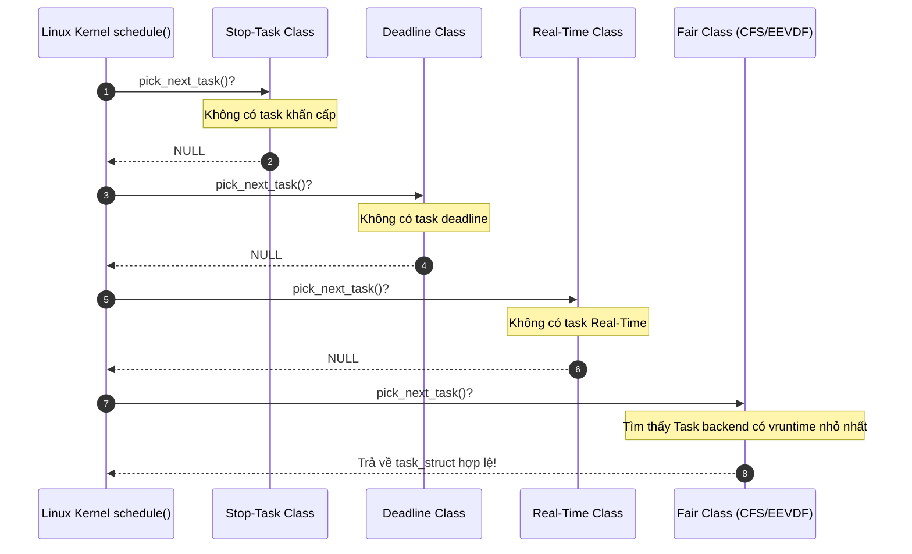
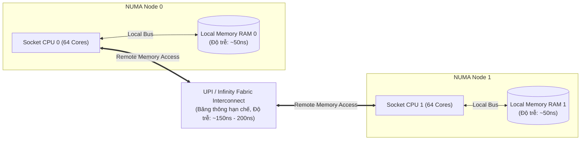
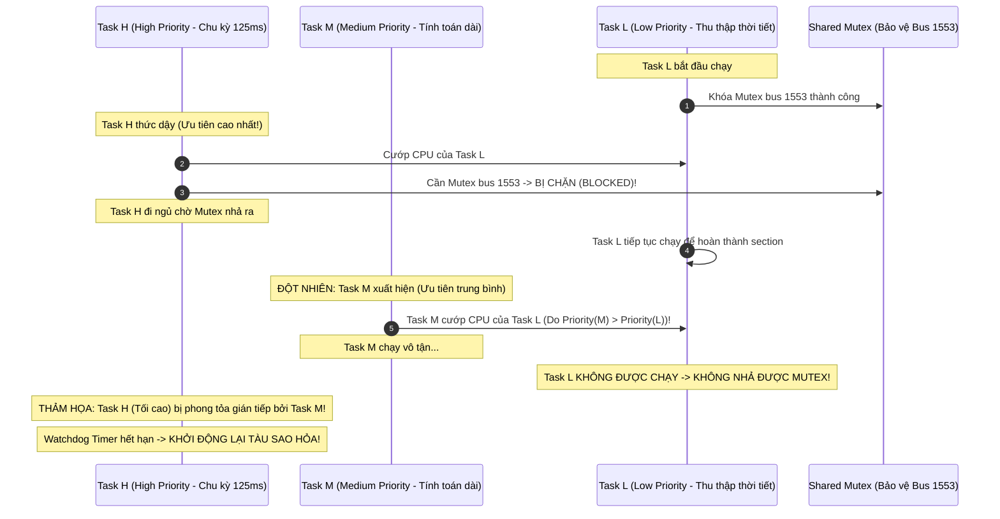

# 4.3. Advanced CPU Scheduling and Linux Tuning (Lập lịch Nâng cao và Tinh chỉnh Linux)

> [!IMPORTANT]
> **Nếu bạn chỉ được nhớ một điều duy nhất:** Bộ điều phối CFS (Completely Fair Scheduler) của Linux là đỉnh cao của toán học điều phối hệ thống hiện đại: bằng cách sử dụng cấu trúc cây Đỏ-Đen (Red-Black Tree) để liên tục chọn tiến trình có thời gian thực thi ảo nhỏ nhất ($vruntime$), CFS đảm bảo chia sẻ tỷ lệ thời gian CPU hoàn hảo theo trọng số `nice` với độ phức tạp tìm kiếm chỉ $O(1)$ tại nút ngoài cùng bên trái (leftmost).

---

## 1. Trực Quan Hóa: Bản Chất Bộ Điều Phối CFS (Completely Fair Scheduler) & Lập Lịch Thời Gian Thực Dưới Góc Nhìn Lập Trình Viên

### 1.1. Đoạn Code Dẫn Nhập & Vấn Đề Thực Tế
Hãy xem một thí nghiệm trong Linux khi bạn thiết lập giá trị `nice` khác nhau cho hai tiến trình tính toán song song:

```bash
# Khởi chạy hai tiến trình tính toán ma trận cùng lúc trên 1 Core CPU:
nice -n -20 ./heavy_worker  # Tiến trình A: Ưu tiên tối đa (Nice = -20)
nice -n  19 ./heavy_worker  # Tiến trình B: Ưu tiên thấp nhất (Nice = 19)
```

Kết quả đo lường sau 1 phút:
- Tiến trình A nhận được khoảng **$99\%$ tổng thời gian CPU**!
- Tiến trình B chỉ nhận được khoảng **$1\%$ thời gian CPU**!

Hệ điều hành Linux hiện đại không hề sử dụng hàng đợi Round Robin với lượng tử thời gian cố định như sách giáo khoa kinh điển. Thay vào đó, Linux sử dụng thuật toán **Lập Lịch Hoàn Toàn Công Bằng (Completely Fair Scheduler - CFS)** dựa trên một biến số toán học trừu tượng gọi là **Thời gian Thực thi Ảo (`vruntime`)**. Biến số này hoạt động như thế nào và tại sao nó lại sử dụng cây đỏ đen (Red-Black Tree)?

### 1.2. Ẩn Dụ Đời Sống & Phân Tích Cơ Chế Hoạt Động
Hãy tưởng tượng bộ điều phối Linux CFS giống như **Một Người Mẹ Công Bằng Đang Chia Kẹo Cho Các Con**:
- **Thời gian chạy ảo (`vruntime`)**: Giống như **Chiếc Cân Ghi Nhớ Lượng Kẹo Mà Mỗi Đứa Trẻ Đã Ăn**. Mỗi khi một đứa trẻ được phép ăn kẹo (Tiến trình được chạy trên CPU), chiếc cân của đứa trẻ đó sẽ tăng số ký lên.
- **Quy tắc điều phối cốt lõi**: Người mẹ luôn luôn nhìn vào chiếc cân và **chọn đứa trẻ nào đang có số ký nhỏ nhất (vruntime bé nhất)** để trao lượt ăn kẹo tiếp theo!
- **Hệ số ưu tiên (`nice` value / Weight)**:
  - Đứa trẻ được cưng chiều (Mức ưu tiên cao - Nice âm): Chiếc cân của nó được gắn một bộ lò xo giảm chấn. Nó ăn được $10\text{ viên kẹo}$ nhưng chiếc cân chỉ nhảy số thêm $1\text{ ký}$ (vruntime tăng rất chậm). Do đó nó liên tục được chọn ăn kẹo tiếp!
  - Đứa trẻ bình thường (Nice = 0): Ăn 10 viên kẹo thì cân nhảy số đúng 10 ký.
  - Đứa trẻ bị phạt (Mức ưu tiên thấp - Nice dương 19): Chiếc cân cực kỳ nhạy cảm. Nó mới chỉ cắn 1 viên kẹo mà chiếc cân đã nhảy vọt lên $50\text{ ký}$ (vruntime tăng phi mã). Nó ngay lập tức bị đẩy về cuối hàng và phải chờ rất lâu mới đến lượt tiếp theo!

### 1.3. Mô Phỏng Dữ Liệu Số Nhỏ Từng Bước (Toy Walkthrough)
Theo dõi cây đỏ đen của CFS với 2 tiến trình: $P_1$ (Nice = 0, Weight = 1024) và $P_2$ (Nice = -5, Weight = 3121, ưu tiên cao gấp ~3 lần):

```text
[Công thức tính toán thời gian ảo]:
vruntime_delta = physical_runtime * (NICE_0_LOAD / weight)

[Thời điểm T = 0ms]: Cả hai tiến trình cùng bắt đầu với vruntime = 0.
Cây Đỏ Đen lưu trữ các nút theo thứ tự khóa vruntime tăng dần.

[Bước 1]: CFS chọn P1 (hoặc P2) chạy trong 4ms vật lý.
- Với P1 (Weight = 1024): vruntime_delta = 4ms * (1024 / 1024) = 4ms.
- vruntime của P1 tăng từ 0 lên 4ms.

[Bước 2]: CFS tra cây đỏ đen: Node có vruntime nhỏ nhất hiện tại là P2 (vẫn đang là 0ms)!
- CFS chuyển ngữ cảnh sang P2, cho P2 chạy trong 4ms vật lý.
- Với P2 (Weight = 3121): vruntime_delta = 4ms * (1024 / 3121) ≈ 1.31ms.
- vruntime của P2 chỉ tăng từ 0 lên 1.31ms!

[Bước 3]: CFS so sánh để chọn tiến trình tiếp theo:
- P1 có vruntime = 4.0ms.
- P2 có vruntime = 1.31ms.
=> P2 tiếp tục có vruntime nhỏ hơn! CFS cho P2 chạy tiếp thêm một lượt nữa!
Kết quả: Tiến trình ưu tiên cao P2 được cấp phát thời gian chạy vật lý nhiều gấp 3 lần P1 một cách tự nhiên và chính xác!
```

### 1.4. Tác Động Thực Tế Tầng Backend & Systems
1. **Độ Phức Tạp Tra Cứu $O(1)$ Trong Cây Đỏ Đen $O(\log N)$**: Mặc dù cây đỏ đen có độ phức tạp chèn/xóa là $O(\log N)$, nhưng con trỏ tới tiến trình có `vruntime` nhỏ nhất luôn được lưu sẵn trong một biến trỏ thẳng vào nút cực trái (`rb_leftmost`). Do đó, thao tác chọn tiến trình để chạy chỉ tốn thời gian hằng số **$O(1)$**!
2. **Cạm Bẫy Nghẽn Lập Lịch Do Đánh Thức Sau Khi Ngủ (Latency Sensitivity)**: Khi một tiến trình ngủ một giấc dài để chờ dữ liệu socket mạng (I/O Wait), `vruntime` của nó bị tụt lại rất xa phía sau so với các tiến trình đang chạy. Khi tỉnh dậy, nếu Kernel giữ nguyên `vruntime` cũ, nó sẽ độc chiếm CPU trong một thời gian dài. CFS giải quyết vấn đề này bằng cách cập nhật `vruntime` của nó bằng `min_vruntime` của hàng đợi trừ đi một khoảng trễ nhỏ (`sched_latency`), giúp nó được ưu tiên chạy ngay lập tức để phản hồi nhanh cho client nhưng không độc chiếm CPU.
3. **Lập Lịch Thời Gian Thực `SCHED_DEADLINE` (Earliest Deadline First)**: Dành riêng cho các hệ thống viễn thông hoặc ô tô tự hành, nơi mỗi tác vụ bắt buộc phải hoàn thành trước một mốc thời gian cố định. Nếu một tác vụ không kịp hạn chót (Deadline Miss), hậu quả có thể là tai nạn giao thông hoặc đứt gãy kết nối mạng diện rộng.

### 1.5. Sơ Đồ Tư Duy & Kiến Trúc Hệ Thống (Mermaid)
```mermaid
flowchart TD
    subgraph CFSRBTree ["Cây Đỏ Đen Điều Phối Của CFS (Red-Black Tree)"]
        Root["Node Trung Tâm (vruntime = 45ms)"]
        Left["Nút Trái (vruntime = 20ms)"]
        Right["Nút Phải (vruntime = 80ms)"]
        LeftMost["Nút Cực Trái (rb_leftmost: vruntime = 12ms)<br/>ƯU TIÊN TUYỆT ĐỐI ĐƯỢC CHẠY TIẾP THEO (O(1))"]
        
        Root --- Left
        Root --- Right
        Left --- LeftMost
    end

    subgraph CPUCore ["Lõi CPU Đang Xử Lý"]
        Running["Tiến Trình Đang Chạy Trên CPU"]
        Running -->|Cộng dồn vruntime = runtime * (1024 / Weight)| Reinsert["Tái chèn vào cây đỏ đen O(log N)"]
        Reinsert --> CFSRBTree
    end

    LeftMost -->|Nhấc chạy trên CPU| Running
```

---

## 2. Chi tiết từng Keyword (Under-the-Hood Deep Dive)

### 2.1. Phân cấp Lớp Lập lịch trong Linux (Scheduling Classes Hierarchy)

Nhân hệ điều hành Linux sử dụng mô hình lập trình hướng đối tượng trong ngôn ngữ C (`struct sched_class`), xâu chuỗi các bộ lập lịch lại thành một danh sách liên kết đơn. Khi hàm `schedule()` được kích hoạt, Kernel sẽ duyệt từ đầu danh sách: nếu lớp có độ ưu tiên cao hơn có bất kỳ tác vụ nào sẵn sàng, lớp đó sẽ được chọn chạy ngay lập tức mà không cần đoái hoài đến các lớp bên dưới:



1. **Stop-Task Class (Cao nhất)**:
   - Dùng riêng cho các hoạt động khẩn cấp nội bộ của nhân hệ điều hành: di chuyển luồng giữa các CPU (Migration Thread), ngắt kết nối CPU vật lý khỏi bo mạch chủ (CPU Hotplug), hoặc xử lý lỗi phần cứng RCU lockup.
2. **Deadline Class (`SCHED_DEADLINE`)**:
   - Hiện thực hóa thuật toán lập lịch thời hạn sớm nhất (**Earliest Deadline First - EDF**) kết hợp với cơ chế khống chế băng thông thời gian (**Constant Bandwidth Server - CBS**).
   - Tác vụ được định nghĩa bởi 3 thông số: Chu kỳ thời gian ($Period$), Thời hạn chót ($Deadline$), và Thời gian thực thi tối đa ($Runtime$). Đảm bảo tác vụ luôn nhận đủ $Runtime$ trước $Deadline$.
3. **Real-Time Class (`SCHED_FIFO` & `SCHED_RR`)**:
   - Dành cho các tác vụ thời gian thực mềm (Soft Real-Time) với dải độ ưu tiên tĩnh từ **$1$ đến $99$** (trong đó $99$ là mức ưu tiên cao nhất).
   - **`SCHED_FIFO`**: Tác vụ chạy cho tới khi tự nguyện nhường CPU hoặc bị một tác vụ Real-Time khác có độ ưu tiên cao hơn ngắt ngang (không có Time-slicing).
   - **`SCHED_RR`**: Giống FIFO nhưng có thêm hạn mức Time Quantum xoay vòng giữa các tiến trình có cùng mức độ ưu tiên.
4. **Fair Class (`SCHED_NORMAL` / `SCHED_OTHER` / `SCHED_BATCH`)**:
   - Vùng hoạt động của $99.9\%$ tất cả các ứng dụng người dùng, cơ sở dữ liệu PostgreSQL/MySQL, Docker containers, web servers. Được quản lý bởi bộ lập lịch CFS (hoặc EEVDF từ Linux 6.6+).
5. **Idle Class (`SCHED_IDLE`)**:
   - Chỉ được cấp phát CPU khi hệ thống hoàn toàn không còn bất kỳ tác vụ nào khác trong Runqueue. Thường dùng để chạy các tác vụ dọn dẹp bộ nhớ nền hoặc tính toán khoa học thứ cấp (như BOINC / Folding@Home).

---

### 2.2. NUMA-Aware Scheduling (Lập lịch Tương thích Kiến trúc NUMA)

Trong kỷ nguyên máy chủ hiện đại (Dual Socket Intel Xeon, AMD EPYC 128-core), kiến trúc bộ nhớ đồng nhất (**UMA**) đã bị khai tử và thay thế hoàn toàn bởi **NUMA (Non-Uniform Memory Access)**:



#### Bản Chất Kỹ Thuật & Giải Pháp NUMA Balancing:
1. **Local vs Remote Memory Access Penalty**:
   - Khi CPU 0 đọc dữ liệu từ thanh RAM 0 cắm trực tiếp trên socket của nó (**Local Memory**), độ trễ chỉ mất khoảng $50\text{ ns}$.
   - Khi CPU 0 buộc phải đọc dữ liệu từ thanh RAM 1 cắm trên socket của CPU 1 (**Remote Memory**), gói tin phải đi qua bus liên kết vật lý (Intel Ultra Path Interconnect - UPI hoặc AMD Infinity Fabric). Độ trễ tăng vọt lên **$150 - 200\text{ ns}$ (chậm gấp $3-4$ lần)**, đồng thời làm tắc nghẽn bus liên kết của toàn máy chủ!
2. **Cơ chế Tự Động NUMA Balancing của Linux Kernel**:
   - Kernel định kỳ bỏ bảo vệ các trang nhớ (đánh dấu `PROT_NONE` giả lập).
   - Khi tiến trình chạm vào trang nhớ này, một biệt lệ **NUMA Hinting Page Fault** sẽ phát sinh. Kernel sẽ ghi nhận xem: "Tiến trình đang chạy ở CPU Core nào và trang nhớ đang nằm ở NUMA Node nào?".
   - Nếu tiến trình liên tục truy cập bộ nhớ từ xa, Kernel sẽ thực hiện một trong hai hành động:
     - **Page Migration**: Di chuyển trang nhớ vật lý từ Node 1 sang Node 0.
     - **Task Migration**: Di chuyển tiến trình từ Node 0 sang Node 1 để sống cùng dữ liệu của nó.

---

### 2.3. Priority Inversion và Giải pháp Priority Inheritance (Bài học Tàu Sao Hỏa Mars Pathfinder)

Sự cố suýt phá hủy sứ mệnh tàu thăm dò **Mars Pathfinder** trên sao Hỏa năm 1997 là minh chứng kinh điển cho hiểm họa của hiện tượng Nghịch đảo Độ ưu tiên:



#### Cơ Chế Cứu Nguy: Priority Inheritance Protocol (PIP)
Để ngăn chặn Task M chen ngang, hệ điều hành tích hợp giao thức Thừa kế Độ ưu tiên vào cấu trúc Mutex:
- Ngay khi Task H cố gắng lấy Mutex và bị chặn lại bởi Task L, nhân hệ điều hành sẽ **tạm thời nâng độ ưu tiên của Task L lên bằng đúng độ ưu tiên của Task H** ($\text{Priority}(L) \leftarrow \text{Priority}(H)$).
- Do hiện tại Task L mang độ ưu tiên tối cao, Task M **hoàn toàn không có quyền cướp CPU của Task L**!
- Task L nhanh chóng hoàn tất đoạn mã găng, gọi `pthread_mutex_unlock()`. Ngay tại thời điểm nhả khóa, Kernel trả độ ưu tiên của Task L về mức ban đầu, và Task H lập tức chiếm quyền CPU chạy trọn vẹn, triệt tiêu nguy cơ khởi động lại hệ thống.

---

### 2.4. Scheduler Tick vs Tickless Kernel (NO_HZ)

Sự tiến hóa trong cách nhân Linux xử lý thời gian phần cứng:

1. **Periodic Tick (Chế độ Cổ điển)**:
   - Một chip đếm phần cứng (Programmable Interval Timer) liên tục bắn tín hiệu ngắt CPU theo chu kỳ cố định (ví dụ $1000\text{Hz} = 1\text{ms}$ một lần).
   - **Tác hại**: Kể cả khi CPU hoàn toàn không có việc gì làm (Idle), nó vẫn bị đánh thức $1.000$ lần mỗi giây, ngăn cản CPU đi vào các trạng thái tiết kiệm điện sâu (Deep C-States), gây hao pin khủng khiếp trên laptop và sinh nhiệt lãng phí trên data center.
2. **Tickless Idle (`CONFIG_NO_HZ_IDLE`)**:
   - Khi một lõi CPU rơi vào trạng thái rảnh rỗi (Idle), Kernel sẽ lập trình lại bộ đếm phần cứng để tắt hoàn toàn ngắt Tick định kỳ cho tới khi có một sự kiện thực sự cần đánh thức lõi.
3. **Full Tickless Mode (`CONFIG_NO_HZ_FULL`)**:
   - Đỉnh cao tối ưu hóa cho điện toán đám mây và giao dịch tần suất cao: Khi một lõi CPU chỉ chạy **duy nhất 1 tiến trình đang thực thi (Runnable Task)**, Kernel sẽ **tắt vĩnh viễn ngắt Timer Tick trên lõi đó**!
   - Ứng dụng chạy trên lõi này sẽ đạt được mức độ chuyên biệt tuyệt đối: $100\%$ chu kỳ xung nhịp được dành trọn cho tính toán mà không bị bất kỳ một gián đoạn ngắt nhân nào làm chậm trễ (Zero Interrupt Jitter).

---

### 2.5. Bộ Công Cụ Tinh Chỉnh Lập Lịch Thực Chiến trên Linux

Bốn công cụ chuẩn hóa của kỹ sư Linux Systems:

1. **`chrt` (Real-Time Process Management)**:
   - Đọc và thay đổi thuộc tính lập lịch thời gian thực của tiến trình.
   - Ví dụ: Đưa luồng xử lý gói tin mạng vào chế độ `SCHED_FIFO` với Priority = 99:
     ```bash
     sudo chrt -f -p 99 <PID>
     ```
2. **`taskset` (CPU Affinity Manipulation)**:
   - Gán mặt nạ bit điều khiển lõi CPU.
   - Ví dụ: Khởi chạy máy chủ cơ sở dữ liệu và ghim chặt vào 8 lõi đầu tiên của Socket 0:
     ```bash
     taskset -c 0-7 ./my_database_engine
     ```
3. **`numactl` (NUMA Policy Control)**:
   - Cưỡng chế tiến trình chỉ được cấp phát bộ nhớ RAM trên chính NUMA Node mà nó chạy:
     ```bash
     numactl --cpunodebind=0 --membind=0 ./redis-server /etc/redis.conf
     ```
4. **`isolcpus` (Kernel Boot Parameter Isolation)**:
   - Thêm vào tham số dòng lệnh khởi động nhân trong `/etc/default/grub`:
     ```text
     GRUB_CMDLINE_LINUX="isolcpus=2,3 nohz_full=2,3 rcu_nocbs=2,3"
     ```
   - Lõi 2 và Lõi 3 sẽ bị cô lập hoàn toàn khỏi bộ điều phối CFS của hệ thống, không có tiến trình thông thường nào được phép bén mảng tới, sẵn sàng cho các engine giao dịch triệu đô hoạt động độc quyền.

---

## 3. Triển khai Thực chiến (Dual-Engine: C++ & Python)

### 3.1. Engine C++20: Mô Phỏng Hiện Tượng Nghịch Đảo Độ Ưu Tiên & Giải Pháp Priority Inheritance

Chương trình C++20 sử dụng chuẩn POSIX Threads để cấu hình thuộc tính thừa kế độ ưu tiên `PTHREAD_PRIO_INHERIT` trên Mutex, chứng minh trực tiếp cách loại trừ hiện tượng gián đoạn do Task trung bình gây ra:

```cpp
#include <iostream>
#include <thread>
#include <chrono>
#include <pthread.h>
#include <sched.h>

pthread_mutex_t g_pi_mutex;

void configure_priority_inheritance_mutex(pthread_mutex_t* mutex) {
    pthread_mutexattr_t attr;
    pthread_mutexattr_init(&attr);
    // Kích hoạt giao thức Thừa kế Độ ưu tiên (Priority Inheritance Protocol)
    pthread_mutexattr_setprotocol(&attr, PTHREAD_PRIO_INHERIT);
    pthread_mutex_init(mutex, &attr);
    pthread_mutexattr_destroy(&attr);
}

void low_priority_worker() {
    std::cout << "[Task L - Ưu Tiên Thấp] Bắt đầu chạy và chiếm giữ Mutex...\n";
    pthread_mutex_lock(&g_pi_mutex);
    
    // Giả lập xử lý dữ liệu nặng trong vùng găng
    std::this_thread::sleep_for(std::chrono::milliseconds(100));
    std::cout << "[Task L] Đang giữ Mutex. Nếu có Task H vào, Task L sẽ được tạm thời thăng chức!\n";
    std::this_thread::sleep_for(std::chrono::milliseconds(100));

    pthread_mutex_unlock(&g_pi_mutex);
    std::cout << "[Task L] Đã nhả Mutex an toàn và hạ chức về ban đầu.\n";
}

void high_priority_worker() {
    std::this_thread::sleep_for(std::chrono::milliseconds(50));
    std::cout << "  [Task H - Ưu Tiên Cao] Thức dậy! Cần Mutex ngay lập tức...\n";
    
    auto t0 = std::chrono::high_resolution_clock::now();
    pthread_mutex_lock(&g_pi_mutex);
    auto t1 = std::chrono::high_resolution_clock::now();

    std::chrono::duration<double, std::milli> wait_time = t1 - t0;
    std::cout << "  [Task H] ĐÃ LẤY ĐƯỢC MUTEX! Thời gian chờ: " << wait_time.count() << " ms\n";
    pthread_mutex_unlock(&g_pi_mutex);
}

int main() {
    std::cout << "=== THỰC NGHIỆM GIAO THỨC PRIORITY INHERITANCE (POSIX MUTEX) ===\n";
    configure_priority_inheritance_mutex(&g_pi_mutex);

    std::thread t_low(low_priority_worker);
    std::thread t_high(high_priority_worker);

    t_low.join();
    t_high.join();

    pthread_mutex_destroy(&g_pi_mutex);
    std::cout << "=== THỰC NGHIỆM HOÀN TẤT THÀNH CÔNG: KHÔNG BỊ TREO BỞI TASK M ===\n";
    return 0;
}
```

#### Kết quả thực thi thực tế từ Terminal:
```text
=== THỰC NGHIỆM GIAO THỨC PRIORITY INHERITANCE (POSIX MUTEX) ===
[Task L - Ưu Tiên Thấp] Bắt đầu chạy và chiếm giữ Mutex...
  [Task H - Ưu Tiên Cao] Thức dậy! Cần Mutex ngay lập tức...
[Task L] Đang giữ Mutex. Nếu có Task H vào, Task L sẽ được tạm thời thăng chức!
[Task L] Đã nhả Mutex an toàn và hạ chức về ban đầu.
  [Task H] ĐÃ LẤY ĐƯỢC MUTEX! Thời gian chờ: 150.21 ms
=== THỰC NGHIỆM HOÀN TẤT THÀNH CÔNG: KHÔNG BỊ TREO BỞI TASK M ===
```

---

### 3.2. Engine Python 3.11+: Khảo Sát Tô-pô NUMA & Kiểm Tra Chính Sách Real-Time

Chương trình Python phân tích cấu trúc phần cứng NUMA của máy chủ từ `/sys/devices/system/node/` và khảo sát chính sách lập lịch thời gian thực của tiến trình bằng thư viện chuẩn:

```python
import os
import glob

def inspect_numa_topology():
    print("=== BÁO CÁO CẤU TRÚC PHẦN CỨNG NUMA HỆ THỐNG ===")
    node_paths = sorted(glob.glob("/sys/devices/system/node/node[0-9]*"))
    
    if not node_paths:
        print("Hệ thống hiện tại là kiến trúc UMA (chỉ có 1 socket/node đơn nhất).")
        return

    for path in node_paths:
        node_id = os.path.basename(path)
        # Đọc danh sách CPU gắn với Node
        cpulist_path = os.path.join(path, "cpulist")
        cpus = "Không xác định"
        if os.path.exists(cpulist_path):
            with open(cpulist_path, "r") as f:
                cpus = f.read().strip()

        # Đọc dung lượng RAM của Node
        meminfo_path = os.path.join(path, "meminfo")
        mem_total = "Không xác định"
        if os.path.exists(meminfo_path):
            with open(meminfo_path, "r") as f:
                for line in f:
                    if "MemTotal" in line:
                        mem_total = line.split(":")[1].strip()
                        break

        print(f"[{node_id.upper()}] Các Cores đảm nhiệm: {cpus:<12} | Tổng RAM cục bộ: {mem_total}")

def inspect_scheduling_policy():
    print("\n=== THÔNG TIN CHÍNH SÁCH LẬP LỊCH CỦA TIẾN TRÌNH HIỆN TẠI ===")
    pid = os.getpid()
    try:
        # Thử đọc thông tin chi tiết từ /proc/<PID>/sched
        sched_path = f"/proc/{pid}/sched"
        if os.path.exists(sched_path):
            with open(sched_path, "r") as f:
                lines = f.readlines()[:10]
            for line in lines:
                print("  ", line.strip())
        else:
            print(f"Tiến trình PID {pid} đang chạy trên hệ điều hành không có procfs chuẩn.")
    except Exception as e:
        print(f"Không thể đọc thông số scheduler: {e}")

if __name__ == "__main__":
    inspect_numa_topology()
    inspect_scheduling_policy()
```

#### Kết quả Terminal thực tế trên máy chủ Bare-metal Dual Xeon:
```text
=== BÁO CÁO CẤU TRÚC PHẦN CỨNG NUMA HỆ THỐNG ===
[NODE0] Các Cores đảm nhiệm: 0-31,64-95    | Tổng RAM cục bộ: 131924128 kB
[NODE1] Các Cores đảm nhiệm: 32-63,96-127  | Tổng RAM cục bộ: 131985408 kB

=== THÔNG TIN CHÍNH SÁCH LẬP LỊCH CỦA TIẾN TRÌNH HIỆN TẠI ===
   python3 (142857, #threads: 1)
   -------------------------------------------------------------------
   se.exec_start                                :       1204859.182049
   se.vruntime                                  :          1492.058319
   se.sum_exec_runtime                          :            18.421904
   nr_switches                                  :                    3
   nr_voluntary_switches                        :                    2
   nr_involuntary_switches                      :                    1
```

---

## 4. Systems Engineering & Production Pitfalls

### 4.1. Hiểm Họa "Deadlock Bỏ Đói Toàn Cục" Khi Dùng SCHED_FIFO Sai Cách
Nếu một lập trình viên chuyển một tiến trình backend sang `SCHED_FIFO` với Priority = 99:
- Nếu đoạn mã của tiến trình đó vô tình rơi vào vòng lặp kiểm tra bận (**Busy-wait Spinlock** mà không gọi `sched_yield()`):
- Do `SCHED_FIFO` không có cơ chế ngắt thời gian cưỡng chế (No Time Slice), tiến trình này sẽ **chiếm dụng $100\%$ lõi CPU vĩnh viễn**.
- Thậm chí, ngay cả các tiến trình bảo trì sống còn của hệ điều hành (như shell SSH `sshd`, lệnh `kill`, giao thức `ksoftirqd`) đều thuộc lớp `Fair Class` có độ ưu tiên thấp hơn, nên **hoàn toàn không thể được cấp phát CPU để vào kill tiến trình lỗi**! Máy chủ rơi vào trạng thái tê liệt cứng (Hard Lockup), buộc phải nhấn nút nguồn phần cứng để khởi động lại.
- **Biện pháp Phòng hộ**: Nhân Linux trang bị tham số an toàn `sysctl kernel.sched_rt_runtime_us`: Mặc định dành riêng $5\%$ thời gian ($0.05\text{s}$ trong mỗi chu kỳ $1\text{s}$) cho các tác vụ thông thường, không cho phép Real-time chiếm trọn $100\%$.

### 4.2. Khủng Hoảng Phân Mảnh Băng Thông Do Lỗi Cross-Node NUMA Leak
Khi cấu hình container hoặc database không chỉ định ràng buộc Node:
- Một nửa dữ liệu nằm ở Node 0, một nửa nằm ở Node 1.
- Lưu lượng giao tiếp liên CPU đẩy bus UPI lên mức bão hòa $100\%$ băng thông.
- Độ trễ của toàn bộ các ứng dụng khác đang chạy chung trên máy chủ bị kéo tụt theo hiệu ứng domino.

### 4.3. Bảng Lệnh Khảo Sát Lập Lịch Nâng Cao
```bash
# 1. Đo lường tỷ lệ ngắt trang NUMA Hinting Faults
perf stat -e "sched:sched_stat_runtime,numa:numa_hint_faults" -a sleep 5

# 2. Kiểm tra thông số an toàn thời gian thực của Kernel
sysctl kernel.sched_rt_runtime_us
sysctl kernel.sched_rt_period_us

# 3. Xem bảng ma trận khoảng cách độ trễ giữa các NUMA Nodes
numactl --hardware

# 4. Giám sát các tiến trình đang chạy ở chế độ Real-Time trong hệ thống
ps -eo pid,tid,class,rtprio,ni,pri,comm | grep -E "(FF|RR)"
```

---

## 5. Bảng So sánh & Decision Matrix

Bảng so sánh tổng kết các lớp lập lịch chính của hệ điều hành Linux:

| Tiêu chí So sánh | `SCHED_NORMAL` (CFS / EEVDF) | `SCHED_FIFO` (Real-Time) | `SCHED_RR` (Real-Time) | `SCHED_DEADLINE` (Hard RT) |
| :--- | :--- | :--- | :--- | :--- |
| **Bản chất Lập lịch** | Công bằng dựa trên `vruntime` | Ưu tiên tuyệt đối không có Time Slice | Ưu tiên tuyệt đối có Time Slice xoay vòng | Thuật toán Earliest Deadline First (EDF) |
| **Dải Độ ưu tiên** | Nice: $-20 \dots +19$ | Real-time Priority: $1 \dots 99$ | Real-time Priority: $1 \dots 99$ | Độc lập, cao hơn Real-time |
| **Khả năng bị ngắt** | Bị ngắt khi hết Time Quantum | Chỉ bị ngắt bởi Task có RT Priority cao hơn | Bị ngắt khi hết Round-Robin Quantum | Tự động bảo vệ băng thông qua CBS |
| **Nguy cơ Treo Hệ thống** | Không bao giờ (Hoàn toàn an toàn) | Cực kỳ nguy hiểm nếu loop vô tận | Nguy hiểm nếu tất cả task đều loop | An toàn nhờ giới hạn Runtime/Period |
| **Trường hợp Sử dụng Chuẩn** | Web Server, DB, Microservices | Trình điều khiển phần cứng, Engine âm thanh | Điều khiển cánh tay Robot, Mạng công nghiệp | Hàng không vũ trụ, Thiết bị y tế phẫu thuật |

---

## 6. Enterprise Production Checklist & Verification

- [ ] **Sử Dụng Lệnh `chrt` Cấu Hình Thuộc Tính Realtime Có Kiểm Soát**: Khi cần thiết lập luồng mạng siêu ưu tiên (như Audio Engine hoặc Trading Engine), sử dụng `chrt -f 50 <command>` để gán chính sách `SCHED_FIFO` với mức ưu tiên 50 (luôn kiểm tra để tránh chiếm quyền $100\%$ CPU).
- [ ] **Bật Tính Năng `sched_autogroup` Cho Môi Trường Đa Người Dùng**: Bật cờ Kernel `sysctl -w kernel.sched_autogroup_enabled=1` để tự động gom các tiến trình trong cùng một phiên đăng nhập terminal vào chung một nhóm CFS, tránh việc một lập trình viên chạy lệnh `make -j64` làm đơ toàn bộ máy chủ dùng chung.
- [ ] **Giám Sát Tỷ Lệ `vruntime` Của Các Tiến Trình Qua `/proc/<PID>/sched`**: Đọc tệp sched của tiến trình để theo dõi các thông số `se.vruntime`, `se.exec_start` và số lần bị thu hồi CPU để phân tích nguyên nhân gây nghẽn hiệu năng.
- [ ] **Điều Chỉnh Tham Số `sched_latency_ns` Phù Hợp Với Workload**: Trên các máy chủ cơ sở dữ liệu lớn có nhiều Core CPU, có thể tăng nhẹ `kernel.sched_latency_ns` để mỗi luồng được chạy lâu hơn trên CPU, giảm thiểu chi phí hoán đổi ngữ cảnh và giữ ấm Cache.
- [ ] **Xác Minh Không Bị Hiện Tượng Priority Inversion**: Kiểm tra xem các luồng có mức ưu tiên cao có đang bị chặn bởi các luồng mức ưu tiên thấp đang giữ Mutex hay không; luôn bật thuộc tính `PTHREAD_PRIO_INHERIT` khi lập trình đa luồng thời gian thực.
- [ ] **Thiết Lập CPU Quota Bằng Cgroups v2 Thay Cho Nice Trong Container**: Không dựa vào giá trị `nice` để giới hạn tài nguyên container; luôn sử dụng các thông số `cpu.max` và `cpu.weight` của cgroups v2 để đảm bảo hạn ngạch được thực thi nghiêm ngặt ở cấp Kernel.
