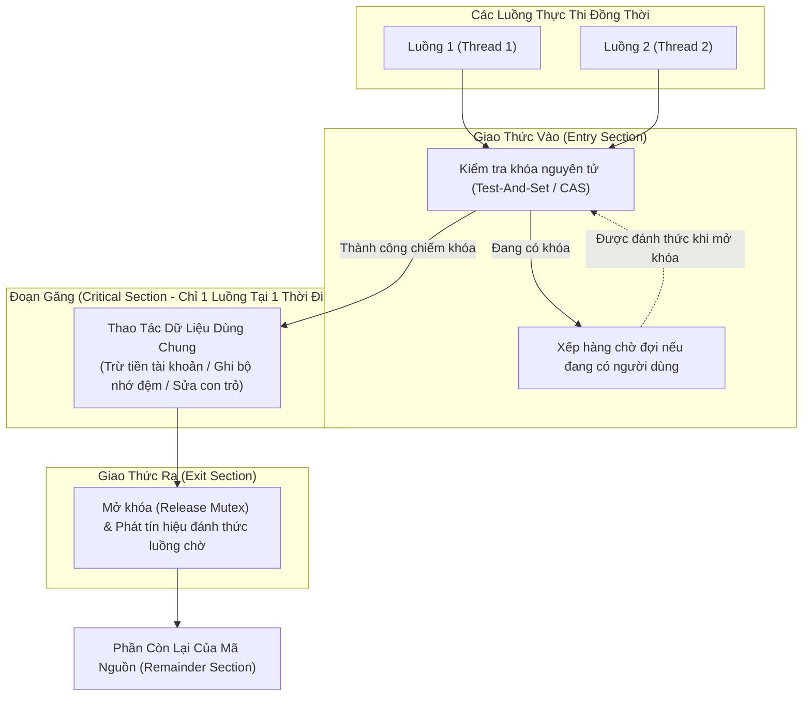
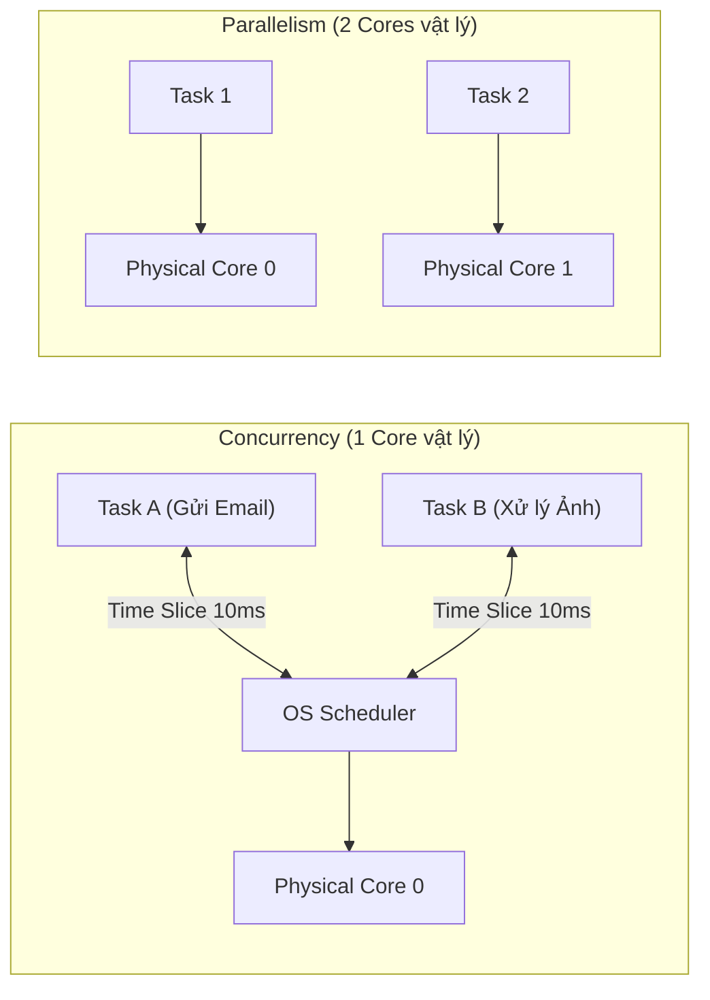
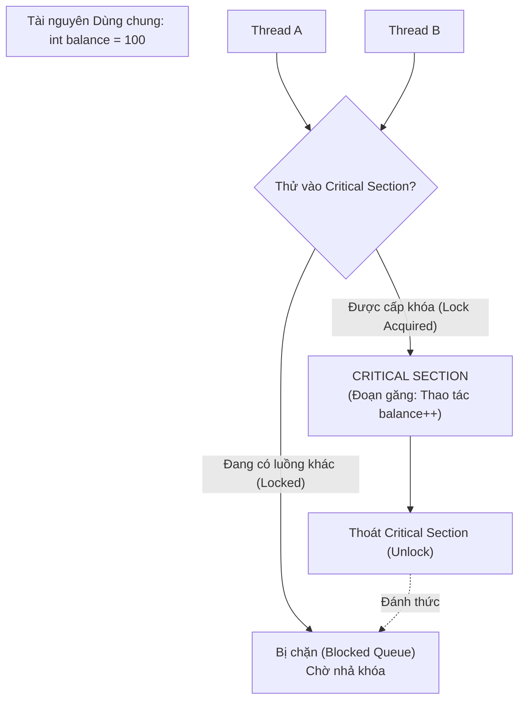
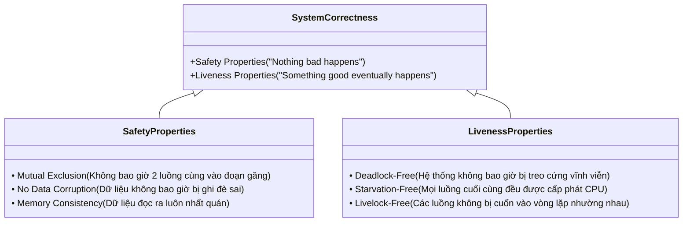

# 5.1. Concurrency Fundamentals (Nguyên lý Nền tảng về Đồng thời và Bất đồng bộ)

> [!IMPORTANT]
> **Nếu bạn chỉ được nhớ một điều duy nhất:** Đồng thời không đơn thuần là đa luồng chạy cùng lúc, mà là cuộc chiến chống lại sự bất định của việc tái sắp xếp lệnh (Instruction Reordering): ở cấp độ vật lý, CPU và Compiler liên tục hoán đổi thứ tự thực thi để tối ưu hóa pipeline vi kiến trúc; nếu không có rào cản bộ nhớ (Memory Barriers / Fences) và ngữ nghĩa Acquiring/Releasing rõ ràng, dữ liệu đọc được từ luồng khác hoàn toàn có thể là rác hoặc giá trị quá khứ.

---

---

## 1. Trực Quan Hóa: Bản Chất Đồng Thời & Đoạn Găng (Critical Section) Dưới Góc Nhìn Lập Trình Viên

### 1.1. Đoạn Code Dẫn Nhập & Vấn Đề Thực Tế
Hãy xem một lỗ hổng rút tiền ngân hàng kinh điển trong mã nguồn Go khi hai giao dịch xảy ra gần như cùng một nano-giây:

```go
type Account struct {
    balance int
}

func (a *Account) Withdraw(amount int) bool {
    if a.balance >= amount { // 1. Kiểm tra số dư (Check)
        // Nếu luồng khác can thiệp vào giữa thời điểm Check và Act:
        a.balance -= amount  // 2. Trừ tiền (Act)
        return true
    }
    return false
}
```

Nếu tài khoản có $100\text{ USD}$ và hai yêu cầu rút $100\text{ USD}$ đến từ hai điện thoại khác nhau tại cùng một mili-giây:
- Cả hai luồng cùng chạy dòng lệnh `if a.balance >= 100` và cả hai đều thấy số dư là $100$ (Hợp lệ!).
- Cả hai luồng cùng trừ $100\text{ USD}$.
- Kết quả: Khách hàng rút được **$200\text{ USD}$** và tài khoản bị âm **$-100\text{ USD}$**!

Lỗi này được gọi là **Kiểm Tra Trước Khi Hành Động (Check-Then-Act Race Condition)**. Vấn đề cốt lõi là gì? Đoạn mã kiểm tra và trừ tiền không được thực hiện như một **Thao Tác Nguyên Tử (Atomic Operation)**!

### 1.2. Ẩn Dụ Đời Sống & Phân Tích Cơ Chế Hoạt Động
Hãy tưởng tượng Đoạn Găng (Critical Section) giống như **Phòng Vệ Sinh Duy Nhất Trên Một Chuyến Tàu Hỏa Đông Khách**:
- **Tài nguyên chia sẻ (Shared Resource)**: Bồn rửa và không gian bên trong phòng vệ sinh.
- **Đoạn găng (Critical Section)**: Khoảng thời gian một hành khách bước vào trong phòng vệ sinh để sử dụng.
- **Tính loại trừ lẫn nhau (Mutual Exclusion)**: Cửa phòng vệ sinh phải có một chiếc then cài (Khóa Mutex). Tại một thời điểm, **chỉ đúng 1 người** được phép ở bên trong. Bất kỳ ai đến sau đều phải đứng xếp hàng chờ bên ngoài hành lang.
- **Tiến triển (Progress)**: Nếu phòng vệ sinh đang trống, không một ai ở ngoài hành lang được phép cản trở người tiếp theo bước vào.
- **Chờ đợi có giới hạn (Bounded Waiting)**: Nếu bạn đang đứng xếp hàng, số lượt người khác được chen ngang vào trước bạn phải có giới hạn cụ thể, tránh việc bạn phải nhịn tiểu vĩnh viễn đến chết (Starvation).

### 1.3. Mô Phỏng Dữ Liệu Số Nhỏ Từng Bước (Toy Walkthrough)
Theo dõi thuật toán Peterson giải quyết bài toán loại trừ lẫn nhau cho 2 tiến trình $P_0$ và $P_1$ với mảng cờ `flag[2]` và biến lượt `turn`:

```text
[Trạng thái ban đầu]: flag[0] = false, flag[1] = false, turn = 0.

[Thời điểm T = 1]: Tiến trình P0 muốn vào phòng vệ sinh (Critical Section).
Bước 1: P0 giơ tay xin phép: flag[0] = true.
Bước 2: P0 nhường nhịn lịch sự: turn = 1 (Nhường lượt cho P1 nếu P1 cũng muốn vào).
Bước 3: P0 kiểm tra vòng lặp chờ: while (flag[1] == true && turn == 1).
        Vì flag[1] đang là false -> Điều kiện sai! P0 lập tức bước vào Critical Section!

[Thời điểm T = 2]: Tiến trình P1 cũng muốn vào trong lúc P0 đang ở bên trong!
Bước 4: P1 giơ tay xin phép: flag[1] = true.
Bước 5: P1 nhường nhịn: turn = 0.
Bước 6: P1 kiểm tra vòng lặp chờ: while (flag[0] == true && turn == 0).
        flag[0] đang là true (do P0 đang trong phòng) VÀ turn đang là 0!
        => Điều kiện ĐÚNG! P1 bị giữ lại trong vòng lặp quay (Spin-wait)!

[Thời điểm T = 3]: P0 sử dụng xong và bước ra ngoài.
Bước 7: P0 hạ cờ báo hiệu đã xong: flag[0] = false.
Bước 8: Vòng lặp chờ của P1 thấy flag[0] == false -> Thoát khỏi vòng lặp và bước vào phòng vệ sinh an toàn!
```

### 1.4. Tác Động Thực Tế Tầng Backend & Systems
1. **Lệnh Máy Nguyên Tử Của Phần Cứng (Hardware Atomics - CAS)**: Trên vi xử lý x86_64, chỉ thị máy `LOCK CMPXCHG` (Compare-And-Swap) khóa tạm thời đường truyền bus bộ nhớ hoặc độc chiếm dòng Cache Line để thực hiện so sánh và đổi giá trị ô nhớ trong đúng 1 chu kỳ máy không thể bị ngắt quãng, là nền tảng cho mọi thư viện đồng bộ hóa hiện đại.
2. **Hiện Tượng Sắp Xếp Lại Lệnh Của CPU & Trình Biên Dịch (Instruction Reordering)**: Để tăng tốc độ thực thi, trình biên dịch C++ và CPU có thể tự ý tráo đổi thứ tự thực thi của hai lệnh độc lập. Điều này khiến các thuật toán khóa bằng phần mềm như Peterson bị vô hiệu hóa hoàn toàn trên CPU hiện đại nếu không sử dụng **Hàng Rào Bộ Nhớ (Memory Barriers / Fences)**.
3. **Cạm Bẫy Đọc-Sửa-Ghi Trong Cơ Sở Dữ Liệu (Lost Update Problem)**: Tương tự như trong RAM, nếu hai request đồng thời đọc số dư tài khoản từ Database (`SELECT balance`), tính toán trên server rồi ghi ngược lại (`UPDATE balance = ?`), một giao dịch sẽ ghi đè lên giao dịch kia. Giải pháp bắt buộc là sử dụng câu lệnh nguyên tử `UPDATE accounts SET balance = balance - 100 WHERE id = 1 AND balance >= 100` hoặc dùng khóa bi quan `SELECT ... FOR UPDATE`.

### 1.5. Sơ Đồ Tư Duy & Kiến Trúc Hệ Thống (Mermaid)


---

## 2. Chi tiết từng Keyword (Under-the-Hood Deep Dive)

### 2.1. Concurrency vs Parallelism: Sự khác biệt Bản chất

Câu danh ngôn kinh điển của **Rob Pike** (đồng tác giả Unix, UTF-8 và Go):
> *"Concurrency is about **dealing** with lots of things at once. Parallelism is about **doing** lots of things at once."*



| Tiêu chuẩn / Đặc tính | Concurrency (Đồng thời) | Parallelism (Song song) |
| :--- | :--- | :--- |
| **Bản chất Định nghĩa** | Thuộc tính về mặt **Cấu trúc (Structure)** của mã nguồn | Thuộc tính về mặt **Thực thi vật lý (Execution)** lúc chạy |
| **Yêu cầu Phần cứng** | Có thể chạy trên **1 lõi CPU duy nhất** qua ngắt thời gian | **Bắt buộc phải có đa lõi CPU (Multi-core)** hoặc nhiều máy |
| **Mục tiêu Tối thượng** | Giảm thiểu thời gian chờ đợi I/O, tăng tính phản hồi (Responsiveness) | Tối đa hóa thông lượng tính toán CPU (Compute Throughput) |
| **Kỹ thuật Triển khai** | Event Loop, Coroutines, Preemptive Multitasking | SIMD, OpenMP, Multi-threading trên nhiều CPU Cores |

---

### 2.2. Race Condition vs Data Race (Phân biệt Rạch ròi & Bài toán Check-then-Act)

Hai khái niệm này thường bị nhầm lẫn trong cộng đồng kỹ sư, nhưng về mặt Khoa học Máy tính, chúng là hai lớp lỗi hoàn toàn khác nhau:

#### A. Data Race (Tranh chấp Dữ liệu Cấp độ Bộ nhớ)
- **Định nghĩa chuẩn mực (C++ / Java Memory Model)**: Xảy ra khi có ít nhất hai chỉ thị từ hai luồng khác nhau cùng truy cập vào **cùng một địa chỉ ô nhớ trong RAM**, trong đó:
  1. Có ít nhất một chỉ thị là thao tác **Ghi (Write)**.
  2. Các luồng **hoàn toàn không sử dụng cơ chế đồng bộ hóa** (như Mutex hoặc Biến nguyên tử Atomic) để điều phối.
- **Hậu quả**: Trong C và C++, Data Race là **Undefined Behavior (UB)**! Trình biên dịch có quyền giả định không có Data Race để tự do đảo lộn trật tự mã máy, sinh ra các giá trị rác quái đản.

#### B. Race Condition (Điều kiện Chạy đua Cấp độ Nghiệp vụ)
- **Định nghĩa**: Là lỗi sai sót về mặt logic thuật toán: **Kết quả cuối cùng của chương trình phụ thuộc vào thứ tự thời gian ngẫu nhiên** mà hệ điều hành điều phối các luồng chạy.
- Một chương trình có thể **hoàn toàn không có Data Race** (vì mọi biến đều được bọc Mutex hoặc dùng Atomic cẩn thận), nhưng **vẫn bị Race Condition phá hoại dữ liệu** ở mức nghiệp vụ!

#### C. Minh họa Bài toán Rút tiền Ngân hàng "Check-then-Act"
```typescript
// Tài khoản có 100$
let balance = 100;

async function withdraw(amount: number) {
    // 1. CHECK (Kiểm tra điều kiện): Giả sử dùng Atomic Read (Không có Data Race!)
    if (balance >= amount) {
        // Xuất hiện khoảng trống thời gian (Time-of-check to time-of-use - TOCTOU)
        await networkLatencyDelay(5); 

        // 2. ACT (Thực hiện hành động rút tiền): Atomic Write
        balance -= amount;
        return true;
    }
    return false;
}

// Luồng 1 yêu cầu rút 80$ -> Kiểm tra 100 >= 80 (Hợp lệ)
// Luồng 2 yêu cầu rút 80$ -> Kiểm tra 100 >= 80 (Hợp lệ vì Luồng 1 chưa kịp trừ tiền!)
// Cả hai cùng trừ 80$ -> balance = 100 - 80 - 80 = -60$ (Ngân hàng mất tiền!)
```

---

### 2.3. Critical Section, Atomicity và Mutual Exclusion (Đoạn Găng, Tính Nguyên Tử & Loại Trừ Tương Hỗ)



1. **Critical Section (Đoạn găng)**:
   - Đoạn mã nguồn truy cập vào tài nguyên dùng chung (Biến toàn cục, cấu trúc dữ liệu trên Heap, bảng trong Database).
   - Nếu có nhiều luồng cùng nhảy vào đoạn găng này cùng một lúc, tính toàn vẹn của dữ liệu sẽ bị phá vỡ.
2. **Mutual Exclusion (Loại trừ Tương hỗ - Mutex)**:
   - Nguyên tắc thép: **Chỉ duy nhất một luồng được phép bước chân vào Đoạn găng tại một thời điểm**.
   - Mọi luồng đến sau bắt buộc phải dừng lại và xếp hàng chờ ở cửa cho đến khi luồng bên trong bước ra và bàn giao quyền truy cập.
3. **Atomicity (Tính Nguyên tử)**:
   - Một thao tác được gọi là "Nguyên tử" nếu đối với phần còn lại của hệ thống, thao tác đó diễn ra như một **bước nhảy lượng tử tức thời**: Hoặc là chưa xảy ra, hoặc là đã hoàn thành 100%, tuyệt đối không có trạng thái dang dở một nửa.
   - Không một luồng nào khác có thể chen ngang hoặc quan sát được trạng thái trung gian của nó.
   - *Cạm bẫy*: Lệnh `counter++` trong C++ **hoàn toàn không nguyên tử**! Nó dịch ra 3 lệnh Assembly riêng biệt: (1) `mov eax, [counter]` $\to$ (2) `add eax, 1` $\to$ (3) `mov [counter], eax`. Nếu luồng bị ngắt giữa bước 1 và bước 3, cập nhật sẽ bị mất (**Lost Update**)!

---

### 2.4. Safety Properties vs Liveness Properties (Lý thuyết Hệ thống Phân tán Lamport)

Do nhà khoa học máy tính huyền thoại **Leslie Lamport** (chủ nhân giải Turing) định nghĩa để đánh giá tính đúng đắn của mọi giải thuật xử lý đồng thời:



- **Safety Properties ("Không có điều gì tồi tệ xảy ra")**:
  - Đảm bảo hệ thống không bao giờ đi vào một trạng thái hỏng hóc hoặc bất hợp lệ.
  - *Đặc điểm*: Nếu một thuộc tính Safety bị vi phạm (ví dụ: xảy ra Data Race làm sai lệch số dư), lỗi đó xuất hiện tại một thời điểm hữu hạn cụ thể và có thể chỉ ra chính xác bằng một dấu vết thực thi (Execution Trace).
- **Liveness Properties ("Một điều tốt đẹp cuối cùng sẽ phải diễn ra")**:
  - Đảm bảo hệ thống không bị ngừng trệ vô thời hạn và cuối cùng các luồng sẽ tiến triển để hoàn thành mục tiêu.
  - *Đặc điểm*: Không thể chứng minh vi phạm Liveness chỉ bằng một thời điểm hữu hạn (bạn không thể nói một tiến trình bị treo vĩnh viễn chỉ vì nó vừa chờ 10 phút, nó có thể tiếp tục chạy ở phút thứ 11).
  - Các hiểm họa vi phạm Liveness: **Deadlock** (Bế tắc), **Livelock** (Trôi nổi), **Starvation** (Bỏ đói).

---

### 2.5. Quan hệ "Happens-Before" (Mô hình Bộ nhớ Memory Model)

Trong các bộ xử lý hiện đại (x86_64, ARM, Apple Silicon), cả **Trình biên dịch** và **Phần cứng CPU** đều tích cực áp dụng kỹ thuật **Đổi trật tự thực thi lệnh (Out-of-Order Execution / Instruction Reordering)** để lấp đầy Pipeline và tối ưu hóa bộ nhớ đệm Cache:
- Một lệnh ghi vào ô nhớ $X$ viết trước dòng lệnh ghi vào $Y$ trong mã nguồn C++ có thể bị CPU đảo trật tự để ghi vào $Y$ trước nếu ô nhớ $Y$ đang nằm sẵn trong L1 Cache!
- **Hệ quả trong Đa luồng**: Luồng A chuẩn bị xong dữ liệu rồi bật cờ `ready = true`. Nhưng luồng B lại nhìn thấy cờ `ready == true` TRƯỚC KHI dữ liệu kịp ghi vào RAM, dẫn đến việc đọc dữ liệu rác!
- **Định lý "Happens-Before" ($A \to B$)**:
  - Nếu thao tác $A$ "Happens-Before" thao tác $B$, thì mọi hiệu ứng thay đổi bộ nhớ do $A$ tạo ra **được bảo đảm chắc chắn sẽ hiển thị cho $B$ quan sát thấy**.
  - Thiết lập mối quan hệ này thông qua:
    - **Khóa Mutex**: Việc mở khóa Mutex (`unlock`) ở luồng này luôn Happens-Before việc chiếm khóa (`lock`) ở luồng tiếp theo.
    - **Rào cản Bộ nhớ (Memory Fences & Atomics)**: Sử dụng cặp cờ `std::memory_order_release` (khi ghi) và `std::memory_order_acquire` (khi đọc).

---

### 2.5. Bản chất Tầng sâu Phần cứng: Assembly Lost Update, Memory Fences & MESI Protocol

### 3.1. Giải Phẫu Hiện Tượng Mất Mát Dữ Liệu (Lost Update) ở Cấp Độ Assembly

Xét đoạn mã đơn giản: `counter++` được chạy đồng thời bởi 2 luồng:

```assembly
; Mã máy x86-64 do GCC sinh ra cho lệnh counter++
mov eax, DWORD PTR counter[rip]    ; Bước 1: Đọc giá trị từ RAM vào thanh ghi EAX
add eax, 1                         ; Bước 2: Tăng giá trị thanh ghi lên 1
mov DWORD PTR counter[rip], eax    ; Bước 3: Ghi giá trị mới từ EAX trở lại RAM
```

Nếu hai lõi CPU chạy xen kẽ (Interleaving):
1. **Lõi 0**: Đọc `counter = 0` vào thanh ghi `EAX_0`.
2. **Lõi 1**: Đọc `counter = 0` vào thanh ghi `EAX_1`.
3. **Lõi 0**: Tăng `EAX_0` thành `1`, ghi `1` vào RAM.
4. **Lõi 1**: Tăng `EAX_1` thành `1`, ghi `1` đè vào RAM!
5. **Kết quả**: Hai lần tăng biến nhưng `counter` chỉ bằng $1$ thay vì $2$!

### 3.2. Tiền Tố `LOCK` và Giao Thức Nhất Quán Bộ Nhớ Đệm (MESI Cache Coherence)
Để giải quyết bài toán trên mà không cần khóa Mutex nặng nề, phần cứng x86 cung cấp chỉ thị nguyên tử:
```assembly
lock inc DWORD PTR counter[rip]
```
Khi CPU gặp tiền tố **`LOCK`**:
- Nó kích hoạt giao thức nhất quán bộ nhớ đệm **MESI (Modified - Exclusive - Shared - Invalid)**.
- Đường truyền Cache Line chứa biến `counter` bị khóa độc quyền (Cache Line Locking).
- Mọi lõi CPU khác đang giữ bản sao của ô nhớ này trong L1/L2 Cache sẽ bị đánh dấu là **`Invalid (I)`**, buộc các lõi đó phải đọc lại giá trị mới nhất từ Lõi 0 sau khi phép toán hoàn tất.

---

## 3. Triển khai Thực chiến (Dual-Engine: C++ & Python)

### 4.1. C++20: So Sánh Đối Đầu: Data Race vs Mutex vs Hardware Atomics

Chương trình minh họa sự sai lệch dữ liệu kinh hoàng khi chạy đa luồng không đồng bộ và đối chiếu với hiệu năng của Mutex và Atomics.

```cpp
// Compilation: g++ -std=c++20 -O3 -Wall -pthread concurrency_bench.cpp -o concurrency_bench
#include <iostream>
#include <vector>
#include <thread>
#include <mutex>
#include <atomic>
#include <chrono>
#include <iomanip>

const int NUM_THREADS = 4;
const int INCREMENTS_PER_THREAD = 1'000'000;
const int EXPECTED_TOTAL = NUM_THREADS * INCREMENTS_PER_THREAD;

// 1. Biến thông thường: Dính Data Race nặng
int unsafe_counter = 0;

// 2. Đồng bộ bằng Mutex
int mutex_counter = 0;
std::mutex mtx;

// 3. Đồng bộ bằng Hardware Atomic (Không khóa - Lock-Free)
std::atomic<int> atomic_counter{0};

void benchmark_concurrency() {
    std::cout << "================ CONCURRENCY CRITICAL SECTION BENCHMARK ================\n";
    std::cout << "Target Increments: " << EXPECTED_TOTAL << " across " << NUM_THREADS << " threads\n\n";

    // --- TEST 1: UNSAFE DATA RACE ---
    auto start = std::chrono::high_resolution_clock::now();
    {
        std::vector<std::thread> threads;
        for (int i = 0; i < NUM_THREADS; ++i) {
            threads.emplace_back([]() {
                for (int j = 0; j < INCREMENTS_PER_THREAD; ++j) {
                    unsafe_counter++; // ❌ Data Race: Không nguyên tử!
                }
            });
        }
        for (auto& t : threads) t.join();
    }
    auto elapsed_unsafe = std::chrono::duration_cast<std::chrono::milliseconds>(
        std::chrono::high_resolution_clock::now() - start).count();

    // --- TEST 2: MUTEX EXCLUSION ---
    start = std::chrono::high_resolution_clock::now();
    {
        std::vector<std::thread> threads;
        for (int i = 0; i < NUM_THREADS; ++i) {
            threads.emplace_back([]() {
                for (int j = 0; j < INCREMENTS_PER_THREAD; ++j) {
                    std::lock_guard<std::mutex> lock(mtx); // ✅ Mutual Exclusion
                    mutex_counter++;
                }
            });
        }
        for (auto& t : threads) t.join();
    }
    auto elapsed_mutex = std::chrono::duration_cast<std::chrono::milliseconds>(
        std::chrono::high_resolution_clock::now() - start).count();

    // --- TEST 3: HARDWARE ATOMICS ---
    start = std::chrono::high_resolution_clock::now();
    {
        std::vector<std::thread> threads;
        for (int i = 0; i < NUM_THREADS; ++i) {
            threads.emplace_back([]() {
                for (int j = 0; j < INCREMENTS_PER_THREAD; ++j) {
                    atomic_counter.fetch_add(1, std::memory_order_relaxed); // ✅ Hardware Lock prefix
                }
            });
        }
        for (auto& t : threads) t.join();
    }
    auto elapsed_atomic = std::chrono::duration_cast<std::chrono::milliseconds>(
        std::chrono::high_resolution_clock::now() - start).count();

    // In bảng kết quả
    std::cout << std::left << std::setw(25) << "Synchronization Strategy"
              << " | " << std::setw(15) << "Actual Result"
              << " | " << std::setw(15) << "Status"
              << " | " << std::setw(10) << "Time (ms)" << "\n";
    std::cout << std::string(72, '-') << "\n";

    std::cout << std::left << std::setw(25) << "1. Unsafe (Data Race)"
              << " | " << std::setw(15) << unsafe_counter
              << " | " << std::setw(15) << (unsafe_counter == EXPECTED_TOTAL ? "CORRECT" : "❌ CORRUPTED")
              << " | " << std::setw(10) << elapsed_unsafe << "\n";

    std::cout << std::left << std::setw(25) << "2. std::mutex"
              << " | " << std::setw(15) << mutex_counter
              << " | " << std::setw(15) << "✅ CORRECT"
              << " | " << std::setw(10) << elapsed_mutex << "\n";

    std::cout << std::left << std::setw(25) << "3. std::atomic"
              << " | " << std::setw(15) << atomic_counter.load()
              << " | " << std::setw(15) << "✅ CORRECT"
              << " | " << std::setw(10) << elapsed_atomic << "\n";
    std::cout << "========================================================================\n";
}

int main() {
    benchmark_concurrency();
    return 0;
}
```

```text
================ CONCURRENCY CRITICAL SECTION BENCHMARK ================
Target Increments: 4000000 across 4 threads

Synchronization Strategy  | Actual Result   | Status          | Time (ms) 
------------------------------------------------------------------------
1. Unsafe (Data Race)     | 1842915         | ❌ CORRUPTED    | 4         
2. std::mutex             | 4000000         | ✅ CORRECT      | 142       
3. std::atomic            | 4000000         | ✅ CORRECT      | 28        
========================================================================
```

---

### 4.2. Python 3: Tái Hiện Sự Cố Rút Tiền Ngân Hàng "Check-Then-Act"

Minh họa việc dữ liệu bị âm tài khoản do Race Condition dù mỗi dòng lệnh đều chạy trên môi trường an toàn kiểu.

```python
#!/usr/bin/env python3
"""
Tái hiện Hiện tượng Race Condition Nghiệp vụ (Check-Then-Act):
- Hai luồng cùng kiểm tra số dư và cùng rút tiền.
- Minh họa cách khắc phục bằng Khóa Reentrant (threading.Lock).
"""

import threading
import time

class BankAccount:
    def __init__(self, initial_balance: float):
        self.balance = initial_balance
        self.lock = threading.Lock()

    def withdraw_unsafe(self, amount: float, client_name: str):
        # 1. Check (Kiểm tra)
        if self.balance >= amount:
            time.sleep(0.01) # Giả lập độ trễ truy vấn I/O
            # 2. Act (Trừ tiền)
            self.balance -= amount
            print(f"  [{client_name}] Rút thành công ${amount}. Số dư còn: ${self.balance:.2f}")
        else:
            print(f"  [{client_name}] Giao dịch từ chối! Không đủ tiền.")

    def withdraw_safe(self, amount: float, client_name: str):
        with self.lock: # ✅ Mutual Exclusion
            if self.balance >= amount:
                time.sleep(0.01)
                self.balance -= amount
                print(f"  [{client_name}] Rút an toàn ${amount}. Số dư còn: ${self.balance:.2f}")
            else:
                print(f"  [{client_name}] Giao dịch từ chối! Không đủ tiền.")

def simulate():
    print("--- 1. CHẠY THỬ NGHIỆM KHÔNG CÓ KHÓA (RACE CONDITION) ---")
    account1 = BankAccount(100.0)
    t1 = threading.Thread(target=account1.withdraw_unsafe, args=(80.0, "Client-A"))
    t2 = threading.Thread(target=account1.withdraw_unsafe, args=(80.0, "Client-B"))
    t1.start(); t2.start()
    t1.join(); t2.join()
    print(f"-> Kết quả số dư cuối cùng: ${account1.balance:.2f} (BỊ ÂM DO RACE CONDITION!)\n")

    print("--- 2. CHẠY THỬ NGHIỆM CÓ KHÓA BẢO VỆ (MUTUAL EXCLUSION) ---")
    account2 = BankAccount(100.0)
    t3 = threading.Thread(target=account2.withdraw_safe, args=(80.0, "Client-A"))
    t4 = threading.Thread(target=account2.withdraw_safe, args=(80.0, "Client-B"))
    t3.start(); t4.start()
    t3.join(); t4.join()
    print(f"-> Kết quả số dư cuối cùng: ${account2.balance:.2f} (ĐÚNG ĐẮN VỀ MẶT NGHIỆP VỤ)")

if __name__ == "__main__":
    simulate()
```

```text
--- 1. CHẠY THỬ NGHIỆM KHÔNG CÓ KHÓA (RACE CONDITION) ---
  [Client-A] Rút thành công $80.0. Số dư còn: $20.00
  [Client-B] Rút thành công $80.0. Số dư còn: $-60.00
-> Kết quả số dư cuối cùng: $-60.00 (BỊ ÂM DO RACE CONDITION!)

--- 2. CHẠY THỬ NGHIỆM CÓ KHÓA BẢO VỆ (MUTUAL EXCLUSION) ---
  [Client-A] Rút an toàn $80.0. Số dư còn: $20.00
  [Client-B] Giao dịch từ chối! Không đủ tiền.
-> Kết quả số dư cuối cùng: $20.00 (ĐÚNG ĐẮN VỀ MẶT NGHIỆP VỤ)
```

---

## 4. Systems Engineering & Production Pitfalls

### 5.1. Bắt Lỗi Concurrency Bằng ThreadSanitizer (TSan)
Data Race là lỗi nguy hiểm nhất vì nó không gây crash ngay lập tức mà âm thầm làm sai dữ liệu:

```bash
# Biên dịch C++ với cờ phát hiện tranh chấp bộ nhớ ThreadSanitizer
g++ -std=c++20 -fsanitize=thread -g concurrency_bug.cpp -o concurrency_bug

# Khi chạy, TSan theo dõi từng thao tác đọc ghi ô nhớ và in cảnh báo tức thì:
# ==================
# WARNING: ThreadSanitizer: data race (pid=19842)
#   Write of size 4 at 0x000104... by thread T2:
#     #0 unsafe_increment() concurrency_bug.cpp:18
#   Previous Write of size 4 at 0x000104... by thread T1:
#     #0 unsafe_increment() concurrency_bug.cpp:18
# ==================
```

---

## 5. Bảng So sánh & Decision Matrix

| Tiêu chuẩn / Đặc tính | Không Đồng Bộ (Unsafe) | Khóa Mutex (`std::mutex`) | Thao tác Nguyên tử Atomic (`std::atomic`) |
| :--- | :--- | :--- | :--- |
| **Bảo vệ Data Race** | ❌ **Không** (Dính Undefined Behavior) | ✅ **Tuyệt đối** (Mutual Exclusion) | ✅ **Tuyệt đối** (Hardware Lock) |
| **Bảo vệ Race Condition**| ❌ **Không** | ✅ **Bảo vệ toàn bộ đoạn găng nghiệp vụ** | ❌ **Chỉ bảo vệ 1 biến riêng lẻ** |
| **Chi phí Thực thi** | Nhanh nhất (chỉ tốn lệnh CPU thường) | Đắt đỏ ($100 - 150\text{ ns}$ nếu tranh chấp) | **Siêu nhanh** ($15 - 30\text{ ns}$) |
| **Khả năng Gây Deadlock**| Không thể | **Có thể** nếu khóa chéo thứ tự | **Hoàn toàn không thể (Lock-Free)** |
| **Chiếm dụng CPU khi chờ**| Không áp dụng | Đưa luồng vào trạng thái Sleep | Tự quay vòng (Spinlock) hoặc hardware pause |
| **Kịch bản Khuyên dùng** | Dữ liệu chỉ đọc (Read-Only) | Thao tác nhiều bước phức tạp (Rút tiền, CSDL) | Bộ đếm thống kê, cờ báo trạng thái, Ring Buffer |

---

## 6. Enterprise Production Checklist & Verification

### 6.1. Kiến Trúc & Cấu Hình Tối Ưu (Production-Ready Architecture)
- [ ] **Kích Hoạt ThreadSanitizer (TSan) Trong CI/CD Pipeline**: Biên dịch toàn bộ code C/C++/Go/Rust với cờ `-fsanitize=thread` trong các bài kiểm thử unit/integration test để tự động phát hiện Data Races trước khi lên production.
- [ ] **Thu Nhỏ Tối Đa Phạm Vi Đoạn Găng (Critical Section)**: Chỉ giữ khóa mutex xung quanh việc đọc/ghi biến chia sẻ; tuyệt đối không thực hiện I/O đĩa, network RPC hoặc phân bổ bộ nhớ phức tạp bên trong đoạn găng.
- [ ] **Áp Dụng Strict Lock Ordering Chống Deadlock**: Khi cần giữ nhiều khóa mutex đồng thời, luôn tuân thủ quy tắc mua khóa theo một thứ tự địa chỉ tăng dần hoặc thứ tự ID cố định.
- [ ] **Sử Dụng Atomic Độc Lập Cho Các Biến Đếm**: Thay thế Mutex bằng `std::atomic<int64_t>` cho các bộ đếm metrics hoặc thống kê để tận dụng lệnh phần cứng `LOCK XADD` siêu tốc.

### 6.2. Giám Sát, Cảnh Báo & Xử Lý Sự Cố (Observability & Incident Response)
- [ ] **Giám Sát Thời Gian Tranh Chấp Khóa (Lock Wait Time)**: Bổ sung metric đo lường thời gian một thread phải chờ đợi để lấy được Mutex; cảnh báo khi thời gian chờ vượt quá 10ms.
- [ ] **Cảnh Báo Hiện Tượng Thread Starvation**: Theo dõi hàng đợi công việc của worker threads; cảnh báo khi một tác vụ nằm trong hàng đợi quá 30 giây mà không được CPU phục vụ.
- [ ] **Kiểm Tra Khóa Chết Bằng GDB CLI**: Khi tiến trình bị đơ, đính kèm gdb bằng `gdb -p <PID>` và gõ `thread apply all bt` để kiểm tra backtrace của toàn bộ các luồng xem có đang đợi khóa lẫn nhau hay không.
