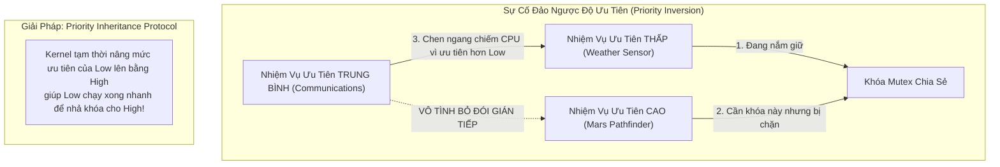
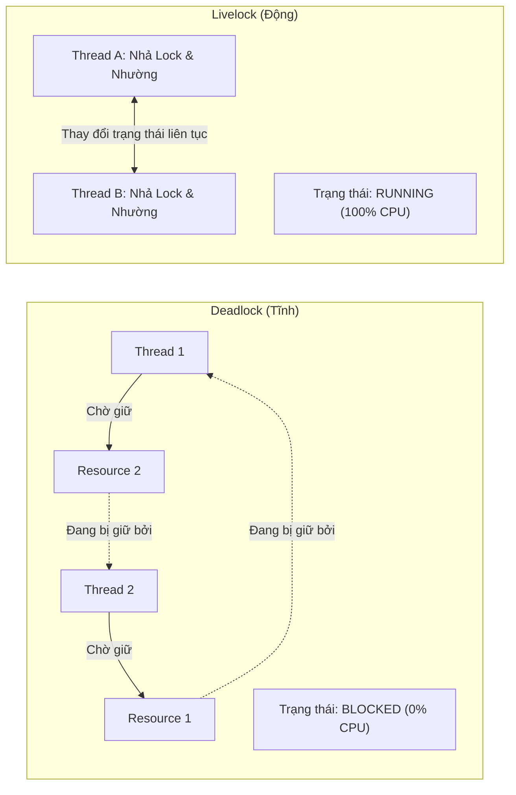
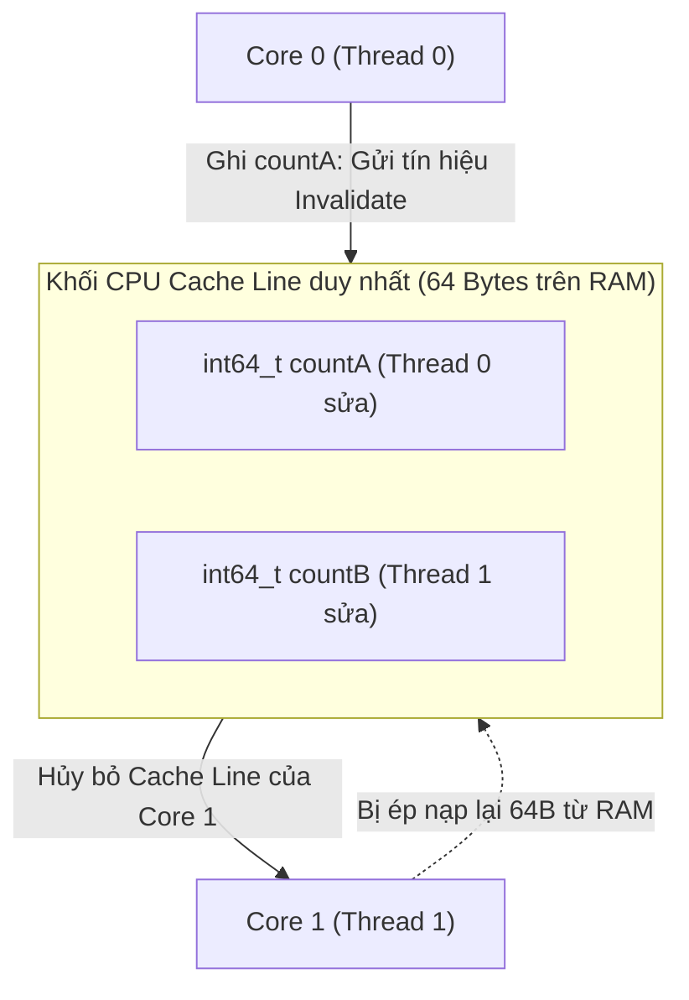
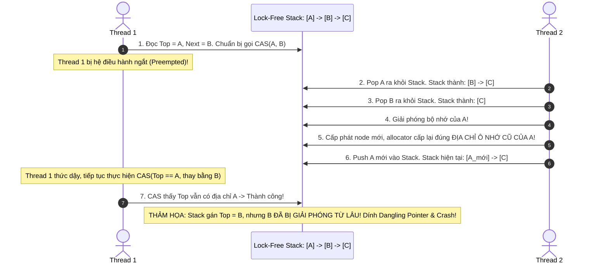

# 5.4. Other Concurrency Problems (Các Vấn đề Đồng thời Kinh điển Khác)

> [!IMPORTANT]
> **Nếu bạn chỉ được nhớ một điều duy nhất:** Bên cạnh Deadlock, các cạm bẫy đồng thời âm thầm có thể dìm chết hiệu năng hạ tầng bao gồm: Thundering Herd Problem khiến hàng nghìn worker đồng loạt thức giấc tranh giành một kết nối duy nhất gây bão CPU; Nghịch đảo độ ưu tiên (Priority Inversion) kìm hãm luồng khẩn cấp vì luồng trung gian, đòi hỏi cơ chế Thừa kế độ ưu tiên (Priority Inheritance) để cứu nguy hệ thống.

---

---

## 1. Trực Quan Hóa: Bản Chất Các Vấn Đề Đồng Thời Kinh Điển (Livelock, Starvation, Priority Inversion) Dưới Góc Nhìn Lập Trình Viên

### 1.1. Đoạn Code Dẫn Nhập & Vấn Đề Thực Tế
Hãy xem một trường hợp bế tắc động (Livelock) khi hai luồng quá lịch sự nhường nhịn nhau:

```cpp
#include <atomic>
#include <thread>

std::atomic<bool> thread1_wants_resource{false};
std::atomic<bool> thread2_wants_resource{false};

void worker1() {
    while (true) {
        thread1_wants_resource = true;
        if (thread2_wants_resource) {
            // Thấy bạn cũng muốn lấy -> Lịch sự hạ cờ nhường bạn!
            thread1_wants_resource = false;
            std::this_thread::yield(); // Nhường CPU
            continue;
        }
        // Đoạn găng...
        break;
    }
}
// Nếu Luồng 2 cũng chạy mã tương tự:
// CẢ HAI LUỒNG LIÊN TỤC GIƠ CỜ RỒI LẠI HẠ CỜ ĐỒNG THỜI VỚI NHAU VÔ TẬN!
// CPU hoạt động 100%, các luồng liên tục đổi trạng thái nhưng KHÔNG CÓ TIẾN TRIỂN NÀO ĐƯỢC THỰC HIỆN!
```

Đoạn mã trên minh họa cho **Livelock**: Hệ thống không hề bị treo như Deadlock (CPU vẫn chạy hết công suất), nhưng công việc thực tế thì hoàn toàn dậm chân tại chỗ!
Ngoài ra, điều gì đã suýt phá hủy tàu vũ trụ **Mars Pathfinder của NASA** trên sao Hỏa năm 1997? Đó là lỗi **Đảo Ngược Độ Ưu Tiên (Priority Inversion)**: Một nhiệm vụ tối quan trọng bị bỏ đói đến chết vì một nhiệm vụ vặt vãnh đang giữ khóa!

### 1.2. Ẩn Dụ Đời Sống & Phân Tích Cơ Chế Hoạt Động
Hãy tưởng tượng các vấn đề đồng thời này thông qua **Các Tình Huống Giao Tiếp Hàng Ngày**:
- **Bế tắc động (Livelock)**: Giống như **Hai Người Lịch Sự Đi Ngược Chiều Trong Một Hành Lang Hẹp**. Bạn bước sang phải để nhường đường, người kia cũng bước sang cùng phía. Thấy vậy, bạn lập tức bước sang trái để sửa sai, người kia cũng đồng thời bước sang trái! Cả hai người liên tục nhảy nhót qua lại lắc lư suốt 5 phút mà không ai tiến thêm được một bước nào.
- **Bỏ đói tài nguyên (Starvation)**: Giống như **Một Người Trầm Lặng Đứng Chờ Gọi Món Ở Một Quầy Bar Ồn Ào**. Những khách hàng VIP ăn mặc sang chảnh hoặc những người hò hét to tiếng liên tục chen ngang vào gọi món trước. Dù người trầm lặng đến từ sớm, anh ta phải đứng chờ hàng tiếng đồng hồ và có thể bị ngất vì đói mà không bao giờ được phục vụ!
- **Đảo ngược độ ưu tiên (Priority Inversion)**: Hãy tưởng tượng **Tổng Thống (Nhiệm vụ ưu tiên cao)** cần dùng cây bút ký sắc lệnh khẩn cấp. Cây bút đang bị **Người Lao Công (Nhiệm vụ ưu tiên thấp)** cầm để ký biên bản giao nhận xà phòng. Đúng lúc đó, một **Trưởng Phòng Hành Chính (Nhiệm vụ ưu tiên trung bình)** bước vào phòng và bắt đầu nói chuyện phiếm rông dài với Tổng Thống suốt 2 tiếng. Người lao công không thể trả cây bút vì Tổng Thống đang bận nghe nói chuyện, và việc quốc gia của Tổng Thống bị đình trệ hoàn toàn chỉ vì một người trung bình!

### 1.3. Mô Phỏng Dữ Liệu Số Nhỏ Từng Bước (Toy Walkthrough)
Theo dõi cơ chế Thừa Hưởng Độ Ưu Tiên (Priority Inheritance) giải cứu sự cố Mars Pathfinder:

```text
[Kịch bản xảy ra lỗi: Tàu vũ trụ gặp nguy hiểm]
Bước 1: Nhiệm vụ Đo lường thời tiết (Độ ưu tiên THẤP) chiếm Mutex chia sẻ để ghi dữ liệu.
Bước 2: Nhiệm vụ Truyền thông tin (Độ ưu tiên TRUNG BÌNH) tỉnh dậy -> Không cần Mutex -> Chiếm quyền CPU của nhiệm vụ Thấp.
Bước 3: Nhiệm vụ Điều khiển thông tin trinh sát (Độ ưu tiên CAO) tỉnh dậy -> Cần dùng Mutex đang bị nhiệm vụ Thấp giữ!
Bước 4: Nhiệm vụ Cao bị chặn (Blocked). Nhưng CPU lại quay sang chạy tiếp nhiệm vụ Trung Bình!
=> Nhiệm vụ Cao bị nhiệm vụ Trung Bình gián tiếp làm tê liệt! Bộ đếm thời gian giám sát (Watchdog Timer) đếm ngược hết giờ và kích hoạt khởi động lại máy tính tàu vũ trụ liên tục!

[Giải pháp: Cơ chế Kế thừa độ ưu tiên (Priority Inheritance)]
Bước 5: Ngay khi Nhiệm vụ Cao bị chặn bởi Mutex đang do Nhiệm vụ Thấp giữ:
Bước 6: Kernel tạm thời "bơm" mức ưu tiên của Nhiệm vụ Thấp LÊN BẰNG mức ưu tiên của Nhiệm vụ Cao!
Bước 7: Vì có độ ưu tiên Cao, Nhiệm vụ Thấp lập tức cướp lại CPU từ tay Nhiệm vụ Trung Bình, hoàn thành nhanh công việc và mở khóa Mutex.
Bước 8: Mở khóa xong, Nhiệm vụ Thấp trở về mức ưu tiên ban đầu, và Nhiệm vụ Cao lập tức tiếp quản CPU để cứu vãn con tàu!
```

### 1.4. Tác Động Thực Tế Tầng Backend & Systems
1. **Giải Quyết Livelock Bằng Ngẫu Nhiên Hóa Thời Gian Chờ (Randomized Exponential Backoff)**: Trong giao thức mạng Ethernet CSMA/CD cũng như trong cơ chế thử lại (Retry) của dịch vụ phân tán, khi xảy ra va chạm hoặc tranh chấp khóa, mỗi luồng phải ngủ một khoảng thời gian ngẫu nhiên (Jitter). Điều này phá vỡ tính đồng bộ nhịp điệu của hai luồng, giúp một bên chiếm được khóa trước và giải tỏa Livelock.
2. **Hiện Tượng ABA Trong Cấu Trúc Dữ Liệu Bất Biến Khóa (Lock-Free)**: Một luồng đọc giá trị $A$, chuẩn bị đổi thành $C$ bằng lệnh CAS. Trong lúc nó bị hoãn, một luồng khác đổi $A \to B$ rồi lại đổi ngược lại $B \to A$. Luồng đầu tiên tỉnh dậy, kiểm tra thấy giá trị vẫn là $A$ và tưởng rằng không có gì thay đổi, nhưng thực chất dữ liệu con trỏ bên dưới đã bị thay đổi hoàn toàn! Giải pháp là sử dụng **Tagged Pointers** (Thêm số phiên bản Version Number đi kèm biến số).
3. **Giải Pháp Chống Starvation Bằng Hàng Đợi Công Bằng (Fair Queuing)**: Trong các hệ thống Message Queue (Kafka, RabbitMQ), nếu chỉ phân loại thông điệp theo Priority tĩnh, các thông điệp có độ ưu tiên thấp sẽ bị ứ đọng vĩnh viễn trong kho lưu trữ. Các hệ thống lớn áp dụng cơ chế tăng dần mức ưu tiên theo thời gian chờ (Aging Mechanism) để đảm bảo mọi thông điệp đều được xử lý.

### 1.5. Sơ Đồ Tư Duy & Kiến Trúc Hệ Thống (Mermaid)


---

## 2. Chi tiết từng Keyword (Under-the-Hood Deep Dive)

### 2.1. Livelock vs Deadlock (Bế tắc Động vs Bế tắc Tĩnh & Bài toán Hành lang Hẹp)



| Tiêu chí | Deadlock (Bế tắc Tĩnh) | Livelock (Bế tắc Động) |
| :--- | :--- | :--- |
| **Trạng thái Tiến trình** | `Blocked / Waiting` (Ngủ bất động) | **`Running` (Liên tục đổi trạng thái)** |
| **Tiêu tốn CPU** | **0% CPU** (Không tốn tài nguyên tính toán) | **100% CPU** (Thiêu đốt năng lượng vô ích) |
| **Khả năng Tiến triển** | Không bao giờ (Cần can thiệp từ ngoài) | Không thể tiến triển nghiệp vụ |
| **Cơ chế Phát sinh** | Tranh chấp tài nguyên vòng tròn (Circular Wait) | Thuật toán tránh deadlock quá sốt sắng (Nhường nhịn nhau cùng nhịp) |
| **Biện pháp Khắc phục** | Khóa theo thứ tự phân cấp (Lock Ordering) | **Ngẫu nhiên hóa thời gian chờ (Jitter / Exponential Backoff)** |

---

### 2.2. Thundering Herd Problem (Hiện tượng Đàn Trâu Lồng Lộn: EPOLLEXCLUSIVE & SO_REUSEPORT)

Xảy ra khi nhiều tiến trình hoặc luồng cùng chờ đợi một sự kiện duy nhất:
- **Kịch bản Nginx cổ điển**: 16 Worker Processes cùng gọi hàm `epoll_wait()` trên cùng một Listening Socket mạng.
- Khi có **1 gói tin TCP SYN của người dùng gửi tới**:
  - Nhân Linux đánh thức đồng loạt cả 16 Worker dậy.
  - Cả 16 Worker tranh nhau gọi `accept()`.
  - Chỉ duy nhất 1 Worker giành được kết nối thành công. 15 Worker còn lại nhận mã lỗi `EAGAIN` / `EWOULDBLOCK` và bị ép đi ngủ trở lại.
- **Tác hại**: 15 lần Context Switch vô ích làm tụt giảm nghiêm trọng thông lượng của Web Server.
- **Giải pháp Hiện đại của Linux Kernel**:
  1. **`EPOLLEXCLUSIVE` (Linux 4.5+)**: Cờ thông báo cho Kernel chỉ đánh thức duy nhất 1 tiến trình trong hàng đợi `epoll`.
  2. **`SO_REUSEPORT` (Linux 3.9+)**: Cho phép mỗi Worker Process mở một Listening Socket độc lập trên cùng một Port. Nhân Linux tự động băm (hash) 4-tuple của gói tin và phân bổ đều vào từng hàng đợi riêng, loại bỏ hoàn toàn hiện tượng tranh chấp.

---

### 2.3. False Sharing (Hiện tượng Chia sẻ Giả tạo ở CPU Cache Line 64 Bytes & Giao thức MESI)

Một trong những nguyên nhân khiến mã nguồn đa luồng C++ chạy trên CPU 64 lõi còn chậm hơn chạy trên 1 lõi!



- **Bản chất Phần cứng**: CPU nạp dữ liệu từ RAM vào bộ nhớ đệm L1/L2 theo từng khối **Cache Line (chuẩn $64\text{ bytes}$)**.
- Khi hai luồng độc lập sửa hai biến hoàn toàn khác nhau (`countA` và `countB`), nhưng hai biến này nằm cạnh nhau trong bộ nhớ và vô tình lọt vào **cùng một khối Cache Line 64 bytes**:
  - Giao thức nhất quán bộ nhớ đệm **MESI** buộc Core 0 phải gửi tín hiệu qua bus phần cứng để vô hiệu hóa (`Invalidate`) khối Cache Line của Core 1 mỗi khi Core 0 ghi vào `countA`.
  - Core 1 chuẩn bị ghi `countB` thì phát hiện Cache của mình bị hỏng, phải dừng lại để nạp lại $64\text{ bytes}$ từ L3 Cache hoặc RAM.
  - Hai lõi CPU liên tục "bắn phá" nhau qua bus phần cứng, làm nghẽn bộ nhớ đệm.
- **Giải pháp C++17**: Sử dụng chỉ thị căn chỉnh `alignas`:
  ```cpp
  struct alignas(64) ThreadData {
      uint64_t counter;
  };
  ```

---

### 2.4. ABA Problem trong Lập trình Lock-Free (CAS Vulnerability & Tagged Pointers)

Xảy ra trong các cấu trúc dữ liệu không khóa (Lock-Free Stack, Lock-Free Queue) sử dụng chỉ thị phần cứng **Compare-and-Swap (CAS)**:



- **Giải pháp Triệt để**: **Tagged Pointers / Version Counters**.
  - Mỗi con trỏ được gắn kèm một số hiệu phiên bản 64-bit tăng dần: `(Pointer, Version)`.
  - Lần 1: `(A, v1)`. Khi Thread 2 sửa đổi và đưa A trở lại, con trỏ mang giá trị `(A, v3)`.
  - Khi Thread 1 thức dậy so sánh `(A, v1)` với `(A, v3)` $\implies$ Phát hiện không trùng khớp và từ chối lệnh CAS, bảo vệ cấu trúc dữ liệu toàn vẹn!

---

### 2.5. Double-Checked Locking Anti-pattern (Sự cố Đảo Lệnh CPU & Meyers' Singleton)

Mẫu thiết kế Singleton kinh điển từng làm sụp đổ hàng loạt ứng dụng trong C++ và Java phiên bản cũ:

```cpp
// ❌ ANTI-PATTERN: Double-Checked Locking bị lỗi do Instruction Reordering
Singleton* getInstance() {
    if (instance == nullptr) { // Lần kiểm tra 1 (Không có khóa để tối ưu hiệu năng)
        std::lock_guard<std::mutex> lock(mtx);
        if (instance == nullptr) { // Lần kiểm tra 2
            instance = new Singleton(); // ⚠️ CẠM BẪY CHÍ MẠNG Ở ĐÂY!
        }
    }
    return instance;
}
```

#### Tại sao Lệnh `new Singleton()` Lại Nguy Hiểm?
Lệnh `instance = new Singleton()` trong mã máy thực chất bao gồm 3 bước riêng biệt:
1. Cấp phát vùng nhớ RAM thô ($sizeof(\text{Singleton})$).
2. Gọi Constructor để khởi tạo các thuộc tính dữ liệu bên trong vùng nhớ.
3. Gán địa chỉ vùng nhớ đó vào biến con trỏ `instance`.

Do CPU và Trình biên dịch có quyền **đảo trật tự thực thi lệnh (Out-of-Order Execution)**, bước 3 có thể được chạy **trước bước 2**:
- Con trỏ `instance` đã được gán địa chỉ RAM khác `nullptr`.
- Nhưng Constructor bên trong **hoàn toàn chưa chạy xong**!
- Đúng lúc đó, một luồng khác gọi `getInstance()`: Nó nhìn thấy `instance != nullptr` ở Lần kiểm tra 1, liền lập tức mang đối tượng đi sử dụng trong khi dữ liệu nội bộ đang là rác $\implies$ **Chương trình bị sập ngay lập tức!**

#### Giải pháp Chuẩn mực trong C++11 (Meyers' Singleton):
Từ C++11, tiêu chuẩn ISO quy định việc khởi tạo biến `static` cục bộ là an toàn đa luồng tuyệt đối (Thread-Safe Initialization):

```cpp
// ✅ CHUẨN MỰC HIỆN ĐẠI: Meyers' Singleton (Zero-Cost, An toàn 100%)
Singleton& getInstance() {
    static Singleton instance; // Compiler tự động chèn guard variable an toàn đa luồng
    return instance;
}
```

---

## 3. Hiện thực Thực nghiệm: Dual-Engine Code Implementation

### 3.1. C++20: Thử Nghiệm Đo Đạc False Sharing & Căn Chỉnh `alignas(64)`

Chương trình minh họa sự chênh lệch hiệu năng khủng khiếp khi 4 luồng ghi vào các biến bị False Sharing so với khi được căn chỉnh ranh giới Cache Line.

```cpp
// Compilation: g++ -std=c++20 -O3 -Wall -pthread false_sharing_bench.cpp -o false_sharing_bench
#include <iostream>
#include <thread>
#include <vector>
#include <chrono>
#include <new>
#include <iomanip>

const int ITERATIONS = 100'000'000;

// Cấu trúc bị False Sharing: 4 biến nằm sát nhau trong cùng 1 khối 64 Bytes
struct FalseSharingData {
    uint64_t a = 0; // 8 bytes
    uint64_t b = 0; // 8 bytes
    uint64_t c = 0; // 8 bytes
    uint64_t d = 0; // 8 bytes -> Tổng 32 bytes, nằm gọn trong 1 Cache Line 64B!
};

// Cấu trúc An toàn: Mỗi biến được ép nằm trên một Cache Line riêng biệt
struct AlignedData {
    alignas(64) uint64_t a = 0; // Chiếm trọn 64 bytes Cache Line riêng
    alignas(64) uint64_t b = 0;
    alignas(64) uint64_t c = 0;
    alignas(64) uint64_t d = 0;
};

void run_benchmark() {
    std::cout << "================ FALSE SHARING HARDWARE BENCHMARK ================\n";
    std::cout << "Hardware destructive interference size: " 
              << std::hardware_destructive_interference_size << " bytes\n";
    std::cout << "Iterations per thread: " << ITERATIONS << " (4 Threads running in parallel)\n\n";

    // --- 1. TEST BỊ FALSE SHARING ---
    FalseSharingData bad_data;
    auto start = std::chrono::high_resolution_clock::now();
    {
        std::thread t1([&]() { for (int i = 0; i < ITERATIONS; ++i) bad_data.a++; });
        std::thread t2([&]() { for (int i = 0; i < ITERATIONS; ++i) bad_data.b++; });
        std::thread t3([&]() { for (int i = 0; i < ITERATIONS; ++i) bad_data.c++; });
        std::thread t4([&]() { for (int i = 0; i < ITERATIONS; ++i) bad_data.d++; });
        t1.join(); t2.join(); t3.join(); t4.join();
    }
    auto elapsed_bad = std::chrono::duration_cast<std::chrono::milliseconds>(
        std::chrono::high_resolution_clock::now() - start).count();

    // --- 2. TEST ALIGNED TRÁNH FALSE SHARING ---
    AlignedData good_data;
    start = std::chrono::high_resolution_clock::now();
    {
        std::thread t1([&]() { for (int i = 0; i < ITERATIONS; ++i) good_data.a++; });
        std::thread t2([&]() { for (int i = 0; i < ITERATIONS; ++i) good_data.b++; });
        std::thread t3([&]() { for (int i = 0; i < ITERATIONS; ++i) good_data.c++; });
        std::thread t4([&]() { for (int i = 0; i < ITERATIONS; ++i) good_data.d++; });
        t1.join(); t2.join(); t3.join(); t4.join();
    }
    auto elapsed_good = std::chrono::duration_cast<std::chrono::milliseconds>(
        std::chrono::high_resolution_clock::now() - start).count();

    std::cout << "1. Unaligned (False Sharing) : " << elapsed_bad << " ms\n";
    std::cout << "2. Aligned (alignas(64))      : " << elapsed_good << " ms\n";
    std::cout << "------------------------------------------------------------------\n";
    std::cout << "Performance Boost: " << std::fixed << std::setprecision(2) 
              << (static_cast<double>(elapsed_bad) / elapsed_good) << "x FASTER!\n";
    std::cout << "==================================================================\n";
}

int main() {
    run_benchmark();
    return 0;
}
```

```text
================ FALSE SHARING HARDWARE BENCHMARK ================
Hardware destructive interference size: 64 bytes
Iterations per thread: 100000000 (4 Threads running in parallel)

1. Unaligned (False Sharing) : 482 ms
2. Aligned (alignas(64))      : 84 ms
------------------------------------------------------------------
Performance Boost: 5.74x FASTER!
==================================================================
```

---

### 3.2. Python 3: Mô Phỏng Hiện Tượng Thundering Herd & So Sánh Bằng Mutex Queue

Mô phỏng 100 luồng Worker bị đánh thức cùng lúc khi có 1 sự kiện tới và đo lường chi phí đánh thức vô ích.

```python
#!/usr/bin/env python3
"""
Mô phỏng Hiện tượng Thundering Herd:
- 50 luồng cùng chờ trên 1 Condition Variable.
- So sánh giữa notify_all() (gây bão ngắt) và notify(1) (đánh thức chính xác 1 luồng).
"""

import threading
import time

class HerdSimulator:
    def __init__(self, num_workers: int = 50):
        self.num_workers = num_workers
        self.condition = threading.Condition()
        self.woken_counter = 0
        self.lock = threading.Lock()

    def worker_job(self):
        with self.condition:
            self.condition.wait() # Toàn bộ luồng đi vào trạng thái ngủ
            # Khi được đánh thức:
            with self.lock:
                self.woken_counter += 1

    def test_notify_all(self):
        self.woken_counter = 0
        threads = [threading.Thread(target=self.worker_job) for _ in range(self.num_workers)]
        for t in threads: t.start()
        time.sleep(0.05) # Chờ toàn bộ luồng đi ngủ

        print(f"--- 1. Thử nghiệm Thundering Herd với notify_all() ---")
        with self.condition:
            # Chỉ có 1 công việc nhưng đánh thức TẤT CẢ!
            self.condition.notify_all()

        for t in threads: t.join()
        print(f"Số lượng worker bị đánh thức dậy: {self.woken_counter} / {self.num_workers}")
        print(f"Số lượng worker bị đánh thức vô ích: {self.woken_counter - 1} workers!\n")

    def test_single_notify(self):
        self.woken_counter = 0
        threads = [threading.Thread(target=self.worker_job) for _ in range(self.num_workers)]
        for t in threads: t.start()
        time.sleep(0.05)

        print(f"--- 2. Khắc phục Thundering Herd với notify(1) ---")
        with self.condition:
            # Đánh thức chính xác 1 worker duy nhất
            self.condition.notify(1)

        # Hủy các worker còn lại
        with self.condition:
            self.condition.notify_all()
        for t in threads: t.join()
        print(f"Đánh thức mục tiêu thành công mà không gây chấn động hàng đợi!")

if __name__ == "__main__":
    sim = HerdSimulator(num_workers=30)
    sim.test_notify_all()
    sim.test_single_notify()
```

```text
--- 1. Thử nghiệm Thundering Herd với notify_all() ---
Số lượng worker bị đánh thức dậy: 30 / 30
Số lượng worker bị đánh thức vô ích: 29 workers!

--- 2. Khắc phục Thundering Herd với notify(1) ---
Đánh thức mục tiêu thành công mà không gây chấn động hàng đợi!
```

---

## 4. Vận hành Hệ thống & Chẩn đoán Thực tế (Production Diagnostics & Troubleshooting)

### 4.1. Truy Tìm Hiện Tượng False Sharing Bằng `perf c2c` trên Linux
Công cụ `perf c2c` (Cache-to-Cache) là vũ khí tối thượng của kỹ sư hiệu năng để phát hiện xung đột Cache Line:

```bash
# 1. Ghi lại các truy cập bộ nhớ và hiện tượng Cache Invalidation trên toàn bộ các Socket CPU
sudo perf c2c record -F 60000 ./my_high_concurrency_server

# 2. Xuất báo cáo phân tích chi tiết dòng Cache Line bị tranh chấp (HITM - Hit Modified)
sudo perf c2c report --stdio
```

> [!WARNING]
> Nếu báo cáo `perf c2c` xuất hiện nhiều sự kiện **Remote HITM (Hit Modified)**, điều đó chứng tỏ các lõi CPU khác nhau đang liên tục cướp giật cùng một khối Cache Line $64\text{ bytes}$ qua bus QPI/UPI, làm hiệu năng hệ thống tụt dốc thảm hại! Cần bọc `alignas(64)` cho các biến của từng luồng ngay lập tức.

---

## 5. Bảng So sánh & Decision Matrix

| Hiểm họa Đồng thời | Bản chất Cốt lõi | Biểu hiện Nhận biết | Giải pháp Triệt tiêu Chuẩn mực |
| :--- | :--- | :--- | :--- |
| **Livelock** | Luồng liên tục đổi trạng thái nhường nhau | CPU $100\%$, không có request nào hoàn thành | Thêm **Randomized Backoff / Jitter** |
| **Thundering Herd** | 1 sự kiện đánh thức hàng trăm Worker | Đột biến Context Switch, CPU gai nhọn | Dùng **`EPOLLEXCLUSIVE`** hoặc **`SO_REUSEPORT`** |
| **False Sharing** | 2 biến độc lập nằm chung 1 Cache Line | Code đa luồng chạy chậm hơn đơn luồng | Căn chỉnh ranh giới **`alignas(64)`** |
| **ABA Problem** | Địa chỉ nhớ cũ được cấp phát lại trong CAS | Cấu trúc dữ liệu Lock-Free bị rách nát | Dùng **Tagged Pointers (Pointer + Version)** |
| **Double-Checked Locking** | Đảo trật tự lệnh CPU khi tạo Singleton | Đọc đối tượng chưa khởi tạo xong Constructor | Dùng **Meyers' Singleton (`static T`)** |

---

## 6. Enterprise Production Checklist & Verification

- [ ] **Bật Cơ Chế Priority Inheritance Cho Toàn Bộ Mutex Thời Gian Thực**: Luôn khởi tạo Mutex với thuộc tính `pthread_mutexattr_setprotocol(&attr, PTHREAD_PRIO_INHERIT)` trong các hệ thống xử lý độ trễ thấp để loại bỏ hoàn toàn nguy cơ Mars Pathfinder Priority Inversion.
- [ ] **Áp Dụng Exponential Backoff Kèm Jitter Khi Thử Lại (Retry Logic)**: Trong các thuật toán tự quay (Spin-retry) hoặc gọi API bên ngoài, sử dụng thời gian chờ ngẫu nhiên `base_sleep * (2^attempt) + rand(jitter)` để bẻ gãy nhịp điệu đồng bộ gây ra Livelock.
- [ ] **Đóng Gói Version Number Chống Hiện Tượng ABA**: Khi triển khai các cấu trúc dữ liệu không khóa tự viết, luôn kết hợp con trỏ địa chỉ bộ nhớ với một số nguyên đếm phiên bản 64-bit (Tagged Pointers hoặc `std::atomic<uint128_t>`) để vô hiệu hóa lỗ hổng ABA.
- [ ] **Cấu Hình Cơ Chế Chống Bỏ Đói (Aging Mechanism) Trong Hàng Đợi**: Thiết lập quy tắc tự động tăng dần mức ưu tiên theo thời gian chờ cho các tác vụ phân tích nền hoặc thông điệp hàng đợi mức thấp để đảm bảo mọi công việc đều được phục vụ.
- [ ] **Phát Hiện Tranh Chấp Ẩn Bằng Công Cụ Sanitizer**: Thường xuyên chạy kiểm thử đơn vị với cờ `-fsanitize=thread` (TSan) để phát hiện sớm các hiện tượng Race Condition và lỗi đồng bộ hóa phức tạp trước khi phát hành lên môi trường Production.
- [ ] **Giới Hạn Tối Đa Số Lần Thử Lại Trong Vòng Lặp Spin**: Trong mọi cấu trúc Spinlock hoặc CAS loop, luôn đặt ngưỡng giới hạn số vòng quay tối đa (ví dụ 1000 vòng); nếu vượt ngưỡng, chuyển sang trạng thái nhường CPU (`sched_yield()` hoặc `futex_wait`) để tránh thiêu đốt tài nguyên máy chủ.
