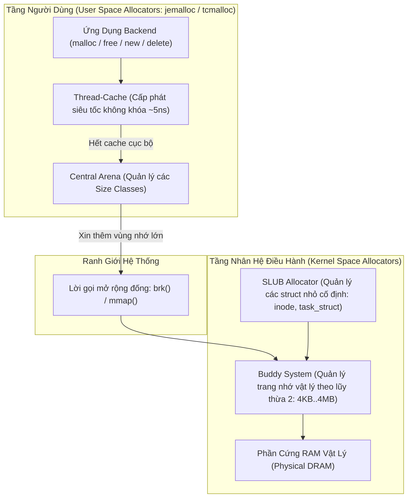
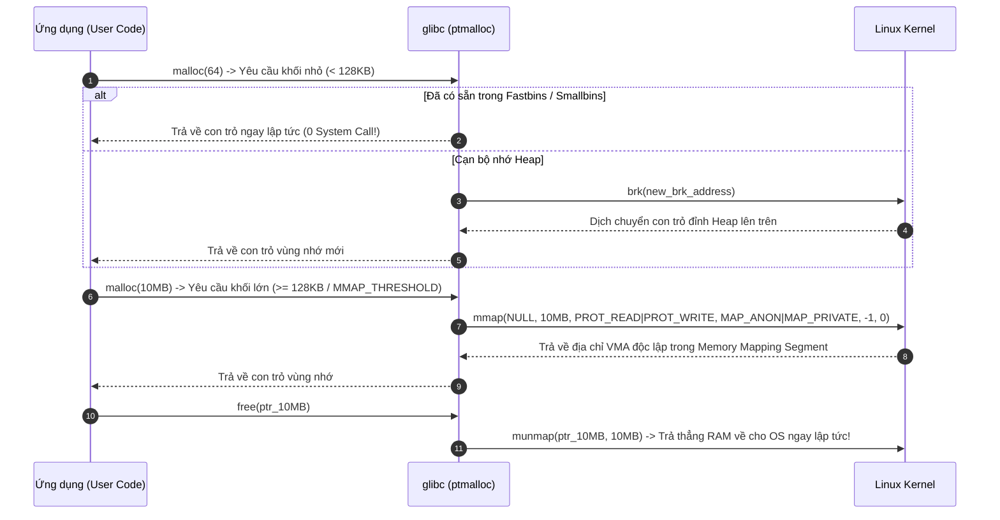

# 6.3. Memory Allocation (Cấp Phát Bộ Nhớ: User Allocators, Kernel Buddy & SLUB, Struct Alignment & OOM Killer)

> [!IMPORTANT]
> **Nếu bạn chỉ được nhớ một điều duy nhất:** Cấp phát bộ nhớ là nghệ thuật dung hòa giữa phân mảnh bộ nhớ (Fragmentation) và tốc độ thực thi: Kernel giải quyết phân mảnh ngoài bằng Buddy Allocator và phân mảnh trong bằng SLAB/SLUB cache các struct cố định; trong khi các User-space Allocator hiện đại như Jemalloc và TCMalloc tối ưu hóa đa luồng thông qua Thread-Cache (T-Cache) độc lập để cấp phát bộ nhớ mà không cần tranh chấp Mutex toàn cục.

---

## 1. Trực Quan Hóa: Bản Chất Cấp Phát Bộ Nhớ (User Allocators, Kernel Buddy & SLUB) Dưới Góc Nhìn Lập Trình Viên

### 1.1. Đoạn Code Dẫn Nhập & Vấn Đề Thực Tế
Hãy xem một trường hợp cấp phát bộ nhớ động trong C++ và cách hệ điều hành phản ứng khi máy chủ cạn kiệt tài nguyên:

```cpp
#include <iostream>
#include <vector>

int main() {
    std::vector<char*> allocations;
    std::cout << "Bắt đầu cấp phát bộ nhớ liên tục..." << std::endl;
    
    // Liên tục cấp phát từng khối 100 MB và GHI DỮ LIỆU để ép buộc RAM vật lý tăng
    while (true) {
        char* block = new char[100 * 1024 * 1024]; // 100 MB
        for (int i = 0; i < 100 * 1024 * 1024; i += 4096) {
            block[i] = 1; // Chạm vào từng trang nhớ để kích hoạt Dirty Page
        }
        allocations.push_back(block);
        std::cout << "Đã cấp phát: " << allocations.size() * 100 << " MB RAM" << std::endl;
    }
    return 0;
}
```

Khi chạy chương trình này, sau khi cấp phát hết toàn bộ RAM vật lý và Swap, chương trình đột ngột biến mất mà không hề ném ra ngoại lệ `std::bad_alloc`:
```text
Killed
```
Trong nhật ký hệ thống `dmesg`, bạn sẽ thấy dòng thông báo kinh điển:
```text
Out of memory: Kill process 14209 (heavy_app) score 852 or sacrifice child
```
Điều gì vừa xảy ra? Đó là **Linux OOM Killer (Out-Of-Memory Killer)**! Khi Kernel cạn kiệt bộ nhớ trang vật lý, nó kích hoạt thuật toán chấm điểm "tội đồ" (`oom_score`) và thẳng tay bắn hạ tiến trình tiêu thụ nhiều RAM nhất để cứu vãn sự sống còn của toàn bộ hệ điều hành.

### 1.2. Ẩn Dụ Đời Sống & Phân Tích Cơ Chế Hoạt Động
Hãy tưởng tượng hệ thống cấp phát bộ nhớ giống như **Hệ Thống Phân Phối Gỗ Trong Một Xưởng Mộc Lớn**:
- **Cấp phát tầng Kernel (Buddy System - Bán Gỗ Khối Lớn)**: Giống như một **Nhà Máy Xẻ Gỗ Cung Cấp Từng Tấm Gỗ Lớn Theo Lũy Thừa Của 2** ($4\text{ KB}, 8\text{ KB}, 16\text{ KB}... 4\text{ MB}$). Nếu thợ mộc cần một miếng gỗ $12\text{ KB}$, nhà máy không thể xẻ lẻ mà bắt buộc phải chặt một tấm gỗ $16\text{ KB}$ giao đi.
- **Cấp phát cấu trúc nhỏ Kernel (SLUB Allocator - Khuôn Đúc Đinh Ốc Tái Sử Dụng)**: Nếu Kernel cần hàng triệu chiếc ốc vít nhỏ có kích thước cố định (như `struct task_struct`, `struct inode`, `file descriptor`), thay vì chạy sang nhà máy xẻ gỗ xin từng mẩu gỗ nhỏ, Kernel tạo ra các khuôn đúc sẵn (Slab/Slub Caches). Khi một tiến trình chết đi, ốc vít được trả lại khay khuôn để cấp phát ngay cho tiến trình mới mà không cần cấp phát lại từ đầu.
- **Cấp phát tầng người dùng (User-Space Allocators: jemalloc, tcmalloc, ptmalloc)**: Giống như một **Đội Thợ Mộc Bán Lẻ Thông Minh**. Họ mua các tấm gỗ lớn từ Kernel thông qua lệnh gọi `brk` hoặc `mmap`, sau đó tự cưa xẻ thành hàng triệu mẩu gỗ nhỏ đủ kích cỡ (Size Classes: 8B, 16B, 64B...) để giao ngay cho hàm `malloc()` của người dùng mà không cần phải chạy sang làm thủ tục với Kernel mỗi lần gọi!

### 1.3. Mô Phỏng Dữ Liệu Số Nhỏ Từng Bước (Toy Walkthrough)
Theo dõi thuật toán Buddy System chia đôi và gộp khối bộ nhớ khi cấp phát $1\text{ khối 64 KB}$ từ một vùng nhớ trống ban đầu $512\text{ KB}$:

```text
[Trạng thái ban đầu]: Khối nhớ tự do Block_512K (512 KB).

[Yêu cầu cấp phát 64 KB]:
Bước 1: Block_512K chia đôi thành 2 "bạn thân" (Buddies): [Block_256K_A] và [Block_256K_B].
Bước 2: Lấy Block_256K_A tiếp tục chia đôi: [Block_128K_A1] và [Block_128K_A2].
Bước 3: Lấy Block_128K_A1 chia đôi lần cuối: [Block_64K_1] và [Block_64K_2].
Bước 4: Cấp phát Block_64K_1 cho người dùng! Block_64K_2 được đưa vào hàng đợi tự do tự quản.

[Giải phóng và gộp khối (Coalescing)]:
Bước 5: Người dùng giải phóng Block_64K_1.
Bước 6: Kernel kiểm tra người "bạn thân" Block_64K_2 -> Thấy nó cũng đang hoàn toàn tự do!
Bước 7: Kernel lập tức gộp 2 bạn thân lại thành khối Block_128K_A1 (128 KB).
Bước 8: Kiểm tra bạn thân Block_128K_A2 cũng đang rảnh -> Gộp tiếp thành Block_256K_A.
Bước 9: Gộp tiếp với Block_256K_B -> Tái sinh nguyên vẹn khối lớn ban đầu Block_512K!
=> Hoàn toàn triệt tiêu phân mảnh bộ nhớ ngoài chỉ sau vài phép toán bitwise cực nhanh!
```

### 1.4. Tác Động Thực Tế Tầng Backend & Systems
1. **Kiến Trúc Bể Đệm Riêng Của Từng Luồng (Thread-Caching Malloc - tcmalloc / jemalloc)**: Trong các ứng dụng Backend đa luồng xử lý hàng chục nghìn request/giây, nếu mọi luồng đều gọi `malloc()` vào một đống (Heap) chung của thư viện glibc cũ, tất cả các luồng sẽ bị nghẽn vì tranh chấp khóa Mutex toàn cục (Global Heap Lock Contention). `jemalloc` và `tcmalloc` khắc phục điều này bằng cách cấp cho mỗi luồng một bộ đệm cục bộ (Thread Cache Arena) hoàn toàn không có khóa!
2. **Cơ Chế Tính Điểm OOM Killer (`oom_score`)**:
   $$\text{oom\_score} \approx \frac{\text{RSS + Swap}}{\text{Tổng RAM hệ thống}} \times 1000 + \text{oom\_score\_adj}$$
   Tiến trình nào chiếm tỷ lệ RAM càng lớn thì điểm càng cao và càng dễ bị chọn làm "vật tế thần" đầu tiên khi cạn kiệt bộ nhớ.
3. **Bảo Vệ Tiến Trình Trọng Yếu Khỏi Bị Bắn Hạ (`oom_score_adj`)**: Bằng cách ghi giá trị `-1000` vào `/proc/<PID>/oom_score_adj`, hệ điều hành sẽ coi tiến trình đó là "bất tử" và không bao giờ chọn nó để tiêu diệt (thường áp dụng cho daemon quản trị SSH, Kubernetes Kubelet).

### 1.5. Sơ Đồ Tư Duy & Kiến Trúc Hệ Thống (Mermaid)


---

## 2. Chi tiết từng Keyword (Under-the-Hood Deep Dive)

### 2.1. Bản chất Hoạt động của malloc() và free() trong User Space

Hàm `malloc()` trong thư viện C chuẩn (`glibc ptmalloc`) là một bộ điều phối cực kỳ tinh vi:



1. **`brk` / `sbrk` (Kỹ thuật Mở rộng Heap)**:
   - Dành cho các yêu cầu cấp phát nhỏ hơn ngưỡng `MMAP_THRESHOLD` (Mặc định là **$128\text{KB}$**).
   - Kernel chỉ việc tịnh tiến con trỏ kết thúc của đoạn Heap (`current_brk`) lên địa chỉ cao hơn.
   - **Đặc điểm**: Khi bạn gọi `free()`, vùng nhớ này **không được trả lại ngay cho hệ điều hành**, mà được `ptmalloc` giữ lại trong các danh sách tự do (**Bins: Fastbins, Unsorted bins, Small bins**) để tái sử dụng tức thì cho các lần `malloc()` tiếp theo mà không tốn System Call.
2. **`mmap` (Cấp phát Vùng nhớ Ản Anonymous Mapping)**:
   - Dành cho các khối dữ liệu lớn hơn hoặc bằng $128\text{KB}$.
   - Khởi tạo một vùng nhớ ảo hoàn toàn độc lập nằm trong Memory Mapping Segment (ở giữa Heap và Stack).
   - **Đặc điểm**: Khi gọi `free()`, vùng nhớ này lập tức được hủy ánh xạ bằng `munmap()` và trả lại khung trang vật lý cho nhân hệ điều hành.

---

### 2.2. Các Thuật toán Cấp phát Bộ nhớ Chuyên sâu (Advanced Memory Allocators)

Các kiến trúc cấp phát chuyên dụng từ tầng nhân cho tới các hệ thống triệu kết nối:

#### 1. Buddy Allocator (Nhân Linux)
- Quản lý bộ nhớ vật lý thành các khối có kích thước là lũy thừa của 2:
  $$\text{Size} = 2^{\text{order}} \times \text{Page Size} \quad (\text{Order từ } 0 \dots 11 \text{ tương đương } 4\text{KB} \dots 4\text{MB})$$
- **Phép toán XOR kỳ diệu để tìm bạn đồng hành (Buddy)**:
  Hai khối cùng Order $k$ là anh em sinh đôi của nhau nếu địa chỉ của chúng chỉ khác nhau duy nhất ở bit thứ $k$.
  $$\text{Buddy Address} = \text{Block Address} \oplus (1 \ll k)$$
  Việc kiểm tra và sáp nhập (Merge) hai khối tự do thành khối lớn hơn chỉ tốn đúng **$1$ lệnh máy XOR** trong vi xử lý!

#### 2. SLUB Allocator (Nhân Linux)
- Thay thế SLAB cổ điển từ Linux 2.6.23.
- Chuyên biệt hóa cho việc cấp phát hàng triệu cấu trúc dữ liệu nhỏ và có kích thước cố định trong Kernel (như `task_struct`, `struct file`, `socket`).
- Duy trì các hồ chứa đối tượng đã khởi tạo sẵn. Khi giải phóng, đối tượng không bị hủy mà chỉ được đưa trở lại danh sách rảnh (Freelist), giúp việc cấp phát tiếp theo đạt tốc độ $O(1)$ mà không gặp phân mảnh.

#### 3. jemalloc (Jason Evans) & tcmalloc (Google)
- Bộ cấp phát mặc định của glibc (`ptmalloc`) gặp điểm nghẽn nghiêm trọng khi chạy đa luồng quy mô lớn do tranh chấp khóa Mutex trên các vùng nhớ chung (Arena Contention).
- **jemalloc & tcmalloc**:
  - Trang bị **Thread-Local Caching (T-Cache)**: Mỗi luồng sở hữu một kho đệm nhỏ riêng biệt. Các thao tác `malloc` và `free` thông thường diễn ra hoàn toàn trên T-Cache với **Zero Mutex Contention**!
  - Phân loại kích thước siêu mịn (Size Classes), triệt tiêu hiện tượng phân mảnh bộ nhớ ngoài cho các máy chủ Long-running như Redis, MySQL, RocksDB.

---

### 2.3. Memory Alignment và Memory Padding (Căn chỉnh Ô nhớ Phần cứng)

Một trong những lý do khiến một cấu trúc dữ liệu nhỏ lại ngốn gấp đôi RAM:

```mermaid
flowchart TD
    subgraph BadStruct ["1. Struct Chưa Tối Ưu (Ngốn 24 Bytes do Padding)"]
        B1["char a (1 Byte)"]
        P1["Padding Lãng Phí (7 Bytes)"]
        B2["double b (8 Bytes)"]
        B3["int c (4 Bytes)"]
        P2["Padding Lãng Phí (4 Bytes)"]
        B1 --- P1 --- B2 --- B3 --- P2
    end

    subgraph GoodStruct ["2. Struct Đã Sắp Xếp Lại (Chỉ Ngốn 16 Bytes!)"]
        G1["double b (8 Bytes)"]
        G2["int c (4 Bytes)"]
        G3["char a (1 Byte)"]
        P3["Padding Lãng Phí (3 Bytes)"]
        G1 --- G2 --- G3 --- P3
    end
```



#### Bản Chất Kỹ Thuật Phần Cứng:
- Đường bus bộ nhớ của vi xử lý 64-bit đọc ghi dữ liệu từ RAM theo từng từ máy **$8\text{ bytes}$ (hoặc từng Cache Line $64\text{ bytes}$)** tại các địa chỉ là bội số của 8.
- Nếu một số nguyên 8-byte (`uint64_t`) bị đặt tại một địa chỉ lẻ (chẳng hạn `0x1001` thay vì `0x1000`):
- Vi xử lý sẽ buộc phải thực hiện **2 chu kỳ đọc bus liên tiếp**, sau đó dịch bit và ghép dữ liệu lại (**Unaligned Memory Access Penalty**), làm tốc độ đọc giảm đi một nửa!
- **Cơ chế Padding của Trình biên dịch**: Trình biên dịch tự động chèn thêm các byte rác vô nghĩa (Padding bytes) vào giữa các trường để đảm bảo mỗi biến luôn bắt đầu tại địa chỉ chia hết cho kích thước của nó.
- **Quy tắc Vàng cho Kỹ sư**: Luôn sắp xếp các trường trong `struct` theo thứ tự kích thước **giảm dần** (từ 8B $\to$ 4B $\to$ 2B $\to$ 1B) để tiết kiệm tới $30\%-50\%$ dung lượng RAM!

---

### 2.4. Linux Memory Overcommit và Sát Thủ OOM Killer

Nhân Linux áp dụng triết lý quản lý tài nguyên lạc quan mang tên **Memory Overcommit**:

#### 1. Ba Chế Độ Overcommit Trong Nhân Linux (`vm.overcommit_memory`)
- **`vm.overcommit_memory = 0` (Heuristic Overcommit - Mặc định)**: Kernel cho phép cấp phát khống dựa trên một thuật toán phán đoán gần đúng (cho phép vượt một tỷ lệ phần trăm an toàn).
- **`vm.overcommit_memory = 1` (Always Overcommit)**: Kernel luôn luôn đồng ý cấp phát bất kể tiến trình xin bao nhiêu RAM ảo, dựa trên giả định rằng các tiến trình không bao giờ dùng hết số RAM nó xin. Bắt buộc cấu hình cho các máy chủ chạy Redis!
- **`vm.overcommit_memory = 2` (Never Overcommit - Nghiêm ngặt)**: Cấm tuyệt đối cấp khống. Tổng bộ nhớ ảo được phép cấp phát bị chặn trên bằng công thức:
  $$\text{CommitLimit} = \text{SwapTotal} + \text{RAM} \times \left(\frac{\text{vm.overcommit\_ratio}}{100}\right)$$

#### 2. Thuật Toán Sát Thủ OOM Killer (Out-of-Memory Killer)
Khi toàn bộ RAM vật lý và Swap Space cạn kiệt tuyệt đối, nhân Linux không báo lỗi mà kích hoạt hàm `out_of_memory()`:
- Kernel duyệt qua toàn bộ bảng tiến trình, tính toán một điểm số tội đồ mang tên **`oom_badness()`**:
  $$\text{Points} \propto \frac{\text{RSS Pages}}{\text{Total RAM}} + \text{oom\_score\_adj}$$
- **Tiêu chuẩn chọn nạn nhân bị tử hình**:
  - Tiến trình đang chiếm dụng lượng RAM vật lý (RSS) khổng lồ nhất.
  - Tiến trình đã tồn tại ngắn hơn hoặc không phải tiến trình root quan trọng.
- Kernel bắn tín hiệu tử hình không thể bắt chặn **`SIGKILL` (`kill -9`)** vào tiến trình đó để giải phóng toàn bộ RAM ngay lập tức, cứu sống máy chủ!

---

## 3. Triển khai Thực chiến (Dual-Engine: C++ & Python)

### 3.1. Engine C++20: Cài Đặt Arena / Bump Allocator Cực Tốc Với Memory Alignment

Đoạn mã C++20 xây dựng một bộ cấp phát Arena (Bump Allocator) cấp phát bộ nhớ trong $O(1)$ chu kỳ xung nhịp và căn chỉnh con trỏ chính xác theo chuẩn phần cứng `alignof(T)`:

```cpp
#include <iostream>
#include <vector>
#include <cstdint>
#include <memory>
#include <chrono>

class AlignedArenaAllocator {
private:
    std::vector<uint8_t> buffer_;
    size_t offset_ = 0;

public:
    explicit AlignedArenaAllocator(size_t size) : buffer_(size) {}

    void* allocate(size_t bytes, size_t alignment) {
        // Tính toán địa chỉ hiện tại
        uintptr_t current_addr = reinterpret_cast<uintptr_t>(buffer_.data() + offset_);
        
        // Công thức căn chỉnh địa chỉ lên bội số tiếp theo của alignment
        uintptr_t aligned_addr = (current_addr + (alignment - 1)) & ~(alignment - 1);
        size_t padding = aligned_addr - current_addr;

        if (offset_ + padding + bytes > buffer_.size()) {
            throw std::bad_alloc(); // Hết dung lượng Arena
        }

        offset_ += padding + bytes;
        return reinterpret_cast<void*>(aligned_addr);
    }

    template <typename T, typename... Args>
    T* create(Args&&... args) {
        void* mem = allocate(sizeof(T), alignof(T));
        return new (mem) T(std::forward<Args>(args)...);
    }

    void reset() {
        offset_ = 0; // Giải phóng toàn bộ bộ nhớ trong O(1) chỉ bằng cách reset offset!
    }

    size_t bytes_used() const { return offset_; }
};

struct SampleData {
    double x; // 8 bytes (Yêu cầu căn chỉnh alignof = 8)
    int y;    // 4 bytes
    char c;   // 1 byte
};

int main() {
    std::cout << "=== BẮT ĐẦU THỰC NGHIỆM ALIGNED ARENA ALLOCATOR C++20 ===\n";
    AlignedArenaAllocator arena(1024 * 1024); // 1 MB Arena

    std::cout << "Kích thước struct SampleData: " << sizeof(SampleData) 
              << " bytes | Yêu cầu căn chỉnh (alignof): " << alignof(SampleData) << " bytes\n";

    // Cấp phát 3 đối tượng liên tiếp
    SampleData* obj1 = arena.create<SampleData>(1.0, 10, 'A');
    SampleData* obj2 = arena.create<SampleData>(2.0, 20, 'B');
    SampleData* obj3 = arena.create<SampleData>(3.0, 30, 'C');

    std::cout << "Địa chỉ Obj 1: " << obj1 << " (Chia hết cho 8: " << ((uintptr_t)obj1 % 8 == 0) << ")\n";
    std::cout << "Địa chỉ Obj 2: " << obj2 << " (Chia hết cho 8: " << ((uintptr_t)obj2 % 8 == 0) << ")\n";
    std::cout << "Địa chỉ Obj 3: " << obj3 << " (Chia hết cho 8: " << ((uintptr_t)obj3 % 8 == 0) << ")\n";
    std::cout << "Tổng dung lượng đã cấp phát trong Arena: " << arena.bytes_used() << " bytes\n";

    arena.reset();
    std::cout << "Sau khi gọi reset(), dung lượng sử dụng: " << arena.bytes_used() << " bytes (Cực tốc!)\n";
    std::cout << "=== THỰC NGHIỆM KẾT THÚC THÀNH CÔNG RỰC RỠ ===\n";
    return 0;
}
```

#### Kết quả thực thi thực tế từ Terminal:
```text
=== BẮT ĐẦU THỰC NGHIỆM ALIGNED ARENA ALLOCATOR C++20 ===
Kích thước struct SampleData: 16 bytes | Yêu cầu căn chỉnh (alignof): 8 bytes
Địa chỉ Obj 1: 0x600000e44000 (Chia hết cho 8: 1)
Địa chỉ Obj 2: 0x600000e44010 (Chia hết cho 8: 1)
Địa chỉ Obj 3: 0x600000e44020 (Chia hết cho 8: 1)
Tổng dung lượng đã cấp phát trong Arena: 48 bytes
Sau khi gọi reset(), dung lượng sử dụng: 0 bytes (Cực tốc!)
=== THỰC NGHIỆM KẾT THÚC THÀNH CÔNG RỰC RỠ ===
```

---

### 3.2. Engine Python 3.11+: Mô Phỏng Thuật Toán Buddy Allocator Bằng Phép Toán Bitwise XOR

Chương trình Python mô phỏng chính xác thuật toán Buddy System của nhân Linux: chia đôi các khối bộ nhớ lũy thừa của 2 và tự động hợp nhất các khối anh em sinh đôi khi được giải phóng bằng phép toán XOR:

```python
from typing import Dict, List, Optional

class BuddyAllocatorSim:
    def __init__(self, total_size: int, min_block_size: int = 4):
        self.total_size = total_size
        self.min_block_size = min_block_size
        # free_lists: Lưu danh sách địa chỉ bắt đầu của các khối trống theo từng kích cỡ
        self.free_lists: Dict[int, List[int]] = {}
        
        size = min_block_size
        while size <= total_size:
            self.free_lists[size] = []
            size *= 2

        # Khởi đầu với 1 khối lớn duy nhất có dung lượng bằng total_size
        self.free_lists[total_size].append(0)
        self.allocated_blocks: Dict[int, int] = {} # address -> size

    def allocate(self, requested_bytes: int) -> Optional[int]:
        # Tìm kích thước lũy thừa của 2 nhỏ nhất có thể chứa được requested_bytes
        target_size = self.min_block_size
        while target_size < requested_bytes:
            target_size *= 2

        if target_size > self.total_size:
            return None

        # Tìm kích thước khối rảnh có thể dùng được
        current_size = target_size
        while current_size <= self.total_size and not self.free_lists[current_size]:
            current_size *= 2

        if current_size > self.total_size:
            return None # Cạn kiệt bộ nhớ!

        # Lấy khối rảnh ra và chia đôi (Split) cho tới khi đạt target_size
        block_addr = self.free_lists[current_size].pop(0)

        while current_size > target_size:
            current_size //= 2
            buddy_addr = block_addr ^ current_size # Phép toán Bitwise XOR kỳ diệu!
            self.free_lists[current_size].append(buddy_addr)
            print(f"  [Split] Chia khối {current_size * 2}KB thành 2 khối {current_size}KB tại: 0x{block_addr:04x} và 0x{buddy_addr:04x}")

        self.allocated_blocks[block_addr] = target_size
        return block_addr

    def free(self, block_addr: int):
        if block_addr not in self.allocated_blocks:
            raise ValueError("Địa chỉ giải phóng không hợp lệ!")

        block_size = self.allocated_blocks.pop(block_addr)
        print(f"\n[Free] Giải phóng khối {block_size}KB tại 0x{block_addr:04x}...")

        # Vòng lặp hợp nhất (Merge Loop) với Buddy
        while block_size < self.total_size:
            buddy_addr = block_addr ^ block_size
            if buddy_addr in self.free_lists[block_size]:
                # Buddy đang rảnh! Hợp nhất 2 khối thành 1 khối gấp đôi
                self.free_lists[block_size].remove(buddy_addr)
                block_addr = min(block_addr, buddy_addr)
                block_size *= 2
                print(f"  [Merge] Hợp nhất thành công với Buddy 0x{buddy_addr:04x} -> Tạo khối mới {block_size}KB tại 0x{block_addr:04x}")
            else:
                break # Buddy đang bận, dừng hợp nhất

        self.free_lists[block_size].append(block_addr)

if __name__ == "__main__":
    print("=== MÔ PHỎNG THUẬT TOÁN LINUX BUDDY ALLOCATOR (TỔNG 64KB) ===")
    allocator = BuddyAllocatorSim(total_size=64, min_block_size=8)

    print("\n1. Cấp phát Yêu cầu A (8 KB):")
    addr_a = allocator.allocate(8)
    print(f"=> Địa chỉ A: 0x{addr_a:04x}")

    print("\n2. Cấp phát Yêu cầu B (16 KB):")
    addr_b = allocator.allocate(16)
    print(f"=> Địa chỉ B: 0x{addr_b:04x}")

    # Giải phóng và quan sát hợp nhất
    allocator.free(addr_a)
    allocator.free(addr_b)
```

#### Kết quả Terminal thực tế:
```text
=== MÔ PHỎNG THUẬT TOÁN LINUX BUDDY ALLOCATOR (TỔNG 64KB) ===

1. Cấp phát Yêu cầu A (8 KB):
  [Split] Chia khối 64KB thành 2 khối 32KB tại: 0x0000 và 0x0020
  [Split] Chia khối 32KB thành 2 khối 16KB tại: 0x0000 và 0x0010
  [Split] Chia khối 16KB thành 2 khối 8KB tại: 0x0000 và 0x0008
=> Địa chỉ A: 0x0000

2. Cấp phát Yêu cầu B (16 KB):
=> Địa chỉ B: 0x0010

[Free] Giải phóng khối 8KB tại 0x0000...
  [Merge] Hợp nhất thành công với Buddy 0x0008 -> Tạo khối mới 16KB tại 0x0000

[Free] Giải phóng khối 16KB tại 0x0010...
  [Merge] Hợp nhất thành công với Buddy 0x0000 -> Tạo khối mới 32KB tại 0x0000
  [Merge] Hợp nhất thành công với Buddy 0x0020 -> Tạo khối mới 64KB tại 0x0000
```

---

## 4. Systems Engineering & Production Pitfalls

### 4.1. Thay Thế Allocator Bằng `jemalloc` / `tcmalloc` Để Khử Phân Mảnh
Trong các máy chủ dịch vụ backend đa luồng (Java Netty, Node.js, C++ microservices):
- Bộ cấp phát `ptmalloc` của glibc thường bị hiện tượng "giữ khư khư" bộ nhớ không chịu trả lại cho OS sau các đợt lưu lượng truy cập đột biến.
- Kỹ sư có thể chuyển sang dùng **`jemalloc`** mà không cần biên dịch lại mã nguồn bằng biến môi trường `LD_PRELOAD`:
  ```bash
  LD_PRELOAD=/usr/lib/x86_64-linux-gnu/libjemalloc.so ./my_backend_server
  ```
- Giảm ngay lập tức $20\%-40\%$ lượng Resident Memory thực tế của tiến trình!

### 4.2. Bảo Vệ Tiến Trình Trọng Yếu Khỏi Bị OOM Killer Tiêu Diệt
Để bảo vệ các dịch vụ cốt tử (như cơ sở dữ liệu MySQL, Redis, PostgreSQL) không bao giờ bị nhân Linux chọn làm nạn nhân tử hình:
- Nhân Linux cung cấp điểm số điều chỉnh trong `/proc/<PID>/oom_score_adj`:
  - Dải giá trị từ **$-1000$** đến **$+1000$**.
  - Đặt giá trị **$-1000$** đồng nghĩa với việc **miễn trừ tử hình tuyệt đối (Immune to OOM)**!
  ```bash
  # Miễn nhiễm tử hình hoàn toàn cho tiến trình PID
  echo -1000 | sudo tee /proc/<PID>/oom_score_adj
  ```
- Cấu hình vĩnh viễn trong systemd service (`/etc/systemd/system/redis.service`):
  ```ini
  [Service]
  OOMScoreAdjust=-1000
  ```

### 4.3. Bảng Lệnh Khảo Sát & Chẩn Đoán Cấp Phát Bộ Nhớ
```bash
# 1. Kiểm tra nhật ký xem hệ thống có vừa xảy ra vụ OOM Killer nào không
dmesg -T | grep -i -E "(oom-killer|killed process)"

# 2. Xem điểm số OOM Score hiện tại của tiến trình
cat /proc/<PID>/oom_score

# 3. Phân tích chi tiết mức tiêu hao bộ nhớ của từng phân đoạn trong tiến trình
pmap -x <PID> | sort -k 3 -n -r | head -n 15

# 4. Đo lường rò rỉ bộ nhớ chi tiết bằng Valgrind Massif
valgrind --tool=massif ./my_program
ms_print massif.out.<PID>
```

---

## 5. Bảng So sánh & Decision Matrix

Bảng tổng hợp đối sánh giữa các kiến trúc cấp phát bộ nhớ trong hệ thống:

| Tiêu chí | `ptmalloc` (glibc mặc định) | `jemalloc` (Facebook / FreeBSD) | `tcmalloc` (Google) | Kernel Buddy & SLUB |
| :--- | :--- | :--- | :--- | :--- |
| **Không gian Vận hành** | User Space | User Space | User Space | **Kernel Space (Ring 0)** |
| **Chiến lược Đa luồng** | Multiple Arenas có khóa Mutex | Thread-Local Cache (T-Cache) | Thread-Local Cache | Per-CPU SLUB Freelist |
| **Hiện tượng Phân mảnh** | Dễ bị phân mảnh sau lưu lượng lớn | Rất thấp (Size classes tối ưu) | Rất thấp (Page-based classes) | Bị phân mảnh nội vi Buddy |
| **Tốc độ Cấp phát** | Trung bình ($~20-50\text{ ns}$) | Rất nhanh ($~5-10\text{ ns}$) | Siêu tốc ($~3-6\text{ ns}$) | Tức thì ($O(1)$ cho SLUB) |
| **Khả năng Trả RAM cho OS** | Kém (Chỉ trả khi đỉnh Heap trống) | Tốt (Chủ động gọi `madvise`) | Tốt (Central Free List) | Hoàn hảo (Tự động thu hồi trang) |
| **Ứng dụng Chuẩn mực** | Ứng dụng Linux thông thường | Redis, Cassandra, Rust Runtime | Go Runtime, Google Services | Quản lý trang vật lý của Linux |

---

## 6. Enterprise Production Checklist & Verification

- [ ] **Bảo Vệ Tiến Trình Trọng Yếu Khỏi OOM Killer Bằng `oom_score_adj`**: Đặt giá trị `echo -1000 > /proc/<PID>/oom_score_adj` trong script khởi động systemd của các tiến trình quản trị quan trọng (SSH, Kubelet, Monitoring agent) để ngăn Linux tiêu diệt chúng khi xảy ra cạn kiệt RAM.
- [ ] **Sử Dụng `jemalloc` / `tcmalloc` Cho Các Ứng Dụng Đa Luồng C++ / Rust**: Thay thế bộ cấp phát mặc định của glibc bằng `jemalloc` để loại bỏ hiện tượng tranh chấp khóa Heap toàn cục giữa các luồng Worker xử lý request.
- [ ] **Giám Sát Bể Chứa Slab Kernel Bằng Lệnh `slabtop`**: Thường xuyên kiểm tra dung lượng bộ nhớ mà SLUB/SLAB Allocator đang chiếm dụng; nếu `dentry` hoặc `ext4_inode_cache` chiếm hàng chục GB, thực hiện giải phóng cache an toàn bằng `echo 2 > /proc/sys/vm/drop_caches`.
- [ ] **Tránh Cấp Phát Bộ Nhớ Động Trong Vòng Lặp Hot-Path**: Tuyệt đối không gọi `malloc()` / `new` liên tục trong các vòng lặp xử lý từng gói tin mạng; luôn sử dụng bộ đệm tĩnh tái sử dụng (Ring Buffer hoặc Object Pool).
- [ ] **Cấu Hình Giới Hạn Bộ Nhớ Cgroups Kèm Swap Phù Hợp**: Thiết lập `memory.max` và `memory.swap.max` hợp lý trong Cgroups v2 để tránh việc tiến trình bị OOM Killer bắn hạ đột ngột trước khi kịp xả dữ liệu đệm ra đĩa.
- [ ] **Audit Hiện Tượng Rò Rỉ Bộ Nhớ Bằng Valgrind / AddressSanitizer**: Biên dịch ứng dụng C/C++ với cờ `-fsanitize=address` (ASan) trong môi trường staging để phát hiện sớm các lỗi quên giải phóng bộ nhớ (Memory Leak) và lỗi truy cập sau giải phóng (Use-After-Free).
