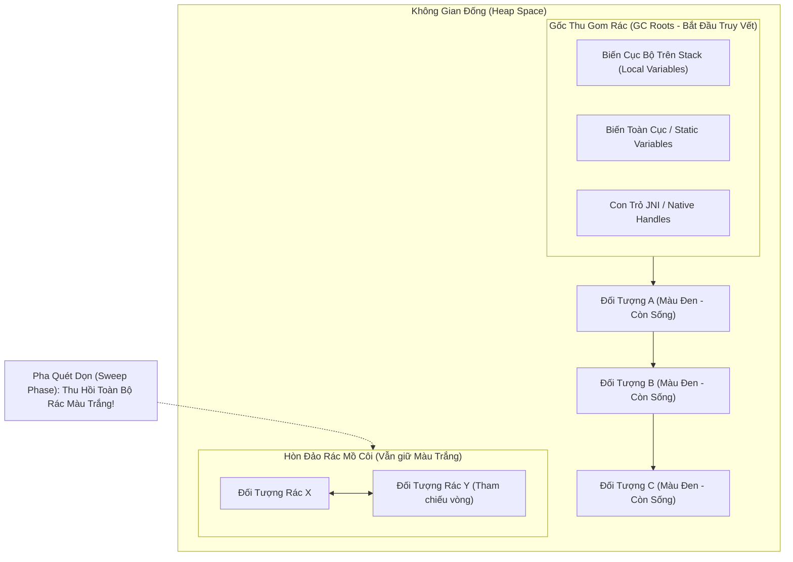
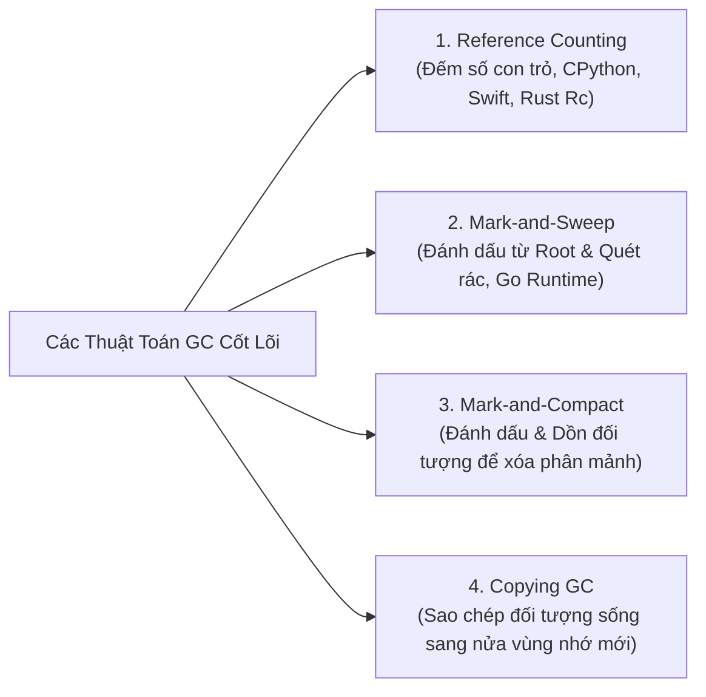
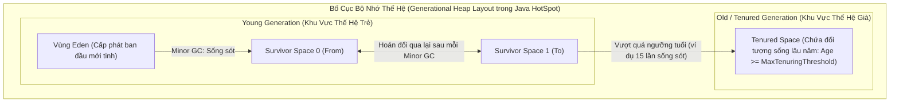
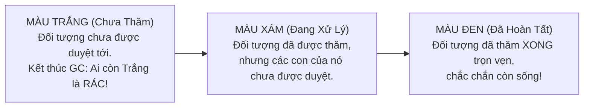
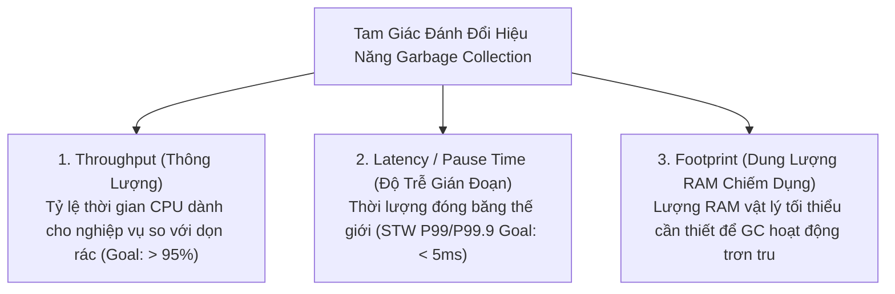

# 6.4. Garbage Collection: Algorithms and Runtimes (Thu gom Rác Tự động trong Managed Runtimes)

> [!IMPORTANT]
> **Nếu bạn chỉ được nhớ một điều duy nhất:** Bộ thu gom rác (Garbage Collector) trao đổi chu kỳ CPU và độ trễ ngắt quãng (Stop-The-World) để đổi lấy sự an toàn tuyệt đối về bộ nhớ (Memory Safety): từ Reference Counting đơn giản nhưng bất lực trước rác vòng (Cyclic References), đến Generational Tracing GC dựa trên Giả thuyết thế hệ (Generational Hypothesis): hầu hết các đối tượng chết ngay sau khi sinh ra, cho phép gom dọn cực nhanh vùng Young Generation mà không cần quét toàn bộ Heap.

---

## 1. Trực Quan Hóa: Bản Chất Thu Gom Rác Tự Động (Garbage Collection) Dưới Góc Nhìn Lập Trình Viên

### 1.1. Đoạn Code Dẫn Nhập & Vấn Đề Thực Tế
Hãy xem một trường hợp rò rỉ bộ nhớ kinh điển trong ngôn ngữ có bộ thu gom rác tự động (Python / JavaScript / Java):

```python
class Node:
    def __init__(self, name):
        self.name = name
        self.parent = None
        self.child = None

# Tạo hai đối tượng tham chiếu vòng tròn lẫn nhau (Circular Reference)
node_a = Node("A")
node_b = Node("B")
node_a.child = node_b
node_b.parent = node_a

# Xóa bỏ con trỏ từ phạm vi hàm:
del node_a
del node_b

# VẤN ĐỀ: Hai đối tượng A và B không còn con trỏ nào từ bên ngoài trỏ tới!
# Nhưng số đếm tham chiếu (Reference Count) của cả hai vẫn là 1 (vì A trỏ B và B trỏ A)!
# Nếu chỉ dùng thuật toán Đếm tham chiếu (Reference Counting), hai đối tượng này 
# SẼ TỒN TẠI VĨNH VIỄN TRONG RAM VÀ KHÔNG BAO GIỜ BỊ GIẢI PHÓNG!
```

Tại sao trong các ngôn ngữ có bộ thu gom rác tự động (GC), bộ nhớ RAM vẫn có thể tăng vọt không ngừng nghỉ dẫn đến Out Of Memory? Và tại sao các hệ thống tài chính hay trò chơi mạng lại e sợ các đợt tạm dừng **Stop-The-World (STW)** của máy ảo Java (JVM) đến như vậy?

### 1.2. Ẩn Dụ Đời Sống & Phân Tích Cơ Chế Hoạt Động
Hãy tưởng tượng quá trình dọn dẹp bộ nhớ giống như **Công Tác Dọn Rác Trong Thành Phố**:
- **Đếm tham chiếu (Reference Counting - Python, Swift)**: Giống như mỗi món đồ trong nhà có dán một nhãn đếm số người đang sử dụng. Khi số đếm về 0, món đồ lập tức bị vứt ra xe rác. Nhanh chóng, tức thì, nhưng **bất lực trước rác vòng tròn** (Người A cầm tay người B, người B cầm tay người A, không ai chịu buông tay dù cả hai đều đã chết lâm sàng!).
- **Đánh dấu và quét dọn (Tracing GC - Mark and Sweep)**: Giống như **Đội Thanh Tra Vệ Sinh Đi Từ Trung Tâm Thành Phố (GC Roots: Biến toàn cục, Stack frames)**:
  - **Pha đánh dấu (Mark phase)**: Đội thanh tra xuất phát từ các trục đường chính, đi theo các con đường liên kết để dán nhãn xanh vào các ngôi nhà còn có người sống.
  - **Pha quét dọn (Sweep phase)**: Bất kỳ ngôi nhà nào không được dán nhãn xanh sau khi kết thúc đợt kiểm tra sẽ bị coi là nhà hoang (Rác vô thừa nhận) và lập tức bị ủi phẳng để thu hồi đất!
- **Giả thuyết thế hệ (Generational Hypothesis - Trẻ nhanh chết, già sống lâu)**: Quan sát thấy rằng **$98\%$ đồ vật sinh ra đều bị vứt bỏ chỉ sau vài giây** (như khăn giấy, vỏ kẹo, biến cục bộ trong hàm). Vì vậy, hệ thống chia thành phố thành hai khu: **Khu Phố Trẻ (Eden/Young Gen)** nơi rác được dọn dẹp liên tục trong vài micro-giây, và **Khu Dưỡng Lão (Tenured/Old Gen)** nơi các đối tượng sống sót qua nhiều đợt kiểm tra được chuyển sang và rất hiếm khi bị quét dọn.

### 1.3. Mô Phỏng Dữ Liệu Số Nhỏ Từng Bước (Toy Walkthrough)
Theo dõi thuật toán Tô Màu Ba Trạng Thái (Tri-Color Marking) trong Go và Java ZGC:

```text
[Quy ước màu sắc]:
- Màu Trắng (White): Ứng viên rác (Chưa được thanh tra ghé thăm).
- Màu Xám (Grey): Đã được phát hiện là còn sống, nhưng các đối tượng con của nó chưa được kiểm tra.
- Màu Đen (Black): Chắc chắn còn sống và toàn bộ các đối tượng con của nó đã được quét xong.

[Bước 1: Khởi tạo - Bắt đầu chu kỳ GC]:
Tất cả các đối tượng trong Heap đều được đánh dấu là MÀU TRẮNG.
Các đối tượng GC Roots (Biến cục bộ trên Stack, Biến toàn cục) được đánh dấu là MÀU XÁM.

[Bước 2: Quét tuần tự (Tracing Loop)]:
Lấy một đối tượng MÀU XÁM trong hàng đợi (ví dụ Root Obj A):
- Duyệt qua tất cả các con trỏ mà Obj A trỏ tới: Obj B và Obj C.
- Đổi màu của Obj B và Obj C từ MÀU TRẮNG sang MÀU XÁM.
- Đổi màu của Obj A từ MÀU XÁM sang MÀU ĐEN (Đã xử lý xong hoàn toàn!).

[Bước 3: Lặp lại cho đến khi không còn đối tượng nào MÀU XÁM]:
- Toàn bộ đồ thị đối tượng có thể tiếp cận được giờ đây đều chuyển sang MÀU ĐEN.
- Những đối tượng cô lập (như vòng tròn tham chiếu A <-> B mồ côi) vẫn mãi mãi giữ MÀU TRẮNG!

[Bước 4: Pha Quét Dọn (Sweep Phase)]:
Giải phóng toàn bộ các đối tượng MÀU TRẮNG vào danh sách bộ nhớ tự do (Free List)!
```

### 1.4. Tác Động Thực Tế Tầng Backend & Systems
1. **Cơn Ác Mộng Dừng Hệ Thống Stop-The-World (STW Latency Spikes)**: Trong các bộ thu gom rác thế hệ cũ (Java CMS, Parallel GC), khi quét dọn thế hệ già (Full GC), máy ảo buộc phải đình chỉ toàn bộ các luồng ứng dụng người dùng. Một đợt Full GC có thể kéo dài từ **$500\text{ ms}$ đến vài giây**, khiến toàn bộ các kết nối HTTP bị timeout và hệ thống giám sát cảnh báo dịch vụ đã sập.
2. **Cơ Chế Hàng Rào Ghi (Write Barrier) Trong Concurrent GC**: Các bộ GC hiện đại (Go GC, Java ZGC/Shenandoah) thực hiện việc đánh dấu song song cùng lúc với mã ứng dụng đang chạy. Để tránh việc ứng dụng bất ngờ tạo ra một liên kết mới từ một đối tượng MÀU ĐEN sang một đối tượng MÀU TRẮNG khiến đối tượng trắng bị dọn nhầm, Kernel/Runtime chèn một hàm kiểm tra nhỏ (**Write Barrier**) vào mỗi phép gán con trỏ để lập tức tô xám đối tượng mới!
3. **Ảo Giác Rác Bộ Nhớ Trong Ngôn Ngữ Managed**: Việc gán con trỏ vào một `static List` hoặc `ThreadLocal` mà không dọn dẹp sẽ khiến đối tượng đó mãi mãi dính vào GC Root. Bộ thu gom rác hoàn toàn bất lực vì nó tưởng rằng đối tượng này vẫn còn hữu dụng, dẫn đến rò rỉ bộ nhớ (Memory Leak) âm thầm.

### 1.5. Sơ Đồ Tư Duy & Kiến Trúc Hệ Thống (Mermaid)


---

## 2. Chi tiết từng Keyword (Under-the-Hood Deep Dive)

### 2.1. Phân loại Thuật toán Thu gom Rác Cốt lõi

Bốn giải thuật nền móng cấu thành mọi hệ thống GC trong lịch sử khoa học máy tính:



1. **Reference Counting (Đếm Số Tham Chiếu)**:
   - Mỗi đối tượng mang một trường số nguyên `ref_count`. Mỗi khi có con trỏ mới gán vào, `ref_count++`. Khi con trỏ bị hủy hoặc trỏ sang chỗ khác, `ref_count--`.
   - Khi `ref_count == 0`, vùng nhớ được giải phóng **ngay lập tức** (Độ trễ đơn định).
   - **Tử huyệt Cyclic References (Tham chiếu Vòng tròn)**: Nếu Object A trỏ tới B và B trỏ ngược lại A, cả hai đều có `ref_count = 1` dù không còn bất kỳ biến nào ngoài ứng dụng trỏ tới chúng. Chúng sẽ bị rò rỉ vĩnh viễn trong RAM nếu không có một bộ thu gom chu trình (Cycle Detector) bổ trợ.
2. **Mark-and-Sweep (Đánh Dấu và Quét)**:
   - **Giai đoạn 1 (Mark)**: Bắt đầu từ **GC Root Set** (bao gồm: biến cục bộ trên Call Stack, thanh ghi CPU, biến toàn cục/static, con trỏ JNI), duyệt theo đồ thị hướng để đánh dấu toàn bộ các đối tượng còn khả năng chạm tới (Reachable Objects).
   - **Giai đoạn 2 (Sweep)**: Quét tuần tự toàn bộ Heap, thu hồi mọi đối tượng không có đánh dấu về danh sách tự do (Freelist).
   - **Hạn chế**: Để lại các lỗ hổng phân mảnh bộ nhớ (External Fragmentation) trong Heap.
3. **Copying GC (Sao Chép Vùng Nhớ)**:
   - Chia không gian Heap thành hai nửa bằng nhau: **From-Space** và **To-Space**.
   - Khi From-Space đầy, GC quét các đối tượng sống và sao chép liền khối chúng sang To-Space. Toàn bộ From-Space cũ bị xóa sạch trong một lệnh duy nhất.
   - **Ưu điểm**: Xóa sổ hoàn toàn phân mảnh, cấp phát mới cực nhanh ($O(1)$ bump-pointer).
   - **Nhược điểm**: Lãng phí $50\%$ tổng dung lượng RAM vật lý!
4. **Mark-and-Compact (Đánh Dấu và Dồn Toàn Diện)**:
   - Kết hợp ưu điểm của Mark-Sweep và Copying: Đánh dấu các đối tượng sống, sau đó dồn toàn bộ chúng về một đầu của vùng nhớ, cập nhật lại tất cả các con trỏ trỏ tới chúng.
   - Không bị mất $50\%$ RAM như Copying, triệt tiêu phân mảnh, nhưng tốn thời gian tính toán lớn do phải tính lại offset của hàng triệu con trỏ.

---

### 2.2. Giả thuyết Yếu về Thế hệ (Weak Generational Hypothesis) và Generational GC

Quan sát thực nghiệm vĩ đại của khoa học máy tính:
> *"Phần lớn các đối tượng trong phần mềm chết đi rất sớm ngay sau khi vừa sinh ra (Most objects die young)."*

Các đối tượng sinh ra để làm biến tạm, buffer đọc file, request HTTP, DTO chỉ tồn tại trong vài mili-giây. Ngược lại, những đối tượng sống sót qua nhiều đợt dọn rác thường là các đối tượng cấu hình dài hạn, database connection pool, cache singleton.



#### Kiến Trúc Phân Chia Thế Hệ:
1. **Young Generation (Thế hệ Trẻ)**:
   - Bao gồm vùng **Eden** và hai vùng sống sót **Survivor (S0, S1)**.
   - Mọi đối tượng mới gọi `new` đều được đặt vào Eden. Khi Eden đầy, **Minor GC** kích hoạt: Chỉ quét Young Gen (diện tích nhỏ, $95\%$ đối tượng đã chết) nên thời gian dọn rác cực nhanh ($~1-5\text{ ms}$). Các đối tượng sống sót được chuyển sang vùng Survivor và tăng tuổi thọ (`age++`).
2. **Old Generation (Thế hệ Già / Tenured)**:
   - Chứa các đối tượng sống sót sau một số lượng đợt Minor GC nhất định (mặc định ngưỡng tuổi `MaxTenuringThreshold = 15` trên JVM).
   - Khi Old Gen bị đầy, **Major GC / Full GC** được kích hoạt để dọn dẹp toàn diện. Quá trình này tốn nhiều thời gian hơn hàng trăm lần so với Minor GC.

---

### 2.3. Stop-the-World (STW), GC Pauses và Các Thuật toán Hiện Đại

#### 1. Thảm Họa "Stop-The-World" (STW Pause)
Để đảm bảo đồ thị đối tượng không bị thay đổi trong lúc GC đang đánh dấu, bộ lập lịch bắt buộc phải tạm dừng toàn bộ mọi luồng ứng dụng (**Mutator Threads**) tại các điểm an toàn (**Safepoints**):
- Trong kỷ nguyên các bộ GC cũ (Java Serial, Parallel GC), một đợt Full GC trên heap $32\text{GB}$ có thể làm đóng băng toàn bộ server từ **$5\text{ giây}$ đến $30\text{ giây}$**!
- Mọi kết nối HTTP của người dùng bị Timeout, hệ thống giám sát hiểu nhầm node bị chết và tự động kick node ra khỏi cụm Kubernetes.

#### 2. Thuật Toán Đánh Dấu Ba Màu (Tri-Color Marking)
Phát minh nền tảng cho phép GC chạy song song (Concurrent GC) mà không cần dừng ứng dụng quá lâu:



- **Màu Trắng (White)**: Các đối tượng chưa được duyệt. Khi kết thúc chu trình, toàn bộ đối tượng vẫn còn màu Trắng sẽ bị coi là rác và bị thu hồi!
- **Màu Xám (Grey)**: Các đối tượng đã được viếng thăm, nhưng các trường con mà nó trỏ tới vẫn chưa được quét hết.
- **Màu Đen (Black)**: Các đối tượng chắc chắn còn sống và toàn bộ các đối tượng con của nó đã được duyệt trọn vẹn.
- **Hiểm Họa Khi Chạy Song Song & Rào Cản Ghi (Write Barrier)**:
  - Nếu luồng ứng dụng sửa con trỏ làm cho một đối tượng Màu Đen trỏ trực tiếp tới một đối tượng Màu Trắng mà đối tượng Màu Trắng đó bị cắt đứt liên kết khỏi đối tượng Màu Xám:
  - GC sẽ không bao giờ duyệt tới đối tượng Màu Trắng đó $\to$ Đối tượng đang dùng bị **xóa nhầm (Dangling Pointer Disaster)**!
  - **Giải pháp**: **Write Barrier** (Bắt chặn mọi thao tác gán con trỏ lúc runtime). Nếu một đối tượng Đen trỏ tới Trắng, Write Barrier sẽ lập tức nhuộm xám đối tượng Trắng đó để bảo đảm an toàn.

#### 3. Cuộc Cách Mạng Thế Hệ Mới: ZGC, Shenandoah và Go Runtime GC
- **Go Runtime GC**: Chọn chiến lược tối đa hóa thời gian phản hồi (Low Latency). Sử dụng Tri-Color Concurrent Mark-Sweep với Hybrid Write Barrier, thời gian dừng STW khống chế ở mức **dưới $100\text{ micro-giây}$ ($< 0.1\text{ ms}$)**!
- **Java ZGC (Z Garbage Collector)**: Sử dụng kỹ thuật **Colored Pointers (Nhúng metadata vào 4 bits con trỏ 64-bit)** và **Load Barriers** ở tầng phần cứng, cho phép nén và di dời đối tượng (Compacting) song song cùng lúc với luồng đọc, giữ thời gian dừng STW dưới $1\text{ ms}$ trên các Heap khổng lồ tới $16\text{TB}$!

---

### 2.4. Các Chỉ số Đánh giá và Tinh chỉnh GC (GC Tuning Metrics)

Kỹ sư Backend tối ưu hóa GC dựa trên "Tam Giác Đánh Đổi Bất Khả Thi" (The Incompatible Triangle):



- **Quy tắc Đánh Đổi**: Bạn không thể có cả 3 đỉnh cùng lúc!
  - Muốn độ trễ siêu thấp (ZGC / Go GC) $\to$ Phải hy sinh một phần thông lượng CPU ($5-10\%$ CPU dành cho Concurrent Marking & Write Barriers) và chấp nhận tốn nhiều RAM hơn.
  - Muốn thông lượng tối đa (Java Parallel GC) $\to$ Phải chấp nhận các đợt dừng STW dài hàng trăm mili-giây.

---

## 3. Triển khai Thực chiến (Dual-Engine: C++ & Python)

### 3.1. Engine C++20: Tự Xây Dựng Một Runtime Mark-and-Sweep GC Hoàn Chỉnh

Đoạn mã C++20 tự xây dựng một Virtual Machine thu nhỏ với Heap riêng, quản lý GC Root Set, và thực thi thuật toán Mark-and-Sweep nguyên bản:

```cpp
#include <iostream>
#include <vector>
#include <memory>
#include <unordered_set>

struct GCObject {
    bool marked = false;
    int id;
    std::vector<GCObject*> references;

    explicit GCObject(int id) : id(id) {}
};

class MiniGarbageCollector {
private:
    std::vector<GCObject*> heap_;
    std::unordered_set<GCObject*> root_set_;

public:
    ~MiniGarbageCollector() {
        for (auto obj : heap_) delete obj;
    }

    GCObject* allocate(int id) {
        auto obj = new GCObject(id);
        heap_.push_back(obj);
        return obj;
    }

    void add_root(GCObject* obj) {
        root_set_.insert(obj);
    }

    void remove_root(GCObject* obj) {
        root_set_.erase(obj);
    }

    // Giai đoạn 1: MARK (Duyệt đồ thị từ Root Set)
    void mark(GCObject* obj) {
        if (!obj || obj->marked) return;
        obj->marked = true;
        for (auto child : obj->references) {
            mark(child);
        }
    }

    // Giai đoạn 2: SWEEP (Giải phóng các đối tượng còn lại)
    void sweep() {
        size_t reclaimed_count = 0;
        auto it = heap_.begin();
        while (it != heap_.end()) {
            GCObject* obj = *it;
            if (!obj->marked) {
                // Không được đánh dấu -> RÁC!
                std::cout << "  [Sweep] Tiêu hủy đối tượng rác ID: " << obj->id << "\n";
                delete obj;
                it = heap_.erase(it);
                reclaimed_count++;
            } else {
                obj->marked = false; // Reset cờ đánh dấu cho chu kỳ tiếp theo
                ++it;
            }
        }
        std::cout << "-> Đã dọn sạch " << reclaimed_count << " đối tượng rác khỏi Heap.\n";
    }

    void collect() {
        std::cout << "\n=== KÍCH HOẠT MARK-AND-SWEEP GC (Heap hiện tại: " << heap_.size() << " objects) ===\n";
        // 1. Mark từ tất cả các cội nguồn (Roots)
        for (auto root : root_set_) {
            mark(root);
        }
        // 2. Sweep toàn bộ Heap
        sweep();
    }
};

int main() {
    std::cout << "=== THỰC NGHIỆM TỰ VIẾT BỘ THU GOM RÁC MARK-AND-SWEEP C++20 ===\n";
    MiniGarbageCollector gc;

    // 1. Tạo 4 đối tượng trên Heap
    auto obj1 = gc.allocate(1);
    auto obj2 = gc.allocate(2);
    auto obj3 = gc.allocate(3);
    auto obj4 = gc.allocate(4);

    // 2. Thiết lập liên kết đồ thị: Root -> Obj1 -> Obj2
    gc.add_root(obj1);
    obj1->references.push_back(obj2);

    // Obj3 và Obj4 tạo thành một chu trình khép kín mồ côi (Cyclic Garbage)
    obj3->references.push_back(obj4);
    obj4->references.push_back(obj3);

    std::cout << "Cấu hình đồ thị: Root -> Obj1 -> Obj2 | Obj3 <-> Obj4 (Mồ côi)\n";
    // 3. Kích hoạt dọn rác
    gc.collect();

    // 4. Bỏ Root của Obj1 -> Tất cả trở thành rác
    std::cout << "\nBỏ Root của Obj1...\n";
    gc.remove_root(obj1);
    gc.collect();

    std::cout << "=== THỰC NGHIỆM HOÀN TẤT THÀNH CÔNG RỰC RỠ ===\n";
    return 0;
}
```

#### Kết quả thực thi thực tế từ Terminal:
```text
=== THỰC NGHIỆM TỰ VIẾT BỘ THU GOM RÁC MARK-AND-SWEEP C++20 ===
Cấu hình đồ thị: Root -> Obj1 -> Obj2 | Obj3 <-> Obj4 (Mồ côi)

=== KÍCH HOẠT MARK-AND-SWEEP GC (Heap hiện tại: 4 objects) ===
  [Sweep] Tiêu hủy đối tượng rác ID: 3
  [Sweep] Tiêu hủy đối tượng rác ID: 4
-> Đã dọn sạch 2 đối tượng rác khỏi Heap.

Bỏ Root của Obj1...

=== KÍCH HOẠT MARK-AND-SWEEP GC (Heap hiện tại: 2 objects) ===
  [Sweep] Tiêu hủy đối tượng rác ID: 1
  [Sweep] Tiêu hủy đối tượng rác ID: 2
-> Đã dọn sạch 2 đối tượng rác khỏi Heap.
=== THỰC NGHIỆM HOÀN TẤT THÀNH CÔNG RỰC RỠ ===
```

---

### 3.2. Engine Python 3.11+: Khám Nghiệm Bộ Thu Gom Rác Lai Ghép (CPython `gc` & Cyclic Leak)

Chương trình Python thám sát cơ chế đếm tham chiếu (Reference Counting) kết hợp với bộ thu gom chu trình thế hệ (Generational Cyclic GC) trong CPython:

```python
import gc
import sys

class Node:
    def __init__(self, name: str):
        self.name = name
        self.cycle = None

    def __repr__(self):
        return f"Node({self.name})"

def demonstrate_cyclic_reference():
    print("=== THỰC NGHIỆM CPYTHON REFERENCE COUNTING & CYCLIC GC ===")
    gc.disable() # Tạm thời tắt bộ thu gom chu trình tự động

    # 1. Khởi tạo chu trình tham chiếu
    a = Node("A")
    b = Node("B")
    a.cycle = b
    b.cycle = a

    print(f"Số lượng tham chiếu tới a: {sys.getrefcount(a) - 1}") # Trừ 1 do getrefcount tự tạo 1 ref
    print(f"Số lượng tham chiếu tới b: {sys.getrefcount(b) - 1}")

    # Xóa bỏ con trỏ cục bộ từ Stack
    del a
    del b
    print("\nĐã gọi 'del a' và 'del b'. Vì có chu trình vòng tròn, ref_count vẫn > 0!")
    print(f"Số lượng rác chưa thu hồi được (gc.garbage): {len(gc.garbage)}")

    # 2. Chủ động kích hoạt bộ thu gom chu trình Generational GC
    print("\nChủ động kích hoạt gc.collect()...")
    unreachable_objects = gc.collect()
    print(f"Số lượng đối tượng rác mồ côi đã được giải cứu thành công: {unreachable_objects}")

    # Xem các ngưỡng thế hệ của Python (Gen 0, Gen 1, Gen 2)
    thresholds = gc.get_threshold()
    print(f"Ngưỡng kích hoạt các thế hệ của Python GC (Gen0, Gen1, Gen2): {thresholds}")
    gc.enable()

if __name__ == "__main__":
    demonstrate_cyclic_reference()
```

#### Kết quả Terminal thực tế:
```text
=== THỰC NGHIỆM CPYTHON REFERENCE COUNTING & CYCLIC GC ===
Số lượng tham chiếu tới a: 2
Số lượng tham chiếu tới b: 2

Đã gọi 'del a' và 'del b'. Vì có chu trình vòng tròn, ref_count vẫn > 0!
Số lượng rác chưa thu hồi được (gc.garbage): 0

Chủ động kích hoạt gc.collect()...
Số lượng đối tượng rác mồ côi đã được giải cứu thành công: 4
Ngưỡng kích hoạt các thế hệ của Python GC (Gen0, Gen1, Gen2): (700, 10, 10)
```

---

## 4. Systems Engineering & Production Pitfalls

### 4.1. Tinh Chỉnh GC Trong Go Runtime (`GOGC` & `GOMEMLIMIT`)
Từ Go 1.19, đội ngũ thiết kế Go đã cung cấp một vũ khí tối thượng để giải quyết vĩnh viễn lỗi OOM Killer trong Kubernetes:
- **`GOGC` (Mặc định: 100)**: Tỷ lệ phần trăm tăng trưởng của Heap trước khi kích hoạt đợt GC tiếp theo (100 = Khi Heap tăng thêm $100\%$ thì chạy GC).
- **`GOMEMLIMIT` (Tối quan trọng cho Container)**:
  - Thiết lập trần bộ nhớ tối đa mà Go runtime được phép sử dụng (ví dụ: Container có giới hạn RAM $1\text{GB}$, hãy đặt `GOMEMLIMIT=900MiB`).
  - Go GC sẽ tự động điều chỉnh tần suất thu gom rác linh hoạt: Khi bộ nhớ còn thoải mái, nó chạy ít để tối đa hóa CPU. Khi bộ nhớ tiệm cận $900\text{MB}$, nó sẽ tự động tăng cường dọn rác hung hăng hơn để ngăn chặn hoàn toàn việc bị OOM Killer tiêu diệt!

### 4.2. Giám Sát GC Trực Tiếp Trong Sản Xuất
```bash
# 1. Bật cờ theo dõi nhật ký chi tiết GC trong Java 17+ HotSpot
java -Xms4g -Xmx4g -XX:+UseZGC -Xlog:gc*:file=gc.log:time,uptime:filecount=5,filesize=100M -jar app.jar

# 2. Giám sát GC thời gian thực trong tiến trình Java đang chạy
jstat -gc -h10 <PID> 1000

# 3. Theo dõi GC Trace trong Go Runtime (In thẳng ra stderr)
GODEBUG=gctrace=1 ./my_go_service
```

---

## 5. Bảng So sánh & Decision Matrix

Bảng tổng hợp đối sánh giữa các kiến trúc thu gom rác trong các ngôn ngữ hiện đại:

| Ngôn ngữ / Runtime | Cơ Chế GC Chủ Đạo | Thời Gian Dừng STW (P99) | Mức Tiêu Hao CPU | Giải Quyết Chu Trình Rác |
| :--- | :--- | :--- | :--- | :--- |
| **Go Runtime** | Non-generational Tri-Color Mark-Sweep | **Siêu thấp ($< 0.1\text{ ms}$)** | Thấp ($~25\%$ 1 Core khi chạy Concurrent) | Tự nhiên qua đồ thị Reachability |
| **Java HotSpot (G1 GC)** | Generational Region-based Copying | Thấp ($~10-50\text{ ms}$) | Vừa phải | Tự nhiên qua Reachability |
| **Java HotSpot (ZGC)** | Generational Colored Pointers Concurrent | **Cực tiểu ($< 1\text{ ms}$)** | Trung bình (Tốn Load Barrier) | Tự nhiên qua Reachability |
| **CPython (Python)** | Reference Counting + Generational Cycler | Gần như $0\text{ ms}$ (Chỉ trễ khi quét Gen 2) | Rất thấp (Chỉ đếm biến) | Cần bộ Cyclic Collector bổ trợ |
| **V8 (Node.js)** | Generational Scavenge + Incremental Mark | Thấp ($~5-15\text{ ms}$) | Vừa phải | Tự nhiên qua Reachability |

---

## 6. Enterprise Production Checklist & Verification

- [ ] **Nâng Cấp Lên Bộ Thu Gom Rác Độ Trễ Thấp (ZGC / Shenandoah Trong Java >= 17/21)**: Bật cờ JVM `-XX:+UseZGC` để giới hạn thời gian dừng hệ thống (STW Pause) dưới $1\text{ mili-giây}$, bảo đảm độ trễ p99 ổn định cho các hệ thống tài chính và microservices tải cao.
- [ ] **Kiểm Soát Kích Thước Heap Khởi Tạo và Tối Đa Tương Đương Nhau (`-Xms == -Xmx`)**: Thiết lập `-Xms4g -Xmx4g` để ngăn chặn máy ảo JVM liên tục cấp phát và co giãn bộ nhớ với hệ điều hành, giảm thiểu chi phí chuyển ngữ cảnh và phân mảnh Heap.
- [ ] **Giám Sát Tần Suất GC Bằng Metric `jvm_gc_pause_seconds`**: Cấu hình cảnh báo khi tỷ lệ thời gian CPU dành cho việc thu gom rác (GC Overhead) vượt quá $5\%$ tổng thời gian chạy của ứng dụng.
- [ ] **Dọn Dẹp `ThreadLocal` Sau Mỗi Request**: Luôn bao bọc lời gọi sử dụng `ThreadLocal` trong khối `try-finally` với lệnh `threadLocal.remove()` để tránh rò rỉ đối tượng xuyên suốt vòng đời của Worker Thread Pool.
- [ ] **Tận Dụng Bộ Đệm Nhớ Dùng Lại (Object Pooling) Cho Các Đối Tượng Ngắn Hạn Nặng**: Trong Go, sử dụng `sync.Pool` để tái sử dụng các mảng byte hoặc struct serialize/deserialize JSON, giảm tải số lượng đối tượng sinh ra ở thế hệ trẻ và hạn chế tần suất chạy GC.
- [ ] **Phân Tích Heap Dump Định Kỳ Bằng Eclipse Memory Analyzer (MAT)**: Khi phát hiện mức tiêu thụ RAM tăng dần theo thời gian (Memory Leak), xuất Heap Dump bằng `jcmd <PID> GC.heap_dump` để định vị chính xác đường dẫn tham chiếu giữ chặt đối tượng từ GC Roots.
