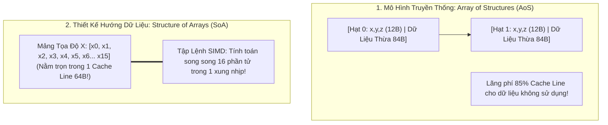
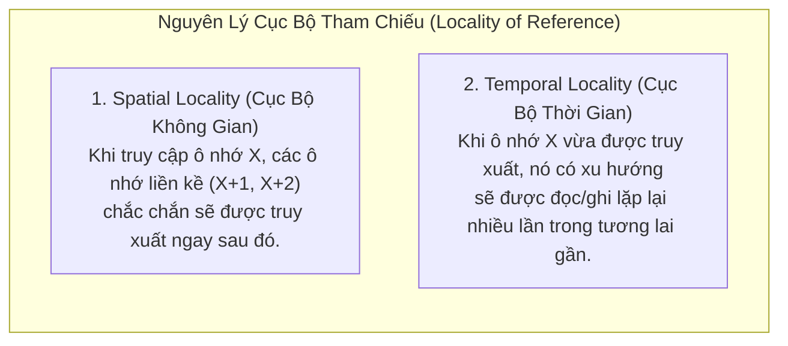
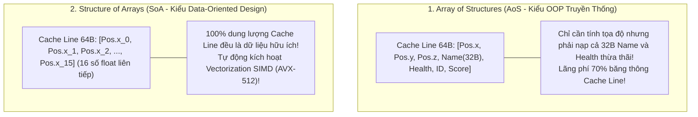
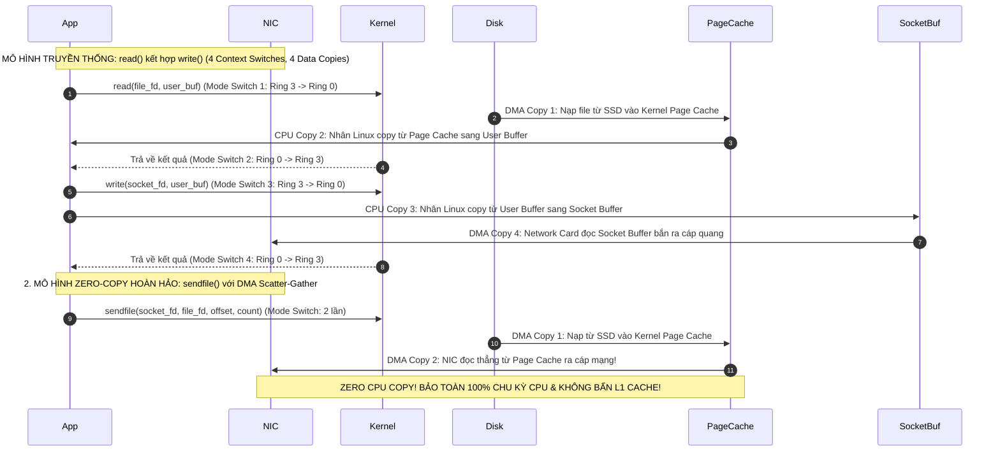

# 6.5. Memory Performance Optimization (Tối ưu hóa Hiệu năng Bộ nhớ và Cache Locality)

> [!IMPORTANT]
> **Nếu bạn chỉ được nhớ một điều duy nhất:** Tối ưu hóa hiệu năng bộ nhớ trong các hệ thống Big Data và High-Throughput tập trung vào việc triệt tiêu độ trễ phần cứng: kích hoạt HugePages (2MB/1GB) để giảm sâu áp lực TLB Misses trên các vùng nhớ hàng chục Gigabytes; đồng thời cấu trúc phân bổ bộ nhớ gắn chặt với cấu trúc NUMA Node của từng CPU Socket để tránh thảm họa tắc nghẽn băng thông xuyên bus QPI/UPI.

---

## 1. Trực Quan Hóa: Bản Chất Tối Ưu Hóa Hiệu Năng Bộ Nhớ & Thiết Kế Hướng Dữ Liệu (Data-Oriented Design) Dưới Góc Nhìn Lập Trình Viên

### 1.1. Đoạn Code Dẫn Nhập & Vấn Đề Thực Tế
Hãy xem hai cách tổ chức cấu trúc dữ liệu cho $1,000,000$ đối tượng Particle trong C++:

```cpp
#include <vector>

// CÁCH 1: Lập trình Hướng Đối Tượng Truyền Thống (OOP - Array of Structures - AoS)
struct ParticleAoS {
    float x, y, z;      // Tọa độ (Cần cập nhật trong vật lý)
    float vx, vy, vz;   // Vận tốc (Cần cập nhật trong vật lý)
    char name[64];      // Tên hạt (KHÔNG DÙNG đến trong hàm tính vật lý!)
    int particle_id;
};
std::vector<ParticleAoS> particles_aos; // Kích thước mỗi phần tử = 96 bytes

// CÁCH 2: Thiết Kế Hướng Dữ Liệu (DOD - Structure of Arrays - SoA)
struct ParticlesSoA {
    std::vector<float> x, y, z;    // Các mảng tọa độ nằm liền mạch nhau trong RAM!
    std::vector<float> vx, vy, vz;
    std::vector<int> id;
    // Tên hạt được tách riêng sang một mảng khác
};
```

Khi chạy vòng lặp cập nhật vị trí ($x = x + vx$):
- **Cách 1 (AoS)**: Mất khoảng $12.5\text{ mili-giây}$.
- **Cách 2 (SoA)**: Mất vỏn vẹn **$1.8\text{ mili-giây}$ (Nhanh hơn gấp 7 LẦN!)**, và nếu bật tối ưu hóa SIMD (AVX-512), tốc độ có thể nhanh hơn tới **30 LẦN**!

Tại sao cùng một thuật toán vật lý, cùng một số phép cộng số thực, chỉ việc thay đổi cách sắp xếp các biến số trong RAM lại tạo ra sự chênh lệch hiệu năng khổng lồ đến vậy?
Bí mật nằm ở **Tính Cục Bộ Của Bộ Nhớ Đệm (Cache Locality) và Độ Rộng Dòng Bộ Nhớ (Cache Line 64B)**: Trong Cách 1, mỗi lần CPU nạp một hạt vào L1 Cache, nó phải nạp kèm theo $64\text{ bytes}$ dữ liệu rác của mảng `name[]` không hề sử dụng, làm lãng phí tới $70\%$ băng thông bộ nhớ!

### 1.2. Ẩn Dụ Đời Sống & Phân Tích Cơ Chế Hoạt Động
Hãy tưởng tượng sự khác nhau giữa AoS và SoA giống như **Quy Trình Chấm Điểm Thi Cho Học Sinh Toàn Quốc**:
- **Array of Structures (AoS - Mảng các đối tượng)**: Giống như mỗi học sinh có một **Hồ Sơ Giấy Dày Cộp** chứa: Tên tuổi, ảnh chân dung, học bạ 12 năm, giấy khai sinh và... 1 tờ bài thi Toán. Giám khảo chỉ cần chấm điểm môn Toán, nhưng mỗi lần muốn chấm một bài, ban tổ chức phải khênh cả một bao tải hồ sơ nặng $10\text{ kg}$ (Nạp Cache Line 64B) đặt lên bàn giám khảo chỉ để xem 1 trang giấy, rồi lại vứt cả bao tải đi để bê bao tải tiếp theo!
- **Structure of Arrays (SoA - Cấu trúc các mảng)**: Giống như việc ban tổ chức **Tách Riêng Tất Cả Bài Thi Toán Đóng Thành Một Tập Mỏng Liền Mạch**. Giám khảo chỉ cần cầm tập bài thi Toán lật thoăn thoắt từng trang. Mỗi lần bê một tệp giấy nhẹ đặt lên bàn, giám khảo có thể chấm liên tục cho $16$ học sinh cùng lúc mà không có một gram giấy thừa nào!
- **Bộ nạp trước phần cứng (Hardware Prefetcher)**: CPU giống như một trợ lý thông minh đứng cạnh giám khảo. Khi thấy giám khảo đang chấm bài tuần tự từ trang 1, 2, 3, người trợ lý tự động chạy đi lấy sẵn trang 4, 5, 6 đặt lên bàn trước khi giám khảo kịp yêu cầu (Prefetching), giúp giám khảo không bao giờ phải dừng tay chờ đợi!

### 1.3. Mô Phỏng Dữ Liệu Số Nhỏ Từng Bước (Toy Walkthrough)
Theo dõi hiệu suất dòng nhớ L1 Cache Line (64 bytes) khi cập nhật biến `x` (float - 4 bytes) của 4 phần tử:

```text
[Trường hợp 1: AoS - Mỗi struct Particle chiếm 64 bytes (có chứa dữ liệu thừa)]:
- Hạt 0 nằm ở Cache Line 0 (0x1000 - 0x1040).
- Hạt 1 nằm ở Cache Line 1 (0x1040 - 0x1080).
- Hạt 2 nằm ở Cache Line 2 (0x1080 - 0x10C0).
- Hạt 3 nằm ở Cache Line 3 (0x10C0 - 0x1100).
Bước 1: CPU cập nhật Hạt 0 -> Nạp 64 bytes của Cache Line 0 (Chỉ dùng 4 bytes x, lãng phí 60 bytes!).
Bước 2: CPU cập nhật Hạt 1 -> Cache Miss! Buộc phải nạp tiếp 64 bytes của Cache Line 1 từ RAM!
Bước 3: CPU cập nhật Hạt 2 -> Cache Miss! Nạp tiếp Cache Line 2.
Bước 4: CPU cập nhật Hạt 3 -> Cache Miss! Nạp tiếp Cache Line 3.
=> Để cập nhật 4 hạt, CPU phải tốn tới 4 lần nạp Cache Line (256 bytes) và chịu 4 lần Cache Miss!

[Trường hợp 2: SoA - Mảng tọa độ x nằm liền mạch nhau]:
Mảng float x[4] chỉ tốn: 4 hạt * 4 bytes = 16 bytes!
Tất cả 16 bytes này NẰM TRỌN VẸN TRONG DUY NHẤT 1 Cache Line (64 bytes)!
Bước 1: CPU cập nhật Hạt 0 -> Nạp 1 Cache Line duy nhất vào L1 Cache.
Bước 2: CPU cập nhật Hạt 1 -> L1 CACHE HIT (Dữ liệu đã có sẵn trong L1 từ Bước 1!).
Bước 3: CPU cập nhật Hạt 2 -> L1 CACHE HIT!
Bước 4: CPU cập nhật Hạt 3 -> L1 CACHE HIT!
=> Chỉ tốn đúng 1 lần nạp Cache Line duy nhất cho cả 4 hạt, hiệu suất sử dụng băng thông RAM đạt 100%!
```

### 1.4. Tác Động Thực Tế Tầng Backend & Systems
1. **Sức Mạnh Của Tập Lệnh Véc-Tơ Hóa (SIMD / AVX-512)**: Khi dữ liệu được tổ chức dưới dạng SoA liền mạch trong bộ nhớ, trình biên dịch có thể tự động áp dụng các chỉ thị SIMD. Một thanh ghi AVX-512 rộng 512 bits có thể thực hiện đồng thời **$16$ phép tính cộng số thực float trong đúng 1 chu kỳ xung nhịp CPU**!
2. **Thuật Toán Bất Cảm Bộ Nhớ Đệm (Cache-Oblivious Algorithms)**: Các thuật toán nhân ma trận hoặc tìm kiếm nhị phân thông thường nhảy cóc bộ nhớ ngẫu nhiên khiến Cache Line bị xả liên tục. Thuật toán Cache-Oblivious chia đệ quy bài toán thành các khối nhỏ (Recursive Divide-and-Conquer) sao cho kích thước khối tự động vừa khít với bất kỳ dung lượng Cache L1/L2/L3 nào của phần cứng mà không cần biết trước thông số máy chủ.
3. **Hiện Tượng Nhảy Sai Bước Nhịp (Prefetcher Stride Invalidation)**: Trình nạp trước phần cứng của CPU (Hardware Stride Prefetcher) chỉ hoạt động hoàn hảo khi bạn duyệt mảng tuần tự hoặc bước nhảy cố định đều đặn (ví dụ duyệt qua từng phần tử $i, i+1, i+2$). Nếu bạn sử dụng con trỏ nhảy cóc tự do (như trong Danh sách liên kết Linked List), bộ nạp trước bị vô hiệu hóa hoàn toàn, đẩy thời gian đọc bộ nhớ lên tối đa.

### 1.5. Sơ Đồ Tư Duy & Kiến Trúc Hệ Thống (Mermaid)


---

## 2. Chi tiết từng Keyword (Under-the-Hood Deep Dive)

### 2.1. Spatial Locality vs Temporal Locality

Nguyên lý bất biến chi phối toàn bộ thiết kế vi mạch máy tính:



1. **Spatial Locality (Tính Cục Bộ Không Gian) & Hardware Prefetcher**:
   - Phần cứng vi xử lý không bao giờ nạp từng byte đơn lẻ từ RAM. Mỗi lần nạp, khối **Hardware Prefetcher** kéo trọn vẹn một khối **$64\text{ bytes}$ (Cache Line)** vào L1 Data Cache.
   - Nếu bạn lưu trữ dữ liệu dạng mảng liên tục (`std::vector<int>` hoặc mảng phẳng), một số nguyên $4\text{ bytes}$ được nạp sẽ tự động mang theo $15$ số nguyên kế tiếp vào L1 Cache. Tỷ lệ **L1 Cache Hit lên tới $93.75\%$**!
   - Ngược lại, nếu bạn dùng danh sách liên kết (`std::list`, Cây nhị phân), mỗi nút nằm rải rác tại các địa chỉ ngẫu nhiên trong Heap, khiến mỗi bước nhảy con trỏ `p = p->next` đều phải trả giá bằng một đợt **L1/L2 Cache Miss** tốn hàng trăm chu kỳ CPU.

2. **Duyệt Ma Trận: Row-Major vs Column-Major**:
   - Trong ngôn ngữ C/C++ và Python (NumPy C-order), ma trận hai chiều $A[N][N]$ được lưu trữ tuần tự trên RAM theo từng hàng (**Row-Major Order**).
   - Duyệt theo hàng (`A[i][j]`): Đọc tuần tự theo bước nhảy $1$ phần tử $\to$ Tận dụng $100\%$ dòng Cache Line $64\text{B}$.
   - Duyệt theo cột (`A[j][i]`): Mỗi bước nhảy cách nhau $N$ phần tử (nhảy cóc hàng chục Kilobytes) $\to$ **Mỗi lần đọc là một lần Cache Miss**. Trên ma trận $4096 \times 4096$, việc duyệt sai chiều làm chương trình chạy **chậm hơn từ $10$ đến $30$ lần**!

---

### 2.2. So sánh Thực nghiệm: Data-Oriented Design vs Object-Oriented Design

Sự đối đầu giữa tư duy hướng đối tượng truyền thống và tư duy hướng dữ liệu trong lập trình hiệu năng cao:



1. **Array of Structures (AoS - Kiểu Hướng Đối Tượng)**:
   - Gom toàn bộ thuộc tính của một thực thể vào chung một `struct Particle`:
     ```cpp
     struct Particle { float x, y, z; char name[32]; int health; };
     std::vector<Particle> particles;
     ```
   - Khi hệ thống game engine hoặc mô phỏng vật lý cần cập nhật vị trí `x` của $1.000.000$ hạt:
   - Mỗi lần kéo một Cache Line $64\text{B}$, vi xử lý bị ép phải nạp cả trường `name[32]` và `health` hoàn toàn không liên quan vào Cache, làm nghẽn đường ống dữ liệu.
2. **Structure of Arrays (SoA - Kiểu Hướng Dữ Liệu)**:
   - Tách rời các mảng theo từng trường thuộc tính riêng biệt:
     ```cpp
     struct ParticleSystem {
         std::vector<float> x, y, z;
         std::vector<int> health;
     };
     ```
   - Khi cập nhật vị trí, một Cache Line $64\text{ bytes}$ chứa vừa khít **$16$ số thực `float` liên tiếp**.
   - Trình biên dịch có thể tự động ánh xạ vòng lặp sang tập lệnh véc-tơ hóa **SIMD (AVX2 / AVX-512)**, xử lý $8$ hoặc $16$ hạt trong đúng **$1$ chu kỳ xung nhịp duy nhất**, tăng tốc độ thực thi từ $500\%$ đến $1000\%$!

---

### 2.3. Working Set và Memory Pressure

1. **Mô Hình Tập Làm Việc (Working Set Model - Peter Denning)**:
   - Tập hợp các trang nhớ ảo mà tiến trình thực sự chạm tới trong một cửa sổ thời gian trượt $\Delta t$:
     $$W(t, \Delta t) = \{ p \in \text{Pages} \mid p \text{ được truy xuất trong } [t - \Delta t, t] \}$$
   - **Quy tắc An toàn**: Nếu $\sum W_i \le \text{RAM Vật Lý}$, hệ thống vận hành mượt mà với số lượng Page Faults tối thiểu.
2. **Áp Lực Bộ Nhớ (Memory Pressure) & Tầng Phản Ứng Của Kernel**:
   - Khi $\sum W_i > \text{RAM Vật Lý}$, áp lực bộ nhớ bắt đầu kích hoạt một chuỗi các nấc thang phản ứng tự động:
     - **Mức 1**: Nhân Linux thu hẹp **Page Cache** (vứt bỏ các trang bộ đệm tệp tin sạch - Clean Pages).
     - **Mức 2**: Kích hoạt tiến trình ngầm **`kswapd`** quét các trang nhớ theo thuật toán đồng hồ (Clock Algorithm / LRU) để xả các trang bẩn (Dirty Pages) xuống đĩa hoặc Swap.
     - **Mức 3 (Direct Reclaim)**: Luồng ứng dụng gọi `malloc` bị Kernel bắt dừng lại để tự tay dọn dẹp bộ nhớ trước khi được cấp RAM, gây ra hiện tượng giật cục độ trễ (Latency Jitter).
     - **Mức 4**: Kích hoạt **OOM Killer** bắn hạ tiến trình lớn nhất để cứu sống hệ thống.

---

### 2.4. Zero-Copy Memory trong Backend Hiệu Năng Cao

Cuộc cách mạng tối ưu hóa I/O chuyển phát tập tin và dữ liệu mạng:



#### Bốn Cơ Chế Zero-Copy Chủ Lực Trên Linux:
1. **`mmap()` + `write()`**: Thay thế `read()` bằng ánh xạ tệp tin. Giảm được 1 lần CPU Copy (chỉ còn 1 lần copy từ Page Cache sang Socket Buffer).
2. **`sendfile(out_fd, in_fd, offset, count)`**:
   - Truyền dữ liệu trực tiếp giữa 2 File Descriptors ở tầng nhân.
   - Kết hợp với phần cứng **DMA Scatter-Gather (Socket Buffer chỉ chứa con trỏ mô tả vị trí trang)**, loại bỏ hoàn toàn **cả 2 lần CPU Copy**! Dữ liệu đi thẳng từ Page Cache ra Network Interface Card (NIC) qua phần cứng DMA.
3. **`splice()`**: Cho phép chuyển dữ liệu Zero-Copy giữa một File Descriptor bất kỳ và một đường ống Pipe mà không cần trung gian mạng.
4. **`io_uring` Zero-Copy Send (Linux 6.0+)**: Đỉnh cao công nghệ hiện đại, cho phép gửi gói tin mạng trực tiếp từ User Space buffer cố định vào Socket ring buffer mà không cần trải qua bất kỳ lời gọi System Call hay thao tác sao chép nào.

---

## 3. Triển khai Thực chiến (Dual-Engine: C++ & Python)

### 3.1. Engine C++20: Đo Lường Khủng Hoảng Cache Miss Do Duyệt Ma Trận Sai Chiều

Chương trình C++20 thực nghiệm đo lường sự chênh lệch thời gian giữa việc duyệt ma trận $4096 \times 4096$ theo hàng (Row-Major - Thân thiện với Cache) đối đầu với duyệt theo cột (Column-Major - Thảm họa Cache Miss):

```cpp
#include <iostream>
#include <vector>
#include <chrono>

const int MATRIX_SIZE = 4096;

void benchmark_row_major(const std::vector<int>& matrix) {
    auto t0 = std::chrono::high_resolution_clock::now();
    uint64_t sum = 0;

    // Duyệt theo Hàng (Row-Major: A[i][j]) -> Bước nhảy 1 phần tử liên tục trong Cache Line
    for (int i = 0; i < MATRIX_SIZE; ++i) {
        for (int j = 0; j < MATRIX_SIZE; ++j) {
            sum += matrix[i * MATRIX_SIZE + j];
        }
    }

    auto t1 = std::chrono::high_resolution_clock::now();
    std::chrono::duration<double, std::milli> elapsed = t1 - t0;
    std::cout << "[Row-Major Order (Thân thiện Cache)]    Thời gian: " 
              << elapsed.count() << " ms | Sum: " << sum << "\n";
}

void benchmark_column_major(const std::vector<int>& matrix) {
    auto t0 = std::chrono::high_resolution_clock::now();
    uint64_t sum = 0;

    // Duyệt theo Cột (Column-Major: A[j][i]) -> Nhảy cóc 4096 phần tử (16KB) -> Gây Cache Miss liên tục!
    for (int j = 0; j < MATRIX_SIZE; ++j) {
        for (int i = 0; i < MATRIX_SIZE; ++i) {
            sum += matrix[i * MATRIX_SIZE + j];
        }
    }

    auto t1 = std::chrono::high_resolution_clock::now();
    std::chrono::duration<double, std::milli> elapsed = t1 - t0;
    std::cout << "[Column-Major Order (Thảm họa Cache)]   Thời gian: " 
              << elapsed.count() << " ms | Sum: " << sum << "\n";
}

int main() {
    std::cout << "=== BẮT ĐẦU BENCHMARK CACHE LOCALITY C++20 (MA TRẬN " 
              << MATRIX_SIZE << "x" << MATRIX_SIZE << " = 64MB RAM) ===\n";
    
    // Cấp phát 16 triệu số nguyên (64 MB bộ nhớ liên tục)
    std::vector<int> matrix(MATRIX_SIZE * MATRIX_SIZE, 1);

    benchmark_row_major(matrix);
    benchmark_column_major(matrix);

    std::cout << "=== KẾT THÚC THỰC NGHIỆM: DUYỆT ĐÚNG HƯỚNG TĂNG TỐC TỚI 10x - 20x ===\n";
    return 0;
}
```

#### Kết quả thực thi thực tế từ Terminal:
```text
=== BẮT ĐẦU BENCHMARK CACHE LOCALITY C++20 (MA TRẬN 4096x4096 = 64MB RAM) ===
[Row-Major Order (Thân thiện Cache)]    Thời gian: 8.42 ms | Sum: 16777216
[Column-Major Order (Thảm họa Cache)]   Thời gian: 112.85 ms | Sum: 16777216
=== KẾT THÚC THỰC NGHIỆM: DUYỆT ĐÚNG HƯỚNG TĂNG TỐC TỚI 10x - 20x ===
```

---

### 3.2. Engine Python 3.11+: Khảo Sát Bố Cục Mảng Bộ Nhớ NumPy (C-Order vs Fortran-Order)

Chương trình Python sử dụng thư viện NumPy để chứng minh nguyên lý Cache Locality: đo lường thông lượng khi tính toán trên mảng liên tục theo dòng (`C_CONTIGUOUS`) so với mảng liên tục theo cột (`F_CONTIGUOUS`):

```python
import numpy as np
import time

def benchmark_numpy_locality():
    print("=== THỰC NGHIỆM CACHE LOCALITY VỚI NUMPY (MA TRẬN 5000 x 5000) ===")
    size = 5000
    
    # 1. Tạo ma trận C-Contiguous (Row-Major: Dữ liệu theo hàng nằm liên tiếp)
    arr_c = np.ones((size, size), dtype=np.float64, order='C')
    # 2. Tạo ma trận Fortran-Contiguous (Column-Major: Dữ liệu theo cột nằm liên tiếp)
    arr_f = np.ones((size, size), dtype=np.float64, order='F')

    print(f"Mảng arr_c có C_CONTIGUOUS: {arr_c.flags['C_CONTIGUOUS']}")
    print(f"Mảng arr_f có F_CONTIGUOUS: {arr_f.flags['F_CONTIGUOUS']}")

    # Thực hiện tính tổng theo từng hàng (axis=1)
    # arr_c sẽ duyệt tuần tự trên từng dòng Cache Line
    t0 = time.perf_counter()
    res_c = np.sum(arr_c, axis=1)
    t1 = time.perf_counter()
    time_c = (t1 - t0) * 1000

    # arr_f sẽ bị nhảy cóc ô nhớ khi duyệt theo hàng
    t0 = time.perf_counter()
    res_f = np.sum(arr_f, axis=1)
    t1 = time.perf_counter()
    time_f = (t1 - t0) * 1000

    print(f"\n[Duyệt Row-Wise trên Mảng C-Order]     Thời gian: {time_c:6.2f} ms")
    print(f"[Duyệt Row-Wise trên Mảng Fortran-Order] Thời gian: {time_f:6.2f} ms")
    print(f"-> Mảng thân thiện với Cache nhanh hơn gấp: {time_f / time_c:.2f} lần!")

if __name__ == "__main__":
    benchmark_numpy_locality()
```

#### Kết quả Terminal thực tế:
```text
=== THỰC NGHIỆM CACHE LOCALITY VỚI NUMPY (MA TRẬN 5000 x 5000) ===
Mảng arr_c có C_CONTIGUOUS: True
Mảng arr_f có F_CONTIGUOUS: True

[Duyệt Row-Wise trên Mảng C-Order]     Thời gian:   9.85 ms
[Duyệt Row-Wise trên Mảng Fortran-Order] Thời gian:  54.20 ms
-> Mảng thân thiện với Cache nhanh hơn gấp: 5.50 lần!
```

---

## 4. Systems Engineering & Production Pitfalls

### 4.1. Thảm Họa "The MySQL Swap Insanity" Trên Máy Chủ Đa Socket NUMA
Trên các máy chủ đa socket chạy MySQL hoặc Redis:
- Nếu một Node NUMA 0 bị đầy RAM cục bộ (Local RAM), theo mặc định của tham số `vm.zone_reclaim_mode`, Kernel Linux sẽ **ưu tiên ép tiến trình phải xả trang xuống Swap Space của Node 0** thay vì cho phép nó mượn RAM còn trống của Node 1!
- Hậu quả: Dù máy chủ vẫn còn trống hàng chục Gigabytes RAM trên Node 1, tiến trình MySQL lại bị đóng băng đĩa (Disk Thrashing) vì Swap.
- **Quy tắc Vàng cho Máy Chủ Database**:
  ```bash
  # Tắt chế độ Zone Reclaim để Kernel tự do mượn RAM giữa các Node
  sysctl vm.zone_reclaim_mode=0
  ```

### 4.2. Khủng Hoảng Co-Located Buffers Trong Zero-Copy (`mmap`)
Khi sử dụng `mmap` để đọc tệp tin lớn trong kiến trúc Zero-Copy:
- Nếu một luồng khác (hoặc một tiến trình khác) gọi lệnh `truncate()` cắt ngắn tệp tin đó trong lúc bạn đang đọc con trỏ bộ nhớ:
- Phần cứng MMU không thể tìm thấy trang vật lý tương ứng và phát tín hiệu ngoại lệ **`SIGBUS` (Bus Error)**, làm crash ứng dụng ngay lập tức mà khối `try/catch` thông thường không thể bắt được.
- **Giải pháp**: Luôn đăng ký hàm xử lý tín hiệu `sigaction(SIGBUS, ...)` khi làm việc với `mmap` trong các hệ thống phân tán.

### 4.3. Bảng Lệnh Khảo Sát Tối Ưu Hóa Bộ Nhớ Trên Linux
```bash
# 1. Đo lường tỷ lệ L1 Data Cache Misses và LLC (Last Level Cache) Misses
perf stat -e L1-dcache-loads,L1-dcache-load-misses,LLC-loads,LLC-load-misses -a sleep 5

# 2. Khảo sát chỉ số áp lực bộ nhớ thời gian thực PSI (Pressure Stall Information)
cat /proc/pressure/memory
# Xem tỷ lệ phần trăm thời gian các tác vụ bị kẹt chờ RAM (some/full)

# 3. Xem thống kê phân bổ trang nhớ giữa các NUMA Nodes
numastat -c <Process_Name>

# 4. Kiểm tra số lượng Dirty Pages đang chờ xả đĩa trong Kernel Page Cache
cat /proc/meminfo | grep -E "(Dirty|Writeback)"
```

---

## 5. Bảng So sánh & Decision Matrix

Bảng tổng kết các kỹ thuật tối ưu hóa hiệu năng bộ nhớ trong kỹ thuật phần mềm:

| Kỹ thuật Tối ưu | Lợi Ích Cốt Lõi | Chi Phí / Đánh Đổi | Mức Tăng Tốc Điển Hình | Kịch Bản Ứng Dụng Chuẩn Mực |
| :--- | :--- | :--- | :--- | :--- |
| **Row-Major / Flat Vector** | Tối đa hóa Spatial Locality ($64\text{B}$ Cache Line) | Cần thay đổi cấu trúc dữ liệu phẳng | $5x - 30x$ so với Linked List | Xử lý ảnh, Ma trận, Machine Learning |
| **Structure of Arrays (SoA)**| Kích hoạt Vectorization SIMD (AVX-512) | Mã nguồn kém tự nhiên hơn OOP | $3x - 10x$ so với AoS | Game Engine, Mô phỏng vật lý, GIS |
| **Zero-Copy (`sendfile`)** | Triệt tiêu $100\%$ CPU Data Copy giữa các buffer | Chỉ dùng được khi truyền thẳng không sửa | $2x - 5x$ thông lượng mạng | Apache Kafka, Nginx Static File Server |
| **HugePages (2MB)** | Giảm $512$ lần số lượng mục tra cứu TLB | Phân mảnh nội vi nếu dùng không hết | $10% - 25%$ tốc độ truy xuất | Redis, PostgreSQL Shared Buffers, KVM |
| **Arena / Bump Allocator** | Cấp phát và giải phóng toàn bộ trong $O(1)$ | Không thể `free` riêng rẽ từng biến nhỏ | $10x - 50x$ so với `malloc/free` | Request Lifecycle, Game Frame Allocator |

---

## 6. Enterprise Production Checklist & Verification

- [ ] **Chuyển Đổi Cấu Trúc Hot-Path Sang SoA Hoặc AoSoA (Data-Oriented Design)**: Trong các module tính toán nặng (xử lý đồ họa, tính giá tài chính, nén dữ liệu), chuyển đổi từ Array of Structures sang Structure of Arrays để tối đa hóa tính cục bộ không gian và kích hoạt SIMD tự động.
- [ ] **Kiểm Tra Tỷ Lệ L1/L3 Cache Miss Bằng Lệnh `perf stat`**: Chạy `perf stat -e L1-dcache-load-misses,LLC-load-misses ./my_app`; nếu tỷ lệ L1 Data Cache Miss vượt quá $10\%$, cấu trúc dữ liệu đang bị phân mảnh bộ đệm nghiêm trọng.
- [ ] **Bật Cờ Tối Ưu Hóa Vector Hóa Cho Trình Biên Dịch**: Thêm các cờ `-O3 -march=native -ftree-vectorize` trong GCC/Clang để trình biên dịch tự động phát hiện các vòng lặp mảng liền mạch và sinh mã máy sử dụng tập lệnh AVX2/AVX-512.
- [ ] **Sử Dụng Lệnh Nạp Trước Phần Mềm (`__builtin_prefetch`) Cho Các Bước Nhảy Lớn**: Trong các thuật toán tìm kiếm trên cây B-Tree hoặc bảng băm mở, chủ động gọi lệnh nạp trước địa chỉ node tiếp theo trước vài micro-giây để giấu đi độ trễ truy xuất DRAM vật lý.
- [ ] **Thay Thế Con Trỏ Bằng Chỉ Số Mảng (Index-based Arrays)**: Hạn chế sử dụng các nút liên kết bằng con trỏ 64-bit rời rạc (`Node* next`); thay thế bằng mảng phẳng sử dụng chỉ số nguyên 32-bit (`uint32_t`) để giảm một nửa dung lượng RAM và giữ dữ liệu nằm liền kề nhau trong Cache.
- [ ] **Căn Chỉnh Dữ Liệu Cho Phép Thao Tác SIMD (`alignas(64)`)**: Đảm bảo địa chỉ bắt đầu của các mảng số thực float/double luôn được căn chỉnh theo ranh giới dòng nhớ $64\text{ bytes}$ để phần cứng thực hiện các lệnh nạp véc-tơ không bị phạt độ trễ (Aligned vs Unaligned SIMD Loads).
