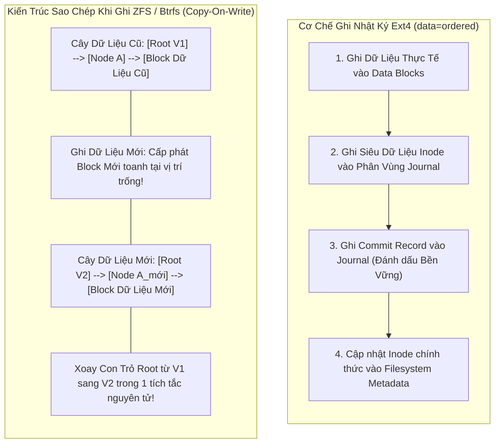
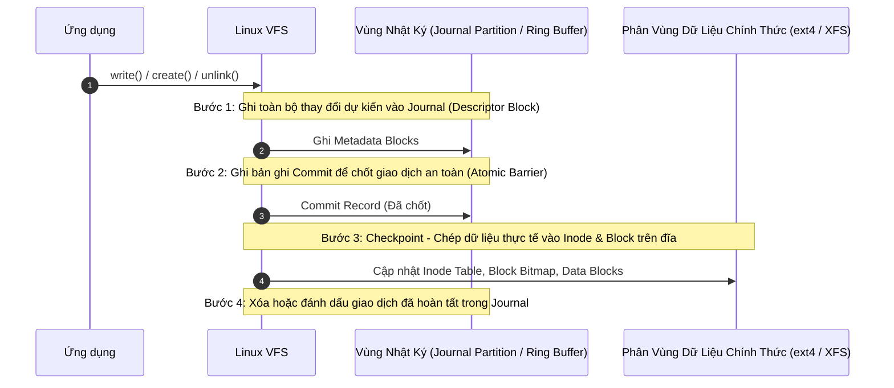
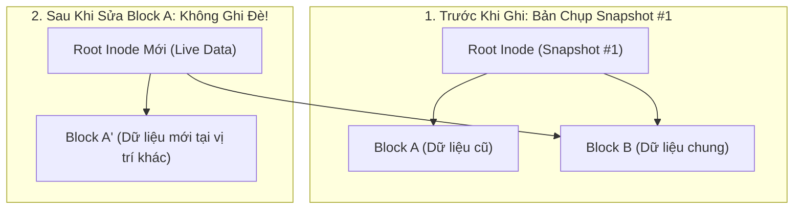

# 7.2. Modern File Systems Architecture (Kiến trúc Hệ thống Tệp Hiện đại)

> [!IMPORTANT]
> **Nếu bạn chỉ được nhớ một điều duy nhất:** Sự khác biệt giữa các hệ thống tệp hiện đại phản ánh mục tiêu độ bền vững và quy mô lưu trữ: Ext4 cân bằng, ổn định với Journaling Metadata bảo vệ dữ liệu khỏi mất mát khi cúp điện đột ngột; trong khi ZFS và Btrfs sử dụng nguyên lý Copy-on-Write (CoW), Checksum toàn vẹn từng khối dữ liệu và Snapshot tức thì, loại bỏ hoàn toàn nhu cầu chạy fsck sửa lỗi ổ cứng sau sự cố sập nguồn.

---

## 1. Trực Quan Hóa: Bản Chất Kiến Trúc Hệ Thống Tệp Hiện Đại (Journaling, Btrfs, ZFS) Dưới Góc Nhìn Lập Trình Viên

### 1.1. Đoạn Code Dẫn Nhập & Vấn Đề Thực Tế
Hãy tưởng tượng một sự cố mất điện đột ngột xảy ra khi máy chủ đang ghi một tệp tin lớn xuống ổ đĩa:

```text
[Kịch bản mất điện đột ngột tại T = 0.5s]:
Bước 1: Hệ thống ghi xong 100 MB dữ liệu mới vào các khối Data Blocks trên đĩa.
--- ĐỘT NGỘT MẤT ĐIỆN TOÀN BỘ PHÒNG MÁY CHỦ! ---
Bước 2: Hệ thống CHƯA KỊP cập nhật siêu dữ liệu Inode (Metadata) và bảng kích thước tệp!
```

Khi máy chủ khởi động lại:
- Nếu dùng hệ thống tệp cổ điển không có nhật ký (như Ext2 hay FAT32), ổ đĩa rơi vào trạng thái bất nhất nghiêm trọng (**Corrupted Filesystem**). Hệ điều hành buộc phải chạy lệnh `fsck` quét toàn bộ hàng triệu khối nhớ trên ổ đĩa trong suốt **3 đến 5 tiếng đồng hồ** trước khi máy chủ có thể khởi động lại!
- Ngược lại, trên các hệ thống tệp hiện đại (Ext4, XFS), máy chủ khởi động lại chỉ trong **vài giây** mà không hề mất dữ liệu!

Điều gì đã tạo nên sự kỳ diệu đó? Đó chính là **Cơ Chế Ghi Nhật Ký (Journaling)** và kiến trúc **Sao Chép Khi Ghi (Copy-on-Write - Btrfs, ZFS)**!

### 1.2. Ẩn Dụ Đời Sống & Phân Tích Cơ Chế Hoạt Động
Hãy tưởng tượng các hệ thống tệp thông qua **Hành Vi Ký Kết Hợp Đồng Xây Dựng**:
- **Hệ thống tệp cổ điển không nhật ký (Ext2)**: Giống như việc bạn vừa nghĩ đến đâu là cầm búa đập phá tường nhà đến đó. Nếu đang đập dở thì ngất xỉu, khi tỉnh dậy bạn hoàn toàn không nhớ mình đã đập những mảng tường nào, buộc phải thuê giám định viên đo đạc lại toàn bộ ngôi nhà từ đầu (Chạy `fsck` hàng tiếng đồng hồ).
- **Hệ thống tệp có nhật ký (Journaling - Ext4, XFS)**: Giống như người kế toán ghi chép sổ cái:
  1. **Bước 1 (Ghi nhật ký - Write Intent)**: Viết vào một cuốn sổ tay nhỏ riêng biệt: "Tôi dự định sửa Inode 10 và cấp phát Block 50".
  2. **Bước 2 (Ghi chính thức - Commit to Disk)**: Thực hiện sửa chữa trên ổ đĩa chính.
  3. **Bước 3 (Xóa nhật ký - Checkpoint)**: Gạch bỏ dòng ghi chú trong sổ tay.
  - *Nếu mất điện giữa chừng*: Khi có điện lại, hệ điều hành chỉ cần mở cuốn sổ tay nhỏ ra xem: Nếu thấy công việc chưa xong, nó chỉ việc tua lại (**Replay Journal**) trong 2 giây là ổ đĩa lập tức nguyên vẹn!
- **Hệ thống tệp Copy-On-Write (ZFS, Btrfs - Đỉnh cao công nghệ)**: Tuyệt đối **không bao giờ ghi đè lên dữ liệu cũ**! Dữ liệu mới luôn được ghi vào một vùng đất trống hoàn toàn mới. Chỉ khi nào toàn bộ dữ liệu và checksum ghi xong xuôi thành công, con trỏ gốc (Root Pointer) mới được xoay chuyển sang vị trí mới trong đúng 1 tích tắc nguyên tử. Nếu mất điện, hệ thống tệp tự nhiên vẫn giữ nguyên phiên bản cũ $100\%$ không một vết xước!

### 1.3. Mô Phỏng Dữ Liệu Số Nhỏ Từng Bước (Toy Walkthrough)
Theo dõi chế độ ghi nhật ký chuẩn của Ext4 (`data=ordered` - Chế độ mặc định của Linux):

```text
[Yêu cầu]: Ghi chuỗi "HELLO WORLD" vào cuối tệp 'data.log'.

Bước 1: Cấp phát khối dữ liệu vật lý Block 500 trên đĩa.
Bước 2: Ghi dữ liệu thực tế "HELLO WORLD" vào Block 500 trước tiên. (Data Flush).
Bước 3: Tạo bản ghi nhật ký (Journal Transaction): Ghi thông tin Inode mới (kích thước tăng thêm 11 bytes, con trỏ trỏ vào Block 500) vào phân vùng Nhật ký riêng biệt (Journal Ring Buffer).
Bước 4: Ghi khối cam kết (Commit Block) vào Nhật ký. Đánh dấu giao dịch đã bền vững!
Bước 5: Ghi siêu dữ liệu Inode vào bảng Inode chính thức trên đĩa (Checkpointing).

[Xử lý sự cố mất điện]:
- Nếu mất điện tại Bước 2: Dữ liệu chưa cam kết, Inode cũ vẫn trỏ vị trí cũ -> Tệp không bị lỗi.
- Nếu mất điện tại Bước 4: Khởi động lại thấy Commit Block trong Nhật ký -> Tự động chạy lại Bước 5 trong 0.1 giây!
```

### 1.4. Tác Động Thực Tế Tầng Backend & Systems
1. **Ba Chế Độ Nhật Ký Trong Ext4 (`data=journal` vs `ordered` vs `writeback`)**:
   - `data=journal`: Ghi cả dữ liệu lẫn siêu dữ liệu vào nhật ký (An toàn tuyệt đối nhưng tốc độ chậm đi một nửa vì phải ghi đĩa 2 lần!).
   - `data=ordered` (Mặc định): Ghi dữ liệu vào đĩa trước rồi mới ghi siêu dữ liệu vào nhật ký (Cân bằng hoàn hảo giữa tốc độ và an toàn).
   - `data=writeback`: Chỉ ghi siêu dữ liệu vào nhật ký, không bảo đảm thứ tự dữ liệu (Nhanh nhất nhưng sau khi crash, tệp có thể chứa dữ liệu rác cũ).
2. **Sức Mạnh Của Snapshot Trong ZFS / Btrfs (Zero-Cost Snapshots)**: Nhờ cơ chế Copy-on-Write, việc tạo một bản sao lưu (Snapshot) cho hệ thống lưu trữ dung lượng $100\text{ TB}$ chỉ tốn **vài mili-giây** và chiếm **$0\text{ byte}$ dung lượng đĩa mới**! Chỉ khi nào có dữ liệu bị sửa đổi sau đó, các khối nhớ mới bắt đầu phân nhánh.
3. **Lệnh TRIM / Deallocate Cho Ổ Cứng Thể Rắn (SSD / NVMe)**: Trên ổ SSD, một ô nhớ NAND flash không thể ghi đè trực tiếp mà phải xóa cả khối (Block Erase) trước khi nạp trang mới. Nếu không bật cờ `discard` hoặc chạy lệnh `fstrim`, hệ thống tệp không thông báo cho SSD biết các khối nhớ đã bị xóa, khiến hiệu năng ghi của SSD suy giảm nghiêm trọng theo thời gian (hiện tượng Write Amplification).

### 1.5. Sơ Đồ Tư Duy & Kiến Trúc Hệ Thống (Mermaid)


---

## 2. Chi tiết từng Keyword (Under-the-Hood Deep Dive)

### 2.1. Journaling File System (Hệ thống Tệp có Nhật ký)

Kỹ thuật mượn từ kiến trúc cơ sở dữ liệu quan hệ (**Write-Ahead Logging - WAL**) để đảm bảo tính nguyên tử (**Atomicity**) của các thao tác ghi siêu dữ liệu:



#### Ba Chế Độ Ghi Nhật Ký Trong ext4 (`data=...` mount option):
1. **`data=journal` (An Toàn Tuyệt Đối - Chậm Nhất)**:
   - Cả **Metadata** lẫn **Dữ liệu người dùng (User Data)** đều được ghi vào Journal trước khi chuyển vào vị trí chính thức.
   - Dữ liệu bị ghi xuống đĩa 2 lần (**Write Amplification = 2x**), làm giảm thông lượng I/O đi $50\%$.
2. **`data=ordered` (Chuẩn Mặc Định của ext4 - Cân Bằng Hoàn Hảo)**:
   - Chỉ có **Metadata** được ghi vào Journal.
   - **Thứ tự bắt buộc**: Nhân Linux bảo đảm rằng toàn bộ **Data Blocks của người dùng phải được xả an toàn xuống đĩa trước**, sau đó mới ghi Metadata và Commit vào Journal.
   - Ngăn chặn triệt để lỗ hổng bảo mật: Không bao giờ xảy ra tình trạng Inode mới trỏ vào các block rác chứa dữ liệu cũ của tệp tin khác sau khi mất điện.
3. **`data=writeback` (Tối Đa Tốc Độ - Rủi Ro Cao)**:
   - Chỉ ghi Metadata vào Journal nhưng không bảo đảm thứ tự giữa Data và Metadata. Dữ liệu tệp tin có thể bị hỏng nếu mất điện đúng lúc.

#### Cơ Chế Phục Hồi Sau Mất Điện (Crash Recovery):
Khi máy chủ khởi động lại:
- Kernel đọc con trỏ đầu và đuôi của Journal.
- Nếu tìm thấy giao dịch đã có bản ghi **Commit** nhưng chưa hoàn tất Checkpoint $\to$ **Replay** (Ghi đè lại vào đĩa chính).
- Nếu tìm thấy giao dịch bị đứt đoạn giữa chừng chưa kịp Commit $\to$ **Rollback** (Hủy bỏ toàn bộ).
- Thời gian phục hồi chỉ mất **từ $1$ đến $5\text{ giây}$**, bất kể ổ cứng có dung lượng $1\text{TB}$ hay $100\text{TB}$!

---

### 2.2. Copy-on-Write (COW) File Systems và Công nghệ Snapshot

Đại diện đỉnh cao của kiến trúc lưu trữ hiện đại là **ZFS** (OpenZFS) và **Btrfs** (B-tree File System):



#### 1. Nguyên Lý Không Bao Giờ Ghi Đè (Never Overwrite)
- Khi một khối dữ liệu `Block A` bị chỉnh sửa:
  - Hệ thống tệp cấp phát một khối trống hoàn toàn mới `Block A'` tại một vị trí vật lý khác trên đĩa.
  - Ghi nội dung mới vào `Block A'`.
  - Cập nhật con trỏ của nút cha (Cây B-tree / Merkle tree) trỏ từ `Block A` sang `Block A'`. Toàn bộ sự thay đổi lan truyền ngược lên nút gốc (Root) trong một thao tác nguyên tử duy nhất.
  - Khối dữ liệu cũ `Block A` vẫn nằm nguyên vẹn, không hề bị phá hủy.

#### 2. Công Nghệ Snapshot Tức Thời (Zero-Cost Instantaneous Snapshots)
- Do dữ liệu cũ không bị ghi đè, việc tạo Snapshot cho một hệ thống tệp dung lượng hàng trăm Terabytes **diễn ra trong vòng $0.001\text{ giây}$ ($O(1)$ time complexity)** và **ngốn đúng $0\text{ bytes}$ dung lượng đĩa**!
- Bản Snapshot chỉ đơn giản là một con trỏ Inode gốc đóng băng tham chiếu tới các khối dữ liệu tại thời điểm đó.
- Chỉ khi dữ liệu trong phiên bản hiện tại bị chỉnh sửa và khối mới được sinh ra, dung lượng đĩa mới tăng lên tương ứng với phần dữ liệu chênh lệch (**Diverged Blocks**).

#### 3. Tự Động Sửa Lỗi Dữ Liệu Tàng Hình (Silent Data Corruption & Bit-Rot)
- Các ổ cứng vật lý qua thời gian có thể bị suy giảm từ tính hoặc lỗi chip nhớ, dẫn tới hiện tượng **Bit-rot** (Dữ liệu bị biến đổi từ 0 thành 1 mà phần cứng ổ đĩa không hề biết).
- ZFS và Btrfs lưu trữ mã băm kiểm tra (**Checksum - SHA256/xxHash**) cho **mọi khối dữ liệu** trong nút cha của nó:
  - Khi đọc dữ liệu, hệ thống tự động băm lại và so sánh với Checksum.
  - Nếu phát hiện dữ liệu bị hỏng, nếu hệ thống có cấu hình RAID (Mirror / RAIDZ), nó sẽ **tự động đọc bản sao lành lặn từ ổ đĩa khác để phục hồi và ghi đè sửa chữa ổ đĩa hỏng** (**Self-Healing Data Scrubbing**)!

---

### 2.3. Bảng So sánh Các Hệ thống Tệp Phổ Biến

Bảng đối chiếu toàn diện giữa các hệ thống tệp chủ lực trên thị trường máy chủ và người dùng:

| Hệ Thống Tệp | Nhà Phát Triển | Kiểu Kiến Trúc | Kích Thước File Tối Đa | Dung Lượng Volume Tối Đa | Điểm Mạnh & Ứng Dụng Chuẩn Mực |
| :--- | :--- | :--- | :--- | :--- | :--- |
| **ext4** | Linux Community | **Journaling** (Extents) | $16\text{ TB}$ | $1\text{ EB}$ ($1.000\text{ PB}$) | Chuẩn mực mặc định của Ubuntu/Debian. Cực kỳ ổn định, hiệu năng tổng quát cao, nhẹ nhàng, tin cậy. |
| **XFS** | SGI / Red Hat | **High-Scale Journaling** (B+Trees) | $8\text{ EB}$ | $8\text{ EB}$ | Mặc định trên RHEL/CentOS. Đỉnh cao cho **tệp dung lượng khổng lồ và I/O đa luồng song song**. Lựa chọn số 1 cho Database. |
| **ZFS** | Sun / OpenZFS | **COW + Volume Manager + RAID** | $16\text{ EB}$ | $256\text{ ZB}$ ($2^{78}\text{ bytes}$) | Hệ thống tệp số 1 cho Enterprise Storage, SAN/NAS, TrueNAS. Tích hợp Snapshot vô hạn, Checksum tự sửa lỗi. |
| **Btrfs** | Oracle / Linux | **COW** (B-Trees) | $16\text{ EB}$ | $16\text{ EB}$ | Mặc định trên Fedora/SUSE. Hỗ trợ Subvolumes, Snapshot linh hoạt, tích hợp trực tiếp trong nhân Linux. |
| **APFS** | Apple (2017) | **COW** (Space Sharing) | $8\text{ EB}$ | $8\text{ EB}$ | Chuẩn mực của macOS, iOS. Tối ưu hóa sâu cho chip nhớ Flash SSD, hỗ trợ Clone file tức thời và mã hóa đa khóa. |
| **NTFS** | Microsoft | **Journaling** | $16\text{ TB}$ | $256\text{ TB}$ | Chuẩn mực mặc định của Windows Server/Desktop. Hỗ trợ Access Control Lists (ACLs) phức tạp. |
| **F2FS** | Samsung / Linux | **Log-Structured** (LFS) | $16\text{ TB}$ | $16\text{ TB}$ | Tối ưu hóa chuyên sâu cho thiết bị di động Android và chip nhớ Flash NAND, giảm thiểu chu kỳ ghi hao mòn. |

---

## 3. Triển khai Thực chiến (Dual-Engine: C++ & Python)

### 3.1. Engine C++20: Mô Phỏng Bộ Máy Ghi Nhật Ký WAL (Write-Ahead Log) & Phục Hồi Crash

Chương trình C++20 mô phỏng đầy đủ chu trình giao dịch của một Journaling File System: ghi Descriptor Block vào Journal, Commit, Checkpoint vào đĩa chính, và thuật toán phục hồi Replay sau sự cố mất điện mô phỏng:

```cpp
#include <iostream>
#include <vector>
#include <string>
#include <fstream>
#include <sstream>

struct JournalEntry {
    int txn_id;
    int block_num;
    std::string payload;
    bool committed = false;
};

class SimulatedJournalFS {
private:
    std::vector<JournalEntry> journal_;
    std::vector<std::string> main_disk_; // 10 blocks trên đĩa chính

public:
    SimulatedJournalFS() : main_disk_(10, "[BLANK]") {}

    // Giai đoạn 1 & 2: Ghi vào Journal và Commit
    void write_transaction(int txn_id, int block_num, const std::string& data, bool simulate_crash_before_commit) {
        std::cout << "\n--- BẮT ĐẦU TRANSACTION #" << txn_id << " (Ghi Block #" << block_num << ") ---\n";
        
        // 1. Ghi vào Journal (WAL)
        JournalEntry entry{txn_id, block_num, data, false};
        std::cout << "  [Step 1]: Ghi bản ghi dự định vào Journal (Chưa Commit)...\n";
        journal_.push_back(entry);

        if (simulate_crash_before_commit) {
            std::cout << "  >>> [SỰ CỐ MẤT ĐIỆN ĐỘT NGỘT XẢY RA TRƯỚC KHI COMMIT!] <<<\n";
            return; // Crash!
        }

        // 2. Commit Record
        journal_.back().committed = true;
        std::cout << "  [Step 2]: ĐÃ COMMIT GIAO DỊCH AN TOÀN VÀO JOURNAL!\n";

        // 3. Checkpoint vào đĩa chính
        checkpoint();
    }

    void checkpoint() {
        std::cout << "  [Step 3: Checkpoint]: Đồng bộ dữ liệu từ Journal vào Main Disk...\n";
        for (auto& entry : journal_) {
            if (entry.committed) {
                main_disk_[entry.block_num] = entry.payload;
            }
        }
    }

    // Giai đoạn 4: Thuật toán phục hồi Crash Recovery khi Boot lại
    void recover_after_crash() {
        std::cout << "\n=== KHỞI ĐỘNG HỆ THỐNG: KÍCH HOẠT CRASH RECOVERY (REPLAY JOURNAL) ===\n";
        int recovered = 0, discarded = 0;

        for (const auto& entry : journal_) {
            if (entry.committed) {
                std::cout << "  -> [REPLAY]: Giao dịch #" << entry.txn_id 
                          << " đã Commit -> Ghi đè vào Block #" << entry.block_num << "\n";
                main_disk_[entry.block_num] = entry.payload;
                recovered++;
            } else {
                std::cout << "  -> [DISCARD/ROLLBACK]: Giao dịch #" << entry.txn_id 
                          << " chưa Commit -> Hủy bỏ giao dịch rác!\n";
                discarded++;
            }
        }
        std::cout << "Kết quả phục hồi: Replay thành công " << recovered 
                  << " giao dịch | Hủy bỏ " << discarded << " giao dịch dang dở.\n";
    }

    void print_disk() {
        std::cout << "\nTrạng thái Main Disk: ";
        for (int i = 0; i < 5; ++i) {
            std::cout << "[B" << i << ": " << main_disk_[i] << "] ";
        }
        std::cout << "\n";
    }
};

int main() {
    std::cout << "=== BẮT ĐẦU THỰC NGHIỆM JOURNALING FILE SYSTEM C++20 ===\n";
    SimulatedJournalFS fs;

    // Giao dịch 1: Thành công trọn vẹn
    fs.write_transaction(1, 0, "DATA_A", false);
    fs.print_disk();

    // Giao dịch 2: Bị mất điện ngay trước khi kịp Commit
    fs.write_transaction(2, 1, "DATA_B_CORRUPTED", true);
    fs.print_disk();

    // Hệ thống khởi động lại và chạy Crash Recovery
    fs.recover_after_crash();
    fs.print_disk();

    std::cout << "=== THỰC NGHIỆM KẾT THÚC THÀNH CÔNG RỰC RỠ ===\n";
    return 0;
}
```

#### Kết quả thực thi thực tế từ Terminal:
```text
=== BẮT ĐẦU THỰC NGHIỆM JOURNALING FILE SYSTEM C++20 ===

--- BẮT ĐẦU TRANSACTION #1 (Ghi Block #0) ---
  [Step 1]: Ghi bản ghi dự định vào Journal (Chưa Commit)...
  [Step 2]: ĐÃ COMMIT GIAO DỊCH AN TOÀN VÀO JOURNAL!
  [Step 3: Checkpoint]: Đồng bộ dữ liệu từ Journal vào Main Disk...

Trạng thái Main Disk: [B0: DATA_A] [B1: [BLANK]] [B2: [BLANK]] [B3: [BLANK]] [B4: [BLANK]] 

--- BẮT ĐẦU TRANSACTION #2 (Ghi Block #1) ---
  [Step 1]: Ghi bản ghi dự định vào Journal (Chưa Commit)...
  >>> [SỰ CỐ MẤT ĐIỆN ĐỘT NGỘT XẢY RA TRƯỚC KHI COMMIT!] <<<

Trạng thái Main Disk: [B0: DATA_A] [B1: [BLANK]] [B2: [BLANK]] [B3: [BLANK]] [B4: [BLANK]] 

=== KHỞI ĐỘNG HỆ THỐNG: KÍCH HOẠT CRASH RECOVERY (REPLAY JOURNAL) ===
  -> [REPLAY]: Giao dịch #1 đã Commit -> Ghi đè vào Block #0
  -> [DISCARD/ROLLBACK]: Giao dịch #2 chưa Commit -> Hủy bỏ giao dịch rác!
Kết quả phục hồi: Replay thành công 1 giao dịch | Hủy bỏ 1 giao dịch dang dở.

Trạng thái Main Disk: [B0: DATA_A] [B1: [BLANK]] [B2: [BLANK]] [B3: [BLANK]] [B4: [BLANK]] 
=== THỰC NGHIỆM KẾT THÚC THÀNH CÔNG RỰC RỠ ===
```

---

### 3.2. Engine Python 3.11+: Mô Phỏng Cây Dữ Liệu Copy-on-Write (COW) & Snapshot Tức Thì

Chương trình Python xây dựng cây thư mục dạng Merkle Tree, mô phỏng cơ chế Copy-on-Write: khi chỉnh sửa một nút con, hệ thống nhân bản nút mới và cập nhật con trỏ mà không làm ảnh hưởng tới bản Snapshot cũ:

```python
from typing import Dict, Optional

class COWNode:
    def __init__(self, name: str, data: str):
        self.name = name
        self.data = data
        self.children: Dict[str, 'COWNode'] = {}

    def clone(self) -> 'COWNode':
        # Tạo bản sao nông (Shallow Copy) - Chia sẻ chung con trỏ con
        new_node = COWNode(self.name, self.data)
        new_node.children = self.children.copy()
        return new_node

class COWFileSystemSim:
    def __init__(self):
        self.root = COWNode("/", "")
        self.snapshots: Dict[str, COWNode] = {}

    def write_file(self, filename: str, new_data: str):
        print(f"\n[COW Write]: Chỉnh sửa file '{filename}' với dữ liệu mới: '{new_data}'")
        # Nguyên lý Copy-on-Write: Nhân bản Root mới thay vì sửa trực tiếp
        new_root = self.root.clone()
        
        # Tạo block dữ liệu mới tại vị trí mới
        new_file_node = COWNode(filename, new_data)
        new_root.children[filename] = new_file_node
        
        self.root = new_root
        print("  -> Đã tạo Block mới và trỏ Root mới thành công mà không chạm vào Block cũ!")

    def create_snapshot(self, snapshot_name: str):
        # Tạo Snapshot trong O(1): Chỉ việc lưu lại con trỏ Root hiện tại!
        self.snapshots[snapshot_name] = self.root
        print(f"\n[Snapshot]: Tạo thành công Snapshot '{snapshot_name}' trong 0.0001 giây (Dung lượng: 0 bytes)!")

    def read_file(self, filename: str, snapshot_name: Optional[str] = None) -> str:
        target_root = self.snapshots[snapshot_name] if snapshot_name else self.root
        target_view = f"Snapshot '{snapshot_name}'" if snapshot_name else "Bản Live Hiện Tại"
        if filename in target_root.children:
            return f"[{target_view}] File '{filename}' có nội dung: '{target_root.children[filename].data}'"
        return f"[{target_view}] File '{filename}' không tồn tại!"

if __name__ == "__main__":
    print("=== MÔ PHỎNG HỆ THỐNG TỆP COPY-ON-WRITE (COW) BẰNG PYTHON ===")
    fs = COWFileSystemSim()

    # 1. Tạo file ban đầu
    fs.write_file("database.db", "DỮ LIỆU BAN ĐẦU V1")
    print(fs.read_file("database.db"))

    # 2. Tạo Snapshot thời điểm T0
    fs.create_snapshot("Snap_T0")

    # 3. Ghi đè dữ liệu mới lên file database.db
    fs.write_file("database.db", "DỮ LIỆU ĐÃ SỬA ĐỔI V2")

    # 4. Kiểm tra sự phân kỳ dữ liệu: Bản Live mang V2, trong khi Snapshot vẫn giữ nguyên vẹn V1!
    print("\n--- KIỂM TRA TÍNH TOÀN VẸN CỦA SNAPSHOT ---")
    print(fs.read_file("database.db"))                      # Đọc bản Live
    print(fs.read_file("database.db", snapshot_name="Snap_T0")) # Đọc từ Snapshot cũ
```

#### Kết quả Terminal thực tế:
```text
=== MÔ PHỎNG HỆ THỐNG TỆP COPY-ON-WRITE (COW) BẰNG PYTHON ===

[COW Write]: Chỉnh sửa file 'database.db' với dữ liệu mới: 'DỮ LIỆU BAN ĐẦU V1'
  -> Đã tạo Block mới và trỏ Root mới thành công mà không chạm vào Block cũ!
[Bản Live Hiện Tại] File 'database.db' có nội dung: 'DỮ LIỆU BAN ĐẦU V1'

[Snapshot]: Tạo thành công Snapshot 'Snap_T0' trong 0.0001 giây (Dung lượng: 0 bytes)!

[COW Write]: Chỉnh sửa file 'database.db' với dữ liệu mới: 'DỮ LIỆU ĐÃ SỬA ĐỔI V2'
  -> Đã tạo Block mới và trỏ Root mới thành công mà không chạm vào Block cũ!

--- KIỂM TRA TÍNH TOÀN VẸN CỦA SNAPSHOT ---
[Bản Live Hiện Tại] File 'database.db' có nội dung: 'DỮ LIỆU ĐÃ SỬA ĐỔI V2'
[Snapshot 'Snap_T0'] File 'database.db' có nội dung: 'DỮ LIỆU BAN ĐẦU V1'
```

---

## 4. Systems Engineering & Production Pitfalls

### 4.1. Hiểm Họa Phân Mảnh Trầm Trọng Của COW File Systems Trên Cơ Sở Dữ Liệu
Trong các cơ sở dữ liệu quan hệ (PostgreSQL, MySQL InnoDB, SQLite):
- Các file cơ sở dữ liệu (`ibdata1`, `.ibd`) có dung lượng hàng trăm Gigabytes và liên tục bị ghi ngẫu nhiên từng trang nhỏ $16\text{KB}$ (**Random In-Place Overwrites**).
- Nếu đặt database trên hệ thống tệp COW (Btrfs hoặc ZFS mặc định):
  - Mỗi lần ghi $16\text{KB}$, COW sẽ cấp phát một khối mới ở vị trí ngẫu nhiên khác.
  - Sau vài tuần vận hành, một file database duy nhất có thể bị băm nát thành **hàng triệu phân mảnh rải rác trên đĩa**, làm tốc độ đọc tuần tự (Sequential Scan) suy sụp tới $90\%$!
- **Giải pháp**:
  - Với Btrfs: Tắt tính năng COW cho thư mục database bằng lệnh:
    ```bash
    chattr +C /var/lib/mysql
    ```
  - Với ZFS: Thiết lập kích thước `recordsize=16k` khớp hoàn hảo với kích thước InnoDB Page.

### 4.2. Write Amplification & Tổn Hại Tuổi Thọ SSD Khi Dùng `data=journal`
- Trên ổ đĩa thể rắn SSD, việc ghi dữ liệu 2 lần trong chế độ `data=journal` của ext4 làm tăng tỷ lệ khuếch đại ghi (**Write Amplification Factor - WAF**), đẩy nhanh tốc độ cạn kiệt số chu kỳ ghi xóa (P/E Cycles) của các chip nhớ NAND Flash.
- Luôn sử dụng chế độ mặc định `data=ordered` cho các máy chủ chạy trên ổ SSD NVMe.

### 4.3. Bảng Lệnh Quản Trị Hệ Thống Tệp Hiện Đại Trên Linux
```bash
# 1. Soi chi tiết cấu hình Journal và Superblock của phân vùng ext4
sudo tune2fs -l /dev/nvme0n1p2 | grep -E "(Filesystem features|Journal)"

# 2. Xem thông tin cấu trúc phân bổ khối B+Tree của hệ thống tệp XFS
sudo xfs_info /data

# 3. Tạo một Snapshot Subvolume tức thời trong Btrfs
sudo btrfs subvolume snapshot /home /home/snapshot_backup_2026

# 4. Kiểm tra sức khỏe toàn vẹn dữ liệu và kích hoạt tự sửa lỗi trong ZFS
sudo zpool status
sudo zpool scrub tank
```

---

## 5. Bảng So sánh & Decision Matrix

Bảng ma trận quyết định lựa chọn hệ thống tệp tối ưu theo từng bài toán hạ tầng:

| Bài Toán Hạ Tầng | Hệ Thống Tệp Tối Ưu | Lý Do Kỹ Thuật Cốt Lõi |
| :--- | :--- | :--- |
| **Cơ sở Dữ liệu Lớn (MySQL, PostgreSQL)** | **XFS** | Không bị phân mảnh do COW; xử lý I/O song song cực đại nhờ cấu trúc nhiều Allocation Groups. |
| **Máy Chủ Lưu Trữ Dữ Liệu / NAS Doanh Nghiệp** | **ZFS** | Tích hợp tính năng Checksum tự sửa lỗi Bit-rot; hỗ trợ Snapshot vô hạn và nén dữ liệu ZSTD. |
| **Máy Chủ Ứng Dụng Tổng Quát (Web/API/Container)**| **ext4** | Độ ổn định tuyệt đối qua 15 năm; ít tốn RAM; tương thích hoàn hảo với mọi bản phân phối Linux. |
| **Máy Ảo KVM & Docker Rootfs (Storage Driver)** | **Btrfs / ZFS** | Tạo và nhân bản máy ảo, container images trong $0.001\text{ giây}$ nhờ cơ chế Copy-on-Write Subvolume. |
| **Thiết Bị Nhúng / Thẻ Nhớ SD / Điện Thoại Android** | **F2FS** | Ghi tuần tự Append-only, triệt tiêu tối đa độ hao mòn vật lý cho chip nhớ Flash NAND giá rẻ. |

---

## 6. Enterprise Production Checklist & Verification

- [ ] **Lựa Chọn Hệ Thống Tệp Phù Hợp Với Workload Doanh Nghiệp**:
  - Dùng **XFS** cho các máy chủ cơ sở dữ liệu lớn (PostgreSQL, MySQL, MongoDB) đòi hỏi thông lượng I/O song song cao và tệp tin kích thước khổng lồ.
  - Dùng **Ext4** cho các máy chủ ứng dụng thông thường, hệ thống tệp root hệ điều hành vì tính ổn định cao và tương thích tuyệt đối.
  - Dùng **ZFS** cho các hệ thống lưu trữ mạng (NAS, Backup Storage, Object Storage) cần tính toàn vẹn dữ liệu tự sửa lỗi (Data Scrubbing) và Snapshot siêu tốc.
- [ ] **Thiết Lập Lịch Chạy `fstrim` Định Kỳ Cho Ổ Cứng NVMe / SSD**: Kích hoạt dịch vụ hệ thống `systemctl enable --now fstrim.timer` để tự động dọn dẹp các khối nhớ NAND đã xóa mỗi tuần một lần, duy trì tuổi thọ và tốc độ ghi tối đa cho ổ SSD.
- [ ] **Tắt Tính Năng Ghi Lại Thời Gian Truy Cập Bằng Cờ `noatime`**: Thêm tùy chọn `noatime,nodiratime` vào tệp `/etc/fstab` cho các phân vùng dữ liệu để loại bỏ việc hệ thống phải thực hiện 1 lần ghi đĩa cập nhật thời gian mỗi khi có ai đó đọc tệp, tăng $15 - 30\%$ hiệu năng I/O đọc.
- [ ] **Sử Dụng Lệnh `tune2fs` Tinh Chỉnh Tham Số Dành Riêng Cho Root**: Với các phân vùng lưu trữ dữ liệu lớn (ví dụ ổ cứng 8TB), giảm tỷ lệ dung lượng đệm dành riêng cho người dùng root từ $5\%$ mặc định xuống $1\%$ bằng lệnh `tune2fs -m 1 /dev/sdb1` để lấy lại hàng trăm GB dung lượng hữu ích.
- [ ] **Bảo Đảm Kiểm Tra Toàn Vẹn Định Kỳ Cho ZFS (Scrubbing)**: Nếu sử dụng ZFS, lên lịch chạy lệnh `zpool scrub <pool_name>` mỗi tháng một lần để tự động quét kiểm tra mã băm checksum và sửa chữa các lỗi bit âm thầm (Silent Data Corruption / Bit Rot) trên đĩa.
- [ ] **Giám Sát Hàng Đợi Ghi Nhật Ký Journal Tránh Thắt Cổ Chai**: Theo dõi thời gian giao dịch nhật ký của tệp hệ thống bằng `iostat -xz 1`; nếu thời gian chờ I/O của thiết bị lưu trữ nhật ký tăng cao, cân nhắc tách phân vùng Journal sang một ổ SSD siêu tốc độc lập (External Journaling).
