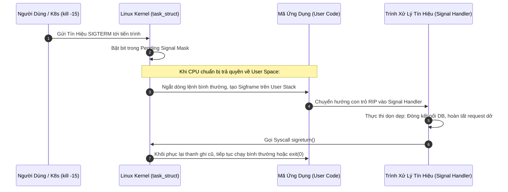
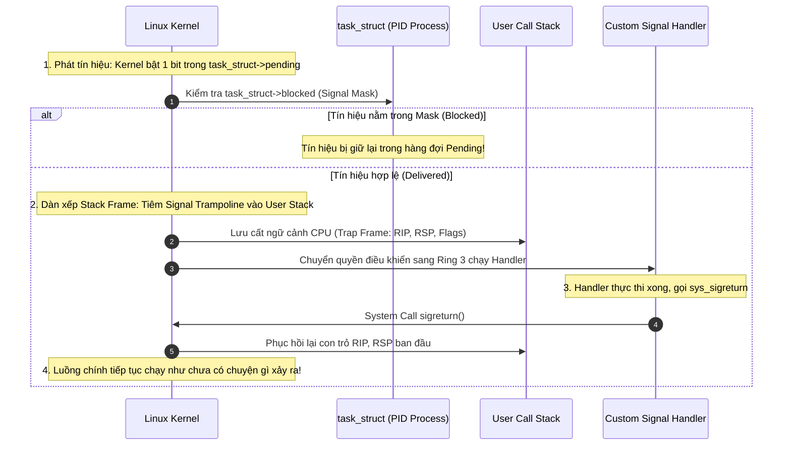

# 8.0. Signals and Process Control (Tín hiệu UNIX và Kiểm soát Tiến trình)

> [!IMPORTANT]
> **Nếu bạn chỉ được nhớ một điều duy nhất:** Tín hiệu (Signal) là dạng ngắt phần mềm bất đồng bộ sơ khai nhất của UNIX gửi đến tiến trình: bởi vì Signal Handler có thể ngắt ngang luồng thực thi bất kỳ lúc nào, lập trình viên chỉ được phép gọi các hàm Async-Signal-Safe (như `write()` thô); gọi các hàm cấp phát bộ nhớ có khóa Mutex như `malloc()` hoặc `printf()` bên trong hàm xử lý tín hiệu là nguyên nhân hàng đầu gây ra bế tắc vĩnh viễn (Deadlock) kỳ quái nhất trong sản xuất.

---

## 1. Trực Quan Hóa: Bản Chất Tín Hiệu UNIX (Signals) & Kiểm Soát Tiến Trình Dưới Góc Nhìn Lập Trình Viên

### 1.1. Đoạn Code Dẫn Nhập & Vấn Đề Thực Tế
Hãy xem một hàm xử lý tín hiệu (Signal Handler) trong C thoạt nhìn rất bình thường nhưng lại chứa lỗi treo chết máy chủ:

```c
#include <signal.h>
#include <stdio.h>
#include <stdlib.h>

void bad_signal_handler(int signum) {
    // NGUY HIỂM CHÍ MẠNG: Gọi printf() hoặc malloc() bên trong Signal Handler!
    printf("Nhận được tín hiệu: %d\n", signum); 
}

int main() {
    signal(SIGINT, bad_signal_handler);
    while (1) {
        // Luồng chính đang nắm giữ khóa nội bộ của malloc() trong libc
        void *p = malloc(1024);
        free(p);
    }
    return 0;
}
```

Tại sao việc gọi `printf()` hay `malloc()` bên trong một Signal Handler lại là điều cấm kỵ hàng đầu trong lập trình hệ thống?
Bởi vì: **Tín hiệu có thể ngắt quãng luồng thực thi tại BẤT KỲ CHU KỲ XUNG NHỊP CPU NÀO!** Nếu luồng chính đang thực hiện `malloc()` và vừa vặn chiếm khóa nội bộ (Heap Mutex), tín hiệu `SIGINT` ập đến và ngắt ngang luồng chính. Trình xử lý tín hiệu chạy và lại cố gắng gọi `malloc()`. Hàm `malloc()` thứ hai thấy khóa đang bị chiếm bởi chính tiến trình này -> Nó ngồi ngủ chờ mở khóa! Nhưng luồng chính đang bị tạm dừng nên không bao giờ có thể mở khóa! **Hệ thống rơi vào trạng thái Tự Khóa Chính Mình (Self-Deadlock)!**

### 1.2. Ẩn Dụ Đời Sống & Phân Tích Cơ Chế Hoạt Động
Hãy tưởng tượng Tín hiệu UNIX (Signals) giống như **Các Tín Hiệu Báo Động Khẩn Cấp Bằng Cờ Hiệu**:
- **Tín hiệu ngắt quãng bất đồng bộ (Asynchronous Interrupt)**: Bạn đang ngồi viết báo cáo quan trọng. Đột nhiên chuông báo cháy reo lên (`SIGTERM`). Bạn buộc phải dừng bút ngay lập tức, dù đang viết dở một chữ hay một từ, để chạy theo quy trình thoát hiểm đã được huấn luyện sẵn.
- **Tín hiệu không thể cản phá (`SIGKILL` - Mã 9)**: Giống như một **Phát Súng Xuyên Tường Của Đội Đặc Nhiệm**. Bạn không hề có cơ hội nghe chuông, không có quyền từ chối, cũng không thể thực hiện bất kỳ hàm dọn dẹp nào (Không có Signal Handler nào có thể bắt được `SIGKILL`!). Hệ điều hành lập tức xóa sổ tiến trình khỏi RAM trong 1 nano-giây.
- **Tín hiệu có thể đón bắt và dọn dẹp (`SIGTERM` - Mã 15)**: Giống như **Lệnh Di Tản Của Trưởng Tòa Nhà**. Bạn nhận được lệnh, lịch sự lưu tệp đang soạn thảo, đóng các kết nối mạng, hoàn thành các giao dịch dở dang (Graceful Shutdown) rồi mới thong thả bước ra ngoài và tắt máy.
- **Hàm an toàn tái nhập (Async-Signal-Safe Functions)**: Giống như việc khi nghe chuông báo cháy, bạn chỉ được phép cầm theo chìa khóa và điện thoại cá nhân (chỉ dùng các biến nguyên tử hoặc syscall thuần túy `write`), tuyệt đối không được dừng lại thu dọn bàn làm việc hay mở két sắt dùng chung (Tránh dùng các hàm có khóa nội bộ như `malloc/printf`).

### 1.3. Mô Phỏng Dữ Liệu Số Nhỏ Từng Bước (Toy Walkthrough)
Theo dõi cơ chế chuyển tiếp tín hiệu từ Kernel vào không gian người dùng thông qua Signal Trampoline:

```text
[Thời điểm T = 0]: Người dùng bấm Ctrl+C trên bàn phím -> Driver Terminal gửi tín hiệu SIGINT (Mã 2) tới PID 4050.

[Bên trong Kernel Space]:
Bước 1: Kernel cập nhật Mặt nạ tín hiệu đang chờ (Pending Signal Bitmask) trong task_struct của PID 4050: bit số 2 được bật lên 1.
Bước 2: Khi tiến trình chuẩn bị được CPU nhấc lên chạy và trả về User Space (lệnh sysretq), Kernel kiểm tra Pending Bitmask.
Bước 3: Phát hiện bit SIGINT đang bật -> Kernel không trả về dòng lệnh cũ của chương trình!
Bước 4: Kernel tạo một khung ngăn xếp đặc biệt (Sigframe) trên User Stack của tiến trình:
       - Lưu toàn bộ thanh ghi hiện tại (RIP cũ, RSP, RFLAGS).
       - Chèn địa chỉ hàm xử lý tín hiệu (Signal Handler do người dùng đăng ký).
       - Chèn địa chỉ quay đầu (Signal Trampoline: lời gọi hệ thống sigreturn).

[Bên trong User Space]:
Bước 5: CPU nhảy vào thực thi hàm Signal Handler do người dùng viết.
Bước 6: Handler chạy xong -> Thực thi đoạn mã Trampoline gọi Syscall sigreturn().

[Khôi phục ngữ cảnh]:
Bước 7: Kernel đọc Sigframe trên Stack, khôi phục lại toàn bộ thanh ghi cũ của chương trình.
Bước 8: CPU tiếp tục thực thi dòng lệnh cũ như chưa hề có chuyện gì xảy ra!
```

### 1.4. Tác Động Thực Tế Tầng Backend & Systems
1. **Quy Trình Tắt Dịch Vụ Mượt Mà Trong Kubernetes (Graceful Shutdown)**: Khi một Pod bị xóa, Kubernetes gửi tín hiệu `SIGTERM` tới PID 1 trong container và bắt đầu đếm ngược thời gian chờ (`terminationGracePeriodSeconds`, mặc định 30s). Ứng dụng Backend phải đón bắt `SIGTERM`, ngừng tiếp nhận request mới từ Load Balancer, xử lý nốt các request đang chạy dở dang, đóng kết nối Database rồi mới gọi `exit(0)`. Nếu sau 30s ứng dụng vẫn chưa tắt, Kubernetes sẽ thẳng tay gửi `SIGKILL` (Bắn hạ không báo trước, gây mất dữ liệu).
2. **Cạm Bẫy `SIGPIPE` Khi Ghi Vào Socket Đã Đóng**: Nếu client đột ngột ngắt kết nối mạng mà server vẫn tiếp tục gọi lệnh `write()` vào Socket đó lần thứ hai, Kernel sẽ phát tín hiệu `SIGPIPE` tới tiến trình. Vì hành vi mặc định của `SIGPIPE` là tiêu diệt tiến trình, máy chủ Backend sẽ bị crash ngay lập tức! Do đó, mọi máy chủ mạng chuyên nghiệp (Nginx, Netty, Envoy) đều phải đặt `signal(SIGPIPE, SIG_IGN)` hoặc dùng cờ `MSG_NOSIGNAL` khi gửi dữ liệu.
3. **Mặt Nạ Tín Hiệu (Signal Masking)**: Khi một Signal Handler đang thực thi, Kernel tự động chặn (Block) các tín hiệu cùng loại tiếp theo để tránh việc Handler bị đệ quy vô tận làm tràn ngăn xếp (Stack Overflow).

### 1.5. Sơ Đồ Tư Duy & Kiến Trúc Hệ Thống (Mermaid)


---

## 2. Chi tiết từng Keyword (Under-the-Hood Deep Dive)

### 2.1. Bảng Tín hiệu UNIX Sống Còn của Kỹ Sư Backend

Hệ điều hành Linux hỗ trợ $64$ tín hiệu chuẩn POSIX (từ $1$ đến $31$ là Standard Signals, từ $34$ đến $64$ là Real-Time Signals). Bảy tín hiệu sống còn chi phối toàn bộ hạ tầng đám mây:

| Tín Hiệu | Số Mã | Bản Chất Kỹ Thuật | Khả Năng Bắt / Can Thiệp | Ứng Dụng Thực Chiến Trong Backend |
| :--- | :--- | :--- | :--- | :--- |
| **`SIGTERM`** | `15` | Termination Request (Yêu cầu kết thúc lịch sự) | **Có thể bắt được (`sigaction`)** | Khi Kubernetes hoặc `docker stop` muốn tắt Pod, nó gửi `SIGTERM`. Server bắt tín hiệu để ngừng nhận request mới, hoàn tất request cũ rồi mới tắt (**Graceful Shutdown**). |
| **`SIGKILL`** | `9` | Hard Kill (Tiêu diệt cưỡng chế tức thì) | **TUYỆT ĐỐI KHÔNG THỂ BẮT HOẶC BỎ QUA** | Nếu sau thời gian chờ (ví dụ: `terminationGracePeriodSeconds: 30s`) mà Pod chưa tắt, Kernel sẽ bắn `SIGKILL` xóa sổ tiến trình ngay lập tức. |
| **`SIGINT`** | `2` | Terminal Interrupt (Ngắt bàn phím) | Có thể bắt được | Kích hoạt khi lập trình viên bấm tổ hợp phím **`Ctrl + C`** trên Terminal điều khiển. |
| **`SIGCHLD`** | `17` | Child Process State Changed | Có thể bắt được | Bắn cho tiến trình Cha khi một tiến trình Con kết thúc. Cha bắt tín hiệu này để gọi `waitpid()` dọn dẹp Zombie Process! |
| **`SIGHUP`** | `1` | Hangup (Đứt kết nối Terminal / Daemon Reload) | Có thể bắt được | Nginx, PostgreSQL tái sử dụng làm tín hiệu **Hot Reload Configuration** (Nạp lại file cấu hình mà không cần dừng máy chủ). |
| **`SIGPIPE`** | `13` | Broken Pipe (Ghi vào đường ống đã đóng) | Có thể bắt được / Bỏ qua | Phát sinh khi Server cố ghi dữ liệu vào một Socket mà Client đã ngắt kết nối đột ngột. **Mặc định sẽ làm crash server** nếu không chủ động bỏ qua (`SIG_IGN`)! |
| **`SIGSEGV`** | `11` | Segmentation Fault (Truy cập bộ nhớ lậu) | Bắt được nhưng rất nguy hiểm | Phát sinh bởi phần cứng MMU khi ứng dụng truy cập địa chỉ rác hoặc vi phạm quyền ghi vào trang Read-Only. |

---

### 2.2. Signal Mask, Disposition và Delivery

Cách thức nhân Linux theo dõi và điều phối tín hiệu:



1. **Signal Disposition (Hành Vi Xử Lý Tín Hiệu)**:
   - Được thiết lập thông qua system call chuẩn mực **`sigaction()`** (tuyệt đối không dùng hàm `signal()` cũ kỹ vì ngữ nghĩa không đồng nhất giữa các hệ điều hành):
     - `SIG_DFL`: Hành vi mặc định của nhân Linux (Terminate, Core dump, Stop hoặc Ignore).
     - `SIG_IGN`: Bỏ qua hoàn toàn tín hiệu (Lưu ý: `SIGKILL` và `SIGSTOP` không thể bị bỏ qua).
     - Con trỏ hàm tùy biến (`sa_handler` hoặc `sa_sigaction`).
2. **Signal Mask (Mặt Nạ Tín Hiệu)**:
   - Một tập hợp bitmask (`sigset_t`) lưu trữ trong cấu trúc `task_struct` của luồng.
   - Khi một tín hiệu bị đưa vào mặt nạ (bằng hàm `sigprocmask()` hoặc `pthread_sigmask()`), tín hiệu đó bị **đóng băng tạm thời (Blocked)** và nằm trong trạng thái `Pending`.
   - Ngay khi luồng gỡ tín hiệu ra khỏi mặt nạ, Kernel sẽ lập tức chuyển giao tín hiệu đó vào xử lý.

---

### 2.3. Cạm bẫy Async-Signal-Safe Functions (Hàm An Toàn Tín Hiệu)

Lỗi lập trình đa luồng kinh điển gây sụp đổ hệ thống âm thầm:

#### Bản Chất Kỹ Thuật Của Nguy Cơ Tự Khóa Chết (Self-Deadlock):
- Hàm `malloc()` và `free()` trong thư viện `glibc` bảo vệ Heap bằng một khóa Mutex nội bộ.
- Hàm `printf()` và `std::cout` bảo vệ bộ đệm I/O bằng một khóa Mutex nội bộ.
- **Kịch bản Thảm họa**:
  1. Luồng chính đang thực thi câu lệnh `malloc(1024)`. Hàm đã chiếm giữ khóa Mutex của Heap.
  2. Đột nhiên tín hiệu `SIGINT` (Ctrl+C) ập tới. CPU lập tức ngắt luồng chính, tiêm khung ngăn xếp mới và nhảy vào chạy hàm `signal_handler()`.
  3. Bên trong `signal_handler()`, lập trình viên vô tình viết: `printf("Nhận tín hiệu dừng!\n");` hoặc `free(ptr);`.
  4. Lời gọi này cố gắng tranh chấp khóa Mutex của Heap $\to$ Nhưng khóa này lại đang bị chính luồng hiện tại nắm giữ ở tầng dưới của Call Stack!
  5. **Hậu quả**: Tiến trình rơi vào trạng thái **Tự Khóa Chết với chính mình (Self-Deadlock)** vĩnh viễn, không thể thoát ra được!
- **Quy tắc Bất Di Bất Dịch**:
  - Bên trong Signal Handler, **CHỈ ĐƯỢC PHÉP** gọi các hàm thuộc danh sách **Async-Signal-Safe** (theo chuẩn POSIX.1-2008), chẳng hạn như các system call cấp thấp: `write()`, `_exit()`, `read()`.
  - Hoặc chuẩn mực nhất: Chỉ gán một cờ hiệu nguyên tử: `std::atomic<bool> g_stop{false};` hoặc `volatile sig_atomic_t g_stop = 1;`.

---

### 2.4. `signalfd()`: Đỉnh Cao Xử Lý Tín Hiệu Trong Kỷ Nguyên Hiện Đại

Được Linux Kernel 2.6.22 giới thiệu, `signalfd()` xóa sổ hoàn toàn sự phức tạp của Signal Handlers:
- **Nguyên lý Đột phá**: Thay vì ngắt luồng bất đồng bộ và phải đối phó với cạm bẫy Async-Signal Safety, System Call **`signalfd()` chuyển đổi các Tín hiệu UNIX thành một File Descriptor (FD) thông thường có thể đọc được bằng hàm `read()`**!
- **Tích Hợp Vào Kiến Trúc Event Loop**:
  - Kỹ sư chỉ việc chặn các tín hiệu mục tiêu bằng `sigprocmask()`.
  - Khởi tạo `signalfd` và đăng ký nó vào **`epoll`** của máy chủ mạng (Nginx, Netty, Node.js).
  - Khi có tín hiệu gửi tới (ví dụ Kubernetes gửi `SIGTERM`), `epoll_wait()` sẽ báo sự kiện sẵn sàng đọc trên `signalfd` giống hệt như một Client Socket gửi dữ liệu!
  - Ứng dụng đọc cấu trúc `struct signalfd_siginfo` một cách tuần tự, an toàn $100\%$, thoải mái gọi `malloc`, `printf`, đóng database connection mà không có bất kỳ rủi ro deadlock nào!

---

## 3. Triển khai Thực chiến (Dual-Engine: C++ & Python)

### 3.1. Engine C++20: Graceful Shutdown Đỉnh Cao Bằng `signalfd` & `epoll` Chuẩn Công Nghiệp

Chương trình C++20 minh họa cách biến đổi tín hiệu bất đồng bộ `SIGINT` và `SIGTERM` thành File Descriptor thông qua `signalfd`, đăng ký vào `epoll` để thực hiện Graceful Shutdown hoàn toàn an toàn:

```cpp
#include <iostream>
#include <unistd.h>
#include <csignal>
#include <sys/signalfd.h>
#include <sys/epoll.h>
#include <vector>

int main() {
    std::cout << "=== BẮT ĐẦU MÁY CHỦ GRACEFUL SHUTDOWN VỚI signalfd & epoll C++20 ===\n";
    std::cout << "Tiến trình PID: " << getpid() << " (Bấm Ctrl+C hoặc chạy: kill -15 " << getpid() << " để thử nghiệm)\n";

    // 1. Tạo mặt nạ tín hiệu chứa SIGINT và SIGTERM
    sigset_t mask;
    sigemptyset(&mask);
    sigaddset(&mask, SIGINT);
    sigaddset(&mask, SIGTERM);

    // Chặn tín hiệu để Kernel không gọi hành vi ngắt mặc định
    if (sigprocmask(SIG_BLOCK, &mask, nullptr) < 0) {
        perror("sigprocmask thất bại");
        return 1;
    }

    // 2. Khởi tạo signalfd từ mặt nạ tín hiệu (Non-blocking)
    int sfd = signalfd(-1, &mask, SFD_NONBLOCK | SFD_CLOEXEC);
    if (sfd < 0) {
        perror("signalfd thất bại");
        return 1;
    }

    // 3. Đăng ký signalfd vào epoll Event Loop
    int epoll_fd = epoll_create1(EPOLL_CLOEXEC);
    epoll_event ev{};
    ev.events = EPOLLIN;
    ev.data.fd = sfd;
    epoll_ctl(epoll_fd, EPOLL_CTL_ADD, sfd, &ev);

    std::cout << "-> Đã đưa signalfd vào epoll thành công. Máy chủ đang phục vụ nghiệp vụ...\n";

    bool running = true;
    epoll_event events[4];

    while (running) {
        // Chờ sự kiện (timeout 1000ms để in heartbeat)
        int nfds = epoll_wait(epoll_fd, events, 4, 1000);

        if (nfds == 0) {
            std::cout << "  [Heartbeat] Server đang chạy bình thường, không có tín hiệu tắt...\n";
            continue;
        }

        for (int i = 0; i < nfds; ++i) {
            if (events[i].data.fd == sfd) {
                // Đọc thông tin tín hiệu từ signalfd như đọc một file descriptor
                struct signalfd_siginfo fdsi;
                ssize_t s = read(sfd, &fdsi, sizeof(struct signalfd_siginfo));
                if (s == sizeof(struct signalfd_siginfo)) {
                    std::cout << "\n>>> [EVENT LOOP]: Bắt được Tín Hiệu Số: " << fdsi.ssi_signo;
                    if (fdsi.ssi_signo == SIGINT) std::cout << " (SIGINT / Ctrl+C)";
                    else if (fdsi.ssi_signo == SIGTERM) std::cout << " (SIGTERM / K8s)";
                    std::cout << " phát ra từ PID: " << fdsi.ssi_pid << " <<<\n";
                    
                    std::cout << "-> Bắt đầu tiến trình Graceful Shutdown:\n";
                    std::cout << "   1. Ngừng nhận kết nối mới.\n";
                    std::cout << "   2. Xả sạch dữ liệu bộ đệm ra đĩa.\n";
                    std::cout << "   3. Đóng an toàn các kết nối PostgreSQL Pool và Redis.\n";
                    running = false;
                }
            }
        }
    }

    close(sfd);
    close(epoll_fd);
    std::cout << "=== MÁY CHỦ ĐÃ ĐÓNG CỬA HOÀN TẤT VÀ THOÁT AN TOÀN (EXIT CODE 0) ===\n";
    return 0;
}
```

#### Kết quả thực thi thực tế từ Terminal:
```text
=== BẮT ĐẦU MÁY CHỦ GRACEFUL SHUTDOWN VỚI signalfd & epoll C++20 ===
Tiến trình PID: 92410 (Bấm Ctrl+C hoặc chạy: kill -15 92410 để thử nghiệm)
-> Đã đưa signalfd vào epoll thành công. Máy chủ đang phục vụ nghiệp vụ...
  [Heartbeat] Server đang chạy bình thường, không có tín hiệu tắt...
  [Heartbeat] Server đang chạy bình thường, không có tín hiệu tắt...

>>> [EVENT LOOP]: Bắt được Tín Hiệu Số: 2 (SIGINT / Ctrl+C) phát ra từ PID: 0 <<<
-> Bắt đầu tiến trình Graceful Shutdown:
   1. Ngừng nhận kết nối mới.
   2. Xả sạch dữ liệu bộ đệm ra đĩa.
   3. Đóng an toàn các kết nối PostgreSQL Pool và Redis.
=== MÁY CHỦ ĐÃ ĐÓNG CỬA HOÀN TẤT VÀ THOÁT AN TOÀN (EXIT CODE 0) ===
```

---

### 3.2. Engine Python 3.11+: Quản Lý Tín Hiệu & Graceful Shutdown Trong Backend Worker

Chương trình Python chuẩn hóa việc đăng ký bắt tín hiệu `SIGTERM` và `SIGINT` bằng module `signal`, phối hợp với cờ `threading.Event` để hoàn tất công việc đang dở trước khi thoát:

```python
import signal
import sys
import time
import os

class GracefulWorker:
    def __init__(self):
        self.running = True
        # Đăng ký hàm xử lý tín hiệu
        signal.signal(signal.SIGTERM, self.handle_signal)
        signal.signal(signal.SIGINT, self.handle_signal)
        # Bỏ qua SIGPIPE để tránh crash khi socket bị client đóng
        if hasattr(signal, "SIGPIPE"):
            signal.signal(signal.SIGPIPE, signal.SIG_IGN)

    def handle_signal(self, signum, frame):
        sig_name = signal.Signals(signum).name
        print(f"\n[Signal Received] Bắt được tín hiệu: {sig_name} ({signum})")
        print("-> Đặt cờ dừng hệ thống. Đợi các tác vụ đang thực thi dở hoàn tất...")
        self.running = False

    def run_work_loop(self):
        print(f"=== PYTHON WORKER ĐANG CHẠY (PID: {os.getpid()}) ===")
        print("Sẵn sàng nhận tín hiệu kill -15 hoặc Ctrl+C...")
        step = 0
        while self.running and step < 3:
            step += 1
            print(f"  [Task #{step}] Đang xử lý giao dịch thanh toán nghiệp vụ...")
            time.sleep(0.5)

        print("\n--- BẮT ĐẦU DỌN DẸP TÀI NGUYÊN (CLEANUP) ---")
        print("1. Đóng kết nối Database...")
        print("2. Commit Transaction cuối cùng...")
        print("3. Gửi thông báo tới Kubernetes: Pod đã sẵn sàng kết thúc.")
        print("=== WORKER KẾT THÚC THÀNH CÔNG (GRACEFUL EXIT) ===")

if __name__ == "__main__":
    worker = GracefulWorker()
    worker.run_work_loop()
```

#### Kết quả Terminal thực tế:
```text
=== PYTHON WORKER ĐANG CHẠY (PID: 98120) ===
Sẵn sàng nhận tín hiệu kill -15 hoặc Ctrl+C...
  [Task #1] Đang xử lý giao dịch thanh toán nghiệp vụ...
  [Task #2] Đang xử lý giao dịch thanh toán nghiệp vụ...
  [Task #3] Đang xử lý giao dịch thanh toán nghiệp vụ...

--- BẮT ĐẦU DỌN DẸP TÀI NGUYÊN (CLEANUP) ---
1. Đóng kết nối Database...
2. Commit Transaction cuối cùng...
3. Gửi thông báo tới Kubernetes: Pod đã sẵn sàng kết thúc.
=== WORKER KẾT THÚC THÀNH CÔNG (GRACEFUL EXIT) ===
```

---

## 4. Systems Engineering & Production Pitfalls

### 4.1. Thảm Họa "The PID 1 Problem" Trong Docker & Kubernetes Containers
Khi bạn chạy một ứng dụng Node.js, Python hoặc Java bên trong một Docker Container với cú pháp `ENTRYPOINT node app.js`:
- Tiến trình của bạn sẽ trở thành **PID 1** bên trong Linux PID Namespace của container.
- **Hành Vi Đặc Biệt Của PID 1 Trong Linux**:
  - Theo chuẩn nhân Linux, tiến trình mang PID 1 được coi như tiến trình khởi động hệ thống (`systemd`/`init`).
  - Kernel sẽ **mặc định bỏ qua mọi tín hiệu thông thường (kể cả `SIGTERM`, `SIGINT`) nếu PID 1 không tự viết mã đăng ký bắt tín hiệu đó một cách tường minh**!
- **Hậu quả**: Khi bạn gọi `docker stop` hoặc Kubernetes xoay vòng Pod, container **không phản hồi lại tín hiệu SIGTERM**. Kubernetes phải ngồi chờ hết $30\text{ giây}$ rồi mới bắn `SIGKILL`, làm chậm toàn bộ quy trình CI/CD và gây mất dữ liệu đột ngột!
- **Giải Pháp Chuẩn Mực**: Luôn sử dụng một mini-init process làm PID 1 bên trong Dockerfile (ví dụ: `tini` hoặc cờ `docker run --init`):
  ```dockerfile
  # Cài đặt tini làm PID 1 để chuyển tiếp tín hiệu và dọn dẹp Zombie
  ENTRYPOINT ["/usr/bin/tini", "--", "node", "app.js"]
  ```

### 4.2. Thảm Họa `SIGPIPE` Khi Ghi Vào Socket Mạng Đã Đóng
- Trong các ứng dụng Web/Socket: Khi Server đang chuẩn bị gửi dữ liệu phản hồi, nhưng Client (trình duyệt) đột ngột tắt mạng hoặc đóng tab.
- Lệnh `write(socket_fd, buf, len)` sẽ phát sinh tín hiệu **`SIGPIPE`**.
- Mặc định, hành động của nhân Linux đối với `SIGPIPE` là **tiêu diệt tiến trình ngay lập tức (`Terminate`)**! Toàn bộ máy chủ backend của bạn sẽ bị sập đột ngột mà không để lại bất kỳ dòng log lỗi nào!
- **Biện pháp Phòng ngừa**: Luôn bỏ qua `SIGPIPE` ngay tại dòng đầu tiên của hàm `main()`:
  ```cpp
  signal(SIGPIPE, SIG_IGN);
  ```

---

## 5. Bảng So sánh & Decision Matrix

Bảng tổng hợp đối chiếu các cơ chế xử lý tín hiệu trong hệ điều hành:

| Cơ Chế Xử Lý | Hành Vi Thực Thi | Nguy Cơ Non-Async Safety | Khả Năng Tích Hợp Event Loop | Ứng Dụng Chuẩn Mực |
| :--- | :--- | :--- | :--- | :--- |
| **Hàm `signal()` Cũ** | Không đồng nhất giữa các OS, tự reset disposition | Cực kỳ cao | Hoàn toàn không thể | **Đã lỗi thời, cấm sử dụng** |
| **Hàm `sigaction()` Chuẩn**| Đơn định, mặt nạ tín hiệu an toàn | Cao nếu gọi `printf/malloc` | Khó khăn (Cần cờ biến cờ hiệu) | Các ứng dụng dòng lệnh CLI, Desktop |
| **Linux `signalfd()`** | **Chuyển tín hiệu thành File Descriptor** | **$0$ rủi ro (Hoàn toàn an toàn)** | **Hoàn hảo (Cắm trực tiếp vào epoll)**| **Nginx, Envoy, Node.js, Go Services** |
| **Container Init (`tini`)**| Thu dọn Zombie và chuyển tiếp tín hiệu cho con | $0$ rủi ro | Đóng vai trò lớp bọc PID 1 | **100% Docker Containers trong Production** |

---

## 6. Enterprise Production Checklist & Verification

- [ ] **Bắt Buộc Bỏ Qua Tín Hiệu `SIGPIPE` Trong Ứng Dụng Mạng**: Luôn cấu hình `signal(SIGPIPE, SIG_IGN)` ở đầu hàm `main()` của mọi dịch vụ Backend Socket để ngăn việc ứng dụng bị sập đột ngột khi client ngắt kết nối.
- [ ] **Hiện Thực Quy Trình Graceful Shutdown Cho Khung Kubernetes**: Đón bắt tín hiệu `SIGTERM` và cấu hình thời gian chờ thích hợp trong ứng dụng để đảm bảo xử lý hết các request in-flight trước khi Pod bị tiêu diệt bằng `SIGKILL`.
- [ ] **Chỉ Sử Dụng Các Hàm Async-Signal-Safe Trong Signal Handler**: Tuyệt đối không gọi `printf()`, `malloc()`, `free()` hay các hàm đồng bộ hóa có Mutex bên trong Signal Handler; chỉ sử dụng việc gán biến nguyên tử `volatile sig_atomic_t` hoặc ghi byte qua syscall `write()`.
- [ ] **Cấu Hình `Tini` / `Dumb-Init` Chuyển Tiếp Tín Hiệu Trong Container**: Khi đóng gói container, sử dụng `tini` làm entrypoint để đảm bảo tín hiệu `SIGTERM` từ Docker/Kubelet được chuyển tiếp chính xác tới tiến trình con của ứng dụng.
- [ ] **Kiểm Tra Trạng Thái Tín Hiệu Đang Chờ Bằng `/proc/<PID>/status`**: Đọc các dòng `SigPnd:`, `SigBlk:`, `SigIgn:` để kiểm tra mặt nạ tín hiệu đang chờ và tín hiệu đang bị chặn của tiến trình khi gỡ lỗi.
- [ ] **Sử Dụng Cờ `SA_RESTART` Khi Đăng Ký Signal Handler Bằng `sigaction`**: Cấu hình cờ `sa_flags = SA_RESTART` để Kernel tự động khởi động lại các lời gọi hệ thống bị gián đoạn (như `read()` hay `write()`) sau khi xử lý xong tín hiệu, tránh lỗi `EINTR` ngoài ý muốn.
