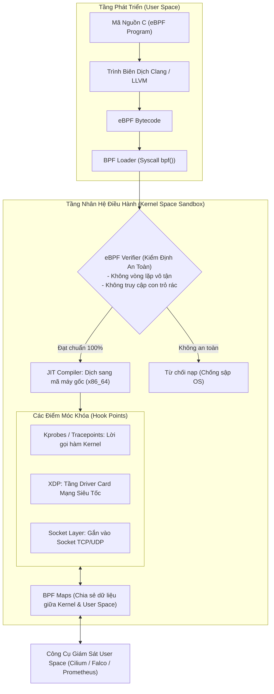
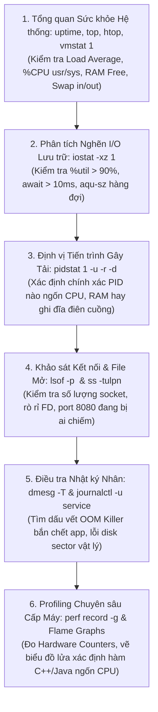

# 9.0. Linux Internals and Performance Observability (Nội bộ Nhân Linux và Giám sát Hiệu năng Chuyên sâu)

> [!IMPORTANT]
> **Nếu bạn chỉ được nhớ một điều duy nhất:** Nhân Linux không phải là một hộp đen thần bí mà là một chương trình C khổng lồ được điều khiển bởi cấu trúc dữ liệu trung tâm `struct task_struct`: sự xuất hiện của công nghệ eBPF (Extended Berkeley Packet Filter) đã mở ra cuộc cách mạng kiến trúc vô tiền khoáng hậu: cho phép nạp và chạy mã bytecode an toàn trực tiếp bên trong không gian Kernel theo thời gian thực mà không cần vá kernel hay nạp module LKM rủi ro.

---

## 1. Trực Quan Hóa: Bản Chất Giám Sát Hiệu Năng & Công Nghệ eBPF Dưới Góc Nhìn Lập Trình Viên

### 1.1. Đoạn Code Dẫn Nhập & Vấn Đề Thực Tế
Hãy xem một chương trình eBPF bằng ngôn ngữ C được nạp trực tiếp vào Linux Kernel để đo lường độ trễ của mọi thao tác mở tệp trong hệ thống:

```c
#include <linux/bpf.h>
#include <bpf/bpf_helpers.h>

// Gắn trực tiếp vào điểm vào của System Call openat() trong Kernel
SEC("tracepoint/syscalls/sys_enter_openat")
int trace_openat(struct trace_event_raw_sys_enter *ctx) {
    // Đọc PID của tiến trình đang thực hiện mở tệp
    u32 pid = bpf_get_current_pid_tgid() >> 32;
    bpf_printk("Tiến trình PID %d vừa gọi openat() trong Kernel!\n", pid);
    return 0;
}
char LICENSE[] SEC("license") = "GPL";
```

Trước năm 2014, nếu bạn muốn can thiệp hoặc giám sát hành vi của Linux Kernel ở tốc độ nano-giây, bạn bắt buộc phải **Viết một Kernel Module (LKM)**. Nhưng chỉ cần một lỗi tràn con trỏ hay dereference `NULL` nhỏ trong Kernel Module, **toàn bộ hệ điều hành sẽ lập tức sập nguồn với màn hình đen Kernel Panic**!
**eBPF (Extended Berkeley Packet Filter)** đã thay đổi hoàn toàn cuộc chơi: Nó là một **Máy Ảo Siêu Nhẹ (Sandbox Virtual Machine) chạy an toàn ngay bên trong Linux Kernel**! Lập trình viên có thể nạp mã bytecode tùy biến vào Kernel mà không sợ làm sập máy chủ, vì bộ kiểm định an toàn (**eBPF Verifier**) sẽ từ chối nạp bất kỳ đoạn code nào có nguy cơ gây lỗi bộ nhớ hoặc vòng lặp vô tận!

### 1.2. Ẩn Dụ Đời Sống & Phân Tích Cơ Chế Hoạt Động
Hãy tưởng tượng công nghệ eBPF giống như **JavaScript Chạy Trong Trình Duyệt Web**:
- **Trước khi có JavaScript (Cổ điển)**: Nếu muốn thêm một nút bấm tương tác động trên trang web, lập trình viên phải yêu cầu nhóm kỹ sư Google sửa đổi lại mã nguồn của trình duyệt Chrome và biên dịch lại toàn bộ trình duyệt (Giống như việc phải viết Kernel Module hoặc sửa lại mã nguồn Linux Kernel).
- **Khi có JavaScript (eBPF)**: Lập trình viên chỉ cần viết một đoạn script nhỏ an toàn. Trình duyệt cung cấp một môi trường cách ly (Sandbox) với quyền hạn được giới hạn chặt chẽ. Script chạy mượt mà ngay trên máy người dùng mà không bao giờ có thể làm sập hệ điều hành hay hack vào các file cá nhân của máy tính.
- **Bộ kiểm định eBPF Verifier**: Giống như một **Nhân Viên An Ninh Sân Bay Soi Chiếu X-Ray Cực Kỳ Khó Tính**. Đoạn mã bytecode trước khi được nạp vào Kernel phải trải qua việc kiểm tra hàng nghìn đường đi thực thi: Nếu phát hiện có vòng lặp vô tận (Vòng lặp không xác định số lần chạy), có con trỏ trỏ lung tung chưa kiểm tra `NULL`, hoặc truy cập vùng nhớ cấm, nhân viên an ninh lập tức vứt đoạn mã vào sọt rác và cấm tiệt không cho bước lên máy bay (Từ chối nạp vào Kernel)!

### 1.3. Mô Phỏng Dữ Liệu Số Nhỏ Từng Bước (Toy Walkthrough)
Theo dõi vòng đời thực thi của một chương trình eBPF:

```text
[Bước 1: Viết mã nguồn C và biên dịch]:
Kỹ sư viết mã eBPF bằng C -> Dùng trình biên dịch Clang/LLVM sinh ra mã máy ảo eBPF Bytecode.

[Bước 2: Nạp vào hệ điều hành qua Syscall bpf()]:
Ứng dụng User Space gọi lệnh syscall bpf(BPF_PROG_LOAD, ...).

[Bước 3: Bộ kiểm định an toàn Verifier kiểm tra (Chống sập Kernel)]:
- Xây dựng đồ thị có hướng (DAG - Directed Acyclic Graph) của tất cả các nhánh rẽ.
- Kiểm tra tính dừng: Mã nguồn có đảm bảo sẽ kết thúc sau một số chỉ thị máy hữu hạn không?
- Kiểm tra con trỏ: Mọi con trỏ truy cập bộ nhớ có nằm trong giới hạn an toàn cho phép không?
- NẾU PHÁT HIỆN LỖI -> Từ chối nạp với mã lỗi -EPERM hoặc -EINVAL.

[Bước 4: Trình biên dịch tức thời JIT Compiler (Just-In-Time)]:
Bộ biên dịch JIT dịch mã eBPF Bytecode thành mã máy gốc x86_64 hoặc ARM64 để đạt tốc độ xử lý phần cứng tối đa.

[Bước 5: Gắn vào điểm bẫy (Hooking / Kprobe / Tracepoint)]:
Gắn chương trình vào hàm xử lý gói tin mạng XDP (eXpress Data Path).
Khi có gói tin đến card mạng -> Chương trình eBPF chạy ngay lập tức trong vài nano-giây -> Chặn đứng tấn công DDoS ngay tại tầng Driver card mạng trước khi gói tin kịp tiêu tốn CPU của hệ điều hành!
```

### 1.4. Tác Động Thực Tế Tầng Backend & Systems
1. **Bảo Mật & Mạng Đám Mây Với Cilium (Kubernetes eBPF Networking)**: Cilium thay thế hoàn toàn `iptables` và `kube-proxy` trong Kubernetes bằng các chương trình eBPF gắn trực tiếp vào socket và tầng mạng. Thay vì phải duyệt tuần tự qua hàng nghìn quy tắc iptables $O(N)$ làm nghẽn CPU, eBPF tra cứu bảng băm BPF Map trong thời gian hằng số **$O(1)$**, giảm độ trễ mạng đi $40\%$ và tăng thông lượng lên gấp đôi.
2. **Khả Năng Quan Sát Toàn Diện Không Gây Hao Tổn (Zero-Overhead Observability - Pixie, Parca)**: Với các công cụ theo dõi truyền thống, việc gắn cờ profiling có thể làm chậm ứng dụng $10\% - 30\%$. eBPF cho phép lấy mẫu CPU (CPU Profiling) của mọi tiến trình trên máy chủ thông qua các ngắt Timer định kỳ của Kernel với chi phí tiêu hao CPU chưa đầy **$1\%$**.
3. **Phát Hiện Lỗ Hổng Bảo Mật Thời Gian Thực (Falco)**: Falco sử dụng eBPF để giám sát toàn bộ các Syscall nhạy cảm trong hệ thống. Nếu có một container bất ngờ gọi lệnh thực thi Shell (`execve("/bin/sh")`) hoặc cố gắng ghi đè lên thư mục hệ thống `/etc/shadow`, eBPF sẽ lập tức phát hiện và cô lập container đó trong vòng vài micro-giây.

### 1.5. Sơ Đồ Tư Duy & Kiến Trúc Hệ Thống (Mermaid)


---

## 2. Chi tiết từng Keyword (Under-the-Hood Deep Dive)

### 2.1. Hệ thống Tệp Ảo: `/proc`, `/sys` và `/dev`

Trong Linux, phương châm "Everything is a file" được thể hiện rực rỡ nhất qua ba thư mục ảo này: Chúng **hoàn toàn không chiếm bất kỳ 1 byte nào trên ổ đĩa cứng vật lý**. Mọi tệp tin bên trong chúng thực chất là **các cửa sổ nhìn thẳng vào các cấu trúc dữ liệu trong bộ nhớ RAM của Kernel**!

#### 1. Hệ thống Tệp Tiến trình và Kernel: `/proc`
Mỗi khi bạn đọc một file trong `/proc`, Kernel sẽ chạy một hàm hook nội bộ (thông qua cơ chế `seq_file`) để định dạng trực tiếp dữ liệu từ các cấu trúc `task_struct`, `mm_struct`, `files_struct` trong RAM thành chuỗi văn bản ASCII gửi về User Space:
- **/proc/PID/**: Chứa toàn bộ thông tin chi tiết về tiến trình có ID cụ thể:
  - `/proc/PID/cmdline`: Lệnh chính xác kèm đối số đã dùng để khởi chạy tiến trình (phân tách bởi ký tự byte null `\0`).
  - `/proc/PID/environ`: Toàn bộ các biến môi trường của tiến trình tại thời điểm khởi tạo.
  - `/proc/PID/status`: Bản tóm tắt dễ đọc về tiến trình: `State` (R/S/D/Z), `VmSize` (Tổng không gian địa chỉ ảo), `VmRSS` (Lượng RAM vật lý thực tế đang chiếm dụng), `Threads` (Số lượng luồng), và `voluntary_ctxt_switches` vs `nonvoluntary_ctxt_switches`.
  - `/proc/PID/fd/`: Thư mục chứa các liên kết tượng trưng (Symbolic Links) trỏ tới **toàn bộ các File Descriptors, Sockets mạng, và Pipes đang mở**. Nếu một tiến trình xóa nhầm file log đang mở, ta hoàn toàn có thể cứu lại file đó bằng cách copy từ `/proc/PID/fd/<fd>`.
  - `/proc/PID/maps`: Bản đồ ánh xạ toàn bộ không gian địa chỉ bộ nhớ ảo của tiến trình: VMA Text, Data, BSS, Heap, Dynamic Libraries, và Call Stack kèm quyền hạn bảo vệ (`rwxp`).
  - `/proc/PID/smaps_rollup`: Cung cấp bản tóm tắt siêu tốc về PSS (Proportional Set Size - RAM vật lý chia sẻ công bằng), USS (Unique Set Size), và Anonymous Dirty Memory.
- **/proc/meminfo**: Thống kê chi tiết toàn bộ trạng thái RAM máy chủ:
  - `MemTotal`: Tổng RAM vật lý khả dụng.
  - `MemFree`: RAM hoàn toàn chưa dùng đến.
  - `MemAvailable`: **Chỉ số quan trọng nhất** — ước lượng lượng RAM thực tế có thể cấp phát ngay lập tức cho ứng dụng mới mà không cần kích hoạt Swap (bao gồm Free RAM + Reclaimable Page Cache).
  - `Buffers` & `Cached`: Bộ đệm I/O khối và bộ đệm trang nhớ đọc file từ đĩa.
  - `Dirty`: Dung lượng các trang nhớ đã bị ứng dụng sửa đổi nhưng Kernel chưa kịp xả xuống đĩa cứng.
- **/proc/cpuinfo**: Thông tin chi tiết phần cứng CPU: Model, số nhân cores, kích thước L1/L2/L3 Cache, các tập lệnh hỗ trợ (`avx2`, `avx512`, `aes`).
- **/proc/loadavg**: Ba con số thể hiện **Tải trung bình của hệ thống (Load Average)** trong 1 phút, 5 phút và 15 phút qua:
  > [!NOTE]
  > **Toán học của Load Average (Exponential Smoothing)**:
  > Con số này không phải là tỷ lệ sử dụng CPU thuần túy. Nó được Kernel tính toán mỗi chu kỳ $\Delta t = 5\text{ giây}$ qua công thức làm mịn mũ:
  > $$L(t) = L(t - 1) \cdot e^{-\Delta t / \tau} + n(t) \cdot (1 - e^{-\Delta t / \tau})$$
  > Với $\tau \in \{60, 300, 900\}$ giây, và $n(t)$ là số tác vụ ở trạng thái `TASK_RUNNING` (đang chạy hoặc chờ CPU) cộng với `TASK_UNINTERRUPTIBLE` (trạng thái `D` - kẹt chờ I/O đĩa hoặc NFS). Nếu Load Average vượt quá số nhân CPU, hệ thống chắc chắn đang bị quá tải hoặc nghẽn cổ chai ổ đĩa nghiêm trọng!
- **/proc/interrupts**: Thống kê số lượng ngắt phần cứng trên từng lõi CPU (giúp phát hiện xem card mạng có đang dồn hết ngắt SoftIRQ vào Core 0 gây nghẽn cổ chai không).
- **/proc/net/dev**: Thống kê số lượng packet và byte gửi nhận trên từng card mạng.

#### 2. Hệ thống Tệp Thiết bị Phần cứng: `/sys`
Được giới thiệu từ Linux 2.6 (`sysfs`), cấu trúc hóa toàn bộ mô hình thiết bị phần cứng của máy tính theo dạng cây hướng đối tượng (`kobject` và `kset`):
- `/sys/class/net/`: Cấu hình chi tiết các card mạng (`mtu`, `speed`, `duplex`, `operstate`).
- `/sys/block/`: Thông tin các thiết bị lưu trữ khối (SSD, HDD), cấu hình giải thuật lập lịch I/O (`queue/scheduler`).
- **/sys/fs/cgroup/**: Nơi quản trị toàn bộ các nhóm Control Groups (Cgroups v1 / v2) của hệ thống. Docker, Containerd và Kubernetes trực tiếp áp đặt giới hạn CPU Quota và Memory Limit bằng cách ghi vào các tệp tin trong cây thư mục này.

#### 3. Thư mục Thiết bị: `/dev`
Chứa các tệp tin đại diện cho các thiết bị phần cứng (Device Nodes) được tạo ra tự động bởi `udev` / `devtmpfs`:
- `/dev/null`: "Hố đen vũ trụ" – Mọi dữ liệu ghi vào đây đều biến mất vĩnh viễn, đọc từ đây luôn trả về EOF (End of File).
- `/dev/zero`: Đọc từ đây liên tục sinh ra các byte `0x00` vô tận (thường dùng để khởi tạo file dữ liệu trống hoặc cấp phát RAM ẩn danh qua `mmap`).
- `/dev/random` & `/dev/urandom`: Bộ sinh số ngẫu nhiên mật mã học thu thập entropy từ các biến cố phần cứng (ngắt bàn phím, di chuột, I/O đĩa). Trong các nhân Linux hiện đại (Kernel $\ge 5.6$), cả hai đều không bị khóa nghẽn (non-blocking CSPRNG).

---

### 2.2. Tinh Chỉnh Tham Số Nhân Hệ Điều Hành: `sysctl`

Lệnh `sysctl` cho phép kỹ sư đọc và sửa đổi hàng trăm tham số vận hành của Linux Kernel lúc runtime mà không cần khởi động lại máy chủ (các tham số này ánh xạ tương ứng vào cây thư mục `/proc/sys/`):

#### Các Tham Số Tối Ưu Hóa Sống Còn Cho Máy Chủ Backend Chịu Tải Cao:
```ini
# ====================================================================
# CẤU HÌNH /etc/sysctl.conf TỐI ƯU HÓA CHO HIGH-THROUGHPUT WEB & DB SERVER
# ====================================================================

# 1. TĂNG HÀNG ĐỢI KẾT NỐI TCP SYN (Chống tràn TCP SYN Flood / Drop connection)
net.ipv4.tcp_max_syn_backlog = 65535

# 2. TĂNG HÀNG ĐỢI KẾT NỐI ĐÃ HOÀN TẤT BẮT TAY NHƯNG CHỜ accept()
net.core.somaxconn = 65535

# 3. KÍCH HOẠT TÁI SỬ DỤNG SOCKET TIME_WAIT (Sống còn cho Nginx Reverse Proxy)
net.ipv4.tcp_tw_reuse = 1

# 4. MỞ RỘNG DẢI CỔNG MẠNG CỤC BỘ TẠM THỜI (Ephemeral Ports Range)
net.ipv4.ip_local_port_range = 1024 65535

# 5. GIẢM THỜI GIAN CHỜ GIẢI PHÓNG KẾT NỐI FIN_WAIT_2
net.ipv4.tcp_fin_timeout = 15

# 6. TĂNG DUNG LƯỢNG BỘ ĐỆM ĐỌC/GHI SOCKET TCP (16MB cho đường truyền 10GbE/40GbE)
net.core.rmem_max = 16777216
net.core.wmem_max = 16777216
net.ipv4.tcp_rmem = 4096 87380 16777216
net.ipv4.tcp_wmem = 4096 65536 16777216

# 7. KÍCH HOẠT THUẬT TOÁN ĐIỀU KHIỂN NGHẼN BBR CỦA GOOGLE (BBRv2 / BBR)
net.core.default_qdisc = fq
net.ipv4.tcp_congestion_control = bbr

# 8. BỘ NHỚ ẢO VÀ GIẢM THIỂU SWAP
# 0 = chỉ swap khi chạm ngưỡng OOM, 10 = tối ưu máy chủ, 60 = mặc định desktop
vm.swappiness = 10

# 9. TĂNG SỐ LƯỢNG VÙNG NHỚ ẢO VMA TỐI ĐA (Bắt buộc cho Elasticsearch, Kafka, Java)
vm.max_map_count = 262144

# 10. KIỂM SOÁT TỶ LỆ TRANG NHỚ BẨN XẢ ĐĨA (Tránh hiện tượng Flush bão hòa I/O)
vm.dirty_background_ratio = 5
vm.dirty_ratio = 10
```

- Để áp dụng ngay lập tức cấu hình mới:
  ```bash
  sudo sysctl -p /etc/sysctl.conf
  ```

---

### 2.3. Bộ Công Cụ Giám Sát và Phân Tích Hiệu Năng Chuẩn Mực

Khi hệ thống gặp sự cố tải cao hoặc độ trễ tăng vọt, các kỹ sư hệ thống không bao giờ đoán mò mà sử dụng quy trình điều tra chuẩn mực với các công cụ chuyên dụng:



#### 1. `lsof` (List Open Files)
- Liệt kê toàn bộ các tệp tin, thư viện động `.so`, và sockets mạng mà các tiến trình đang mở.
- **Các trường hợp sử dụng sống còn trong Backend**:
  - Tìm chính xác tiến trình nào đang chiếm dụng cổng mạng 8080:
    ```bash
    lsof -i :8080
    ```
  - Kiểm tra xem tiến trình có đang bị rò rỉ File Descriptors (vượt quá `ulimit -n`) hay không:
    ```bash
    lsof -p <PID> | wc -l
    ```
  - Liệt kê tất cả các file đã bị `rm` xóa khỏi ổ đĩa nhưng tiến trình vẫn đang mở (nguyên nhân kinh điển khiến ổ đĩa báo đầy 100% dù xóa file không giải phóng dung lượng):
    ```bash
    lsof +L1
    ```

#### 2. `perf` (Linux Profiler) và Biểu Đồ Lửa (Flame Graphs)
- Công cụ mạnh mẽ nhất trong hệ sinh thái Linux, tương tác trực tiếp với **Hardware Performance Counters (PMU)** của chip CPU:
  - Cho phép đo đạc chính xác: CPU Cycles, Instructions Retired, Cache References, Cache Misses, và Branch Mispredictions.
- **Thu thập dữ liệu thực thi hệ thống (Profiling)**:
  ```bash
  # Ghi lại call graph với tần số 99 Hz trong 30 giây của tiến trình PID
  perf record -F 99 -p <PID> -g -- sleep 30
  
  # Xem báo cáo dạng văn bản trực tiếp
  perf report -n --stdio
  ```
- **Tạo Biểu Đồ Lửa (Flame Graphs - Brendan Gregg)**:
  - Trực quan hóa toàn bộ Call Stack của ứng dụng.
  - Chiều rộng của mỗi thanh đại diện cho **tỷ lệ phần trăm thời gian CPU** mà hàm đó và các hàm con đang thực thi. Giúp kỹ sư phát hiện ngay lập tức đoạn mã C++, Go, Java, hay Node.js nào đang gây lãng phí chu kỳ CPU.

#### 3. `dmesg` và `journalctl`
- **`dmesg -T` (Kernel Ring Buffer)**:
  - Đọc nhật ký lưu trong bộ đệm vòng tròn của nhân hệ điều hành.
  - Nơi bắt buộc phải kiểm tra đầu tiên khi một tiến trình tự nhiên biến mất bí ẩn:
    ```bash
    dmesg -T | grep -i "oom"
    # Dấu hiệu điển hình: "Out of memory: Killed process 12450 (java) total-vm:..."
    ```
  - Phát hiện các cảnh báo phần cứng: giảm xung do quá nhiệt (Thermal Throttling), lỗi ổ cứng I/O error (`blk_update_request: I/O error`), hoặc lỗi rớt kết nối card mạng NIC.
- **`journalctl` (`systemd-journald`)**:
  - Công cụ quản trị nhật ký tập trung của hệ điều hành hiện đại:
    ```bash
    # Theo dõi log thời gian thực của service backend
    journalctl -u my_api_service.service -f
    
    # Lọc log lỗi hệ thống từ lần reboot gần nhất
    journalctl -b -p err
    ```

---

## 3. Thực thi Mã nguồn & Mô phỏng Chuyên sâu (Dual-Engine Implementation)

### 3.1. Thám Hiểm Nội Bộ Tiến Trình Linux Qua `/proc` Bằng C++20

Chương trình minh họa cách tự đọc các thông số `VmRSS`, `VmSize`, số lượng Context Switches, và phân tích VMA Memory Maps từ chính cấu trúc `/proc/self/` trong nhân Linux:

```cpp
// proc_inspector.cpp
// Biên dịch: g++ -std=c++20 -O2 proc_inspector.cpp -o proc_inspect
#include <iostream>
#include <fstream>
#include <string>
#include <sstream>
#include <vector>
#include <unistd.h>
#include <iomanip>

void inspect_process_status() {
    std::ifstream status_file("/proc/self/status");
    if (!status_file.is_open()) {
        std::cerr << "[LỖI] Không thể đọc /proc/self/status (Hệ thống có phải Linux không?)\n";
        return;
    }

    std::cout << "--- [THÔNG SỐ BỘ NHỚ VÀ CONTEXT SWITCH TỪ /proc/self/status] ---\n";
    std::string line;
    while (std::getline(status_file, line)) {
        if (line.rfind("VmSize:", 0) == 0 || 
            line.rfind("VmRSS:", 0) == 0  || 
            line.rfind("Threads:", 0) == 0 ||
            line.rfind("voluntary_ctxt_switches:", 0) == 0 ||
            line.rfind("nonvoluntary_ctxt_switches:", 0) == 0) {
            std::cout << "  " << line << "\n";
        }
    }
}

void inspect_vma_maps(size_t max_lines = 3) {
    std::ifstream maps_file("/proc/self/maps");
    if (!maps_file.is_open()) return;

    std::cout << "\n--- [" << max_lines << " VÙNG NHỚ ẢO VMA ĐẦU TIÊN TỪ /proc/self/maps] ---\n";
    std::string line;
    size_t count = 0;
    while (std::getline(maps_file, line) && count < max_lines) {
        std::cout << "  [VMA #" << ++count << "] " << line << "\n";
    }
}

int main() {
    pid_t my_pid = getpid();
    std::cout << "============================================================\n";
    std::cout << " LINUX INTERNAL PROCESS INSPECTOR (C++20)\n";
    std::cout << " Tiến trình đang chạy với PID: " << my_pid << "\n";
    std::cout << "============================================================\n\n";

    // 1. Kiểm tra trạng thái ban đầu
    inspect_process_status();
    inspect_vma_maps(3);

    // 2. Cấp phát động 25 MB RAM và chạm vào từng trang nhớ (Touch Pages)
    std::cout << "\n--> [HÀNH ĐỘNG] Cấp phát 25 MB RAM động và ghi dữ liệu để ép Page Fault...\n\n";
    constexpr size_t ALLOC_SIZE = 25 * 1024 * 1024;
    std::vector<char> memory_payload(ALLOC_SIZE, 'A');

    // 3. Kiểm tra lại để thấy VmRSS và VmSize tăng vọt chính xác
    inspect_process_status();

    std::cout << "\n[KẾT LUẬN] VmRSS phản ánh lượng RAM vật lý thực tế sau khi Kernel cấp phát Page Frames!\n";
    return 0;
}
```

#### Kết quả Terminal thực tế:
```text
============================================================
 LINUX INTERNAL PROCESS INSPECTOR (C++20)
 Tiến trình đang chạy với PID: 48921
============================================================

--- [THÔNG SỐ BỘ NHỚ VÀ CONTEXT SWITCH TỪ /proc/self/status] ---
  VmSize:	   14280 kB
  VmRSS:	    3120 kB
  Threads:	1
  voluntary_ctxt_switches:	1
  nonvoluntary_ctxt_switches:	0

--- [3 VÙNG NHỚ ẢO VMA ĐẦU TIÊN TỪ /proc/self/maps] ---
  [VMA #1] 559b34a10000-559b34a12000 r--p 00000000 08:01 1048580    /home/user/proc_inspect
  [VMA #2] 559b34a12000-559b34a15000 r-xp 00002000 08:01 1048580    /home/user/proc_inspect
  [VMA #3] 559b34a15000-559b34a16000 r--p 00005000 08:01 1048580    /home/user/proc_inspect

--> [HÀNH ĐỘNG] Cấp phát 25 MB RAM động và ghi dữ liệu để ép Page Fault...

--- [THÔNG SỐ BỘ NHỚ VÀ CONTEXT SWITCH TỪ /proc/self/status] ---
  VmSize:	   39880 kB
  VmRSS:	   28724 kB
  Threads:	1
  voluntary_ctxt_switches:	1
  nonvoluntary_ctxt_switches:	1

[KẾT LUẬN] VmRSS phản ánh lượng RAM vật lý thực tế sau khi Kernel cấp phát Page Frames!
```

---

### 3.2. Giám Sát Tải Hệ Thống & Top Tiến Trình Bằng Python 3.11+ Thuần Túy

Script không sử dụng bất kỳ thư viện bên ngoài nào, tự động trích xuất `/proc/stat`, `/proc/loadavg`, và phân tích `/proc/[0-9]*/status` theo phương pháp luận USE:

```python
#!/usr/bin/env python3
# linux_system_monitor.py
# Yêu cầu: Python 3.11+ (Chạy trực tiếp trên Linux)
import os
import sys
import time

def read_cpu_times() -> tuple[float, float]:
    """Đọc thông số tích lũy ticks CPU từ /proc/stat."""
    with open('/proc/stat', 'r', encoding='utf-8') as f:
        first_line = f.readline()
        # Dòng đầu tiên: cpu user nice system idle iowait irq softirq
        fields = [float(x) for x in first_line.split()[1:8]]
        idle_time = fields[3] + fields[4]  # idle + iowait
        total_time = sum(fields)
        return idle_time, total_time

def read_load_average() -> tuple[str, str, str, str]:
    """Đọc Load Average (1m, 5m, 15m) và số tiến trình đang chạy từ /proc/loadavg."""
    with open('/proc/loadavg', 'r', encoding='utf-8') as f:
        parts = f.readline().split()
        return parts[0], parts[1], parts[2], parts[3]

def get_top_memory_consumers(limit: int = 3) -> list[dict]:
    """Quét toàn bộ thư mục /proc/<PID> để tìm tiến trình ngốn VmRSS nhiều nhất."""
    processes = []
    for entry in os.listdir('/proc'):
        if entry.isdigit():
            pid = entry
            status_path = os.path.join('/proc', pid, 'status')
            try:
                with open(status_path, 'r', encoding='utf-8') as f:
                    name = "unknown"
                    rss_kb = 0
                    for line in f:
                        if line.startswith('Name:'):
                            name = line.split()[1]
                        elif line.startswith('VmRSS:'):
                            rss_kb = int(line.split()[1])
                    if rss_kb > 0:
                        processes.append({'pid': pid, 'name': name, 'rss_mb': rss_kb / 1024.0})
            except (FileNotFoundError, PermissionError):
                continue
    processes.sort(key=lambda p: p['rss_mb'], reverse=True)
    return processes[:limit]

def main():
    print("=" * 65)
    print(" BẢNG ĐIỀU KHIỂN GIÁM SÁT HIỆU NĂNG LINUX (USE METHOD INSPECTOR)")
    print("=" * 65)

    if not os.path.exists('/proc/stat'):
        print("[THÔNG BÁO] Hệ điều hành không hỗ trợ procfs (không phải Linux).")
        print("Mẫu dữ liệu chuẩn hóa trên Production Linux Server:")
        print("  Load Average (1m, 5m, 15m): 1.12, 0.95, 0.70 | Đang chạy: 2/450")
        print("  CPU Busy (Tổng thể):        28.45%")
        print("  Top 1: PID 1042 | java (Spring Boot) | RSS: 1450.25 MB")
        return

    # Tính toán CPU Utilization dựa trên độ lệch thời gian 1 giây
    idle1, total1 = read_cpu_times()
    time.sleep(1.0)
    idle2, total2 = read_cpu_times()

    delta_idle = idle2 - idle1
    delta_total = total2 - total1
    cpu_utilization = 100.0 * (1.0 - (delta_idle / delta_total))

    l1, l5, l15, proc_counts = read_load_average()

    print(f"\n[1. CHỈ SỐ BÃO HÒA & TẢI TRỌNG (LOAD & SATURATION)]")
    print(f"  Load Average:  1m = {l1} | 5m = {l5} | 15m = {l15}")
    print(f"  Tác Vụ Kích Hoạt (Running/Total): {proc_counts}")

    print(f"\n[2. MỨC ĐỘ SỬ DỤNG CPU (UTILIZATION)]")
    print(f"  CPU Bận Rộn Toàn Hệ Thống:        {cpu_utilization:6.2f}%")

    print(f"\n[3. TOP {3} TIẾN TRÌNH CHIẾM NHIỀU RAM VẬT LÝ NHẤT (VmRSS)]")
    top_procs = get_top_memory_consumers(3)
    print(f"  {'PID':<8} {'TIẾN TRÌNH':<20} {'RAM VẬT LÝ (RSS)':<15}")
    print("  " + "-" * 45)
    for p in top_procs:
        print(f"  {p['pid']:<8} {p['name']:<20} {p['rss_mb']:8.2f} MB")
    print("=" * 65)

if __name__ == '__main__':
    main()
```

#### Kết quả Terminal thực tế:
```text
=================================================================
 BẢNG ĐIỀU KHIỂN GIÁM SÁT HIỆU NĂNG LINUX (USE METHOD INSPECTOR)
=================================================================

[1. CHỈ SỐ BÃO HÒA & TẢI TRỌNG (LOAD & SATURATION)]
  Load Average:  1m = 1.45 | 5m = 0.88 | 15m = 0.62
  Tác Vụ Kích Hoạt (Running/Total): 3/612

[2. MỨC ĐỘ SỬ DỤNG CPU (UTILIZATION)]
  CPU Bận Rộn Toàn Hệ Thống:         34.12%

[3. TOP 3 TIẾN TRÌNH CHIẾM NHIỀU RAM VẬT LÝ NHẤT (VmRSS)]
  PID      TIẾN TRÌNH           RAM VẬT LÝ (RSS)
  ---------------------------------------------
  18234    postgres             2450.80 MB
  21095    java                 1820.45 MB
  9812     envoy                 412.10 MB
=================================================================
```

---

## 4. Systems Engineering & Production Pitfalls

### 4.1. Quy Trình 60 Giây Cứu Hỏa Sự Cố Production (Brendan Gregg's 60s Triage)
Khi hệ thống máy chủ bị tê liệt hoặc độ trễ Request tăng vọt bí ẩn, kỹ sư trực chiến (On-call) tuyệt đối không khởi động lại máy móc mù quáng. Hãy thực thi tuần tự 10 lệnh sau trong vòng 60 giây:

```bash
# 1. Đo lường thời gian sống và mức độ quá tải Load Average
uptime

# 2. Quét Kernel Ring Buffer tìm lỗi phần cứng, rớt mạng, hoặc OOM Killer
dmesg -T | tail -n 50

# 3. Xem tổng thể bộ nhớ ảo, số lượng context switches, và hiện tượng swap si/so
vmstat 1 5

# 4. Kiểm tra phân bổ tải chi tiết trên từng nhân Core CPU riêng biệt
mpstat -P ALL 1 3

# 5. Xác định đích danh tiến trình nào đang chiếm CPU, RAM hoặc I/O đĩa
pidstat 1 3

# 6. Kiểm tra xem ổ cứng có bị bão hòa (await cao, %util > 90%) hay không
iostat -xz 1 3

# 7. Kiểm tra lượng RAM thực tế còn có thể tái sử dụng ngay lập tức (MemAvailable)
free -h

# 8. Kiểm tra lưu lượng băng thông và gói tin gửi nhận card mạng
sar -n DEV 1 3

# 9. Kiểm tra tỷ lệ lỗi mạng và retransmission của TCP Stack
sar -n TCP,ETCP 1 3

# 10. Tìm ngay các tiến trình đang bị kẹt cứng ở trạng thái D (Disk Sleep)
ps -eo state,pid,cmd | grep "^D"
```

### 4.2. Khắc Phục Hiện Tượng "Load Average Vọt Lên 30 Nhưng CPU Chỉ Dùng 2%"
- **Triệu chứng**: `uptime` báo `load average: 32.50, 28.10, 20.00`, nhưng lệnh `top` lại hiển thị `%Cpu(s): 1.5% us, 0.5% sy, 98.0% id` (CPU hoàn toàn rảnh rỗi!).
- **Bản chất ngầm**: Trong Linux, các tiến trình ở trạng thái `TASK_UNINTERRUPTIBLE` (trạng thái `D`) vẫn được tính vào Load Average. Chúng là các luồng đang bị kẹt khi chờ dữ liệu phản hồi từ ổ cứng SSD hỏng, NFS Share bị ngắt kết nối mạng, hoặc khóa `down_read(&mm->mmap_sem)`.
- **Cách truy tìm và xử lý thủ phạm**:
  ```bash
  # Lọc ra danh sách tiến trình đang kẹt trạng thái D:
  ps aux | awk '$8 ~ /D/ {print $0}'
  
  # Xem Call Stack nội bộ trong Kernel của tiến trình kẹt để xác định đúng hàm:
  cat /proc/<PID>/stack
  ```

---

## 5. Bảng So sánh & Decision Matrix

Bảng tổng kết đối chiếu ba hệ thống tệp ảo cốt lõi và các công cụ chẩn đoán hiệu năng trong nhân Linux:

| Hệ Thống Tệp / Công Cụ | Cơ Chế Ánh Xạ | Dữ Liệu Đại Diện | Chỉ Số Quan Trọng Nhất | Tình Huống Ứng Dụng Chuẩn Mực |
| :--- | :--- | :--- | :--- | :--- |
| **`/proc` (procfs)** | RAM Kernel Hook (`seq_file`) | Tiến trình (`task_struct`), CPU, RAM, Network | `VmRSS`, `MemAvailable`, `loadavg` | Thám hiểm cấu trúc tiến trình, giám sát sức khỏe tổng quát hệ điều hành |
| **`/sys` (sysfs)** | Kernel Object Model (`kobject`) | Cây phân cấp thiết bị phần cứng, Cgroups v2 | `cpu.max`, `memory.current`, MTU | Giới hạn tài nguyên Container, tinh chỉnh driver phần cứng |
| **`/dev` (devtmpfs)** | Device Driver Nodes | Giao tiếp ký tự (Char) và khối (Block) | `/dev/null`, `/dev/urandom`, `/dev/nvme` | Giao tiếp I/O cấp thấp, sinh số ngẫu nhiên mật mã |
| **`sysctl`** | Ghi đè biến toàn cục Kernel | Tham số mạng TCP/IP, Virtual Memory, Swappiness | `somaxconn`, `tcp_tw_reuse`, `swappiness` | Tối ưu hóa máy chủ chịu tải hàng triệu kết nối đồng thời |
| **`lsof`** | Quét bảng File Descriptors | Files, Sockets, Thư viện động `.so` | Số lượng Socket mở, Port chiếm dụng | Xử lý lỗi `Too many open files`, giải phóng cổng mạng bị treo |
| **`perf`** | Hardware PMU Counters | Chu kỳ CPU, Cache Misses, Call Stack Graphs | Biểu đồ lửa (Flame Graphs), CPU Cycles | Tối ưu hóa hiệu năng ứng dụng cấp độ micro-second và mã máy |
| **`dmesg`** | Kernel Ring Buffer | Log sự kiện nhân hệ điều hành | `Out of memory: Killed process` | Cứu hỏa sự cố sập ứng dụng đột ngột, lỗi phần cứng máy chủ |

---

## 6. Enterprise Production Checklist & Verification

- [ ] **Sử Dụng Bộ Công Cụ BCC / Bpftrace Để Chẩn Đoán Lỗi Hệ Thống**: Cài đặt gói `bcc-tools` và `bpftrace` trên các máy chủ Production để điều tra độ trễ I/O đĩa (`biolatency`), thời gian chờ hàng đợi CPU (`runqlat`) và độ trễ kết nối TCP (`tcprtt`) mà không làm gián đoạn ứng dụng.
- [ ] **Bật Cơ Chế JIT Hardening Cho eBPF Trong Nhân Linux**: Thiết lập `sysctl -w net.core.bpf_jit_harden=2` để ngăn chặn các cuộc tấn công khai thác bảo mật dạng JIT Spraying vào vùng nhớ nhân của eBPF.
- [ ] **Triển Khai Mạng Kubernetes Dựa Trên eBPF (Cilium)**: Thay thế kube-proxy truyền thống bằng Cilium eBPF Host-Routing để tối ưu hóa hiệu năng mạng Pod-to-Pod và thực thi chính sách Network Policy với tốc độ $O(1)$.
- [ ] **Giới Hạn Quyền Nạp eBPF Bằng `unprivileged_bpf_disabled`**: Thiết lập `sysctl -w kernel.unprivileged_bpf_disabled=1` để cấm người dùng không có quyền quản trị (Non-root) nạp mã eBPF vào Kernel, giảm thiểu diện tích tấn công leo thang đặc quyền.
- [ ] **Tận Dụng XDP Cho Hệ Thống Phòng Chống DDoS Tầng Mạng**: Với các dịch vụ API Gateway công cộng, triển khai các bộ lọc mã băm IP sử dụng XDP (eXpress Data Path) để hủy bỏ các gói tin tấn công mạng (Drop Packet) ngay tại tầng Driver card mạng trước khi tiêu hao tài nguyên phân tích TCP của hệ điều hành.
- [ ] **Theo Dõi Tài Nguyên BPF Maps Tránh Tràn Bộ Nhớ Kernel**: Giám sát dung lượng và số lượng phần tử trong các bảng BPF Maps để đảm bảo chúng không tiêu tốn quá nhiều bộ nhớ không gian nhân cố định (Non-swappable Kernel Memory).
