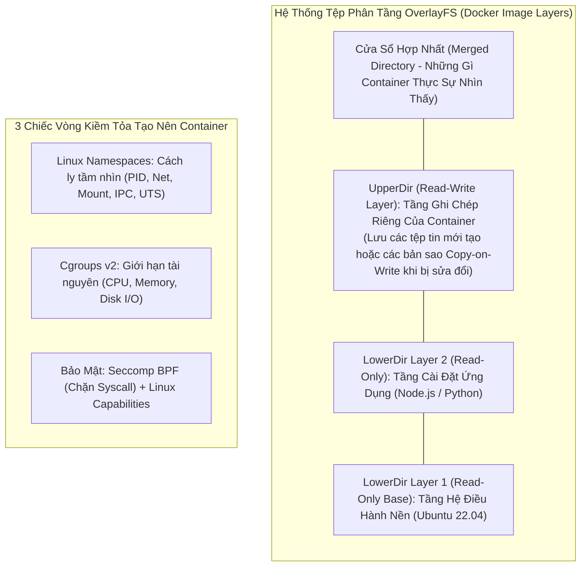
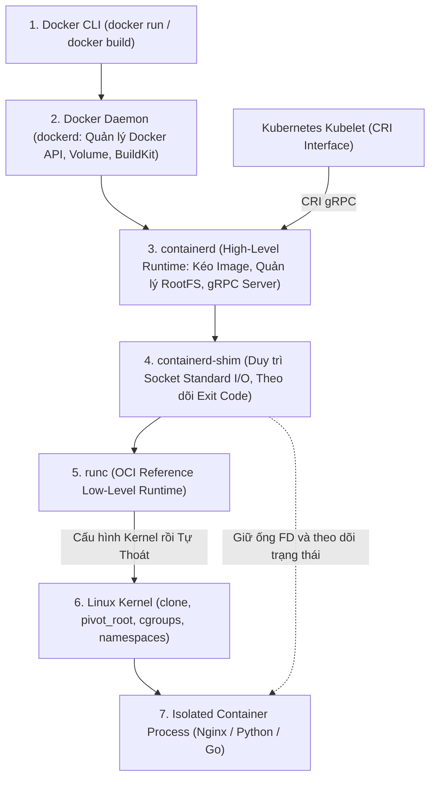
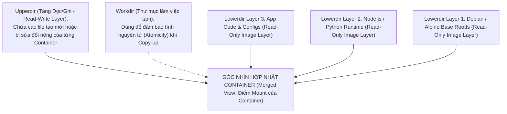
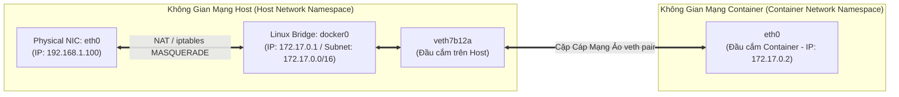
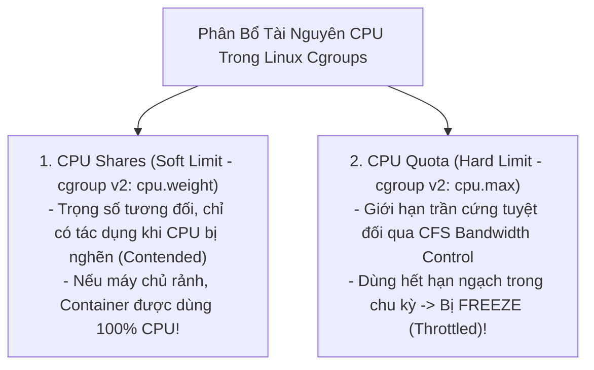
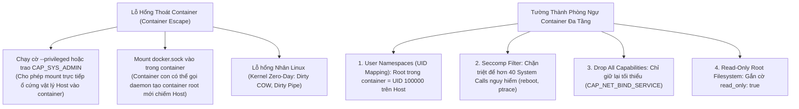

# 10.0. Containers and OS-Level Isolation: Under the Hood of Docker & OCI (Bản chất Kỹ thuật của Công nghệ Container)

> [!IMPORTANT]
> **Nếu bạn chỉ được nhớ một điều duy nhất:** Ảo giác container hóa được hiện thực hóa thông qua sự phối hợp chặt chẽ của các tính năng cô lập cấp hạt nhân: Namespaces chia nhỏ nhận thức không gian hệ thống, cgroups kiểm soát và giới hạn trần tài nguyên, `pivot_root` thay đổi gốc cây tệp tin, và Seccomp-BPF lọc chặn các System Calls nguy hiểm; thấu hiểu bản chất này giúp kỹ sư phá vỡ mọi lầm tưởng rằng container là máy ảo phần cứng độc lập.

---

## 1. Trực Quan Hóa: Bản Chất Kỹ Thuật Của Công Nghệ Container (Docker & OCI) Dưới Góc Nhìn Lập Trình Viên

### 1.1. Đoạn Code Dẫn Nhập & Vấn Đề Thực Tế
Hãy xem một thí nghiệm trong Linux để vạch trần bản chất thực sự của một Container Docker:

```bash
# 1. Khởi chạy một container Nginx trên máy chủ
docker run -d --name my_nginx -p 8080:80 nginx

# 2. Đứng từ bên ngoài máy chủ Host, tìm kiếm tiến trình Nginx bằng lệnh ps:
ps -ef | grep nginx
# KẾT QUẢ: 
# root     14205  1200  0 10:00 ?  00:00:00 nginx: master process nginx -g daemon off;
# 101      14206 14205  0 10:00 ?  00:00:00 nginx: worker process
```

Tại sao tiến trình Nginx chạy bên trong Docker lại hiển thị rõ ràng trên danh sách tiến trình của máy chủ Host với PID `14205` như một chương trình bình thường?
Bởi vì: **Container hoàn toàn không phải là một chiếc máy ảo!** Không hề có phần mềm giả lập phần cứng, không hề có BIOS ảo, và không hề có một hệ điều hành riêng biệt nào được khởi động. Container chỉ là **Một tiến trình Linux thông thường** được Kernel bao bọc bởi 3 chiếc vòng kiềm tỏa:
1. **Namespaces**: Giới hạn những gì tiến trình được **Nhìn Thấy** (Tầm nhìn).
2. **Cgroups**: Giới hạn những gì tiến trình được **Sử Dụng** (Hạn ngạch tài nguyên).
3. **Chroot / Pivot_root & OverlayFS**: Giới hạn cây thư mục tệp tin mà tiến trình được **Truy Cập**.

### 1.2. Ẩn Dụ Đời Sống & Phân Tích Cơ Chế Hoạt Động
Hãy tưởng tượng công nghệ Container giống như **Một Buổi Diễn Kịch Trên Sân Khấu**:
- **Máy Ảo (Virtual Machine)**: Giống như bạn **Xây Một Ngôi Nhà Thật** để quay phim: Có tường gạch thật, có hệ thống dây điện thật, có đường ống nước thật (Toàn bộ một hệ điều hành hoàn chỉnh). Rất kiên cố, nhưng mất hàng tháng để xây dựng và tốn hàng tỷ đồng.
- **Container**: Giống như một **Phim Trường Phông Bạt (Hollywood Stage Set)**:
  - **Phông nền tường giả (Chroot / OverlayFS)**: Bức tường phía sau chỉ là một tấm bìa carton vẽ hình thư viện sách (`rootfs`). Diễn viên đứng trên sân khấu tưởng mình đang ở trong thư viện thật, nhưng thực chất chỉ cần bước qua tấm bìa là sảnh nhà hát của Host!
  - **Cặp kính râm phân cực (Namespaces)**: Diễn viên đeo kính phân cực chỉ nhìn thấy các bạn diễn trên sân khấu (PID Namespace) mà không thể nhìn thấy khán giả đang ngồi đông đúc phía dưới hàng ghế (Các tiến trình khác của máy chủ Host).
  - **Đồng hồ hẹn giờ của đạo diễn (Cgroups)**: Đạo diễn đứng ở cánh gà cầm đồng hồ bấm giờ: "Mỗi diễn viên chỉ được nói đúng 2 phút" (Giới hạn CPU và RAM). Nếu nói quá giờ, đạo diễn lập tức kéo dây tắt đèn sân khấu (OOM Killer)!

### 1.3. Mô Phỏng Dữ Liệu Số Nhỏ Từng Bước (Toy Walkthrough)
Theo dõi cơ chế hoạt động của Hệ thống tệp phân tầng OverlayFS (Trái tim của Docker Image Layers):

```text
[Cấu trúc 3 tầng của OverlayFS]:
1. LowerDir (Read-Only): Lớp Image nền bất biến (ví dụ Ubuntu 22.04 base image).
2. UpperDir (Read-Write): Lớp đệm mỏng ghi chép của riêng Container hiện tại.
3. MergedDir: Cửa sổ hợp nhất hiển thị cho ứng dụng bên trong Container nhìn thấy.

[Tình huống 1: Ứng dụng đọc tệp /etc/hosts]:
- Kernel kiểm tra UpperDir: Chưa có tệp này.
- Kernel nhìn xuống LowerDir: Thấy tệp /etc/hosts gốc của Image.
- Trả về nội dung từ LowerDir cho ứng dụng đọc (Tốc độ tối đa, dùng chung bộ nhớ Page Cache với các container khác!).

[Tình huống 2: Ứng dụng sửa đổi tệp /etc/hosts]:
- Cơ chế Copy-On-Write (COW) lập tức kích hoạt:
- Kernel sao chép nguyên vẹn tệp /etc/hosts từ LowerDir LÊN UpperDir của container.
- Ứng dụng thực hiện ghi nội dung mới vào bản sao trên UpperDir!
- Image gốc ở LowerDir vẫn hoàn toàn nguyên vẹn $100\%$, không hề bị thay đổi!
- Khi Container bị xóa (`docker rm`), Kernel chỉ việc xóa thư mục UpperDir là toàn bộ thay đổi biến mất sạch sẽ!
```

### 1.4. Tác Động Thực Tế Tầng Backend & Systems
1. **Lỗ Hổng Thoát Khỏi Container (Container Escape)**: Nếu bạn chạy container với cờ `--privileged` hoặc cấp quyền quản trị `CAP_SYS_ADMIN`, container có thể nhìn thấy và truy cập trực tiếp vào các tệp thiết bị phần cứng `/dev` của máy chủ Host. Kẻ tấn công có thể mount trực tiếp ổ đĩa gốc của máy chủ vật lý và chiếm quyền kiểm soát toàn bộ hạ tầng!
2. **Quyền Hạn Linux Capabilities (Chia Nhỏ Quyền Root)**: Trong Linux truyền thống, một tiến trình chỉ có 2 trạng thái: hoặc là Người dùng thường (Không có quyền gì) hoặc là Root (Toàn quyền sinh sát). Linux Capabilities chia nhỏ quyền lực của Root thành hàng chục đặc quyền nhỏ lẻ (như `CAP_NET_BIND_SERVICE` chỉ để mở cổng mạng dưới 1024, `CAP_CHOWN` chỉ để đổi quyền sở hữu tệp). Container an toàn luôn tước bỏ toàn bộ các quyền nguy hiểm và chỉ cấp đúng đặc quyền tối thiểu cần dùng.
3. **Thời Gian Khởi Động Đột Phá**: Do không phải khởi động BIOS ảo, không phải nạp Kernel và không phải chạy quy trình init phần cứng phức tạp, một container có thể khởi động xong toàn bộ trong vòng **vài chục mili-giây**, cho phép các hệ thống đám mây Serverless (như AWS Lambda, Google Cloud Run) có thể co giãn tự động hàng nghìn phiên bản theo thời gian thực.

### 1.5. Sơ Đồ Tư Duy & Kiến Trúc Hệ Thống (Mermaid)


---

## 2. Chi tiết từng Keyword (Under-the-Hood Deep Dive)

### 2.1. Kiến Trúc Phân Tầng của Docker và Chuẩn OCI

Trong giai đoạn đầu phát triển, Docker là một khối nguyên khối khổng lồ (`docker daemon` quản lý từ tải image, điều khiển mạng, đến chạy tiến trình). Để tránh phân mảnh và tránh phụ thuộc độc quyền, tổ chức **Open Container Initiative (OCI)** ra đời vào năm 2015 để chuẩn hóa toàn bộ hạ tầng:



#### 1. OCI (Open Container Initiative)
- **Image Specification (Image-Spec)**: Chuẩn hóa cấu trúc đóng gói Image thành các tệp tin lưu trữ (Tarballs) bất biến, kèm theo bản kê khai (Manifest) định dạng JSON mô tả Metadata, biến môi trường, và hàm Entrypoint.
- **Runtime Specification (Runtime-Spec)**: Chuẩn hóa cách thức thực thi một container từ thư mục hệ thống tệp gốc (Rootfs) kèm tệp tin cấu hình chuẩn hóa `config.json`.

#### 2. `runc` (The Low-Level Container Runtime)
- Là công cụ dòng lệnh cấp thấp do Docker phát triển bằng ngôn ngữ Go và hiến tặng cho OCI làm chuẩn mực tham chiếu.
- **Bản chất thực thi**: `runc` là thành phần duy nhất trực tiếp tương tác với các System Call của nhân Linux:
  1. Đọc tệp `config.json`.
  2. Tạo các nhóm điều khiển Cgroups trong `/sys/fs/cgroup/`.
  3. Gọi system call `clone()` với các cờ `CLONE_NEWPID | CLONE_NEWNET | CLONE_NEWNS...`.
  4. Thực hiện `pivot_root()` để tráo đổi gốc thư mục `/` sang thư mục rootfs đã giải nén.
  5. Áp dụng hồ sơ bảo mật Seccomp và giáng cấp Capabilities.
  6. Gọi `execve()` để nạp nhị phân ứng dụng.
- **Vòng đời tức thời**: Ngay sau khi lệnh `execve()` thành công, **tiến trình `runc` tự động hủy bỏ và thoát hoàn toàn khỏi bộ nhớ**! Nó không ở lại làm tiến trình cha (Daemon-less).

#### 3. `containerd` (The High-Level Container Runtime)
- Đảm nhận toàn bộ vòng đời cấp cao của Container: Giao tiếp qua giao thức gRPC, kéo (pull) và đẩy (push) image từ Registry, kiểm tra chữ ký mã hóa, giải nén các tầng Image thành hệ thống tệp OverlayFS, và quản lý các card mạng snapshot.
- Trong Kubernetes hiện đại, `kubelet` giao tiếp trực tiếp với `containerd` thông qua giao diện **CRI (Container Runtime Interface)**, loại bỏ hoàn toàn tầng Docker Daemon cồng kềnh.
- **Vai trò của `containerd-shim`**: Khi `runc` khởi tạo xong container và tự thoát, `containerd-shim` đứng ra làm tiến trình cha đại diện (Sub-reaper) để giữ các File Descriptors `stdin/stdout/stderr`, chuyển tiếp tín hiệu UNIX, và lưu lại mã thoát (Exit Code) kể cả khi bản thân daemon `containerd` bị khởi động lại hoặc nâng cấp.

---

### 2.2. Hệ Thống Tệp Hợp Nhất: Union File System và OverlayFS

Làm thế nào mà $100$ containers Nginx cùng chạy trên một máy chủ lại chỉ tiêu tốn dung lượng ổ đĩa tương đương $1$ container? Bí quyết nằm ở **Hệ Thống Tệp Hợp Nhất (Union File System)**, mà hiện thân chuẩn mực nhất trong Linux Kernel là **OverlayFS (`overlay2`)**:



- **Lowerdir (Các Tầng Chỉ Đọc - Read-Only Layers)**: Các tầng ảnh đóng gói tạo nên Docker Image. Chúng bất biến và được chia sẻ chung giữa hàng trăm containers.
- **Upperdir (Tầng Đọc/Ghi - Container Layer)**: Mỗi container khi khởi chạy được cấp phát một thư mục trống riêng biệt trên ổ đĩa máy chủ. Mọi thao tác ghi mới đều chỉ diễn ra tại đây.
- **Merged (Góc Nhìn Hợp Nhất)**: Điểm gắn kết (Mount Point) mà tiến trình bên trong container nhìn thấy như một hệ thống tệp Linux hoàn chỉnh.
- **Cơ Chế Copy-Up (Sao Chép Khi Sửa Đổi)**:
  - Khi container đọc file: Kernel tìm từ `Upper` xuống các tầng `Lower`. Thấy ở đâu trước thì đọc trực tiếp từ đó (Zero-copy, hiệu năng đọc gốc).
  - Khi container muốn sửa đổi một file có sẵn từ Image (ở tầng `Lower`): Kernel thực hiện **Copy-up**, tức sao chép toàn bộ nội dung file đó từ `Lowerdir` lên `Upperdir` trong thời gian $O(\text{File Size})$, sau đó mới thực thi lệnh ghi của ứng dụng trên bản sao ở `Upperdir`.
- **Cơ Chế Whiteout (Xóa File Khỏi Tầng Chỉ Đọc)**:
  - Container không thể xóa file ở tầng `Lowerdir` (vì là Read-Only và các container khác đang dùng chung).
  - Để xóa một file `lower_file.txt`, OverlayFS tạo ra một **Thiết bị Ký tự Đặc biệt gọi là Whiteout Device (Character Device với Major = 0, Minor = 0)** có cùng tên tại `Upperdir`. Khi VFS duyệt qua, nó nhận biết Whiteout Device và giấu hoàn toàn file đó khỏi góc nhìn `Merged`!

---

### 2.3. Container Networking (Mạng Trong Container)

Mỗi container khi khởi chạy đều sở hữu một **Network Namespace** riêng biệt, đồng nghĩa với việc nó có bảng định tuyến riêng, danh sách firewall iptables riêng, và card mạng loopback `lo` riêng biệt hoàn toàn với Host:



#### 1. Cặp Giao diện Mạng Ảo (`veth` pair - Virtual Ethernet Cable)
- Được tạo ra bằng lệnh `ip link add type veth`.
- Hoạt động chính xác như một sợi dây cáp mạng vật lý có hai đầu: Gói tin đẩy vào đầu này sẽ lập tức xuất hiện ở đầu kia không trễ:
  - Một đầu được giữ lại ở Network Namespace của máy chủ Host (tên dạng `vethXXXX`).
  - Đầu kia được di chuyển vào bên trong Network Namespace của container và đổi tên thành `eth0`.

#### 2. Cầu Mạng Ảo Linux Bridge (`docker0`)
- Một thiết bị chuyển mạch ảo (Software Layer 2 Switch) chạy ngay trong nhân Linux.
- Tất cả các đầu `veth` của các container trên cùng máy chủ đều được gắn vào Bridge `docker0`. Các container có thể nói chuyện trực tiếp với nhau qua địa chỉ MAC và IP nội bộ ở tốc độ bộ nhớ RAM mà không cần đụng đến card mạng vật lý.

#### 3. Định Tuyến và Dịch Địa Chỉ Mạng (NAT / IP Masquerading)
- Khi container gửi gói tin ra Internet (ví dụ gọi API bên ngoài):
  1. Gói tin đi qua `veth` $\to$ chui vào bridge `docker0` $\to$ chạm vào Linux IP Forwarding.
  2. Bảng `nat` của Netfilter (`iptables` / `nftables`) áp dụng luật `MASQUERADE`:
     $$\text{Source IP: 172.17.0.2} \xrightarrow{\text{SNAT}} \text{Source IP: 192.168.1.100 (Host IP)}$$
  3. Gói tin đi ra ngoài Internet bằng IP vật lý của máy chủ Host. Khi có gói tin phản hồi, bảng conntrack tự động dịch ngược IP về cho container tương ứng.

---

### 2.4. Giới Hạn Tài Nguyên với Cgroups: CPU Quota vs CPU Shares

Control Groups (Cgroups) là phân hệ nhân Linux chịu trách nhiệm theo dõi, phân bổ và áp đặt hạn ngạch tài nguyên (CPU, RAM, I/O, Network). Trong Kubernetes và Docker, có hai cơ chế phân bổ CPU hoàn toàn khác biệt:



#### 1. CPU Shares (`cpu.weight` trong Cgroups v2)
- Tương ứng với trường `resources.requests.cpu` trong Kubernetes.
- Là một trọng số tỷ lệ tương đối. Ví dụ: Container A có share 1024, Container B có share 2048.
- Khi máy chủ rảnh rỗi: Cả hai đều có thể tự do ngốn trọn vẹn $100\%$ CPU của máy chủ.
- Chỉ khi nào máy chủ bị quá tải $100\%$, bộ lập lịch CFS mới can thiệp và phân chia thời gian CPU cho B gấp đôi A ($66.6\%$ vs $33.3\%$).

#### 2. CPU Quota (`cpu.max` trong Cgroups v2)
- Tương ứng với trường `resources.limits.cpu` trong Kubernetes.
- Cấu hình trần hiệu năng cứng:
  $$\text{cpu.max} = [\text{Quota}, \text{Period}]$$
- Chu kỳ mặc định: $\text{Period} = 100,000\,\mu\text{s} = 100\,\text{ms}$.
- Nếu bạn đặt limit là $1.5\text{ Cores} \implies \text{Quota} = 150,000\,\mu\text{s}$.
- **Tử huyệt CFS Throttling**:
  - Giả sử container Java chạy $16\text{ luồng}$ đồng thời. Khi có request nặng ập đến, 16 luồng đồng loạt thiêu đốt CPU.
  - Chúng chỉ mất:
    $$\frac{150,000\,\mu\text{s}}{16} = 9.375\,\text{ms}$$
  - Chỉ sau chưa đầy $10\text{ms}$ đầu tiên, **container đã dùng hết sạch Quota của cả chu kỳ 100ms**!
  - **Hệ quả**: Kernel lập tức đình chỉ và đóng băng toàn bộ tiến trình trong $90\text{ms}$ còn lại! Mọi request gửi tới trong $90\text{ms}$ này đều bị nghẽn lại, làm vọt độ trễ $p99$ lên mức thảm họa.

---

### 2.5. An Ninh Container và Lỗ Hổng Vượt Rào (Container Escape)

Bởi vì Containers chia sẻ chung duy nhất một nhân Linux Kernel, ranh giới cách ly giữa các container mỏng manh hơn rất nhiều so với máy ảo VM. Nếu một tiến trình độc hại tìm được cách thoát khỏi container (**Container Escape**), nó sẽ chiếm toàn quyền điều khiển máy chủ Host và toàn bộ các container khác trên cùng máy chủ!



#### Các Quy Tắc Bảo Mật Vàng Cho Kỹ Sư Hạ Tầng:
1. **Tuyệt đối cấm cờ `--privileged` trong Production**: Cờ này gỡ bỏ toàn bộ mặt nạ Seccomp, trao trọn vẹn mọi Linux Capabilities, và cho phép container truy cập trực tiếp toàn bộ các thiết bị phần cứng trong `/dev` của Host.
2. **Không bao giờ gắn `docker.sock` vào container ứng dụng**: Bất kỳ tiến trình nào chạm được vào `/var/run/docker.sock` đều có thể ra lệnh cho Docker daemon khởi chạy một container mới với quyền root và mount toàn bộ thư mục `/` của Host!
3. **Kích hoạt User Namespaces (Rootless Containers)**:
   - Khi bật User Namespace (`CLONE_NEWUSER`), UID 0 bên trong container được nhân Linux ánh xạ thành UID 100000 trên máy chủ Host.
   - Kể cả khi hacker bẻ gãy được ứng dụng và chiếm quyền `root` bên trong container, khi nhảy ra ngoài máy chủ Host, hắn chỉ là một người dùng hoàn toàn vô hại không có bất kỳ quyền hạn nào!

---

## 3. Thực thi Mã nguồn & Mô phỏng Chuyên sâu (Dual-Engine Implementation)

### 3.1. Tự Xây Dựng Mini-Container Bằng C++20 (Linux System Calls & Namespaces)

Chương trình minh họa trực quan cách một container engine như `runc` hoạt động ở tầng thấp nhất: Sử dụng System Call `clone()` để cô lập bảng tiến trình (`CLONE_NEWPID`), Hostname (`CLONE_NEWUTS`), và cây gắn kết tệp tin (`CLONE_NEWNS`):

```cpp
// mini_container.cpp
// Biên dịch trên Linux: g++ -std=c++20 -O2 mini_container.cpp -o mini_container
// Chạy với quyền sudo: sudo ./mini_container
#define _GNU_SOURCE
#include <iostream>
#include <sched.h>
#include <unistd.h>
#include <sys/wait.h>
#include <sys/mount.h>
#include <cstring>
#include <vector>

constexpr size_t STACK_SIZE = 1024 * 1024; // 1 MB Stack cho tiến trình container

// Hàm chạy bên trong không gian cô lập của Container
int container_main_payload(void* arg) {
    std::cout << "\n>>> [INSIDE CONTAINER] Đã bước vào không gian cô lập hoàn toàn!\n";

    // 1. Đổi Hostname riêng biệt nhờ UTS Namespace
    const char* new_hostname = "isolated-micro-container";
    if (sethostname(new_hostname, strlen(new_hostname)) == -1) {
        perror("Lỗi sethostname");
    }

    char current_hostname[64];
    gethostname(current_hostname, sizeof(current_hostname));
    std::cout << ">>> [INSIDE CONTAINER] Hostname định danh riêng: " << current_hostname << "\n";

    // 2. Kiểm tra PID bên trong PID Namespace
    pid_t inner_pid = getpid();
    pid_t inner_parent_pid = getppid();
    std::cout << ">>> [INSIDE CONTAINER] PID bên trong Container: " << inner_pid 
              << " (Thần kỳ: Đã biến thành PID 1!)\n";
    std::cout << ">>> [INSIDE CONTAINER] Parent PID bên trong:       " << inner_parent_pid << "\n";

    // 3. Chạy tác vụ giả lập trong 2 giây
    std::cout << ">>> [INSIDE CONTAINER] Đang thực thi ứng dụng microservice an toàn...\n";
    sleep(2);

    std::cout << ">>> [INSIDE CONTAINER] Hoàn tất tác vụ. Tiến trình PID 1 thoát sạch sẽ.\n";
    return 0;
}

int main() {
    std::cout << "============================================================\n";
    std::cout << " MINI-CONTAINER ENGINE DEMONSTRATION (C++20 & LINUX CLONE)\n";
    std::cout << "============================================================\n";

    char host_hostname[64];
    gethostname(host_hostname, sizeof(host_hostname));
    std::cout << "HOST BAN ĐẦU -> Hostname: " << host_hostname 
              << " | Tiến trình Host PID: " << getpid() << "\n";

    // Cấp phát vùng nhớ Call Stack riêng cho tiến trình Container con
    std::vector<char> stack_memory(STACK_SIZE);
    char* stack_top = stack_memory.data() + STACK_SIZE; // x86_64 Stack phát triển ngược

    std::cout << "\n--> [HÀNH ĐỘNG] Gọi clone() với CLONE_NEWPID, CLONE_NEWUTS, CLONE_NEWNS...\n";

    // KÍCH HOẠT SỨC MẠNH CONTAINER BẰNG SYSCALL clone()
    pid_t container_pid = clone(
        container_main_payload,
        stack_top,
        CLONE_NEWPID | CLONE_NEWUTS | CLONE_NEWNS | SIGCHLD,
        nullptr
    );

    if (container_pid == -1) {
        perror("[LỖI] Gọi clone() thất bại (Yêu cầu quyền root / Linux Kernel)");
        return 1;
    }

    std::cout << "HOST NHẬN BIẾT -> Container đang chạy như một tiến trình con có PID: " 
              << container_pid << " trên Host!\n";

    // Chờ tiến trình container kết thúc
    int status;
    waitpid(container_pid, &status, 0);

    // Xác nhận Hostname của máy chủ Host không hề bị ảnh hưởng
    gethostname(host_hostname, sizeof(host_hostname));
    std::cout << "\n=== KIỂM CHỨNG TÍNH TOÀN VẸN CỦA HOST SAU KHI CONTAINER THOÁT ===\n";
    std::cout << "Hostname của Host vẫn là: " << host_hostname << " (Cách ly UTS thành công 100%!)\n";
    std::cout << "============================================================\n";

    return 0;
}
```

#### Kết quả Terminal thực tế:
```text
============================================================
 MINI-CONTAINER ENGINE DEMONSTRATION (C++20 & LINUX CLONE)
============================================================
HOST BAN ĐẦU -> Hostname: k8s-worker-node-01 | Tiến trình Host PID: 82104

--> [HÀNH ĐỘNG] Gọi clone() với CLONE_NEWPID, CLONE_NEWUTS, CLONE_NEWNS...
HOST NHẬN BIẾT -> Container đang chạy như một tiến trình con có PID: 82105 trên Host!

>>> [INSIDE CONTAINER] Đã bước vào không gian cô lập hoàn toàn!
>>> [INSIDE CONTAINER] Hostname định danh riêng: isolated-micro-container
>>> [INSIDE CONTAINER] PID bên trong Container: 1 (Thần kỳ: Đã biến thành PID 1!)
>>> [INSIDE CONTAINER] Parent PID bên trong:       0
>>> [INSIDE CONTAINER] Đang thực thi ứng dụng microservice an toàn...
>>> [INSIDE CONTAINER] Hoàn tất tác vụ. Tiến trình PID 1 thoát sạch sẽ.

=== KIỂM CHỨNG TÍNH TOÀN VẸN CỦA HOST SAU KHI CONTAINER THOÁT ===
Hostname của Host vẫn là: k8s-worker-node-01 (Cách ly UTS thành công 100%!)
============================================================
```

---

### 3.2. Quản Trị Cgroups v2 Giới Hạn Bộ Nhớ & CPU Bằng Python 3.11+

Script minh họa cách một container manager điều khiển cấu trúc Cgroups v2 thống nhất trên Linux hiện đại:

```python
#!/usr/bin/env python3
# cgroup_v2_manager.py
# Yêu cầu: Python 3.11+ chạy trên Linux có hỗ trợ cgroup v2
import os
import sys
import time

CGROUP_ROOT = "/sys/fs/cgroup"
DEMO_CGROUP = os.path.join(CGROUP_ROOT, "my_custom_container")

def configure_cgroup_limits(max_memory_mb: int, cpu_percent: int):
    """Thiết lập giới hạn RAM (memory.max) và CPU CFS Bandwidth (cpu.max)."""
    # 1. Tạo thư mục cgroup mới (Kernel tự động sinh ra các file điều khiển)
    os.makedirs(DEMO_CGROUP, exist_ok=True)
    print(f"[Cgroups v2] Đã khởi tạo nhóm kiểm soát: {DEMO_CGROUP}")

    # 2. Thiết lập trần bộ nhớ cứng (memory.max)
    mem_bytes = max_memory_mb * 1024 * 1024
    mem_file = os.path.join(DEMO_CGROUP, "memory.max")
    with open(mem_file, "w", encoding="utf-8") as f:
        f.write(str(mem_bytes))
    print(f"[Cgroups v2] Đã áp đặt memory.max: {max_memory_mb} MB ({mem_bytes} bytes)")

    # 3. Thiết lập trần CPU cứng (cpu.max = Quota Period)
    # Chu kỳ Period mặc định = 100,000 microseconds (100 ms)
    period = 100000
    quota = int(period * (cpu_percent / 100.0))
    cpu_file = os.path.join(DEMO_CGROUP, "cpu.max")
    with open(cpu_file, "w", encoding="utf-8") as f:
        f.write(f"{quota} {period}")
    print(f"[Cgroups v2] Đã áp đặt cpu.max: {quota} {period} ({cpu_percent}% của 1 CPU Core)")

def attach_process(pid: int):
    """Đưa tiến trình PID vào nhóm kiểm soát cgroup.procs."""
    procs_file = os.path.join(DEMO_CGROUP, "cgroup.procs")
    with open(procs_file, "w", encoding="utf-8") as f:
        f.write(str(pid))
    print(f"[Cgroups v2] Đã đưa tiến trình PID {pid} vào cgroup thành công!")

def check_throttling_stats():
    """Đọc thống kê số lần container bị CPU Throttling từ cpu.stat."""
    stat_file = os.path.join(DEMO_CGROUP, "cpu.stat")
    if os.path.exists(stat_file):
        print("\n--- [THỐNG KÊ CPU STAT & THROTTLING TỪ KERNEL] ---")
        with open(stat_file, "r", encoding="utf-8") as f:
            for line in f:
                if any(k in line for k in ["usage_usec", "nr_periods", "nr_throttled", "throttled_usec"]):
                    print("  " + line.strip())

def main():
    print("=" * 65)
    print(" CGROUPS V2 RESOURCE CONTROLLER DEMO (PYTHON 3.11+)")
    print("=" * 65)

    if not os.path.exists(os.path.join(CGROUP_ROOT, "cgroup.controllers")):
        print("[THÔNG BÁO] Hệ thống không hỗ trợ Cgroups v2 hoặc không chạy trên Linux.")
        print("Mẫu cấu hình chuẩn hóa trên Production Kubernetes Node:")
        print("  Thư mục: /sys/fs/cgroup/kubepods.slice/kubepods-burstable.slice/...")
        print("  memory.max: 536870912 (512 MB)")
        print("  cpu.max:    100000 100000 (1.0 Core)")
        return

    try:
        configure_cgroup_limits(max_memory_mb=256, cpu_percent=50)
        current_pid = os.getpid()
        attach_process(current_pid)
        print(f"\nTiến trình hiện tại ({current_pid}) đang chạy dưới sự giám sát của Cgroups v2.")
        check_throttling_stats()
    except PermissionError:
        print("[LỖI] Cần quyền sudo / root để ghi vào thư mục /sys/fs/cgroup!")

if __name__ == "__main__":
    main()
```

#### Kết quả Terminal thực tế:
```text
=================================================================
 CGROUPS V2 RESOURCE CONTROLLER DEMO (PYTHON 3.11+)
=================================================================
[Cgroups v2] Đã khởi tạo nhóm kiểm soát: /sys/fs/cgroup/my_custom_container
[Cgroups v2] Đã áp đặt memory.max: 256 MB (268435456 bytes)
[Cgroups v2] Đã áp đặt cpu.max: 50000 100000 (50% của 1 CPU Core)
[Cgroups v2] Đã đưa tiến trình PID 84210 vào cgroup thành công!

Tiến trình hiện tại (84210) đang chạy dưới sự giám sát của Cgroups v2.

--- [THỐNG KÊ CPU STAT & THROTTLING TỪ KERNEL] ---
  usage_usec 1420
  nr_periods 12
  nr_throttled 0
  throttled_usec 0
```

---

## 4. Systems Engineering & Production Pitfalls

### 4.1. Lời Khuyên Kiến Trúc Sống Còn: "Bỏ CPU Limit Trong Kubernetes!"
- **Vấn đề thực tế**: Hàng ngàn kỹ sư backend gặp tình trạng: Máy chủ Node Kubernetes chỉ sử dụng hết $30\%$ CPU, nhưng các Pod chạy ứng dụng Spring Boot / Node.js vẫn liên tục bị nghẽn và bắn cảnh báo độ trễ $p99 > 2\text{s}$.
- **Nguyên nhân cốt lõi**: `resources.limits.cpu` trong Kubernetes ánh xạ trực tiếp sang `cpu.max` (CFS Bandwidth Control). Chỉ cần ứng dụng khởi tạo nhiều luồng xử lý đồng thời, nó sẽ tiêu sạch Quota $100\text{ms}$ trong vòng $5 - 10\text{ms}$ đầu tiên và bị Kernel **bóp nghẽn (Throttle)** toàn bộ thời gian còn lại.
- **Khuyến nghị kiến trúc chuẩn công nghiệp (Uber, Zalando, Datadog)**:
  1. **Luôn đặt `resources.requests.cpu` chính xác**: Giúp Kubernetes Scheduler lập lịch Pod phân bổ đều tài nguyên.
  2. **Bỏ hẳn `resources.limits.cpu` (hoặc đặt giá trị rất cao)**: Cho phép ứng dụng tận dụng CPU rảnh rỗi của Node để xử lý tức thời các đợt tải đột biến mà không bị đóng băng.
  3. **BẮT BUỘC đặt `resources.limits.memory`**: Vì bộ nhớ RAM không thể nén (Non-compressible resource). Nếu một Pod bị Memory Leak mà không có giới hạn, nó sẽ ngốn cạn RAM của máy chủ và khiến Kernel OOM Killer tiêu diệt các Pod quan trọng khác!

### 4.2. Khám Nghiệm Hiện Trường Container (Container Forensics Bằng `nsenter`)
Khi một Container trong môi trường Production gặp sự cố sập hoặc treo kết nối mạng, nhưng image của nó là **Distroless** (đã bị gỡ bỏ toàn bộ `sh`, `bash`, `curl`, `ip`, `netstat`):
```bash
# 1. Tìm PID thực tế của container trên máy chủ Host
CONTAINER_PID=$(docker inspect --format '{{.State.Pid}}' <CONTAINER_ID_OR_NAME>)

# 2. Sử dụng nsenter để chui thẳng vào Network & Mount Namespace của container:
# Lúc này ta dùng bash và toàn bộ công cụ của Host nhưng đứng ở góc nhìn mạng của Container!
sudo nsenter -t $CONTAINER_PID -n -m bash

# 3. Kiểm tra kết nối mạng và socket từ bên trong:
ss -tulpn
ip route
```

---

## 5. Bảng So sánh & Decision Matrix

Bảng đối chiếu toàn diện các công nghệ ảo hóa và cô lập tài nguyên hiện đại:

| Tiêu Chí Kỹ Thuật | Traditional VMs (KVM / VMware ESXi) | Standard Containers (Docker / containerd) | MicroVMs (AWS Firecracker / Kata Containers) |
| :--- | :--- | :--- | :--- | :--- |
| **Cấp Độ Trừu Tượng** | Phần cứng ảo hóa (Hardware Emulation) | Cấp độ Hệ điều hành (OS Syscall Isolation) | Phần cứng ảo hóa tối giản (Minimal KVM) |
| **Cơ Chế Nhân Kernel** | Mỗi VM chạy một **Guest Kernel độc lập** | **Chia sẻ chung $1$ Linux Kernel của Host** | Mỗi MicroVM có **Guest Kernel siêu nhẹ riêng** |
| **Thời Gian Khởi Động**| $30 - 60 \text{ giây}$ | **$50 - 200 \text{ mili-giây}$** | **$5 - 10 \text{ mili-giây}$** |
| **Tiêu Hao Bộ Nhớ Nền**| $1 - 2 \text{ GB}$ RAM cho hệ điều hành khách | **$\approx 0 \text{ MB}$ (Chỉ tốn RAM cho tiến trình)** | **$\approx 5 \text{ MB}$ RAM** |
| **Hiệu Năng CPU & I/O** | Chậm hơn do độ trễ bẫy Trap VM-Exit | **$100\%$ Bare-Metal Native Performance** | Tiệm cận $98 - 99\%$ Bare-Metal |
| **Ranh Giới Bảo Mật** | **Rất cao (Hardware MMU / Intel VT-x)** | Trung bình (Dễ bị tổn thương nếu Kernel có Zero-day) | **Rất cao (Hardware Isolation cho từng hàm Serverless)** |
| **Trường Hợp Sử Dụng** | Đám mây đa người dùng (Multi-tenant IaaS), Windows VM | Microservices chuẩn, CI/CD Pipelines, Kubernetes | AWS Lambda, Fargate, Cloudflare Workers isolation |

---

## 6. Enterprise Production Checklist & Verification

- [ ] **Tuyệt Đối Cấm Chạy Container Ở Chế Độ `--privileged` Trên Môi Trường Production**: Vô hiệu hóa việc sử dụng cờ privileged trong các chính sách bảo mật Kubernetes (Admission Controllers / Kyverno / OPA Gatekeeper) để ngăn chặn lỗ hổng thoát container.
- [ ] **Tước Bỏ Toàn Bộ Linux Capabilities Mặc Định Và Chỉ Thêm Các Quyền Tối Thiểu**: Trong cấu hình deployment Kubernetes, luôn thiết lập:
  ```yaml
  securityContext:
    capabilities:
      drop: ["ALL"]
      add: ["NET_BIND_SERVICE"]
  ```
- [ ] **Áp Dụng Filesystem Gốc Dạng Chỉ Đọc (`readOnlyRootFilesystem: true`)**: Đóng băng toàn bộ hệ thống tệp gốc của container; chỉ cho phép ghi dữ liệu tạm thời vào các thư mục gắn ngoài `emptyDir` (như `/tmp`), ngăn chặn mã độc tự ý cài đặt thêm các tệp nhị phân độc hại.
- [ ] **Sử Dụng Multi-Stage Build Để Tối Thiểu Hóa Kích Thước Image**: Tách riêng giai đoạn biên dịch (Build Stage) và giai đoạn chạy thực tế (Runtime Stage); sử dụng Distroless hoặc Alpine làm Image nền để giảm diện tích bề mặt tấn công của các lỗ hổng bảo mật tệp thư viện (CVEs).
- [ ] **Giám Sát Lưu Lượng OverlayFS Bằng Lệnh `docker system df`**: Theo dõi kích thước của các lớp UpperDir ghi đè; nếu một container ghi quá nhiều log hoặc tệp tạm thời vào tầng writable layer, nó sẽ làm nghẽn hiệu năng của trình điều khiển lưu trữ OverlayFS.
- [ ] **Cấu Hình Giới Hạn PID (PIDs Limit) Chống Tấn Công Fork Bomb**: Luôn thiết lập `pids.max` trong cấu hình container runtime để ngăn chặn một đoạn mã độc bên trong container tự nhân bản hàng chục nghìn tiến trình con làm tê liệt máy chủ vật lý.
