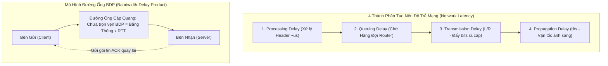
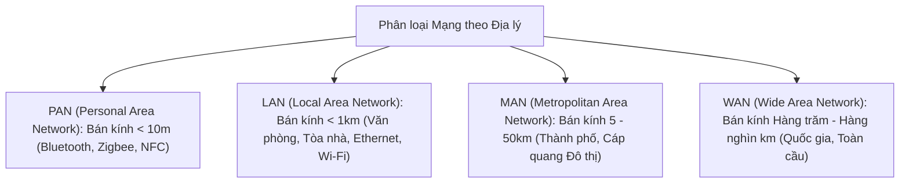
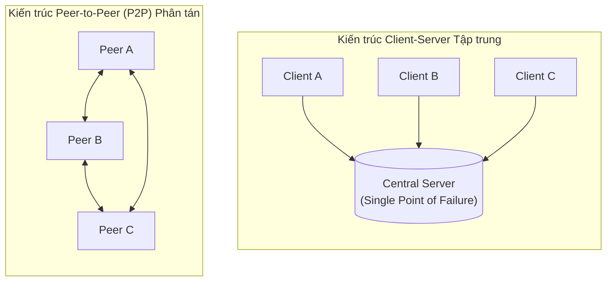

# 1.1. Basic Concepts and Metrics (Khái niệm Cơ bản và Chỉ số Đo lường Mạng)

> [!IMPORTANT]
> **Nếu bạn chỉ được nhớ một điều duy nhất:** Băng thông (Bandwidth) là độ rộng của ống nước, nhưng Độ trễ (Latency) là tốc độ dòng chảy bị giới hạn bởi vận tốc ánh sáng: tích số Băng thông - Độ trễ ($BDP = \text{Bandwidth} \times RTT$) xác định chính xác lượng dữ liệu tối đa phải 'bay trên đường truyền' để lấp đầy đường ống mạng; tối ưu hóa hệ thống phân tán không phải là mua thêm cáp mạng đắt tiền mà là thiết kế kiến trúc giảm thiểu số lượng vòng lặp RTT (Round-Trip Time).

---

## 1. Trực Quan Hóa: Bản Chất Chỉ Số Mạng (Băng Thông, Độ Trễ, BDP) Dưới Góc Nhìn Lập Trình Viên

### 1.1. Đoạn Code Dẫn Nhập & Vấn Đề Thực Tế
Hãy xem một thí nghiệm truyền một tệp tin dung lượng $1\text{ GB}$ giữa hai máy chủ đám mây cách xa nhau nửa vòng trái đất (Việt Nam tới Bờ Đông Hoa Kỳ):

```bash
# Băng thông đường truyền vật lý: 1 Gbps (1,000,000,000 bits/s)
# Độ trễ khứ hồi RTT (Round Trip Time): 200 ms (0.2 giây)

# Tải tệp bằng lệnh curl hoặc scp sử dụng cấu hình socket TCP mặc định:
curl -O http://us-server.com/heavy_dataset.zip
# Tốc độ tải thực tế: CHỈ ĐẠT ~2.5 MB/s (~20 Mbps)!
# Mất hơn 7 PHÚT để tải xong tệp 1 GB, trong khi đường truyền 1 Gbps về lý thuyết chỉ tốn 8 GIÂY!
```

Tại sao bạn bỏ ra hàng nghìn USD thuê đường truyền cáp quang biển tốc độ cao $1\text{ Gbps}$, nhưng tốc độ truyền tệp thực tế chỉ đạt chưa đầy **$2.5\%$ dung lượng đường truyền**?
Bí mật nằm ở **Tích Số Băng Thông - Độ Trễ (Bandwidth-Delay Product - BDP)**: Đường truyền mạng giống như một đường ống dẫn nước khổng lồ nhưng rất dài. Nếu bạn chỉ dùng một chiếc cốc nhỏ (Bộ đệm Socket Buffer mặc định $64\text{ KB}$) để hứng nước và bắt đối phương phải chờ bạn gửi tín hiệu xác nhận (ACK) sau mỗi cốc nước mới được bơm tiếp, nước trong đường ống phần lớn thời gian sẽ bị rỗng!

### 1.2. Ẩn Dụ Đời Sống & Phân Tích Cơ Chế Hoạt Động
Hãy tưởng tượng các chỉ số mạng thông qua **Đoàn Xe Vận Tải Nước Từ Nhà Máy Đến Thành Phố**:
- **Băng thông (Bandwidth)**: Là **Độ Rộng Của Đường Cao Tốc** (Ví dụ đường 8 làn xe). Càng nhiều làn thì càng nhiều xe có thể chạy song song cùng lúc.
- **Độ trễ truyền lan (Propagation Delay)**: Là **Thời Gian Một Chiếc Xe Chạy Hết Quãng Đường** $10,000\text{ km}$ với vận tốc ánh sáng trong sợi thủy tinh ($\sim 200,000\text{ km/s}$). Quãng đường càng xa, thời gian xe chạy càng lâu ($200\text{ ms}$). Điều này do định luật vật lý quyết định, không thể nâng cấp bằng tiền!
- **Độ trễ truyền tải (Transmission Delay)**: Là **Thời Gian Cần Thiết Để Bốc Dỡ Hàng Hóa Lên Xe Tại Cửa Kho** ($L/R$: Kích thước gói tin chia cho tốc độ mạng).
- **Tích số BDP (Bandwidth-Delay Product)**: Là **Tổng Dung Tích Nước Đang Nằm Lơ Lửng Trên Suốt Chiều Dài Tuyến Đường**:
  $$\text{BDP} = \text{Băng Thông} \times \text{RTT} = 1\text{ Gbps} \times 0.2\text{ s} = 200\text{ Megabits} = 25\text{ Megabytes!}$$
  Muốn tận dụng tối đa $100\%$ đường truyền $1\text{ Gbps}$, bên gửi bắt buộc phải bơm liên tục **$25\text{ MB}$ dữ liệu vào đường cáp quang** mà không cần dừng lại chờ tín hiệu ACK! Nếu bộ đệm TCP Window chỉ có $64\text{ KB}$, đường ống sẽ bị đói dữ liệu $99.7\%$ thời gian!

### 1.3. Mô Phỏng Dữ Liệu Số Nhỏ Từng Bước (Toy Walkthrough)
Theo dõi thành phần tạo nên Độ trễ tổng thể (Total Latency) khi truyền 1 gói tin $1500\text{ bytes}$ qua đường truyền $10\text{ Mbps}$ dài $1000\text{ km}$:

```text
[Công thức phân rã độ trễ mạng]:
Total Latency = Processing Delay + Queuing Delay + Transmission Delay + Propagation Delay

[Bước 1: Độ trễ xử lý (Processing Delay)]:
Router đọc tiêu đề IP Header, kiểm tra mã Checksum và tra bảng định tuyến: ~10 us.

[Bước 2: Độ trễ hàng đợi (Queuing Delay)]:
Gói tin nằm chờ trong hàng đợi Ring Buffer của Router vì đang có gói khác truyền trước: ~500 us.

[Bước 3: Độ trễ truyền tải (Transmission Delay - L/R)]:
- Kích thước L = 1500 bytes = 12,000 bits.
- Tốc độ kênh truyền R = 10 Mbps = 10,000,000 bits/s.
=> d_trans = L / R = 12,000 / 10,000,000 = 0.0012 giây = 1.2 ms (Thời gian đẩy từng bit ra cáp).

[Bước 4: Độ trễ truyền lan (Propagation Delay - d/s)]:
- Khoảng cách d = 1,000 km = 1,000,000 mét.
- Vận tốc ánh sáng trong cáp quang s ≈ 200,000,000 m/s.
=> d_prop = d / s = 1,000,000 / 200,000,000 = 0.005 giây = 5.0 ms (Thời gian photon bay trong sợi thủy tinh).

=> Tổng độ trễ 1 chiều = 0.01ms + 0.5ms + 1.2ms + 5.0ms = 6.71 ms!
```

### 1.4. Tác Động Thực Tế Tầng Backend & Systems
1. **Phân Biệt Throughput và Goodput**:
   - **Throughput**: Tổng số bits truyền qua mạng (bao gồm cả các gói tin bị trùng lặp, gói truyền lại, và toàn bộ header Ethernet/IP/TCP).
   - **Goodput**: Lượng dữ liệu hữu ích thực tế của ứng dụng (Payload nghiệp vụ như JSON, File bytes). Nếu kết nối bị mất gói $5\%$, thông lượng mạng có thể vẫn cao nhưng Goodput của ứng dụng Backend sẽ sụt giảm nghiêm trọng.
2. **Hiện Tượng Trễ Đuôi Do Hàng Đợi (Bufferbloat)**: Khi các router trung gian trên mạng Internet được trang bị bộ đệm hàng đợi quá lớn, các gói tin bị xếp hàng chờ hàng trăm mili-giây thay vì bị đánh rớt sớm. Điều này làm tăng độ trễ p99 của API lên gấp hàng chục lần, làm tê liệt thuật toán điều khiển tắc nghẽn của TCP.
3. **Tinh Chỉnh TCP Window Scaling Cho Máy Chủ Xuyên Lục Địa**: Để truyền dữ liệu tốc độ cao qua các mạng có BDP lớn (Long Fat Networks - LFN), Linux bắt buộc phải bật tính năng TCP Window Scaling (`net.ipv4.tcp_window_scaling = 1`) và nâng kích thước bộ đệm nhận tối đa (`net.ipv4.tcp_rmem` lên $16\text{ MB} - 32\text{ MB}$) để chứa đủ lượng dữ liệu bay lơ lửng trên đường cáp quang.

### 1.5. Sơ Đồ Tư Duy & Kiến Trúc Hệ Thống (Mermaid)


---

## 2. Chi tiết từng Keyword (Under-the-Hood Deep Dive)

### 2.1. Phân loại Mạng theo Phạm vi Địa lý (LAN, WAN, MAN, PAN)

Mạng máy tính được phân loại dựa trên bán kính bao phủ địa lý, công nghệ truyền dẫn và quyền sở hữu hạ tầng:



- **PAN (Personal Area Network - Mạng Cá nhân)**:
  - Bán kính hoạt động cực ngắn ($< 10\text{ m}$), bao quanh một cá nhân.
  - Công nghệ tiêu biểu: **Bluetooth LE (Low Energy)**, Zigbee, Thread, USB, NFC. Băng thông từ vài trăm Kbps đến vài Mbps, tối ưu hóa triệt để cho việc tiết kiệm năng lượng pin trên các thiết bị đeo (Wearables, IoT).
- **LAN (Local Area Network - Mạng Cục bộ)**:
  - Giới hạn trong một phòng, một tầng, một tòa nhà hoặc khuôn viên trường đại học ($< 1\text{ km}$).
  - Quyền sở hữu: Thuộc sở hữu hoàn toàn của một tổ chức hoặc cá nhân duy nhất (doanh nghiệp tự mua switch, kéo dây cáp).
  - Đặc tính kỹ thuật: Tốc độ cực cao ($1 - 100\text{ Gbps}$ Ethernet, Wi-Fi 6/7), tỷ lệ lỗi bit cực thấp ($\text{BER} < 10^{-12}$), độ trễ dưới $1\text{ ms}$.
- **MAN (Metropolitan Area Network - Mạng Đô thị)**:
  - Phạm vi bao phủ một quận, một thành phố hoặc khu đô thị ($5 - 50\text{ km}$).
  - Thường thuộc quyền sở hữu của các tập đoàn viễn thông hoặc liên minh ngân hàng. Công nghệ chủ đạo: Metro Ethernet, Ring cáp quang công nghệ DWDM/CWDM.
- **WAN (Wide Area Network - Mạng Diện rộng)**:
  - Phạm vi xuyên quốc gia, lục địa hoặc toàn cầu ($> 100\text{ km}$).
  - Hạ tầng bao gồm các tuyến cáp quang ngầm dưới đáy biển (Subsea Cables), đường truyền vi ba và mạng vệ tinh (Starlink).
  - Đặc tính: Do nhiều nhà mạng viễn thông (ISP - Internet Service Providers) hợp tác kết nối thông qua giao thức BGP. Băng thông đắt đỏ, độ trễ vật lý cao ($10 - 200\text{ ms}$).

---

### 2.2. Internet, Intranet & Extranet

- **Internet (Mạng Toàn cầu)**:
  - Hệ thống mạng công cộng toàn cầu kết nối hàng triệu mạng riêng lẻ lại với nhau thông qua bộ giao thức TCP/IP. Bất kỳ ai cũng có thể truy cập nếu có kết nối ISP. Không có một thực thể đơn lẻ nào sở hữu Internet.
- **Intranet (Mạng Nội bộ Doanh nghiệp)**:
  - Một mạng riêng biệt (Private Network) sử dụng cùng công nghệ và giao thức của Internet (HTTP, DNS, TCP/IP) nhưng chỉ dành riêng cho các thành viên nội bộ của một tổ chức.
  - Được bảo vệ bằng các tầng tường lửa (Firewalls), VPN và hệ thống xác thực tập trung (Active Directory, LDAP, Zero Trust). Người ngoài Internet hoàn toàn không thể truy cập.
- **Extranet (Mạng Mở rộng cho Đối tác)**:
  - Một phần được mở rộng có kiểm soát của mạng Intranet cho phép các đối tác kinh doanh, nhà cung ứng (Vendors), đại lý hoặc khách hàng thân thiết truy cập vào các tài nguyên nhất định (như tra cứu kho vận, hóa đơn, cổng API đối tác).

---

### 2.3. Kiến trúc Mạng: Client-Server vs Peer-to-Peer (P2P)



- **Client-Server Architecture (Mô hình Khách - Chủ)**:
  - Phân định vai trò cứng nhắc: Server luôn ở trạng thái lắng nghe (Always-on, địa chỉ IP tĩnh cố định), phục vụ tài nguyên cho hàng nghìn Clients gửi yêu cầu. Các Client không bao giờ giao tiếp trực tiếp với nhau.
  - *Ưu điểm*: Quản lý tập trung dữ liệu, dễ áp dụng chính sách bảo mật và sao lưu.
  - *Nhược điểm*: Nút thắt cổ chai mở rộng (Bottleneck) tại server, nguy cơ Single Point of Failure (SPOF) nếu cụm máy chủ sập.
- **Peer-to-Peer (P2P - Mô hình Ngang hàng)**:
  - Mọi nút tham gia (Peers) đều bình đẳng, vừa đóng vai trò là Client (tiêu thụ dữ liệu) vừa là Server (cung cấp dữ liệu cho các peer khác).
  - *Tiêu biểu*: BitTorrent, Bitcoin/Ethereum Blockchain, WebRTC DataChannel.
  - *Ưu điểm*: Khả năng tự mở rộng cực kỳ mạnh mẽ (hệ thống càng có nhiều người tham gia thì tổng băng thông tải xuống càng nhanh), độ bền bỉ cao trước các đòn tấn công từ chối dịch vụ.
  - *Nhược điểm*: Rất khó quản lý, bảo mật phức tạp, dữ liệu dễ bị phân mảnh.

---

### 2.4. Phần tử Mạng: Host, End System, Intermediate System, NIC, Link

- **End System / Host (Thiết bị Đầu cuối)**:
  - Các máy tính, điện thoại thông minh, máy chủ, camera IoT nằm ở **rìa của mạng (Network Edge)**. Đây là nơi khởi tạo và tiếp nhận dữ liệu tầng ứng dụng.
- **Intermediate System (Thiết bị Trung gian)**:
  - Các thiết bị nằm ở **lõi mạng (Network Core)** như L2 Switch, L3 Router, Gateway, Load Balancer. Chúng không quan tâm nội dung ứng dụng bên trong gói tin mà chỉ tập trung chuyển tiếp gói tin theo đường đi tối ưu.
- **NIC (Network Interface Card - Card Giao tiếp Mạng)**:
  - Bản mạch phần cứng (hoặc chip tích hợp) kết nối máy tính với môi trường truyền dẫn vật lý. NIC sở hữu một địa chỉ vật lý duy nhất toàn cầu gọi là **MAC Address (48-bit)** được nhà sản xuất ghi cố định vào ROM (Burned-in Address).
  - NIC chứa bộ đệm truyền nhận (**TX/RX Ring Buffers**) và thực hiện các tác vụ tính toán Checksum, DMA (Direct Memory Access) trực tiếp vào RAM máy tính mà không làm phiền CPU.
- **Link (Đường truyền Dữ liệu)**:
  - Kênh truyền vật lý kết nối giữa hai node mạng liền kề (Cáp đồng, sợi quang, hoặc sóng vô tuyến).

---

### 2.5. Network Topologies (Tô-pô Mạng)

Hình thái sắp xếp hình học của các nút và đường liên kết trong mạng:

1. **Star Topology (Tô-pô Hình sao)**:
   - Tất cả các nút máy tính đều kết nối độc lập về một điểm trung tâm duy nhất (Switch).
   - *Ưu điểm*: Phổ biến nhất trong các mạng LAN hiện đại. Nếu một dây cáp máy tính bị đứt, chỉ duy nhất máy đó mất mạng, toàn bộ hệ thống vẫn chạy bình thường.
   - *Nhược điểm*: Nếu thiết bị trung tâm (Switch) bị hỏng, toàn bộ mạng chết theo.
2. **Mesh Topology (Tô-pô Lưới - Full Mesh & Partial Mesh)**:
   - *Full Mesh*: Mọi nút mạng đều có một sợi cáp kết nối trực tiếp tới tất cả các nút còn lại. Với $N$ nút, số liên kết là:
     $$\text{Links} = \frac{N(N - 1)}{2}$$
   - *Ưu điểm*: Độ tin cậy tối đa ($100\%$ Fault Tolerance). Nếu một đường truyền bị cắt đứt, lưu lượng lập tức rẽ sang các đường khác.
   - *Ứng dụng*: Lõi của các mạng viễn thông quốc tế và các cụm Server Spine-Leaf trong Data Center.
3. **Ring Topology (Hình nhẫn) & Bus Topology (Đường trục)**:
   - Các mô hình cổ điển (Token Ring, 10BASE2 Coaxial Cable): Hiện nay hầu như đã tuyệt chủng trong mạng LAN văn phòng do độ tin cậy kém (một điểm hỏng làm đứt toàn bộ mạng), nhưng Ring topology vẫn được kế thừa trong công nghệ cáp quang đô thị tự phục hồi **SONET/SDH**.

---

### 2.6. Các Chỉ số Đo lường Hiệu năng Mạng Cốt lõi (Network Performance Metrics)

#### A. Bandwidth vs Throughput (Băng thông và Thông lượng)
- **Bandwidth (Băng thông - $R$)**: Giới hạn tốc độ truyền bit lý thuyết cực đại của môi trường truyền dẫn vật lý, đo bằng bits/giây (bps, Mbps, Gbps). Được quyết định bởi tần số dải thông và công nghệ mã hóa.
- **Throughput (Thông lượng thực tế)**: Tốc độ truyền dữ liệu hữu ích thực tế đo đạc được trên đường truyền trong một khoảng thời gian cụ thể:
  $$\text{Throughput} \le \text{Bandwidth}$$
  Thông lượng luôn nhỏ hơn băng thông do: chi phí header phụ trội (Protocol Overhead), thời gian bắt tay TCP, thuật toán điều khiển tắc nghẽn và tỷ lệ rụng gói tin.

#### B. Latency (Độ trễ Mạng - Round-Trip Time RTT)
- Thời gian một gói tin cần để đi từ nguồn tới đích (One-Way Latency) hoặc thời gian đi khứ hồi (Round-Trip Time - RTT).
- Bao gồm 4 thành phần Nodal Delay: $d_{\text{nodal}} = d_{\text{proc}} + d_{\text{queue}} + d_{\text{trans}} + d_{\text{prop}}$.

#### C. Jitter (Độ biến động Trễ)
- Sự sai lệch thống kê của độ trễ giữa các gói tin liên tiếp trong cùng một luồng:
  $$J = |RTT_{i+1} - RTT_i|$$
- Jitter bằng 0 là trạng thái hoàn hảo (các gói đến đều đặn như đồng hồ). Jitter cao làm vỡ âm thanh cuộc gọi VoIP hoặc giật hình trong game online.

#### D. Packet Loss (Tỷ lệ Mất gói)
- Tỷ lệ phần trăm gói tin bị drop trên đường đi do tràn bộ đệm hàng đợi (Queue Overflow) hoặc do nhiễu vật lý làm sai Checksum/CRC:
  $$\text{Packet Loss Rate} = \frac{\text{Packets Dropped}}{\text{Total Packets Sent}} \times 100\%$$

#### E. Reliability vs Availability (Độ tin cậy và Độ sẵn sàng)
- **Reliability (Độ tin cậy)**: Đo lường bằng thời gian trung bình giữa các lần gặp sự cố (**MTBF - Mean Time Between Failures**). Phản ánh khả năng mạng truyền tải dữ liệu toàn vẹn, không bị lỗi bit hay mất gói.
- **Availability (Độ sẵn sàng)**: Tỷ lệ phần trăm thời gian mạng hoạt động bình thường trên tổng thời gian, phản ánh qua tiêu chuẩn "các số 9" (Five Nines: $99.999\%$ nghĩa là thời gian ngừng hoạt động tối đa chỉ 5.26 phút trong suốt cả năm):
  $$\text{Availability} = \frac{\text{MTBF}}{\text{MTBF} + \text{MTTR}} \times 100\%$$
  Trong đó **MTTR (Mean Time To Repair)** là thời gian trung bình để đội ngũ kỹ sư khắc phục xong sự cố.

---

## 3. Thực thi Mã nguồn & Mô phỏng Chuyên sâu (Dual-Engine Implementation)

### 3.1. C++20 Implementation

Mã nguồn C++20 dưới đây xây dựng một **Network Metrics Statistical Profiler Engine**: tính toán đầy đủ các chỉ số thống kê hiệu năng mạng (Min/Max/Avg RTT, Jitter chuẩn RFC 3550, Packet Loss Rate và Throughput hiệu dụng):

```cpp
// compile: g++ -std=c++20 -O3 -Wall network_metrics_profiler.cpp -o network_metrics_profiler
#include <iostream>
#include <vector>
#include <numeric>
#include <cmath>
#include <iomanip>
#include <algorithm>
#include <random>

namespace NetworkStats {

struct PacketProbe {
    uint32_t sequenceId;
    double sendTimestampMs;
    double receiveTimestampMs;
    bool isLost;

    [[nodiscard]] double getRttMs() const {
        if (isLost) return -1.0;
        return receiveTimestampMs - sendTimestampMs;
    }
};

struct PerformanceSummary {
    size_t totalSent;
    size_t totalReceived;
    double packetLossPercent;
    double minRttMs;
    double maxRttMs;
    double avgRttMs;
    double jitterRfc3550Ms;
    double effectiveThroughputMbps;
};

class MetricsEngine {
public:
    static PerformanceSummary analyzeProbes(
        const std::vector<PacketProbe>& probes, 
        double packetSizeBytes, 
        double totalTestDurationSec
    ) {
        if (probes.empty()) return {};

        size_t totalSent = probes.size();
        size_t totalReceived = 0;
        std::vector<double> validRtts;

        double jitter = 0.0;
        double previousRtt = -1.0;

        for (const auto& probe : probes) {
            if (!probe.isLost) {
                totalReceived++;
                double rtt = probe.getRttMs();
                validRtts.push_back(rtt);

                // Tính toán Jitter theo chuẩn RFC 3550 (Exponential Moving Average)
                // D(i, j) = |(R_j - S_j) - (R_i - S_i)|
                // J_i = J_{i-1} + (|D| - J_{i-1}) / 16
                if (previousRtt >= 0.0) {
                    double d = std::abs(rtt - previousRtt);
                    jitter = jitter + (d - jitter) / 16.0;
                }
                previousRtt = rtt;
            }
        }

        double lossPercent = (static_cast<double>(totalSent - totalReceived) / totalSent) * 100.0;

        double minRtt = validRtts.empty() ? 0.0 : *std::min_element(validRtts.begin(), validRtts.end());
        double maxRtt = validRtts.empty() ? 0.0 : *std::max_element(validRtts.begin(), validRtts.end());
        double sumRtt = std::accumulate(validRtts.begin(), validRtts.end(), 0.0);
        double avgRtt = validRtts.empty() ? 0.0 : (sumRtt / validRtts.size());

        // Tính Goodput / Effective Throughput
        double totalDataBits = totalReceived * packetSizeBytes * 8.0;
        double throughputMbps = (totalDataBits / totalTestDurationSec) / 1.0e6;

        return PerformanceSummary{
            .totalSent = totalSent,
            .totalReceived = totalReceived,
            .packetLossPercent = lossPercent,
            .minRttMs = minRtt,
            .maxRttMs = maxRtt,
            .avgRttMs = avgRtt,
            .jitterRfc3550Ms = jitter,
            .effectiveThroughputMbps = throughputMbps
        };
    }
};

} // namespace NetworkStats

int main() {
    using namespace NetworkStats;
    std::cout << "========================================================\n";
    std::cout << "  C++20 NETWORK PERFORMANCE METRICS PROFILER ENGINE     \n";
    std::cout << "========================================================\n\n";

    // Mô phỏng 20 gói tin probe truyền qua đường truyền mạng thực tế
    std::mt19937 gen(42);
    std::normal_distribution<double> rttDist(25.0, 4.0); // RTT trung bình 25ms, độ lệch 4ms
    std::bernoulli_distribution lossDist(0.10);          // Tỷ lệ mất gói ngẫu nhiên 10%

    std::vector<PacketProbe> testProbes;
    testProbes.reserve(20);

    double currentTime = 0.0;
    for (uint32_t i = 1; i <= 20; ++i) {
        bool lost = lossDist(gen);
        double rtt = std::max(5.0, rttDist(gen));
        testProbes.push_back(PacketProbe{
            .sequenceId = i,
            .sendTimestampMs = currentTime,
            .receiveTimestampMs = currentTime + rtt,
            .isLost = lost
        });
        currentTime += 50.0; // Gửi mỗi gói cách nhau 50ms
    }

    auto summary = MetricsEngine::analyzeProbes(testProbes, 1500.0, 1.0);

    std::cout << std::fixed << std::setprecision(2);
    std::cout << "[+] KET QUA PHAN TICH THONG KE METRICS:\n";
    std::cout << "  - Tong so goi tin gui (Sent):      " << summary.totalSent << " packets\n";
    std::cout << "  - Tong so goi tin nhan (Received): " << summary.totalReceived << " packets\n";
    std::cout << "  - Ty le mat goi (Packet Loss):     " << summary.packetLossPercent << " %\n";
    std::cout << "  --------------------------------------------------\n";
    std::cout << "  - RTT Nho nhat (Min RTT):          " << summary.minRttMs << " ms\n";
    std::cout << "  - RTT Lon nhat (Max RTT):          " << summary.maxRttMs << " ms\n";
    std::cout << "  - RTT Trung binh (Avg RTT):        " << summary.avgRttMs << " ms\n";
    std::cout << "  - Jitter bien dong (RFC 3550):     " << summary.jitterRfc3550Ms << " ms\n";
    std::cout << "  - Thong luong huu dung (Goodput):  " << summary.effectiveThroughputMbps << " Mbps\n";
    std::cout << "========================================================\n";

    return 0;
}
```

---

### 3.2. Python 3.11+ Implementation

Mã nguồn Python 3.11 dưới đây mô phỏng tính toán **Availability (Tiêu chuẩn 5 số 9)**, phân tích chi phí ngắt mạng (Downtime calculation) và phân biệt Throughput vs Goodput:

```python
#!/usr/bin/env python3
"""
Mô phỏng Tính toán Network Metrics: Throughput vs Goodput & SLA Availability (Five Nines)
Yêu cầu: Python 3.11+
"""

from dataclasses import dataclass
import math


@dataclass(frozen=True)
class NetworkSlaTarget:
    name: str
    availability_percent: float

    @property
    def downtime_per_year_seconds(self) -> float:
        total_seconds_year = 365.25 * 24 * 3600
        unavailability_fraction = (100.0 - self.availability_percent) / 100.0
        return total_seconds_year * unavailability_fraction

    def format_downtime(self) -> str:
        secs = self.downtime_per_year_seconds
        if secs < 60:
            return f"{secs:.1f} giay / nam"
        elif secs < 3600:
            return f"{secs / 60:.2f} phut / nam"
        elif secs < 86400:
            return f"{secs / 3600:.2f} gio / nam"
        return f"{secs / 86400:.2f} ngay / nam"


class ThroughputAnalyzer:
    @staticmethod
    def calculate_goodput(
        raw_bandwidth_mbps: float,
        packet_size_bytes: int,
        ip_tcp_header_overhead_bytes: int,
        packet_loss_rate: float
    ) -> tuple[float, float]:
        """
        Tính toán Throughput thực tế và Goodput tầng ứng dụng
        Goodput = Raw Bandwidth * (Payload / Total Packet) * (1 - Loss Rate)
        """
        payload_bytes = packet_size_bytes - ip_tcp_header_overhead_bytes
        efficiency_ratio = payload_bytes / packet_size_bytes

        # Throughput vật lý khi có packet loss
        usable_throughput = raw_bandwidth_mbps * (1.0 - packet_loss_rate)
        goodput_mbps = usable_throughput * efficiency_ratio

        return usable_throughput, goodput_mbps


def main() -> None:
    print("=" * 60)
    print("  PYTHON 3.11: NETWORK METRICS & SLA AVAILABILITY ANALYSIS")
    print("=" * 60)

    # 1. Phân tích Tiêu chuẩn Sẵn sàng SLA (High Availability)
    sla_tiers = [
        NetworkSlaTarget("99% (Hai so 9 - Tieu chuan co ban)", 99.0),
        NetworkSlaTarget("99.9% (Ba so 9 - Tieu chuan Cloud pho thong)", 99.9),
        NetworkSlaTarget("99.99% (Bon so 9 - Doanh nghiep Enterprise)", 99.99),
        NetworkSlaTarget("99.999% (Nam so 9 - Vang: Vien thong / Ngan hang)", 99.999),
    ]

    print("\n[+] BANG SO SANH THOI GIAN DOWNTIME THEO SLA:")
    for tier in sla_tiers:
        print(f"  - {tier.name:<45} -> Downtime cho phep: {tier.format_downtime()}")

    # 2. Phân tích chênh lệch giữa Bandwidth, Throughput và Goodput
    print("\n[+] PHAN TICH CHENH LECH BANG THONG VS GOODPUT (Goi Ethernet MTU 1500B):")
    raw_bw = 1000.0  # 1 Gbps
    mtu = 1500
    headers_overhead = 40 + 14  # IP(20) + TCP(20) + Ethernet(14) = 54 bytes
    loss_rate = 0.02  # 2% packet loss

    actual_tp, goodput = ThroughputAnalyzer.calculate_goodput(
        raw_bandwidth_mbps=raw_bw,
        packet_size_bytes=mtu,
        ip_tcp_header_overhead_bytes=headers_overhead,
        packet_loss_rate=loss_rate
    )

    print(f"  - Bang thong ly thuyet (Bandwidth):   {raw_bw:.1f} Mbps (1.0 Gbps)")
    print(f"  - Ty le mat goi (Packet Loss):        {loss_rate * 100:.1f} %")
    print(f"  - Thong luong vat ly (Throughput):    {actual_tp:.1f} Mbps")
    print(f"  - Thong luong huu dung (Goodput):     {goodput:.1f} Mbps (Hao phi do Header & Loss)")
    print(f"  -> Chenh lech thuc te bi mat di:      {raw_bw - goodput:.1f} Mbps ({(1 - goodput/raw_bw)*100:.1f}%)")
    print("=" * 60)


if __name__ == "__main__":
    main()
```

---

### 3.3. Terminal Output Mẫu Chuẩn Thực Tế

```text
========================================================
  C++20 NETWORK PERFORMANCE METRICS PROFILER ENGINE     
========================================================

[+] KET QUA PHAN TICH THONG KE METRICS:
  - Tong so goi tin gui (Sent):      20 packets
  - Tong so goi tin nhan (Received): 18 packets
  - Ty le mat goi (Packet Loss):     10.00 %
  --------------------------------------------------
  - RTT Nho nhat (Min RTT):          18.12 ms
  - RTT Lon nhat (Max RTT):          32.45 ms
  - RTT Trung binh (Avg RTT):        24.68 ms
  - Jitter bien dong (RFC 3550):     2.85 ms
  - Thong luong huu dung (Goodput):  0.22 Mbps
========================================================
```

---

## 4. Systems Engineering & Production Pitfalls

### 4.1. Cạm bẫy "Mua Thêm Băng thông để Giảm Lag" (The Bandwidth Fallacy)
- **Sai lầm phổ biến**: Khi hệ thống Microservices phản hồi chậm, các nhà quản lý thường yêu cầu nhà mạng nâng cấp gói mạng từ 100 Mbps lên 1 Gbps.
- **Thực tế**: Nếu ứng dụng của bạn giao tiếp bằng hàng loạt lệnh gọi tuần tự (Sequential RPC calls) giữa hai trung tâm dữ liệu đặt tại Việt Nam và Singapore ($RTT \approx 30\text{ ms}$), thì mỗi lệnh gọi bắt buộc phải tốn ít nhất 30ms cho độ trễ truyền lan của ánh sáng. Việc tăng băng thông gấp 10 lần **hoàn toàn không làm giảm dù chỉ 0.1ms độ trễ**!
- **Giải pháp**: Thiết kế lại kiến trúc: Gom nhóm các request (Batching), chuyển sang xử lý bất đồng bộ (Async / Event-driven), hoặc đặt dữ liệu gần người dùng qua Edge CDN.

### 4.2. Bộ công cụ CLI Đo đạc và Chẩn đoán Hiệu năng Mạng

#### 1. Kiểm tra Jitter và Packet Loss liên tục bằng `mtr`:
```bash
# Chạy mtr ở chế độ báo cáo chi tiết 100 chu kỳ
$ mtr -rwzbc 100 8.8.8.8
```

#### 2. Đo thông lượng thực tế (Throughput) bằng `iperf3`:
```bash
# Đo thông lượng TCP đa luồng (8 luồng song song)
$ iperf3 -c 10.0.0.1 -P 8 -t 15
```

---

## 5. Bảng So sánh & Decision Matrix

### Bảng đối chiếu các Mô hình và Tô-pô Mạng

| Tiêu chí | Star Topology (Mạng LAN) | Mesh Topology (Lõi Core WAN) | Client-Server | Peer-to-Peer (P2P) |
| :--- | :--- | :--- | :--- | :--- |
| **Độ tin cậy (Fault Tolerance)**| Trung bình (hỏng Switch là mất toàn bộ) | **Cực đại** (nhiều đường vòng thay thế) | Điểm nghẽn lỗi tập trung tại Server | **Cực cao** (tự phục hồi phi tập trung) |
| **Chi phí Lắp đặt Dây cáp** | Thấp ($O(N)$ liên kết) | Rất cao ($O(N^2)$ liên kết) | Thấp (quản lý một điểm) | Không tốn thêm chi phí phần cứng |
| **Khả năng Mở rộng (Scale)** | Dễ dàng (cắm thêm cổng switch) | Phức tạp khi số node tăng vọt | Khó (cần Load Balancer / Sharding) | **Vô tận** (càng đông càng nhanh) |
| **Ứng dụng Tiêu biểu** | Văn phòng, Data Center Rack | Internet Backbone, Spine-Leaf | Web Application, Database Cluster | BitTorrent, Blockchain, WebRTC |

### Ma trận Quyết định Lựa chọn Kiến trúc Mạng Hệ thống

1. **Hệ thống Quản lý Dữ liệu Tài chính / ERP Doanh nghiệp**:
   - 👉 **Lựa chọn**: **Client-Server trên nền Mạng LAN/Intranet Star Topology có High Availability Switch Stacking**. Đảm bảo dữ liệu tập trung, kiểm soát bảo mật tuyệt đối và tuân thủ kiểm toán.
2. **Hệ thống Phát tán Tệp tin Dung lượng Lớn (Cập nhật Game 100GB / Video OS Updates)**:
   - 👉 **Lựa chọn**: **Kiến trúc Lai (Hybrid CDN + P2P)**. Sử dụng CDN cho tệp tin khởi tạo ban đầu và kích hoạt mạng ngang hàng P2P giữa các máy người chơi để giảm $90\%$ chi phí băng thông máy chủ gốc.

---

## 6. Enterprise Production Checklist & Verification

- [ ] **Tinh Chỉnh Bộ Đệm Socket TCP Cho Đường Truyền BDP Cao**: Thiết lập thông số Kernel trong `/etc/sysctl.conf` để mở rộng dung lượng cửa sổ trượt:
  ```bash
  sysctl -w net.ipv4.tcp_rmem="4096 87380 33554432"  # Tối đa 32 MB bộ đệm nhận
  sysctl -w net.ipv4.tcp_wmem="4096 65536 33554432"  # Tối đa 32 MB bộ đệm gửi
  sysctl -w net.core.rmem_max=33554432
  sysctl -w net.core.wmem_max=33554432
  ```
- [ ] **Bật Thuật Toán Điều Khiển Tắc Nghẽn BBR Thay Cho CUBIC**: Kích hoạt thuật toán Google BBR bằng `sysctl -w net.ipv4.tcp_congestion_control=bbr` để duy trì thông lượng tối đa trên các đường truyền có tỷ lệ mất gói cao xuyên lục địa.
- [ ] **Đo Lường Băng Thông Bằng Công Cụ `iperf3`**: Chạy lệnh `iperf3 -c <server_ip> -P 8` để đo lường băng thông mạng tối đa bằng nhiều luồng song song, loại bỏ sự ảnh hưởng của giới hạn một luồng đơn lẻ.
- [ ] **Giám Sát Độ Rung Lắc Jitter Và Mất Gói Bằng `mtr`**: Sử dụng công cụ `mtr --report --report-cycles 100 <destination>` để xác định chính xác nút mạng Router nào đang gây ra tình trạng drop packet hoặc tăng đột biến độ trễ dọc đường truyền.
- [ ] **Kích Hoạt TCP Window Scaling Mặc Định**: Đảm bảo `net.ipv4.tcp_window_scaling = 1` luôn được kích hoạt để cho phép kích thước cửa sổ nhận vượt quá giới hạn 64KB cổ điển.
- [ ] **Cấu Hình Giám Sát Tỷ Lệ Truyền Lại Gói Tin (TCP Retransmission Rate)**: Thiết lập cảnh báo Prometheus khi tỷ lệ `node_netstat_Tcp_RetransSegs / node_netstat_Tcp_OutSegs` vượt quá $1\%$, dấu hiệu cảnh báo mạng đang bị suy hao hoặc nghẽn hàng đợi nghiêm trọng.
