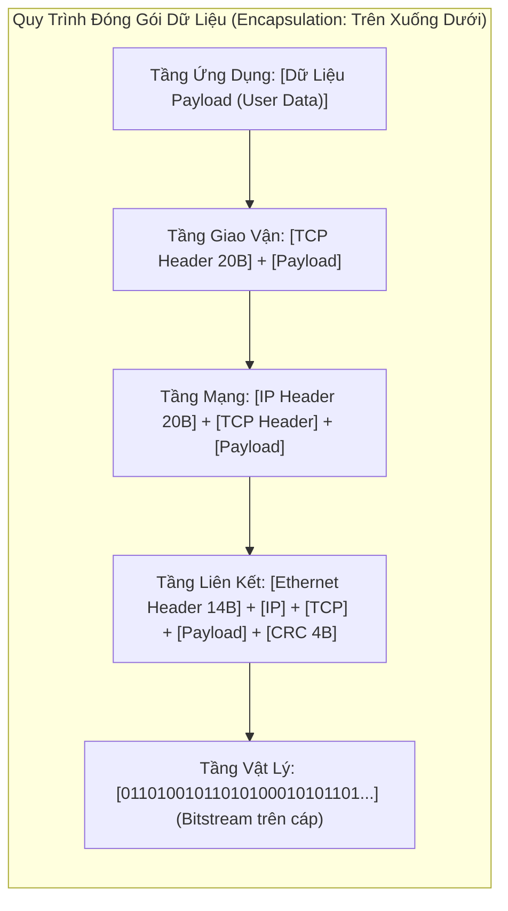
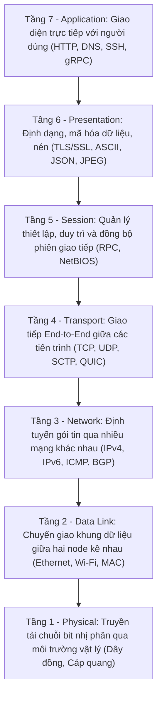
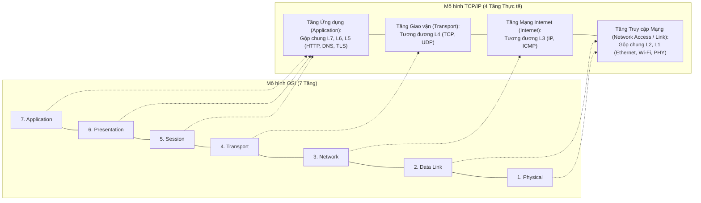
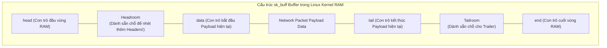

# 1.2. Network Models and Encapsulation (Mô hình Phân tầng và Cơ chế Đóng gói Dữ liệu)

> [!IMPORTANT]
> **Nếu bạn chỉ được nhớ một điều duy nhất:** Mô hình mạng phân tầng (OSI 7 tầng hay TCP/IP 4 tầng) hoạt động dựa trên nguyên lý Đóng gói dữ liệu (Encapsulation): mỗi tầng mạng chỉ nhìn thấy Header của chính mình và coi dữ liệu tầng trên là Payload thuần túy; khi dữ liệu đi xuống từ L7 đến L2, mỗi tầng gắn thêm một Header (và Trailer) tạo thành Frame, và quy trình đảo ngược (Decapsulation) diễn ra ở máy nhận.

---

## 1. Trực Quan Hóa: Bản Chất Mô Hình Phân Tầng & Đóng Gói Dữ Liệu (Encapsulation) Dưới Góc Nhìn Lập Trình Viên

### 1.1. Đoạn Code Dẫn Nhập & Vấn Đề Thực Tế
Hãy xem một gói tin JSON nhỏ được gửi qua API mạng và xem những gì thực sự được truyền qua card mạng:

```json
{"user_id": 42, "status": "active"} 
```
Đoạn payload JSON trên chỉ dài đúng **36 bytes**. Nhưng khi bạn bắt gói tin bằng công cụ Wireshark hoặc `tcpdump`, bạn sẽ thấy kích thước của gói tin trên đường truyền cáp quang bị đội lên ít nhất **90 bytes**!

```text
[Khung Ethernet: 14 bytes]
  [Tiêu đề IPv4: 20 bytes]
    [Tiêu đề TCP: 20 bytes (hoặc 32 bytes có Options)]
      [Tiêu đề HTTP/1.1: ~150 - 500 bytes Headers!]
        {"user_id": 42, "status": "active"} (Payload chỉ có 36 bytes!)
```

Tại sao một chuỗi dữ liệu nhỏ bé lại phải cõng theo hàng loạt các lớp tiêu đề (Headers) nặng nề đến vậy? Mỗi tầng mạng thêm vào những thông tin gì, và điều này ảnh hưởng như thế nào đến tỷ lệ dữ liệu hữu ích (Goodput) của các vi dịch vụ Backend?

### 1.2. Ẩn Dụ Đời Sống & Phân Tích Cơ Chế Hoạt Động
Hãy tưởng tượng quá trình Đóng Gói Dữ Liệu (Encapsulation) giống như **Quy Trình Gửi Thư Mật Quốc Tế Bằng Bưu Điện**:
- **Tầng Ứng Dụng (Application Layer - Payload)**: Bức thư viết tay của bạn: "Hẹn gặp lúc 8 giờ tối".
- **Tầng Giao Vận (Transport Layer - TCP Header)**: Bạn nhét bức thư vào một **Chiếc Phong Bì Bưu Điện Nội Bộ**. Trên phong bì ghi rõ: Số thứ tự trang thư (Sequence Number để bên nhận xếp lại đúng thứ tự), và Mã hòm thư của người nhận trong tòa nhà (Cổng - Port 80 hoặc 443).
- **Tầng Mạng (Network Layer - IP Header)**: Nhân viên bưu điện nhét tiếp phong bì trên vào một **Túi Bưu Phẩm Quốc Tế**. Mặt ngoài dán nhãn: Địa chỉ quốc gia người gửi (Source IP) và Địa chỉ bưu điện thành phố người nhận (Destination IP) để các trạm trung chuyển biết đường định tuyến xuyên quốc gia.
- **Tầng Liên Kết Dữ Liệu (Data Link Layer - Ethernet Frame)**: Túi bưu phẩm được đặt vào một **Thùng Hàng Gỗ Trên Xe Tải Giao Hàng**. Trên thành thùng dán nhãn: Biển số xe tải gửi (Source MAC) và Biển số xe tải của trạm tiếp theo (Destination MAC), kèm theo một chiếc khóa niêm phong chống cạy phá (Mã kiểm tra lỗi CRC/FCS).
- **Tầng Vật Lý (Physical Layer - Bits)**: Xe tải nổ máy lăn bánh trên đường cao tốc (Các xung điện $0$ và $1$ chạy trên dây đồng hoặc ánh sáng trong cáp quang).

Khi tới tay người nhận, quy trình được thực hiện **Mở Gói Ngược Lại (Decapsulation)**: Mỗi tầng bóc đi một lớp vỏ phong bì, kiểm tra thông tin của tầng mình và chuyển phần lõi bên trong lên tầng trên!

### 1.3. Mô Phỏng Dữ Liệu Số Nhỏ Từng Bước (Toy Walkthrough)
Theo dõi hành trình đóng gói một thông điệp HTTP GET qua từng tầng giao thức:

```text
[Tầng 7 - Ứng Dụng (Application PDU: Data)]:
Chuỗi dữ liệu: "GET /api/user HTTP/1.1\r\nHost: api.com\r\n\r\n" (45 bytes).

[Tầng 4 - Giao Vận (Transport PDU: Segment)]:
Kernel gắn thêm 20 bytes TCP Header vào trước:
[Source Port: 54120 | Dest Port: 80 | Seq: 1000 | Ack: 0 | Flags: ACK | Window: 65535]
-> Tổng kích thước lúc này: 20B + 45B = 65 bytes.

[Tầng 3 - Mạng (Network PDU: Packet / Datagram)]:
Kernel gắn thêm 20 bytes IPv4 Header vào trước:
[Version: 4 | TTL: 64 | Protocol: 6 (TCP) | Source IP: 192.168.1.10 | Dest IP: 93.184.216.34]
-> Tổng kích thước lúc này: 20B + 65B = 85 bytes.

[Tầng 2 - Liên Kết Dữ Liệu (Data Link PDU: Frame)]:
Driver card mạng gắn 14 bytes Ethernet Header ở đầu và 4 bytes FCS/CRC32 ở đuôi:
[Dest MAC: 00:1A:2B:3C:4D:5E | Source MAC: 52:54:00:12:34:56 | EtherType: 0x0800 (IPv4)] 
+ [85 bytes IP Packet] + [FCS: 0x8A2C19F0]
-> Tổng kích thước khung Ethernet hoàn chỉnh trên đường truyền: 14B + 85B + 4B = 103 bytes!
```

### 1.4. Tác Động Thực Tế Tầng Backend & Systems
1. **Gánh Nặng Tiêu Đề (Header Overhead) Với Các Gói Tin Nhỏ**: Nếu bạn gửi các gói tin telemetry nhỏ $10\text{ bytes}$ bằng TCP, chi phí tiêu đề cố định là $54\text{ bytes}$ (Ethernet 14B + IP 20B + TCP 20B). Nghĩa là **hơn $84\%$ băng thông mạng bị lãng phí chỉ cho việc truyền các tiêu đề**! Đó là lý do giao thức gRPC và HTTP/2 sử dụng nén tiêu đề HPACK, và các game nhiều người chơi chuyển sang dùng UDP.
2. **Kích Thước Khung Tối Đa MTU (Maximum Transmission Unit - 1500B)**: Tầng Data Link của Ethernet chỉ cho phép mang theo tối đa một gói IP nặng $1500\text{ bytes}$ (MTU). Nếu gói dữ liệu của ứng dụng vượt quá MTU, hệ điều hành buộc phải thực hiện phân mảnh (Fragmentation) hoặc cắt nhỏ thành nhiều phân đoạn TCP (Segmentation).
3. **Tính Năng Phần Cứng TSO (TCP Segmentation Offload)**: Để giải phóng CPU khỏi việc phải tự tay chia nhỏ dữ liệu thành hàng nghìn gói $1500\text{ bytes}$, hệ điều hành hiện đại gửi nguyên một khối dữ liệu lớn $64\text{ KB}$ xuống Card mạng (NIC). Chip phần cứng trên card mạng sẽ tự động băm nhỏ và gắn TCP/IP Header độc lập cho từng gói tin (TSO / GSO), tiết kiệm tới $20\%$ CPU của máy chủ Backend.

### 1.5. Sơ Đồ Tư Duy & Kiến Trúc Hệ Thống (Mermaid)


---

## 2. Chi tiết từng Keyword (Under-the-Hood Deep Dive)

### 2.1. The OSI 7-Layer Reference Model (Mô hình OSI 7 Tầng)

Được chuẩn hóa bởi ISO vào năm 1984, mô hình OSI là khung tham chiếu kinh điển dùng trong giảng dạy và thiết kế kiến trúc:



- **Tầng 7 (Application)**: Nơi các tiến trình phần mềm giao tiếp với mạng (trình duyệt, web server).
- **Tầng 6 (Presentation)**: Chuyển đổi cú pháp dữ liệu (Syntax conversion), giải nén, mã hóa mật mã.
- **Tầng 5 (Session)**: Kiểm soát các cuộc đối thoại giữa hai máy tính (Checkpoints, Session recovery).
- **Tầng 4 (Transport)**: Cung cấp kết nối logic đầu-cuối (Process-to-Process) giữa các ứng dụng chạy trên hai máy tính khác nhau thông qua khái niệm **Port**.
- **Tầng 3 (Network)**: Định tuyến gói tin xuyên qua nhiều mạng con thông qua địa chỉ logic **IP Address**.
- **Tầng 2 (Data Link)**: Chuyển giao dữ liệu giữa hai thiết bị nằm trong cùng một mạng cục bộ (Hop-to-Hop) thông qua địa chỉ vật lý **MAC Address**.
- **Tầng 1 (Physical)**: Xử lý mức điện áp, chân cắm, đầu nối và bộ thu phát quang.

---

### 2.2. The TCP/IP Model (Mô hình TCP/IP 4 Tầng Thực tế)

Trong khi mô hình OSI mang tính lý thuyết học thuật, toàn bộ mạng Internet toàn cầu thực tế đang vận hành trên **Mô hình TCP/IP (RFC 1122)** gồm 4 tầng thực dụng:



- **Triết lý Thiết kế TCP/IP**:
  - Gộp các tầng 5, 6, 7 thành một tầng **Application** duy nhất nằm hoàn toàn ở User-Space (do lập trình viên ứng dụng tự quản lý).
  - Tầng **Transport** và **Internet** nằm trong Kernel-Space của Hệ điều hành.
  - Tầng **Network Access** nằm ở tầng Driver và phần cứng card mạng NIC.

---

### 2.3. Protocol Data Unit (PDU) & Terminology

Mỗi tầng mạng có một tên gọi chuyên biệt cho đơn vị dữ liệu giao thức (PDU) của mình. Sử dụng sai thuật ngữ là dấu hiệu của sự thiếu chuyên nghiệp trong kỹ thuật mạng:

| Tầng Mạng | Tên gọi Chuẩn PDU | Định danh Địa chỉ | Thiết bị Xử lý Tiêu biểu |
| :--- | :--- | :--- | :--- |
| **Layer 7 (Application)** | **Message / Data** | URL, URI, Hostname | Web Browser, API Gateway, Reverse Proxy |
| **Layer 4 (Transport)** | **Segment** (TCP) / **Datagram** (UDP) | Port Number (16-bit) | L4 Load Balancer, Stateful Firewall |
| **Layer 3 (Network / Internet)** | **Packet** / **Datagram** (IP) | IP Address (IPv4: 32-bit, IPv6: 128-bit) | Router, L3 Switch |
| **Layer 2 (Data Link)** | **Frame** | MAC Address (48-bit) | L2 Switch, Bridge, NIC |
| **Layer 1 (Physical)** | **Bits / Symbols** | Tín hiệu điện / quang | Hub, Repeater, SFP Transceiver |

---

### 2.4. Data Encapsulation & Decapsulation (Đóng gói và Mở gói Dữ liệu)

Khi dữ liệu đi xuống từng tầng, mỗi tầng gắn thêm một mẩu siêu dữ liệu (Metadata) gọi là **Header** vào đầu gói tin, và riêng tầng Data Link gắn thêm một **Trailer** vào đuôi gói tin.

#### Chi tiết Overhead Kích thước của Header:

```text
+-----------------------------------------------------------------------------------------+
|                                    ETHERNET FRAME (Tối đa 1518 Bytes)                   |
|                                                                                         |
| +-----------------+ +-----------------+ +-----------------+ +-------------+ +---------+ |
| | Ethernet Header | |    IP Header    | |   TCP Header    | | Application | | Frame   | |
| |   (14 Bytes)    | | (20 - 60 Bytes) | | (20 - 60 Bytes) | |   Payload   | | Trailer | |
| | Src/Dst MAC,    | | Src/Dst IP, TTL,| | Src/Dst Port,   | | (HTTP Data) | |  (FCS)  | |
| | EtherType       | | Protocol, Check | | Seq, Ack, Flags | |             | | (4 B)   | |
| +-----------------+ +-----------------+ +-----------------+ +-------------+ +---------+ |
+-----------------------------------------------------------------------------------------+
```

- **Chi phí Overhead Tối thiểu**:
  - Ethernet Header: $14\text{ bytes}$
  - Ethernet Trailer (FCS / CRC-32): $4\text{ bytes}$
  - IPv4 Header (không options): $20\text{ bytes}$
  - TCP Header (không options): $20\text{ bytes}$
  - 👉 **Tổng Overhead cố định**: $14 + 4 + 20 + 20 = 58\text{ bytes}$.
- **Hiệu suất Truyền dẫn (Efficiency)**:
  - Nếu gửi gói tin tối đa (Full MTU 1500 bytes payload): Tỷ lệ dữ liệu hữu ích đạt $\frac{1460}{1518} \approx 96.1\%$.
  - Nếu gửi một thông điệp nhỏ (ví dụ 1 ký tự phím bấm SSH $1\text{ byte}$): Bạn phải gửi đi một khung mạng $59\text{ bytes}$ để vận chuyển đúng 1 byte dữ liệu! Hiệu suất tụt xuống chỉ còn $1.69\%$.

---

### 2.5. Linux Kernel Network Stack: `sk_buff` (Bản chất Dưới Tầng Hệ Điều Hành)

Làm thế nào nhân Linux đóng gói và tháo gỡ hàng triệu gói tin mỗi giây mà không bị cạn kiệt bộ nhớ do cấp phát và sao chép buffer liên tục? Bí mật nằm ở cấu trúc **`struct sk_buff` (Socket Buffer - `<linux/skbuff.h>`)**:



- **Cơ chế Zero-Copy Headroom**:
  - Khi Kernel cấp phát một `sk_buff` cho ứng dụng gửi dữ liệu: Nó cấp phát một khối bộ nhớ liên tục lớn hơn kích thước dữ liệu cần gửi. Con trỏ `data` và `tail` được đặt ở giữa, chừa lại một khoảng trống phía trước gọi là **Headroom**.
  - **Hàm `skb_push(skb, size)`**: Khi gói tin đi xuống tầng Transport: Kernel chỉ cần **dịch chuyển con trỏ `data` lùi về phía trước** và ghi trực tiếp TCP Header vào vùng Headroom vừa tạo.
  - Khi đi tiếp xuống tầng Network: Kernel lại gọi `skb_push()` để lùi con trỏ `data` thêm 20 bytes và ghi trực tiếp IP Header.
  - 👉 **Không hề có một phép `memcpy()` dữ liệu payload nào xảy ra**! Việc đóng gói diễn ra với chi phí CPU gần như bằng 0!
- **Hàm `skb_pull(skb, size)`**: Khi nhận gói tin (Decapsulation), kernel chỉ cần dịch con trỏ `data` tiến lên phía trước để loại bỏ Header của tầng vừa bóc tách.

---

## 3. Thực thi Mã nguồn & Mô phỏng Chuyên sâu (Dual-Engine Implementation)

### 3.1. C++20 Implementation

Mã nguồn C++20 dưới đây mô phỏng lại hoàn chỉnh cơ chế cấp phát bộ nhớ **Zero-Copy Socket Buffer (`MockSkBuff`)** của Linux Kernel: sử dụng con trỏ `head`, `data`, `tail`, `end` cùng các thao tác `push`, `pull`, `put` để đóng gói dữ liệu qua các tầng mà không copy payload:

```cpp
// compile: g++ -std=c++20 -O3 -Wall skbuff_simulator.cpp -o skbuff_simulator
#include <iostream>
#include <vector>
#include <cstdint>
#include <cstring>
#include <iomanip>
#include <stdexcept>
#include <span>

namespace LinuxKernelSim {

// Mô phỏng cấu trúc struct sk_buff chuẩn trong Linux Kernel
class MockSkBuff {
private:
    std::vector<uint8_t> memoryPool_;
    uint8_t* head_; // Đầu vùng nhớ vật lý
    uint8_t* data_; // Bắt đầu dữ liệu hợp lệ
    uint8_t* tail_; // Kết thúc dữ liệu hợp lệ
    uint8_t* end_;  // Cuối vùng nhớ vật lý

public:
    explicit MockSkBuff(size_t totalBufferSize, size_t reserveHeadroom)
        : memoryPool_(totalBufferSize, 0) {
        if (reserveHeadroom >= totalBufferSize) {
            throw std::invalid_argument("Headroom exceeds total buffer size");
        }
        head_ = memoryPool_.data();
        end_  = head_ + totalBufferSize;
        data_ = head_ + reserveHeadroom;
        tail_ = data_;
    }

    // Gắn thêm dữ liệu vào đuôi (tương đương skb_put)
    uint8_t* put(size_t len) {
        if (tail_ + len > end_) throw std::overflow_error("Tailroom overflow");
        uint8_t* oldTail = tail_;
        tail_ += len;
        return oldTail;
    }

    // Dịch con trỏ data lùi về phía trước để nhét thêm Header (tương đương skb_push)
    uint8_t* push(size_t len) {
        if (data_ - len < head_) throw std::underflow_error("Headroom underflow");
        data_ -= len;
        return data_;
    }

    // Dịch con trỏ data tiến lên phía trước để bóc bỏ Header (tương đương skb_pull)
    uint8_t* pull(size_t len) {
        if (data_ + len > tail_) throw std::underflow_error("Not enough data to pull");
        data_ += len;
        return data_;
    }

    [[nodiscard]] size_t dataLen() const { return static_cast<size_t>(tail_ - data_); }
    [[nodiscard]] size_t headroom() const { return static_cast<size_t>(data_ - head_); }
    [[nodiscard]] size_t tailroom() const { return static_cast<size_t>(end_ - tail_); }

    void printState(const std::string& stepName) const {
        std::cout << ">>> [" << stepName << "]\n";
        std::cout << "  - Payload Length: " << dataLen() << " bytes\n";
        std::cout << "  - Headroom còn:   " << headroom() << " bytes\n";
        std::cout << "  - Tailroom còn:   " << tailroom() << " bytes\n";
        std::cout << "  - Raw Buffer Dump (Hex): ";
        for (const uint8_t* ptr = data_; ptr < tail_; ++ptr) {
            std::cout << std::hex << std::setw(2) << std::setfill('0') << static_cast<int>(*ptr) << " ";
        }
        std::cout << std::dec << "\n\n";
    }
};

} // namespace LinuxKernelSim

int main() {
    using namespace LinuxKernelSim;
    std::cout << "========================================================\n";
    std::cout << "  C++20 LINUX KERNEL sk_buff ZERO-COPY ENCAPSULATION    \n";
    std::cout << "========================================================\n\n";

    // Cấp phát buffer 128 bytes, dành sẵn 64 bytes Headroom cho Headers
    MockSkBuff skb(128, 64);
    skb.printState("1. KHOI TAO BUFFER TRONG");

    // 1. Tầng Ứng dụng: Nhét chuỗi tin nhắn "PING"
    std::string appMsg = "PING";
    uint8_t* payloadPtr = skb.put(appMsg.size());
    std::memcpy(payloadPtr, appMsg.data(), appMsg.size());
    skb.printState("2. APPLICATION LAYER: Nhét Payload 'PING'");

    // 2. Tầng Transport: Gắn TCP Header giả lập (4 bytes: SrcPort=80, DstPort=443)
    uint8_t* tcpHeader = skb.push(4);
    tcpHeader[0] = 0x00; tcpHeader[1] = 0x50; // Port 80
    tcpHeader[2] = 0x01; tcpHeader[3] = 0xBB; // Port 443
    skb.printState("3. TRANSPORT LAYER: skb_push(4) nhét TCP Header");

    // 3. Tầng Network: Gắn IPv4 Header giả lập (4 bytes: IP=10.0.0.1)
    uint8_t* ipHeader = skb.push(4);
    ipHeader[0] = 0x0A; ipHeader[1] = 0x00; ipHeader[2] = 0x00; ipHeader[3] = 0x01;
    skb.printState("4. NETWORK LAYER: skb_push(4) nhét IP Header");

    // 4. Quá trình Nhận (Decapsulation): Bóc IP Header
    skb.pull(4);
    skb.printState("5. DECAPSULATION: skb_pull(4) bóc tách IP Header");

    // 5. Bóc TCP Header
    skb.pull(4);
    skb.printState("6. DECAPSULATION: skb_pull(4) khôi phục Payload nguyên bản");

    std::cout << "========================================================\n";
    return 0;
}
```

---

### 3.2. Python 3.11+ Implementation

Mã nguồn Python 3.11 dưới đây mô phỏng chu trình **Data Encapsulation & Decapsulation Đa tầng**: đóng gói tuần tự từng cấu trúc nhị phân (Ethernet Frame -> IPv4 Packet -> TCP Segment -> HTTP Message) và giải mã bóc tách từng trường:

```python
#!/usr/bin/env python3
"""
Mô phỏng Quá trình Đóng gói và Mở gói Dữ liệu Đa tầng (Encapsulation Engine)
Yêu cầu: Python 3.11+
"""

from dataclasses import dataclass
import struct


@dataclass
class EthernetHeader:
    dst_mac: str
    src_mac: str
    ethertype: int = 0x0800  # IPv4


@dataclass
class Ipv4Header:
    src_ip: str
    dst_ip: str
    protocol: int = 6  # TCP
    ttl: int = 64


@dataclass
class TcpHeader:
    src_port: int
    dst_port: int
    seq_num: int = 1001
    ack_num: int = 0


class EncapsulationEngine:
    @staticmethod
    def pack_headers(eth: EthernetHeader, ip: Ipv4Header, tcp: TcpHeader, payload: bytes) -> bytes:
        """Đóng gói toàn bộ các tầng thành một chuỗi byte nhị phân thô"""
        # 1. TCP Header giả lập (8 bytes cơ bản)
        tcp_bytes = struct.pack("!HHII", tcp.src_port, tcp.dst_port, tcp.seq_num, tcp.ack_num)
        
        # 2. IP Header giả lập (12 bytes cơ bản)
        src_ip_int = int.from_bytes(bytes(map(int, ip.src_ip.split("."))), "big")
        dst_ip_int = int.from_bytes(bytes(map(int, ip.dst_ip.split("."))), "big")
        ip_bytes = struct.pack("!BBHII", ip.ttl, ip.protocol, len(payload) + len(tcp_bytes), src_ip_int, dst_ip_int)

        # 3. Ethernet Header (14 bytes)
        eth_bytes = b"\x00\x11\x22\x33\x44\x55" + b"\x66\x77\x88\x99\xAA\xBB" + struct.pack("!H", eth.ethertype)

        # 4. Ethernet Frame Trailer (CRC32 Checksum - 4 bytes)
        frame_body = eth_bytes + ip_bytes + tcp_bytes + payload
        fcs_trailer = struct.pack("!I", 0xDEADBEEF)

        return frame_body + fcs_trailer

    @staticmethod
    def unpack_and_inspect(wire_bytes: bytes) -> None:
        """Mở gói và in ra thông tin từng tầng"""
        print(f"\n[+] TIEP NHAN KHUNG ETHERNET: Tong chieu dai = {len(wire_bytes)} bytes")
        
        # Bóc Ethernet Header (14 bytes)
        eth_header = wire_bytes[:14]
        ethertype = struct.unpack("!H", eth_header[12:14])[0]
        print(f"  [L2 Data Link] EtherType: 0x{ethertype:04X} (IPv4 Payload)")

        # Bóc IP Header (12 bytes)
        ip_header = wire_bytes[14:26]
        ttl, proto, length, src_ip_raw, dst_ip_raw = struct.unpack("!BBHII", ip_header)
        src_ip = ".".join(str((src_ip_raw >> (8 * i)) & 0xFF) for i in reversed(range(4)))
        dst_ip = ".".join(str((dst_ip_raw >> (8 * i)) & 0xFF) for i in reversed(range(4)))
        print(f"  [L3 Network]   IP: {src_ip} -> {dst_ip} (TTL={ttl}, Proto={proto})")

        # Bóc TCP Header (8 bytes)
        tcp_header = wire_bytes[26:34]
        sport, dport, seq, ack = struct.unpack("!HHII", tcp_header)
        print(f"  [L4 Transport] TCP: Port {sport} -> {dport} (Seq={seq})")

        # Trích xuất Application Data (loại trừ 4 bytes FCS ở đuôi)
        payload = wire_bytes[34:-4]
        print(f"  [L7 App Data]  Payload: \"{payload.decode('utf-8')}\" ({len(payload)} bytes)")


def main() -> None:
    print("=" * 60)
    print("  PYTHON 3.11: MULTI-LAYER ENCAPSULATION SIMULATOR")
    print("=" * 60)

    app_payload = b"GET /api/v1/health HTTP/1.1\r\nHost: api.example.com\r\n\r\n"

    eth = EthernetHeader("00:11:22:33:44:55", "66:77:88:99:AA:BB")
    ip = Ipv4Header("192.168.1.100", "142.250.190.46")
    tcp = TcpHeader(54321, 443)

    wire_packet = EncapsulationEngine.pack_headers(eth, ip, tcp, app_payload)
    EncapsulationEngine.unpack_and_inspect(wire_packet)

    print("\n" + "=" * 60)


if __name__ == "__main__":
    main()
```

---

### 3.3. Terminal Output Mẫu Chuẩn Thực Tế

```text
========================================================
  C++20 LINUX KERNEL sk_buff ZERO-COPY ENCAPSULATION    
========================================================

>>> [1. KHOI TAO BUFFER TRONG]
  - Payload Length: 0 bytes
  - Headroom còn:   64 bytes
  - Tailroom còn:   64 bytes
  - Raw Buffer Dump (Hex): 

>>> [2. APPLICATION LAYER: Nhét Payload 'PING']
  - Payload Length: 4 bytes
  - Headroom còn:   64 bytes
  - Tailroom còn:   60 bytes
  - Raw Buffer Dump (Hex): 50 49 4e 47 

>>> [3. TRANSPORT LAYER: skb_push(4) nhét TCP Header]
  - Payload Length: 8 bytes
  - Headroom còn:   60 bytes
  - Tailroom còn:   60 bytes
  - Raw Buffer Dump (Hex): 00 50 01 bb 50 49 4e 47 

>>> [4. NETWORK LAYER: skb_push(4) nhét IP Header]
  - Payload Length: 12 bytes
  - Headroom còn:   56 bytes
  - Tailroom còn:   60 bytes
  - Raw Buffer Dump (Hex): 0a 00 00 01 00 50 01 bb 50 49 4e 47 

>>> [5. DECAPSULATION: skb_pull(4) bóc tách IP Header]
  - Payload Length: 8 bytes
  - Headroom còn:   60 bytes
  - Tailroom còn:   60 bytes
  - Raw Buffer Dump (Hex): 00 50 01 bb 50 49 4e 47 

>>> [6. DECAPSULATION: skb_pull(4) khôi phục Payload nguyên bản]
  - Payload Length: 4 bytes
  - Headroom còn:   64 bytes
  - Tailroom còn:   60 bytes
  - Raw Buffer Dump (Hex): 50 49 4e 47 

========================================================
```

---

## 4. Systems Engineering & Production Pitfalls

### 4.1. Thảm họa TSO (TCP Segmentation Offload) và Phân mảnh Gói tin
- **Bản chất**: Để giảm tải CPU cho máy chủ khi truyền tải dữ liệu lớn, Linux Kernel sử dụng tính năng **TSO (TCP Segmentation Offload)**: Kernel gom các mẩu dữ liệu lên tới 64KB và đẩy thẳng xuống card mạng NIC, giao toàn bộ nhiệm vụ cắt nhỏ thành các gói MTU 1500 bytes cho chip của card mạng xử lý.
- **Sự cố khi bắt gói tin bằng `tcpdump`**:
  - Khi bạn chạy `tcpdump` trên chính máy chủ gửi, bạn sẽ nhìn thấy những gói tin khổng lồ có kích thước lên tới **65.535 bytes** đi qua card mạng!
  - Nhiều kỹ sư mạng non tay hoảng sợ cho rằng hệ thống đang bị lỗi cấu hình MTU hoặc vi phạm chuẩn Ethernet. Thực tế, `tcpdump` móc vào ngăn xếp mạng **trước khi TSO diễn ra trên card mạng**, hoàn toàn là hành vi bình thường.

### 4.2. Bộ công cụ CLI Kiểm tra Phân tầng Mạng và Offloads

#### 1. Kiểm tra các tính năng Offload phần cứng trên card mạng bằng `ethtool`:
```bash
# Kiểm tra xem card mạng có đang gánh tải phần cứng cho CPU không
$ sudo ethtool -k eth0 | grep -E "segmentation|checksum"
rx-checksumming: on
tx-checksumming: on
tcp-segmentation-offload: on    <-- TSO được bật
generic-segmentation-offload: on
```

#### 2. Soi kích thước MTU và thông số tầng Data Link bằng `ip`:
```bash
$ ip link show eth0
2: eth0: <BROADCAST,MULTICAST,UP,LOWER_UP> mtu 1500 qdisc mq state UP mode DEFAULT group default qlen 1000
    link/ether 52:54:00:12:34:56 brd ff:ff:ff:ff:ff:ff
```

---

## 5. Bảng So sánh & Decision Matrix

### Bảng đối chiếu Toàn diện OSI 7 Tầng vs TCP/IP 4 Tầng

| Tầng OSI | Tầng TCP/IP | Trách nhiệm Cốt lõi | Giao thức Tiêu biểu | Đơn vị PDU |
| :--- | :--- | :--- | :--- | :--- |
| **7. Application** | **Application** | Giao diện ứng dụng người dùng | HTTP, DNS, SMTP, SSH | Message / Data |
| **6. Presentation**| (Nằm trong App) | Mã hóa, nén, format dữ liệu | TLS 1.3, JSON, Protobuf | Data |
| **5. Session** | (Nằm trong App) | Đồng bộ và quản lý phiên | RPC, SOCKS5 | Data |
| **4. Transport** | **Transport** | Giao tiếp End-to-End giữa các tiến trình | TCP, UDP, QUIC | Segment / Datagram |
| **3. Network** | **Internet** | Định tuyến gói tin qua nhiều mạng | IPv4, IPv6, ICMP | Packet / Datagram |
| **2. Data Link** | **Network Access** | Truyền tải tin cậy giữa hai node kề nhau | Ethernet, Wi-Fi 802.11 | Frame |
| **1. Physical** | **Network Access** | Truyền tín hiệu điện/quang/sóng | Cáp Cat6, Sợi quang SMF | Bits |

### Ma trận Quyết định Cô lập Sự cố theo Phân tầng Mạng

1. **"Máy tính không thể kết nối tới bất kỳ máy nào khác trong cùng mạng LAN"**:
   - 👉 **Kiểm tra Tầng 1 & 2**: Đèn card mạng có sáng không? Cáp mạng có cắm chặt không? Địa chỉ MAC có hiển thị trong bảng ARP không (`ip neigh`)?
2. **"Trong cùng mạng LAN ping được, nhưng không ra được Internet"**:
   - 👉 **Kiểm tra Tầng 3**: Cấu hình IP và Default Gateway có đúng không? Bảng định tuyến (`ip route`) có trỏ đúng router không?
3. **"Ping IP Google 8.8.8.8 được, nhưng gõ google.com trên trình duyệt bị lỗi"**:
   - 👉 **Kiểm tra Tầng 7**: Sự cố $100\%$ nằm ở tầng phân giải tên miền DNS (`/etc/resolv.conf`).

---

## 6. Enterprise Production Checklist & Verification

- [ ] **Bật Tính Năng TSO/GSO Trên Card Mạng Bằng `ethtool`**: Đảm bảo tính năng chia nhỏ gói tin bằng phần cứng được kích hoạt trên interface mạng:
  ```bash
  ethtool -K eth0 tso on gso on gro on
  ```
  giúp giảm tải chu kỳ CPU cho nhân Linux khi truyền tải lượng dữ liệu lớn.
- [ ] **Sử Dụng HTTP/2 Hoặc HTTP/3 Cho Các Vi Dịch Vụ Microservices**: Chuyển đổi từ HTTP/1.1 sang HTTP/2 (gRPC) để tận dụng cơ chế nén tiêu đề HPACK/QPACK, giảm thiểu gánh nặng truyền tải lặp lại hàng trăm bytes Header của các request RESTful nhỏ.
- [ ] **Kiểm Tra Trạng Thái Đóng Gói Bằng `tcpdump`**: Sử dụng lệnh `tcpdump -nn -vv -i eth0 port 80` để kiểm tra kích thước thực tế của từng tầng tiêu đề (IP Header, TCP Options) khi điều tra hiện tượng nghẽn mạng.
- [ ] **Tối Ưu Hóa Kích Thước Khung Jumbo Frame (MTU 9000) Cho Mạng Nội Bộ Data Center**: Trong các mạng lưu trữ chuyên dụng (iSCSI, Ceph, Kubernetes Pod-to-Pod trên cùng Switch), nâng MTU từ 1500 lên 9000 bytes để giảm số lượng ngắt phần cứng CPU đi 6 lần.
- [ ] **Hạn Chế Gửi Các Thông Điệp Quá Nhỏ Không Bật Gom Gói (Nagle's Algorithm)**: Trong các ứng dụng socket, cân nhắc bật cờ `TCP_NODELAY` chỉ khi thực sự cần độ trễ thấp tức thì; với các dịch vụ log, luôn chủ động gom bộ đệm ở tầng ứng dụng (Buffered I/O) trước khi gọi hàm gửi.
- [ ] **Giám Sát Tỷ Lệ Overhead Tiêu Đề Bằng Metric `node_network_transmit_bytes_total`**: So sánh lưu lượng byte gửi ở tầng mạng với lưu lượng dữ liệu hữu ích tầng ứng dụng để đánh giá hiệu suất của giao thức truyền tải.
