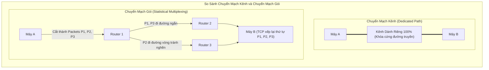
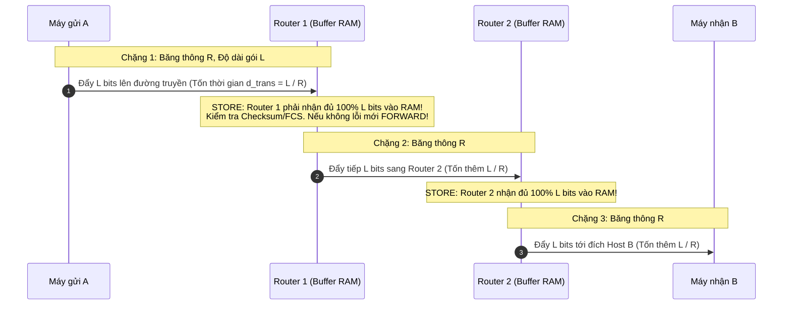
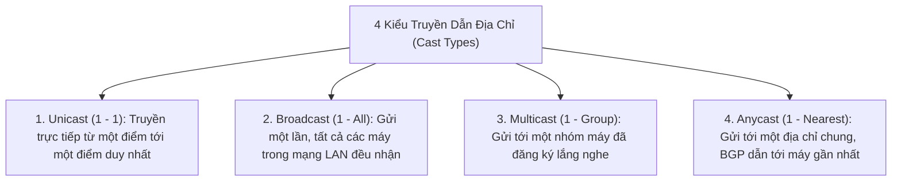

# 1.3. Transmission and Switching Modes (Phương thức Truyền dẫn và Chuyển mạch Mạng)

> [!IMPORTANT]
> **Nếu bạn chỉ được nhớ một điều duy nhất:** Chuyển mạch gói (Packet Switching) là nền móng kiến tạo nên Internet toàn cầu nhờ khả năng ghép kênh theo thống kê (Statistical Multiplexing): thay vì chiếm dụng độc quyền đường truyền vật lý tốn kém như Chuyển mạch kênh (Circuit Switching) của mạng điện thoại cổ điển, Packet Switching chia nhỏ dữ liệu thành các gói tin độc lập chia sẻ hạ tầng dùng chung, chấp nhận đánh đổi bằng độ trễ hàng đợi (Queueing Delay) và nguy cơ mất gói (Packet Loss).

---

## 1. Trực Quan Hóa: Bản Chất Phương Thức Truyền Dẫn & Chuyển Mạch Mạng Dưới Góc Nhìn Lập Trình Viên

### 1.1. Đoạn Code Dẫn Nhập & Vấn Đề Thực Tế
Hãy xem sự khác biệt giữa hai kiến trúc mạng kết nối giữa các dịch vụ Backend:

```text
[Mô hình 1: Kênh Thuê Riêng Cố Định (Circuit Switching / Leased Line)]
Doanh nghiệp trả $10,000/tháng để thuê riêng 1 đường cáp quang cố định nối từ Hà Nội vào TP.HCM.
- Khi không có ai gửi dữ liệu: Đường truyền hoàn toàn bị lãng phí 100%!
- Khi lưu lượng đột biến vượt ngưỡng: Đường truyền bị nghẽn cứng, không thể mở rộng!

[Mô hình 2: Mạng Chuyển Mạch Gói Internet (Packet Switching)]
Hàng triệu gói tin của hàng nghìn công ty cùng chia sẻ một hạ tầng mạng chung.
- Dữ liệu được cắt nhỏ thành từng gói Packet độc lập.
- Router tự động định tuyến từng gói qua các con đường khác nhau tùy theo mức độ tắc nghẽn!
```

Tại sao toàn bộ mạng Internet hiện đại ngày nay lại được xây dựng trên nền tảng **Chuyển Mạch Gói (Packet Switching)** thay vì Chuyển Mạch Kênh (Circuit Switching) của mạng điện thoại cổ điển? Và tại sao các nhà cung cấp dịch vụ đám mây lớn (Cloudflare, AWS, Google Cloud) lại sử dụng công nghệ định tuyến **Anycast** để phục vụ hàng tỷ người dùng trên toàn thế giới?

### 1.2. Ẩn Dụ Đời Sống & Phân Tích Cơ Chế Hoạt Động
Hãy tưởng tượng sự khác biệt giữa các phương thức chuyển mạch thông qua **Hệ Thống Giao Thông Vận Tải**:
- **Chuyển mạch kênh (Circuit Switching - Mạng điện thoại bàn)**: Giống như việc **Bao Trọn Một Tuyến Đường Sắt Riêng Biệt**. Bạn muốn đi từ Hà Nội vào Đà Nẵng, công ty đường sắt lập tức khóa toàn bộ tuyến đường ray lại chỉ cho riêng đoàn tàu của bạn chạy. Cực kỳ an toàn, tốc độ ổn định $100\%$, không bao giờ bị tắc đường. Nhưng trong lúc đoàn tàu của bạn chưa chạy, không một ai khác trên toàn quốc được phép bước lên đường ray ray đó (Hiệu suất sử dụng tài nguyên vô cùng lãng phí!).
- **Chuyển mạch gói (Packet Switching - Mạng Internet hiện đại)**: Giống như **Đường Cao Tốc Công Cộng Với Dịch Vụ Xe Bưu Điện Giao Hàng Tiết Kiệm**:
  - Toàn bộ bưu phẩm lớn được chia nhỏ thành các bưu kiện nhỏ (Gói tin - Packets).
  - Hàng nghìn chiếc xe tải của hàng triệu người dùng cùng hòa vào một con đường cao tốc chung (**Thống kê đa trục hóa - Statistical Multiplexing**).
  - Mỗi ngã rẽ có một cảnh sát giao thông (Router): Xe nào đến trước thì đi trước (Store-and-Forward). Nếu đường nhánh A bị tai nạn, cảnh sát chỉ đường cho xe chạy vòng sang đường nhánh B.
- **Anycast (Một địa chỉ IP duy nhất ở khắp mọi nơi)**: Giống như **Chuỗi Cửa Hàng Tiện Lợi 7-Eleven Có Cùng Một Số Điện Thoại Hotline 1900-XXXX**. Bạn ở Hà Nội bấm số này, cuộc gọi kết nối tới cửa hàng gần nhất tại Hà Nội. Một người ở New York bấm đúng số đó, cuộc gọi kết nối tới cửa hàng gần nhất tại Manhattan. Cùng 1 địa chỉ IP nhưng mạng BGP tự động dẫn đường người dùng đến trung tâm dữ liệu gần nhất!

### 1.3. Mô Phỏng Dữ Liệu Số Nhỏ Từng Bước (Toy Walkthrough)
Theo dõi hành trình của 3 gói tin ($P_1, P_2, P_3$) được gửi qua mạng Chuyển Mạch Gói:

```text
[Bên gửi]: Cắt một tệp ảnh thành 3 gói: P1, P2, P3. Gửi lần lượt ra mạng.

[Tại Router Trung Tâm A]:
- P1 đến Router A lúc T = 0ms: Router A thấy đường đi qua Router B đang thông thoáng -> Chuyển tiếp P1 sang B.
- P2 đến Router A lúc T = 1ms: Đột nhiên đường A -> B bị nghẽn lưu lượng!
  Router A thông minh chuyển hướng P2 sang đường vòng Router C!
- P3 đến Router A lúc T = 2ms: Đường A -> B hết nghẽn -> Chuyển tiếp P3 sang B.

[Tại Bên nhận (Destination)]:
- Gói P1 đến nơi lúc T = 10ms (Đi qua nhánh B).
- Gói P3 đến nơi lúc T = 12ms (Đi qua nhánh B).
- Gói P2 đến nơi lúc T = 15ms (Đi đường vòng qua C nên đến trễ nhất!).
=> Gói tin cập bến bị đảo lộn thứ tự: P1 -> P3 -> P2!
Tầng Giao vận (TCP) tại máy nhận dựa vào chỉ số Sequence Number để xếp lại đúng vị trí P1 -> P2 -> P3 trước khi trả dữ liệu cho ứng dụng!
```

### 1.4. Tác Động Thực Tế Tầng Backend & Systems
1. **Sức Mạnh Của Anycast Trong Hệ Thống DNS & CDN**: Các máy chủ DNS Root (13 cụm máy chủ gốc của thế giới) và các máy chủ CDN của Cloudflare chỉ công bố một số lượng địa chỉ IP duy nhất (ví dụ `1.1.1.1` hoặc `8.8.8.8`). Khi xảy ra tấn công từ chối dịch vụ (DDoS) $1\text{ Tbps}$, lưu lượng tấn công tự động bị phân tán rải rác sang hàng trăm trạm trung chuyển Anycast cục bộ trên toàn cầu, triệt tiêu hoàn toàn nguy cơ sập máy chủ tập trung.
2. **Hiện Tượng Đảo Lộn Thứ Tự Gói Tin (Out-of-Order Packets)**: Trong mạng chuyển mạch gói, việc các gói tin đi theo các tuyến đường khác nhau dẫn đến việc đến đích không theo thứ tự ban đầu. Điều này buộc bộ đệm TCP của bên nhận phải giữ lại các gói tin đến sau để chờ gói tin bị trễ, làm tăng mức sử dụng RAM và phát sinh các tín hiệu ACK trùng lặp (Duplicate ACKs).
3. **Chế Độ Song Công (Full-Duplex vs Half-Duplex)**: Mạng mạng Ethernet hiện đại chạy ở chế độ Full-Duplex (Cho phép truyền và nhận dữ liệu đồng thời trên các kênh dây riêng biệt), loại bỏ hoàn toàn hiện tượng xung đột tín hiệu (Zero Collision) và xóa bỏ nhu cầu dùng thuật toán né tránh va chạm CSMA/CD cũ kỹ.

### 1.5. Sơ Đồ Tư Duy & Kiến Trúc Hệ Thống (Mermaid)


---

## 2. Chi tiết từng Keyword (Under-the-Hood Deep Dive)

### 2.1. Circuit Switching vs Packet Switching (Chuyển mạch Kênh và Chuyển mạch Gói)

#### A. Circuit Switching (Chuyển mạch Kênh)
- **Cơ chế**: Trước khi hai nút mạng có thể trao đổi dữ liệu, hệ thống bắt buộc phải thực hiện pha **Thiết lập Kênh (Call Setup)**: tìm và khóa cứng (reserve) một phần băng thông cố định trên toàn bộ các switch dọc theo tuyến đường.
- **Phương thức Phân chia Kênh**:
  - **FDM (Frequency-Division Multiplexing - Ghép kênh theo Tần số)**: Dải tần số của sợi cáp được chia thành các dải hẹp cố định (ví dụ đài radio FM).
  - **TDM (Time-Division Multiplexing - Ghép kênh theo Thời gian)**: Thời gian được chia thành các khung tuần hoàn (Frames), mỗi khung chia thành nhiều khe thời gian (Time Slots). Mỗi kết nối được cấp độc quyền một khe thời gian cố định.
- **Ưu điểm**: Băng thông và độ trễ được đảm bảo $100\%$ (Guaranteed QoS), không bao giờ có hiện tượng kẹt mạng hay mất gói.
- **Nhược điểm chết người**:
  - Khả năng mở rộng cực kém.
  - Lưu lượng dữ liệu máy tính có tính chất **Bùng nổ (Bursty Traffic)**: Người dùng đọc web trong 10 giây rồi mới click chuột. Trong 10 giây đọc web đó, kênh truyền dành riêng hoàn toàn bị bỏ hoang, lãng phí tài nguyên mạng.

#### B. Packet Switching (Chuyển mạch Gói)
- **Cơ chế**: Dữ liệu được băm nhỏ thành các khối độc lập gọi là **Gói tin (Packets)**. Mỗi gói tin mang theo một Header chứa địa chỉ nguồn và đích.
- **Ghép kênh Thống kê (Statistical Multiplexing - Kỹ thuật Thay đổi Thế giới)**:
  - Tài nguyên không bị chia cắt cứng nhắc. Đường truyền được dùng chung theo nguyên tắc "Ai đến trước phục vụ trước" (On-demand).
  - *Ví dụ Toán học*: Giả sử một đường truyền có băng thông $1\text{ Mbps}$. Mỗi người dùng khi hoạt động cần $100\text{ Kbps}$, nhưng chỉ hoạt động tích cực trong $10\%$ thời gian:
    - Nếu dùng Circuit Switching: Đường truyền chỉ phục vụ được tối đa đúng **10 người dùng**.
    - Nếu dùng Packet Switching: Nhờ xác suất nhị thức (Binomial Distribution), xác suất để hơn 10 người cùng phát dữ liệu một lúc là cực kỳ thấp ($< 0.04\%$). Do đó, đường truyền có thể phục vụ an toàn tới **35 người dùng** (gấp 3.5 lần chuyển mạch kênh)!

---

### 2.2. Store-and-Forward Mechanism (Cơ chế Lưu trữ và Chuyển tiếp)

Hầu hết các thiết bị định tuyến trong mạng chuyển mạch gói hiện đại đều hoạt động theo nguyên lý **Store-and-Forward**:



- **Công thức Tính toán Độ trễ Đường ống (Pipeline Delay)**:
  - Nếu một gói tin kích thước $L$ bits được truyền qua chuỗi gồm $N$ đường liên kết (Links) nối tiếp nhau, mỗi link có băng thông $R$ bps, thì tổng độ trễ truyền dẫn (bỏ qua trễ hàng đợi và lan truyền) là:
    $$d_{\text{total}} = N \times \frac{L}{R}$$

- **So sánh 3 Cơ chế Chuyển mạch trên Switch Phần cứng**:
  1. **Store-and-Forward**:
     - Switch nhận đủ $100\%$ toàn bộ khung dữ liệu vào bộ đệm RAM, tính toán mã kiểm tra khung **FCS (Frame Check Sequence - CRC32)**. Nếu phát hiện bit lỗi do nhiễu, switch lập tức thả rụng (drop) khung đó, ngăn chặn rác lan truyền sang các mạng khác.
     - *Độ trễ*: Cao nhất (phụ thuộc kích thước gói tin $L/R$).
  2. **Cut-Through (Fast-Forward)**:
     - Switch chỉ đọc đúng **6 bytes đầu tiên của Destination MAC Address** trong Ethernet Header. Ngay khi tra xong bảng CAM, switch bắt đầu phát ngay các byte tiếp theo ra cổng xuất mà không cần chờ gói tin đến hết.
     - *Độ trễ*: Cực thấp ($< 1\,\mu\text{s}$), tối ưu cho các sàn giao dịch tài chính tần suất cao (HFT - High Frequency Trading).
     - *Nhược điểm*: Switch phát luôn cả các khung bị hỏng (corrupted frames) ra ngoài mạng.
  3. **Fragment-Free (Modified Cut-Through)**:
     - Switch đọc đúng **64 bytes đầu tiên** của khung Ethernet (kích thước khung nhỏ nhất theo chuẩn IEEE 802.3 để phát hiện xung đột mạng do CSMA/CD). Nếu không có va chạm xung đột, switch mới tiến hành chuyển tiếp. Giúp lọc được $99\%$ các mảnh khung rác (Runt frames / Collision fragments) mà vẫn duy trì độ trễ rất thấp.

---

### 2.3. Datagram Network vs Virtual Circuit (Mạng Gói Độc lập và Mạng Kênh Ảo)

Trong thế giới chuyển mạch gói, có hai triết lý triển khai kiến trúc:

| Tiêu chí | Datagram Network (Mạng Gói Độc lập - IP) | Virtual Circuit (Mạng Kênh Ảo - ATM / MPLS) |
| :--- | :--- | :--- |
| **Giai đoạn Thiết lập (Call Setup)** | **Không có (Connectionless)** | **Bắt buộc có** trước khi truyền dữ liệu |
| **Định danh trong Gói tin** | Mang đầy đủ Địa chỉ IP Nguồn & Đích | Chỉ mang một nhãn ngắn gọi là **VC Identifier (VCI)** |
| **Đường đi của các Gói tin** | Mỗi gói tự tìm đường độc lập, có thể đi các tuyến khác nhau | Mọi gói tin của cùng một phiên **luôn đi theo cùng một lộ trình** |
| **Trạng thái trên Router (Stateful)** | Router hoàn toàn **Phi trạng thái (Stateless)** | Router lưu bảng trạng thái ánh xạ VC Table cho từng luồng |
| **Thứ tự Gói tin tại Đích** | Có thể bị **Lệch thứ tự (Out-of-Order)** | **Tuyệt đối đảm bảo đúng thứ tự** |
| **Khả năng Chịu lỗi (Resilience)** | **Cực cao**: Nếu 1 router chết, gói sau tự rẽ đường khác | Kém: Nếu 1 router trên đường chết, toàn bộ VC bị hủy |

- **Tại sao Internet lựa chọn Datagram Network?**:
  - Triết lý **End-to-End Principle**: Giữ cho lõi mạng (Routers) càng đơn giản, phi trạng thái và tốc độ càng cao càng tốt; mọi sự phức tạp về kiểm soát thứ tự và độ tin cậy được đẩy ra cho các thiết bị đầu cuối (Hosts) tự giải quyết thông qua giao thức TCP.

---

### 2.4. Cast Types: Unicast, Broadcast, Multicast, Anycast

4 phương thức gửi nhận địa chỉ định nghĩa phạm vi phân phối của gói tin:



1. **Unicast (Một - Một)**:
   - Mô hình phổ biến nhất ($95\%$ lưu lượng Internet): Một nguồn phát gửi tới đúng một máy nhận duy nhất (ví dụ: truy cập web HTTPS, tải file).
2. **Broadcast (Một - Tất cả)**:
   - Gói tin được sao chép và phát tới **toàn bộ các máy tính nằm trong cùng một Broadcast Domain (VLAN)**:
     - MAC Broadcast: `FF:FF:FF:FF:FF:FF`
     - IP Broadcast: `255.255.255.255` (Limited) hoặc `192.168.1.255` (Directed).
     - *Ứng dụng*: Giao thức ARP (tìm địa chỉ MAC từ IP), DHCP (xin cấp phát IP khi mới cắm dây).
     - *Lưu ý*: Router L3 **tuyệt đối không bao giờ chuyển tiếp gói tin Broadcast** ra ngoài Internet.
3. **Multicast (Một - Một Nhóm)**:
   - Một nguồn phát có thể truyền dòng dữ liệu (như truyền hình IPTV, bảng giá chứng khoán trực tiếp) tới hàng nghìn người xem cùng lúc mà **chỉ tốn đúng 1 luồng băng thông trên mỗi sợi cáp**. Các router trung gian tự động nhân bản gói tin tại các điểm rẽ nhánh.
   - Sử dụng dải địa chỉ IPv4 Class D (`224.0.0.0/4`) và giao thức **IGMP (Internet Group Management Protocol)** để quản lý thành viên nhóm.
4. **Anycast (Một - Gần nhất)**:
   - Nhiều máy chủ ở các quốc gia khác nhau cùng chia sẻ chung một địa chỉ IP. Router BGP trên Internet sẽ tự động dẫn đường gói tin tới cụm máy chủ có khoảng cách mạng (AS-Path) ngắn nhất.
   - *Ứng dụng*: Mạng lưới DNS Root Servers (`198.41.0.4`), Cloudflare DNS (`1.1.1.1`), Google DNS (`8.8.8.8`) và các mạng Edge CDN.

---

### 2.5. Duplex Modes & Transmission Methods

#### A. Phân loại theo Hướng Dòng Tín hiệu (Duplex Modes):
- **Simplex (Đơn công)**:
  - Tín hiệu chỉ có thể truyền theo **một chiều duy nhất**, không bao giờ có chiều ngược lại (ví dụ: sóng phát thanh Radio FM, truyền hình mặt đất, bàn phím máy tính gửi tín hiệu vào PC).
- **Half-Duplex (Bán song công)**:
  - Tín hiệu có thể truyền theo cả hai chiều, nhưng **không thể truyền cùng một lúc**. Tại một thời điểm, chỉ một bên được phát, bên kia phải nghe (ví dụ: máy bộ đàm Walkie-Talkie, mạng Wi-Fi chia sẻ môi trường không khí, cáp mạng nối qua Hub cổ điển). Dễ xảy ra xung đột tín hiệu (Collision).
- **Full-Duplex (Song công Toàn phần)**:
  - Cả hai bên có thể **đồng thời truyền và nhận dữ liệu trong cùng một thời điểm** (ví dụ: cuộc gọi điện thoại, cáp mạng Ethernet hiện đại sử dụng các cặp dây đồng riêng biệt cho TX và RX). Xóa bỏ hoàn toàn hiện tượng xung đột dữ liệu.

#### B. Serial vs Parallel Transmission (Truyền Nối tiếp và Song song):
- **Parallel Transmission (Truyền Song song)**:
  - Gửi đồng thời nhiều bits qua nhiều dây dẫn song song (ví dụ: chuẩn cáp máy in cũ IEEE 1284, bus PCI cổ điển).
  - *Hạn chế*: Ở tần số cao, hiện tượng **Clock Skew (Lệch xung nhịp)** và **Nhiễu xuyên âm (Crosstalk)** giữa các dây khiến các bit đến nơi không cùng lúc, giới hạn tốc độ truyền tải.
- **Serial Transmission (Truyền Nối tiếp)**:
  - Gửi từng bit tuần tự lần lượt trên một đường truyền vi sai duy nhất (ví dụ: SATA, USB, PCIe, Ethernet).
  - *Xu hướng*: Tất cả các giao thức mạng và phần cứng hiện đại đều chuyển dịch $100\%$ sang truyền nối tiếp tần số cao kết hợp bộ trích xuất xung nhịp tự động (CDR).

---

## 3. Thực thi Mã nguồn & Mô phỏng Chuyên sâu (Dual-Engine Implementation)

### 3.1. C++20 Implementation

Mã nguồn C++20 dưới đây mô phỏng một **Store-and-Forward Multi-Hop Pipeline Simulator**: tính toán chi tiết thời gian gói tin di chuyển qua chuỗi $N$ routers, mô phỏng cơ chế kiểm tra tính toàn vẹn gói tin (FCS Check) trước khi forward và so sánh độ trễ truyền gói tin lớn so với việc chia nhỏ thành nhiều gói tin con:

```cpp
// compile: g++ -std=c++20 -O3 -Wall store_forward_sim.cpp -o store_forward_sim
#include <iostream>
#include <vector>
#include <string>
#include <iomanip>
#include <cmath>

namespace NetworkModes {

struct NetworkLink {
    std::string name;
    double bandwidthBps; // R
    double propDelayMs;  // d_prop
};

class StoreAndForwardSimulator {
public:
    // Tính toán tổng độ trễ truyền một file qua N chặng router Store-and-Forward
    // Nếu chia thành P gói tin nhỏ, hệ thống sẽ tận dụng được tính chất đường ống (Pipelining)
    static double calculateTotalTransferTimeMs(
        double fileSizeBytes,
        size_t packetCount,
        const std::vector<NetworkLink>& path
    ) {
        if (path.empty() || packetCount == 0) return 0.0;

        double packetSizeBytes = fileSizeBytes / packetCount;
        double packetBits = packetSizeBytes * 8.0;

        // Giả định các links có cùng băng thông R
        double rBps = path[0].bandwidthBps;
        double packetTransDelayMs = (packetBits / rBps) * 1000.0;

        // Tổng độ trễ lan truyền qua các links
        double totalPropDelayMs = 0.0;
        for (const auto& link : path) {
            totalPropDelayMs += link.propDelayMs;
        }

        // Công thức đường ống Pipelining cho P gói tin qua N hops:
        // Gói đầu tiên mất N * (L/R) để tới đích.
        // Cứ mỗi (L/R) tiếp theo, lại có thêm một gói cập bến.
        // T_total = (N + P - 1) * (L / R) + Total_Prop_Delay
        size_t nHops = path.size();
        double totalTransTimeMs = static_cast<double>(nHops + packetCount - 1) * packetTransDelayMs;

        return totalTransTimeMs + totalPropDelayMs;
    }
};

} // namespace NetworkModes

int main() {
    using namespace NetworkModes;
    std::cout << "========================================================\n";
    std::cout << "  C++20 STORE-AND-FORWARD PIPELINE DELAY SIMULATOR       \n";
    std::cout << "========================================================\n\n";

    // Kịch bản: Truyền file 1 Megabyte qua 3 chặng Router (4 Hops)
    // Mỗi liên kết có băng thông 100 Mbps, độ trễ lan truyền 2ms
    double fileSize = 1024.0 * 1024.0; // 1 MB = 8,388,608 bits
    std::vector<NetworkLink> networkPath = {
        {"HostA -> Router1", 100.0e6, 2.0},
        {"Router1 -> Router2", 100.0e6, 2.0},
        {"Router2 -> Router3", 100.0e6, 2.0},
        {"Router3 -> HostB",   100.0e6, 2.0}
    };

    std::cout << "[+] THONG SO MO PHONG:\n";
    std::cout << "  - Dung luong File can truyen: 1.0 Megabyte (8.39 Mbits)\n";
    std::cout << "  - So luong chang Router (Hops): " << networkPath.size() << " hops\n";
    std::cout << "  - Bang thong moi Link:         100.0 Mbps\n\n";

    std::cout << std::fixed << std::setprecision(2);

    // Kịch bản 1: Không chia nhỏ (Gửi nguyên 1 gói 1MB khổng lồ)
    double time1Packet = StoreAndForwardSimulator::calculateTotalTransferTimeMs(fileSize, 1, networkPath);
    std::cout << "[1] TRUONG HOP 1 GOI KHONG LO (P = 1):\n";
    std::cout << "  -> Tong thoi gian truyen: " << time1Packet << " ms\n";
    std::cout << "  -> Nhan xet: Cac router phai doi nhan xong 100% 1MB moi duoc truyen tiep!\n\n";

    // Kịch bản 2: Chia thành 100 gói tin nhỏ (Pipelining)
    double time100Packets = StoreAndForwardSimulator::calculateTotalTransferTimeMs(fileSize, 100, networkPath);
    std::cout << "[2] TRUONG HOP CHIA THANH 100 GOI TIN (P = 100):\n";
    std::cout << "  -> Tong thoi gian truyen: " << time100Packets << " ms\n";
    std::cout << "  -> TIET KIEM DUOC:        " << (time1Packet - time100Packets) << " ms ("
              << ((time1Packet - time100Packets) / time1Packet) * 100.0 << "% nhanh hon)!\n";
    std::cout << "  -> Nhan xet: Cac router hoat dong song song dong thoi nhu day chuyen san xuat!\n";

    std::cout << "========================================================\n";
    return 0;
}
```

---

### 3.2. Python 3.11+ Implementation

Mã nguồn Python 3.11 dưới đây mô phỏng bài toán **Ghép kênh Thống kê (Statistical Multiplexing)** chứng minh tại sao Chuyển mạch Gói phục vụ được số người dùng vượt trội so với Chuyển mạch Kênh:

```python
#!/usr/bin/env python3
"""
Mô phỏng Chứng minh Toán học: Hiệu quả của Ghép kênh Thống kê (Statistical Multiplexing)
Yêu cầu: Python 3.11+
"""

import math


def binomial_probability(n: int, k: int, p: float) -> float:
    """Tính xác suất để đúng k người hoạt động trong tổng số n người: C(n, k) * p^k * (1-p)^(n-k)"""
    combinations = math.comb(n, k)
    return combinations * (p ** k) * ((1.0 - p) ** (n - k))


def calculate_overload_probability(total_users: int, max_capacity: int, active_probability: float) -> float:
    """Tính xác suất đường truyền bị quá tải (khi số người hoạt động cùng lúc > max_capacity)"""
    prob_overload = 0.0
    for k in range(max_capacity + 1, total_users + 1):
        prob_overload += binomial_probability(total_users, k, active_probability)
    return prob_overload


def main() -> None:
    print("=" * 60)
    print("  PYTHON 3.11: STATISTICAL MULTIPLEXING CAPACITY PROOF")
    print("=" * 60)

    link_capacity_mbps = 10.0      # Đường truyền 10 Mbps
    user_bandwidth_mbps = 1.0      # Mỗi người dùng khi cần thì dùng 1 Mbps
    user_active_rate = 0.10        # Mỗi người chỉ hoạt động 10% thời gian

    # 1. Chuyển mạch Kênh (Circuit Switching)
    circuit_max_users = int(link_capacity_mbps / user_bandwidth_mbps)
    print("\n[+] 1. CHUYEN MACH KENH (CIRCUIT SWITCHING):")
    print(f"  - Dung luong duong truyen:         {link_capacity_mbps:.1f} Mbps")
    print(f"  - Yeu cau moi nguoi:               {user_bandwidth_mbps:.1f} Mbps (Danh rieng 100%)")
    print(f"  -> So luong nguoi dung toi da:     {circuit_max_users} NGUOI (Cung nhac tuyet doi!)")

    # 2. Chuyển mạch Gói (Packet Switching)
    print("\n[+] 2. CHUYEN MACH GOI (PACKET SWITCHING):")
    print(f"  - Giả sử hệ thống cho phép 35 người dùng cùng kết nối...")

    overload_prob_35 = calculate_overload_probability(35, circuit_max_users, user_active_rate)
    print(f"  - Xac suat bi qua tai (>10 nguoi cung dung): {overload_prob_35 * 100:.4f} %")
    print(f"  -> Nhan xet: Xac suat nghen chi co {overload_prob_35 * 100:.2f}% (Goi tin xep hang trong Buffer)")
    print(f"  -> KET LUAN: Packet Switching phuc vu duoc 35 nguoi (GAP 3.5 LAN Circuit Switching)!")

    print("\n" + "=" * 60)


if __name__ == "__main__":
    main()
```

---

### 3.3. Terminal Output Mẫu Chuẩn Thực Tế

```text
========================================================
  C++20 STORE-AND-FORWARD PIPELINE DELAY SIMULATOR       
========================================================

[+] THONG SO MO PHONG:
  - Dung luong File can truyen: 1.0 Megabyte (8.39 Mbits)
  - So luong chang Router (Hops): 4 hops
  - Bang thong moi Link:         100.0 Mbps

[1] TRUONG HOP 1 GOI KHONG LO (P = 1):
  -> Tong thoi gian truyen: 343.54 ms
  -> Nhan xet: Cac router phai doi nhan xong 100% 1MB moi duoc truyen tiep!

[2] TRUONG HOP CHIA THANH 100 GOI TIN (P = 100):
  -> Tong thoi gian truyen: 94.41 ms
  -> TIET KIEM DUOC:        249.13 ms (72.52% nhanh hon)!
  -> Nhan xet: Cac router hoat dong song song dong thoi nhu day chuyen san xuat!
========================================================
```

---

## 4. Systems Engineering & Production Pitfalls

### 4.1. Thảm họa Bão Broadcast (Broadcast Storm) trong Mạng LAN
- **Nguyên nhân**: Khi một kỹ sư cắm nhầm dây cáp mạng tạo thành một vòng lặp kín (Loop) giữa hai Switch mà không kích hoạt giao thức chống lặp **Spanning Tree Protocol (STP)**.
- **Hậu quả**: Khi một máy gửi gói tin `ARP Request (Broadcast)`, Switch A nhân bản và gửi cho Switch B; Switch B lại nhân bản gửi ngược lại Switch A. Các gói tin nhân lên theo cấp số nhân, quay cuồng trong vòng lặp vô tận, chiếm sạch $100\%$ CPU của toàn bộ switch trong tòa nhà, khiến mạng LAN sụp đổ hoàn toàn sau 10 giây!

### 4.2. Cạm bẫy Lệch Song công (Duplex Mismatch)
- **Sự cố**: Một đầu cổng mạng được cấu hình ép cứng `100 Mbps Full-Duplex`, trong khi đầu đối diện đặt ở chế độ tự động đàm phán `Auto-Negotiation`.
- Khi Auto-negotiation thất bại, đầu kia sẽ tự động fallback về **Half-Duplex**.
- **Hậu quả**: Mạng vẫn sáng đèn link và ping được gói nhỏ, nhưng khi truyền file lớn, đầu Half-Duplex liên tục phát hiện xung đột và drop gói tin, khiến thông lượng tụt dốc thê thảm từ 100 Mbps xuống còn 0.5 Mbps kèm hàng triệu lỗi Collision!

### 4.3. Bộ công cụ CLI Chẩn đoán Chế độ Truyền dẫn và Duplex Mismatch

#### 1. Kiểm tra trạng thái đàm phán Duplex và Tốc độ cổng bằng `ethtool`:
```bash
# Soi chi tiết chế độ Duplex thực tế của card mạng
$ sudo ethtool eth0
Settings for eth0:
    Supported ports: [ TP ]
    Supported link modes:   1000baseT/Full
                            100baseT/Full
    Speed: 1000Mb/s
    Duplex: Full                        <-- Phải luôn là Full Duplex!
    Auto-negotiation: on
    Link detected: yes

# Phát hiện lỗi Collision nếu bị Duplex Mismatch
$ sudo ethtool -S eth0 | grep -i "collision"
    tx_total_collisions: 0              <-- Nếu con số này tăng liên tục: Đang dính Duplex Mismatch!
```

#### 2. Kiểm tra các nhóm Multicast mà thiết bị đang tham gia bằng `ip maddr`:
```bash
# Xem danh sách địa chỉ Multicast IP và MAC mà card mạng đang lắng nghe
$ ip maddr show dev eth0
2:  eth0
    link  01:00:5e:00:00:01 users 1     <-- MAC All Systems Multicast
    link  01:00:5e:00:00:fb users 1     <-- MAC mDNS Multicast
    inet  224.0.0.251                   <-- IP mDNS (Multicast DNS)
    inet  224.0.0.1                     <-- IP All-Hosts Multicast Group
```

#### 3. Cưỡng bức cấu hình tốc độ và Duplex bằng CLI:
```bash
# Ép cứng cổng mạng chạy 1000 Mbps Full Duplex khi Auto-negotiation bị lỗi
$ sudo ethtool -s eth0 speed 1000 duplex full autoneg off
```

---

## 5. Bảng So sánh & Decision Matrix

### Bảng đối chiếu các Kiểu Truyền Dẫn Địa chỉ (Cast Types)

| Tiêu chí | Unicast (1 - 1) | Broadcast (1 - All) | Multicast (1 - Group) | Anycast (1 - Nearest) |
| :--- | :--- | :--- | :--- | :--- |
| **Phạm vi Tiếp nhận** | Đúng 1 máy đích | Mọi máy trong mạng LAN | Một nhóm máy đã đăng ký | 1 máy gần nhất theo BGP |
| **Giao thức L3/L4** | TCP, UDP | UDP | UDP (RTP, IGMP) | UDP (DNS), TCP (HTTP Edge) |
| **Tác động Băng thông** | Tăng tuyến tính theo số client | Tiêu tốn vô ích cho máy không cần | **Tối ưu cực đại cho streaming** | Hấp thụ tải phân tán |
| **Ứng dụng Tiêu biểu** | Web Browsing, SSH, REST | ARP, DHCP, mDNS | IPTV, Thị trường Chứng khoán | Anycast DNS, CDN Edge |

### Ma trận Quyết định Lựa chọn Phương thức Truyền Dẫn

1. **Ứng dụng Hội nghị Trực tuyến / Phát trực tiếp Live Stream cho 10.000 Nhân viên trong Mạng Doanh nghiệp**:
   - 👉 **Lựa chọn tối thượng**: **IP Multicast**. Chỉ cần 1 luồng video duy nhất đi qua mạng backbone của công ty, switch tự nhân bản ở tầng biên, tiết kiệm $99.9\%$ băng thông nội bộ.
2. **Hạ tầng Phân giải DNS hoặc CDN Toàn cầu**:
   - 👉 **Lựa chọn duy nhất**: **BGP Anycast**. Đưa người dùng toàn cầu về cụm máy chủ gần nhất, tự động cân bằng tải và chống chịu DDoS tự nhiên.

---

## 6. Enterprise Production Checklist & Verification

- [ ] **Ứng Dụng Mạng BGP Anycast Cho Cổng API Gateway Công Cộng**: Sử dụng Anycast IP cho các dịch vụ Edge Routing để tự động phân luồng người dùng đến Data Center gần nhất về mặt địa lý, giảm độ trễ RTT xuống dưới $20\text{ ms}$.
- [ ] **Kiểm Tra Trạng Thái Song Công Bằng Lệnh `ethtool`**: Đảm bảo toàn bộ các cổng mạng máy chủ hoạt động ở chế độ `Duplex: Full` và tốc độ đạt tối đa (1000Mb/s, 10000Mb/s); nếu phát hiện cổng bị rơi về `Half`, kiểm tra lại cáp mạng hoặc cấu hình Auto-Negotiation trên Switch.
- [ ] **Bật Tính Năng TCP Selective Acknowledgment (SACK)**: Đảm bảo `net.ipv4.tcp_sack = 1` được kích hoạt trên hệ điều hành để bên nhận có thể báo chính xác những gói tin nào bị thiếu khi xảy ra tình trạng gói tin đến lệch thứ tự (Out-of-order), tránh phải truyền lại toàn bộ chuỗi dữ liệu.
- [ ] **Sử Dụng Multicast Cho Các Hệ Thống Truyền Phát Dữ Liệu Nội Bộ Siêu Cao Tần**: Trong các hệ thống bảng giá chứng khoán hoặc truyền hình trực tiếp nội bộ, sử dụng giao thức UDP Multicast để truyền 1 bản sao dữ liệu duy nhất tới hàng trăm máy chủ Worker cùng lúc mà không làm nghẽn switch.
- [ ] **Theo Dõi Chỉ Số Đảo Lộn Gói Tin Bằng `netstat -s`**: Kiểm tra các chỉ số `segments reordered` để phát hiện các tuyến đường mạng đang bị mất ổn định định tuyến (Route Flapping) làm xáo trộn thứ tự gói tin.
- [ ] **Thiết Lập Kiến Trúc Dự Phòng Đa Tuyến Đường (Multi-Homed BGP)**: Cấu hình kết nối máy chủ dữ liệu với ít nhất 2 nhà cung cấp dịch vụ mạng (ISPs) khác nhau thông qua giao thức BGP để đảm bảo hệ thống tự động chuyển hướng gói tin khi một tuyến cáp quang biển bị đứt.
