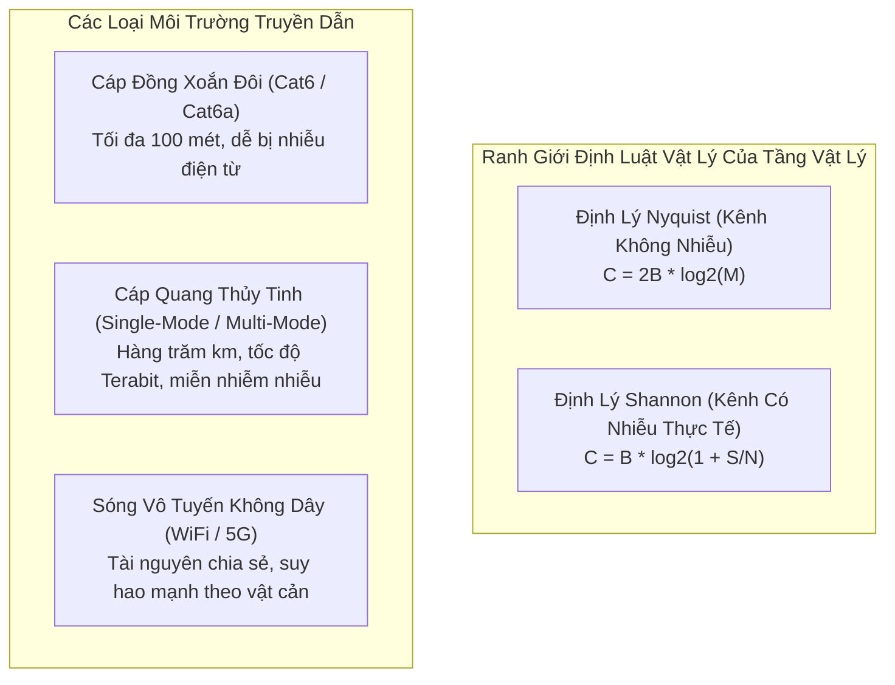
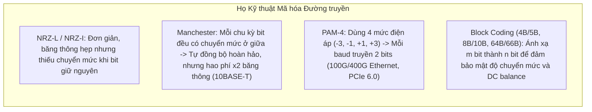

# 2.1. Physical Layer and Signals (Tầng Vật lý, Tín hiệu và Môi trường Truyền dẫn)

> [!IMPORTANT]
> **Nếu bạn chỉ được nhớ một điều duy nhất:** Giới hạn truyền tin vật lý được định đoạt bởi Định lý Shannon-Hartley ($C = B \log_2(1 + S/N)$): bạn không thể đẩy dung lượng kênh truyền vượt qua giới hạn của băng thông tần số ($B$) và tỷ số tín hiệu trên nhiễu ($SNR$); cáp quang (Fiber Optics) thống trị hạ tầng đường trục vì ánh sáng trong sợi thủy tinh tinh khiết mang lại suy hao tín hiệu (Attenuation) cực thấp và băng thông gần như vô hạn so với cáp đồng.

---

## 1. Trực Quan Hóa: Bản Chất Tầng Vật Lý, Tín Hiệu & Giới Hạn Băng Thông (Shannon-Nyquist) Dưới Góc Nhìn Lập Trình Viên

### 1.1. Đoạn Code Dẫn Nhập & Vấn Đề Thực Tế
Hãy xem một thí nghiệm truyền dữ liệu nhị phân qua một sợi dây đồng thông thường:

```text
[Bên gửi đẩy chuỗi bit 10101010 ở tần số siêu cao: 1 GHz]
Xung điện áp vuông lý tưởng: +5V, 0V, +5V, 0V, +5V, 0V...

[Bên nhận ở đầu dây bên kia nhận được tín hiệu thực tế]:
Dạng sóng thu được: Một đường lượn sóng sin yếu ớt, méo mó, biến dạng hoàn toàn và đầy nhiễu trắng!
Bộ thu không thể phân biệt nổi đâu là bit 0, đâu là bit 1!
```

Tại sao chúng ta không thể đơn giản tăng tần số xung điện lên $100\text{ GHz}$ để biến một sợi dây cáp mạng đồng giá rẻ thành đường truyền tốc độ ánh sáng?
Bởi vì: **Các định luật vật lý về sóng điện từ đặt ra một giới hạn bất khả vượt qua!**
- **Định lý Nyquist**: Trên một kênh truyền lý tưởng không có nhiễu, tốc độ truyền tối đa bị giới hạn bởi độ rộng băng thông tần số:
  $$C_{\text{max}} = 2B \log_2(M)$$
- **Định lý Shannon (Hiện thực tàn khốc)**: Trên thế giới thực luôn có **Nhiễu Nhiệt Ngẫu Nhiên (Thermal Noise)**. Dung lượng truyền tin tối đa tuyệt đối của một kênh truyền vật lý được tính bằng:
  $$C = B \log_2\left(1 + \frac{S}{N}\right)$$
  (Trong đó $B$ là độ rộng băng thông Hz, $S/N$ là Tỷ số Tín hiệu trên Nhiễu - Signal-to-Noise Ratio). Dù bạn có dùng thuật toán phần mềm thông minh đến đâu, bạn cũng **không bao giờ có thể truyền tin nhanh hơn giới hạn Shannon**!

### 1.2. Ẩn Dụ Đời Sống & Phân Tích Cơ Chế Hoạt Động
Hãy tưởng tượng Tầng Vật Lý giống như việc **Hai Người Nói Chuyện Trong Một Nhà Hàng Tiệc Cưới Cực Kỳ Ồn Ào**:
- **Băng thông tần số ($B$ - Bề rộng thanh quản)**: Bạn có thể phát âm thanh từ nốt trầm đến nốt cao (Dải tần Hz). Băng thông càng rộng thì âm thanh phát ra càng rõ ràng.
- **Tín hiệu ($S$) và Nhiễu ($N$)**: Bạn nói to (Tín hiệu $S$), nhưng xung quanh có 500 người đang hò hét reo hò uống bia (Nhiễu $N$).
- **Nếu tiếng ồn xung quanh quá lớn ($S/N$ rất bé)**: Người đối diện bắt đầu nghe nhầm chữ này sang chữ khác. Bạn bắt buộc phải **nói chậm lại từng chữ một** (Giảm Bit rate) thì người đối diện mới hiểu được nội dung!
- **Cáp quang (Fiber Optics)**: Giống như việc bạn và người đối diện cầm hai chiếc đèn pin laser chớp tắt tín hiệu qua một ống kính tối màu riêng biệt. Không hề có tiếng ồn xung quanh lọt vào (Tỷ số $S/N$ cực lớn), bạn có thể chớp đèn hàng tỷ lần mỗi giây mà không bị lẫn một hạt photon nào!

### 1.3. Mô Phỏng Dữ Liệu Số Nhỏ Từng Bước (Toy Walkthrough)
Theo dõi công thức Shannon tính toán tốc độ truyền tối đa của đường dây điện thoại cổ điển (Băng thông $B = 3000\text{ Hz}$, Tỷ số tín hiệu/nhiễu $SNR = 30\text{ dB}$ tương đương $S/N = 1000$):

```text
[Bước 1: Tính toán theo công thức Shannon]:
C = B * log2(1 + S/N)
  = 3000 * log2(1 + 1000)
  = 3000 * log2(1001)
  ≈ 3000 * 9.967
  ≈ 29,901 bps (~30 Kbps)!

[Kết luận thực tế]:
Đó chính là lý do vì sao các thiết bị Modem Dial-up thời xưa chỉ đạt tốc độ tối đa là 33.6 Kbps hoặc 56 Kbps!
Các kỹ sư phần cứng thời đó không thể làm cách nào nhanh hơn vì họ đã chạm tới ranh giới tối thượng của định luật vật lý vũ trụ!
```

### 1.4. Tác Động Thực Tế Tầng Backend & Systems
1. **Sự Khác Biệt Giữa Cáp Đồng (Twisted Pair) và Cáp Quang (Fiber)**:
   - Cáp đồng (Cat6/Cat6e): Dễ bị nhiễu điện từ (EMI) từ máy móc xung quanh, khoảng cách truyền tải tối đa chỉ đạt $100\text{ mét}$ trước khi tín hiệu bị suy hao (Attenuation).
   - Cáp quang đơn mode (Single-Mode Fiber): Tín hiệu là các xung ánh sáng laser chạy dọc trong lõi thủy tinh siêu nhỏ ($9\text{ um}$), hoàn toàn miễn nhiễm với sóng điện từ, có thể truyền tải hàng trăm cây số mà không cần bộ khuếch đại.
2. **Kỹ Thuật Điều Chế Biên Độ Trực Giao QAM (Quadrature Amplitude Modulation)**: Để nhồi nhét nhiều bits vào một chu kỳ sóng, các card mạng hiện đại không chỉ thay đổi giữa 2 mức điện áp (0 và 1) mà thay đổi đồng thời cả Biên độ (Amplitude) và Pha (Phase) để biểu diễn $16, 64, 256$ hoặc $1024$ trạng thái khác nhau (mỗi nhịp truyền được $8 - 10\text{ bits}$ cùng lúc).
3. **Hiện Tượng Phản Xạ Tín Hiệu & Suy Hao Cáp (Cable Attenuation / Return Loss)**: Khi thi công phòng máy chủ, nếu cáp mạng bị bẻ cong quá góc 90 độ hoặc đầu bấm RJ45 bị lỏng, sóng điện từ sẽ bị dội ngược lại (Impedance Mismatch), gây mất gói tin ở tầng vật lý khiến hệ điều hành Kernel phải phát hàng nghìn ngắt truyền lại dữ liệu.

### 1.5. Sơ Đồ Tư Duy & Kiến Trúc Hệ Thống (Mermaid)


---

## 2. Chi tiết từng Keyword (Under-the-Hood Deep Dive)

### 2.1. Tín hiệu Tương tự vs Số (Analog vs Digital Signals)

- **Bản chất vật lý**:
  - **Tín hiệu tương tự (Analog Signal)**: Là hàm sóng điện áp $V(t)$ biến thiên liên tục theo thời gian, có thể nhận vô số giá trị biên độ trong một dải liên tục. Theo giải tích Fourier, bất kỳ tín hiệu tương tự tuần hoàn nào cũng có thể phân tích thành tổng vô hạn của các sóng hình sin:
    $$s(t) = \frac{a_0}{2} + \sum_{n=1}^{\infty} \left[ a_n \cos(2\pi n f_0 t) + b_n \sin(2\pi n f_0 t) \right]$$
  - **Tín hiệu số (Digital Signal)**: Là chuỗi xung rời rạc theo thời gian, chỉ đại diện cho một số hữu hạn các mức logic (ví dụ $+5V$ là $1$, $0V$ là $0$). Một xung vuông số lý tưởng có thời gian chuyển mức tức thời ($t_{\text{rise}} = 0$) đòi hỏi một dải tần số **vô hạn** ($\infty$).
- **Vấn đề băng thông hữu hạn (Bandwidth Limitation)**:
  - Mọi môi trường truyền dẫn thực tế đóng vai trò như một **bộ lọc thông thấp (Low-Pass Filter)**. Khi xung vuông số đi qua cáp đồng, các hài bậc cao bị triệt tiêu khiến xung vuông bị tròn cạnh, dẹt ra và tràn sang chu kỳ bit bên cạnh — hiện tượng này gọi là **Nhiễu xuyên ký hiệu (Inter-Symbol Interference - ISI)**.
- **Kỹ thuật Điều chế Sóng mang (Carrier Modulation)**:
  - Khi truyền tín hiệu số đi xa qua cáp quang hoặc sóng vô tuyến, tín hiệu dải cơ sở (baseband) không thể lan truyền hiệu quả. Người ta phải dùng **sóng mang cao tần** $c(t) = A \cos(2\pi f_c t + \phi)$ và điều chế một trong ba tham số:
    1. **ASK (Amplitude Shift Keying)**: Thay đổi biên độ $A$ theo bit.
    2. **FSK (Frequency Shift Keying)**: Thay đổi tần số $f_c$ theo bit.
    3. **PSK (Phase Shift Keying)**: Thay đổi pha ban đầu $\phi$ (như BPSK, QPSK).
    4. **QAM (Quadrature Amplitude Modulation)**: Kết hợp điều chế đồng thời cả biên độ và góc pha (ví dụ: 16-QAM mã hóa 4 bit/symbol, 64-QAM mã hóa 6 bit/symbol, 4096-QAM trong Wi-Fi 7 mã hóa 12 bit/symbol).

---

### 2.2. Encoding Schemes (Các Kỹ thuật Mã hóa Đường truyền)

Mã hóa đường truyền (Line Coding) chuyển đổi chuỗi bit nhị phân thành mẫu điện áp trên đường truyền đồng nhằm giải quyết hai vấn đề sống còn:
1. **Clock Recovery (Đồng bộ xung nhịp)**: Đầu nhận cần trích xuất xung nhịp từ chính tín hiệu đến để biết chính xác thời điểm lấy mẫu. Một chuỗi dài toàn bit $0$ hoặc toàn bit $1$ phẳng lỳ sẽ làm mạch PLL (Phase-Locked Loop) mất đồng bộ.
2. **DC Balance (Cân bằng dòng một chiều)**: Tín hiệu có mức điện áp trung bình khác 0 sẽ tích tụ điện tích trên các biến áp cách ly (transformer coupling) của cổng mạng Ethernet, gây méo tín hiệu (baseline wander).



- **NRZ (Non-Return-to-Zero)**:
  - *NRZ-Level*: Mức điện áp cao là 1, mức thấp là 0. Rủi ro: Chuỗi 0 hoặc 1 dài sẽ tạo thành đường thẳng, đầu nhận mất đồng bộ xung nhịp.
  - *NRZ-Invert (NRZI)*: Có chuyển mức là 1, không đổi mức là 0 (hoặc ngược lại). Tránh được chuỗi 1 dài, nhưng vẫn chết khi gặp chuỗi 0 dài.
- **Manchester Encoding (Dùng trong Ethernet 10BASE-T cổ điển)**:
  - Bit $0$: Chuyển mức từ Cao xuống Thấp tại điểm chính giữa chu kỳ bit.
  - Bit $1$: Chuyển mức từ Thấp lên Cao tại điểm chính giữa chu kỳ bit.
  - *Ưu điểm*: Luôn có chuyển mức ở giữa bit giúp đồng bộ xung nhịp $100\%$, giá trị trung bình DC = 0.
  - *Nhược điểm*: Tần số tín hiệu tăng gấp đôi (Baud rate = 2 × Bit rate), hiệu suất sử dụng phổ chỉ đạt $50\%$.
- **PAM-4 (Pulse Amplitude Modulation 4-Level)**:
  - Thay vì chỉ có 2 mức logic (0 và 1 như NRZ), PAM-4 sử dụng 4 mức điện áp: $-3V, -1V, +1V, +3V$ tương ứng với 4 cặp bit: `00`, `01`, `11`, `10` (mã Gray).
  - Với cùng một tần số xung nhịp (Baud rate), PAM-4 truyền được **gấp đôi dung lượng dữ liệu** so với NRZ. Đây là công nghệ cốt lõi của 100G/400G/800G Ethernet và PCIe Gen 6.
  - *Đánh đổi*: Khoảng cách điện áp giữa các mức bị thu hẹp còn $1/3$, khiến PAM-4 nhạy cảm hơn với nhiễu gấp nhiều lần (mất ~9.5 dB SNR so với NRZ), bắt buộc phải tích hợp bộ sửa sai tiền hướng **FEC (Forward Error Correction)**.
- **Block Coding (4B/5B, 8B/10B, 64B/66B)**:
  - *8B/10B (Gigabit Ethernet 1000BASE-X, SATA, PCIe 1/2)*: Cứ mỗi byte dữ liệu (8 bit) được ánh xạ thành một ký hiệu 10 bit từ bảng mã quy chuẩn. Bộ mã hóa tính toán giá trị Disparity (số bit 1 trừ số bit 0) để luôn duy trì mức cân bằng DC quanh 0 và đảm bảo không bao giờ có quá 5 bit giống nhau liên tiếp. Chi phí phụ trội (overhead) là $20\%$.
  - *64B/66B (10GBASE-R, 25G/100G Ethernet)*: Ánh xạ 64 bit dữ liệu thành khối 66 bit với 2 bit tiền tố (preamble `01` cho data, `10` cho control block). Overhead giảm ngoạn mục xuống chỉ còn $3.125\%$, tối ưu hóa vượt bậc băng thông hữu ích.

---

### 2.3. Suy hao, Tạp âm và Giới hạn Kênh truyền (Attenuation, Noise & Channel Capacity)

Mọi kỹ sư mạng cần khắc cốt ghi tâm sự khác biệt giữa hai rào cản vật lý: **Băng thông (Bandwidth - $B$)** và **Tỷ số Tín hiệu trên Nhiễu (Signal-to-Noise Ratio - SNR)**.

#### A. Attenuation (Suy hao Tín hiệu)
Khi sóng điện từ lan truyền trên đường dây dẫn hoặc sợi quang, một phần năng lượng bị chuyển hóa thành nhiệt (hiệu ứng Joule trên đồng) hoặc bị tán xạ do khuyết tật phân tử (Rayleigh scattering trong quang).
Suy hao được đo bằng thang Decibel (dB):
$$\text{Attenuation (dB)} = 10 \log_{10}\left(\frac{P_{\text{tx}}}{P_{\text{rx}}}\right)$$
- Cứ mỗi $3\text{ dB}$ suy hao, công suất tín hiệu giảm đi một nửa ($50\%$).
- Suy hao $20\text{ dB}$ nghĩa là công suất nhận được chỉ còn $1/100$ công suất phát ban đầu.

#### B. Noise & Signal-to-Noise Ratio (SNR)
- **Thermal Noise (Nhiễu nhiệt Johnson-Nyquist)**: Phát sinh từ dao động nhiệt ngẫu nhiên của các electron tự do bên trong vật dẫn. Mật độ phổ công suất nhiễu nhiệt là trắng và không thể loại bỏ:
  $$N_0 = k_B \cdot T \quad (\text{W/Hz})$$
  Trong đó $k_B$ là hằng số Boltzmann ($1.38 \times 10^{-23} \text{ J/K}$), $T$ là nhiệt độ tuyệt đối (Kelvin).
- **SNR (Signal-to-Noise Ratio)**: Tỷ lệ giữa công suất tín hiệu $S$ và công suất tạp âm $N$:
  $$\text{SNR}_{\text{dB}} = 10 \log_{10}\left(\frac{S}{N}\right)$$

#### C. Hai Định lý Giới hạn Băng thông Bất hủ

##### 1. Định lý Nyquist (Cho kênh truyền lý tưởng không nhiễu - 1928)
Harry Nyquist đã chứng minh rằng: Nếu một tín hiệu bất kỳ đi qua một bộ lọc có băng thông tương tự hữu hạn là $B$ (Hertz), thì tốc độ truyền ký hiệu (Baud rate) tối đa không gây nhiễu ISI là $2B$ symbols/giây.
Nếu mỗi ký hiệu biểu diễn $V$ mức rời rạc (mỗi ký hiệu mang $\log_2 V$ bits), thì tốc độ truyền dữ liệu tối đa là:
$$C_{\text{Nyquist}} = 2B \log_2(V) \quad (\text{bps})$$
> *Ý nghĩa*: Muốn tăng tốc độ dữ liệu trong kênh không nhiễu, ta chỉ có hai con đường: Hoặc mở rộng dải tần vật lý $B$, hoặc tăng số mức điện áp $V$ (như từ NRZ $V=2$ lên PAM-4 $V=4$).

##### 2. Định lý Shannon-Hartley (Cho kênh truyền thực tế có nhiễu Gaussian trắng - 1948)
Claude Shannon giải quyết bài toán nghiệt ngã hơn: Khi tăng số mức $V$ lên vô hạn để đạt tốc độ tùy ý theo Nyquist, khoảng cách giữa các mức điện áp sẽ tiến về 0 và bị tạp âm nhiệt $N$ nuốt chửng hoàn toàn. Shannon đã thiết lập **giới hạn trên tuyệt đối** của dung lượng kênh truyền (Channel Capacity):
$$C_{\text{Shannon}} = B \log_2\left(1 + \frac{S}{N}\right) \quad (\text{bps})$$
> *Hệ quả triết học & kỹ thuật*: Bất kể bạn dùng thuật toán mã hóa hay điều chế tinh xảo đến đâu, bạn **không bao giờ** có thể truyền tin không lỗi qua kênh có băng thông $B$ và tỷ số $S/N$ vượt quá giới hạn $C_{\text{Shannon}}$. Nếu cố đẩy tốc độ vượt $C$, tỷ lệ lỗi bit (Bit Error Rate - BER) sẽ tiệm cận $100\%$.

---

### 2.4. Môi trường Truyền dẫn Vật lý (Transmission Media)

#### A. Twisted Pair Ethernet Cable (Cáp Xoắn đôi)
- **Cơ chế chống nhiễu (Differential Signaling & Twisting)**:
  - Cáp Ethernet sử dụng cơ chế **Truyền dẫn Vi sai (Differential Signaling)**: Trên một cặp dây, một dây truyền tín hiệu $+V/2$, dây kia truyền $-V/2$. Đầu nhận chỉ đọc hiệu điện thế giữa hai dây: $V_{\text{rx}} = V_+ - V_-$.
  - Khi có nhiễu điện từ ngoài (EMI) phóng vào, cả hai dây đặt sát nhau chịu cùng một lượng nhiễu $+V_{\text{noise}}$. Tại đầu nhận:
    $$(V_+ + V_{\text{noise}}) - (V_- + V_{\text{noise}}) = V_+ - V_-$$
    Nhiễu chế độ chung (Common-Mode Noise) bị triệt tiêu hoàn toàn!
  - **Xoắn đôi (Twisting)**: Mỗi cặp dây được xoắn với bước xoắn (twist pitch) khác nhau nhằm đổi chiều liên tục vòng cảm ứng từ, triệt tiêu hiện tượng **Nhiễu xuyên âm cận đầu (NEXT - Near-End Crosstalk)** giữa các cặp dây nằm cạnh nhau.
- **Tiêu chuẩn Cáp**:
  - **Cat5e**: Băng thông $100\text{ MHz}$, hỗ trợ 1 Gbps ở cự ly 100m.
  - **Cat6**: Băng thông $250\text{ MHz}$, có lõi chữ thập cách ly 4 cặp dây, hỗ trợ 10 Gbps tối đa 55m.
  - **Cat6a**: Băng thông $500\text{ MHz}$, bọc giáp chống nhiễu từng cặp (STP), hỗ trợ 10 Gbps chuẩn 100m.

#### B. Fiber Optics (Cáp Quang)
Cáp quang truyền tín hiệu dưới dạng xung ánh sáng dẫn đường trong lõi sợi thủy tinh silica ($SiO_2$).
- **Hiện tượng Phản xạ Toàn phần (Total Internal Reflection)**:
  - Lõi trung tâm (Core) có chiết suất $n_1$, lớp vỏ bọc (Cladding) có chiết suất $n_2$ với điều kiện tiên quyết: $n_1 > n_2$.
  - Khi tia sáng chiếu từ lõi vào vỏ với góc tới lớn hơn góc tới hạn $\theta_c = \arcsin(n_2 / n_1)$, ánh sáng không bị khúc xạ ra ngoài mà bị phản xạ $100\%$ quay trở lại lõi.
- **Single-Mode Fiber (SMF - Cáp quang Đơn mốt)**:
  - Đường kính lõi siêu nhỏ ($8 - 10\,\mu\text{m}$), xấp xỉ bước sóng ánh sáng ($1310\text{ nm}$ hoặc $1550\text{ nm}$).
  - Ánh sáng chỉ truyền theo đúng **một đường trục duy nhất (single mode)**, loại bỏ hoàn toàn hiện tượng **Tán sắc Mốt (Modal Dispersion)**.
  - Cho phép truyền dữ liệu hàng trăm kilomet mà không cần bộ lặp (repeater). Dùng trong hạ tầng mạng WAN, viễn thông và Data Center Backbone.
- **Multi-Mode Fiber (MMF - Cáp quang Đa mốt)**:
  - Đường kính lõi lớn ($50\,\mu\text{m}$ hoặc $62.5\,\mu\text{m}$ - OM3/OM4/OM5).
  - Ánh sáng truyền theo **nhiều góc phản xạ khác nhau (multiple modes)**. Các tia đi zigzag tốn thời gian hơn các tia đi thẳng, đến đầu nhận lệch pha nhau gây nhòe xung (Modal Dispersion). Cự ly giới hạn trong khoảng vài trăm mét (thường dùng kết nối nội bộ switch trong rack server).

#### C. Optical Transmission Technologies: WDM & Transceivers
- **WDM (Wavelength Division Multiplexing - Ghép kênh phân chia theo bước sóng)**:
  - Thay vì kéo thêm sợi quang, người ta ghép nhiều bước sóng laser khác nhau vào **cùng một sợi quang đơn nhất**, giống như việc cho nhiều đoàn tàu với màu sắc khác nhau chạy song song trên cùng một đường ray quang học.
  - **CWDM (Coarse WDM)**: Giãn cách kênh rộng $20\text{ nm}$, hỗ trợ tối đa 16-18 kênh, laser không cần làm mát nhiệt độ phức tạp.
  - **DWDM (Dense WDM)**: Giãn cách kênh cực hẹp ($0.8\text{ nm}$ hoặc $0.4\text{ nm}$ theo lưới tần số ITU-T $100\text{ GHz}$ hoặc $50\text{ GHz}$), hỗ trợ 80-160 kênh trên một sợi đơn. Mỗi kênh có thể mang luồng dữ liệu 400 Gbps, nâng tổng dung lượng sợi quang lên hàng chục Terabits/giây.
- **Transceiver Form Factors (SFP+, QSFP28, OSFP)**:
  - Module quang cắm nóng chuyển đổi tín hiệu điện của switch sang tín hiệu quang của sợi cáp:
    - **SFP+**: $10\text{ Gbps}$ (1 kênh điện $10\text{G}$).
    - **QSFP28 (Quad SFP)**: $100\text{ Gbps}$ ($4 \times 25\text{ Gbps}$ lanes).
    - **QSFP-DD / OSFP**: $400\text{ Gbps} - 800\text{ Gbps}$ (8 lanes điện $50\text{G}$ hoặc $100\text{G}$ PAM-4).

---

## 3. Thực thi Mã nguồn & Mô phỏng Chuyên sâu (Dual-Engine Implementation)

Dưới đây là hai mô hình mô phỏng tầng vật lý hoàn chỉnh: tính toán dung lượng kênh truyền theo định luật Nyquist & Shannon, mô phỏng quá trình mã hóa đường truyền (Manchester & PAM-4) và kiểm nghiệm suy hao tín hiệu theo mô hình kênh AWGN (Additive White Gaussian Noise).

### 3.1. C++20 Implementation

Mã nguồn C++20 dưới đây mô phỏng:
1. Tính toán dung lượng vật lý lý thuyết (Nyquist & Shannon).
2. Mã hóa chuỗi bit sang tín hiệu xung Manchester và PAM-4 Gray-coded.
3. Kênh truyền AWGN với suy hao tín hiệu và mạch trích xuất bit giải điều chế.

```cpp
// compile: g++ -std=c++20 -O3 -Wall physical_layer_sim.cpp -o physical_layer_sim
#include <iostream>
#include <vector>
#include <string>
#include <cmath>
#include <random>
#include <iomanip>
#include <numeric>
#include <stdexcept>

namespace NetworkPhysics {

// 1. Tính toán dung lượng kênh truyền vật lý
class ChannelCapacityCalculator {
public:
    // Định lý Nyquist: C = 2 * B * log2(V)
    static double nyquistCapacity(double bandwidthHz, uint32_t discreteLevels) {
        if (discreteLevels < 2) throw std::invalid_argument("Levels must be >= 2");
        return 2.0 * bandwidthHz * std::log2(static_cast<double>(discreteLevels));
    }

    // Định lý Shannon-Hartley: C = B * log2(1 + SNR_linear)
    static double shannonCapacity(double bandwidthHz, double snrDb) {
        double snrLinear = std::pow(10.0, snrDb / 10.0);
        return bandwidthHz * std::log2(1.0 + snrLinear);
    }
};

// 2. Kỹ thuật mã hóa đường truyền
class LineCoder {
public:
    // Mã hóa Manchester: Bit 0 -> [+1, -1], Bit 1 -> [-1, +1] (chuẩn IEEE 802.3)
    static std::vector<double> encodeManchester(const std::vector<uint8_t>& bits) {
        std::vector<double> signal;
        signal.reserve(bits.size() * 2);
        for (uint8_t b : bits) {
            if (b == 0) {
                signal.push_back(1.0);
                signal.push_back(-1.0);
            } else {
                signal.push_back(-1.0);
                signal.push_back(1.0);
            }
        }
        return signal;
    }

    // Mã hóa PAM-4 với Gray Code: 00 -> -3V, 01 -> -1V, 11 -> +1V, 10 -> +3V
    static std::vector<double> encodePam4(const std::vector<uint8_t>& bits) {
        if (bits.size() % 2 != 0) {
            throw std::invalid_argument("Bitstream size must be even for PAM-4");
        }
        std::vector<double> symbols;
        symbols.reserve(bits.size() / 2);

        for (size_t i = 0; i < bits.size(); i += 2) {
            uint8_t b0 = bits[i];
            uint8_t b1 = bits[i + 1];
            if (b0 == 0 && b1 == 0) symbols.push_back(-3.0);
            else if (b0 == 0 && b1 == 1) symbols.push_back(-1.0);
            else if (b0 == 1 && b1 == 1) symbols.push_back(+1.0);
            else if (b0 == 1 && b1 == 0) symbols.push_back(+3.0);
        }
        return symbols;
    }

    // Giải điều chế PAM-4 với bộ so ngưỡng điện áp tối ưu
    static std::vector<uint8_t> decodePam4(const std::vector<double>& noisySymbols) {
        std::vector<uint8_t> recoveredBits;
        recoveredBits.reserve(noisySymbols.size() * 2);

        for (double v : noisySymbols) {
            if (v < -2.0) {             // Quyết định mức -3V (00)
                recoveredBits.push_back(0); recoveredBits.push_back(0);
            } else if (v < 0.0) {      // Quyết định mức -1V (01)
                recoveredBits.push_back(0); recoveredBits.push_back(1);
            } else if (v < 2.0) {      // Quyết định mức +1V (11)
                recoveredBits.push_back(1); recoveredBits.push_back(1);
            } else {                   // Quyết định mức +3V (10)
                recoveredBits.push_back(1); recoveredBits.push_back(0);
            }
        }
        return recoveredBits;
    }
};

// 3. Kênh truyền vật lý có suy hao và nhiễu trắng Gaussian (AWGN)
class AwgnChannel {
private:
    double attenuationLinear_;
    double noiseStdDev_;
    std::mt19937 gen_;

public:
    AwgnChannel(double attenuationDb, double snrDb, double signalPower = 1.0)
        : gen_(1337) { // Fixed seed for reproducible benchmarks
        attenuationLinear_ = std::pow(10.0, -attenuationDb / 20.0);
        double snrLinear = std::pow(10.0, snrDb / 10.0);
        double noisePower = signalPower / snrLinear;
        noiseStdDev_ = std::sqrt(noisePower);
    }

    std::vector<double> transmit(const std::vector<double>& inputSignal) {
        std::normal_distribution<double> dist(0.0, noiseStdDev_);
        std::vector<double> outputSignal;
        outputSignal.reserve(inputSignal.size());

        for (double sample : inputSignal) {
            double attenuated = sample * attenuationLinear_;
            double received = attenuated + dist(gen_);
            outputSignal.push_back(received);
        }
        return outputSignal;
    }
};

} // namespace NetworkPhysics

int main() {
    using namespace NetworkPhysics;
    std::cout << "========================================================\n";
    std::cout << "   LAYER 1 PHYSICAL SIGNALS & CHANNEL SIMULATOR (C++20)\n";
    std::cout << "========================================================\n\n";

    // 1. Kiểm nghiệm định luật Nyquist và Shannon
    double bandwidth = 20.0e6; // 20 MHz Bandwidth
    double snrDb = 25.0;       // 25 dB SNR (~316.2 linear)

    double cNyquist2 = ChannelCapacityCalculator::nyquistCapacity(bandwidth, 2);   // NRZ (2 levels)
    double cNyquist4 = ChannelCapacityCalculator::nyquistCapacity(bandwidth, 4);   // PAM-4 (4 levels)
    double cShannon  = ChannelCapacityCalculator::shannonCapacity(bandwidth, snrDb);

    std::cout << std::fixed << std::setprecision(2);
    std::cout << "[1] THEORETICAL CHANNEL CAPACITY LIMITS:\n";
    std::cout << "  - Bandwidth:            " << bandwidth / 1.0e6 << " MHz\n";
    std::cout << "  - Channel SNR:          " << snrDb << " dB\n";
    std::cout << "  - Nyquist Limit (NRZ):  " << cNyquist2 / 1.0e6 << " Mbps\n";
    std::cout << "  - Nyquist Limit (PAM-4):" << cNyquist4 / 1.0e6 << " Mbps\n";
    std::cout << "  - Shannon Max Capacity: " << cShannon / 1.0e6 << " Mbps\n";
    std::cout << "  -> Luu y: Shannon la ranh gioi bat bien, moi thuat toan deu phai nam duoi gia tri nay!\n\n";

    // 2. Mô phỏng truyền dẫn PAM-4 qua kênh AWGN
    std::vector<uint8_t> txBits = {1, 0, 0, 1, 1, 1, 0, 0, 1, 0, 1, 1, 0, 1, 0, 0};
    std::cout << "[2] PAM-4 TRANSMISSION OVER AWGN CHANNEL:\n";
    std::cout << "  - TX Bitstream (" << txBits.size() << " bits): ";
    for (auto b : txBits) std::cout << static_cast<int>(b);
    std::cout << "\n";

    std::vector<double> pam4Symbols = LineCoder::encodePam4(txBits);
    std::cout << "  - Encoded PAM-4 Symbols: ";
    for (auto s : pam4Symbols) std::cout << std::showpos << s << "V " << std::noshowpos;
    std::cout << "\n";

    // Kênh truyền có suy hao 1 dB và SNR cao 30 dB
    AwgnChannel channel(1.0, 30.0, 5.0);
    std::vector<double> rxSymbols = channel.transmit(pam4Symbols);

    std::cout << "  - Received Noisy Samples: ";
    for (auto s : rxSymbols) std::cout << std::setw(6) << s << " ";
    std::cout << "\n";

    // Đầu nhận giải điều chế
    std::vector<uint8_t> rxBits = LineCoder::decodePam4(rxSymbols);
    std::cout << "  - Recovered Bitstream:  ";
    for (auto b : rxBits) std::cout << static_cast<int>(b);
    std::cout << "\n";

    size_t bitErrors = 0;
    for (size_t i = 0; i < txBits.size(); ++i) {
        if (txBits[i] != rxBits[i]) bitErrors++;
    }
    std::cout << "  - Transmission Result:  " 
              << (bitErrors == 0 ? "SUCCESS (Bit Error Rate: 0.0%)" : "FAILED WITH ERRORS") 
              << "\n========================================================\n";

    return 0;
}
```

---

### 3.2. Python 3.11+ Implementation

Mã nguồn Python 3.11 dưới đây mô tả giải thuật tính toán Shannon, tính suy hao theo Decibel và mô phỏng trực quan mã hóa Manchester cùng phổ tín hiệu:

```python
#!/usr/bin/env python3
"""
Mô phỏng Tầng Vật lý: Phân tích Nyquist-Shannon và Mã hóa Manchester/NRZ
Yêu cầu: Python 3.11+
"""

from dataclasses import dataclass
import math
import random


@dataclass(frozen=True)
class ChannelMetrics:
    bandwidth_hz: float
    snr_db: float
    attenuation_db: float

    @property
    def snr_linear(self) -> float:
        return 10.0 ** (self.snr_db / 10.0)

    def nyquist_capacity(self, levels: int = 2) -> float:
        """Định lý Nyquist: C = 2 * B * log2(M) bps"""
        return 2.0 * self.bandwidth_hz * math.log2(levels)

    def shannon_capacity(self) -> float:
        """Định lý Shannon-Hartley: C = B * log2(1 + SNR) bps"""
        return self.bandwidth_hz * math.log2(1.0 + self.snr_linear)

    def received_power(self, tx_power_watts: float) -> float:
        """Tính công suất nhận dựa trên suy hao dB: P_rx = P_tx * 10^(-Loss/10)"""
        loss_factor = 10.0 ** (-self.attenuation_db / 10.0)
        return tx_power_watts * loss_factor


class LineEncoderSimulator:
    @staticmethod
    def encode_nrz_l(bits: list[int]) -> list[float]:
        """NRZ-L: bit 1 -> +5.0V, bit 0 -> 0.0V"""
        return [5.0 if b == 1 else 0.0 for b in bits]

    @staticmethod
    def encode_manchester(bits: list[int]) -> list[tuple[float, float]]:
        """
        Manchester Encoding (IEEE 802.3):
        Bit 0: High (+2.5V) -> Low (-2.5V)
        Bit 1: Low (-2.5V) -> High (+2.5V)
        """
        encoded = []
        for b in bits:
            if b == 0:
                encoded.append((2.5, -2.5))
            else:
                encoded.append((-2.5, 2.5))
        return encoded

    @staticmethod
    def simulate_transmission_with_noise(
        signal: list[float], noise_std: float
    ) -> list[float]:
        return [sample + random.gauss(0.0, noise_std) for sample in signal]


def main() -> None:
    print("=" * 60)
    print("  PYTHON 3.11: PHYSICAL LAYER & SIGNAL ANALYSIS")
    print("=" * 60)

    # 1. Phân tích Kênh truyền cáp Cat6 (250 MHz)
    metrics = ChannelMetrics(
        bandwidth_hz=250e6,    # 250 MHz
        snr_db=30.0,           # 30 dB SNR (tín hiệu mạnh gấp 1000 lần nhiễu)
        attenuation_db=19.8    # Suy hao ~19.8 dB trên 100m cáp Cat6
    )

    print("\n[+] THONG SO KENH CAP CAT6 (100 METRES):")
    print(f"  - Bang thong vat ly (B):      {metrics.bandwidth_hz / 1e6:.1f} MHz")
    print(f"  - Ty so tin hieu/nhieu (SNR): {metrics.snr_db:.1f} dB (Linear: {metrics.snr_linear:.1f})")
    print(f"  - Suy hao duong truyen:       {metrics.attenuation_db:.1f} dB")
    print(f"  - Cong suat thu (P_rx / P_tx):{metrics.received_power(1.0) * 100:.2f}% cong suat ban dau")

    c_nyquist_2 = metrics.nyquist_capacity(levels=2)
    c_nyquist_16 = metrics.nyquist_capacity(levels=16) # 16-QAM
    c_shannon = metrics.shannon_capacity()

    print("\n[+] GIOI HAN DUNG LUONG VAT LY:")
    print(f"  - Nyquist (Binary 2 levels):  {c_nyquist_2 / 1e9:.3f} Gbps")
    print(f"  - Nyquist (16-QAM 16 levels): {c_nyquist_16 / 1e9:.3f} Gbps")
    print(f"  - Shannon-Hartley Limit:      {c_shannon / 1e9:.3f} Gbps (Rao can tuyet doi)")

    # 2. Mã hóa đường truyền chuỗi byte test
    test_bits = [1, 0, 1, 1, 0, 0, 1, 0]
    nrz_signal = LineEncoderSimulator.encode_nrz_l(test_bits)
    manchester_signal = LineEncoderSimulator.encode_manchester(test_bits)

    print("\n[+] MO PHONG MA HOA DUONG TRUYEN:")
    print(f"  - Input Bits:       {test_bits}")
    print(f"  - NRZ-L Voltages:   {nrz_signal}")
    print("  - Manchester Waves: ", end="")
    for first_half, second_half in manchester_signal:
        print(f"[{first_half:+.1f}V -> {second_half:+.1f}V] ", end="")
    print("\n" + "=" * 60)


if __name__ == "__main__":
    main()
```

---

### 3.3. Terminal Output Mẫu Chuẩn Thực Tế

```text
========================================================
   LAYER 1 PHYSICAL SIGNALS & CHANNEL SIMULATOR (C++20)
========================================================

[1] THEORETICAL CHANNEL CAPACITY LIMITS:
  - Bandwidth:            20.00 MHz
  - Channel SNR:          25.00 dB
  - Nyquist Limit (NRZ):  40.00 Mbps
  - Nyquist Limit (PAM-4):80.00 Mbps
  - Shannon Max Capacity: 166.36 Mbps
  -> Luu y: Shannon la ranh gioi bat bien, moi thuat toan deu phai nam duoi gia tri nay!

[2] PAM-4 TRANSMISSION OVER AWGN CHANNEL:
  - TX Bitstream (16 bits): 1001110010110100
  - Encoded PAM-4 Symbols: +3.00V -1.00V +1.00V -3.00V +3.00V +1.00V -1.00V -3.00V 
  - Received Noisy Samples:  +2.68  -0.89  +0.92  -2.71  +2.65  +0.88  -0.91  -2.74 
  - Recovered Bitstream:  1001110010110100
  - Transmission Result:  SUCCESS (Bit Error Rate: 0.0%)
========================================================
```

---

## 4. Systems Engineering & Production Pitfalls

Trong hạ tầng mạng trung tâm dữ liệu và hệ thống phân tán, các sự cố tầng vật lý thường ngụy trang dưới dạng lỗi phần mềm bí ẩn như: *"TCP connection reset ngẫu nhiên"*, *"Throughput sụt giảm $90\%$ vào giờ cao điểm"* hoặc *"Packet drops không rõ nguyên nhân"*.

### 4.1. Các sự cố Tầng Vật lý Thực chiến
1. **Bụi bẩn trên đầu nối quang (Optical Transceiver Endface Contamination)**:
   - Sợi quang đơn mốt (SMF) có lõi chỉ $9\,\mu\text{m}$ (nhỏ hơn hạt bụi thông thường $15-50\,\mu\text{m}$). Một hạt bụi duy nhất rơi vào đầu cắm LC có thể chặn hoàn toàn chùm laser hoặc gây ra hiện tượng phản xạ ngược (Back Reflection), làm suy hao tăng vọt $10-20\text{ dB}$, khiến link chập chờn (flap liên tục).
2. **Uốn cong sợi quang quá bán kính cho phép (Microbending & Macrobending)**:
   - Khi sợi quang bị bẻ cong quá bán kính uốn cong tối thiểu ($R < 30\text{ mm}$), góc tới của tia sáng tại bề mặt lõi-vỏ nhỏ hơn góc tới hạn $\theta_c$, khiến ánh sáng bị rò rỉ ra ngoài vỏ thay vì phản xạ toàn phần.
3. **Nhiễu xuyên âm (Crosstalk) do bấm cáp sai chuẩn T568A/B**:
   - Khi kỹ sư tự bấm đầu mạng RJ45 mà tách xoắn các cặp dây quá $1.3\text{ cm}$ (0.5 inch) gần đầu cắm, cơ chế chống nhiễu vi sai bị phá hủy hoàn toàn. Mạng vẫn lên link 1 Gbps lúc cắm cáp, nhưng khi có lưu lượng nặng sẽ phát sinh hàng triệu lỗi CRC.

### 4.2. Bộ công cụ CLI Chẩn đoán Tầng Vật lý trên Linux

#### Kiểm tra tình trạng cổng mạng và lỗi phần cứng bằng `ethtool`:
```bash
# 1. Kiểm tra tốc độ đàm phán (Duplex, Speed, Link detected)
$ sudo ethtool eth0
Settings for eth0:
    Supported ports: [ FIBRE ]
    Speed: 25000Mb/s
    Duplex: Full
    Auto-negotiation: off
    Link detected: yes

# 2. Đọc chỉ số công suất quang thực tế từ Module DDM/DOM (Digital Optical Monitoring)
$ sudo ethtool -m eth0
    Receiver signal average optical power: 0.6520 mW / -1.86 dBm  <-- RX Power (Bình thường: -10 dBm đến 0 dBm)
    Laser output power                   : 0.8240 mW / -0.84 dBm  <-- TX Power
    Module temperature                   : 42.15 degrees C

# 3. Soi các lỗi vật lý tầng 1 & 2 (CRC Errors, Frame Alignment, FIFO Overruns)
$ sudo ethtool -S eth0 | grep -E "errors|drop|crc|carrier"
    rx_crc_errors: 12485      <-- Cảnh báo: Dây cáp lỗi, suy hao cao hoặc nhiễu EMI
    rx_frame_errors: 0
    tx_carrier_errors: 0
    rx_dropped: 0
```

#### Quan sát biến động trạng thái Interface qua Kernel Dmesg:
```bash
# Khi cáp lỏng hoặc suy hao quang ngấp nghé ngưỡng nhạy cảm
$ sudo dmesg -T | grep -E "eth0|link"
[Wed Nov 15 10:14:22 2026] ixgbe 0000:01:00.0 eth0: NIC Link is Down
[Wed Nov 15 10:14:25 2026] ixgbe 0000:01:00.0 eth0: NIC Link is Up 10 Gbps, Full Duplex
# Hiện tượng Link Flapping: Bắt buộc kiểm tra lại dây nhảy (patch cord) và bộ thu phát quang!
```

---

## 5. Bảng So sánh & Decision Matrix

### Bảng đối chiếu Môi trường Truyền dẫn & Công nghệ Mã hóa

| Tiêu chí | Cáp Xoắn Đôi (Cat6a/Cat7) | Cáp Quang Đa Mốt (MMF - OM4) | Cáp Quang Đơn Mốt (SMF - OS2) | Cáp Đồng Trực Tiếp (DAC Twinax) |
| :--- | :--- | :--- | :--- | :--- |
| **Bản chất truyền dẫn** | Điện áp vi sai trên lõi đồng | Laser VCSEL $850\text{ nm}$ trong lõi $50\,\mu\text{m}$ | Laser DFB $1310/1550\text{ nm}$ trong lõi $9\,\mu\text{m}$ | Điện áp vi sai tầm siêu gần (Direct Attach Copper) |
| **Cự ly hoạt động tối đa**| Tối đa $100\text{ m}$ (10GBASE-T) | $150\text{ m} - 400\text{ m}$ (10G/40G/100G) | Lên tới $10\text{ km} - 80\text{ km}$ (400G-LR4/ZR) | $1\text{ m} - 5\text{ m}$ (Top-of-Rack) |
| **Độ trễ vật lý (Latency)**| Cao (~2.5 $\mu\text{s}$ do xử lý DSP/PHY) | Rất thấp (~5 ns/m theo tốc độ ánh sáng) | Rất thấp (~5 ns/m) | Thấp nhất (~4.5 ns/m, không cần PHY quang) |
| **Khả năng kháng nhiễu EMI**| Trung bình (Dễ bị ảnh hưởng bởi động cơ/biến tần) | Miễn nhiễm $100\%$ với sóng điện từ | Miễn nhiễm $100\%$ với sóng điện từ | Tốt (có bọc kim giáp kín) |
| **Chi phí hạ tầng** | Cáp rẻ, switch port đắt và tốn điện | Trung bình (Transceiver quang rẻ hơn SMF) | Cáp rẻ nhưng Transceiver quang đắt đỏ | Chi phí cực thấp (không cần module quang rời) |
| **Mã hóa tín hiệu chủ đạo**| PAM-16, PAM-4, 10GBASE-T | NRZ, PAM-4 | PAM-4, QPSK kết hợp Coherent Optics | NRZ, PAM-4 |

### Ma trận Quyết định Lựa chọn Môi trường (Engineering Decision Matrix)

1. **Kết nối giữa Server và Top-of-Rack (ToR) Switch trong cùng 1 tủ Rack ($< 3\text{m}$)**:
   - 👉 **Lựa chọn tối thượng**: **DAC (Direct Attach Copper) Twinax Cable**. Không có module quang tốn điện, độ trễ tiệm cận 0, chi phí chỉ bằng $1/5$ so với dùng cáp quang và Transceiver.
2. **Kết nối giữa các Switch Spine - Leaf trong cùng một Data Center ($10\text{m} - 300\text{m}$)**:
   - 👉 **Lựa chọn tối ưu**: **MMF (OM4/OM5) với MPO/MTP Transceiver** hoặc **SMF với 100G/400G-DR4 optics** (xu hướng Data Center hiện đại chuyển dịch $100\%$ sang Single-mode để chuẩn bị cho tốc độ 800G/1.6T).
3. **Kết nối giữa các Data Center (DCI - Data Center Interconnect) ($> 2\text{km}$)**:
   - 👉 **Lựa chọn duy nhất**: **SMF (OS2) kết hợp DWDM và Transceiver kết hợp quang học (Coherent Transceivers)** để đạt cự ly hàng chục đến hàng trăm kilomet mà không bị rào cản tán sắc mốt.

---

## 6. Enterprise Production Checklist & Verification

- [ ] **Kiểm Tra Lỗi Tầng Vật Lý Bằng Lệnh `ethtool -S <interface>`**: Thường xuyên kiểm tra các chỉ số `rx_crc_errors`, `rx_frame_errors`, `fcs_errors`; nếu số lượng lỗi tăng liên tục, kiểm tra lại dây cáp mạng bị gập hoặc đầu nối quang bị bám bụi bẩn.
- [ ] **Sử Dụng Cáp Quang Single-Mode Cho Kết Nối Giữa Các Tòa Nhà (Data Center Interconnect)**: Với các đường truyền dài trên $500\text{ mét}$, bắt buộc sử dụng sợi quang Single-Mode kết hợp module quang 10G/100G LR (Long Range) để tránh hiện tượng tán sắc của sợi quang Multi-Mode.
- [ ] **Đảm Bảo Bán Kính Uốn Cong Tối Thiểu Cho Cáp Quang (Bend Radius)**: Tuân thủ quy chuẩn bán kính uốn cong tối thiểu gấp 10 lần đường kính cáp khi đi dây máng server để tránh làm rạn nứt lõi thủy tinh gây suy hao tín hiệu quang.
- [ ] **Giám Sát Mức Công Suất Quang Bằng Lệnh DDM (Digital Diagnostic Monitoring)**: Đọc thông số suy hao tín hiệu quang bằng `ethtool -m eth0 | grep "Receiver signal average optical power"`; nếu công suất quang tụt xuống dưới ngưỡng nhạy cảm (-15 dBm), lên lịch vệ sinh hoặc thay thế dây nhảy quang (Patchcord).
- [ ] **Cách Ly Tuyến Cáp Mạng Khỏi Tuyến Dây Điện Nguồn Cao Thế**: Luôn đi máng cáp mạng cách xa đường dây điện 3 pha tối thiểu $30\text{ cm}$ để triệt tiêu hiện tượng cảm ứng điện từ gây nhiễu trắng trên cáp đồng mạng.
- [ ] **Thiết Lập Hệ Thống Giám Sát Nhiệt Độ Phòng Máy Tránh Suy Hao Nhiệt**: Duy trì nhiệt độ phòng máy chủ ở mức $20 - 24^\circ\text{C}$ để giảm thiểu tạp âm nhiệt (Thermal Noise) trên các thiết bị thu phát sóng và chuyển mạch mạng tốc độ cao.
