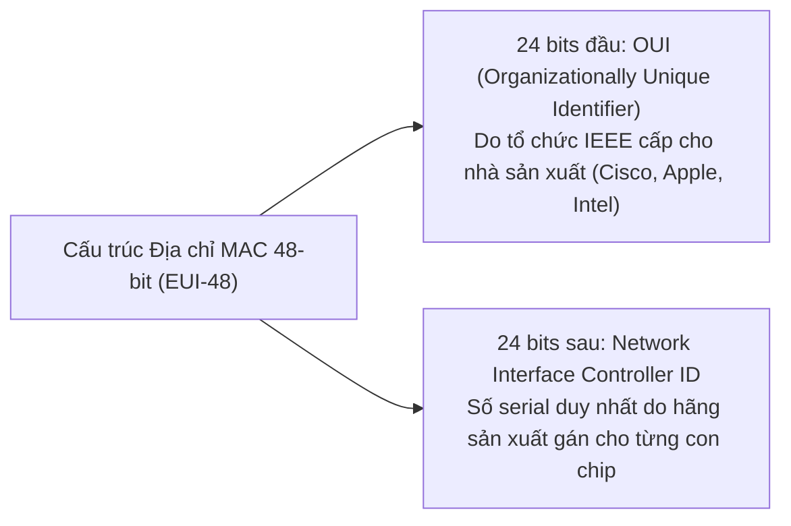
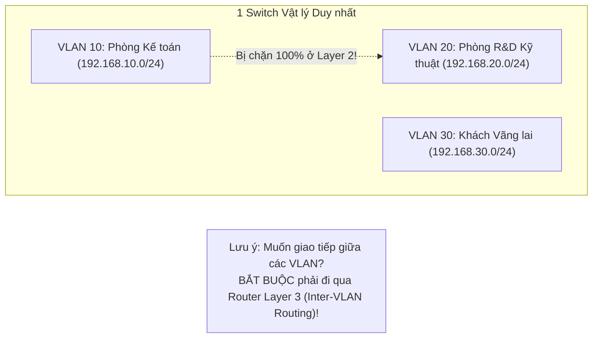

# 2.2. Data Link Layer, Ethernet and Switching (Tầng Liên kết Dữ liệu, Ethernet và Chuyển mạch L2)

> [!IMPORTANT]
> **Nếu bạn chỉ được nhớ một điều duy nhất:** Tầng Liên kết dữ liệu (Data Link Layer) chịu trách nhiệm vận chuyển Frame tin cậy giữa hai thiết bị trong cùng một mạng cục bộ (LAN): Switch Ethernet hoạt động hoàn toàn ở Tầng 2 bằng cách tự học địa chỉ MAC vào Bảng CAM (Content Addressable Memory) thông qua địa chỉ nguồn của Frame; và giao thức ARP (Address Resolution Protocol) là cầu nối sống còn chuyển đổi địa chỉ logic IP Tầng 3 thành địa chỉ vật lý MAC Tầng 2.

---

## 1. Trực Quan Hóa: Bản Chất Tầng Liên Kết Dữ Liệu, Ethernet & Chuyển Mạch L2 Dưới Góc Nhìn Lập Trình Viên

### 1.1. Đoạn Code Dẫn Nhập & Vấn Đề Thực Tế
Hãy xem một thí nghiệm trong mạng nội bộ văn phòng khi hai máy tính cùng có địa chỉ IP `192.168.1.50`:

```bash
# Kiểm tra bảng phân giải địa chỉ ARP trên máy tính của bạn:
arp -a
# KẾT QUẢ HIỂN THỊ:
# IP 192.168.1.1 (Router Gateway) tại địa chỉ MAC 00:11:22:33:44:55
# IP 192.168.1.50 (Máy In Văn Phòng) tại địa chỉ MAC 52:54:00:12:34:56

# ĐỘT NHIÊN KẺ TẤN CÔNG BẬT CÔNG CỤ ARP SPOOFING / POISONING:
# Gửi liên tục các gói ARP Reply giả mạo: "Tôi là 192.168.1.1, địa chỉ MAC của tôi là AA:BB:CC:DD:EE:FF"
```

Hậu quả: Toàn bộ lưu lượng mạng Internet của bạn bị chuyển hướng thẳng sang máy tính của hacker mà bạn hoàn toàn không hề hay biết!
Tại sao trong mạng nội bộ (LAN), địa chỉ IP trở nên hoàn toàn "vô dụng", và máy tính chỉ thực sự tin tưởng **Địa chỉ MAC (Media Access Control)**? Cơ chế hoạt động của **Switch L2** và bảng tra cứu CAM Table có bản chất như thế nào?

### 1.2. Ẩn Dụ Đời Sống & Phân Tích Cơ Chế Hoạt Động
Hãy tưởng tượng sự khác biệt giữa Địa Chỉ IP và Địa Chỉ MAC thông qua **Danh Tính Con Người**:
- **Địa chỉ IP (Logical Address)**: Giống như **Địa Chỉ Tạm Trú Của Bạn** (Ví dụ: Số nhà 123, Đường Láng, Hà Nội). Bạn chuyển nhà vào Sài Gòn, bạn sẽ được cấp một địa chỉ tạm trú mới. Nó mang tính chất phân vùng vị trí địa lý để người đưa thư từ xa biết đường tìm đến.
- **Địa chỉ MAC (Physical Address - 48-bit EUI-48)**: Giống như **Số Căn Cước Công Dân / Dấu Vân Tay Duy Nhất Của Bạn**. Nó được nhà sản xuất khắc chết vào phần cứng của Card mạng từ lúc xuất xưởng. Bạn mang máy tính đi bất kỳ nơi đâu trên thế giới, địa chỉ MAC vẫn giữ nguyên vẹn không đổi.
- **Giao thức ARP (Address Resolution Protocol - Tiếng Loa Phát Thanh)**: Bạn bước vào phòng làm việc có 50 người. Bạn muốn gửi tài liệu cho anh "Nguyễn Văn A" (Địa chỉ IP `192.168.1.50`). Nhưng bạn không biết mặt anh ta! Bạn cầm loa hét to lên giữa phòng (**ARP Broadcast**): "Ai là Nguyễn Văn A, hãy đọc số CCCD cho tôi!". Cả phòng đều nghe thấy tiếng loa, nhưng chỉ duy nhất anh Nguyễn Văn A đứng dậy trả lời (**ARP Unicast**): "Tôi là Nguyễn Văn A, số CCCD của tôi là 52:54:00:12:34:56!". Bạn ghi nhớ điều này vào sổ tay (**ARP Cache**) để lần sau cứ thế gửi thẳng tài liệu!
- **Thiết bị chuyển mạch (L2 Switch)**: Giống như một **Nhân Viên Bưu Điện Trực Cổng Tòa Nhà Thông Minh**. Nhân viên có một cuốn sổ ghi nhớ (**CAM Table**): "Cổng cắm số 1 nối với anh CCCD X, Cổng cắm số 2 nối với chị CCCD Y". Khi một gói hàng đến, nhân viên nhìn địa chỉ MAC đích và **chỉ chuyển tiếp đúng vào cổng cắm của người đó**, hoàn toàn không làm phiền đến các phòng ban khác (Loại bỏ hoàn toàn đụng độ mạng Collision)!

### 1.3. Mô Phỏng Dữ Liệu Số Nhỏ Từng Bước (Toy Walkthrough)
Theo dõi bảng CAM (Content Addressable Memory) của một Switch 4 cổng tự học địa chỉ MAC:

```text
[Trạng thái ban đầu]: Bảng CAM Table của Switch hoàn toàn rỗng [].

[Thời điểm T = 1]: Máy A (MAC_A cắm ở Port 1) gửi gói tin cho Máy B (MAC_B cắm ở Port 2).
Bước 1: Khung Ethernet đến Port 1: [Source MAC: MAC_A | Dest MAC: MAC_B].
Bước 2: Switch tự học ngay lập tức: "À, MAC_A đang cắm ở Port 1!". Ghi vào CAM: {MAC_A -> Port 1}.
Bước 3: Switch tra cứu MAC_B trong CAM -> Chưa có thông tin!
Bước 4: Switch thực hiện FLOODING: Bắn bản sao gói tin ra TẤT CẢ các cổng còn lại (Port 2, 3, 4).

[Thời điểm T = 2]: Máy B nhận được gói tin và gửi lại phản hồi cho Máy A:
Bước 5: Khung Ethernet đến Port 2: [Source MAC: MAC_B | Dest MAC: MAC_A].
Bước 6: Switch học tiếp: "MAC_B đang cắm ở Port 2!". Ghi vào CAM: {MAC_B -> Port 2}.
Bước 7: Switch tra cứu MAC_A trong CAM -> Thấy ngay: MAC_A nằm ở Port 1!
Bước 8: Switch chuyển tiếp gói tin CHÍNH XÁC sang Port 1 (Unicast)! Hoàn toàn không Flooding ra Port 3 hay 4 nữa!
=> Switch đã hoàn tất việc học tập và tối ưu hóa luồng chuyển mạch chỉ sau đúng 1 chu kỳ hỏi đáp!
```

### 1.4. Tác Động Thực Tế Tầng Backend & Systems
1. **Sự Cố Tràn Bảng CAM (CAM Table Flooding Attack)**: Kẻ tấn công trong mạng nội bộ liên tục gửi hàng triệu khung Ethernet với địa chỉ MAC nguồn ngẫu nhiên giả mạo. Bảng CAM của Switch bị đầy $100\%$, buộc Switch phải thoái hóa trở thành một chiếc **Hub ngớ ngẩn (Fail-open to Hub)**: Chuyển toàn bộ lưu lượng mạng sang chế độ Flooding ra tất cả các cổng, cho phép kẻ tấn công bắt trộm toàn bộ mật khẩu và dữ liệu của cả công ty!
2. **Cơn Ác Mộng Cơn Bão Broadcast (Broadcast Storm) & Giao Thức Spanning Tree (STP)**: Nếu ai đó cắm nhầm một sợi dây mạng nối 2 cổng của Switch lại với nhau tạo thành vòng lặp (Loop), một gói tin ARP Broadcast duy nhất sẽ bị nhân bản vô tận và chạy vòng tròn với tốc độ ánh sáng, làm tê liệt $100\%$ CPU của toàn bộ hệ thống mạng trong vòng 3 giây! Giao thức Spanning Tree (STP) tự động phát hiện vòng lặp và khóa cổng dự phòng để bảo vệ mạng.
3. **Mạng Ảo VLAN (802.1Q Tagging)**: Để ngăn chặn việc các phòng ban đọc trộm gói tin của nhau hoặc hạn chế bão Broadcast, kỹ sư mạng chia Switch thành nhiều mạng LAN ảo (VLAN 10, VLAN 20). Một thẻ tag 4-bytes chứa VLAN ID được chèn thẳng vào giữa Ethernet Header để Switch biết đường cách ly luồng dữ liệu.

### 1.5. Sơ Đồ Tư Duy & Kiến Trúc Hệ Thống (Mermaid)

```mermaid
flowchart TD
    subgraph EthernetFrame ["Cấu Trúc Khung Khung Ethernet Chuẩn (IEEE 802.3)"]
        direction LR
        Preamble["Preamble & SFD (8B)"] --> DMAC["Dest MAC (6B)"]
        DMAC --> SMAC["Source MAC (6B)"]
        SMAC --> VLANTag["Optional: 802.1Q VLAN Tag (4B)"]
        VLANTag --> EType["EtherType (2B: 0x0800 IPv4 / 0x0806 ARP)"]
        EType --> Payload["Dữ Liệu Payload (46 - 1500 Bytes MTU)"]
        Payload --> FCS["FCS / CRC32 Checksum (4B)"]
    end

    subgraph SwitchLearning ["Cơ Chế Tự Học Bảng CAM Của Switch L2"]
        Port1["Port 1 (Máy A)"] -->|Gói tin MAC_A gửi MAC_B| SwitchCore["Bộ Chuyển Mạch Switch"]
        SwitchCore --> CAM["Bảng Tra Cứu CAM: [MAC_A -> Port 1]"]
        SwitchCore -->|Chuyển tiếp chính xác| Port2["Port 2 (Máy B)"]
    end
```


---

## 2. Chi tiết từng Keyword (Under-the-Hood Deep Dive)

### 2.1. MAC Address (Địa chỉ Điều khiển Truy cập Môi trường)

Địa chỉ MAC (Media Access Control) là địa chỉ vật lý duy nhất toàn cầu có độ dài **48 bits (6 bytes)**, thường được biểu diễn dưới dạng 12 chữ số thập lục phân phân tách bởi dấu hai chấm hoặc dấu gạch ngang (ví dụ: `00:1A:2B:3C:4D:5E`).



- **Hai bit đặc biệt trong Byte đầu tiên của MAC Address**:
  - **Bit I/G (Individual / Group - Bit 0 của byte 0)**:
    - `0`: Địa chỉ **Unicast** (chỉ dành cho 1 card mạng cá nhân).
    - `1`: Địa chỉ **Multicast / Broadcast** (dành cho một nhóm hoặc toàn bộ thiết bị). Ví dụ: `FF:FF:FF:FF:FF:FF` có toàn bộ các bit bằng 1 (Broadcast).
  - **Bit U/L (Universal / Local - Bit 1 của byte 0)**:
    - `0`: Địa chỉ duy nhất toàn cầu (Globally Unique) do IEEE quản lý.
    - `1`: Địa chỉ do quản trị viên quản lý cục bộ (Locally Administered), thường gặp khi tạo card mạng ảo trong Docker hoặc KVM.

---

### 2.2. Ethernet Frame Format (Cấu trúc Khung Ethernet IEEE 802.3 / Ethernet II)

Khung mạng Ethernet II (chuẩn thực tế của toàn bộ mạng Internet ngày nay) có cấu trúc nhị phân chặt chẽ:

```text
+-------------------+----------------+---------------+---------------+-----------+-----------------+---------------+
| Preamble & SFD    | Destination    | Source        | EtherType     | Payload   | Padding         | Frame Check   |
| (7 Bytes + 1 Byte)| MAC (6 Bytes)  | MAC (6 Bytes) | (2 Bytes)     | (IP Data) | (Nếu < 46 Bytes)| Sequence (FCS)|
| 10101010...10101011| 00:1A:2B:...  | 52:54:00:...  | 0x0800 (IPv4) | (46-1500B)|                 | (CRC-32: 4 B) |
+-------------------+----------------+---------------+---------------+-----------+-----------------+---------------+
|<--- Không tính vào Frame Size --->|<------------------- Frame Size: 64 đến 1518 Bytes ------------------>|
```

- **Preamble (7 bytes) & SFD (Start Frame Delimiter - 1 byte)**:
  - Chuỗi mẫu bit xen kẽ `10101010` giúp mạch phục hồi xung nhịp (Clock Recovery) của đầu nhận đồng bộ tần số với đầu phát. Byte SFD kết thúc bằng hai bit `11` (`10101011`) để báo hiệu: *"Ngay sau byte này là byte đầu tiên của Destination MAC!"*.
- **Destination MAC (6 bytes) & Source MAC (6 bytes)**.
- **EtherType (2 bytes)**:
  - Chỉ định giao thức tầng mạng cấp cao đang được đóng gói bên trong:
    - `0x0800`: IPv4
    - `0x86DD`: IPv6
    - `0x0806`: ARP
    - `0x8100`: VLAN-Tagged Frame (IEEE 802.1Q).
- **Payload & Padding (46 - 1500 bytes)**:
  - Kích thước payload tối thiểu của Ethernet bắt buộc phải là **46 bytes** để đảm bảo tổng độ dài khung (không tính preamble) đạt ít nhất **64 bytes**. Nếu dữ liệu ứng dụng nhỏ hơn 46 bytes, card mạng sẽ tự động chèn thêm các byte số 0 (**Padding**).
- **FCS (Frame Check Sequence - 4 bytes)**:
  - Mã kiểm tra dư thừa tuần hoàn **CRC-32**. Nếu đầu nhận tính toán lại mã CRC mà không khớp, khung dữ liệu bị vứt bỏ ngay lập tức ở tầng phần cứng NIC.

---

### 2.3. MTU vs Jumbo Frame (Kích thước Truyền tải Tối đa)

- **Standard MTU (Maximum Transmission Unit - 1500 Bytes)**:
  - Kích thước payload lớn nhất mà một khung Ethernet tiêu chuẩn có thể chứa. Con số 1500 bytes được Robert Metcalfe lựa chọn từ năm 1980 như một điểm thỏa hiệp giữa chi phí bộ đệm RAM đắt đỏ thời bấy giờ và tỷ lệ lỗi đường truyền.
- **Jumbo Frame (9000 Bytes)**:
  - Khung Ethernet mở rộng hỗ trợ mang payload lên tới **9000 bytes**.
  - **Lợi ích to lớn trong Data Center**:
    - Để truyền tải 9000 bytes dữ liệu, Standard MTU cần 6 khung Ethernet riêng biệt (tương ứng 6 lần ngắt phần cứng CPU Interrupts, 6 lần xử lý header).
    - Jumbo Frame chỉ cần **đúng 1 khung duy nhất**, giúp giảm $80\%$ số lượng ngắt CPU và tăng $20 - 30\%$ thông lượng truyền tải dữ liệu.
  - **Cảnh báo sống còn**: Toàn bộ các thiết bị trên đường truyền (Switch, Router, NIC hai đầu) **bắt buộc phải cùng hỗ trợ Jumbo Frames**. Nếu một switch ở giữa chỉ hỗ trợ MTU 1500, gói tin Jumbo sẽ bị drop thẳng tay!

---

### 2.4. VLAN & IEEE 802.1Q (Mạng Cục bộ Ảo và Gắn thẻ VLAN)

VLAN (Virtual Local Area Network) cho phép chia tách một switch vật lý duy nhất thành nhiều mạng LAN logic biệt lập, cô lập hoàn toàn lưu lượng giữa các phòng ban.



- **Chuẩn Gắn thẻ IEEE 802.1Q (VLAN Tagging)**:
  - Khi khung dữ liệu di chuyển trên đường truyền dùng chung nối giữa các switch (**Trunk Port**), switch sẽ chèn thêm một **thẻ 802.1Q Header 4 bytes** vào ngay giữa Source MAC và EtherType:
    1. **TPID (Tag Protocol Identifier - 16 bits)**: Luôn có giá trị cố định `0x8100`.
    2. **TCI (Tag Control Information)**:
       - **PCP (Priority Code Point - 3 bits)**: Mức ưu tiên chất lượng dịch vụ QoS (0 - 7, dùng cho Voice/Video).
       - **DEI (Drop Eligible Indicator - 1 bit)**: Đánh dấu gói tin có thể bị drop nếu mạng nghẽn.
       - **VID (VLAN Identifier - 12 bits)**: Số định danh VLAN (giá trị từ $1$ đến $4094$, hỗ trợ tối đa **4094 VLANs**).
- **Access Port vs Trunk Port**:
  - **Access Port**: Cổng cắm vào máy tính người dùng cuối. Máy tính chỉ nhận và gửi khung Ethernet tiêu chuẩn (Untagged Frame). Switch sẽ tự động gắn tag khi nhận và gỡ tag khi chuyển ra cho máy tính.
  - **Trunk Port**: Cổng nối giữa Switch với Switch hoặc Switch với Router. Cho phép nhiều VLAN cùng đi qua, bắt buộc phải gắn thẻ (Tagged Frame).

---

### 2.5. Address Resolution Protocol (ARP) & NDP

Làm thế nào để biết địa chỉ MAC của một máy tính khi chỉ biết địa chỉ IP của nó?
- **Quy trình Hoạt động của ARP (RFC 826)**:
  1. Máy A gửi gói tin **ARP Request** dưới dạng Broadcast (`FF:FF:FF:FF:FF:FF`): *"Ai đang giữ IP 192.168.1.50? Hãy trả lời cho MAC của tôi!"*.
  2. Mọi máy trong mạng LAN đều nhận được gói tin, nhưng chỉ máy có IP trùng khớp mới phản hồi.
  3. Máy B phản hồi gói tin **ARP Reply** dưới dạng Unicast trực tiếp về MAC của máy A.
  4. Máy A lưu ánh xạ này vào **Bảng ARP Cache** cục bộ với thời gian hết hạn (Aging Timeout, thường từ 60 đến 300 giây).
- **ARP Spoofing / Poisoning**: Giao thức ARP không hề có mã hóa hay xác thực. Bất kỳ kẻ tấn công nào cũng có thể gửi gói tin ARP Reply giả mạo để mạo danh Default Gateway, thực hiện tấn công Man-in-the-Middle.
- **IPv6 NDP (Neighbor Discovery Protocol - RFC 4861)**: Trong IPv6, ARP bị khai tử hoàn toàn và được thay thế bằng **NDP** chạy trên nền ICMPv6 (sử dụng các gói `Neighbor Solicitation` và `Neighbor Advertisement` qua địa chỉ Multicast Solicited-Node an toàn hơn).

---

### 2.6. Link Layer Switching: Switch, Bridge, Domains & STP

- **Collision Domain (Miền Xung đột) vs Broadcast Domain (Miền Quảng bá)**:
  - **Collision Domain**: Vùng mạng mà nếu hai thiết bị cùng phát tín hiệu một lúc sẽ gây ra xung đột va chạm. Một Hub là 1 collision domain duy nhất. **Một Switch chia mỗi cổng thành 1 Collision Domain độc lập**.
  - **Broadcast Domain**: Vùng mạng mà một gói tin Broadcast có thể lan tới. **Switch không thể chia cắt Broadcast Domain**; chỉ có **Router L3 hoặc VLAN** mới chia cắt được Broadcast Domain.
- **Bảng CAM (Content Addressable Memory) & Cơ chế Học Địa chỉ**:
  - Switch soi MAC nguồn của mọi khung đi vào cổng để ghi nhận: `[Port X -> MAC Y]`.
  - Nếu MAC đích đã có trong bảng CAM -> **Forward** trực tiếp ra cổng đích.
  - Nếu MAC đích chưa có trong bảng CAM -> **Flooding** khung dữ liệu ra toàn bộ các cổng khác (trừ cổng nhận vào).
  - Các bản ghi trong bảng CAM sẽ tự động bị xóa sau một khoảng thời gian không thấy hoạt động (**Aging Time**, mặc định 300 giây).
- **Spanning Tree Protocol (STP - IEEE 802.1D / RSTP 802.1w)**:
  - Khi thiết kế mạng doanh nghiệp, người ta luôn cắm dư thừa các sợi dây cáp giữa các switch để dự phòng (Redundancy).
  - *Mối nguy*: Vòng lặp vật lý (Switching Loop) sẽ biến một gói tin Broadcast thành một cơn bão **Broadcast Storm** phá hủy toàn bộ mạng sau vài giây.
  - *Cơ chế STP*: Các switch trao đổi các gói tin điều khiển **BPDU (Bridge Protocol Data Unit)**, bầu chọn một **Root Bridge** trung tâm, tính toán đường đi ngắn nhất và **tự động khóa (Block)** các cổng dư thừa. Khi một đường cáp chính bị đứt, cổng bị khóa sẽ tự động mở lại trong vòng vài giây (RSTP) để tiếp tục lưu thông!

---

### 2.7. Link Aggregation & LACP (Ghép kênh Đường truyền)

- Thay vì chỉ dùng 1 sợi cáp mạng 1 Gbps, công nghệ **Link Aggregation (IEEE 802.3ad / 802.1AX - LACP)** cho phép gộp từ 2 đến 8 cổng mạng vật lý song song thành một kênh logic duy nhất (**Port Channel / LAG / Bonding Interface**).
- **Lợi ích**:
  - **Tăng băng thông tổng thể**: Gộp 4 cổng 1 Gbps thành một kênh 4 Gbps.
  - **Dự phòng lỗi tức thì (Failover)**: Nếu 1 trong 4 sợi cáp bị chuột cắn đứt, 3 sợi còn lại tiếp tục truyền dữ liệu bình thường mà không làm rớt kết nối mạng.
- **Cơ chế Phân bổ Tải (Load Balancing Hash)**:
  - Switch không chia nhỏ từng byte mà sử dụng hàm băm dựa trên **Source MAC, Dest MAC, hoặc 5-tuple IP/Port** để quyết định gói tin của một kết nối sẽ đi qua sợi cáp vật lý nào, đảm bảo mọi gói tin của cùng một luồng TCP luôn đi trên cùng 1 sợi cáp để tránh bị lệch thứ tự (Out-of-Order).

---

## 3. Thực thi Mã nguồn & Mô phỏng Chuyên sâu (Dual-Engine Implementation)

### 3.1. C++20 Implementation

Mã nguồn C++20 dưới đây mô phỏng một **Software L2 Ethernet Switch Engine**: tự động học địa chỉ MAC vào bảng CAM, quản lý thời gian sống của bản ghi (Aging Timeout), xử lý quyết định Forwarding Unicast hoặc Flooding chuẩn IEEE 802.3:

```cpp
// compile: g++ -std=c++20 -O3 -Wall l2_switch_sim.cpp -o l2_switch_sim
#include <iostream>
#include <string>
#include <unordered_map>
#include <vector>
#include <chrono>
#include <iomanip>

namespace Layer2Switching {

struct CamTableEntry {
    std::string macAddress;
    uint32_t port;
    std::chrono::steady_clock::time_point lastSeen;
};

struct EthernetFrame {
    std::string srcMac;
    std::string dstMac;
    uint16_t etherType;
    std::string payload;
};

class SimulatedL2Switch {
private:
    uint32_t numPorts_;
    std::chrono::seconds agingTimeout_;
    std::unordered_map<std::string, CamTableEntry> camTable_;

public:
    SimulatedL2Switch(uint32_t ports, std::chrono::seconds agingTimeout = std::chrono::seconds(5))
        : numPorts_(ports), agingTimeout_(agingTimeout) {}

    void processIncomingFrame(uint32_t ingressPort, const EthernetFrame& frame) {
        auto now = std::chrono::steady_clock::now();

        // 1. Dọn dẹp các bản ghi quá hạn trong bảng CAM
        evictExpiredEntries(now);

        // 2. MAC Learning: Học địa chỉ MAC nguồn của khung dữ liệu
        camTable_[frame.srcMac] = CamTableEntry{
            .macAddress = frame.srcMac,
            .port = ingressPort,
            .lastSeen = now
        };
        std::cout << "  [MAC LEARNING] Port " << ingressPort << " gan voi MAC: " << frame.srcMac << "\n";

        // 3. Xử lý Forwarding / Flooding dựa trên MAC đích
        if (frame.dstMac == "FF:FF:FF:FF:FF:FF") {
            // Khung Broadcast -> Bắt buộc Flooding
            std::cout << "  [ACTION: BROADCAST FLOODING] Phat toi tat ca cac cong: ";
            for (uint32_t p = 1; p <= numPorts_; ++p) {
                if (p != ingressPort) std::cout << "Port " << p << " ";
            }
            std::cout << "\n\n";
            return;
        }

        auto it = camTable_.find(frame.dstMac);
        if (it != camTable_.end()) {
            // Đã biết cổng đích trong bảng CAM -> Chuyển tiếp Unicast trực tiếp
            uint32_t targetPort = it->second.port;
            if (targetPort == ingressPort) {
                std::cout << "  [ACTION: FILTER DROP] MAC dich nam cung cong voi nguon -> Loc bo goi tin.\n\n";
            } else {
                std::cout << "  [ACTION: UNICAST FORWARD] Chuyen tiep thang ra Port " << targetPort 
                          << " (Chinh xac, khong gay nghen mang!)\n\n";
            }
        } else {
            // Chưa biết MAC đích -> Bắt buộc UNKNOWN UNICAST FLOODING
            std::cout << "  [ACTION: UNKNOWN FLOODING] Chua ro MAC dich " << frame.dstMac 
                      << " -> Phat tran ra tat ca cac cong (tru Port " << ingressPort << ")!\n\n";
        }
    }

    void evictExpiredEntries(std::chrono::steady_clock::time_point now) {
        for (auto it = camTable_.begin(); it != camTable_.end();) {
            if (now - it->second.lastSeen > agingTimeout_) {
                std::cout << "  [CAM AGING] Ban ghi MAC " << it->first << " het han -> Xoa khoi bang CAM!\n";
                it = camTable_.erase(it);
            } else {
                ++it;
            }
        }
    }

    void displayCamTable() const {
        std::cout << "=== CURRENT SWITCH CAM TABLE ===\n";
        std::cout << "  MAC Address        | Port\n";
        std::cout << "  -------------------|-----\n";
        for (const auto& [mac, entry] : camTable_) {
            std::cout << "  " << mac << "  | Port " << entry.port << "\n";
        }
        std::cout << "================================\n\n";
    }
};

} // namespace Layer2Switching

int main() {
    using namespace Layer2Switching;
    std::cout << "========================================================\n";
    std::cout << "      C++20 L2 ETHERNET SWITCH SIMULATOR (CAM TABLE)    \n";
    std::cout << "========================================================\n\n";

    SimulatedL2Switch switchDev(4, std::chrono::seconds(3)); // 4 Cổng, timeout 3s

    // Khung 1: Host A (Port 1) gửi Broadcast ARP Request tìm Host B
    std::cout << "[1] FRAME 1: Host A phat ARP Request (Broadcast):\n";
    switchDev.processIncomingFrame(1, EthernetFrame{
        .srcMac = "00:11:22:33:44:AA",
        .dstMac = "FF:FF:FF:FF:FF:FF",
        .etherType = 0x0806,
        .payload = "ARP Who has 192.168.1.20?"
    });

    // Khung 2: Host B (Port 2) gửi Unicast ARP Reply trả lời cho Host A
    std::cout << "[2] FRAME 2: Host B tra loi ARP Reply cho Host A (Unicast):\n";
    switchDev.processIncomingFrame(2, EthernetFrame{
        .srcMac = "00:11:22:33:44:BB",
        .dstMac = "00:11:22:33:44:AA",
        .etherType = 0x0806,
        .payload = "ARP I am 192.168.1.20"
    });

    // Hiển thị bảng CAM sau 2 khung
    switchDev.displayCamTable();

    // Khung 3: Host A gửi dữ liệu Unicast tới Host B -> Đã biết Port 2
    std::cout << "[3] FRAME 3: Host A gui HTTP Data toi Host B:\n";
    switchDev.processIncomingFrame(1, EthernetFrame{
        .srcMac = "00:11:22:33:44:AA",
        .dstMac = "00:11:22:33:44:BB",
        .etherType = 0x0800,
        .payload = "GET /index.html HTTP/1.1"
    });

    std::cout << "========================================================\n";
    return 0;
}
```

---

### 3.2. Python 3.11+ Implementation

Mã nguồn Python 3.11 dưới đây mô phỏng **Bộ phân giải Địa chỉ ARP Cache và Thẻ VLAN IEEE 802.1Q**:

```python
#!/usr/bin/env python3
"""
Mô phỏng Giao thức ARP Cache và Cấu trúc Gắn thẻ VLAN IEEE 802.1Q
Yêu cầu: Python 3.11+
"""

from dataclasses import dataclass
import time


@dataclass
class ArpCacheEntry:
    ip_address: str
    mac_address: str
    created_at: float
    ttl_seconds: float = 5.0

    @property
    def is_expired(self) -> bool:
        return (time.time() - self.created_at) > self.ttl_seconds


class ArpResolutionEngine:
    def __init__(self) -> None:
        self.arp_cache: dict[str, ArpCacheEntry] = {}

    def resolve(self, target_ip: str, simulated_mac_source: dict[str, str]) -> str:
        now = time.time()

        # 1. Kiểm tra cache
        if target_ip in self.arp_cache:
            entry = self.arp_cache[target_ip]
            if not entry.is_expired:
                print(f"  [ARP CACHE HIT] {target_ip} -> {entry.mac_address}")
                return entry.mac_address
            else:
                print(f"  [ARP CACHE EXPIRED] Ban ghi {target_ip} da het han!")
                del self.arp_cache[target_ip]

        # 2. Cache Miss: Phát gói ARP Request Broadcast
        print(f"  [ARP CACHE MISS] Phat ARP Request Broadcast (FF:FF:FF:FF:FF:FF) cho IP [{target_ip}]...")
        if target_ip in simulated_mac_source:
            resolved_mac = simulated_mac_source[target_ip]
            self.arp_cache[target_ip] = ArpCacheEntry(target_ip, resolved_mac, now)
            print(f"  [ARP REPLY] Nhan phan hoi: {target_ip} = {resolved_mac}")
            return resolved_mac

        raise TimeoutError(f"Host {target_ip} khong phan hoi ARP!")


@dataclass
class VlanTag8021Q:
    tpid: int = 0x8100
    pcp: int = 0      # 3 bits Priority (0-7)
    dei: int = 0      # 1 bit Drop Eligible
    vid: int = 1      # 12 bits VLAN ID (1-4094)

    def encode_tag_bytes(self) -> bytes:
        tci = (self.pcp << 13) | (self.dei << 12) | (self.vid & 0x0FFF)
        return self.tpid.to_bytes(2, "big") + tci.to_bytes(2, "big")


def main() -> None:
    print("=" * 60)
    print("  PYTHON 3.11: ARP CACHE LIFECYCLE & VLAN 802.1Q SIMULATOR")
    print("=" * 60)

    # Dữ liệu mô phỏng mạng LAN
    network_devices = {
        "192.168.1.1": "00:00:5E:00:53:01",
        "192.168.1.50": "52:54:00:12:34:56"
    }

    engine = ArpResolutionEngine()

    print("\n--- PHA 1: Truy van IP 192.168.1.1 lan dau tien ---")
    mac1 = engine.resolve("192.168.1.1", network_devices)
    print(f"  -> MAC dich: {mac1}")

    print("\n--- PHA 2: Truy van lai ngay sau do (Kiem tra Cache Hit) ---")
    mac2 = engine.resolve("192.168.1.1", network_devices)
    print(f"  -> MAC dich: {mac2}")

    # Minh họa cấu trúc VLAN Tag 802.1Q
    print("\n--- PHA 3: Dong goi The VLAN 802.1Q cho VLAN ID = 100 (Phong Ke toan) ---")
    vlan_tag = VlanTag8021Q(pcp=5, dei=0, vid=100) # PCP=5 (Voice traffic)
    tag_bytes = vlan_tag.encode_tag_bytes()

    print(f"  - TPID:      0x{vlan_tag.tpid:04X}")
    print(f"  - Priority:  {vlan_tag.pcp} (High Priority Audio)")
    print(f"  - VLAN ID:   {vlan_tag.vid}")
    print(f"  - 4-Byte Tag Hex Dump: {tag_bytes.hex(' ').upper()}")

    print("\n" + "=" * 60)


if __name__ == "__main__":
    main()
```

---

### 3.3. Terminal Output Mẫu Chuẩn Thực Tế

```text
========================================================
      C++20 L2 ETHERNET SWITCH SIMULATOR (CAM TABLE)    
========================================================

[1] FRAME 1: Host A phat ARP Request (Broadcast):
  [MAC LEARNING] Port 1 gan voi MAC: 00:11:22:33:44:AA
  [ACTION: BROADCAST FLOODING] Phat toi tat ca cac cong: Port 2 Port 3 Port 4 

[2] FRAME 2: Host B tra loi ARP Reply cho Host A (Unicast):
  [MAC LEARNING] Port 2 gan voi MAC: 00:11:22:33:44:BB
  [ACTION: UNICAST FORWARD] Chuyen tiep thang ra Port 1 (Chinh xac, khong gay nghen mang!)

=== CURRENT SWITCH CAM TABLE ===
  MAC Address        | Port
  -------------------|-----
  00:11:22:33:44:AA  | Port 1
  00:11:22:33:44:BB  | Port 2
================================

[3] FRAME 3: Host A gui HTTP Data toi Host B:
  [MAC LEARNING] Port 1 gan voi MAC: 00:11:22:33:44:AA
  [ACTION: UNICAST FORWARD] Chuyen tiep thang ra Port 2 (Chinh xac, khong gay nghen mang!)

========================================================
```

---

## 4. Systems Engineering & Production Pitfalls

### 4.1. Thảm họa Tràn Bảng CAM (CAM Table Overflow Attack)
- **Kỹ thuật tấn công**: Kẻ tấn công trong mạng LAN chạy một công cụ (như `macof`) liên tục gửi hàng triệu khung Ethernet mang các địa chỉ MAC nguồn ngẫu nhiên giả mạo vào switch.
- **Hậu quả**: Bảng CAM của switch bị lấp đầy $100\%$ bộ nhớ trong vài giây.
- Khi bảng CAM bị đầy, switch không thể học thêm bất kỳ địa chỉ nào nữa và bắt buộc phải **chuyển sang chế độ Fail-Open (hoạt động như một Hub cổ điển)**: Mọi khung dữ liệu của tất cả người dùng khác đều bị switch Flooding bừa bãi ra tất cả các cổng, cho phép kẻ tấn công nghe lén toàn bộ lưu lượng mạng LAN!
- **Phòng chống (Port Security)**:
  - Cấu hình tính năng **Port Security** trên switch: Giới hạn mỗi cổng mạng chỉ được phép học tối đa 1 hoặc 2 địa chỉ MAC. Nếu phát hiện địa chỉ thứ 3, switch lập tức khóa cổng (`shutdown port`).

### 4.2. Bộ công cụ CLI Quản lý và Chẩn đoán Layer 2 trên Linux

#### 1. Xem và xóa bảng ARP Cache trên Linux:
```bash
# Xem bảng ARP hiện tại
$ ip neigh show
192.168.1.1 dev eth0 lladdr 00:00:5e:00:53:01 REACHABLE
192.168.1.20 dev eth0 lladdr 52:54:00:12:34:56 STALE

# Xóa toàn bộ ARP cache khi nghi ngờ bị nhiễm độc ARP Spoofing
$ sudo ip neigh flush all
```

#### 2. Cấu hình Card mạng Ảo gắn thẻ VLAN 802.1Q:
```bash
# Tạo sub-interface nhận diện VLAN 100 trên eth0
$ sudo ip link add link eth0 name eth0.100 type vlan id 100
$ sudo ip addr add 192.168.100.10/24 dev eth0.100
$ sudo ip link set dev eth0.100 up
```

---

## 5. Bảng So sánh & Decision Matrix

### Bảng đối chiếu các Thiết bị và Khái niệm Tầng Data Link

| Tiêu chí | Hub | L2 Switch | Router L3 | VLAN (802.1Q) |
| :--- | :--- | :--- | :--- | :--- |
| **Tầng Mạng Xử lý** | Layer 1 (Physical) | Layer 2 (Data Link) | Layer 3 (Network) | Layer 2 (Logic Partition) |
| **Phân chia Collision Domain** | Không (1 miền chung) | **Có (Mỗi cổng 1 miền)** | Có | Có |
| **Phân chia Broadcast Domain** | Không | Không (Chuyển tiếp Broadcast) | **Có (Chặn Broadcast)** | **Có (Chia tách Broadcast)** |
| **Bảng Tra cứu Phần cứng** | Không có | **CAM Table (MAC Address)** | **FIB / Routing Table (IP)** | Bảng ánh xạ Port-VLAN |
| **Tốc độ Chuyển tiếp** | Tức thời | Cực nhanh (Chip ASIC) | Nhanh | Cực nhanh (Phần cứng Switch) |

### Ma trận Quyết định Cấu hình Mạng Tầng 2

1. **Môi trường Mạng Doanh nghiệp Văn phòng Phức tạp**:
   - 👉 **Cấu hình chuẩn**: Bắt buộc chia tách **VLAN riêng cho từng phòng ban (Voice, Data, Guest Wi-Fi)**, bật giao thức **RSTP (Rapid Spanning Tree Protocol)** chống lặp vòng, kích hoạt **Port Security** và **DHCP Snooping** để ngăn chặn máy chủ DHCP giả mạo và ARP Spoofing.
2. **Cụm Máy chủ Lưu trữ Storage Data Center (SAN / Ceph / NFS)**:
   - 👉 **Cấu hình chuẩn**: Kích hoạt **Jumbo Frames (MTU 9000)** trên toàn bộ switch và server lưu trữ kết hợp **LACP Link Aggregation (Bonding Mode 4 / 802.3ad)** để tối đa hóa băng thông và đảm bảo tính sẵn sàng cao.

---

## 6. Enterprise Production Checklist & Verification

- [ ] **Bật Tính Năng Dynamic ARP Inspection (DAI) Trên Switch Quản Trị**: Ngăn chặn hoàn toàn các cuộc tấn công ARP Spoofing / Man-In-The-Middle bằng cách ép buộc Switch kiểm tra tính hợp lệ của gói tin ARP dựa trên bảng DHCP Snooping.
- [ ] **Kích Hoạt Port Security Giới Hạn Địa Chỉ MAC**: Giới hạn mỗi cổng Switch của máy chủ chỉ được phép học tối đa 1 hoặc 2 địa chỉ MAC hợp lệ; nếu phát hiện lưu lượng MAC ngẫu nhiên bất thường, tự động khóa cổng (Shutdown/Restrict) để vô hiệu hóa tấn công CAM Flooding.
- [ ] **Bật Tính Năng BPDU Guard Và Loop Protection Chống Vòng Lặp Mạng**: Cấu hình STP BPDU Guard trên toàn bộ các cổng truy cập (Edge Ports) để tự động ngắt kết nối ngay lập tức nếu có ai cắm nhầm thiết bị gây vòng lặp mạng L2 Loop.
- [ ] **Xóa Bảng Bộ Đệm ARP Khi Thay Đổi Card Mạng Hoặc IP**: Chạy lệnh `ip -s -s neigh flush all` trên Linux khi di chuyển dịch vụ hoặc tráo đổi card mạng để làm mới tức thì bảng phân giải địa chỉ MAC của máy chủ.
- [ ] **Phân Tách Mạng Quản Trị Khỏi Mạng Ứng Dụng Bằng VLAN**: Luôn cô lập lưu lượng quản lý máy chủ (IPMI / iLO / SSH) sang một dải VLAN riêng biệt, không dùng chung với VLAN phục vụ người dùng cuối.
- [ ] **Giám Sát Bão Broadcast Bằng Storm Control**: Cấu hình ngưỡng `storm-control broadcast level 5.00` trên các Switch doanh nghiệp để tự động bóp nghẹt lưu lượng phát thanh khi nó chiếm quá $5\%$ băng thông cổng.
