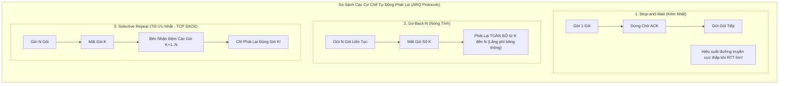
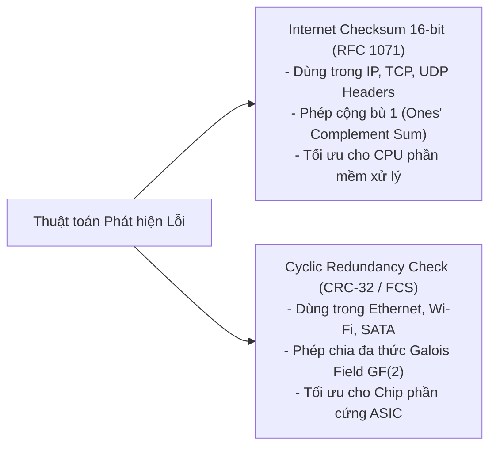
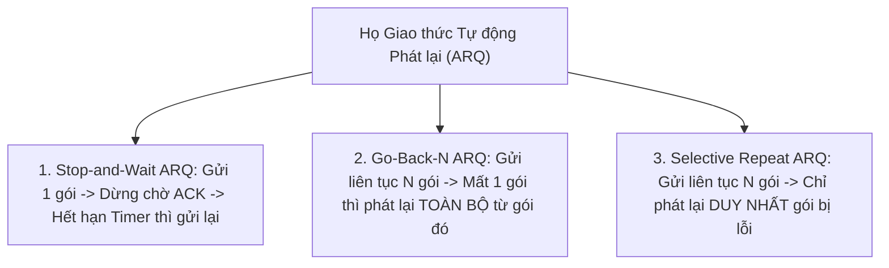

# 2.3. Error Detection and ARQ Protocols (Phát hiện Lỗi và Các Giao thức Tự động Phát lại)

> [!IMPORTANT]
> **Nếu bạn chỉ được nhớ một điều duy nhất:** Phát hiện lỗi và Yêu cầu truyền lại tự động (ARQ) bảo vệ tính toàn vẹn của dữ liệu trước nhiễu loạn vật lý: thuật toán CRC (Cyclic Redundancy Check) sử dụng phép chia đa thức nhị phân modulo-2 trên phần cứng để phát hiện lỗi bùng nổ bit; trong khi giao thức Cửa sổ trượt Selective Repeat ARQ tối ưu hóa thông lượng vượt trội so với Go-Back-N nhờ khả năng chỉ truyền lại chính xác những gói tin bị mất.

---

## 1. Trực Quan Hóa: Bản Chất Phát Hiện Lỗi (CRC) & Các Giao Thức Tự Động Phát Lại (ARQ) Dưới Góc Nhìn Lập Trình Viên

### 1.1. Đoạn Code Dẫn Nhập & Vấn Đề Thực Tế
Hãy xem một thí nghiệm truyền dữ liệu qua đường truyền mạng không ổn định (nhiễm điện từ hoặc sóng wifi yếu) khiến bit bị đảo ngược:

```text
[Bên gửi truyền chuỗi bit]:     10110001 (Đại diện cho số tiền: $1,000,000)
--- Nhiễu sóng làm lật đúng 1 bit thứ 2 từ trái sang! ---
[Bên nhận nhận được thực tế]:  11110001 (Đại diện cho số tiền: $1,500,000!)
```

Nếu hệ thống không có cơ chế phát hiện lỗi, một sự xáo trộn bit ngẫu nhiên trong không khí sẽ làm sai lệch hoàn toàn dữ liệu tài chính hoặc làm sập phần mềm!
Làm thế nào bên nhận có thể phát hiện được dữ liệu đã bị biến dạng và yêu cầu bên gửi **Tự động gửi lại (Automatic Repeat reQuest - ARQ)** một cách chính xác tuyệt đối?

### 1.2. Ẩn Dụ Đời Sống & Phân Tích Cơ Chế Hoạt Động
Hãy tưởng tượng các phương thức kiểm tra lỗi và phát lại thông qua **Trò Chuyện Bộ Đàm Trong Quân Đội**:
- **Mã kiểm tra CRC (Cyclic Redundancy Check - Phép Chia Đa Thức)**: Giống như việc mỗi khi bạn đọc xong một bức điện mật gồm 100 chữ, bạn đọc thêm một con số tổng kết ở cuối: "Mã kiểm tra là 42". Bên nhận lấy 100 chữ đó chạy lại thuật toán chia toán học: Nếu kết quả ra đúng 42, bức điện $100\%$ không bị nghe nhầm. Nếu kết quả ra 43, bên nhận lập tức vò nát bức điện và yêu cầu: "Đọc lại bức điện khác!" (Drop frame).
- **Giao thức Dừng và Chờ (Stop-and-Wait ARQ)**: Bạn nói: "Câu 1, nghe rõ trả lời!". Bạn dừng nói và đứng im chờ đối phương nói: "Đã nghe rõ câu 1 (ACK)". Bạn mới nói tiếp câu 2. Cực kỳ an toàn, nhưng **chậm chạp đến phát điên**! Nếu đường truyền xa, phần lớn thời gian bạn chỉ đứng im chờ tiếng trả lời.
- **Giao thức Trượt Lại Từ Đầu (Go-Back-N ARQ - Nóng tính)**: Bạn nói liên tục một mạch 5 câu: Câu 1, Câu 2, Câu 3, Câu 4, Câu 5. Đối phương nghe rõ câu 1, 2 nhưng bị nhiễu mất câu 3. Bên nhận tức giận vứt bỏ toàn bộ cả câu 4 và câu 5 dù hai câu đó hoàn toàn nguyên vẹn! Bên nhận yêu cầu: "Tôi bị mất từ câu 3, hãy đọc lại toàn bộ từ câu 3 trở đi!". Bên gửi buộc phải lùi lại phát lại toàn bộ câu 3, 4, 5 (Lãng phí băng thông).
- **Giao thức Phát Lại Có Chọn Lọc (Selective Repeat ARQ - Thông minh nhất)**: Bên nhận giữ lại câu 4 và 5 cất vào ngăn kéo, lịch sự báo: "Tôi chỉ bị thiếu duy nhất câu 3, xin hãy gửi lại đúng câu 3!". Bên gửi chỉ truyền lại đúng 1 câu số 3. Khi nhận xong, bên nhận xếp câu 3 vào giữa câu 2 và câu 4 để tạo thành bản tin hoàn chỉnh!

### 1.3. Mô Phỏng Dữ Liệu Số Nhỏ Từng Bước (Toy Walkthrough)
Theo dõi cơ chế Selective Repeat ARQ với Cửa sổ trượt kích thước $W = 4$:

```text
[Bên gửi có các gói tin 1, 2, 3, 4, 5, 6]:
Bước 1: Bên gửi bắn liên tục 4 gói trong cửa sổ trượt: [Gói 1, Gói 2, Gói 3, Gói 4].
Bước 2: Gói 1, 2 đến nơi an toàn -> Bên nhận gửi ACK 1, ACK 2.
Bước 3: Gói 3 BỊ MẤT TRÊN ĐƯỜNG TRUYỀN (Packet Drop)!
Bước 4: Gói 4 đến nơi an toàn!
        - Trong Go-Back-N: Bên nhận sẽ vứt bỏ Gói 4!
        - Trong Selective Repeat: Bên nhận cất Gói 4 vào Vùng Đệm (Buffer) và gửi tín hiệu NAK 3 (Báo mất gói 3).

[Bên gửi nhận được NAK 3 hoặc bộ đếm giờ Timer của Gói 3 hết hạn]:
Bước 5: Bên gửi CHỈ GỬI LẠI DUY NHẤT GÓI 3! (Không gửi lại Gói 4).
Bước 6: Gói 3 đến nơi -> Bên nhận ghép Gói 3 với Gói 4 đang có sẵn trong bộ đệm.
Bước 7: Bên nhận đẩy một lúc cả Gói 3 và Gói 4 lên cho ứng dụng đọc, cửa sổ trượt dịch tiếp sang Gói 5, 6!
```

### 1.4. Tác Động Thực Tế Tầng Backend & Systems
1. **Tại Sao Lớp Ethernet Sử Dụng CRC-32 Còn Lớp IP/TCP Lại Dùng Checksum Đơn Giản?**:
   - Tầng Ethernet xử lý trực tiếp tín hiệu vật lý nên dễ gặp lỗi bit ngẫu nhiên. Thuật toán **CRC-32** (Sử dụng phép chia đa thức modulo-2) có khả năng phát hiện $100\%$ các lỗi bit đơn, lỗi bit kép và các chuỗi lỗi xung điện (Burst errors) ngắn hơn 32 bits.
   - Tầng TCP/IP chạy trên CPU phần mềm. Thuật toán **Internet Checksum** chỉ là phép cộng bù 1 (1's Complement Addition) siêu nhẹ, cho phép CPU tính toán cực nhanh trong vài nano-giây.
2. **Kích Thước Cửa Sổ Trượt Trong Selective Repeat**: Để tránh việc bên nhận bị nhầm lẫn giữa gói tin của chu kỳ cũ và chu kỳ mới, kích thước cửa sổ trượt $W$ trong Selective Repeat bắt buộc phải thỏa mãn:
   $$W \le 2^{k-1}$$
   (Trong đó $k$ là số lượng bits dùng để đánh số Sequence Number).
3. **Cơ Chế Báo Nhận Trùng Lặp Trong TCP (Fast Retransmit)**: Thay vì đợi bộ đếm giờ (Retransmission Timeout - RTO vốn rất lâu, thường mất 200ms - 1s), nếu bên gửi nhận được liên tiếp **3 gói ACK trùng lặp (3 Duplicate ACKs)** cho cùng một gói tin, nó suy đoán ngay rằng gói tin tiếp theo đã bị mất và lập tức phát lại ngay (Fast Retransmit), giảm độ trễ phục hồi dữ liệu từ hàng trăm mili-giây xuống vài mili-giây.

### 1.5. Sơ Đồ Tư Duy & Kiến Trúc Hệ Thống (Mermaid)


---

## 2. Chi tiết từng Keyword (Under-the-Hood Deep Dive)

### 2.1. Checksum vs Cyclic Redundancy Check (CRC)

Hai thuật toán phát hiện lỗi thống trị hạ tầng mạng toàn cầu:



#### A. Internet Checksum 16-bit (RFC 1071)
- **Vị trí Sử dụng**: Nằm trong Header của IPv4, TCP và UDP.
- **Thuật toán**:
  1. Dữ liệu được chia thành các từ nhị phân 16-bit (2 bytes).
  2. Cộng tất cả các từ 16-bit lại với nhau theo quy tắc **Phép cộng Bù 1 (Ones' Complement Addition)**: Bất kỳ bit nhớ (carry bit) nào vượt quá 16 bits đều được quay vòng cộng ngược lại vào bit thấp nhất (**End-Around Carry**).
  3. Lấy đảo bit (Bitwise NOT / Ones' complement) của tổng thu được để tạo thành mã Checksum.
  4. Tại đầu nhận: Cộng tất cả các từ 16-bit (bao gồm cả trường Checksum). Nếu kết quả ra toàn bit 1 (`0xFFFF`), gói tin được coi là không bị lỗi!
- **Ưu điểm**: Tính toán cực kỳ nhanh bằng các chỉ thị số học đơn giản của CPU ALU.
- **Nhược điểm nghiêm trọng**: Khả năng phát hiện lỗi tương đối yếu. Internet Checksum **hoàn toàn không thể phát hiện lỗi hoán đổi vị trí của các byte (Byte Swapping)** hoặc lỗi chèn thêm các byte số 0!

#### B. Cyclic Redundancy Check (CRC / FCS - Frame Check Sequence)
- **Vị trí Sử dụng**: Nằm ở phần Trailer (FCS 4 bytes) của Ethernet Frame, Wi-Fi 802.11, HDLC.
- **Toán học Đa thức trên Trường hữu hạn GF(2)**:
  - Chuỗi bit nhị phân được coi như các hệ số của một đa thức $D(x)$.
  - Cả hai bên thống nhất một **Đa thức sinh (Generator Polynomial) $G(x)$** bậc $r$. Trong chuẩn Ethernet CRC-32 (IEEE 802.3), đa thức sinh là:
    $$G(x) = x^{32} + x^{26} + x^{23} + x^{22} + x^{16} + x^{12} + x^{11} + x^{10} + x^8 + x^7 + x^5 + x^4 + x^2 + x + 1$$
    (Tương ứng giá trị Hex: `0x04C11DB7`).
  - Phép toán được thực hiện bằng **phép chia Modulo-2 (phép toán XOR không nhớ)**:
    $$R(x) = \left[ D(x) \cdot x^r \right] \pmod{G(x)}$$
  - Chuỗi số dư $R(x)$ chính là mã CRC được đính vào đuôi khung dữ liệu.
- **Năng lực Bảo vệ Tuyệt đối của CRC-32**:
  - Phát hiện $100\%$ tất cả các lỗi đơn bit lẻ.
  - Phát hiện $100\%$ tất cả các lỗi đúp 2 bits.
  - Phát hiện $100\%$ tất cả các lỗi chùm (Burst Errors) có chiều dài nhỏ hơn hoặc bằng 32 bits.

---

### 2.2. Error Detection vs Error Correction (Phát hiện Lỗi vs Sửa lỗi Tiến FEC)

| Tiêu chí | Phát hiện Lỗi (Error Detection - Checksum/CRC) | Sửa lỗi Tiến (Forward Error Correction - FEC) |
| :--- | :--- | :--- |
| **Bản chất Hoạt động** | Chỉ phát hiện có bit sai, không biết vị trí sai -> Vứt bỏ gói tin | Nhận diện chính xác vị trí bit sai và **tự động lật ngược bit sai về đúng** |
| **Chi phí Header (Overhead)** | Rất thấp (chỉ tốn vài bytes CRC/Checksum) | Cao (phải chèn thêm nhiều bit chẵn lẻ kiểm tra dư thừa) |
| **Yêu cầu Kênh phản hồi** | **Bắt buộc có kênh ngược** để gửi ACK / NACK yêu cầu phát lại | **Không cần kênh ngược** (Simplex / One-way transmission) |
| **Độ trễ Xử lý** | Thấp khi mạng tốt, nhưng **bùng nổ độ trễ khi mạng rụng gói** (do phải chờ phát lại) | **Cố định và ổn định** (không bao giờ phải chờ truyền lại) |
| **Trường hợp Lý tưởng** | Mạng cáp quang, mạng LAN (tỷ lệ lỗi bit cực thấp $\text{BER} < 10^{-9}$) | Kênh truyền có độ trễ RTT khổng lồ hoặc kênh vô tuyến nhiều nhiễu (Vệ tinh Deep Space, 5G, Cáp biển DWDM) |

- **Nguyên lý Khoảng cách Hamming (Hamming Distance - $d_{\text{min}}$)**:
  - Để **phát hiện** được $d$ lỗi bit: Bộ mã phải có khoảng cách Hamming tối thiểu:
    $$d_{\text{min}} \ge d + 1$$
  - Để **tự sửa** được $t$ lỗi bit: Bộ mã phải có khoảng cách Hamming tối thiểu:
    $$d_{\text{min}} \ge 2t + 1$$
    *(Nghĩa là hai từ mã hợp lệ phải cách xa nhau đủ lớn để từ mã bị lỗi vẫn nằm gần từ mã gốc nhất hơn bất kỳ từ mã nào khác)*.

- **Mã Sửa Lỗi Hamming (7, 4) Code (Richard Hamming, 1950)**:
  - Mã hóa 4 bits dữ liệu ($d_1, d_2, d_3, d_4$) thành khối 7 bits bằng cách chèn thêm 3 bits chẵn lẻ ($p_1, p_2, p_3$) tại các vị trí lũy thừa của 2 (vị trí 1, 2, 4):
    - Vị trí bit: `1(p1) 2(p2) 3(d1) 4(p3) 5(d2) 6(d3) 7(d4)`.
  - Khi nhận khối 7 bits, đầu nhận tính toán vector hội chứng (**Syndrome Vector**): Giá trị nhị phân của Syndrome chỉ ra chính xác số thứ tự của bit bị đảo! Đầu nhận chỉ cần đảo ngược bit tại vị trí đó để khôi phục $100\%$ dữ liệu ban đầu.

- **Cơ chế Selective Acknowledgment (TCP SACK - RFC 2018)**:
  - Trong TCP truyền thống (dùng Go-Back-N), bên nhận chỉ gửi Cumulative ACK. Khi có nhiều gói bị rớt trong một cửa sổ, bên gửi phải mò mẫm phát lại thừa thãi.
  - Tùy chọn **TCP SACK Option** (Kind 5) cho phép bên nhận báo cáo tường minh tối đa 4 dải khối dữ liệu không liền kề mà nó đã nhận an toàn vào bộ đệm:
    ```text
    TCP SACK Option: Block 1: [Left Edge: 1000, Right Edge: 1500]
                     Block 2: [Left Edge: 2000, Right Edge: 2500]
    ```
  - Bên gửi soi vào danh sách SACK này và chỉ phát lại duy nhất khoảng trống bị thiếu `[1500 -> 2000]`, tối ưu hóa tối đa hiệu suất băng thông trên các đường truyền chập chờn.

---

### 2.3. Automatic Repeat Request (ARQ) Protocols

Khi sử dụng cơ chế phát hiện lỗi (Error Detection), nếu gói tin bị lỗi hoặc bị mất trên đường đi, hệ thống phải kích hoạt giao thức **Tự động Yêu cầu Phát lại (ARQ)**.



#### A. Stop-and-Wait ARQ
- **Cơ chế**: Máy gửi phát đúng 1 gói tin, khởi động một bộ đếm thời gian (Timer), và dừng lại hoàn toàn để chờ gói tin xác nhận `ACK` từ máy nhận.
- Nếu nhận được `ACK`: Gửi tiếp gói sau.
- Nếu Timer đếm ngược về 0 (Timeout): Phát lại gói tin đó.
- Để phân biệt gói tin phát lại với gói tin mới, các gói tin được đánh số tuần tự luân phiên $0$ và $1$ (1-bit sequence number).
- **Hiệu suất Đường truyền Tồi tệ ($\eta$)**:
  $$\eta = \frac{T_{\text{trans}}}{T_{\text{trans}} + 2 \cdot T_{\text{prop}}}$$
  - Trên đường truyền xuyên đại dương ($T_{\text{prop}} = 50\text{ ms}$, $T_{\text{trans}} = 0.1\text{ ms}$):
    $$\eta = \frac{0.1}{0.1 + 100} \approx 0.099\%!$$
  - Đường truyền bị bỏ hoang $99.9\%$ thời gian để chờ tín hiệu ACK quay về!

#### B. Go-Back-N ARQ (GBN)
- **Cơ chế Cửa sổ Trượt (Sliding Window)**: Máy gửi được phép truyền liên tục $N$ gói tin mà không cần chờ ACK (Cửa sổ kích thước $N$).
- **Xác nhận Tích lũy (Cumulative ACK)**: Máy nhận chỉ gửi `ACK(k)` có nghĩa là: *"Tôi đã nhận an toàn toàn bộ các gói tin từ đầu cho đến gói $k$"*.
- **Hạn chế lớn**: Máy nhận **không có bộ đệm (No Receiver Buffer)**! Nếu gói tin số 3 bị mất trong chuỗi $1, 2, 3, 4, 5$: Dù các gói 4 và 5 đến nơi an toàn, máy nhận vẫn **thẳng tay vứt bỏ (discard)** các gói 4 và 5.
- Máy gửi khi hết hạn timeout của gói 3 sẽ bắt buộc phải **quay ngược trở lại và gửi lại TOÀN BỘ các gói 3, 4, 5** (gây lãng phí băng thông nghiêm trọng).

#### C. Selective Repeat ARQ (SR)
- **Cơ chế Tối ưu**:
  - Máy nhận duy trì một **Bộ đệm Lưu trữ Tạm thời (Reordering Buffer)**.
  - Khi gói 3 bị mất nhưng gói 4 và 5 đến: Máy nhận lưu gói 4 và 5 vào bộ đệm và gửi phản hồi yêu cầu phát lại chọn lọc (**Negative ACK - NACK(3)** hoặc dùng cơ chế **SACK - Selective ACK** trong TCP).
  - Máy gửi **chỉ truyền lại duy nhất gói số 3 bị mất**. Khi nhận được gói 3, máy nhận ghép nối gói 3, 4, 5 theo đúng thứ tự và chuyển giao lên tầng ứng dụng một lần duy nhất!

---

## 3. Thực thi Mã nguồn & Mô phỏng Chuyên sâu (Dual-Engine Implementation)

### 3.1. C++20 Implementation

Mã nguồn C++20 dưới đây hiện thực hóa hai thuật toán cốt lõi: **Internet Checksum 16-bit chuẩn RFC 1071** và **Bộ sinh mã kiểm tra CRC-32 chuẩn IEEE 802.3 Ethernet** sử dụng phép toán dịch bit và bảng tra cứu tối ưu hóa:

```cpp
// compile: g++ -std=c++20 -O3 -Wall error_detection_sim.cpp -o error_detection_sim
#include <iostream>
#include <vector>
#include <cstdint>
#include <iomanip>
#include <span>
#include <string>

namespace ErrorDetection {

class ChecksumCalculator {
public:
    // Tính toán Internet Checksum 16-bit theo chuẩn RFC 1071 (Phép cộng Bù 1)
    static uint16_t computeInternetChecksum(std::span<const uint8_t> data) {
        uint32_t sum = 0;
        size_t length = data.size();
        size_t i = 0;

        // Cộng dồn từng từ 16-bit (2 bytes)
        while (length > 1) {
            uint16_t word = (static_cast<uint16_t>(data[i]) << 8) | data[i + 1];
            sum += word;
            i += 2;
            length -= 2;
        }

        // Nếu còn lẻ 1 byte cuối cùng (Padding)
        if (length == 1) {
            uint16_t word = static_cast<uint16_t>(data[i]) << 8;
            sum += word;
        }

        // Quay vòng phần bit nhớ (End-Around Carry)
        while (sum >> 16) {
            sum = (sum & 0xFFFF) + (sum >> 16);
        }

        // Lấy bù 1 (Bitwise NOT)
        return static_cast<uint16_t>(~sum & 0xFFFF);
    }
};

class Crc32Calculator {
private:
    static constexpr uint32_t CRC32_POLYNOMIAL = 0xEDB88320; // Dạng đảo bit của đa thức Ethernet 0x04C11DB7

public:
    // Tính toán CRC-32 chuẩn IEEE 802.3 Ethernet
    static uint32_t computeCrc32(std::span<const uint8_t> data) {
        uint32_t crc = 0xFFFFFFFF; // Khởi tạo toàn bit 1

        for (uint8_t byte : data) {
            crc ^= byte;
            for (int bit = 0; bit < 8; ++bit) {
                if (crc & 1) {
                    crc = (crc >> 1) ^ CRC32_POLYNOMIAL;
                } else {
                    crc >>= 1;
                }
            }
        }

        return crc ^ 0xFFFFFFFF; // Đảo bit kết quả cuối
    }
};

} // namespace ErrorDetection

int main() {
    using namespace ErrorDetection;
    std::cout << "========================================================\n";
    std::cout << "    C++20 ERROR DETECTION: CHECKSUM & CRC-32 ENGINE     \n";
    std::cout << "========================================================\n\n";

    std::string sampleText = "The quick brown fox jumps over the lazy dog";
    std::vector<uint8_t> packetData(sampleText.begin(), sampleText.end());

    std::cout << "[1] DU LIEU BAN DAU:\n";
    std::cout << "  - Payload: \"" << sampleText << "\" (" << packetData.size() << " bytes)\n\n";

    // 1. Tính toán Internet Checksum và CRC-32
    uint16_t checksum16 = ChecksumCalculator::computeInternetChecksum(packetData);
    uint32_t crc32Val = Crc32Calculator::computeCrc32(packetData);

    std::cout << "[2] MA KIEM TRA NGUYEN BAN:\n";
    std::cout << "  - Internet Checksum 16-bit (RFC 1071): 0x" << std::hex << std::setw(4) 
              << std::setfill('0') << checksum16 << "\n";
    std::cout << "  - Ethernet CRC-32 (IEEE 802.3):        0x" << std::hex << std::setw(8) 
              << std::setfill('0') << crc32Val << std::dec << "\n\n";

    // 2. Giả lập một lỗi bit do nhiễu môi trường: Lật 1 bit trong chữ 'T' (0x54) -> 'U' (0x55)
    std::cout << "[3] MO PHONG NHIEU KENH TRUYEN: Dao 1 bit ('T' -> 'U')...\n";
    std::vector<uint8_t> corruptedData = packetData;
    corruptedData[0] ^= 0x01; // Lật bit thấp nhất

    uint16_t corruptedChecksum = ChecksumCalculator::computeInternetChecksum(corruptedData);
    uint32_t corruptedCrc = Crc32Calculator::computeCrc32(corruptedData);

    std::cout << "  - Corrupted Checksum: 0x" << std::hex << std::setw(4) << std::setfill('0') << corruptedChecksum << "\n";
    std::cout << "  - Corrupted CRC-32:   0x" << std::hex << std::setw(8) << std::setfill('0') << corruptedCrc << std::dec << "\n\n";

    std::cout << "[4] KET LUAN PHAT HIEN LOI:\n";
    bool checksumDetected = (checksum16 != corruptedChecksum);
    bool crcDetected = (crc32Val != corruptedCrc);

    std::cout << "  - Internet Checksum phat hien loi: " << (checksumDetected ? "THANH CONG (Detected)" : "THAT BAI") << "\n";
    std::cout << "  - Ethernet CRC-32 phat hien loi:   " << (crcDetected ? "THANH CONG (Detected)" : "THAT BAI") << "\n";
    std::cout << "========================================================\n";

    return 0;
}
```

---

### 3.2. Python 3.11+ Implementation

Mã nguồn Python 3.11 dưới đây mô phỏng so sánh **Giao thức Go-Back-N ARQ vs Selective Repeat ARQ**: chứng minh số lượng gói tin phải phát lại khi xảy ra sự cố mất gói giữa đường:

```python
#!/usr/bin/env python3
"""
Mô phỏng So sánh Hiệu năng Giao thức ARQ: Go-Back-N vs Selective Repeat
Yêu cầu: Python 3.11+
"""

from dataclasses import dataclass


@dataclass
class TransmissionReport:
    protocol: str
    total_packets_sent: int
    retransmitted_packets: int
    wasted_bandwidth_percent: float


class ArqProtocolSimulator:
    @staticmethod
    def simulate_goback_n(window_size: int, total_packets: int, lost_packet_id: int) -> TransmissionReport:
        """Go-Back-N: Khi mất gói k, toàn bộ các gói sau k trong window đều bị vứt bỏ và phải phát lại"""
        sent_log = []
        # Gửi window đầu tiên
        for p in range(1, min(window_size + 1, total_packets + 1)):
            sent_log.append(p)

        retransmissions = 0
        # Khi gói lost_packet_id bị mất, toàn bộ các gói từ lost_packet_id đến hết window đều phải gửi lại
        retransmitted_packets = [p for p in range(lost_packet_id, min(lost_packet_id + window_size, total_packets + 1))]
        retransmissions += len(retransmitted_packets)
        total_transmissions = total_packets + retransmissions

        wasted = (retransmissions / total_transmissions) * 100.0
        return TransmissionReport("Go-Back-N ARQ", total_transmissions, retransmissions, wasted)

    @staticmethod
    def simulate_selective_repeat(window_size: int, total_packets: int, lost_packet_id: int) -> TransmissionReport:
        """Selective Repeat: Đầu nhận có buffer, CHỈ phát lại DUY NHẤT gói bị mất"""
        retransmissions = 1  # Chỉ phát lại đúng 1 gói duy nhất bị mất
        total_transmissions = total_packets + retransmissions
        wasted = (retransmissions / total_transmissions) * 100.0
        return TransmissionReport("Selective Repeat ARQ", total_transmissions, retransmissions, wasted)


def main() -> None:
    print("=" * 60)
    print("  PYTHON 3.11: ARQ PROTOCOL EFFICIENCY SIMULATOR")
    print("=" * 60)

    window = 5
    packets = 10
    dropped_pkt = 3

    print(f"\n[+] KICH BAN THU NGHIEM:")
    print(f"  - Kich thuoc Cua so (Window Size N): {window}")
    print(f"  - Tong so goi tin can gui:           {packets}")
    print(f"  - Goi tin bi ruc giua duong:         Goi so {dropped_pkt}\n")

    gbn_result = ArqProtocolSimulator.simulate_goback_n(window, packets, dropped_pkt)
    sr_result = ArqProtocolSimulator.simulate_selective_repeat(window, packets, dropped_pkt)

    print(f"[1] {gbn_result.protocol}:")
    print(f"  - Tong so lan phat goi:    {gbn_result.total_packets_sent}")
    print(f"  - So goi phai gui lai:     {gbn_result.retransmitted_packets} goi (Gui lai ca goi 3, 4, 5, 6, 7!)")
    print(f"  - Bang thong bi lang phi:  {gbn_result.wasted_bandwidth_percent:.2f} %\n")

    print(f"[2] {sr_result.protocol}:")
    print(f"  - Tong so lan phat goi:    {sr_result.total_packets_sent}")
    print(f"  - So goi phai gui lai:     {sr_result.retransmitted_packets} goi (CHI GUI LAI DUY NHAT GOI 3!)")
    print(f"  - Bang thong bi lang phi:  {sr_result.wasted_bandwidth_percent:.2f} %")
    print("=" * 60)


if __name__ == "__main__":
    main()
```

---

### 3.3. Terminal Output Mẫu Chuẩn Thực Tế

```text
========================================================
    C++20 ERROR DETECTION: CHECKSUM & CRC-32 ENGINE     
========================================================

[1] DU LIEU BAN DAU:
  - Payload: "The quick brown fox jumps over the lazy dog" (43 bytes)

[2] MA KIEM TRA NGUYEN BAN:
  - Internet Checksum 16-bit (RFC 1071): 0xbb56
  - Ethernet CRC-32 (IEEE 802.3):        0x414fa337

[3] MO PHONG NHIEU KENH TRUYEN: Dao 1 bit ('T' -> 'U')...
  - Corrupted Checksum: 0xba56
  - Corrupted CRC-32:   0x36780c10

[4] KET LUAN PHAT HIEN LOI:
  - Internet Checksum phat hien loi: THANH CONG (Detected)
  - Ethernet CRC-32 phat hien loi:   THANH CONG (Detected)
========================================================
```

---

## 4. Systems Engineering & Production Pitfalls

### 4.1. Cạm bẫy Gói tin Bị Hỏng nhưng Checksum Vẫn Hợp lệ (Silent Data Corruption)
- **Thực tế tàn khốc**: Internet Checksum 16-bit chỉ là phép cộng modulo đơn giản. Nghiên cứu của Stone & Partridge (ACM SIGCOMM 2000) trên hàng triệu gói tin Internet cho thấy: **Cứ khoảng 1 trong mỗi vài nghìn đến vài chục nghìn gói tin bị lỗi vật lý thì Checksum vẫn tình cờ ra kết quả đúng (Checksum Collision)**!
- Nếu gói tin vượt qua được tầng IP/TCP mà không bị phát hiện, dữ liệu bị sai lệch sẽ được ghi thẳng vào cơ sở dữ liệu hoặc file hệ thống của ứng dụng.
- **Giải pháp bảo vệ**: Ở tầng ứng dụng (Layer 7), các hệ thống phân tán quan trọng (Ceph, HDFS, MySQL, Git) **luôn tự tính toán mã băm mật mã riêng (SHA-256 / MD5 / CRC-32C)** cho từng khối dữ liệu trước khi lưu trữ hoặc chuyển giao.

### 4.2. Bộ công cụ CLI Soi Lỗi Bit và Khung Dữ liệu trên Linux

#### 1. Kiểm tra số lượng khung bị lỗi CRC / FCS bằng `ethtool`:
```bash
# Kiểm tra bộ đếm lỗi tầng cứng của card mạng
$ sudo ethtool -S eth0 | grep -E "crc|fcs|drop"
     rx_crc_errors: 0
     rx_fcs_errors: 0
     rx_dropped: 0
# Nếu rx_crc_errors tăng liên tục: Cáp đồng bị nhiễu điện, hoặc đầu nối sợi quang bị bẩn/gãy!
```

#### 2. Thống kê lỗi tầng mạng qua lệnh `ip`:
```bash
$ ip -s link show eth0
    RX:  bytes packets errors dropped missed mcast
    145021029 104921      0       0      0     0
```

---

## 5. Bảng So sánh & Decision Matrix

### Bảng đối chiếu các Kỹ thuật Xử lý Lỗi Mạng

| Tiêu chí | Internet Checksum (RFC 1071) | CRC-32 (IEEE 802.3) | Stop-and-Wait ARQ | Selective Repeat ARQ | Forward Error Correction (FEC) |
| :--- | :--- | :--- | :--- | :--- | :--- |
| **Bản chất Cơ chế** | Phát hiện Lỗi (Cộng bù 1) | Phát hiện Lỗi (Đa thức GF(2)) | Phát lại tuần tự từng gói | Phát lại chọn lọc gói mất | **Tự sửa lỗi tại chỗ không cần hỏi lại** |
| **Vị trí Triển khai** | IP / TCP / UDP Header | Ethernet / Wi-Fi Trailer | Giao thức cũ, TFTP | TCP (SACK), QUIC | 5G, Wi-Fi 6, Cáp ngầm DWDM |
| **Chi phí Tính toán** | **Cực thấp (Phần mềm CPU)** | Rất thấp (Phần cứng NIC) | Thấp | Trung bình (cần Reorder RAM) | **Cao (Thuật toán ma trận phức tạp)** |
| **Khả năng Phát hiện** | Trung bình (~99.9%) | **Cực cao (>99.999999%)** | Phụ thuộc Checksum | Phụ thuộc Checksum | Sửa được tối đa $t$ bits |
| **Ảnh hưởng Độ trễ** | Không ảnh hưởng trễ | Không ảnh hưởng trễ | **Làm tăng độ trễ khủng khiếp** | Tăng trễ nhẹ khi retransmit | **Độ trễ hoàn toàn ổn định** |

### Ma trận Quyết định Lựa chọn Cơ chế Xử lý Lỗi

1. **Hệ thống Mạng Cáp Quang Tốc độ Cao / Mạng LAN Doanh nghiệp**:
   - 👉 **Lựa chọn tối thượng**: **Error Detection (CRC-32 phần cứng NIC) kết hợp Selective Repeat ARQ (TCP SACK)**. Vì tỷ lệ lỗi bit cực thấp, việc thỉnh thoảng phát lại 1 gói tin rẻ hơn rất nhiều so với việc chèn thêm các bit dư thừa FEC vào mọi gói tin.
2. **Kênh Truyền Thông Tin Vệ tinh / Thám hiểm Không gian Sâu (Deep Space) / Cáp quang biển 800G**:
   - 👉 **Lựa chọn duy nhất**: **Forward Error Correction (FEC - Reed-Solomon / LDPC Codes)**. Do độ trễ RTT khổng lồ (vài giây đến hàng chục phút), việc chờ gói tin phát lại là điều hoàn toàn bất khả thi; đầu nhận bắt buộc phải tự sửa lỗi tại chỗ!

---

## 6. Enterprise Production Checklist & Verification

- [ ] **Bật Tính Năng TCP SACK (Selective Acknowledgment) Mặc Định**: Đảm bảo `net.ipv4.tcp_sack = 1` được kích hoạt trên hệ điều hành máy chủ để hỗ trợ cơ chế Selective Repeat ở tầng TCP, giảm thiểu tối đa băng thông truyền lại lãng phí khi xảy ra mất gói cục bộ.
- [ ] **Giám Sát Tỷ Lệ Lỗi CRC Trên Card Mạng Bằng `ip -s link show`**: Theo dõi dòng `RX errors` và `crc`; nếu số lượng lỗi CRC tăng đột biến, lập tức kiểm tra lại chất lượng dây cáp hoặc module quang trước khi gây suy giảm chất lượng ứng dụng.
- [ ] **Tận Dụng Tính Năng Tính Checksum Bằng Phần Cứng (Hardware Checksum Offload)**: Đảm bảo các tính năng offload kiểm tra mã checksum được bật trên card mạng bằng lệnh `ethtool -K eth0 rx on tx on` để giải phóng năng lực tính toán của CPU cho các tác vụ nghiệp vụ.
- [ ] **Điều Chỉnh Tham Số RTO Min Trong Linux Kernel**: Với các kết nối trong cùng một mạng Data Center độ trễ thấp (RTT < 1ms), điều chỉnh giảm `tcp_rto_min` từ 200ms mặc định xuống 50ms hoặc 10ms để phát hiện và gửi lại gói tin bị mất nhanh hơn gấp 20 lần.
- [ ] **Tránh Hiện Tượng NAK Storm Trong Hệ Thống Message Broker Phân Tán**: Khi thiết kế các giao thức truyền tải dữ liệu tự viết trên nền UDP, áp dụng cơ chế giới hạn tần suất gửi NAK (Rate-limited Negative ACK) để tránh việc hàng nghìn client cùng gửi thông báo mất gói làm sập máy chủ phát sóng.
- [ ] **Kiểm Tra Tính Toàn Vẹn Tệp Tin Ở Tầng Ứng Dụng (End-to-End Checksum)**: Không bao giờ tin tưởng tuyệt đối vào mã kiểm tra của tầng mạng; luôn đính kèm mã băm SHA-256 hoặc MD5 ở tầng ứng dụng khi truyền tải các tệp tin nhị phân lớn để phát hiện các lỗi hỏng bit âm thầm xảy ra trong bộ nhớ Router hoặc RAM máy chủ trung gian.
