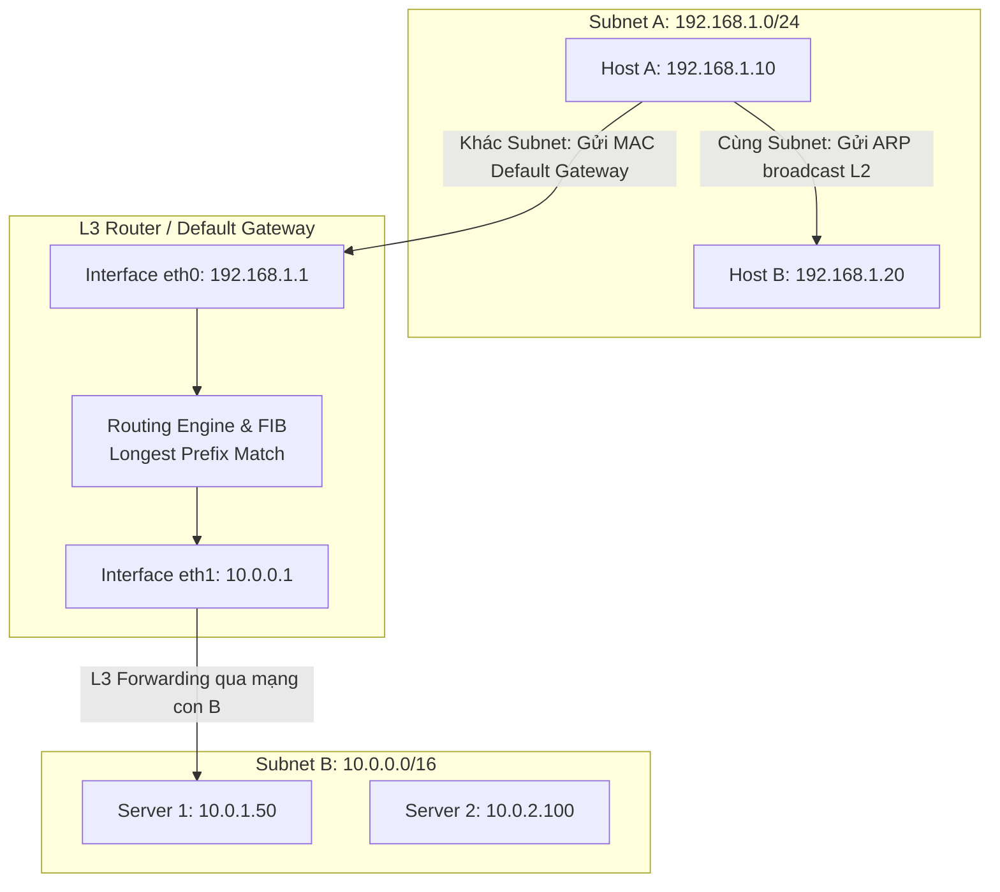
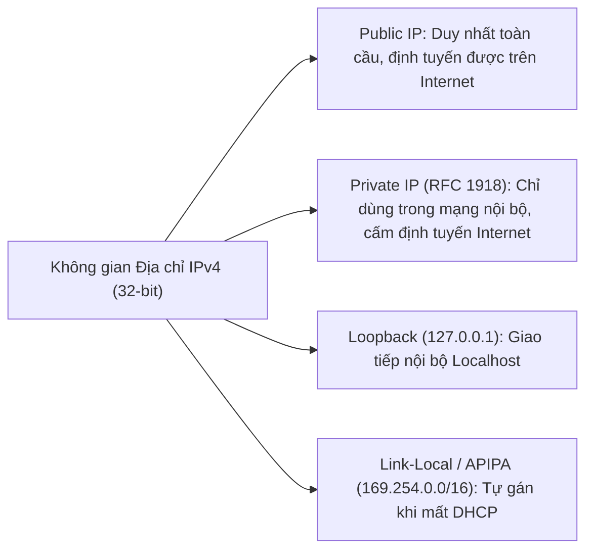
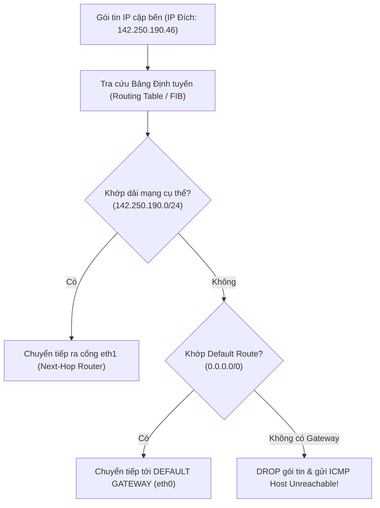

# 3.1. IP Fundamentals and Subnetting (Nguyên lý Giao thức IP và Phân chia Mạng con)

> [!IMPORTANT]
> **Nếu bạn chỉ được nhớ một điều duy nhất:** Giao thức IP (Internet Protocol) là xương sống định tuyến toàn cầu cung cấp dịch vụ phân phát phi kết nối, nỗ lực tối đa (Best-effort Delivery): phân chia mạng con (CIDR Subnetting) và thuật toán Khớp tiền tố dài nhất (Longest Prefix Match - LPM) trên bảng định tuyến FIB của Router cho phép nén hàng tỷ địa chỉ host thành các dải mạng phân cấp, giải cứu bảng định tuyến Internet khỏi thảm họa bùng nổ kích thước bộ nhớ.

---

## 1. Đơn giản nhưng phải chi tiết (Intuitive & Deep Breakdown)

### 1.1. Đoạn Code Dẫn Nhập & Vấn Đề Thực Tế
Khi hai máy chủ muốn truyền gói tin cho nhau, làm sao hệ điều hành biết gói tin này có thể gửi trực tiếp qua card mạng vật lý (Layer 2) hay bắt buộc phải chuyển tiếp qua Default Gateway (Layer 3)?

```python
# Kiểm tra định tuyến L2/L3 bằng phép toán Bitwise Subnet Mask
def can_communicate_directly(ip_a_str, ip_b_str, mask_str):
    import ipaddress
    ip_a = int(ipaddress.IPv4Address(ip_a_str))
    ip_b = int(ipaddress.IPv4Address(ip_b_str))
    mask = int(ipaddress.IPv4Address(mask_str))
    
    # Phép toán AND cấp độ bit phần cứng (Bitwise AND)
    net_a = ip_a & mask
    net_b = ip_b & mask
    
    # Nếu cùng Network ID -> Gửi thẳng ARP L2, ngược lại -> Đóng gói gửi Default Gateway
    return net_a == net_b

# Host A: 192.168.1.10/24 muốn gửi tới Host B: 192.168.1.200/24
print("Cùng Subnet (L2 Direct):", can_communicate_directly("192.168.1.10", "192.168.1.200", "255.255.255.0")) # True

# Host A: 192.168.1.10/24 muốn gửi tới Cloud Server: 10.0.0.5/24
print("Khác Subnet (L3 Gateway):", can_communicate_directly("192.168.1.10", "10.0.0.5", "255.255.255.0")) # False
```

Nếu cấu hình Subnet Mask sai (ví dụ máy A là `/24`, máy B là `/16`), gói tin gửi đi có thể thành công nhưng gói tin phản hồi (ACK/Reply) bị gửi nhầm ra Gateway và biến mất vĩnh viễn (Blackhole routing).

### 1.2. Ẩn Dụ Đời Sống & Phân Tích Cơ Chế Hoạt Động
Hãy tưởng tượng hệ thống địa chỉ IP tương tự như **Hệ thống Mã Bưu chính và Số nhà Toàn cầu**:
- **Địa chỉ MAC (Layer 2)** giống như **Căn cước Công dân (CCCD)**: Định danh duy nhất một người, nhưng nếu chỉ cầm CCCD đứng giữa sa mạc thì người đưa thư không thể biết bạn đang ở nhà số mấy, phố nào để giao hàng.
- **Địa chỉ IP (Layer 3)** giống như **Số nhà đầy đủ (Quận/Huyện + Tên Đường + Số Nhà)**: Cho biết chính xác vị trí logic của thiết bị trong mạng lưới.
- **Subnet Mask (Mặt nạ mạng)** chính là **ranh giới phân chia Quận**: Cho biết bao nhiêu chữ số đầu là "Tên Phường/Quận" (Network ID) và bao nhiêu chữ số sau là "Số nhà cụ thể" (Host ID).
  - Nếu gửi thư cho người cùng phường: Bạn tự cầm thư sang nhà hàng xóm bấm chuông (ARP Request nội bộ).
  - Nếu gửi thư khác phường/quốc tế: Bắt buộc phải bỏ vào hòm thư Bưu điện phường (**Default Gateway**) để các trạm trung chuyển lớn (**Routers**) lần lượt chuyển phát.

### 1.3. Mô Phỏng Dữ Liệu Số Nhỏ Từng Bước (Toy Walkthrough)
Xét gói tin từ Host `192.168.1.55/26` gửi tới Target `192.168.1.130`:

| Thành phần | Biểu diễn Thập phân | Biểu diễn Nhị phân (32 bits) | Ý nghĩa Hệ thống |
| :--- | :--- | :--- | :--- |
| **IP Nguồn** | `192.168.1.55` | `11000000.10101000.00000001.00110111` | Host hiện tại |
| **Subnet Mask (/26)** | `255.255.255.192` | `11000000.11100000.00000001.11000000` | 26 bits mạng, 6 bits host |
| **Network ID Nguồn** | `192.168.1.0` | `11000000.10101000.00000001.00000000` | Dải mạng khả dụng: .1 -> .62 |
| **IP Đích** | `192.168.1.130` | `11000000.10101000.00000001.10000010` | IP cần gửi tới |
| **Network ID Đích** | `192.168.1.128` | `11000000.10101000.00000001.10000000` | Thuộc dải mạng .128/26 |
| **Kết luận Quyết định** | `0.0 != 128.0` | Khác nhau ở bit thứ 25 (`0` vs `1`) | **Khác Subnet -> Chuyển tiếp tới Gateway** |

### 1.4. Tác Động Thực Tế Tầng Backend & Systems
- **Cạn kiệt IP trong Kubernetes / Cloud VPC**: Khi dùng AWS EKS VPC CNI, mỗi Pod lấy 1 địa chỉ IP thực từ Subnet VPC. Nếu cấu hình VPC Subnet `/24` (251 IPs khả dụng), khi cụm mở rộng lên 10 nodes (mỗi node 30 pods = 300 pods), hệ thống hết sạch IP khiến hàng loạt Pod rơi vào trạng thái `ContainerCreating` vĩnh viễn.
- **Overhead Bảng định tuyến (FIB / LPM Lookup)**: Router trung tâm phải xử lý bảng định tuyến chứa hơn $950,000$ tiền tố BGP toàn cầu. Thuật toán tra cứu Longest Prefix Match (LPM) chạy bằng phần cứng chuyên dụng TCAM (Ternary Content-Addressable Memory) tiêu thụ điện năng lớn và giới hạn kích thước bảng.

### 1.5. Sơ Đồ Tư Duy & Kiến Trúc Hệ Thống (Mermaid)


---

## 2. Chi tiết từng Keyword (Under-the-Hood Deep Dive)

### 2.1. IPv4 vs IPv6 Fundamentals

- **IPv4 (Internet Protocol Version 4 - RFC 791, 1981)**:
  - Chiều dài địa chỉ: **32 bits (4 bytes)**, biểu diễn dưới dạng 4 số thập phân phân tách bởi dấu chấm (Dotted-Decimal: `192.168.1.1`).
  - Không gian địa chỉ lý thuyết: $2^{32} \approx 4.29\text{ tỷ địa chỉ}$.
  - **Sự cố Cạn kiệt Địa chỉ**: Vào ngày 25 tháng 11 năm 2019, tổ chức RIPE NCC thông báo đã cấp phát hết khối địa chỉ IPv4 cuối cùng. Mạng Internet toàn cầu phải sống sót nhờ các giải pháp tình thế như NAT (Network Address Translation) và CIDR.
- **IPv6 (Internet Protocol Version 6 - RFC 8200)**:
  - Chiều dài địa chỉ: **128 bits (16 bytes)**, biểu diễn dưới dạng 8 nhóm 4 chữ số thập lục phân phân tách bởi dấu hai chấm (Hexadecimal: `2001:0db8:85a3:0000:0000:8a2e:0370:7334`).
  - Quy tắc rút gọn:
    - Bỏ các số 0 ở đầu nhóm: `0db8` -> `db8`.
    - Dùng cặp dấu hai chấm `::` thay thế cho một chuỗi liên tiếp các nhóm toàn số 0 (chỉ dùng duy nhất 1 lần trong chuỗi): `2001:db8:85a3::8a2e:370:7334`.
  - Không gian địa chỉ khổng lồ: $2^{128} \approx 3.4 \times 10^{38}$ địa chỉ (đủ để gán cho từng hạt cát trên Trái Đất hàng tỷ địa chỉ IP riêng biệt).
  - Tích hợp sẵn bảo mật IPsec bắt buộc, loại bỏ hoàn toàn nhu cầu NAT, xóa bỏ phân mảnh gói tin tại router trung gian.

---

### 2.2. Phân loại Không gian Địa chỉ IP

Không gian địa chỉ IPv4 được quy hoạch thành các dải đặc biệt:



#### A. Public IP vs Private IP (RFC 1918)
- **Public IP**: Địa chỉ công cộng duy nhất trên toàn thế giới, do tổ chức IANA/ICANN quản lý và cấp phát qua các cơ quan khu vực (APNIC, ARIN, RIPE). Được phép định tuyến trực tiếp trên mạng Internet toàn cầu.
- **Private IP (RFC 1918)**: Dải địa chỉ dành riêng cho các mạng nội bộ doanh nghiệp và gia đình. Các router Internet công cộng **bắt buộc phải DROP mọi gói tin** có IP nguồn hoặc IP đích thuộc dải này. Gồm 3 khối:
  1. **Lớp A**: `10.0.0.0` đến `10.255.255.255` (`10.0.0.0/8` - Hơn 16.7 triệu IPs).
  2. **Lớp B**: `172.16.0.0` đến `172.31.255.255` (`172.16.0.0/12` - Hơn 1 triệu IPs).
  3. **Lớp C**: `192.168.0.0` đến `192.168.255.255` (`192.168.0.0/16` - 65.536 IPs).

#### B. Loopback Address (`127.0.0.1` / IPv6 `::1`)
- Đại diện cho chính chiếc máy tính hiện tại. Mọi gói tin gửi tới dải `127.0.0.0/8` đều bị Linux Kernel "vòng ngược" (loop back) lại tầng ứng dụng ngay tại giao diện mạng ảo `lo` mà **hoàn toàn không chạm tới phần cứng card mạng NIC hay dây cáp**.

#### C. Link-Local Address (APIPA: `169.254.0.0/16` / IPv6 `fe80::/10`)
- **Cơ chế APIPA (Automatic Private IP Addressing)**: Khi máy tính cắm dây mạng nhưng máy chủ DHCP bị hỏng hoặc không phản hồi, máy tính sẽ tự động bốc một địa chỉ ngẫu nhiên trong dải `169.254.1.0` đến `169.254.254.255`.
- *Ý nghĩa thực tế*: Nếu máy tính của bạn hiện IP bắt đầu bằng `169.254.x.x`, đó là dấu hiệu chẩn đoán kinh điển: **Máy tính đã cắm cáp thành công (Link UP) nhưng không xin được IP từ Router DHCP**!

---

### 2.3. Subnetting & CIDR (Classless Inter-Domain Routing)

#### 1. Nguyên lý Mặt nạ Mạng (Subnet Mask)
Mặt nạ mạng là một chuỗi nhị phân 32-bit gồm một dải các bit $1$ liên tục theo sau bởi một dải các bit $0$:
- Bit $1$: Đại diện cho phần mạng (**Network ID**).
- Bit $0$: Đại diện cho phần máy con (**Host ID**).
- Để kiểm tra xem máy đích có cùng mạng với mình không, hệ điều hành thực hiện phép toán logic **Bitwise AND**:
  $$\text{Network ID} = \text{IP Address} \;\mathbf{AND}\; \text{Subnet Mask}$$

#### 2. Ký pháp CIDR (CIDR Prefix Notation `/xx` - RFC 4632)
Thay thế cho hệ thống phân lớp cổ điển (Classful A, B, C) cứng nhắc gây lãng phí hàng tỷ địa chỉ. Ký hiệu `/xx` biểu thị số lượng bit 1 liên tục trong Subnet Mask:
- `/24` $\iff$ `255.255.255.0` (Có 24 bits 1, chừa lại 8 bits cho Host: $2^8 - 2 = 254$ máy).
- `/16` $\iff$ `255.255.0.0` (Có 16 bits 1, chừa lại 16 bits cho Host: $2^{16} - 2 = 65.534$ máy).
- **Quy tắc 2 Địa chỉ Bất khả xâm phạm trong mỗi Subnet**:
  1. **Địa chỉ Mạng (Network Address)**: Toàn bộ các bit phần Host là $0$ (ví dụ `192.168.1.0`).
  2. **Địa chỉ Quảng bá (Broadcast Address)**: Toàn bộ các bit phần Host là $1$ (ví dụ `192.168.1.255`).
  - Do đó, số lượng máy chủ (Usable Hosts) thực tế có thể cấp phát luôn là:
    $$\text{Usable Hosts} = 2^{(32 - \text{Prefix})} - 2$$

#### 3. Supernetting (Route Aggregation / Gộp dải mạng)
- Cho phép gộp nhiều dải mạng con liền kề thành một dải mạng lớn hơn (ví dụ gộp 4 dải `/24` liền kề thành một dải `/22`), giúp thu nhỏ kích thước bảng định tuyến BGP toàn cầu từ hàng triệu dòng xuống còn vài trăm nghìn dòng.

---

### 2.4. Bảng Định tuyến, Default Gateway và Cơ chế Chuyển tiếp (Routing & IP Forwarding)

Làm thế nào một router biết phải gửi gói tin ra cổng nào?



- **Cấu trúc Bảng Định tuyến (Routing Table)**:
  - **Destination Network**: Dải mạng đích cần tới.
  - **Genmask / Prefix**: Mặt nạ mạng tương ứng.
  - **Gateway / Next-Hop**: Địa chỉ IP của router kế tiếp chịu trách nhiệm chuyển tiếp. Nếu là `0.0.0.0` hoặc `*`, nghĩa là mạng đó nối trực tiếp vào card mạng (Directly Connected).
  - **Interface**: Cổng mạng vật lý xuất gói tin (`eth0`, `ens192`).
  - **Metric**: Chi phí đường truyền (số càng nhỏ càng ưu tiên).
- **Default Route (`0.0.0.0/0`) & Default Gateway**:
  - Luật "cứu cánh cuối cùng": Bất kỳ gói tin nào có địa chỉ đích không khớp với bất kỳ dòng cụ thể nào trong bảng định tuyến sẽ tự động được chuyển giao cho **Default Gateway** (thường là router biên kết nối ra Internet).
- **Linux Kernel IP Forwarding**:
  - Mặc định, một máy chủ Linux đóng vai trò là End-Host: nếu nhận được gói tin có IP đích không phải là IP của chính nó, Linux sẽ lập tức vứt bỏ.
  - Để biến máy tính Linux thành một Router L3 chuyển tiếp gói tin giữa các mạng, bạn bắt buộc phải bật cờ Kernel:
    ```bash
    $ sudo sysctl -w net.ipv4.ip_forward=1
    ```

---

## 3. Thực thi Mã nguồn & Mô phỏng Chuyên sâu (Dual-Engine Implementation)

### 3.1. C++20 Implementation

Mã nguồn C++20 dưới đây xây dựng một **CIDR Subnet Calculator Engine**: chuyển đổi địa chỉ IP dạng chuỗi sang số nguyên nhị phân 32-bit (Big-endian), tính toán chính xác Network Address, Broadcast Address, số lượng Usable Hosts và kiểm tra xem một IP bất kỳ có thuộc về Subnet hay không:

```cpp
// compile: g++ -std=c++20 -O3 -Wall subnet_calculator.cpp -o subnet_calculator
#include <iostream>
#include <string>
#include <sstream>
#include <vector>
#include <cstdint>
#include <iomanip>
#include <stdexcept>

namespace IpNetworking {

class Ipv4Address {
private:
    uint32_t addr_; // Lưu trữ dạng số nguyên 32-bit

public:
    explicit Ipv4Address(uint32_t addr = 0) : addr_(addr) {}

    // Chuyển chuỗi "192.168.1.50" thành uint32_t
    static Ipv4Address fromString(const std::string& ipStr) {
        std::istringstream ss(ipStr);
        std::string octetStr;
        uint32_t result = 0;

        for (int i = 0; i < 4; ++i) {
            if (!std::getline(ss, octetStr, '.')) {
                throw std::invalid_argument("Invalid IP format: " + ipStr);
            }
            int val = std::stoi(octetStr);
            if (val < 0 || val > 255) {
                throw std::out_of_range("Octet out of range: " + octetStr);
            }
            result = (result << 8) | static_cast<uint32_t>(val);
        }
        return Ipv4Address(result);
    }

    [[nodiscard]] uint32_t toUint32() const { return addr_; }

    [[nodiscard]] std::string toString() const {
        return std::to_string((addr_ >> 24) & 0xFF) + "." +
               std::to_string((addr_ >> 16) & 0xFF) + "." +
               std::to_string((addr_ >> 8) & 0xFF) + "." +
               std::to_string(addr_ & 0xFF);
    }
};

class CidrSubnet {
private:
    Ipv4Address baseIp_;
    uint8_t prefixLen_;
    uint32_t mask_;
    uint32_t networkAddr_;
    uint32_t broadcastAddr_;

public:
    CidrSubnet(const std::string& ipStr, uint8_t prefixLen)
        : baseIp_(Ipv4Address::fromString(ipStr)), prefixLen_(prefixLen) {
        if (prefixLen > 32) throw std::invalid_argument("Prefix must be 0-32");

        mask_ = (prefixLen == 0) ? 0 : (~0U << (32 - prefixLen));
        networkAddr_ = baseIp_.toUint32() & mask_;
        broadcastAddr_ = networkAddr_ | ~mask_;
    }

    [[nodiscard]] Ipv4Address getNetworkAddress() const { return Ipv4Address(networkAddr_); }
    [[nodiscard]] Ipv4Address getBroadcastAddress() const { return Ipv4Address(broadcastAddr_); }
    [[nodiscard]] Ipv4Address getSubnetMask() const { return Ipv4Address(mask_); }

    [[nodiscard]] uint64_t getUsableHostCount() const {
        if (prefixLen_ >= 31) return 0; // /31 và /32 là trường hợp đặc biệt
        return static_cast<uint64_t>(broadcastAddr_ - networkAddr_ - 1);
    }

    // Kiểm tra xem một IP có thuộc dải Subnet này hay không (Bitwise AND)
    [[nodiscard]] bool contains(const Ipv4Address& testIp) const {
        return (testIp.toUint32() & mask_) == networkAddr_;
    }
};

} // namespace IpNetworking

int main() {
    using namespace IpNetworking;
    std::cout << "========================================================\n";
    std::cout << "      C++20 CIDR SUBNETTING & ROUTING ENGINE SIM        \n";
    std::cout << "========================================================\n\n";

    std::string subnetStr = "192.168.10.150";
    uint8_t prefix = 26; // /26 -> 64 IPs, 62 Usable hosts

    std::cout << "[1] SUBNET CALCULATION CHO [" << subnetStr << "/" << static_cast<int>(prefix) << "]:\n";
    CidrSubnet subnet(subnetStr, prefix);

    std::cout << "  - Subnet Mask:           " << subnet.getSubnetMask().toString() << "\n";
    std::cout << "  - Network Address:       " << subnet.getNetworkAddress().toString() << " (Khong the gan cho Host)\n";
    std::cout << "  - Broadcast Address:     " << subnet.getBroadcastAddress().toString() << " (Phat toan Subnet)\n";
    std::cout << "  - First Usable Host:     " << Ipv4Address(subnet.getNetworkAddress().toUint32() + 1).toString() << "\n";
    std::cout << "  - Last Usable Host:      " << Ipv4Address(subnet.getBroadcastAddress().toUint32() - 1).toString() << "\n";
    std::cout << "  - Total Usable Hosts:    " << subnet.getUsableHostCount() << " devices\n\n";

    // 2. Kiểm tra định tuyến cục bộ
    std::cout << "[2] ROUTING MEMBERSHIP TEST (Kiem tra cung Subnet):\n";
    std::vector<std::string> testIps = {
        "192.168.10.130", // Thuộc dải 128 - 191
        "192.168.10.190", // Thuộc dải
        "192.168.10.60",  // Nằm ở Subnet khác (.0/26)
        "10.0.0.1"        // Hoàn toàn khác mạng
    };

    for (const auto& ipStr : testIps) {
        auto ip = Ipv4Address::fromString(ipStr);
        bool isLocal = subnet.contains(ip);
        std::cout << "  - IP: " << std::setw(15) << ipStr << " -> " 
                  << (isLocal ? "CUNG SUBNET (Giao tiep L2 ARP truc tiep)" : "KHAC SUBNET (Phai day qua Default Gateway)") 
                  << "\n";
    }

    std::cout << "========================================================\n";
    return 0;
}
```

---

### 3.2. Python 3.11+ Implementation

Mã nguồn Python 3.11 dưới đây mô phỏng một **Software Routing Table Forwarding Engine**: thực hiện thuật toán **Longest Prefix Match (LPM)** để chuyển tiếp gói tin tới đúng Next-hop interface:

```python
#!/usr/bin/env python3
"""
Mô phỏng Bảng Định tuyến IPv4 & Thuật toán Longest Prefix Match (LPM)
Yêu cầu: Python 3.11+
"""

from dataclasses import dataclass
import ipaddress


@dataclass
class RouteEntry:
    network: ipaddress.IPv4Network
    gateway: str  # "0.0.0.0" nghĩa là kết nối trực tiếp
    interface: str
    metric: int = 100


class SimulatedRouter:
    def __init__(self) -> None:
        self.routing_table: list[RouteEntry] = []

    def add_route(self, cidr: str, gateway: str, interface: str, metric: int = 100) -> None:
        route = RouteEntry(ipaddress.IPv4Network(cidr), gateway, interface, metric)
        self.routing_table.append(route)
        # Sắp xếp theo Prefix Length giảm dần để ưu tiên Longest Prefix Match
        self.routing_table.sort(key=lambda r: (r.network.prefixlen, -r.metric), reverse=True)

    def route_packet(self, dst_ip_str: str) -> tuple[str, str, str]:
        """Thực hiện Longest Prefix Match để tìm đường đi tối ưu"""
        dst_ip = ipaddress.IPv4Address(dst_ip_str)

        for route in self.routing_table:
            if dst_ip in route.network:
                next_hop = route.gateway if route.gateway != "0.0.0.0" else "Direct Link (ARP)"
                return route.interface, next_hop, str(route.network)

        return "NONE", "UNREACHABLE", "No Route"


def main() -> None:
    print("=" * 60)
    print("  PYTHON 3.11: IP ROUTING TABLE & LONGEST PREFIX MATCH")
    print("=" * 60)

    router = SimulatedRouter()

    # Nạp bảng định tuyến điển hình
    router.add_route("192.168.1.0/24", "0.0.0.0", "eth0", metric=10)       # LAN nội bộ
    router.add_route("10.0.0.0/8", "192.168.1.254", "eth0", metric=20)     # Mạng Corporate
    router.add_route("10.244.0.0/16", "192.168.1.200", "eth0", metric=15)  # Cụm Kubernetes Pods (Cụ thể hơn /8)
    router.add_route("0.0.0.0/0", "192.168.1.1", "eth0", metric=100)       # Default Gateway ra Internet

    test_destinations = [
        "192.168.1.50",    # Sẽ khớp 192.168.1.0/24 (Direct)
        "10.244.2.15",     # Khớp cả 10.0.0.0/8 VÀ 10.244.0.0/16 -> LPM chọn /16!
        "10.5.1.1",        # Chỉ khớp 10.0.0.0/8
        "142.250.190.46",  # Không khớp dải nào -> Rơi vào Default Route 0.0.0.0/0
    ]

    print("\n[+] THUC HIEN TRA CUU DINH TUYEN (LONGEST PREFIX MATCH):")
    for ip in test_destinations:
        iface, nhop, matched_rule = router.route_packet(ip)
        print(f"  - IP Dich: {ip:<16} -> Khop Quy tac: {matched_rule:<16} | Out: {iface} | Next-Hop: {nhop}")

    print("\n" + "=" * 60)


if __name__ == "__main__":
    main()
```

---

### 3.3. Terminal Output Mẫu Chuẩn Thực Tế

```text
========================================================
      C++20 CIDR SUBNETTING & ROUTING ENGINE SIM        
========================================================

[1] SUBNET CALCULATION CHO [192.168.10.150/26]:
  - Subnet Mask:           255.255.255.192
  - Network Address:       192.168.10.128 (Khong the gan cho Host)
  - Broadcast Address:     192.168.10.191 (Phat toan Subnet)
  - First Usable Host:     192.168.10.129
  - Last Usable Host:      192.168.10.190
  - Total Usable Hosts:    62 devices

[2] ROUTING MEMBERSHIP TEST (Kiem tra cung Subnet):
  - IP:  192.168.10.130 -> CUNG SUBNET (Giao tiep L2 ARP truc tiep)
  - IP:  192.168.10.190 -> CUNG SUBNET (Giao tiep L2 ARP truc tiep)
  - IP:   192.168.10.60 -> KHAC SUBNET (Phai day qua Default Gateway)
  - IP:        10.0.0.1 -> KHAC SUBNET (Phai day qua Default Gateway)
========================================================
```

---

## 4. Systems Engineering & Production Pitfalls

### 4.1. Thảm họa Cạn kiệt Địa chỉ IP trong Cụm Kubernetes Subnet
- **Sự cố thường gặp**: Khi dựng cụm Kubernetes trên Cloud (AWS EKS dùng VPC CNI), quản trị viên thiếu kinh nghiệm tạo Subnet mạng con `/24` (chỉ có 251 địa chỉ khả dụng).
- Khi cụm mở rộng lên 10 Worker Nodes, mỗi Node chạy 25 Pods -> Tổng số Pods là 250! Toàn bộ dải IP của Subnet bị cạn kiệt $100\%$.
- **Hậu quả**: Các Pod mới sinh ra bị kẹt vĩnh viễn ở trạng thái **`ContainerCreating`** với lỗi báo: `Failed to allocate IP address from subnet`!
- **Giải pháp**: Luôn quy hoạch Subnet cho cụm Kubernetes tối thiểu là dải **/20 (4.096 IPs)** hoặc **/19**.

### 4.2. Bộ công cụ CLI Quản lý và Soi Bảng Định tuyến Linux

#### 1. Kiểm tra bảng định tuyến chi tiết bằng `ip route`:
```bash
# Xem bảng định tuyến mặc định của nhân Linux
$ ip route show
default via 192.168.1.1 dev eth0 proto dhcp metric 100 
10.244.0.0/16 via 192.168.1.200 dev eth0 
192.168.1.0/24 dev eth0 proto kernel scope link src 192.168.1.50 metric 100 

# Truy vấn xem một IP đích cụ thể sẽ được Linux gửi đi theo đường nào:
$ ip route get 142.250.190.46
142.250.190.46 via 192.168.1.1 dev eth0 src 192.168.1.50 uid 1000 
    cache 
```

#### 2. Thêm hoặc xóa lộ trình định tuyến tĩnh:
```bash
# Thêm đường định tuyến tới mạng con 10.10.0.0/16 qua Gateway 192.168.1.254
$ sudo ip route add 10.10.0.0/16 via 192.168.1.254 dev eth0
```

---

## 5. Bảng So sánh & Decision Matrix

### Bảng đối chiếu Toàn diện IPv4 vs IPv6

| Tiêu chí | IPv4 (RFC 791) | IPv6 (RFC 8200) |
| :--- | :--- | :--- |
| **Kích thước Địa chỉ** | 32 bits (4 bytes) | **128 bits (16 bytes)** |
| **Tổng số Địa chỉ** | $\approx 4.3 \times 10^9$ (Đã cạn kiệt) | $\approx 3.4 \times 10^{38}$ (Vô tận) |
| **Cấu hình Địa chỉ** | Thủ công (Static) hoặc qua DHCPv4 | Tự động hóa qua SLAAC (Không cần DHCP) hoặc DHCPv6 |
| **Nhu cầu NAT** | **Bắt buộc** để giải quyết thiếu IP | **Loại bỏ hoàn toàn** (End-to-End Connectivity) |
| **Phân mảnh Gói tin** | Thực hiện bởi cả Host và Router trung gian | **CHỈ ĐƯỢC PHÉP phân mảnh tại Host nguồn** |
| **Giao thức L2 Ánh xạ**| ARP (Address Resolution Protocol) | **NDP (Neighbor Discovery Protocol qua ICMPv6)** |
| **Kích thước Header** | Biến thiên ($20 - 60\text{ bytes}$) | Cố định tối giản (**$40\text{ bytes}$**) |

### Ma trận Quyết định Quy hoạch Mạng Doanh nghiệp & Cloud

1. **Hạ tầng Private Cloud / Kubernetes Cluster**:
   - 👉 **Quy hoạch chuẩn**: Sử dụng dải Class A **`10.0.0.0/8`**, chia nhỏ thành các VPC `/16` cho từng môi trường (Production, Staging, Dev), mỗi Subnet cấp `/20` hoặc `/21` để đảm bảo không bao giờ cạn kiệt IP Pods.
2. **Triển khai Hệ thống Đón đầu Tương lai (Public Facing APIs)**:
   - 👉 **Quy hoạch chuẩn**: Bật chế độ **Dual-Stack (IPv4 + IPv6)** tại tầng Cloud Ingress / CDN. Cho phép người dùng di động 4G/5G (phần lớn chỉ có IPv6) kết nối trực tiếp với độ trễ thấp mà không phải đi qua các gateway chuyển đổi NAT64/DNS64.

---

## 6. Enterprise Production Checklist & Verification

### 6.1. Kiến Trúc & Cấu Hình Tối Ưu (Production-Ready Architecture)
- [ ] **Kế hoạch Quy hoạch CIDR VPC**: Không bao giờ tạo Subnet dưới `/20` (4,096 IPs) cho các mạng VPC chứa Kubernetes clusters (AWS VPC CNI, Azure CNI) để tránh sự cố cạn kiệt IP Pods.
- [ ] **Tách biệt Subnet Public và Private**: Chỉ đặt API Gateway/Load Balancer vào Public Subnet; toàn bộ Backend services, Databases, Cache bắt buộc nằm trong Private Subnet không có Public IP.
- [ ] **Tối ưu Bảng định tuyến Linux Host**: Kiểm tra bảng định tuyến mặc định bằng lệnh `ip route show` và đảm bảo metric của interface tốc độ cao (ví dụ 10GbE / 25GbE) có độ ưu tiên cao nhất.
- [ ] **Dual-Stack IPv4/IPv6 Ready**: Kích hoạt hỗ trợ IPv6 song song tại CDN/Ingress layer để tối ưu hóa latency cho người dùng di động (mạng 4G/5G phần lớn ưu tiên IPv6 Native).

### 6.2. Giám Sát, Cảnh Báo & Xử Lý Sự Cố (Observability & Incident Response)
- [ ] **Cảnh báo Tỷ lệ Sử dụng IP Subnet**: Thiết lập cảnh báo Prometheus khi tỷ lệ IP cấp phát của VPC Subnet vượt ngưỡng 75% và báo động đỏ khi vượt 85%.
- [ ] **Kiểm tra Route Hop và Next-Hop**: Sử dụng `ip route get <target_ip>` để xác thực chính xác interface, gateway và source IP mà kernel Linux sẽ dùng để gửi gói tin đi.
- [ ] **Kiểm soát MTU & MSS Mismatches**: Cấu hình Path MTU Discovery (PMTUD) và đảm bảo firewall không drop gói ICMP Type 3 Code 4 (Fragmentation Needed) để tránh lỗi kẹt truyền dữ liệu lớn.
