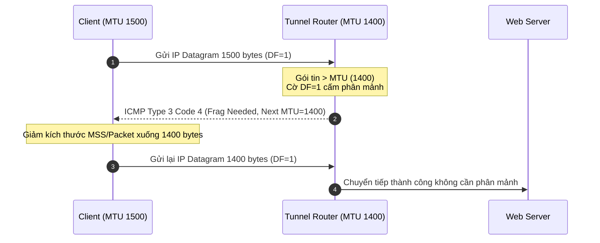
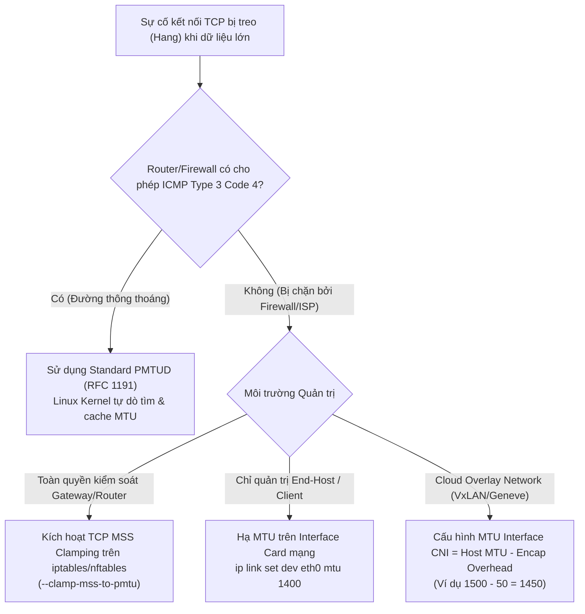

# 3.2. IP Packet, Fragmentation, and ICMP

> [!IMPORTANT]
> **Nếu bạn chỉ được nhớ một điều duy nhất:** Phân mảnh gói tin IP (Fragmentation) là thảm họa đối với hiệu năng mạng: nếu một mảnh bị mất, toàn bộ gói tin IP lớn phải bị hủy bỏ; do đó, các hệ thống hiện đại luôn bật cờ Don't Fragment (DF) và sử dụng cơ chế Path MTU Discovery (PMTUD) kết hợp thông điệp ICMP Type 3 Code 4 (Fragmentation Needed) để tự động dò tìm kích thước khung truyền an toàn tối đa dọc theo toàn bộ tuyến đường.

---

## 1. Đơn giản nhưng phải chi tiết (Intuitive & Deep Breakdown)

### 1.1. Đoạn Code Dẫn Nhập & Vấn Đề Thực Tế
Chuyện gì xảy ra khi ứng dụng gửi một gói tin UDP có kích thước 4,000 bytes qua một liên kết Ethernet chỉ hỗ trợ kích thước tối đa (MTU) là 1,500 bytes?

```bash
# Gửi gói ICMP kích thước 2000 bytes với cờ Don't Fragment (DF) được bật
$ ping -c 1 -s 2000 -M do 8.8.8.8
PING 8.8.8.8 (8.8.8.8) 2000(2028) bytes of data.
ping: local error: message too long, mtu=1500

# Gửi lại mà không bật cờ DF -> Kernel Linux tự động phân mảnh (Fragment) thành nhiều mảnh
$ ping -c 1 -s 2000 -M dont 8.8.8.8
2008 bytes from 8.8.8.8: icmp_seq=1 ttl=118 time=24.2 ms
```

Nếu một mảnh duy nhất trong số các mảnh phân mảnh bị rơi (packet loss) giữa đường, **toàn bộ gói tin gốc 4,000 bytes sẽ bị huỷ bỏ hoàn toàn**, gây lãng phí băng thông mạng và sụt giảm hiệu năng nghiêm trọng.

### 1.2. Ẩn Dụ Đời Sống & Phân Tích Cơ Chế Hoạt Động
Hãy hình dung giao thức IP và hiện tượng Phân mảnh gói tin qua câu chuyện **Chở Hàng Qua Hầm Đường Bộ**:
- **MTU (Maximum Transmission Unit)** giống như **Chiều cao Giới hạn của Cửa Hầm** (ví dụ: tối đa 3 mét).
- Chiếc xe tải chở một bức tượng cao 6 mét đến cửa hầm:
  - Nếu xe có dán nhãn **"DF = 1" (Don't Fragment - Không được tháo rời)**: Trạm gác cửa hầm sẽ lập tức chặn xe lại, đuổi quay về và gửi giấy phạt báo lỗi: *"Hàng quá khổ, cửa hầm chỉ cho phép 3 mét!"* (Đây chính là gói tin **ICMP Type 3, Code 4: Fragmentation Needed**).
  - Nếu xe cho phép **"DF = 0"**: Thợ ở cửa hầm cưa bức tượng làm đôi, đánh số mảnh `1/2` và `2/2` kèm mã định danh lô hàng, rồi cho hai xe nhỏ chở qua hầm. Tại điểm đến, người nhận phải gom đủ cả hai mảnh mới ráp lại thành tượng gốc. Nếu xe thứ hai bị tai nạn lật giữa đường, người nhận đành vứt luôn mảnh thứ nhất vào sọt rác!

### 1.3. Mô Phỏng Dữ Liệu Số Nhỏ Từng Bước (Toy Walkthrough)
Phân mảnh một IP Datagram $3,000\text{ bytes}$ (IP Header = $20\text{ bytes}$, Data = $2,980\text{ bytes}$) qua MTU = $1,500\text{ bytes}$:
Mỗi mảnh có IP Header = $20\text{ bytes}$, nên phần dữ liệu tối đa mỗi mảnh là $1,500 - 20 = 1,480\text{ bytes}$ (phải là bội số của 8).

| Mảnh Phân Đoạn | Total Length | Data Length | Cờ MF (More Fragments) | Fragment Offset (8-byte units) | Byte Range thực tế |
| :--- | :--- | :--- | :--- | :--- | :--- |
| **Gói Gốc** | $3,000\text{ bytes}$ | $2,980\text{ bytes}$ | 0 | 0 | Byte 0 -> 2979 |
| **Mảnh 1 (Frag #1)** | $1,500\text{ bytes}$ | $1,480\text{ bytes}$ | **1** (Còn mảnh sau) | **0** ($0 \div 8$) | Byte 0 -> 1479 |
| **Mảnh 2 (Frag #2)** | $1,500\text{ bytes}$ | $1,480\text{ bytes}$ | **1** (Còn mảnh sau) | **185** ($1480 \div 8$) | Byte 1480 -> 2959 |
| **Mảnh 3 (Frag #3)** | $40\text{ bytes}$ | $20\text{ bytes}$ | **0** (Mảnh cuối cùng) | **370** ($2960 \div 8$) | Byte 2960 -> 2979 |

Đầu nhận nhận cả 3 mảnh, xếp theo `Fragment Offset` và khi nhận mảnh có `MF = 0` thì ráp lại thành gói gốc.

### 1.4. Tác Động Thực Tế Tầng Backend & Systems
- **Tấn công Fragment Reassembly Exhaustion**: Kẻ tấn công gửi hàng triệu mảnh phân mảnh với offset rải rác nhưng không bao giờ gửi mảnh cuối cùng. Kernel Linux phải duy trì bộ đệm `inet_frag` trong RAM để chờ mảnh còn lại cho đến khi cạn kiệt bộ nhớ kernel và crash hệ thống.
- **Vấn đề Black Hole Path MTU Discovery (PMTUD)**: Khi một Firewall hoặc Cloud Security Group chặn nhầm toàn bộ lưu lượng ICMP, thông điệp ICMP "Fragmentation Needed" không thể quay về máy chủ nguồn. Client tiếp tục gửi các gói tin 1,500 bytes nhưng router đường hầm (VPN/GRE/Overlay) âm thầm drop chúng, khiến kết nối TCP bị "đóng băng" (treo phiên TLS Handshake).

### 1.5. Sơ Đồ Tư Duy & Kiến Trúc Hệ Thống (Mermaid)


---

## 2. Chi tiết từng Keyword (Under-the-Hood Deep Dive)

### 2.1. IPv4 Header Structure (Cấu trúc Header IPv4)

Một IPv4 Header tiêu chuẩn có độ dài từ 20 bytes (khi không có Options) đến 60 bytes (khi Options đạt kích thước tối đa 40 bytes). Dữ liệu được tổ chức theo từng hàng 32-bit (4 bytes):

```text
 0                   1                   2                   3
 0 1 2 3 4 5 6 7 8 9 0 1 2 3 4 5 6 7 8 9 0 1 2 3 4 5 6 7 8 9 0 1
+-+-+-+-+-+-+-+-+-+-+-+-+-+-+-+-+-+-+-+-+-+-+-+-+-+-+-+-+-+-+-+-+
|Version|  IHL  |    DSCP   |ECN|          Total Length         |
+-+-+-+-+-+-+-+-+-+-+-+-+-+-+-+-+-+-+-+-+-+-+-+-+-+-+-+-+-+-+-+-+
|         Identification        |Flags|      Fragment Offset    |
+-+-+-+-+-+-+-+-+-+-+-+-+-+-+-+-+-+-+-+-+-+-+-+-+-+-+-+-+-+-+-+-+
|  Time to Live |    Protocol   |         Header Checksum       |
+-+-+-+-+-+-+-+-+-+-+-+-+-+-+-+-+-+-+-+-+-+-+-+-+-+-+-+-+-+-+-+-+
|                       Source IPv4 Address                     |
+-+-+-+-+-+-+-+-+-+-+-+-+-+-+-+-+-+-+-+-+-+-+-+-+-+-+-+-+-+-+-+-+
|                    Destination IPv4 Address                   |
+-+-+-+-+-+-+-+-+-+-+-+-+-+-+-+-+-+-+-+-+-+-+-+-+-+-+-+-+-+-+-+-+
|                    Options (if IHL > 5) ...                   |
+-+-+-+-+-+-+-+-+-+-+-+-+-+-+-+-+-+-+-+-+-+-+-+-+-+-+-+-+-+-+-+-+
```

1. **Version (4 bits)**: Luôn bằng `4` (nhị phân `0100`).
2. **IHL (Internet Header Length - 4 bits)**: Số lượng từ 32-bit (4-byte words) cấu thành Header. Giá trị tối thiểu là 5 ($5 \times 4 = 20$ bytes), tối đa là 15 ($15 \times 4 = 60$ bytes).
3. **DSCP (Differentiated Services Code Point - 6 bits) & ECN (Explicit Congestion Notification - 2 bits)**:
   - Thay thế trường TOS (Type of Service) cũ.
   - DSCP dùng cho chính sách QoS (Quality of Service) tại Router.
   - ECN cho phép router trung gian báo hiệu nghẽn sắp xảy ra (`11` - Congestion Encountered) mà không cần phải drop gói tin.
4. **Total Length (16 bits)**: Kích thước toàn bộ gói tin (Header + Payload) tính bằng byte. Giới hạn lý thuyết tối đa là $2^{16} - 1 = 65,535$ bytes.
5. **Identification (16 bits)**: Định danh duy nhất cho một datagram nguyên bản. Tất cả các mảnh (fragments) sinh ra từ datagram này đều mang cùng một giá trị `Identification`.
6. **Flags (3 bits)**:
   - Bit 0: Reserved (bắt buộc bằng 0).
   - Bit 1: **DF (Don't Fragment)**. Nếu $DF=1$, các router trên đường đi không được phép chia nhỏ gói tin; nếu gặp MTU nhỏ hơn, router bắt buộc phải drop gói tin và gửi ICMP lỗi.
   - Bit 2: **MF (More Fragments)**. Nếu $MF=1$, phía sau vẫn còn mảnh nữa. Nếu $MF=0$, đây là mảnh cuối cùng (hoặc gói tin không bị phân mảnh).
7. **Fragment Offset (13 bits)**: Vị trí bắt đầu của payload trong mảnh này so với payload ban đầu, tính theo đơn vị **8-byte blocks** ($Offset \times 8$). Do đó, mọi mảnh phân mảnh (ngoại trừ mảnh cuối cùng) đều phải có kích thước payload là bội số của 8 bytes!
8. **Time to Live (TTL - 8 bits)**: Bộ đếm số chặng (hop count) chống lặp vòng vô tận. Mỗi router chuyển tiếp gói tin sẽ giảm TTL đi 1. Khi $TTL = 0$, router drop gói tin và gửi ICMP Type 11 (Time Exceeded).
9. **Protocol (8 bits)**: Giao thức tầng trên chứa trong payload (1 = ICMP, 6 = TCP, 17 = UDP, 47 = GRE, 50 = ESP).
10. **Header Checksum (16 bits)**: Checksum 1's complement bảo vệ riêng phần IPv4 Header. Mỗi router chuyển tiếp phải trừ 1 ở trường TTL và tính lại Checksum (hoặc cập nhật gia tăng theo RFC 1624).

---

### 2.2. IPv6 Header Structure (Cấu trúc Header IPv6 Tối giản)

IPv6 loại bỏ hoàn toàn các trường ít dùng hoặc gây nghẽn phần cứng của IPv4, cố định kích thước Base Header thành **40 bytes** để router xử lý bằng ASIC phần cứng với tốc độ dây (wire-speed):

```text
 0                   1                   2                   3
 0 1 2 3 4 5 6 7 8 9 0 1 2 3 4 5 6 7 8 9 0 1 2 3 4 5 6 7 8 9 0 1
+-+-+-+-+-+-+-+-+-+-+-+-+-+-+-+-+-+-+-+-+-+-+-+-+-+-+-+-+-+-+-+-+
|Version| Traffic Class |           Flow Label                  |
+-+-+-+-+-+-+-+-+-+-+-+-+-+-+-+-+-+-+-+-+-+-+-+-+-+-+-+-+-+-+-+-+
|         Payload Length        |  Next Header  |   Hop Limit   |
+-+-+-+-+-+-+-+-+-+-+-+-+-+-+-+-+-+-+-+-+-+-+-+-+-+-+-+-+-+-+-+-+
|                                                               |
+                                                               +
|                                                               |
+                         Source Address                        +
|                           (128 bits)                          |
+                                                               +
|                                                               |
+-+-+-+-+-+-+-+-+-+-+-+-+-+-+-+-+-+-+-+-+-+-+-+-+-+-+-+-+-+-+-+-+
|                                                               |
+                                                               +
|                                                               |
+                      Destination Address                      +
|                           (128 bits)                          |
+                                                               +
|                                                               |
+-+-+-+-+-+-+-+-+-+-+-+-+-+-+-+-+-+-+-+-+-+-+-+-+-+-+-+-+-+-+-+-+
```

- **Không còn Header Checksum**: IPv6 giao toàn quyền kiểm tra toàn vẹn dữ liệu cho L2 (CRC32) và L4 (TCP/UDP Checksum bắt buộc). Router không cần tốn chu kỳ CPU tính lại checksum mỗi khi giảm Hop Limit.
- **Không còn trường phân mảnh trong Base Header**: **Router IPv6 trên đường đi KHÔNG BAO GIỜ phân mảnh gói tin!** Nếu gói tin vượt quá MTU của hop kế tiếp, router lập tức hủy gói tin và gửi ICMPv6 Type 2 (Packet Too Big). Chỉ có máy nguồn (Source Host) mới được phép phân mảnh thông qua **IPv6 Fragment Extension Header**.
- **Next Header**: Thay thế Protocol ID của IPv4. Trường này trỏ tới Header tiếp theo dạng mắt xích (Extension Headers như Hop-by-Hop, Routing, Fragment, hoặc L4 Protocol như TCP/UDP).
- **Flow Label (20 bits)**: Cho phép router nhận diện luồng gói tin cùng phiên để cân bằng tải (ECMP) trên phần cứng mà không cần phân tích sâu vào Layer 4 (Deep Packet Inspection).

---

### 2.3. IP Fragmentation and Reassembly (Phân mảnh và Tái lắp ráp)

#### Cơ chế Phân mảnh tại Router (IPv4)
Giả sử một Router nhận gói tin IPv4 có tổng chiều dài $Total\_Length = 4000$ bytes (20 bytes Header, 3980 bytes Payload) với $DF = 0$. Cổng ra của router có liên kết MTU là 1500 bytes.
- Kích thước payload tối đa trên một mảnh: $\lfloor \frac{1500 - 20}{8} \rfloor \times 8 = \lfloor \frac{1480}{8} \rfloor \times 8 = 185 \times 8 = 1480$ bytes.
- Quá trình chia mảnh:
  - **Mảnh 1**: Header 20 bytes, Payload 1480 bytes ($Total\_Length = 1500$). $MF = 1$, $Offset = 0$ ($0 \times 8 = 0$).
  - **Mảnh 2**: Header 20 bytes, Payload 1480 bytes ($Total\_Length = 1500$). $MF = 1$, $Offset = 185$ ($185 \times 8 = 1480$).
  - **Mảnh 3**: Header 20 bytes, Payload còn lại là $3980 - (1480 \times 2) = 1020$ bytes ($Total\_Length = 1040$). $MF = 0$, $Offset = 370$ ($370 \times 8 = 2960$).

#### Cơ chế Tái lắp ráp tại Đích (Reassembly)
- Router trung gian **không bao giờ** tái lắp ráp các mảnh; chỉ có thiết bị đích cuối cùng (Destination Host) mới thực hiện việc này.
- Kernel đích cấp phát một hàng đợi `ipq` (IP Queue) lập chỉ mục theo bộ 4: `(Source IP, Destination IP, Identification, Protocol)`.
- Khi mảnh cuối cùng tới ($MF=0$), kernel tính được kích thước payload toàn phần ban đầu = $Offset \times 8 + Fragment\_Payload\_Len$.
- Khi tất cả các byte từ 0 đến cuối được lấp đầy, kernel ghép nối các buffer `sk_buff` và chuyển giao lên L4.
- **Timer Timeout**: Nếu sau khoảng thời gian quy định (Linux mặc định `ipfrag_time = 30s`) mà vẫn thiếu dù chỉ 1 mảnh, kernel sẽ hủy toàn bộ các mảnh đã lưu trong RAM và gửi gói tin **ICMP Type 11 Code 1 (Fragment Reassembly Time Exceeded)** về nguồn.

---

### 2.4. Path MTU Discovery (PMTUD)

PMTUD (RFC 1191 đối với IPv4, RFC 8201 đối với IPv6) là cơ chế chuẩn mực giúp End-Host tự động dò tìm kích thước MTU nhỏ nhất (Bottleneck MTU) trên toàn bộ lộ trình mạng mà không cần phân mảnh:

1. Máy nguồn gửi gói tin thăm dò với cờ **$DF = 1$**.
2. Nếu gói tin vừa vặn qua tất cả các chặng, nó đến đích bình thường.
3. Nếu một router trên đường đi có MTU nhỏ hơn kích thước gói:
   - Router hủy gói tin.
   - Router gửi lại gói **ICMP Type 3, Code 4 (Destination Unreachable: Fragmentation Needed and DF set)**.
   - Các router hiện đại theo chuẩn RFC 1191 sẽ đính kèm trường **Next-Hop MTU** trong ICMP payload, thông báo chính xác kích thước MTU tối đa mà cổng mạng đó chấp nhận.
4. Máy nguồn nhận được thông điệp ICMP, cập nhật giá trị MTU vào kernel routing cache / socket FIB, và hạ kích thước phân đoạn TCP MSS tương ứng.

> [!WARNING]
> **Hiện tượng MTU Black Hole (Hố đen MTU)**: Nếu một tường lửa hoặc thiết bị trung gian cấu hình sai chặn toàn bộ lưu lượng ICMP (bao gồm Type 3 Code 4), máy gửi sẽ không bao giờ nhận được phản hồi lỗi. Kết quả: Kết nối TCP Handshake (SYN/ACK kích thước nhỏ) vẫn thành công, nhưng ngay khi dữ liệu lớn (HTTP GET, TLS Client Hello/Certificate) được truyền đi, kết nối sẽ bị treo vĩnh viễn (hang) và timeout!

---

### 2.5. ICMP (Internet Control Message Protocol)

ICMP (RFC 792) hoạt động tại Layer 3 nhưng được đóng gói trực tiếp bên trong IP Datagram ($Protocol = 1$ cho IPv4, $Protocol = 58$ cho ICMPv6).

#### Cấu trúc Chung của ICMP Header
```text
 0                   1                   2                   3
 0 1 2 3 4 5 6 7 8 9 0 1 2 3 4 5 6 7 8 9 0 1 2 3 4 5 6 7 8 9 0 1
+-+-+-+-+-+-+-+-+-+-+-+-+-+-+-+-+-+-+-+-+-+-+-+-+-+-+-+-+-+-+-+-+
|     Type      |     Code      |          Checksum             |
+-+-+-+-+-+-+-+-+-+-+-+-+-+-+-+-+-+-+-+-+-+-+-+-+-+-+-+-+-+-+-+-+
|                 Rest of Header (Varies by Type)               |
+-+-+-+-+-+-+-+-+-+-+-+-+-+-+-+-+-+-+-+-+-+-+-+-+-+-+-+-+-+-+-+-+
|       Original IP Header + first 64 bits of Original Payload  |
+-+-+-+-+-+-+-+-+-+-+-+-+-+-+-+-+-+-+-+-+-+-+-+-+-+-+-+-+-+-+-+-+
```

#### Các Cặp Type/Code Quan trọng Nhất
1. **Echo Request & Reply (Type 8 / Type 0)**: Dùng trong công cụ `ping`. Trường *Rest of Header* chứa `Identifier` (PID tiến trình) và `Sequence Number` để ghép cặp request/reply.
2. **Destination Unreachable (Type 3)**:
   - `Code 0`: Net Unreachable (Không tìm thấy mạng đích trong bảng định tuyến).
   - `Code 1`: Host Unreachable (Không giải quyết được địa chỉ ARP/L2 ở chặng cuối).
   - `Code 3`: Port Unreachable (Không có tiến trình nào lắng nghe cổng UDP trên máy đích).
   - `Code 4`: **Fragmentation Needed and DF set** (Cốt lõi của PMTUD).
3. **Time Exceeded (Type 11)**:
   - `Code 0`: **TTL expired in transit** (Hết hạn số chặng khi đang chuyển tiếp - nền tảng của `traceroute`).
   - `Code 1`: **Fragment reassembly time exceeded** (Quá thời gian chờ lắp ráp các mảnh IP).
4. **Redirect (Type 5)**: Router thông báo cho host rằng có một router khác trên cùng mạng LAN có tuyến đường tối ưu hơn.

---

## 3. Thực thi Mã nguồn & Mô phỏng Chuyên sâu (Dual-Engine Implementation)

Dưới đây là mã nguồn mô phỏng chi tiết thuật toán phân mảnh gói tin IPv4 và phân tích cấu trúc ICMP Message.

### 3.1. C++20: IP Fragmentation Engine & Reassembly Simulator

File `ip_fragmenter.cpp` mô phỏng đầy đủ logic chia nhỏ IP Datagram theo bội số 8 bytes của trường `Fragment Offset` và tính toán Header Checksum.

```cpp
#include <iostream>
#include <vector>
#include <cstdint>
#include <cstring>
#include <iomanip>
#include <sstream>

#pragma pack(push, 1)
struct IPv4Header {
    uint8_t  ihl_version;      // 4 bits version, 4 bits IHL
    uint8_t  tos_ecn;          // DSCP / ECN
    uint16_t total_length;     // Big-Endian
    uint16_t identification;   // Big-Endian
    uint16_t flags_fragment;   // 3 bits flags, 13 bits fragment offset
    uint8_t  ttl;
    uint8_t  protocol;
    uint16_t checksum;
    uint32_t src_ip;
    uint32_t dst_ip;
};
#pragma pack(pop)

// Chuyển đổi Endianess
uint16_t to_be16(uint16_t val) {
    return (val << 8) | (val >> 8);
}

// Thuật toán Internet Checksum (RFC 1071 - 1's complement sum)
uint16_t calculate_checksum(const uint16_t* data, size_t length_bytes) {
    uint32_t sum = 0;
    while (length_bytes > 1) {
        sum += *data++;
        length_bytes -= 2;
    }
    if (length_bytes > 0) {
        sum += *reinterpret_cast<const uint8_t*>(data);
    }
    while (sum >> 16) {
        sum = (sum & 0xFFFF) + (sum >> 16);
    }
    return static_cast<uint16_t>(~sum);
}

struct Fragment {
    IPv4Header header;
    std::vector<uint8_t> payload;
};

std::vector<Fragment> fragment_ipv4_packet(
    uint32_t src_ip, uint32_t dst_ip, uint16_t id, uint8_t proto,
    const std::vector<uint8_t>& payload, uint16_t link_mtu) 
{
    std::vector<Fragment> fragments;
    constexpr size_t header_len = sizeof(IPv4Header); // 20 bytes

    if (link_mtu <= header_len) {
        throw std::runtime_error("MTU qua nho, khong du cho IP Header!");
    }

    size_t max_payload_per_frag = (link_mtu - header_len) & ~7ULL; // Lam tron xuong boi so cua 8
    size_t total_payload_bytes = payload.size();
    size_t bytes_sent = 0;

    while (bytes_sent < total_payload_bytes) {
        size_t current_chunk = std::min(max_payload_per_frag, total_payload_bytes - bytes_sent);
        bool has_more = (bytes_sent + current_chunk < total_payload_bytes);

        Fragment frag;
        frag.header.ihl_version = 0x45; // IPv4, IHL = 5 (20 bytes)
        frag.header.tos_ecn = 0;
        frag.header.total_length = to_be16(static_cast<uint16_t>(header_len + current_chunk));
        frag.header.identification = to_be16(id);
        frag.header.ttl = 64;
        frag.header.protocol = proto;
        frag.header.src_ip = src_ip;
        frag.header.dst_ip = dst_ip;
        frag.header.checksum = 0;

        // Flags & Offset
        // Bit 0: Res, Bit 1: DF (0), Bit 2: MF
        uint16_t offset_in_8byte_blocks = static_cast<uint16_t>(bytes_sent / 8);
        uint16_t flags_offset = offset_in_8byte_blocks & 0x1FFF;
        if (has_more) {
            flags_offset |= (1 << 13); // Set MF = 1
        }
        frag.header.flags_fragment = to_be16(flags_offset);

        // Tinh toan Header Checksum
        frag.header.checksum = calculate_checksum(
            reinterpret_cast<const uint16_t*>(&frag.header), header_len);

        frag.payload.assign(payload.begin() + bytes_sent, payload.begin() + bytes_sent + current_chunk);
        fragments.push_back(std::move(frag));

        bytes_sent += current_chunk;
    }

    return fragments;
}

int main() {
    std::cout << "=== IPv4 FRAGMENTATION SIMULATOR (C++20) ===" << std::endl;
    // Gia lap payload 3500 bytes (vi du du lieu UDP lon)
    std::vector<uint8_t> large_payload(3500, 0xAB);
    uint16_t mtu = 1500;
    uint16_t packet_id = 0x1A2B;

    auto frags = fragment_ipv4_packet(0x0101A8C0, 0x08080808, packet_id, 17, large_payload, mtu);

    std::cout << "Kich thuoc Payload goc: " << large_payload.size() << " bytes\n";
    std::cout << "Link MTU: " << mtu << " bytes (Payload toi da moi manh: " << ((mtu - 20) & ~7) << " bytes)\n";
    std::cout << "Tong so manh tao thanh: " << frags.size() << "\n\n";

    for (size_t i = 0; i < frags.size(); ++i) {
        const auto& f = frags[i];
        uint16_t raw_flags_offset = to_be16(f.header.flags_fragment);
        bool mf = (raw_flags_offset & (1 << 13)) != 0;
        uint16_t offset_val = (raw_flags_offset & 0x1FFF) * 8;
        uint16_t total_len = to_be16(f.header.total_length);

        std::cout << "--- Mảnh #" << (i + 1) << " ---\n";
        std::cout << "  Total Length   : " << total_len << " bytes (Payload: " << f.payload.size() << " bytes)\n";
        std::cout << "  Identification : 0x" << std::hex << std::uppercase << to_be16(f.header.identification) << std::dec << "\n";
        std::cout << "  More Fragments : " << (mf ? "1 (Con manh tiep)" : "0 (Manh cuoi)") << "\n";
        std::cout << "  Byte Offset    : " << offset_val << " bytes\n";
        std::cout << "  Header Checksum: 0x" << std::hex << std::uppercase << f.header.checksum << std::dec << "\n";
    }

    return 0;
}
```

### 3.2. Python 3.11: Raw IP/ICMP Packet Inspector & PMTUD Simulation

File `pmtud_simulator.py` mô phỏng máy trạng thái Path MTU Discovery, phân tích phản hồi ICMP Type 3 Code 4 và tự động hội tụ kích thước TCP Segment.

```python
import struct
import socket
from dataclasses import dataclass
from typing import Optional, List, Tuple

@dataclass
class ICMPPacket:
    type: int
    code: int
    checksum: int
    next_hop_mtu: int
    payload: bytes

class PMTUDSimulator:
    """Mo phong qua trinh Path MTU Discovery va co che phan hoi ICMP Packet Too Big."""
    
    def __init__(self, path_hops_mtu: List[int]):
        # Danh sach MTU cua tung chặng (hop) tren toan tuyen
        self.path_hops_mtu = path_hops_mtu
        self.cached_pmtu = 1500  # Default khoi dau Ethernet MTU
        print(f"[*] Khoi tao Network Path gom {len(path_hops_mtu)} hops:")
        for idx, mtu in enumerate(path_hops_mtu):
            print(f"    Hop {idx+1} MTU: {mtu} bytes")

    def simulate_transmit(self, packet_size: int, df_flag: bool) -> Tuple[bool, Optional[ICMPPacket]]:
        """Mô phỏng gửi gói tin qua từng hop mạng."""
        print(f"\n[>] Sender gui packet: Size={packet_size}B, DF={df_flag}")
        
        for hop_index, hop_mtu in enumerate(self.path_hops_mtu):
            if packet_size > hop_mtu:
                if df_flag:
                    print(f"    [!] NGHẼN tai Hop {hop_index+1}: Packet ({packet_size}B) > MTU ({hop_mtu}B) va DF=1!")
                    # Sinh ra goi tin ICMP Type 3, Code 4 (Fragmentation Needed)
                    # RFC 1191: Next-Hop MTU nam tai 2 byte thu 6-7 cua ICMP Header
                    icmp_header = struct.pack("!BBHHH", 3, 4, 0, 0, hop_mtu)
                    # Checksum ICMP
                    chksum = self._in_cksum(icmp_header)
                    icmp_header = struct.pack("!BBHHH", 3, 4, chksum, 0, hop_mtu)
                    
                    return False, ICMPPacket(type=3, code=4, checksum=chksum, next_hop_mtu=hop_mtu, payload=b"")
                else:
                    print(f"    [~] Hop {hop_index+1}: Packet ({packet_size}B) > MTU ({hop_mtu}B) -> Router tu phan manh!")
        
        print(f"    [+] Packet chuyen giao thanh cong toi Receiver!")
        return True, None

    def run_discovery_loop(self, initial_probe_size: int = 1500):
        current_probe = initial_probe_size
        print(f"\n--- BAT DAU PATH MTU DISCOVERY TU SIZE {current_probe}B ---")
        
        step = 1
        while True:
            print(f"\n[Round {step}] Thu nghiem voi MTU = {current_probe} bytes")
            success, icmp_err = self.simulate_transmit(packet_size=current_probe, df_flag=True)
            
            if success:
                self.cached_pmtu = current_probe
                tcp_mss = self.cached_pmtu - 40 # Tru 20B IPv4 + 20B TCP
                print(f"\n[=== HOAN TAT PMTUD ===]")
                print(f"Path MTU toi uu xac dinh duoc: {self.cached_pmtu} bytes")
                print(f"TCP Maximum Segment Size (MSS) de xuat: {tcp_mss} bytes")
                break
            
            if icmp_err and icmp_err.type == 3 and icmp_err.code == 4:
                print(f"    [<] Nhan ICMP Type 3 Code 4 tu Router!")
                print(f"        Next-Hop MTU thong bao: {icmp_err.next_hop_mtu} bytes")
                current_probe = icmp_err.next_hop_mtu
            else:
                print("    [-] Gap loi khong xac dinh hoac timeout.")
                break
            step += 1

    @staticmethod
    def _in_cksum(data: bytes) -> int:
        if len(data) % 2 == 1:
            data += b'\x00'
        words = struct.unpack(f"!{len(data)//2}H", data)
        s = sum(words)
        while s >> 16:
            s = (s & 0xFFFF) + (s >> 16)
        return ~s & 0xFFFF

if __name__ == "__main__":
    # Kịch bản thực tế: Host gửi (1500) -> Edge Router (1500) -> GRE Tunnel / PPPoE (1420) -> Core (1500)
    network_path = [1500, 1420, 1500]
    simulator = PMTUDSimulator(network_path)
    simulator.run_discovery_loop(initial_probe_size=1500)
```

### 3.3. Terminal Output Mẫu

```text
$ clang++ -std=c++20 -O3 ip_fragmenter.cpp -o ip_fragmenter && ./ip_fragmenter
=== IPv4 FRAGMENTATION SIMULATOR (C++20) ===
Kich thuoc Payload goc: 3500 bytes
Link MTU: 1500 bytes (Payload toi da moi manh: 1480 bytes)
Tong so manh tao thanh: 3

--- Mảnh #1 ---
  Total Length   : 1500 bytes (Payload: 1480 bytes)
  Identification : 0x1A2B
  More Fragments : 1 (Con manh tiep)
  Byte Offset    : 0 bytes
  Header Checksum: 0xB571
--- Mảnh #2 ---
  Total Length   : 1500 bytes (Payload: 1480 bytes)
  Identification : 0x1A2B
  More Fragments : 1 (Con manh tiep)
  Byte Offset    : 1480 bytes
  Header Checksum: 0x9857
--- Mảnh #3 ---
  Total Length   : 560 bytes (Payload: 540 bytes)
  Identification : 0x1A2B
  More Fragments : 0 (Manh cuoi)
  Byte Offset    : 2960 bytes
  Header Checksum: 0x76B2

$ python3 pmtud_simulator.py
[*] Khoi tao Network Path gom 3 hops:
    Hop 1 MTU: 1500 bytes
    Hop 2 MTU: 1420 bytes
    Hop 3 MTU: 1500 bytes

--- BAT DAU PATH MTU DISCOVERY TU SIZE 1500B ---

[Round 1] Thu nghiem voi MTU = 1500 bytes

[>] Sender gui packet: Size=1500B, DF=True
    [!] NGHẼN tai Hop 2: Packet (1500B) > MTU (1420B) va DF=1!
    [<] Nhan ICMP Type 3 Code 4 tu Router!
        Next-Hop MTU thong bao: 1420 bytes

[Round 2] Thu nghiem voi MTU = 1420 bytes

[>] Sender gui packet: Size=1420B, DF=True
    [+] Packet chuyen giao thanh cong toi Receiver!

[=== HOAN TAT PMTUD ===]
Path MTU toi uu xac dinh duoc: 1420 bytes
TCP Maximum Segment Size (MSS) de xuat: 1380 bytes
```

---

## 4. Systems Engineering & Production Pitfalls

### 4.1. MTU Black Hole và Giải pháp TCP MSS Clamping
Trong hạ tầng Cloud, Kubernetes Overlay Networks (Calico IPIP, Cilium VXLAN, AWS VPC peering) thường tiêu tốn từ 20 đến 54 bytes cho Outer IP & Encapsulation Header. Nếu máy khách gửi gói tin 1500 bytes ra Internet qua tunnel:
- Tunnel endpoint cần phân mảnh hoặc drop nếu cờ DF=1.
- Nếu firewall ISP chặn ICMP Type 3 Code 4, kết nối rơi vào **Hố đen MTU (MTU Black Hole)**.
- **Biện pháp xử lý production chuẩn**: Cấu hình **TCP MSS Clamping** tại Gateway / Router:
```bash
# Tự động điều chỉnh kích thước TCP MSS trong các gói tin SYN đi qua router
iptables -t mangle -A FORWARD -p tcp --tcp-flags SYN,RST SYN \
         -j TCPMSS --clamp-mss-to-pmtu
```
Lệnh trên bắt các gói tin TCP SYN/ACK, tính toán $Path\_MTU - 40$ bytes, và ghi đè trường MSS Option trong TCP Header, triệt tiêu nguy cơ sinh ra gói tin vượt quá kích thước MTU.

### 4.2. IP Reassembly DoS Attack (Teardrop Attack & Hash Collision)
- Kẻ tấn công gửi các mảnh IP có trường `Offset` cố tình chồng chéo (overlapping fragments) hoặc gửi hàng triệu mảnh `MF=1` với `Identification` khác nhau nhưng không bao giờ gửi mảnh kết thúc.
- Kernel Linux phải duy trì cấu trúc dữ liệu `ipq` trong bộ nhớ RAM chờ timeout (30 giây). Điều này gây cạn kiệt RAM hệ thống.
- **Cấu hình Kernel bảo vệ**:
```bash
# Giới hạn dung lượng bộ nhớ tối đa dành cho IP Reassembly (mặc định 4MB)
sysctl -w net.ipv4.ipfrag_high_thresh=4194304
sysctl -w net.ipv4.ipfrag_low_thresh=3145728

# Rút ngắn thời gian chờ tái lắp ráp (mặc định 30 giây xuống 10 giây)
sysctl -w net.ipv4.ipfrag_time=10
```

### 4.3. Các lệnh CLI Chẩn đoán MTU và Phân mảnh

```bash
# 1. Đo chính xác MTU tuyến đường tới máy chủ đích bằng ping (Linux)
# -M do: Bật cờ DF (Don't Fragment)
# -s 1472: Kích thước ICMP Payload (1472 + 8B ICMP + 20B IP = 1500B)
ping -c 2 -M do -s 1472 8.8.8.8

# Nếu gặp lỗi: "ping: local error: message too long, mtu=1420" -> Tìm thấy MTU nghẽn!

# 2. Dùng tracepath để dò MTU từng hop tự động
tracepath 8.8.8.8

# 3. Kiểm tra và thiết lập MTU trên card mạng Linux
ip link show dev eth0
sudo ip link set dev eth0 mtu 1400

# 4. Kiểm tra các thông số thống kê phân mảnh gói tin trong Kernel
netstat -s | grep -i frag
# Hoặc đọc trực tiếp từ procfs:
cat /proc/net/snmp | grep -i ip:
```

---

## 5. Bảng So sánh & Decision Matrix

### 5.1. Bảng So sánh: IPv4 vs IPv6 Packet Architecture

| Đặc tính Kỹ thuật | IPv4 (RFC 791) | IPv6 (RFC 8200) |
| :--- | :--- | :--- |
| **Kích thước Header** | Biến thiên: 20 đến 60 bytes | Cố định: **40 bytes** (Chuẩn hóa) |
| **Phân mảnh tại Router** | **Hỗ trợ** (nếu cờ $DF = 0$) | **TUYỆT ĐỐI CẤM** (Router chỉ drop và gửi ICMPv6 Packet Too Big) |
| **Điểm thực hiện Phân mảnh**| Router trung gian hoặc Source Host | **Chỉ duy nhất Source Host** (dùng Extension Header) |
| **Header Checksum** | Có (Tính toán và kiểm tra tại mỗi hop) | **Loại bỏ hoàn toàn** (Tối ưu ASIC & wire-speed) |
| **Độ dài Địa chỉ** | 32 bits (4 bytes) | 128 bits (16 bytes) |
| **Cơ chế Điều khiển Lỗi**| ICMPv4 (Protocol = 1) | ICMPv6 (Protocol = 58 - Đa năng hơn) |
| **Giới hạn MTU Tối thiểu** | 576 bytes | **1280 bytes** |

### 5.2. Decision Matrix: Cơ chế Kiểm soát MTU trong Hệ thống Phức hợp



| Tình huống / Môi trường | Giải pháp Tối ưu | Cơ chế Hoạt động | Đánh đổi / Nhược điểm |
| :--- | :--- | :--- | :--- |
| **Hạ tầng Mạng Nội bộ / Campus** | **Jumbo Frames (MTU 9000)** | Nâng MTU trên toàn bộ Switch, NIC | Mọi thiết bị trên broadcast domain phải đồng bộ cấu hình, nếu không sẽ rớt gói tin. |
| **Internet Công cộng Tiêu chuẩn**| **PMTUD ($DF=1$)** | Phản hồi ICMP Type 3 Code 4 | Dễ bị tê liệt nếu firewall upstream drop gói ICMP (MTU Black Hole). |
| **VPN Tunnels (IPsec, WireGuard)** | **TCP MSS Clamping** | Sửa giá trị MSS Option trong SYN packet | Chỉ hiệu quả với TCP; các gói tin UDP lớn vẫn bị drop nếu không tự chia mảnh. |
| **Kubernetes Overlay (Calico/Cilium)**| **Hạ Pod MTU tương ứng Overhead** | Thiết lập MTU interface `cali*` hoặc `cilium_*` | Giảm nhẹ throughput lý thuyết (khoảng 1-3%) do tỷ lệ payload/overhead giảm. |

---

## 6. Enterprise Production Checklist & Verification

### 6.1. Kiến Trúc & Cấu Hình Tối Ưu (Production-Ready Architecture)
- [ ] **Kích hoạt Path MTU Discovery (PMTUD)**: Luôn bật `net.ipv4.ip_no_pmtu_disc = 0` trên các máy chủ Linux để kernel tự động thương lượng kích thước gói tin phù hợp dọc tuyến đường.
- [ ] **Tuyệt đối Không Chặn ICMP Type 3 Toàn Bộ**: Trong cấu hình iptables/nftables hoặc AWS Security Groups, không được drop mù quáng ICMP. Bắt buộc cho phép `icmp type 3` (Destination Unreachable) để PMTUD hoạt động chính xác.
- [ ] **TCP MSS Clamping cho Mạng VPN / Overlay**: Trên các Router/Firewall chạy WireGuard, IPsec, hoặc GRE/VXLAN tunnel, cấu hình `iptables -t mangle -A POSTROUTING -p tcp --tcp-flags SYN,RST SYN -j TCPMSS --clamp-mss-to-pmtu` để tự động gọt nhỏ MSS cho mọi phiên TCP.
- [ ] **Kiểm soát Bộ đệm Phân mảnh Kernel**: Giới hạn vùng nhớ reassembly bằng sysctl `net.ipv4.ipfrag_high_thresh` và `net.ipv4.ipfrag_low_thresh` để ngăn chặn DoS cạn kiệt RAM.

### 6.2. Giám Sát, Cảnh Báo & Xử Lý Sự Cố (Observability & Incident Response)
- [ ] **Giám sát Tỷ lệ Phân mảnh IP**: Đọc metric `netstat -s | grep -i frag` hoặc bộ đếm SNMP `IpReasmReqds`, `IpReasmOKs`, `IpReasmFails` để phát hiện ứng dụng đang gửi dữ liệu UDP quá lớn.
- [ ] **Báo động ICMP Rate Limiting**: Theo dõi ngưỡng `net.ipv4.icmp_ratelimit` để tránh trường hợp máy chủ bị tràn bộ đệm xử lý khi có bão ICMP flood.
- [ ] **Xác thực MTU Tuyến đường bằng CLI**: Dùng lệnh `tracepath -n <ip_address>` để phát hiện chính xác router hop nào trên đường truyền có MTU thấp gây nghẽn.
