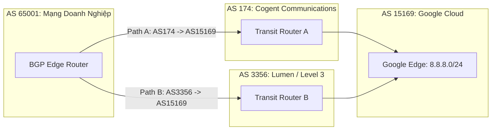
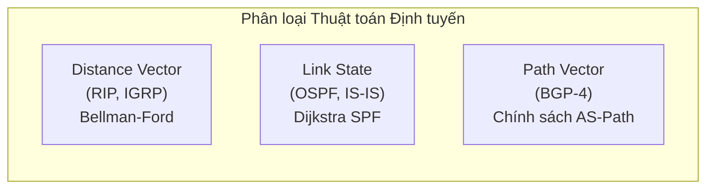
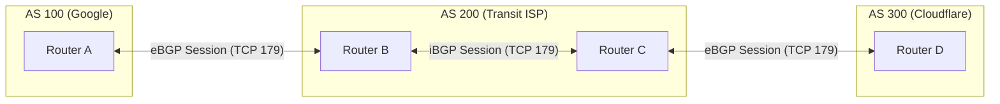
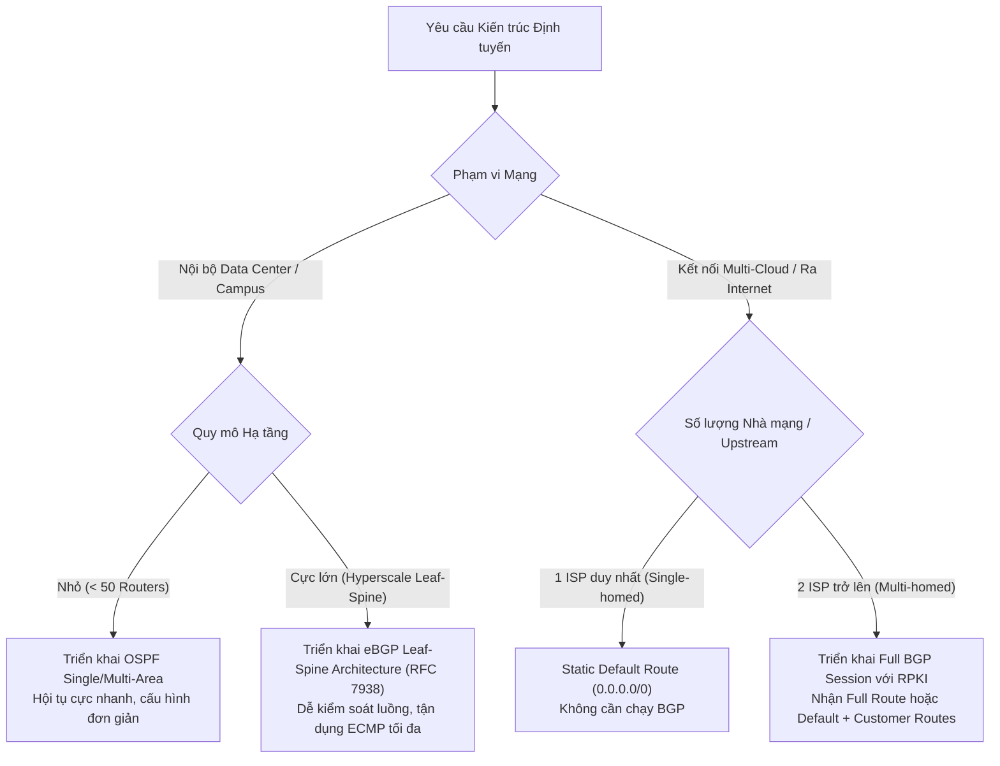

# 3.3. Routing Algorithms and BGP

> [!IMPORTANT]
> **Nếu bạn chỉ được nhớ một điều duy nhất:** Internet không phải là một mạng đơn lẻ mà là một liên minh lỏng lẻo giữa hàng chục nghìn Hệ thống Tự trị (Autonomous Systems - AS): trong khi OSPF/IS-IS sử dụng thuật toán Dijkstra để tìm đường đi ngắn nhất bên trong nội bộ một AS, thì BGP (Border Gateway Protocol) là giao thức Path Vector định tuyến toàn bộ Internet dựa trên chính sách kinh tế và thỏa thuận thương mại giữa các nhà mạng.

---

## 1. Đơn giản nhưng phải chi tiết (Intuitive & Deep Breakdown)

### 1.1. Đoạn Code Dẫn Nhập & Vấn Đề Thực Tế
Làm thế nào nhân hệ điều hành Linux hoặc một L3 Switch quyết định chọn card mạng nào để gửi một gói tin ra ngoài khi có hàng nghìn đường đi trong bảng định tuyến?

```python
# Mô phỏng thuật toán Longest Prefix Match (LPM) tra cứu bảng định tuyến
routing_table = [
    ("0.0.0.0/0", 0, "eth0_default_gw"),
    ("10.0.0.0/8", 8, "eth1_intranet"),
    ("10.244.0.0/16", 16, "eth2_k8s_pods"),
    ("10.244.15.0/24", 24, "eth3_worker_node_15")
]

def lookup_route(destination_ip):
    import ipaddress
    dst = ipaddress.IPv4Address(destination_ip)
    best_route = None
    max_prefix_len = -1
    
    for prefix, prefix_len, interface in routing_table:
        net = ipaddress.IPv4Network(prefix)
        if dst in net:
            if prefix_len > max_prefix_len: # Ưu tiên đường đi có tiền tố dài nhất
                max_prefix_len = prefix_len
                best_route = interface
                
    return best_route

# Gói tin gửi tới 10.244.15.88 sẽ khớp cả /8, /16 và /24, nhưng /24 cụ thể nhất!
print("Giao diện được chọn:", lookup_route("10.244.15.88")) # eth3_worker_node_15
```

Nếu một giao thức định tuyến bị lỗi tạo thành vòng lặp (Routing Loop), gói tin sẽ chạy vòng quanh mãi mãi giữa các router, làm cạn kiệt băng thông mạng cho đến khi trường TTL (Time To Live) đếm về 0.

### 1.2. Ẩn Dụ Đời Sống & Phân Tích Cơ Chế Hoạt Động
Định tuyến toàn cầu (Internet Routing) giống như **Hệ thống Biển chỉ dẫn Giao thông và Điều hướng Chuyến bay Liên lục địa**:
- **Bảng định tuyến (Routing Table / FIB)** giống như **Tấm bản đồ ngã tư**: Khi một chiếc xe đi tới, người gác cổng nhìn biển số và chỉ xe rẽ trái hay rẽ phải.
- **Nội bộ một Tỉnh (IGP - OSPF/IS-IS)** giống như **Google Maps tìm đường ngắn nhất trong nội thành**: Dùng thuật toán Dijkstra để tính toán quãng đường ngắn nhất dựa trên tốc độ cho phép của từng tuyến đường.
- **Định tuyến Giữa các Quốc gia (EGP - BGP)** giống như **Chính sách Ngoại giao và Thương mại Hàng không Toàn cầu**:
  - Không đơn thuần là đường đi ngắn nhất về mặt địa lý.
  - Một chuyến bay từ Mỹ về Việt Nam có thể chọn quá cảnh ở Nhật Bản thay vì Trung Quốc vì lý do thỏa thuận giá vé, phí quá cảnh hoặc quan hệ chính trị. BGP (Border Gateway Protocol) hoạt động dựa trên **Chính sách Định tuyến (Policy-based Routing)** và đường dẫn các Hệ thống Tự trị (**AS-Path**).

### 1.3. Mô Phỏng Dữ Liệu Số Nhỏ Từng Bước (Toy Walkthrough)
Quá trình BGP Router chọn tuyến đường tốt nhất giữa 3 đường đi khả dụng tới dải mạng `8.8.8.0/24`:

| Tuyến Đường (Route Candidate) | Weight (Cisco/Internal) | Local Preference (Toàn AS) | AS-Path (Số AS đi qua) | Origin | MED (Metric) | Quyết Định Chọn |
| :--- | :--- | :--- | :--- | :--- | :--- | :--- |
| **Đường A (Qua ISP-1)** | 100 | **200** | `AS100 AS200` (2 hops) | IGP | 50 | **THẮNG CUỘC** (Local Pref cao nhất: 200 > 100) |
| **Đường B (Qua ISP-2)** | 100 | 100 | `AS50` (1 hop) | IGP | 10 | Bị loại ở bước Local Preference |
| **Đường C (Qua ISP-3)** | 100 | 100 | `AS300 AS400 AS500` | EGP | 20 | Bị loại ở bước Local Preference |

Mặc dù Đường B có `AS-Path` ngắn hơn (chỉ 1 hop), nhưng Quản trị viên mạng đã cấu hình `Local Preference = 200` cho Đường A (ví dụ do giá băng thông ISP-1 rẻ hơn), do đó BGP quyết định gửi toàn bộ lưu lượng qua Đường A.

### 1.4. Tác Động Thực Tế Tầng Backend & Systems
- **Thảm họa BGP Route Hijacking**: Nếu một nhà mạng công bố nhầm tiền tố IP của dịch vụ khác (ví dụ sự cố một ISP Pakistan công bố tiền tố của YouTube năm 2008), toàn bộ lưu lượng YouTube toàn cầu bị hút về mạng Pakistan khiến trang web sập trên diện rộng.
- **Tiêu thụ Bộ nhớ FIB trên L3 Switches**: Bảng BGP toàn cầu hiện có hơn 950,000 tiền tố. Nếu phần cứng L3 Switch rẻ tiền chỉ có bộ nhớ TCAM chứa được 512,000 routes, switch sẽ bị tràn TCAM và đẩy việc tra cứu xuống CPU, gây treo switch và rớt hàng loạt kết nối.

### 1.5. Sơ Đồ Tư Duy & Kiến Trúc Hệ Thống (Mermaid)


---

## 2. Chi tiết từng Keyword (Under-the-Hood Deep Dive)

### 2.1. Longest Prefix Match (LPM - Khớp Tiền tố Dài nhất)

#### 1. Nguyên lý Hoạt động
Khi một router nhận được gói tin có địa chỉ IP đích, địa chỉ này có thể khớp với **nhiều dòng khác nhau** trong bảng định tuyến do kỹ thuật gom cụm mạng (Route Aggregation / CIDR):
- Dòng 1: `10.0.0.0/8` qua Gateway A
- Dòng 2: `10.244.0.0/16` qua Gateway B
- Dòng 3: `10.244.5.0/24` qua Gateway C
- Dòng 4: `0.0.0.0/0` (Default Gateway) qua Gateway D

**Quy tắc Longest Prefix Match (LPM)**: Router bắt buộc phải chọn dòng định tuyến có **Mặt nạ mạng dài nhất (Prefix Length `/xx` lớn nhất)**, vì tiền tố dài nhất đại diện cho dải địa chỉ hẹp nhất, cụ thể nhất và chính xác nhất.
- Ví dụ: Gói tin đến IP đích `10.244.5.12`:
  - Khớp Dòng 1 (8 bits đầu trùng: `10`)
  - Khớp Dòng 2 (16 bits đầu trùng: `10.244`)
  - Khớp Dòng 3 (24 bits đầu trùng: `10.244.5`)
  - Khớp Dòng 4 (0 bits trùng)
  - **Kết luận**: Router chọn **Dòng 3 (`/24`)** để chuyển tiếp gói tin ra Gateway C!

#### 2. Cấu trúc Dữ liệu Dưới Tầng Phần cứng & Kernel (Under the Hood)
- **Linux Kernel (Software Data Plane)**:
  - Kernel sử dụng cấu trúc **LC-Trie (Level-Compressed Trie)** kết hợp **Fib Lookup Table**. Độ phức tạp lý thuyết là $O(W)$ với $W=32$ (IPv4) hoặc $W=128$ (IPv6), nhưng nhờ nén các nhánh đơn lẻ thành các node đa phân (multi-way nodes), thời gian tra cứu giảm xuống trung bình từ 3 đến 5 bước nhảy bộ nhớ.
- **Core Router & Switches (Hardware Data Plane)**:
  - Sử dụng **TCAM (Ternary Content-Addressable Memory)**. Khác với RAM thông thường (chỉ lưu giá trị 0 và 1), mỗi ô nhớ TCAM hỗ trợ 3 trạng thái: `0`, `1`, và `X` (Don't Care / Mask bit).
  - Khi một địa chỉ IP đi vào chip ASIC, phần cứng TCAM so sánh IP đó song song đồng thời với tất cả 1,000,000 dòng định tuyến chỉ trong **1 chu kỳ xung nhịp (Single Clock Cycle < 2 nanoseconds)**.

---

### 2.2. Phân loại Thuật toán Định tuyến: Distance Vector vs Link State vs Path Vector



#### A. Distance Vector Routing (Định lý Bellman-Ford)
- **Triết lý**: *"Chia sẻ cả thế giới bạn biết với những người hàng xóm trực tiếp"* (Tell neighbors about the world).
- Mỗi router duy trì một vector khoảng cách (Distance Vector) chứa khoảng cách ngắn nhất ước lượng từ nó tới mọi mạng đích.
- Theo chu kỳ (ví dụ RIP: 30s/lần), router gửi toàn bộ bảng định tuyến cho các router láng giềng nối trực tiếp.
- Công thức Bellman-Ford: $D_x(y) = \min_v \{ c(x, v) + D_v(y) \}$
- **Vấn đề chí tử: Count-to-Infinity (Đếm đến vô cùng)**: Khi một liên kết đứt gãy, hai router láng giềng liên tục cập nhật tăng dần metric của nhau cho tới khi đạt ngưỡng vô cùng (RIP là 16).
- **Cơ chế khắc phục**:
  - *Split Horizon*: Không bao giờ quảng bá ngược lại một tuyến đường về phía router mà ta vừa học tuyến đường đó.
  - *Poison Reverse*: Quảng bá tuyến đường ngược lại với metric = $\infty$ để chủ động đánh dấu là không thể tiếp cận.

#### B. Link State Routing (Thuật toán Dijkstra)
- **Triết lý**: *"Chia sẻ trạng thái liên kết láng giềng với toàn bộ thế giới"* (Tell the world about your neighbors).
- Mỗi router đo đạc chi phí kết nối trực tiếp của mình và đóng gói thành gói tin **LSA (Link-State Advertisement)**, sau đó làm tràn ngập (**Flooding**) gói tin này ra toàn bộ mạng (OSPF Area).
- Kết quả: **Tất cả các router trong cùng một vùng đều sở hữu một bản đồ đồ thị topology mạng y hệt nhau (Link State Database - LSDB)**.
- Mỗi router độc lập chạy thuật toán **Dijkstra Shortest Path First (SPF)** với chính nó là gốc đồ thị để tính toán cây đường đi ngắn nhất đến mọi mạng đích:
  $$\text{Độ phức tạp: } O(E + V \log V)$$
- Ưu điểm: Hội tụ cực nhanh (vài millisecond), hoàn toàn không có hiện tượng lặp vòng định tuyến nội vùng.

#### C. Path Vector Routing
- Được thiết kế dành riêng cho mạng Internet liên vùng (Inter-domain).
- Thay vì chỉ truyền metric là số chặng (hop count) hay chi phí (cost), Path Vector truyền theo **danh sách tuần tự các nút trung gian đã đi qua** (chính là danh sách Autonomous System Numbers - **AS-Path**).
- **Cơ chế chống vòng lặp triệt để**: Khi Router của AS 100 nhận được bản tin BGP, nếu thấy số `100` đã tồn tại sẵn trong danh sách `AS-Path`, nó lập tức **hủy bỏ gói tin đó ngay tại cửa vào** vì đường đi này đã tạo thành một vòng lặp!

---

### 2.3. Autonomous Systems (AS) & BGP (Border Gateway Protocol)

#### A. Autonomous System (AS - Hệ Tự trị)
Một Autonomous System là một tập hợp các mạng IP được đặt dưới sự quản lý hành chính và kỹ thuật của một tổ chức duy nhất (như ISP Viettel, VNPT, Google AS15169, Cloudflare AS13335).
- Mỗi AS được cấp một định danh toàn cầu gọi là **ASN (Autonomous System Number)** bởi tổ chức IANA/RIR (16-bit: 1 - 65,535; hoặc 32-bit: lên tới 4.2 tỷ).
- **Phân loại AS**:
  1. *Stub AS*: Chỉ có một kết nối duy nhất ra ngoài (ví dụ một doanh nghiệp nhỏ nối vào 1 ISP). Lưu lượng chỉ đi vào hoặc đi ra, không bao giờ trung chuyển.
  2. *Multi-homed AS*: Kết nối tới từ 2 ISP trở lên để dự phòng, nhưng từ chối làm cầu nối trung chuyển dữ liệu giữa 2 ISP đó.
  3. *Transit AS*: Các ISP lớn (Tier-1, Tier-2). Cho phép dữ liệu từ AS thứ ba đi xuyên qua mạng của mình để sang AS thứ tư (có tính phí băng thông).

#### B. BGP-4 (Border Gateway Protocol Version 4 - RFC 4271)
BGP là giao thức trao đổi thông tin tiếp cận mạng (Network Reachability) giữa các AS trên toàn cầu, chạy trên nền **TCP cổng 179** đảm bảo truyền tải tin cậy.



- **eBGP (External BGP)**: Chạy giữa 2 router thuộc 2 AS khác nhau. Mặc định yêu cầu kết nối trực tiếp (TTL = 1).
- **iBGP (Internal BGP)**: Chạy giữa các router bên trong cùng một AS để đồng bộ các tuyến đường ngoại vi học được từ eBGP.

#### C. BGP Best Path Selection Algorithm (Thuật toán Chọn Tuyến BGP)
Khi một router BGP nhận được nhiều đường đi khác nhau tới cùng một dải IP đích, nó duyệt qua cây quyết định sau theo thứ tự ưu tiên tuyệt đối từ trên xuống dưới:

| Thứ tự | Thuộc tính (Attribute) | Phạm vi & Tiêu chí Lựa chọn | Ý nghĩa Kỹ thuật |
| :---: | :--- | :--- | :--- |
| **1** | **Weight** (Cisco proprietary) | Cục bộ trên Router (Cao hơn thắng) | Cho phép admin gán quyền ưu tiên cứng cho từng router. |
| **2** | **Local Preference** (LOCAL_PREF) | Toàn bộ trong AS (Cao hơn thắng) | Chính sách chọn cổng ra khỏi AS (ví dụ ưu tiên đường Peering miễn phí hơn đường Transit tốn tiền). |
| **3** | **Locally Originated** | Cục bộ | Ưu tiên tuyến do chính router này sinh ra (`network` hoặc `redistribute`). |
| **4** | **AS-Path Length** | Truyền toàn cầu (**Ngắn hơn thắng**) | Tuyến đi qua ít quốc gia/AS hơn được ưu tiên. Kỹ thuật *AS-Path Prepending* dùng để làm dài đường này nhằm hạ độ ưu tiên. |
| **5** | **Origin Type** | Toàn cầu | IGP (`i`) > EGP (`e`) > Incomplete (`?`). |
| **6** | **MED** (Multi-Exit Discriminator) | Giữa 2 AS láng giềng (**Thấp hơn thắng**) | AS đích gửi sang để gợi ý AS nguồn nên vào bằng cổng nào. |
| **7** | **eBGP over iBGP** | Toàn cầu | Tuyến học từ láng giềng ngoài (eBGP) ưu tiên hơn tuyến học nội bộ (iBGP). |
| **8** | **IGP Metric to Next-Hop** | Nội bộ (**Thấp hơn thắng**) | Chọn cổng ra có chi phí OSPF/IS-IS gần nhất (Hot-Potato Routing). |
| **9** | **Router ID** | Tie-breaker | Giá trị BGP Router ID nhỏ nhất. |

---

### 2.4. Advanced Routing Concepts trong Backend & Cloud Infrastructure

#### A. ECMP (Equal-Cost Multi-Path)
Khi bảng định tuyến có nhiều đường đi tới cùng một đích với chi phí bằng nhau (cùng metric, cùng AS-Path length), router kích hoạt **ECMP** để phân tải lưu lượng song song trên nhiều card mạng hoặc switch:
- **5-Tuple Hashing**: Để tránh hiện tượng gói tin bị đảo thứ tự (Packet Reordering) làm vỡ cửa sổ TCP, router **không chia gói theo Round-Robin**, mà tính hàm băm trên bộ 5 giá trị:
  $$\text{Hash} = \text{CRC32}(\text{Src IP}, \text{Dst IP}, \text{Src Port}, \text{Dst Port}, \text{Protocol}) \pmod N$$
- Mọi gói tin thuộc cùng một luồng TCP (cùng 5-tuple) sẽ luôn luôn đi trên cùng một đường truyền vật lý cố định!

#### B. Asymmetric Routing (Định tuyến Bất đối xứng)
- Trong mạng phức hợp, chiều đi (Request: Client $\to$ Server) đi qua ISP 1, nhưng chiều về (Response: Server $\to$ Client) lại đi qua ISP 2 do chính sách BGP bất đối xứng.
- **Hệ quả đối với Stateful Firewall**: Tường lửa trên đường đi chỉ thấy gói SYN, nhưng không thấy gói SYN/ACK (do đi đường khác). Kernel Stateful Firewall sẽ nhận diện các gói sau là bất hợp lệ và **drop toàn bộ kết nối**!
- Trong Linux, nếu cờ kiểm tra tuyến ngược `rp_filter` (Reverse Path Filtering) bật chế độ Strict Mode (`= 1`), kernel sẽ drop các gói tin nếu interface nhận gói tin không phải là interface tối ưu để gửi gói tin ngược lại!

---

## 3. Thực thi Mã nguồn & Mô phỏng Chuyên sâu (Dual-Engine Implementation)

### 3.1. C++20: Longest Prefix Match với Binary Radix Trie Engine

File `lpm_trie.cpp` hiện thực cấu trúc cây nhị phân tiền tố (Binary Trie) chuẩn xác mô phỏng cơ chế tra cứu định tuyến IP dưới Linux Kernel.

```cpp
#include <iostream>
#include <memory>
#include <string>
#include <vector>
#include <sstream>
#include <cstdint>
#include <optional>
#include <iomanip>

struct RouteEntry {
    std::string prefix_str;
    std::string next_hop;
    std::string interface;
    uint8_t prefix_len;
};

class RadixTrieLPM {
private:
    struct TrieNode {
        std::unique_ptr<TrieNode> children[2]; // 0 va 1
        std::optional<RouteEntry> route;

        TrieNode() {
            children[0] = nullptr;
            children[1] = nullptr;
        }
    };

    std::unique_ptr<TrieNode> root_;

    // Chuyển IPv4 dạng string "x.x.x.x" thành uint32_t
    static uint32_t parse_ip(const std::string& ip_str) {
        uint32_t ip = 0;
        std::stringstream ss(ip_str);
        std::string segment;
        while (std::getline(ss, segment, '.')) {
            ip = (ip << 8) | static_cast<uint8_t>(std::stoi(segment));
        }
        return ip;
    }

public:
    RadixTrieLPM() : root_(std::make_unique<TrieNode>()) {}

    void insert(const std::string& cidr, const std::string& next_hop, const std::string& iface) {
        size_t slash_pos = cidr.find('/');
        std::string ip_part = cidr.substr(0, slash_pos);
        uint8_t prefix_len = static_cast<uint8_t>(std::stoi(cidr.substr(slash_pos + 1)));

        uint32_t ip = parse_ip(ip_part);
        TrieNode* current = root_.get();

        for (int i = 31; i >= 32 - prefix_len; --i) {
            int bit = (ip >> i) & 1;
            if (!current->children[bit]) {
                current->children[bit] = std::make_unique<TrieNode>();
            }
            current = current->children[bit].get();
        }

        current->route = RouteEntry{cidr, next_hop, iface, prefix_len};
    }

    std::optional<RouteEntry> lookup(const std::string& dest_ip_str) const {
        uint32_t ip = parse_ip(dest_ip_str);
        TrieNode* current = root_.get();
        std::optional<RouteEntry> best_match = std::nullopt;

        // Lưu vết trên từng node đi qua, node nào có route thì cập nhật (Longest Prefix)
        for (int i = 31; i >= 0; --i) {
            if (current->route.has_value()) {
                best_match = current->route;
            }

            int bit = (ip >> i) & 1;
            if (!current->children[bit]) {
                break;
            }
            current = current->children[bit].get();
        }

        if (current && current->route.has_value()) {
            best_match = current->route;
        }

        return best_match;
    }
};

int main() {
    std::cout << "=== LONGEST PREFIX MATCH (LPM) TRIE ENGINE (C++20) ===" << std::endl;
    RadixTrieLPM router_fib;

    // Nạp bảng định tuyến mẫu
    router_fib.insert("0.0.0.0/0", "192.168.1.1", "eth0");        // Default Gateway
    router_fib.insert("10.0.0.0/8", "10.0.0.1", "eth1");          // Private Class A
    router_fib.insert("10.244.0.0/16", "10.244.0.1", "eth2");      // K8s Cluster Pod CIDR
    router_fib.insert("10.244.5.0/24", "10.244.5.1", "cali-veth"); // K8s Node Worker 1

    std::vector<std::string> test_ips = {
        "10.244.5.120", // Khớp cả /0, /8, /16, /24 -> Chọn /24
        "10.244.8.4",   // Khớp /0, /8, /16 -> Chọn /16
        "10.50.1.1",    // Khớp /0, /8 -> Chọn /8
        "8.8.8.8"       // Chỉ khớp /0 -> Chọn Default Gateway
    };

    for (const auto& ip : test_ips) {
        auto result = router_fib.lookup(ip);
        std::cout << "Tra cứu IP: [" << std::left << std::setw(15) << ip << "] -> ";
        if (result) {
            std::cout << "Khớp Tuyến: " << std::setw(16) << result->prefix_str 
                      << " | Next-Hop: " << std::setw(14) << result->next_hop 
                      << " | Egress: " << result->interface << "\n";
        } else {
            std::cout << "DROP (No route to host)\n";
        }
    }

    return 0;
}
```

### 3.2. Python 3.11: BGP Best Path Selection Decision Simulator

File `bgp_decision_engine.py` mô phỏng đầy đủ thuật toán chọn tuyến BGP 8 bước tiêu chuẩn của RFC 4271.

```python
from dataclasses import dataclass
from typing import List, Optional

@dataclass
class BGPRoute:
    prefix: str
    peer_ip: str
    weight: int              # Cisco weight (Default 0, local only)
    local_pref: int          # Local Preference (Default 100)
    as_path: List[int]       # Danh sách ASN
    origin: str              # 'IGP', 'EGP', 'INCOMPLETE'
    med: int                 # Multi-Exit Discriminator (thấp hơn tốt hơn)
    is_ebgp: bool            # True nếu học từ eBGP, False nếu iBGP
    igp_metric: int          # Chi phí OSPF tới Next-Hop
    router_id: str           # IP của Router quảng bá

class BGPDecisionEngine:
    """Hiện thực hóa toàn bộ cây quyết định BGP Best Path Selection (RFC 4271)."""

    ORIGIN_PRIORITY = {'IGP': 1, 'EGP': 2, 'INCOMPLETE': 3}

    @classmethod
    def select_best_path(cls, candidates: List[BGPRoute]) -> BGPRoute:
        if not candidates:
            raise ValueError("Không có tuyến BGP nào để chọn!")

        print(f"[*] Bắt đầu đánh giá {len(candidates)} ứng viên cho tiền tố: {candidates[0].prefix}\n")

        # Bước 1: Weight cao nhất (Cisco)
        max_weight = max(r.weight for r in candidates)
        filtered = [r for r in candidates if r.weight == max_weight]
        cls._log_step("1. Weight (Cao nhất)", filtered)
        if len(filtered) == 1: return filtered[0]

        # Bước 2: Local Preference cao nhất
        max_lp = max(r.local_pref for r in filtered)
        filtered = [r for r in filtered if r.local_pref == max_lp]
        cls._log_step("2. Local Preference (Cao nhất)", filtered)
        if len(filtered) == 1: return filtered[0]

        # Bước 3: AS-Path ngắn nhất
        min_as_len = min(len(r.as_path) for r in filtered)
        filtered = [r for r in filtered if len(r.as_path) == min_as_len]
        cls._log_step("3. AS-Path Length (Ngắn nhất)", filtered)
        if len(filtered) == 1: return filtered[0]

        # Bước 4: Origin Type thấp nhất (IGP < EGP < Incomplete)
        min_origin = min(cls.ORIGIN_PRIORITY[r.origin] for r in filtered)
        filtered = [r for r in filtered if cls.ORIGIN_PRIORITY[r.origin] == min_origin]
        cls._log_step("4. Origin Type (IGP > EGP > Incomplete)", filtered)
        if len(filtered) == 1: return filtered[0]

        # Bước 5: MED thấp nhất
        min_med = min(r.med for r in filtered)
        filtered = [r for r in filtered if r.med == min_med]
        cls._log_step("5. MED (Thấp nhất)", filtered)
        if len(filtered) == 1: return filtered[0]

        # Bước 6: eBGP ưu tiên hơn iBGP
        ebgp_routes = [r for r in filtered if r.is_ebgp]
        if ebgp_routes and len(ebgp_routes) < len(filtered):
            filtered = ebgp_routes
            cls._log_step("6. eBGP over iBGP", filtered)
            if len(filtered) == 1: return filtered[0]

        # Bước 7: IGP metric to Next-Hop thấp nhất
        min_igp = min(r.igp_metric for r in filtered)
        filtered = [r for r in filtered if r.igp_metric == min_igp]
        cls._log_step("7. IGP Metric to Next-Hop (Thấp nhất)", filtered)
        if len(filtered) == 1: return filtered[0]

        # Bước 8: Router ID nhỏ nhất
        filtered.sort(key=lambda r: r.router_id)
        cls._log_step("8. Tie-breaker Router ID (Nhỏ nhất)", [filtered[0]])
        return filtered[0]

    @staticmethod
    def _log_step(step_name: str, remaining: List[BGPRoute]):
        peers = [f"{r.peer_ip} (AS-Path: {r.as_path})" for r in remaining]
        print(f"[{step_name}] -> Còn lại {len(remaining)} ứng viên: {', '.join(peers)}")

if __name__ == "__main__":
    # Kịch bản: 3 nhà mạng cùng quảng bá dải IP 1.1.1.0/24 tới router của chúng ta
    route_a = BGPRoute("1.1.1.0/24", "192.0.2.1", weight=0, local_pref=100, as_path=[200, 300], origin='IGP', med=50, is_ebgp=True, igp_metric=10, router_id="192.0.2.1")
    route_b = BGPRoute("1.1.1.0/24", "198.51.100.1", weight=0, local_pref=100, as_path=[400, 500, 600], origin='IGP', med=10, is_ebgp=True, igp_metric=5, router_id="198.51.100.1")
    route_c = BGPRoute("1.1.1.0/24", "203.0.113.1", weight=0, local_pref=120, as_path=[700, 800, 900], origin='IGP', med=100, is_ebgp=True, igp_metric=20, router_id="203.0.113.1")

    best = BGPDecisionEngine.select_best_path([route_a, route_b, route_c])
    print(f"\n[WINNER]: Tuyến được đưa vào FIB -> Peer IP: {best.peer_ip} (AS-Path: {best.as_path})")
```

### 3.3. Terminal Output Mẫu

```text
$ clang++ -std=c++20 -O3 lpm_trie.cpp -o lpm_trie && ./lpm_trie
=== LONGEST PREFIX MATCH (LPM) TRIE ENGINE (C++20) ===
Tra cứu IP: [10.244.5.120   ] -> Khớp Tuyến: 10.244.5.0/24   | Next-Hop: 10.244.5.1     | Egress: cali-veth
Tra cứu IP: [10.244.8.4     ] -> Khớp Tuyến: 10.244.0.0/16   | Next-Hop: 10.244.0.1     | Egress: eth2
Tra cứu IP: [10.50.1.1      ] -> Khớp Tuyến: 10.0.0.0/8      | Next-Hop: 10.0.0.1       | Egress: eth1
Tra cứu IP: [8.8.8.8        ] -> Khớp Tuyến: 0.0.0.0/0       | Next-Hop: 192.168.1.1    | Egress: eth0

$ python3 bgp_decision_engine.py
[*] Bắt đầu đánh giá 3 ứng viên cho tiền tố: 1.1.1.0/24

[1. Weight (Cao nhất)] -> Còn lại 3 ứng viên: 192.0.2.1 (AS-Path: [200, 300]), 198.51.100.1 (AS-Path: [400, 500, 600]), 203.0.113.1 (AS-Path: [700, 800, 900])
[2. Local Preference (Cao nhất)] -> Còn lại 1 ứng viên: 203.0.113.1 (AS-Path: [700, 800, 900])

[WINNER]: Tuyến được đưa vào FIB -> Peer IP: 203.0.113.1 (AS-Path: [700, 800, 900])
```

---

## 4. Systems Engineering & Production Pitfalls

### 4.1. BGP Route Hijacking & Biện pháp Khắc phục RPKI
- **Nguyên lý tấn công**: BGP hoạt động dựa trên sự tin cậy mù quáng (blind trust). Nếu một kẻ xấu cấu hình router quảng bá một dải IP tiền tố cụ thể hơn (ví dụ quảng bá `/24` trong khi chủ sở hữu hợp pháp chỉ quảng bá `/22`), theo nguyên lý **Longest Prefix Match**, toàn bộ lưu lượng toàn cầu tới dải IP đó sẽ tự động bị hút về phía kẻ tấn công!
  - *Vụ việc điển hình*: Năm 2008, Pakistan Telecom muốn chặn YouTube trong nước nhưng vô tình quảng bá tiền tố `208.65.153.0/24` ra Internet toàn cầu, làm sập YouTube trên toàn thế giới trong suốt 2 giờ.
- **Biện pháp phòng thủ bắt buộc**: **RPKI (Resource Public Key Infrastructure)**.
  - Sử dụng chữ ký số mật mã học để tạo ra các bản ghi **ROA (Route Origin Authorization)**.
  - Các Border Router khi nhận bản tin BGP sẽ thực hiện **BGP Origin Validation (ROV)**. Nếu ASN quảng bá không khớp với chữ ký số trong ROA, tuyến đường sẽ bị đánh dấu là `Invalid` và bị hủy bỏ ngay lập tức.

### 4.2. Linux Kernel Reverse Path Filtering (`rp_filter`) và Asymmetric Routing
Khi triển khai Kubernetes (MetalLB, Calico BGP peering) hoặc máy chủ đa card mạng (Multi-homing), lưu lượng mạng thường rơi vào tình trạng **Asymmetric Routing** (chiều đi một cổng, chiều về một cổng).
- Mặc định trên Ubuntu/CentOS: `net.ipv4.conf.all.rp_filter = 1` (Strict Reverse Path Validation).
- Kernel sẽ kiểm tra: *"Nếu ta gửi gói tin tới IP nguồn của packet này, nó có đi ra đúng cái interface vừa nhận gói tin hay không?"*. Nếu câu trả lời là "Không", Linux Kernel **lặng lẽ drop toàn bộ gói tin** mà không hề ghi log!
- **Khắc phục production**: Chuyển sang chế độ Loose Mode (`= 2`) hoặc tắt (`= 0`):
```bash
# Đổi rp_filter sang Loose Mode (cho phép Asymmetric Routing miễn là IP nguồn có đường về trong FIB)
sudo sysctl -w net.ipv4.conf.all.rp_filter=2
sudo sysctl -w net.ipv4.conf.default.rp_filter=2
sudo sysctl -w net.ipv4.conf.eth0.rp_filter=2
```

### 4.3. Các lệnh CLI Chẩn đoán Định tuyến Thực chiến

```bash
# 1. Tra cứu chính xác kernel sẽ định tuyến một IP đích qua đâu (LPM Lookup)
ip route get 8.8.8.8
# Output mẫu: 8.8.8.8 via 192.168.1.1 dev eth0 src 192.168.1.100 uid 1000

# 2. Xem toàn bộ bảng định tuyến của hệ thống
ip route show

# 3. Quản lý Policy-based Routing (PBR) qua nhiều bảng định tuyến riêng biệt
ip rule show
ip route show table 100

# 4. Kiểm tra đường truyền BGP và định danh AS trên Internet bằng traceroute
traceroute -A 1.1.1.1
# Hoặc dùng mtr chuyên sâu:
mtr --aslookup --curses 8.8.8.8
```

---

## 5. Bảng So sánh & Decision Matrix

### 5.1. Bảng So sánh Toàn diện: DV vs LS vs Path Vector

| Tiêu chí Đánh giá | RIPv2 (Distance Vector) | OSPFv3 (Link State) | BGP-4 (Path Vector) |
| :--- | :--- | :--- | :--- |
| **Giao thức Tầng dưới** | UDP (Cổng 520) | IP thô (Protocol = 89) | **TCP (Cổng 179)** |
| **Phạm vi Ứng dụng** | Mạng nhỏ (< 15 hops) | Nội bộ doanh nghiệp / Cloud Data Center (**IGP**) | **Internet toàn cầu / Multi-cloud Interconnect (EGP)** |
| **Thuật toán Cốt lõi** | Bellman-Ford | **Dijkstra SPF** | BGP Decision Tree (Policy Engine) |
| **Tốc độ Hội tụ** | Rất chậm (vài phút) | Cực nhanh (vài mili-giây) | Trung bình (vài giây đến vài phút) |
| **Cơ chế Chống Vòng lặp**| Split Horizon, Poison Reverse | Cây SPF không chu trình (Acyclic Tree) | **AS-Path Loop Detection** |
| **Thước đo Đường đi (Metric)**| Số chặng (Hop Count, max 15)| Chi phí Băng thông (Cost = $\frac{10^8}{\text{Bandwidth}}$) | **Tập thuộc tính BGP (Weight, Local-Pref, AS-Path...)** |
| **Khả năng Mở rộng** | Rất kém | Tốt (hàng chục nghìn routes, chia Areas)| **Không giới hạn (Toàn bộ 1,000,000+ routes Internet)** |

### 5.2. Decision Matrix: Lựa chọn Chiến lược Định tuyến Hạ tầng



| Nhu cầu Thực tế | Giải pháp Kiến trúc Khuyên dùng | Lý do & Giá trị Đem lại |
| :--- | :--- | :--- |
| **Mạng Văn phòng / Chi nhánh Doanh nghiệp** | **OSPF Area 0** | Tự động hóa cập nhật topology, cấu hình chuẩn mực, không tốn tài nguyên CPU. |
| **Trung tâm Dữ liệu Hiện đại (Leaf-Spine)** | **eBGP per Switch (RFC 7938)** | Bỏ qua hoàn toàn OSPF. Mỗi Rack một ASN riêng, điều khiển lưu lượng chính xác, không lo bão LSA. |
| **Hệ thống Web E-commerce Đa đám mây** | **BGP Anycast + ECMP** | Dùng chung 1 dải IP trên AWS, GCP và Bare-metal; router toàn cầu tự động dẫn người dùng tới PoP gần nhất. |
| **Kết nối Hybrid Cloud (AWS DirectConnect)** | **BGP Peering over 802.1Q VLAN** | Chuẩn công nghiệp bắt buộc để trao đổi VPC CIDR với On-premises Data Center an toàn, ổn định. |

---

## 6. Enterprise Production Checklist & Verification

### 6.1. Kiến Trúc & Cấu Hình Tối Ưu (Production-Ready Architecture)
- [ ] **Xác thực BGP RPKI (Resource Public Key Infrastructure)**: Luôn bật xác thực RPKI Route Origin Validation (ROV) trên các router biên BGP để tự động drop các thông báo tiền tố giả mạo hoặc cấu hình sai (BGP Hijacking).
- [ ] **Cấu hình BGP Graceful Restart / BFD**: Kích hoạt Bidirectional Forwarding Detection (BFD) với chu kỳ phát hiện dưới 300ms để failover đường truyền tức thì khi đứt cáp quang mà không cần chờ BGP Hold Timer (90s).
- [ ] **Lọc Tiền tố Inbound / Outbound BGP**: Bắt buộc cấu hình Prefix-lists và AS-Path filters để ngăn chặn việc rò rỉ đường định tuyến (BGP Route Leak) biến mạng doanh nghiệp thành trạm trung chuyển miễn phí.
- [ ] **Tách biệt Control Plane và Data Plane**: Đảm bảo bộ nhớ TCAM trên Switch/Router L3 đủ lớn để chứa toàn bộ Full BGP Table với dung sai tối thiểu 30% cho 3 năm tới.

### 6.2. Giám Sát, Cảnh Báo & Xử Lý Sự Cố (Observability & Incident Response)
- [ ] **Giám sát Trạng thái BGP Peering**: Thiết lập cảnh báo Prometheus/SNMP ngay khi phiên BGP chuyển từ trạng thái `Established` sang bất kỳ trạng thái nào khác (`Idle`, `Connect`, `Active`).
- [ ] **Cảnh báo BGP Flapping**: Theo dõi số lần Route Flap; kích hoạt Route Flap Damping một cách cẩn trọng để cô lập các tuyến đường chập chờn gây bão cập nhật BGP.
- [ ] **Kiểm tra Tuyến BGP Toàn cầu qua Looking Glass**: Khi người dùng ở khu vực địa lý xa phàn nàn mất kết nối, truy cập các cổng BGP Looking Glass công cộng để xác minh tuyến đường mà các nhà mạng quốc tế đang nhìn thấy.
