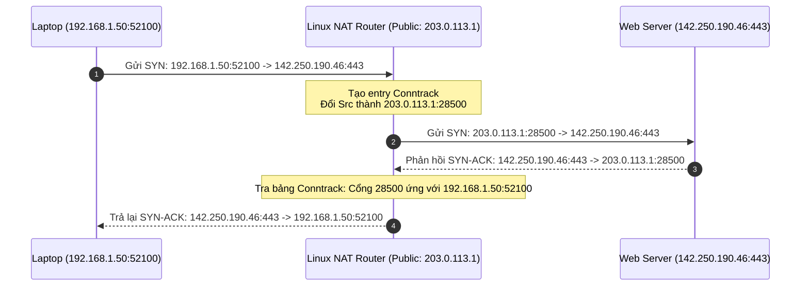
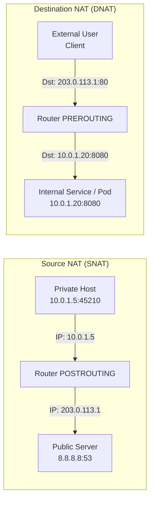
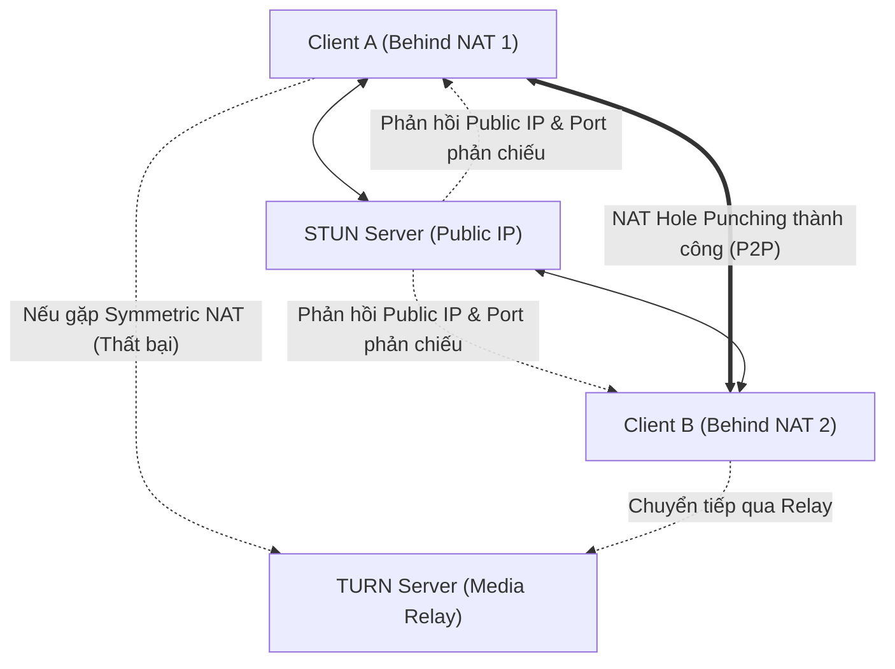
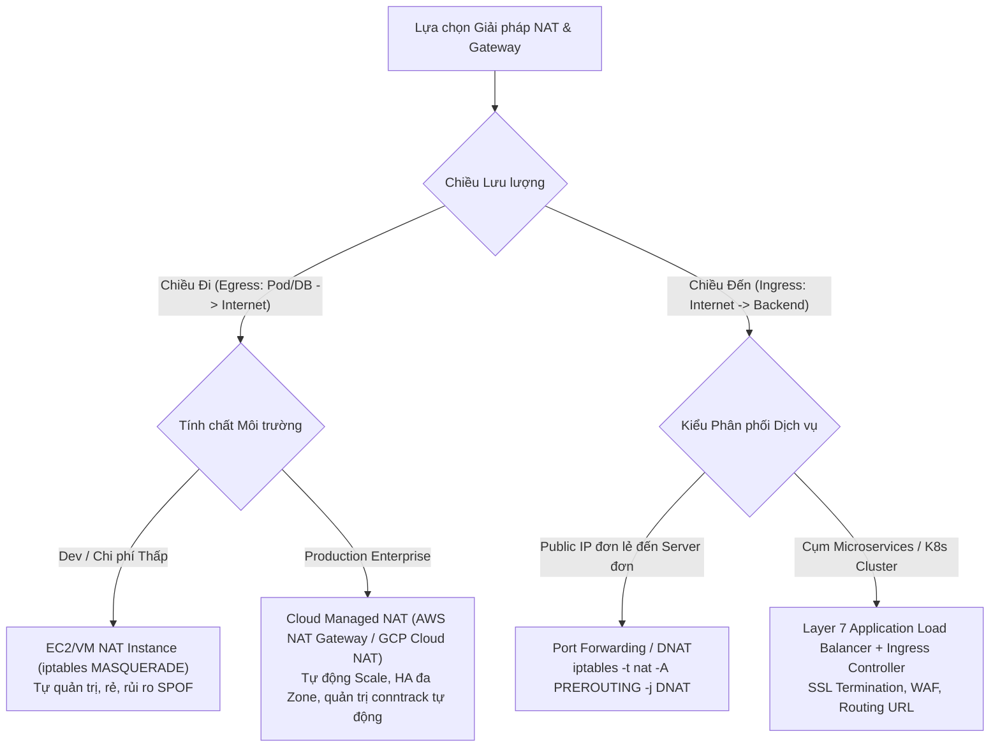

# 3.4. NAT and Connection Tracking

> [!IMPORTANT]
> **Nếu bạn chỉ được nhớ một điều duy nhất:** NAT (Network Address Translation / NAPT) là vị cứu tinh giúp kéo dài tuổi thọ của không gian địa chỉ IPv4 hữu hạn nhưng phá vỡ nguyên lý kết nối đầu-cuối (End-to-End Principle): mỗi kết nối xuyên qua NAT buộc Router/Firewall phải duy trì trạng thái trong bảng Connection Tracking (Linux `conntrack`), và việc cạn kiệt bảng conntrack dưới tải lớn là nguyên nhân hàng đầu khiến các Kubernetes Ingress Controller hay NAT Gateway làm rơi rụng gói tin âm thầm.

---

## 1. Đơn giản nhưng phải chi tiết (Intuitive & Deep Breakdown)

### 1.1. Đoạn Code Dẫn Nhập & Vấn Đề Thực Tế
Làm sao một Router gia đình chỉ có duy nhất 1 địa chỉ IP Public có thể cho phép hàng trăm thiết bị (điện thoại, laptop, TV thông minh) cùng lúc truy cập Internet mà không bị lẫn lộn dữ liệu phản hồi?

```bash
# Xem bảng Connection Tracking (conntrack) trong nhân Linux
$ sudo conntrack -L -p tcp
tcp      6 431999 ESTABLISHED src=192.168.1.100 dst=142.250.190.46 sport=54321 dport=443 \
                      src=142.250.190.46 dst=203.0.113.5 sport=443 dport=12000 [ASSURED] mark=0 use=1
```

Nhân Linux dùng module `nf_conntrack` để ghi nhớ: Khi máy nội bộ `192.168.1.100:54321` gửi ra ngoài, router dịch thành `203.0.113.5:12000`. Khi Google phản hồi về cổng `12000`, router tra ngược bảng này để trả về đúng cổng `54321` cho laptop. Nếu bảng conntrack bị đầy, **toàn bộ kết nối mới sẽ bị drop ngay lập tức**!

### 1.2. Ẩn Dụ Đời Sống & Phân Tích Cơ Chế Hoạt Động
Cơ chế NAPT (Network Address Port Translation) hoạt động y hệt như **Bộ phận Lễ tân và Số máy lẻ (Extension Number) của Tòa nhà Văn phòng**:
- Cả tòa nhà có 500 nhân viên nhưng công ty chỉ đăng ký **1 số điện thoại hotline duy nhất** với bưu điện: `024-3999-8888` (IP Public).
- Mỗi nhân viên ngồi ở bàn làm việc có một **Số máy lẻ nội bộ** (IP Private + Port nội bộ, ví dụ bàn anh Nam là máy lẻ `101`).
- Khi anh Nam gọi điện ra ngoài cho khách hàng:
  - Tổng đài Lễ tân (NAT Router) ghi nhận vào sổ: *"Anh Nam (máy lẻ 101) đang gọi cho khách hàng B qua line ra số 5"*. Khách hàng B chỉ nhìn thấy số hotline `024-3999-8888` gọi tới.
  - Khi khách hàng B gọi lại hoặc trả lời: Tổng đài nhận cuộc gọi tới hotline, nhìn sổ ghi nhớ và nối máy thẳng vào bàn anh Nam (máy lẻ 101).
- Nếu cuốn sổ ghi nhớ của lễ tân hết giấy (**Tràn bảng Conntrack**), lễ tân từ chối nhận thêm bất kỳ cuộc gọi nào mới!

### 1.3. Mô Phỏng Dữ Liệu Số Nhỏ Từng Bước (Toy Walkthrough)
Mô phỏng 2 thiết bị nội bộ cùng gửi yêu cầu HTTP tới cùng một Web Server `93.184.216.34:80`:

| Thiết bị Nội bộ (Src IP:Port) | Thao tác NAT Gateway (203.0.113.5) | Gói tin đi ra Internet (Public Src) | Web Server Phản Hồi Về | Gateway Tra Cứu & Trả Về |
| :--- | :--- | :--- | :--- | :--- |
| **PC-A**: `192.168.1.10:5000` | Cấp Port Public `10001` | `203.0.113.5:10001` -> Server:80 | Server -> `203.0.113.5:10001` | Chuyển lại cho `192.168.1.10:5000` |
| **PC-B**: `192.168.1.20:5000` | Cấp Port Public `10002` (Trùng port nội bộ nhưng khác NAT port) | `203.0.113.5:10002` -> Server:80 | Server -> `203.0.113.5:10002` | Chuyển lại cho `192.168.1.20:5000` |

Nhờ cổng NAT Public khác nhau (`10001` vs `10002`), Router phân biệt chính xác gói tin trả về của PC nào dù cả hai đều dùng cổng xuất phát `5000`.

### 1.4. Tác Động Thực Tế Tầng Backend & Systems
- **Thảm họa "nf_conntrack: table full, dropping packet" trên Kubernetes**: Trong các cụm Kubernetes lớn, mỗi Node xử lý hàng chục nghìn kết nối qua `iptables` / `kube-proxy`. Khi bảng conntrack đạt ngưỡng `nf_conntrack_max`, Linux kernel bắt đầu drop gói tin âm thầm mà không gửi lỗi về socket, khiến ứng dụng bị lỗi connection timeout hàng loạt.
- **SNAT Port Exhaustion trên Cloud NAT / AWS NAT Gateway**: Mỗi IP Public của NAT Gateway chỉ có thể mở tối đa $\approx 64,000$ ephemeral ports cho mỗi cặp (Dst IP, Dst Port). Nếu nhiều microservices cùng gọi dồn dập vào 1 địa chỉ IP bên ngoài, NAT Gateway sẽ cạn kiệt cổng SNAT và từ chối kết nối.

### 1.5. Sơ Đồ Tư Duy & Kiến Trúc Hệ Thống (Mermaid)


---

## 2. Chi tiết từng Keyword (Under-the-Hood Deep Dive)

### 2.1. Phân loại NAT (Static, Dynamic, PAT/NAPT)

#### A. Static NAT (1:1 Mapping)
- Ánh xạ cố định tĩnh một địa chỉ IP Private với duy nhất một địa chỉ IP Public.
- Không sửa đổi Layer 4 Port.
- Ứng dụng: Cung cấp IP tĩnh công khai cho Mail Server, Web Server nội bộ đặt trong DMZ. Không giải quyết được bài toán tiết kiệm IPv4 vì tỷ lệ là 1:1.

#### B. Dynamic NAT (Pool of Public IPs)
- Router quản lý một nhóm (Pool) gồm $N$ địa chỉ Public IP.
- Khi một máy chủ nội bộ phát sinh kết nối ra ngoài, router cấp phát tạm thời một địa chỉ Public IP rảnh rỗi trong pool. Khi kết nối kết thúc, IP này được trả lại pool.
- Nhược điểm: Nếu có $M > N$ máy cùng ra ngoài một lúc, máy thứ $N+1$ sẽ bị drop gói tin (Port Allocation Exhaustion).

#### C. Port Address Translation (PAT / NAPT / NAT Overload)
- **Chuẩn mực của Internet hiện đại**: Cho phép hàng nghìn máy chủ nội bộ dùng chung **duy nhất 1 địa chỉ Public IP**.
- Thiết bị NAT phân biệt các kết nối khác nhau bằng cách ánh xạ cặp `(Private IP, Private Port)` sang cặp `(Public IP, Allocated NAT Port)`.
- Một địa chỉ IPv4 có tối đa 65,535 port TCP và 65,535 port UDP. Sau khi trừ các cổng đặc quyền ($0-1023$), một Public IP có thể duy trì lý thuyết tới $\sim 64,000$ phiên kết nối đồng thời tới cùng một máy chủ đích!

---

### 2.2. SNAT vs DNAT



#### A. SNAT (Source NAT / Masquerading)
- **Mục đích**: Thay đổi địa chỉ IP nguồn (và Port nguồn) của gói tin khi gói tin rời khỏi mạng nội bộ.
- **Vị trí xử lý trong Linux Netfilter**: Bắt buộc phải diễn ra tại hook **`POSTROUTING`** (sau khi router đã hoàn thành việc tra cứu bảng định tuyến để xác định interface cổng ra).
- **`MASQUERADE`**: Là một biến thể đặc biệt của SNAT. Khi địa chỉ IP của interface WAN là IP động (ví dụ qua DHCP hoặc PPPoE quay số viễn thông), `MASQUERADE` sẽ tự động phát hiện IP hiện tại của interface để biên dịch thay vì bắt admin cấu hình IP tĩnh cứng như `SNAT`.

#### B. DNAT (Destination NAT / Port Forwarding)
- **Mục đích**: Thay đổi địa chỉ IP đích (và Port đích) của gói tin khi gói tin vừa chạm vào router.
- **Vị trí xử lý trong Linux Netfilter**: Bắt buộc phải diễn ra tại hook **`PREROUTING`** (trước khi router thực hiện tra cứu định tuyến, để gói tin được chuyển tiếp đến đúng IP máy chủ nội bộ).
- **Ứng dụng xương sống trong Kubernetes**: `kube-proxy` sử dụng iptables/IPVS để bắt lưu lượng tới IP ảo của Service (`ClusterIP:Port`) tại `PREROUTING` và DNAT gói tin sang IP thực của Pod (`PodIP:ContainerPort`).

---

### 2.3. Connection Tracking (`conntrack` trong Linux Kernel)

#### 1. Cơ chế Hoạt động của Netfilter `conntrack`
`conntrack` là một module độc lập trong Linux Kernel có nhiệm vụ ghi nhớ trạng thái của mọi luồng dữ liệu hai chiều (bidirectional flows).
- Mỗi kết nối được đại diện bằng cấu trúc `struct nf_conn` gồm hai tuples (Origin Tuple và Reply Tuple):
  - **Origin Tuple**: `(Src IP, Dst IP, Protocol, Src Port, Dst Port)`
  - **Reply Tuple**: `(Expected Src IP, Expected Dst IP, Protocol, Expected Src Port, Expected Dst Port)`
- **Các trạng thái Conntrack**:
  - `NEW`: Gói tin đầu tiên của kết nối hợp lệ (ví dụ TCP SYN).
  - `ESTABLISHED`: Gói tin phản hồi theo chiều ngược lại đã được ghi nhận (ví dụ TCP SYN/ACK).
  - `RELATED`: Kết nối phụ sinh ra từ một kết nối đã có (ví dụ kênh truyền dữ liệu FTP Data Channel từ kênh Control, hoặc gói tin lỗi ICMP liên kết với phiên UDP/TCP).
  - `INVALID`: Gói tin không khớp với bất kỳ luồng nào, vi phạm thứ tự TCP Sequence, hoặc lỗi checksum (thường bị drop ngay lập tức).

#### 2. Cạn kiệt Bảng Conntrack (`nf_conntrack: table full, dropping packet`)
Bảng conntrack trong Linux Kernel được lưu dưới dạng **Bảng băm (Hash Table)** trong bộ nhớ RAM không hoán trang (non-swappable kernel memory):
- Kích thước bảng băm: `nf_conntrack_buckets`
- Dung lượng tối đa: `nf_conntrack_max` (thường bằng $\text{buckets} \times 8$).
- Khi số lượng kết nối đồng thời vượt quá ngưỡng `nf_conntrack_max`, Kernel **không còn chỗ để ghi nhớ trạng thái**, lập tức xuất hiện lỗi trên `dmesg`:
  ```text
  nf_conntrack: table full, dropping packet
  ```
- Toàn bộ các gói tin phát sinh kết nối mới đều bị hủy bỏ âm thầm, gây tê liệt toàn bộ các API Gateway, Nginx Proxy, Kubernetes Ingress.

---

### 2.4. Hairpin NAT (NAT Loopback)

#### Bài toán
Một máy chủ Web nằm trong mạng nội bộ (`192.168.1.100`), được router gán Port Forwarding từ Public IP `203.0.113.1:80`.
Một máy client nội bộ khác (`192.168.1.50`) muốn truy cập vào trang web thông qua tên miền công khai trỏ về IP `203.0.113.1`:
1. Client gửi request: `Src: 192.168.1.50 -> Dst: 203.0.113.1`.
2. Router thực hiện DNAT: đổi Dst thành `192.168.1.100`, nhưng giữ nguyên Src là `192.168.1.50`.
3. Web Server nhận gói tin thấy IP nguồn là `192.168.1.50` (cùng dải mạng LAN nội bộ), nên nó **gửi thẳng gói tin phản hồi trực tiếp qua Switch L2** tới Client mà không đi qua Router!
4. Client nhận gói tin phản hồi từ `192.168.1.100:80` trong khi nó đang đợi phản hồi từ `203.0.113.1:80`. Client phát hiện sai nguồn và lập tức gửi gói tin TCP RST hủy kết nối!

#### Giải pháp Hairpin NAT
Router phải thực hiện **ĐỒNG THỜI CẢ DNAT VÀ SNAT**:
- Vừa đổi Dst thành `192.168.1.100` (DNAT), vừa đổi Src thành chính IP nội bộ của Router `192.168.1.1` (SNAT).
- Lúc này Web Server sẽ gửi phản hồi về Router, và Router sẽ un-NAT gửi trả lại cho Client trọn vẹn!

---

### 2.5. NAT Traversal: STUN, TURN, ICE (Vượt rào NAT)

Trong các ứng dụng P2P (Peer-to-Peer) như WebRTC, VoIP SIP, game nhiều người chơi, hai máy khách nằm sau hai mạng NAT khác nhau cần thiết lập kết nối truyền file hoặc audio trực tiếp:



1. **Phân loại hành vi NAT (RFC 3489 / RFC 4787)**:
   - *Full Cone NAT*: Một khi cổng nội bộ đã ánh xạ ra Public Port, bất kỳ ai từ Internet gửi dữ liệu vào cổng đó đều được chuyển vào trong. (Dễ xuyên thủng nhất).
   - *Restricted Cone NAT*: Chỉ cho phép IP bên ngoài mà máy nội bộ đã từng gửi gói tin tới mới được gửi dữ liệu ngược lại.
   - *Port Restricted Cone NAT*: Bắt buộc cả IP và Port bên ngoài phải trùng khớp với điểm đến mà máy nội bộ từng gửi trước đó.
   - *Symmetric NAT*: Mỗi khi kết nối tới một máy chủ đích khác nhau, router NAT lại sinh ra một Public Port hoàn toàn mới. (Không thể đục lỗ P2P trực tiếp!).
2. **STUN (Session Traversal Utilities for NAT - RFC 5389)**:
   - Máy client gửi gói tin tới STUN Server công cộng để hỏi: *"Dưới góc nhìn của Internet, địa chỉ IP và Port công khai của tôi là gì?"* (Reflexive Address).
   - Dùng để thực hiện kỹ thuật **UDP Hole Punching**.
3. **TURN (Traversal Using Relays around NAT - RFC 5766)**:
   - Phương án dự phòng cuối cùng khi gặp Symmetric NAT.
   - Toàn bộ lưu lượng âm thanh, video được định tuyến trung chuyển qua một TURN Server trung gian công cộng (Relay). Tốn kém băng thông máy chủ nhưng thành công 100%.
4. **ICE (Interactive Connectivity Establishment - RFC 8445)**:
   - Bộ khung tiêu chuẩn hóa trong WebRTC, tự động thử nghiệm tất cả các phương thức kết nối: Direct Local IP $\to$ STUN Reflexive IP $\to$ TURN Relay, chọn ra con đường tối ưu và có độ trễ thấp nhất.

---

## 3. Thực thi Mã nguồn & Mô phỏng Chuyên sâu (Dual-Engine Implementation)

### 3.1. C++20: Thread-Safe NAPT Connection Tracking Engine

File `nat_engine.cpp` mô phỏng đầy đủ cấu trúc bảng băm Connection Tracking hai chiều (Origin & Reply Tuples), cấp phát Dynamic Port và dịch gói tin TCP.

```cpp
#include <iostream>
#include <unordered_map>
#include <string>
#include <tuple>
#include <cstdint>
#include <memory>
#include <chrono>
#include <mutex>
#include <iomanip>

// Định nghĩa 5-tuple của luồng mạng
struct FlowTuple {
    std::string src_ip;
    std::string dst_ip;
    uint16_t src_port;
    uint16_t dst_port;
    uint8_t protocol; // 6 = TCP, 17 = UDP

    bool operator==(const FlowTuple& other) const {
        return src_ip == other.src_ip && dst_ip == other.dst_ip &&
               src_port == other.src_port && dst_port == other.dst_port &&
               protocol == other.protocol;
    }
};

struct TupleHasher {
    std::size_t operator()(const FlowTuple& t) const {
        return std::hash<std::string>()(t.src_ip) ^
               (std::hash<std::string>()(t.dst_ip) << 1) ^
               (std::hash<uint16_t>()(t.src_port) << 2) ^
               (std::hash<uint16_t>()(t.dst_port) << 3) ^
               (std::hash<uint8_t>()(t.protocol) << 4);
    }
};

enum class ConntrackState { NEW, ESTABLISHED, CLOSED };

struct ConntrackEntry {
    FlowTuple origin;
    FlowTuple reply;
    ConntrackState state;
    std::chrono::steady_clock::time_point last_seen;
};

class NAPTEngine {
private:
    std::string public_ip_;
    uint16_t min_port_;
    uint16_t max_port_;
    uint16_t next_port_;
    std::mutex mtx_;

    // Bảng tra cứu 2 chiều
    std::unordered_map<FlowTuple, std::shared_ptr<ConntrackEntry>, TupleHasher> table_outbound_;
    std::unordered_map<FlowTuple, std::shared_ptr<ConntrackEntry>, TupleHasher> table_inbound_;

public:
    NAPTEngine(std::string public_ip, uint16_t min_port = 50000, uint16_t max_port = 60000)
        : public_ip_(std::move(public_ip)), min_port_(min_port), max_port_(max_port), next_port_(min_port) {}

    // Xử lý gói tin chiều ra (Outbound SNAT)
    FlowTuple process_outbound(const FlowTuple& original_pkt) {
        std::lock_guard<std::mutex> lock(mtx_);
        
        auto it = table_outbound_.find(original_pkt);
        if (it != table_outbound_.end()) {
            it->second->last_seen = std::chrono::steady_clock::now();
            return FlowTuple{public_ip_, original_pkt.dst_ip, it->second->reply.dst_port, original_pkt.dst_port, original_pkt.protocol};
        }

        // Tạo NAT Mapping mới
        uint16_t allocated_port = next_port_++;
        if (next_port_ > max_port_) next_port_ = min_port_;

        auto entry = std::make_shared<ConntrackEntry>();
        entry->origin = original_pkt;
        entry->reply = FlowTuple{original_pkt.dst_ip, public_ip_, original_pkt.dst_port, allocated_port, original_pkt.protocol};
        entry->state = ConntrackState::NEW;
        entry->last_seen = std::chrono::steady_clock::now();

        table_outbound_[original_pkt] = entry;
        table_inbound_[entry->reply] = entry;

        return FlowTuple{public_ip_, original_pkt.dst_ip, allocated_port, original_pkt.dst_port, original_pkt.protocol};
    }

    // Xử lý gói tin chiều về (Inbound Reverse DNAT)
    bool process_inbound(const FlowTuple& incoming_pkt, FlowTuple& translated_pkt) {
        std::lock_guard<std::mutex> lock(mtx_);

        auto it = table_inbound_.find(incoming_pkt);
        if (it == table_inbound_.end()) {
            return false; // DROP packet vì không có trong Conntrack table
        }

        auto entry = it->second;
        entry->state = ConntrackState::ESTABLISHED;
        entry->last_seen = std::chrono::steady_clock::now();

        translated_pkt = FlowTuple{incoming_pkt.src_ip, entry->origin.src_ip, incoming_pkt.src_port, entry->origin.src_port, incoming_pkt.protocol};
        return true;
    }

    size_t active_connections() {
        std::lock_guard<std::mutex> lock(mtx_);
        return table_outbound_.size();
    }
};

int main() {
    std::cout << "=== NAPT CONNECTION TRACKING SIMULATOR (C++20) ===" << std::endl;
    NAPTEngine nat_router("203.0.113.1", 50000, 50100);

    FlowTuple client_a{"10.0.1.5", "93.184.216.34", 45210, 80, 6};
    FlowTuple client_b{"10.0.1.8", "93.184.216.34", 45210, 80, 6}; // Trùng src_port nhưng khác IP nội bộ

    // Gửi Outbound
    auto snat_a = nat_router.process_outbound(client_a);
    std::cout << "[Client A Outbound SNAT] Gốc: " << client_a.src_ip << ":" << client_a.src_port 
              << " -> NAT dịch thành: " << snat_a.src_ip << ":" << snat_a.src_port << "\n";

    auto snat_b = nat_router.process_outbound(client_b);
    std::cout << "[Client B Outbound SNAT] Gốc: " << client_b.src_ip << ":" << client_b.src_port 
              << " -> NAT dịch thành: " << snat_b.src_ip << ":" << snat_b.src_port << "\n";

    // Phản hồi Inbound cho Client A
    FlowTuple server_reply_a{"93.184.216.34", "203.0.113.1", 80, snat_a.src_port, 6};
    FlowTuple delivered_a;
    if (nat_router.process_inbound(server_reply_a, delivered_a)) {
        std::cout << "[Server Reply to A] Tra cứu thành công -> Dịch Dst về: " 
                  << delivered_a.dst_ip << ":" << delivered_a.dst_port << "\n";
    }

    // Thử gửi gói tin rác không có trong bảng conntrack
    FlowTuple rogue_packet{"93.184.216.34", "203.0.113.1", 80, 59999, 6};
    FlowTuple dummy;
    if (!nat_router.process_inbound(rogue_packet, dummy)) {
        std::cout << "[Security Check] Gói tin rác tới Port 59999 bị DROP thành công vì không có State!\n";
    }

    std::cout << "Tổng kết nối đang theo dõi: " << nat_router.active_connections() << " sessions.\n";
    return 0;
}
```

### 3.2. Python 3.11: NAT Gateway & Hairpinning Simulator

File `hairpin_nat_sim.py` mô phỏng đầy đủ cơ chế định tuyến Hairpin NAT (NAT Loopback) giải quyết xung đột khi truy cập Public IP từ nội bộ mạng LAN.

```python
from dataclasses import dataclass
from typing import Optional, Dict, Tuple

@dataclass(frozen=True)
class Packet:
    src_ip: str
    src_port: int
    dst_ip: str
    dst_port: int
    payload: str

class VirtualRouterNAT:
    """Mo phong Router thuc thi Hairpin NAT (NAT Loopback) ket hop Port Forwarding."""
    def __init__(self, lan_ip: str, wan_ip: str):
        self.lan_ip = lan_ip
        self.wan_ip = wan_ip
        # Port forwarding rule: WAN:80 -> WebServer 192.168.1.100:80
        self.port_forwards: Dict[Tuple[str, int], Tuple[str, int]] = {
            (self.wan_ip, 80): ("192.168.1.100", 80)
        }
        # Conntrack table
        self.conntrack: Dict[Tuple[str, int, str, int], Tuple[str, int, str, int]] = {}

    def forward_packet(self, pkt: Packet, enable_hairpin: bool = True) -> Optional[Packet]:
        print(f"\n[+] Router nhan goi tin: {pkt.src_ip}:{pkt.src_port} -> {pkt.dst_ip}:{pkt.dst_port}")
        
        # 1. Kiem tra DNAT (Port Forwarding)
        dst_key = (pkt.dst_ip, pkt.dst_port)
        if dst_key in self.port_forwards:
            internal_ip, internal_port = self.port_forwards[dst_key]
            print(f"    [DNAT MATCH] Dst {pkt.dst_ip}:{pkt.dst_port} -> {internal_ip}:{internal_port}")
            
            # Kiem tra xem nguon co phai tu cung dai LAN hay khong
            is_same_subnet = pkt.src_ip.startswith("192.168.1.")
            
            if is_same_subnet:
                if not enable_hairpin:
                    print("    [!] CANH BAO: Hairpin NAT bi TAT! Goi tin chuyen tiep giu nguyen Src IP.")
                    # Web server se gui tra thang cho Client, Client se RESET ket noi!
                    return Packet(src_ip=pkt.src_ip, src_port=pkt.src_port,
                                  dst_ip=internal_ip, dst_port=internal_port, payload=pkt.payload)
                else:
                    print(f"    [HAIRPIN SNAT] Kich hoat SNAT nguon thanh Router LAN IP: {self.lan_ip}")
                    # Ghi conntrack
                    self.conntrack[(self.lan_ip, 61000, internal_ip, internal_port)] = (pkt.src_ip, pkt.src_port, pkt.dst_ip, pkt.dst_port)
                    return Packet(src_ip=self.lan_ip, src_port=61000,
                                  dst_ip=internal_ip, dst_port=internal_port, payload=pkt.payload)

        return pkt

if __name__ == "__main__":
    router = VirtualRouterNAT(lan_ip="192.168.1.1", wan_ip="203.0.113.1")
    
    # Client noi bo goi toi Public IP cua Web Server cong ty
    client_packet = Packet(src_ip="192.168.1.50", src_port=52341, dst_ip="203.0.113.1", dst_port=80, payload="GET / HTTP/1.1")
    
    print("--- TRUONG HOP 1: KHONG CO HAIRPIN NAT ---")
    bad_routed = router.forward_packet(client_packet, enable_hairpin=False)
    print(f"    -> Packet toi Web Server: {bad_routed.src_ip} -> {bad_routed.dst_ip}")
    print("    -> Ket qua: Web Server se tra loi truc tiep 192.168.1.50 -> CLIENT DROP KET NOI!")

    print("\n--- TRUONG HOP 2: CO HAIRPIN NAT (CHUAN KET NOI) ---")
    good_routed = router.forward_packet(client_packet, enable_hairpin=True)
    print(f"    -> Packet toi Web Server: {good_routed.src_ip}:{good_routed.src_port} -> {good_routed.dst_ip}:{good_routed.dst_port}")
    print("    -> Ket qua: Web Server tra loi ve Router 192.168.1.1 -> Router un-NAT ve 192.168.1.50 THANH CONG!")
```

### 3.3. Terminal Output Mẫu

```text
$ clang++ -std=c++20 -O3 nat_engine.cpp -o nat_engine && ./nat_engine
=== NAPT CONNECTION TRACKING SIMULATOR (C++20) ===
[Client A Outbound SNAT] Gốc: 10.0.1.5:45210 -> NAT dịch thành: 203.0.113.1:50000
[Client B Outbound SNAT] Gốc: 10.0.1.8:45210 -> NAT dịch thành: 203.0.113.1:50001
[Server Reply to A] Tra cứu thành công -> Dịch Dst về: 10.0.1.5:45210
[Security Check] Gói tin rác tới Port 59999 bị DROP thành công vì không có State!
Tổng kết nối đang theo dõi: 2 sessions.

$ python3 hairpin_nat_sim.py
--- TRUONG HOP 1: KHONG CO HAIRPIN NAT ---

[+] Router nhan goi tin: 192.168.1.50:52341 -> 203.0.113.1:80
    [DNAT MATCH] Dst 203.0.113.1:80 -> 192.168.1.100:80
    [!] CANH BAO: Hairpin NAT bi TAT! Goi tin chuyen tiep giu nguyen Src IP.
    -> Packet toi Web Server: 192.168.1.50 -> 192.168.1.100
    -> Ket qua: Web Server se tra loi truc tiep 192.168.1.50 -> CLIENT DROP KET NOI!

--- TRUONG HOP 2: CO HAIRPIN NAT (CHUAN KET NOI) ---

[+] Router nhan goi tin: 192.168.1.50:52341 -> 203.0.113.1:80
    [DNAT MATCH] Dst 203.0.113.1:80 -> 192.168.1.100:80
    [HAIRPIN SNAT] Kich hoat SNAT nguon thanh Router LAN IP: 192.168.1.1
    -> Packet toi Web Server: 192.168.1.1:61000 -> 192.168.1.100:80
    -> Ket qua: Web Server tra loi ve Router 192.168.1.1 -> Router un-NAT ve 192.168.1.50 THANH CONG!
```

---

## 4. Systems Engineering & Production Pitfalls

### 4.1. Tinh chỉnh Hạn mức Bảng Conntrack trong Production High-Throughput
Một Kubernetes Node chịu tải hàng vạn RPS hoặc một cụm AWS NAT Gateway có thể nhanh chóng làm cạn kiệt bảng băm `conntrack`. Khi điều này xảy ra, hệ thống sẽ drop toàn bộ các gói tin TCP SYN mới.
- **Tính toán RAM tiêu tốn**: Mỗi entry `nf_conn` tiêu tốn khoảng 320 bytes RAM trong Kernel slab memory. Một triệu kết nối sẽ tốn:
  $$1,000,000 \times 320 \text{ bytes} \approx 320 \text{ MB RAM}$$
- **Bộ thông số sysctl tối ưu hóa production**:
```bash
# 1. Nâng giới hạn tối đa conntrack lên 1,048,576 (1 triệu kết nối)
sudo sysctl -w net.netfilter.nf_conntrack_max=1048576

# 2. Tăng số lượng hash buckets (khuyến nghị max / 4 = 262,144)
echo 262144 | sudo tee /sys/module/nf_conntrack/parameters/hashsize

# 3. Rút ngắn thời gian giải phóng kết nối TCP đã hoàn tất (mặc định 432000s = 5 ngày!)
sudo sysctl -w net.netfilter.nf_conntrack_tcp_timeout_established=86400 # 24 giờ
sudo sysctl -w net.netfilter.nf_conntrack_tcp_timeout_time_wait=30       # 30 giây
sudo sysctl -w net.netfilter.nf_conntrack_tcp_timeout_close_wait=30      # 30 giây
```

### 4.2. Khắc phục Hiện tượng Cạn kiệt Cổng SNAT (SNAT Port Exhaustion)
Trên Cloud (AWS NAT Gateway, Azure NAT Gateway), mỗi IP Public chỉ cung cấp tối đa $\sim 64,000$ ephemeral ports. Nếu nhiều microservices nội bộ cùng gọi dồn dập vào một Third-party API duy nhất (ví dụ cổng thanh toán `stripe.com:443`), các kết nối sẽ nhanh chóng chiếm dụng hết toàn bộ dải cổng nguồn này.
- **Biện pháp xử lý**:
  1. Kích hoạt **HTTP Keep-Alive / TCP Connection Pooling** trong ứng dụng Backend (gRPC, Nginx upstream keepalive, HTTPClient reuse).
  2. Gán thêm nhiều Public Elastic IP vào cùng một NAT Gateway (Multi-IP NAT Gateway).

### 4.3. Các lệnh CLI Quản trị và Chẩn đoán Conntrack

```bash
# 1. Xem số lượng kết nối đang được theo dõi hiện tại
cat /proc/sys/net/netfilter/nf_conntrack_count

# 2. Xem giới hạn tối đa được phép
cat /proc/sys/net/netfilter/nf_conntrack_max

# 3. Liệt kê các phiên conntrack thời gian thực bằng tiện ích conntrack-tools
sudo apt-get install -y conntrack
sudo conntrack -L -p tcp --dport 443

# 4. Giám sát luồng mở/đóng kết nối liên tục (như tcpdump cho conntrack)
sudo conntrack -E -e NEW,DESTROY

# 5. Xem quy tắc iptables NAT hiện hành
sudo iptables -t nat -L -v -n --line-numbers
```

---

## 5. Bảng So sánh & Decision Matrix

### 5.1. Bảng So sánh: Các Biến thể NAT và Cơ chế Xuyên rào

| Công nghệ | Điểm thay đổi trên Header | Tiêu tốn Port | Khả năng P2P Traversal | Ứng dụng Thực tiễn |
| :--- | :--- | :---: | :--- | :--- |
| **Static NAT (1:1)** | Chỉ thay đổi IP (Src hoặc Dst) | Không | Dễ dàng (Tương đương Public IP) | DMZ Server, Dedicated Database |
| **Dynamic NAT** | Chỉ thay đổi IP từ IP Pool | Không | Phụ thuộc kích thước Pool | Mạng quân sự, cơ quan bảo mật cao |
| **NAPT / PAT** | **Thay đổi cả IP và Port (L3 + L4)** | **Có** | Cần STUN / UDP Hole Punching | Gia đình, Văn phòng, Cloud NAT |
| **STUN (RFC 5389)** | Giữ nguyên gói tin (Hỏi Server) | Không | Thành công với Full Cone / Restricted | WebRTC P2P Voice/Video call |
| **TURN (RFC 5766)** | Đóng gói qua Relay Server | Có | **Thành công 100% mọi loại NAT** | WebRTC Fallback khi gặp Symmetric NAT |

### 5.2. Decision Matrix: Kiến trúc Ra/Vào Mạng trong Cloud & Microservices



| Nhu cầu Thực tế | Giải pháp Kiến trúc Khuyên dùng | Lý do & Khuyến cáo |
| :--- | :--- | :--- |
| **Máy chủ Database Private cần Update OS** | **Cloud Managed NAT Gateway** | Không gán Public IP trực tiếp vào DB; chỉ cho phép traffic 1 chiều đi ra. |
| **Dịch vụ Voice/Video P2P Trực tuyến** | **STUN + TURN Cluster (Coturn)** | Dùng STUN tiết kiệm băng thông; bắt buộc có TURN Server dự phòng cho Symmetric NAT. |
| **Kubernetes Service ClusterIP** | **Kube-proxy IPVS / eBPF (Cilium)** | Thay thế iptables cổ điển để tránh nghẽn CPU khi số lượng Service vượt quá 10,000. |
| **Văn phòng gọi ra cùng 1 API đối tác** | **Static Multi-Egress NAT Gateway** | Cung cấp danh sách 2-4 Public IP cố định để đối tác cấu hình Firewall Whitelist. |

---

## 6. Enterprise Production Checklist & Verification

### 6.1. Kiến Trúc & Cấu Hình Tối Ưu (Production-Ready Architecture)
- [ ] **Nâng cao Giới hạn nf_conntrack_max**: Trên các Kubernetes Worker Nodes và Reverse Proxies chịu tải cao, nâng giới hạn conntrack bằng lệnh: `sysctl -w net.netfilter.nf_conntrack_max=1048576`.
- [ ] **Tối ưu Kích thước Hash Table Conntrack**: Đảm bảo kích thước bucket hash table tương xứng: `echo 262144 > /sys/module/nf_conntrack/parameters/hashsize` (tỷ lệ 1:4 so với max limit).
- [ ] **Rút ngắn Timeout Kết nối TIME_WAIT / FIN_WAIT**: Giảm `net.netfilter.nf_conntrack_tcp_timeout_time_wait` xuống 30s (mặc định 120s) để giải phóng các slot conntrack nhanh chóng.
- [ ] **Cấp phát Nhiều IP Public cho Cloud NAT**: Khi thiết kế Cloud NAT trên GCP hoặc AWS NAT Gateway, cấp phát tối thiểu 3-5 Public IP tĩnh để nhân số lượng ephemeral port tránh thảm họa SNAT Port Exhaustion.

### 6.2. Giám Sát, Cảnh Báo & Xử Lý Sự Cố (Observability & Incident Response)
- [ ] **Theo dõi Tỷ lệ Đầy Bảng Conntrack**: Cảnh báo Prometheus khi giá trị `node_nf_conntrack_entries / node_nf_conntrack_entries_limit > 0.8`.
- [ ] **Kiểm tra Drop Packet do Conntrack**: Giám sát file `/proc/net/stat/nf_conntrack` và cảnh báo ngay khi cột `drop` tăng giá trị.
- [ ] **Truy vấn Dấu chân Kết nối bằng conntrack-tools**: Sử dụng lệnh `conntrack -L -p tcp --state ESTABLISHED` để phân tích các IP nội bộ nào đang chiếm dụng nhiều session nhất.
