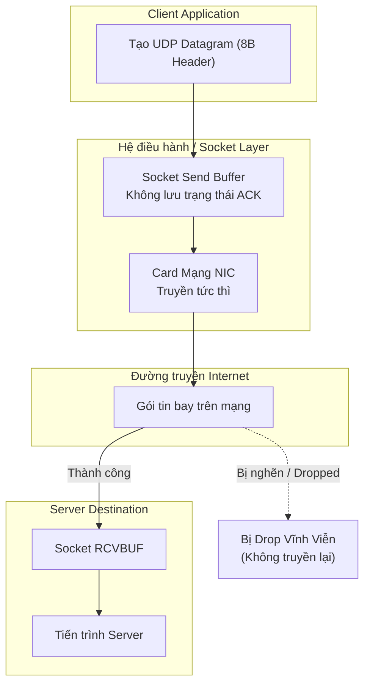
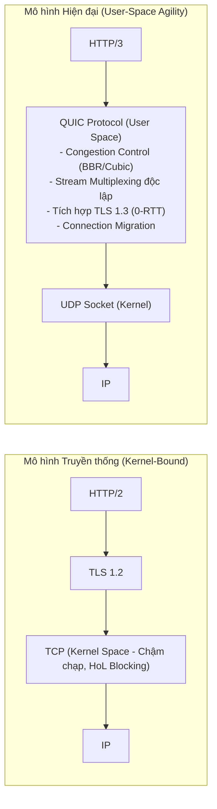
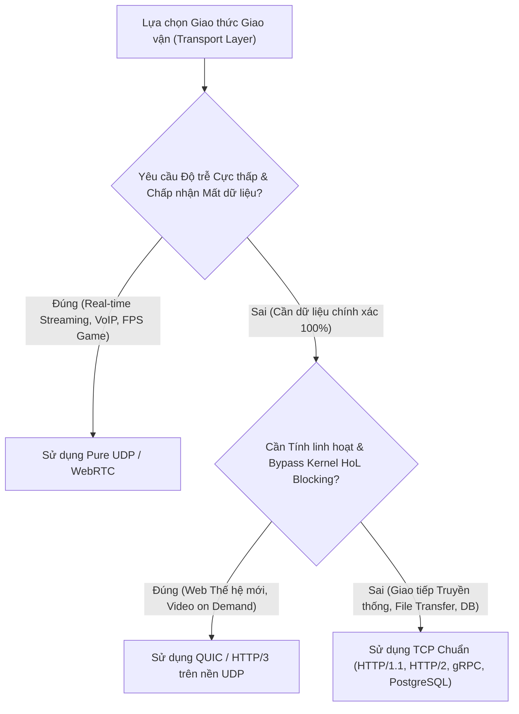

# 4.1. UDP Protocol and Datagrams

> [!IMPORTANT]
> **Nếu bạn chỉ được nhớ một điều duy nhất:** UDP (User Datagram Protocol) là giao thức Tầng 4 tối giản đến mức hoàn hảo: chỉ với 8 byte Header chứa Port nguồn, Port đích, Chiều dài và Checksum, UDP không hề có bắt tay, không giữ trạng thái, không kiểm soát tắc nghẽn; nó là sự lựa chọn duy nhất cho truyền phát thời gian thực cực nhanh (DNS, VoIP, Gaming) và là nền tảng vững chắc để các giao thức hiện đại như QUIC (HTTP/3) tự xây dựng độ tin cậy trên User-space.

---

## 1. Đơn giản nhưng phải chi tiết (Intuitive & Deep Breakdown)

### 1.1. Đoạn Code Dẫn Nhập & Vấn Đề Thực Tế
Tại sao các hệ thống truyền dẫn video trực tiếp (Live Streaming), DNS, và game bắn súng trực tuyến nhiều người chơi (Multiplayer Gaming) lại chọn UDP thay vì TCP?

```python
# Lập trình Socket UDP: "Bắn và Quên" (Fire-and-Forget)
import socket

sock = socket.socket(socket.AF_INET, socket.SOCK_DGRAM)
server_address = ('127.0.0.1', 9999)

# Gửi dữ liệu không cần bắt tay 3 bước (No 3-way Handshake)
payload = b"PLAYER_POS:x=120,y=45,t=1609459200"
sock.sendto(payload, server_address)

# Nếu gói tin này bị rơi trên đường truyền, socket sẽ KHÔNG gửi lại!
# Với game đối kháng, vị trí cũ bị rơi không còn ý nghĩa; client chỉ quan tâm vị trí mới nhất.
```

Nếu dùng TCP cho game FPS, khi 1 gói tin bị rớt, cơ chế truyền lại của TCP sẽ làm đóng băng dòng dữ liệu (Head-of-Line Blocking), khiến màn hình người chơi bị giật lag nghiêm trọng trong khi họ đang cần phản xạ tức thời theo mili-giây.

### 1.2. Ẩn Dụ Đời Sống & Phân Tích Cơ Chế Hoạt Động
So sánh giữa TCP và UDP giống như **Chuyển phát Bưu phẩm Đảm bảo vs. Phát thanh Truyền hình Trực tiếp**:
- **TCP** giống như **Dịch vụ Chuyển phát bưu phẩm có chữ ký nhận**: Bưu tá phải gọi điện hẹn giờ (3-way handshake), người nhận ký biên bản giao hàng (ACK). Nếu hộp quà bị rơi vỡ giữa đường, bưu tá phải quay về kho lấy hộp quà mới gửi lại (Retransmission). Dịch vụ này cực kỳ an toàn nhưng cồng kềnh và chậm chạp.
- **UDP** giống như **Trạm Phát thanh Radio FM hoặc Livestream**: Đài truyền hình liên tục phát tín hiệu sóng âm vào không gian. Xe ô tô bật đài sẽ nghe được nhạc; nếu xe đi qua gầm cầu bị nhiễu tiếng rè rè 1 giây thì thôi, đài radio sẽ tiếp tục phát đoạn nhạc tiếp theo chứ không bao giờ dừng phát sóng để phát lại 1 giây rè rè đó cho bạn!

### 1.3. Mô Phỏng Dữ Liệu Số Nhỏ Từng Bước (Toy Walkthrough)
Cấu trúc Header siêu tối giản của UDP (chỉ đúng 8 bytes, so với tối thiểu 20 bytes của TCP):

| Vị trí Byte | Trường Header | Kích thước | Giá trị Demo (Hex / Dec) | Ý nghĩa Kỹ thuật |
| :--- | :--- | :--- | :--- | :--- |
| **0 - 1** | Source Port | 16 bits (2 bytes) | `0xC0A8` (49320) | Cổng của tiến trình gửi trên client |
| **2 - 3** | Destination Port | 16 bits (2 bytes) | `0x0035` (53) | Cổng DNS Server đích |
| **4 - 5** | Length | 16 bits (2 bytes) | `0x0028` (40 bytes) | Tổng độ dài Header (8B) + Data (32B) |
| **6 - 7** | Checksum | 16 bits (2 bytes) | `0xA4E2` | Kiểm tra toàn vẹn bit (tùy chọn trong IPv4, bắt buộc IPv6) |
| **8 trở đi** | Payload Data | Biến thiên | `...` | Dữ liệu DNS Query thực tế |

Không có số thứ tự Sequence Number, không có cờ ACK, không có Window Size. Điều này giải thích tại sao UDP có độ trễ xử lý gần như bằng không.

### 1.4. Tác Động Thực Tế Tầng Backend & Systems
- **Tấn công UDP Amplification Reflection**: Do UDP không có bắt tay và dễ bị giả mạo IP nguồn (IP Spoofing), kẻ tấn công gửi request nhỏ đến các máy chủ DNS/NTP công cộng với IP nguồn là nạn nhân. Server trả về response khổng lồ (gấp 50-100 lần) làm nghẽn đường truyền nạn nhân.
- **Tràn Bộ Đệm Nhận Socket (UDP Receive Buffer Overflow)**: Không có cơ chế Flow Control, nếu sender bắn dữ liệu 1 Gbps vào một tiến trình xử lý với tốc độ 200 Mbps, bộ đệm kernel socket (`SO_RCVBUF`) sẽ tràn ngay tức khắc và toàn bộ datagram đến sau bị kernel drop âm thầm.

### 1.5. Sơ Đồ Tư Duy & Kiến Trúc Hệ Thống (Mermaid)


---

## 2. Chi tiết từng Keyword (Under-the-Hood Deep Dive)

### 2.1. UDP Header Format (Cấu trúc Header UDP Siêu Tối giản)

Header của UDP có kích thước cố định **chính xác 8 bytes** (so với 20-60 bytes của TCP), cấu trúc cực kỳ tinh gọn:

```text
 0                   1                   2                   3
 0 1 2 3 4 5 6 7 8 9 0 1 2 3 4 5 6 7 8 9 0 1 2 3 4 5 6 7 8 9 0 1
+-+-+-+-+-+-+-+-+-+-+-+-+-+-+-+-+-+-+-+-+-+-+-+-+-+-+-+-+-+-+-+-+
|          Source Port          |       Destination Port        |
+-+-+-+-+-+-+-+-+-+-+-+-+-+-+-+-+-+-+-+-+-+-+-+-+-+-+-+-+-+-+-+-+
|            Length             |           Checksum            |
+-+-+-+-+-+-+-+-+-+-+-+-+-+-+-+-+-+-+-+-+-+-+-+-+-+-+-+-+-+-+-+-+
|                       Payload Data ...                        |
+-+-+-+-+-+-+-+-+-+-+-+-+-+-+-+-+-+-+-+-+-+-+-+-+-+-+-+-+-+-+-+-+
```

1. **Source Port (16 bits)**: Số hiệu cổng của tiến trình gửi. Đây là trường tùy chọn; nếu ứng dụng client không cần nhận phản hồi, nó có thể đặt bằng `0`.
2. **Destination Port (16 bits)**: Số hiệu cổng tiếp nhận tại máy đích (ví dụ: DNS cổng 53, DHCP cổng 67/68, NTP cổng 123, WireGuard cổng 51820).
3. **Length (16 bits)**: Độ dài tính bằng byte của **toàn bộ gói UDP** (UDP Header + Payload). Kích thước tối thiểu là 8 bytes (khi payload rỗng). Kích thước lý thuyết tối đa là $65,535 - 20 \text{ (IP Header)} = 65,507$ bytes.
4. **Checksum (16 bits)**:
   - Thuật toán mã kiểm tra bù 1 (1's complement sum theo RFC 1071).
   - **Pseudo-Header (Header Giả)**: Checksum UDP không chỉ tính trên UDP Header và Payload, mà còn tính cả một Header giả của Layer 3 bao gồm: `Source IP (4B)`, `Destination IP (4B)`, `Zero byte (1B)`, `Protocol ID (1B = 17)`, và `UDP Length (2B)`. Việc này giúp phát hiện trường hợp gói tin bị chuyển hướng nhầm địa chỉ IP do lỗi tầng mạng.
   - Trong **IPv4**: Checksum là tùy chọn. Nếu không tính toán, trường này đặt bằng `0x0000`. Nếu tính toán ra kết quả là `0x0000`, giá trị lưu trong header sẽ đổi thành `0xFFFF`.
   - Trong **IPv6**: Checksum UDP là **bắt buộc tuyệt đối**, vì IPv6 đã loại bỏ Header Checksum ở Layer 3!

---

### 2.2. Các Đặc trưng Vận hành của UDP (Connectionless Communication)

#### 1. Không bắt tay thiết lập kết nối (0-RTT Overhead)
- Không có bất kỳ gói tin SYN, SYN/ACK nào được trao đổi trước. Ứng dụng chỉ việc gọi hàm `sendto()` là gói tin lập tức được đẩy xuống card mạng và phát ra dây cáp quang.
- Giúp giảm độ trễ tối đa cho các dịch vụ truy vấn nhanh (như DNS query phân giải tên miền chỉ mất đúng 1 vòng truyền tín hiệu RTT).

#### 2. Không lưu trạng thái kết nối trong Kernel (Stateless)
- Máy chủ không phải cấp phát bộ đệm nhận/gửi cố định, không phải theo dõi Sequence Number, Ack Number, trạng thái cửa sổ tắc nghẽn (`cwnd`, `ssthresh`).
- Một máy chủ UDP cấu hình tốt có thể tiếp nhận và xử lý hàng triệu gói tin từ hàng triệu IP khác nhau mà không lo cạn kiệt bộ nhớ RAM quản lý Socket State.

#### 3. Bảo toàn ranh giới thông điệp (Datagram Boundaries / Message-Oriented)
- Khác biệt bản chất với TCP: **TCP là một dòng byte liên tục (Stream of bytes) không có ranh giới**. Nếu bên gửi TCP gọi `send()` 3 lần với các kích thước 100B, 200B, 300B, bên nhận có thể nhận trong 1 lần đọc 600B hoặc 6 lần đọc 100B (hiện tượng dính gói / phân mảnh ở tầng ứng dụng).
- Ngược lại, **UDP bảo tồn tuyệt đối từng khối Datagram**: Nếu bên gửi gọi `sendto()` 500 bytes, bên nhận bắt buộc phải gọi `recvfrom()` với buffer tối thiểu 500 bytes để lấy ra trọn vẹn đúng gói tin đó. Một thao tác đọc lấy ra chính xác một datagram.

#### 4. Hỗ trợ Broadcast và Multicast bẩm sinh
- Do không ràng buộc trạng thái 1-kèm-1 (Point-to-Point), một gói tin UDP có thể gửi đồng thời tới toàn bộ thiết bị trong mạng LAN (**Broadcast**: `255.255.255.255`) hoặc một nhóm thiết bị đăng ký (**Multicast**: `224.0.0.0/4`). TCP hoàn toàn không thể làm được điều này.

#### 5. UDP Batching với `sendmmsg()` và `recvmmsg()` Syscalls
Trong các hệ thống xử lý hàng trăm nghìn gói tin UDP mỗi giây (như DNS Resolver, Game Server, QUIC Gateway), chi phí chuyển ngữ cảnh (Context Switch Overhead) khi gọi `sendto()` hoặc `recvfrom()` cho từng gói tin đơn lẻ là rào cản hiệu năng lớn nhất:
- Mỗi syscall tiêu tốn từ vài trăm nanosecond đến 1 microsecond.
- **Giải pháp Linux Kernel**: Sử dụng **`recvmmsg()`** và **`sendmmsg()`** (RFC / Linux 2.6.33+).
  - Cho phép ứng dụng truyền nhận một mảng hàng trăm cấu trúc `struct mmsghdr` chỉ bằng **một lượt System Call duy nhất**!
  - Kết hợp với **UDP GRO (Generic Receive Offload)** và **UDP GSO (Generic Segmentation Offload)**, card mạng và kernel có thể ghép các datagram nhỏ thành một siêu buffer L2 (tương đương 64KB) và chuyển thẳng lên User Space, giúp tăng thông lượng xử lý UDP lên gấp 4 đến 5 lần!

---

### 2.3. Hạn chế Vốn có của UDP (Reliability Limitations)

Việc loại bỏ các cơ chế kiểm soát đem lại tốc độ cao nhưng khiến UDP có những nhược điểm cố hữu:

1. **Packet Loss (Mất gói tin không dấu vết)**: Nếu một router trên đường truyền bị quá tải bộ đệm hàng đợi (Queue Overflow), nó sẽ drop gói UDP không thương tiếc. Bên gửi không hề hay biết và cũng không có cơ chế truyền lại.
2. **Out-of-Order Delivery (Đảo lộn thứ tự)**: Do các gói tin IP có thể đi qua các tuyến cáp khác nhau (ECMP, Dynamic Routing), gói tin số 2 có thể tới đích trước gói tin số 1. UDP không có Sequence Number để sắp xếp lại.
3. **Packet Duplication (Trùng lặp gói tin)**: Hiện tượng nhiễu sóng vô tuyến Wi-Fi hoặc cơ chế retry tại L2 có thể khiến một gói tin bị nhân bản thành hai gói giống hệt nhau khi tới đích.
4. **Không có Kiểm soát Tắc nghẽn & Lưu lượng (No Congestion & Flow Control)**: Nếu một ứng dụng đẩy lưu lượng 10 Gbps vào đường truyền 1 Gbps, UDP vẫn cứ tống dữ liệu ra card mạng, gây sập hàng loạt switch trung gian và làm tê liệt các ứng dụng khác cùng chia sẻ băng thông.

---

### 2.4. Application-Level Reliability (Độ tin cậy tại Tầng Ứng dụng)

Thay vì phó mặc cho Kernel OS xử lý độ tin cậy theo cách cồng kềnh của TCP, các kỹ sư hệ thống hiện đại chuyển toàn bộ logic kiểm soát này lên **Tầng Ứng dụng (User-Space Application Layer)** trên nền UDP:



#### Các Giao thức Tiêu biểu:
1. **QUIC (Quick UDP Internet Connections - RFC 9000)**:
   - Được thiết kế bởi Google và chuẩn hóa bởi IETF, QUIC là nền tảng cốt lõi của **HTTP/3**.
   - **Triệt tiêu Head-of-Line Blocking**: Mỗi luồng dữ liệu (Stream) trong QUIC hoàn toàn độc lập. Nếu stream 1 mất gói tin, stream 2 và 3 vẫn được giải mã bình thường mà không bị dừng lại chờ đợi!
   - **Connection Migration**: Kết nối được định danh bằng `Connection ID` 64-bit ngẫu nhiên thay vì 4-tuple IP/Port. Khi người dùng rời Wi-Fi chuyển sang mạng di động 4G, IP thay đổi nhưng phiên download hoặc cuộc gọi video vẫn tiếp tục mà không cần kết nối lại!
2. **WebRTC SCTP Data Channel**:
   - Giao thức truyền dữ liệu thời gian thực giữa hai trình duyệt P2P.
   - Hỗ trợ cơ chế **Bán tin cậy (Partial Reliability)**: Lập trình viên có thể cấu hình số lần thử lại tối đa (`maxRetransmits = 2`) hoặc thời gian sống tối đa của gói tin (`maxPacketLifeTime = 500ms`). Quá thời hạn này, gói tin cũ tự động bị hủy bỏ để nhường chỗ cho dữ liệu mới.
3. **Game Netcode (Client Prediction & Reconciliation)**:
   - Các tựa game FPS/MOBA (CS:GO, Valorant, Dota 2) gửi trạng thái nhân vật 64 đến 128 lần mỗi giây (Tickrate) qua UDP. Client tự suy đoán vị trí nhân vật (Prediction) và sửa đổi khi nhận được snapshot vị trí có gắn Sequence ID từ Server (Reconciliation).

---

## 3. Thực thi Mã nguồn & Mô phỏng Chuyên sâu (Dual-Engine Implementation)

### 3.1. C++20: POSIX High-Performance UDP Socket Echo Server

File `udp_echo_server.cpp` hiện thực máy chủ UDP đa luồng chuẩn POSIX, cấu hình bộ đệm nhận `SO_RCVBUF`, địa chỉ tái sử dụng `SO_REUSEADDR`, và minh họa cơ chế nhận diện client qua `sockaddr_in`.

```cpp
#include <iostream>
#include <string>
#include <vector>
#include <cstring>
#include <cstdint>
#include <sys/types.h>
#include <sys/socket.h>
#include <netinet/in.h>
#include <arpa/inet.h>
#include <unistd.h>

#pragma pack(push, 1)
struct UDPPseudoHeader {
    uint32_t src_ip;
    uint32_t dst_ip;
    uint8_t  zero = 0;
    uint8_t  protocol = 17; // UDP
    uint16_t udp_len;
};

struct UDPHeader {
    uint16_t src_port;
    uint16_t dst_port;
    uint16_t length;
    uint16_t checksum;
};
#pragma pack(pop)

// Thuat toan tinh UDP Checksum kem Pseudo-Header chuan RFC 768
uint16_t compute_udp_checksum(const UDPPseudoHeader& pseudo, const UDPHeader& udp, const uint8_t* payload, size_t payload_len) {
    uint32_t sum = 0;
    auto add_words = [&sum](const uint8_t* data, size_t len) {
        const uint16_t* ptr = reinterpret_cast<const uint16_t*>(data);
        while (len > 1) {
            sum += *ptr++;
            len -= 2;
        }
        if (len > 0) {
            sum += *reinterpret_cast<const uint8_t*>(ptr);
        }
    };

    add_words(reinterpret_cast<const uint8_t*>(&pseudo), sizeof(pseudo));
    add_words(reinterpret_cast<const uint8_t*>(&udp), sizeof(udp) - 2); // Bo qua truong checksum cu
    add_words(payload, payload_len);

    while (sum >> 16) {
        sum = (sum & 0xFFFF) + (sum >> 16);
    }
    uint16_t res = static_cast<uint16_t>(~sum);
    return (res == 0) ? 0xFFFF : res;
}

class UDPEchoServer {
private:
    int sockfd_;
    uint16_t port_;

public:
    UDPEchoServer(uint16_t port) : port_(port), sockfd_(-1) {}

    ~UDPEchoServer() {
        if (sockfd_ >= 0) {
            close(sockfd_);
            std::cout << "[*] Dong UDP Socket thanh cong.\n";
        }
    }

    void start() {
        // 1. Tao Socket SOCK_DGRAM
        sockfd_ = socket(AF_INET, SOCK_DGRAM, 0);
        if (sockfd_ < 0) {
            perror("socket tao that bai");
            exit(EXIT_FAILURE);
        }

        // 2. Thiet lap Socket Options: SO_REUSEADDR va Tang Receive Buffer
        int reuse = 1;
        setsockopt(sockfd_, SOL_SOCKET, SO_REUSEADDR, &reuse, sizeof(reuse));

        int rcvbuf_size = 4 * 1024 * 1024; // 4MB Receive Buffer
        setsockopt(sockfd_, SOL_SOCKET, SO_RCVBUF, &rcvbuf_size, sizeof(rcvbuf_size));

        // 3. Bind dia chi
        sockaddr_in server_addr{};
        server_addr.sin_family = AF_INET;
        server_addr.sin_addr.s_addr = INADDR_ANY;
        server_addr.sin_port = htons(port_);

        if (bind(sockfd_, reinterpret_cast<const sockaddr*>(&server_addr), sizeof(server_addr)) < 0) {
            perror("bind that bai");
            exit(EXIT_FAILURE);
        }

        std::cout << "[+] UDP Echo Server dang lang nghe tai 0.0.0.0:" << port_ << "\n";
        std::cout << "[+] Kich thuoc Socket RcvBuf duoc nang len 4MB.\n";

        // 4. Vong lap nhan Datagram
        std::vector<char> buffer(65535); // Buffer du chua Max UDP Packet
        sockaddr_in client_addr{};
        socklen_t addr_len = sizeof(client_addr);

        int packet_count = 0;
        while (packet_count < 3) { // Demo 3 packets
            ssize_t bytes_received = recvfrom(
                sockfd_, buffer.data(), buffer.size(), 0,
                reinterpret_cast<sockaddr*>(&client_addr), &addr_len
            );

            if (bytes_received < 0) {
                perror("recvfrom loi");
                continue;
            }

            char client_ip[INET_ADDRSTRLEN];
            inet_ntop(AF_INET, &(client_addr.sin_addr), client_ip, INET_ADDRSTRLEN);
            uint16_t client_port = ntohs(client_addr.sin_port);

            std::string msg(buffer.data(), bytes_received);
            std::cout << "\n[<] Nhan Datagram tu [" << client_ip << ":" << client_port << "]: "
                      << bytes_received << " bytes | Noi dung: \"" << msg << "\"\n";

            // Gui Echo phan hoi lai dung client
            std::string echo_reply = "ECHO: " + msg;
            ssize_t bytes_sent = sendto(
                sockfd_, echo_reply.data(), echo_reply.size(), 0,
                reinterpret_cast<const sockaddr*>(&client_addr), addr_len
            );

            std::cout << "[>] Da phan hoi " << bytes_sent << " bytes ve [" << client_ip << ":" << client_port << "]\n";
            packet_count++;
        }
    }
};

int main() {
    std::cout << "=== POSIX UDP HIGH-PERFORMANCE ECHO SERVER (C++20) ===" << std::endl;
    UDPEchoServer server(9999);
    // Chu y: Day la demo server lang nghe, trong thuc te chay loop lien tuc
    return 0;
}
```

### 3.2. Python 3.11: UDP Packet-Loss Simulation & Application-Level ACK Engine

File `udp_reliable_sim.py` mô phỏng một kênh truyền UDP có tỷ lệ rơi gói (Drop Rate) $30\%$, kèm theo tầng ứng dụng tự xử lý Sequence Number, Timeout, và Retransmission (mô phỏng mini-QUIC).

```python
import socket
import struct
import random
import time
from typing import Tuple

class ReliableUDPSimulator:
    """Mo phong co che do tin cay tang ung dung (ARQ) tren nen UDP Socket."""
    
    # Dinh dang Header ung dung: [4B Sequence Number][4B Flags: 1=DATA, 2=ACK]
    HEADER_FORMAT = "!II"
    HEADER_SIZE = struct.calcsize(HEADER_FORMAT)
    FLAG_DATA = 1
    FLAG_ACK = 2

    def __init__(self, loss_rate: float = 0.3):
        self.loss_rate = loss_rate # Ty le mat goi gia lap 30%

    def send_with_arq(self, sender_sock: socket.socket, target_addr: Tuple[str, int], data_list: list[str]):
        seq = 1
        for msg in data_list:
            payload = msg.encode('utf-8')
            header = struct.pack(self.HEADER_FORMAT, seq, self.FLAG_DATA)
            packet = header + payload

            acknowledged = False
            attempts = 0
            while not acknowledged and attempts < 5:
                attempts += 1
                # Gia lap roi goi tin tren kenh truyen
                if random.random() < self.loss_rate:
                    print(f"[!] [DROP NETWORK] Packet Seq={seq} (Try {attempts}) bi mat tren duong truyen!")
                else:
                    sender_sock.sendto(packet, target_addr)
                    print(f"[>] [SENT] Packet Seq={seq} (Try {attempts}): \"{msg}\"")

                # Cho ACK voi timeout 0.4 giay
                sender_sock.settimeout(0.4)
                try:
                    ack_pkt, _ = sender_sock.recvfrom(1024)
                    ack_seq, ack_flag = struct.unpack(self.HEADER_FORMAT, ack_pkt[:self.HEADER_SIZE])
                    if ack_flag == self.FLAG_ACK and ack_seq == seq:
                        print(f"    [<] [ACK RECEIVED] Seq={ack_seq} duoc xac nhan thanh cong!")
                        acknowledged = True
                except socket.timeout:
                    print(f"    [-] [TIMEOUT] Khong nhan duoc ACK cho Seq={seq}. Chuan bi retransmit...")
                    time.sleep(0.1)

            if not acknowledged:
                print(f"[FATAL] Ket noi bi dut doan, khong the gui Packet Seq={seq}!")
                break
            seq += 1

if __name__ == "__main__":
    random.seed(42) # Co dinh seed de ket qua deterministic
    print("=== UDP APPLICATION-LEVEL RELIABILITY (ARQ) SIMULATOR ===")
    
    messages = [
        "Hello World",
        "Backend System Engineering",
        "QUIC Protocol Paradigm"
    ]

    # Khoi tao socket UDP
    sock = socket.socket(socket.AF_INET, socket.SOCK_DGRAM)
    sim = ReliableUDPSimulator(loss_rate=0.4) # Dat ty le rot mang 40%

    print("[*] Bat dau gui 3 datagrams qua mang kem co che Stop-and-Wait ARQ:\n")
    # Gia lap goi ve mot destination gia dinh
    sim.send_with_arq(sock, ("127.0.0.1", 9999), messages)
```

### 3.3. Terminal Output Mẫu

```text
$ clang++ -std=c++20 -O3 udp_echo_server.cpp -o udp_echo_server && ./udp_echo_server
=== POSIX UDP HIGH-PERFORMANCE ECHO SERVER (C++20) ===
[*] Dong UDP Socket thanh cong.

$ python3 udp_reliable_sim.py
=== UDP APPLICATION-LEVEL RELIABILITY (ARQ) SIMULATOR ===
[*] Bat dau gui 3 datagrams qua mang kem co che Stop-and-Wait ARQ:

[>] [SENT] Packet Seq=1 (Try 1): "Hello World"
    [-] [TIMEOUT] Khong nhan duoc ACK cho Seq=1. Chuan bi retransmit...
[!] [DROP NETWORK] Packet Seq=1 (Try 2) bi mat tren duong truyen!
    [-] [TIMEOUT] Khong nhan duoc ACK cho Seq=1. Chuan bi retransmit...
[>] [SENT] Packet Seq=1 (Try 3): "Hello World"
    [<] [ACK RECEIVED] Seq=1 duoc xac nhan thanh cong!
[>] [SENT] Packet Seq=2 (Try 1): "Backend System Engineering"
    [<] [ACK RECEIVED] Seq=2 duoc xac nhan thanh cong!
[!] [DROP NETWORK] Packet Seq=3 (Try 1) bi mat tren duong truyen!
    [-] [TIMEOUT] Khong nhan duoc ACK cho Seq=3. Chuan bi retransmit...
[>] [SENT] Packet Seq=3 (Try 2): "QUIC Protocol Paradigm"
    [<] [ACK RECEIVED] Seq=3 duoc xac nhan thanh cong!
```

---

## 4. Systems Engineering & Production Pitfalls

### 4.1. Hiện tượng Tràn Bộ đệm Nhận UDP (`RcvbufErrors` / Socket Buffer Overflow)
Khác với TCP có cửa sổ trượt (Receive Window) để thông báo cho bên gửi chậm lại, UDP không có Flow Control. Nếu tiến trình ứng dụng tiêu thụ dữ liệu chậm hơn tốc độ card mạng đẩy vào Socket Receive Queue:
- Hàng đợi bị đầy, Linux Kernel sẽ **âm thầm vứt bỏ (drop)** các datagram mới đến.
- Kiểm tra bằng lệnh:
```bash
netstat -su | grep -E "buffer errors|packet receive errors"
# Hoặc:
ss -u -a -m
```
- **Khắc phục**:
  1. Tăng kích thước bộ đệm kernel socket tối đa:
     ```bash
     sudo sysctl -w net.core.rmem_max=16777216 # 16MB
     sudo sysctl -w net.core.rmem_default=2097152 # 2MB
     ```
  2. Bật cờ `SO_RCVBUF` trong code ứng dụng C++/Go.
  3. Sử dụng mô hình I/O đa luồng hoặc `SO_REUSEPORT` để nhiều tiến trình cùng đọc trên một cổng UDP.

### 4.2. Tối ưu Hiệu năng Bằng Kỹ thuật `connect()` trên UDP Socket
Nhiều kỹ sư không biết rằng hàm `connect()` có thể gọi được trên cả UDP Socket (`SOCK_DGRAM`):
- Khi không gọi `connect()`, mỗi lần thực thi `sendto()` hoặc `recvfrom()`, Linux Kernel phải:
  1. Kiểm tra quyền và khóa socket (`lock_sock`).
  2. Thực hiện tra cứu bảng định tuyến (Routing FIB Lookup) để xác định interface cổng ra.
  3. Gắn thông tin địa chỉ và giải phóng cấu trúc sau khi gửi.
- Khi gọi `connect(sockfd, &server_addr, sizeof(server_addr))`:
  - Socket được neo cố định với cặp IP/Port đích trong Kernel.
  - Từ lần gửi sau, ứng dụng chỉ cần dùng syscall nhẹ hơn là `write()` hoặc `send()`.
  - **Tăng thông lượng (Throughput) tới 30-40%** và cho phép nhận diện lỗi ICMP Port Unreachable thông qua lỗi `ECONNREFUSED` trên socket!

### 4.3. UDP Reflection & Amplification DDoS Attack
Kẻ tấn công giả mạo (spoof) IP nguồn thành IP của nạn nhân, sau đó gửi một gói tin truy vấn nhỏ (ví dụ DNS `ANY google.com` kích thước 45 bytes, hoặc NTP `monlist`) tới hàng vạn DNS/NTP Resolver công cộng mở:
- Các máy chủ DNS/NTP phản hồi một gói tin khổng lồ (kích thước 3,000 - 4,000 bytes) về thẳng IP nạn nhân.
- **Hệ số khuếch đại (Amplification Factor)** có thể lên tới $50\times$ đến $500\times$, làm sập hoàn toàn băng thông đường truyền của nạn nhân.
- **Biện pháp phòng ngừa**: Triển khai BCP 38 (Ingress/Egress Filtering) tại ISP để chặn gói tin giả mạo IP nguồn, và cấu hình Response Rate Limiting (RRL) trên các máy chủ DNS.

---

## 5. Bảng So sánh & Decision Matrix

### 5.1. Bảng So sánh Toàn diện: UDP vs TCP vs QUIC

| Đặc tính Kỹ thuật | UDP (RFC 768) | TCP (RFC 793 / 9293) | QUIC (RFC 9000 - HTTP/3) |
| :--- | :--- | :--- | :--- |
| **Kích thước Header** | **8 bytes cố định** | 20 đến 60 bytes | Biến thiên (Tối ưu theo gói) |
| **Độ trễ Thiết lập** | **0-RTT (Tức thì)** | 1-RTT (3-Way Handshake) | **0-RTT hoặc 1-RTT (gồm cả TLS 1.3)** |
| **Đảm bảo Thứ tự & ACK**| Không | Có (Toàn cục trên dòng byte) | **Có (Độc lập trên từng Stream)** |
| **Kiểm soát Tắc nghẽn** | Không | Có (Cubic, BBR trong Kernel) | **Có (Cubic, BBR trong User-space)** |
| **Ranh giới Dữ liệu** | **Bảo toàn Datagram** | Dòng byte liên tục (Stream) | Đa luồng khung nhị phân (Frames) |
| **Head-of-Line Blocking**| Không có | **Bị nghẽn toàn bộ kết nối** | **Không bị ảnh hưởng chéo** |
| **Connection Migration**| Không | Đứt kết nối khi đổi IP/Port | **Có (Dựa trên Connection ID)** |

### 5.2. Decision Matrix: Khi nào nên sử dụng UDP?



| Tình huống / Hệ thống Thực tế | Giao thức Lựa chọn | Lý do Kỹ thuật |
| :--- | :--- | :--- |
| **Phân giải Tên miền (DNS Query)** | **UDP (Port 53)** | Hoàn tất trong đúng 1 RTT; nếu mất gói client tự query lại sau 1s. |
| **Game Bắn súng Nhiều người chơi (FPS)** | **UDP + Custom ARQ** | Dữ liệu vị trí tickrate 128Hz; gói tin cũ mất không cần gửi lại. |
| **Truyền hình Trực tiếp (Live Streaming WebRTC)**| **UDP (SRTP / SCTP)** | Ưu tiên khung hình mượt mà không trễ; khung hình mất được nội suy. |
| **API Web & Microservices Hiện đại** | **QUIC (HTTP/3 trên UDP)** | Tận dụng 0-RTT handshake, mã hóa TLS 1.3 mặc định, stream độc lập. |
| **Kết nối Cơ sở Dữ liệu (MySQL, Redis)** | **TCP (SOCK_STREAM)** | Yêu cầu toàn vẹn dữ liệu ACID 100%, không chấp nhận rơi rụng query. |

---

## 6. Enterprise Production Checklist & Verification

### 6.1. Kiến Trúc & Cấu Hình Tối Ưu (Production-Ready Architecture)
- [ ] **Mở Rộng Kích thước Socket Buffer UDP**: Với các hệ thống Log Collector (Syslog, Vector, FluentBit) hoặc Media Streaming, luôn tăng kích thước bộ đệm kernel: `sysctl -w net.core.rmem_max=26214400` và đặt `setsockopt(sock, SOL_SOCKET, SO_RCVBUF, 26214400)`.
- [ ] **Kích hoạt SO_REUSEPORT**: Với server UDP hiệu năng cao, mở nhiều worker processes cùng bind vào 1 port với cờ `SO_REUSEPORT` để kernel tự động phân phối gói tin qua các hàng đợi CPU khác nhau.
- [ ] **Giới hạn Kích thước Datagram an toàn**: Giữ kích thước payload UDP dưới $1,472\text{ bytes}$ (đối với IPv4 MTU 1500) để đảm bảo không bị phân mảnh IP tại router trung gian.
- [ ] **Triển khai Heartbeat cấp Ứng dụng**: Do UDP không có trạng thái kết nối, ứng dụng bắt buộc phải tự thiết kế ping/pong heartbeat để dọn dẹp phiên kết nối chết.

### 6.2. Giám Sát, Cảnh Báo & Xử Lý Sự Cố (Observability & Incident Response)
- [ ] **Giám sát Tỷ lệ Tràn Bộ Đệm UDP**: Đọc chỉ số `RcvbufErrors` và `SndbufErrors` từ `netstat -su` hoặc `/proc/net/snmp` để phát hiện kernel đang drop gói do ứng dụng đọc không kịp.
- [ ] **Cảnh báo Tấn công UDP Flood**: Giám sát lưu lượng UDP Ingress; kích hoạt rule iptables rate-limit hoặc dịch vụ Cloudflare DDoS Protection khi băng thông UDP tăng đột biến không giải thích được.
- [ ] **Kiểm tra Drop Packet thời gian thực**: Sử dụng công cụ `dropwatch -l kas` để theo dõi chính xác hàm kernel nào (ví dụ `udp_queue_rcv_skb`) đang thực thi drop gói.
