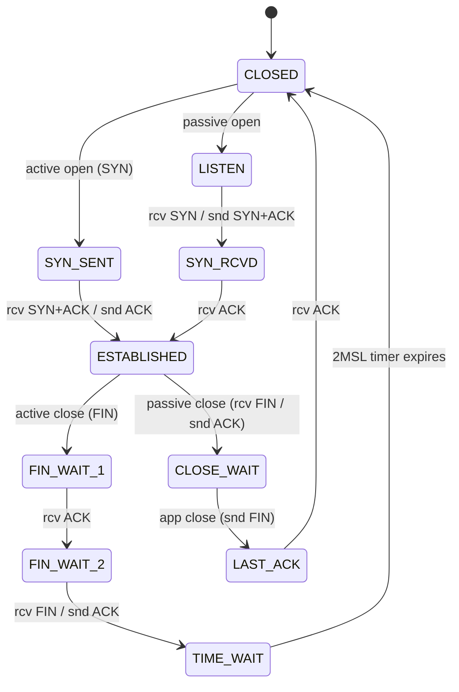
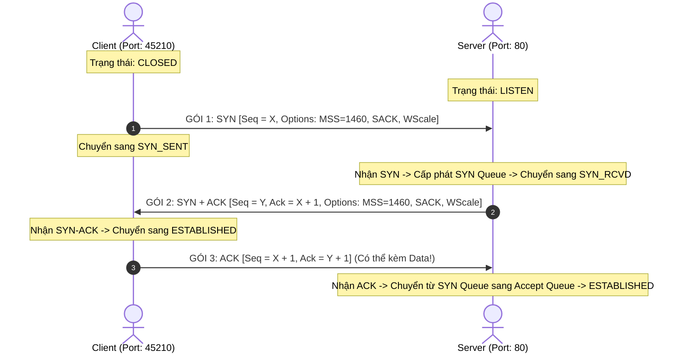
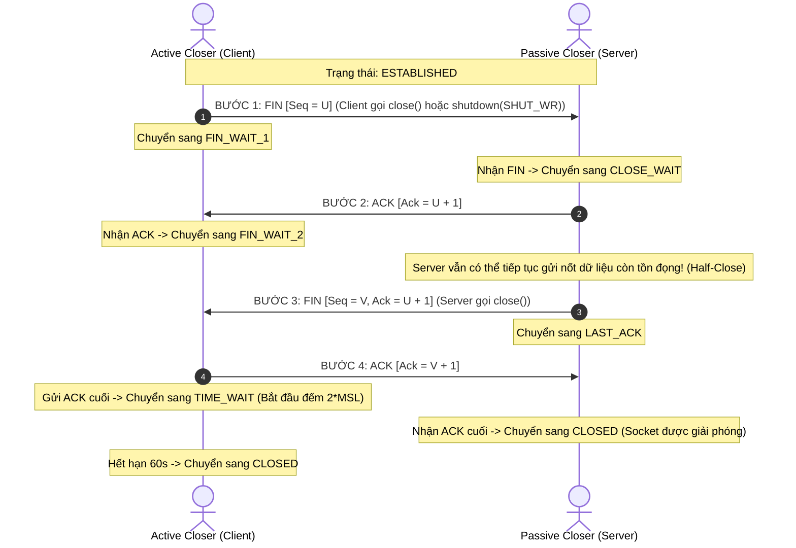
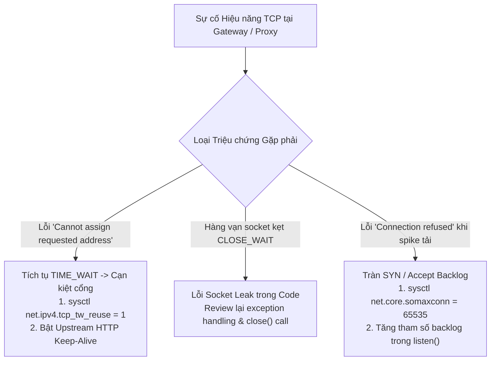

# 4.2. TCP Fundamentals and State Machine

> [!IMPORTANT]
> **Nếu bạn chỉ được nhớ một điều duy nhất:** Độ tin cậy của TCP (Transmission Control Protocol) được vận hành bởi Máy trạng thái hữu hạn (State Machine) phức tạp nhất thế giới mạng: từ Bắt tay 3 bước (SYN, SYN-ACK, ACK) thiết lập số thứ tự Sequence Number ban đầu (ISN), đến giai đoạn đóng kết nối 4 bước với trạng thái `TIME_WAIT` bắt buộc kéo dài $2 \times MSL$ (thường là 60s) để dọn sạch các gói tin lang thang và ngăn ngừa lẫn lộn dữ liệu giữa các thế hệ kết nối mới.

---

## 1. Đơn giản nhưng phải chi tiết (Intuitive & Deep Breakdown)

### 1.1. Đoạn Code Dẫn Nhập & Vấn Đề Thực Tế
Làm thế nào để hai máy chủ thiết lập một đường truyền tin cậy qua một hạ tầng mạng không hề tin cậy, và đóng kết nối an toàn mà không làm mất dữ liệu còn đang dở dang trên đường truyền?

```bash
# Quan sát trạng thái kết nối TCP trên máy chủ sản xuất
$ ss -tan state time-wait
Recv-Q  Send-Q   Local Address:Port    Peer Address:Port
0       0        10.0.0.1:80           192.168.1.50:54210
0       0        10.0.0.1:80           192.168.1.51:54211
... (hàng chục nghìn kết nối ở trạng thái TIME_WAIT!)
```

Nếu một máy chủ đóng kết nối nhưng giải phóng cổng và địa chỉ socket ngay lập tức mà không đi qua trạng thái `TIME_WAIT`, các gói tin cũ còn lang thang trên Internet có thể đến muộn và bị nhét nhầm vào một phiên kết nối mới, gây lỗi hỏng dữ liệu (Data Corruption)!

### 1.2. Ẩn Dụ Đời Sống & Phân Tích Cơ Chế Hoạt Động
Cơ chế Bắt tay 3 bước (3-way Handshake) và Đóng kết nối 4 bước (4-way Handshake) của TCP y hệt như **Giao thức Liên lạc Bộ đàm Quân sự**:
- **Bắt tay 3 bước (Mở phiên)**:
  1. *SYN*: *"Alpha gọi Bravo, tôi nghe rõ bạn nói không? Mã phiên của tôi là 100!"*
  2. *SYN-ACK*: *"Bravo nghe rõ Alpha ở mã 100! Còn bạn nghe rõ tôi nói không? Mã phiên của tôi là 500!"*
  3. *ACK*: *"Alpha nghe rõ Bravo ở mã 500! Bắt đầu truyền mệnh lệnh!"*
  -> Cả hai bên đều chắc chắn kênh truyền 2 chiều hoàn toàn thông suốt!
- **Đóng kết nối 4 bước**:
  - Không thể đóng giật cục vì TCP là kênh truyền Song công Toàn phần (Full-Duplex).
  - Alpha nói *"Tôi hết việc cần nói rồi, đóng chiều nói của tôi nhé!" (FIN)*.
  - Bravo đáp: *"Đã rõ bạn hết lời (ACK), nhưng tôi vẫn đang đọc nốt bản tin cho bạn nghe đây!"*.
  - Khi Bravo đọc xong: *"Tôi cũng hết việc rồi, đóng chiều nói của tôi luôn nhé!" (FIN)*.
  - Alpha đáp: *"Đã rõ, chúc ngủ ngon!" (ACK)* -> Alpha phải chờ thêm 2 phút (**TIME_WAIT**) phòng trường hợp lời *"Chúc ngủ ngon"* bị gió thổi bạt, Bravo sẽ gọi lại FIN!

### 1.3. Mô Phỏng Dữ Liệu Số Nhỏ Từng Bước (Toy Walkthrough)
Mô phỏng 3-Way Handshake với Sequence Number ngẫu nhiên ban đầu (ISN):

| Bước | Phía Gửi | Cờ TCP | SEQ | ACK | Trạng thái Client | Trạng thái Server | Ghi chú Kỹ thuật |
| :--- | :--- | :--- | :--- | :--- | :--- | :--- | :--- |
| **0** | - | - | - | - | `CLOSED` | `LISTEN` | Server mở port chờ |
| **1** | Client -> Server | `SYN` | `1000` | `0` | `SYN_SENT` | `LISTEN` | Client chọn ISN = 1000 |
| **2** | Server -> Client | `SYN, ACK` | `5000` | `1001` | `SYN_SENT` | `SYN_RCVD` | Server chọn ISN = 5000, ACK = 1000 + 1 |
| **3** | Client -> Server | `ACK` | `1001` | `5001` | **`ESTABLISHED`** | **`ESTABLISHED`** | Phiên kết nối thành công, bắt đầu gửi payload |

Lưu ý: Cờ SYN tiêu tốn đúng 1 đơn vị Sequence Number dù không mang theo payload dữ liệu.

### 1.4. Tác Động Thực Tế Tầng Backend & Systems
- **Tấn công SYN Flood**: Kẻ tấn công gửi hàng triệu gói tin `SYN` với IP giả mạo nhưng không bao giờ phản hồi `ACK` ở bước 3. Bảng nhớ bán kết nối (`SYN Queue`) của kernel Linux bị lấp đầy, khiến người dùng thật không thể truy cập dịch vụ.
  - *Giải pháp*: Kích hoạt **SYN Cookies** (`net.ipv4.tcp_syncookies = 1`) để mã hóa trạng thái vào ISN thay vì cấp phát slot bộ nhớ trong RAM.
- **Cạn kiệt Cổng Cục bộ do TIME_WAIT**: Khi một dịch vụ Backend gọi microservice khác với tần suất cao mà không dùng Connection Pooling (HTTP Keep-Alive), các kết nối rơi vào trạng thái `TIME_WAIT` (kéo dài 60s) ngốn hết dải ephemeral ports ($32,768 - 60,999$), dẫn tới lỗi `EADDRNOTAVAIL` (Cannot assign requested address).

### 1.5. Sơ Đồ Tư Duy & Kiến Trúc Hệ Thống (Mermaid)


---

## 2. Chi tiết từng Keyword (Under-the-Hood Deep Dive)

### 2.1. TCP Header Structure (Cấu trúc Header TCP Chuẩn)

Header của TCP có kích thước tối thiểu **20 bytes** (khi không có Options) và tối đa **60 bytes** (khi có đủ 40 bytes Options):

```text
 0                   1                   2                   3
 0 1 2 3 4 5 6 7 8 9 0 1 2 3 4 5 6 7 8 9 0 1 2 3 4 5 6 7 8 9 0 1
+-+-+-+-+-+-+-+-+-+-+-+-+-+-+-+-+-+-+-+-+-+-+-+-+-+-+-+-+-+-+-+-+
|          Source Port          |       Destination Port        |
+-+-+-+-+-+-+-+-+-+-+-+-+-+-+-+-+-+-+-+-+-+-+-+-+-+-+-+-+-+-+-+-+
|                        Sequence Number                        |
+-+-+-+-+-+-+-+-+-+-+-+-+-+-+-+-+-+-+-+-+-+-+-+-+-+-+-+-+-+-+-+-+
|                    Acknowledgment Number                      |
+-+-+-+-+-+-+-+-+-+-+-+-+-+-+-+-+-+-+-+-+-+-+-+-+-+-+-+-+-+-+-+-+
|  Data |       |C|E|U|A|P|R|S|F|                               |
| Offset| Rsrvd |W|C|R|C|S|S|Y|I|            Window Size        |
|       |       |R|E|G|K|H|T|N|N|                               |
+-+-+-+-+-+-+-+-+-+-+-+-+-+-+-+-+-+-+-+-+-+-+-+-+-+-+-+-+-+-+-+-+
|           Checksum            |         Urgent Pointer        |
+-+-+-+-+-+-+-+-+-+-+-+-+-+-+-+-+-+-+-+-+-+-+-+-+-+-+-+-+-+-+-+-+
|                    Options (if Data Offset > 5) ...           |
+-+-+-+-+-+-+-+-+-+-+-+-+-+-+-+-+-+-+-+-+-+-+-+-+-+-+-+-+-+-+-+-+
```

1. **Source Port & Destination Port (16 bits mỗi trường)**: Xác định tiến trình gửi và nhận ở hai đầu kết nối.
2. **Sequence Number (32 bits)**:
   - Nếu cờ SYN bật: Đây là **Initial Sequence Number (ISN)**.
   - Nếu cờ SYN tắt: Đây là số thứ tự của byte dữ liệu đầu tiên trong gói tin này so với toàn bộ luồng dữ liệu.
3. **Acknowledgment Number (32 bits)**:
   - Mang ý nghĩa **Cumulative ACK**: Xác nhận đã nhận trọn vẹn toàn bộ các byte trước đó, và cho biết **số thứ tự của byte tiếp theo** mà bên gửi mong đợi nhận được ($Ack = Seq_{last} + 1$).
4. **Data Offset (4 bits)**: Số lượng từ 32-bit (4-byte words) trong TCP Header. Xác định điểm bắt đầu của Application Data Payload (tối thiểu là 5, tức $5 \times 4 = 20$ bytes; tối đa là 15, tức 60 bytes).
5. **Window Size (16 bits)**: Kích thước bộ đệm nhận còn trống (**Receive Window - `rwnd`**), dùng để kiểm soát luồng (Flow Control). Do trường này chỉ có 16 bits (tối đa 65,535 bytes), TCP sử dụng **Window Scale Option** trong Options để mở rộng lên tới 1 GiB.
6. **Checksum (16 bits)**: Tính toán bắt buộc trên TCP Header, Payload và Pseudo-Header L3 (Source/Dest IP, Protocol 6, TCP Length).
7. **TCP Options Thường Dùng**:
   - `MSS (Maximum Segment Size)`: Thông báo kích thước payload TCP tối đa có thể nhận (ví dụ 1460 bytes).
   - `SACK Permitted`: Cho phép xác nhận có chọn lọc các khối byte bị ngắt quãng.
   - `Window Scale (WScale)`: Hệ số nhân cửa sổ nhận $2^N$.
   - `Timestamps (TSval/TSecr)`: Đo RTT chính xác và bảo vệ chống trùng lặp số tuần tự (PAWS).

---

### 2.2. Các Cờ Điều khiển TCP (TCP Flags)

Mỗi cờ chiếm 1 bit trong Header, đóng vai trò như các tín hiệu điều khiển trạng thái kết nối:
1. **SYN (Synchronize)**: Đồng bộ số thứ tự khởi đầu (ISN). Chỉ xuất hiện trong gói tin bước 1 và bước 2 của Three-Way Handshake.
2. **ACK (Acknowledgment)**: Xác thực trường Acknowledgment Number là hợp lệ. Hầu như mọi gói tin TCP sau bước 1 của handshake đều bật cờ này.
3. **FIN (Finish)**: Thông báo bên gửi đã truyền xong toàn bộ dữ liệu và yêu cầu đóng kết nối một chiều.
4. **RST (Reset)**: Lập tức hủy bỏ kết nối ngay lập tức mà không cần qua 4 bước đóng tiêu chuẩn. Gửi khi kết nối tới cổng không mở, hoặc khi xảy ra lỗi đồng bộ socket nghiêm trọng.
5. **PSH (Push)**: Yêu cầu TCP bên nhận đẩy ngay dữ liệu từ Socket Buffer lên tầng Ứng dụng mà không cần chờ bộ đệm đầy.
6. **URG (Urgent)**: Báo hiệu trường Urgent Pointer hợp lệ, dữ liệu khẩn cấp cần được xử lý ưu tiên (hiện nay ít dùng, thay bằng out-of-band signals).
7. **ECE (ECN-Echo) & CWR (Congestion Window Reduced)**: Dùng trong cơ chế Explicit Congestion Notification ở Layer 3/Layer 4 để báo hiệu nghẽn mạng mà không cần drop gói tin.

---

### 2.3. TCP Three-Way Handshake (Bắt tay 3 bước Thiết lập Kết nối)



#### Under-the-Hood:
1. **Thuật toán sinh ISN (RFC 6528)**: ISN không bao giờ bắt đầu từ 0 cố định để tránh tấn công **TCP Sequence Prediction / Session Hijacking**. Kernel Linux sinh ISN bằng hàm băm mật mã học:
   $$\text{ISN} = M + \text{MD5/SHA256}(\text{Src IP}, \text{Dst IP}, \text{Src Port}, \text{Dst Port}, \text{Secret Key})$$
   trong đó $M$ là một bộ đếm thời gian (timer tick 64ns).
2. **SYN Flood Attack & Kỹ thuật SYN Cookies**:
   - Kẻ tấn công gửi hàng triệu gói tin SYN với IP nguồn giả mạo rồi biến mất. Server cấp phát bộ nhớ RAM lưu `struct request_sock` trong **SYN Backlog Queue** để chờ ACK gói 3. Hàng đợi bị tràn khiến server từ chối phục vụ client hợp lệ.
   - **Giải pháp SYN Cookies (`net.ipv4.tcp_syncookies = 1`)**: Server không cấp phát bất kỳ byte bộ nhớ nào khi nhận SYN. Toàn bộ thông tin kết nối và MSS được mã hóa toán học trực tiếp vào giá trị $Y$ (ISN của Server). Khi Client gửi lại ACK ($Ack = Y + 1$), Server giải mã $Y - 1$ để xác thực; nếu hợp lệ, lúc này mới cấp phát Socket hoàn chỉnh!
3. **Simultaneous Open (Hai bên cùng chủ động mở)**: Cả hai bên cùng gửi gói SYN tới nhau đồng thời. Cả hai cùng chuyển từ `CLOSED` sang `SYN_SENT`, nhận SYN và chuyển sang `SYN_RCVD`, rồi gửi SYN-ACK để cùng chuyển sang `ESTABLISHED`.

---

### 2.4. TCP Four-Way Termination (Đóng Kết nối 4 bước) & Half-Close

Khác với thiết lập kết nối 3 bước, quá trình đóng kết nối cần tới **4 bước** vì TCP là kênh truyền hai chiều độc lập (Full-Duplex):



- **Hiện tượng Rò rỉ Socket `CLOSE_WAIT` (Socket Leak Bug)**:
  - Khi Client đóng kết nối, Kernel Server tự động gửi ACK và đưa socket vào trạng thái `CLOSE_WAIT`. Lúc này, trách nhiệm thuộc về **Code Ứng dụng Backend**: tiến trình ứng dụng phải phát hiện sự kiện đóng kết nối (hàm `recv()` trả về `0` hoặc EOF) và chủ động gọi `close(sockfd)`.
  - Nếu lập trình viên quên gọi `close()` (do dính lỗi unhandled exception hoặc deadlock trong code), socket sẽ bị **mắc kẹt vĩnh viễn ở `CLOSE_WAIT`**, làm cạn kiệt File Descriptor của OS!

---

### 2.5. Trạng thái TIME-WAIT và Tham số 2*MSL (Cốt lõi SRE Backend)

#### 1. Khái niệm Bản chất
- Trạng thái `TIME_WAIT` xuất hiện tại **bên chủ động gửi gói FIN đầu tiên** (Active Closer).
- **MSL (Maximum Segment Lifetime)**: Thời gian sống tối đa của một gói tin IP trong mạng trước khi bị drop (RFC 793 quy định là 2 phút, nhưng các hệ điều hành Linux hiện đại cố định cứng là **30 giây**).
- Thời gian tồn tại của trạng thái `TIME_WAIT` là **$2 \times \text{MSL} = 60 \text{ giây}$**.

#### 2. Hai Lý do Sống còn Bắt buộc phải có `TIME_WAIT`:
1. **Đảm bảo gói tin ACK cuối cùng tới được máy đích**:
   - Nếu gói ACK cuối cùng (Bước 4) bị rơi trên mạng, bên Passive Close sẽ bị timeout và gửi lại gói FIN (Bước 3).
   - Nếu không có trạng thái `TIME_WAIT` mà lập tức chuyển sang `CLOSED`, khi nhận được gói tin FIN gửi lại, máy chủ sẽ không hiểu và phản hồi lại bằng gói **RST**, khiến bên kia coi kết nối bị lỗi bất thường thay vì đóng êm đẹp.
2. **Triệt tiêu các gói tin cũ còn lang thang trong mạng (Draining Old Packets)**:
   - Các gói tin dữ liệu cũ bị kẹt trong các router định tuyến trễ có thể xuất hiện trở lại sau đó. Thời gian $2 \times \text{MSL}$ đảm bảo mọi gói tin thuộc về phiên kết nối cũ đều đã chết hẳn, không thể chui nhầm vào một phiên kết nối mới ngẫu nhiên trùng cặp `(Src IP, Src Port, Dst IP, Dst Port)`.

#### 3. Thảm họa Tích tụ TIME-WAIT trong Backend (TIME_WAIT Accumulation)
- Khi một máy chủ Proxy (như Nginx, HAProxy, Envoy) kết nối tới các dịch vụ microservices phía sau mà **không bật HTTP Keep-Alive**:
  - Với mỗi HTTP Request, Proxy mở một TCP connection và sau đó gọi `close()` trước $\to$ **Proxy chính là Active Closer**!
  - Ở mức tải 5,000 RPS, chỉ sau 60 giây, trên proxy sẽ tích tụ:
    $$5,000 \times 60 = 300,000 \text{ sockets ở trạng thái } TIME\_WAIT!$$
  - Toàn bộ dải Ephemeral Ports (khoảng 60,000 ports) cạn kiệt, hệ thống lập tức sụp đổ với lỗi:
    ```text
    connect() failed (99: Cannot assign requested address)
    ```

---

## 3. Thực thi Mã nguồn & Mô phỏng Chuyên sâu (Dual-Engine Implementation)

### 3.1. C++20: TCP Finite State Machine (FSM) Engine Simulator

File `tcp_fsm_engine.cpp` hiện thực mô hình máy trạng thái hữu hạn đầy đủ của TCP, xử lý các sự kiện chuyển trạng thái cho cả hai kịch bản Active Close và Passive Close.

```cpp
#include <iostream>
#include <string>
#include <unordered_map>
#include <memory>
#include <cstdint>

enum class TCPState {
    CLOSED, LISTEN, SYN_SENT, SYN_RCVD, ESTABLISHED,
    FIN_WAIT_1, FIN_WAIT_2, CLOSING, TIME_WAIT,
    CLOSE_WAIT, LAST_ACK
};

enum class TCPEvent {
    APP_ACTIVE_OPEN,  // connect()
    APP_PASSIVE_OPEN, // listen()
    APP_CLOSE,        // close()
    RCV_SYN,
    RCV_SYN_ACK,
    RCV_ACK,
    RCV_FIN,
    RCV_FIN_ACK,
    TIMEOUT_2MSL
};

std::string state_to_string(TCPState s) {
    switch (s) {
        case TCPState::CLOSED: return "CLOSED";
        case TCPState::LISTEN: return "LISTEN";
        case TCPState::SYN_SENT: return "SYN_SENT";
        case TCPState::SYN_RCVD: return "SYN_RCVD";
        case TCPState::ESTABLISHED: return "ESTABLISHED";
        case TCPState::FIN_WAIT_1: return "FIN_WAIT_1";
        case TCPState::FIN_WAIT_2: return "FIN_WAIT_2";
        case TCPState::CLOSING: return "CLOSING";
        case TCPState::TIME_WAIT: return "TIME_WAIT";
        case TCPState::CLOSE_WAIT: return "CLOSE_WAIT";
        case TCPState::LAST_ACK: return "LAST_ACK";
    }
    return "UNKNOWN";
}

class TCPStateMachine {
private:
    TCPState current_state_;
    std::string role_; // "CLIENT" hoac "SERVER"

public:
    TCPStateMachine(std::string role) : current_state_(TCPState::CLOSED), role_(std::move(role)) {}

    TCPState get_state() const { return current_state_; }

    bool handle_event(TCPEvent ev) {
        TCPState prev = current_state_;

        switch (current_state_) {
            case TCPState::CLOSED:
                if (ev == TCPEvent::APP_PASSIVE_OPEN) current_state_ = TCPState::LISTEN;
                else if (ev == TCPEvent::APP_ACTIVE_OPEN) current_state_ = TCPState::SYN_SENT;
                break;

            case TCPState::LISTEN:
                if (ev == TCPEvent::RCV_SYN) current_state_ = TCPState::SYN_RCVD;
                else if (ev == TCPEvent::APP_CLOSE) current_state_ = TCPState::CLOSED;
                break;

            case TCPState::SYN_SENT:
                if (ev == TCPEvent::RCV_SYN_ACK) current_state_ = TCPState::ESTABLISHED;
                break;

            case TCPState::SYN_RCVD:
                if (ev == TCPEvent::RCV_ACK) current_state_ = TCPState::ESTABLISHED;
                break;

            case TCPState::ESTABLISHED:
                if (ev == TCPEvent::APP_CLOSE) current_state_ = TCPState::FIN_WAIT_1; // Active Close
                else if (ev == TCPEvent::RCV_FIN) current_state_ = TCPState::CLOSE_WAIT; // Passive Close
                break;

            case TCPState::FIN_WAIT_1:
                if (ev == TCPEvent::RCV_ACK) current_state_ = TCPState::FIN_WAIT_2;
                else if (ev == TCPEvent::RCV_FIN) current_state_ = TCPState::CLOSING;
                else if (ev == TCPEvent::RCV_FIN_ACK) current_state_ = TCPState::TIME_WAIT;
                break;

            case TCPState::FIN_WAIT_2:
                if (ev == TCPEvent::RCV_FIN) current_state_ = TCPState::TIME_WAIT;
                break;

            case TCPState::CLOSING:
                if (ev == TCPEvent::RCV_ACK) current_state_ = TCPState::TIME_WAIT;
                break;

            case TCPState::TIME_WAIT:
                if (ev == TCPEvent::TIMEOUT_2MSL) current_state_ = TCPState::CLOSED;
                break;

            case TCPState::CLOSE_WAIT:
                if (ev == TCPEvent::APP_CLOSE) current_state_ = TCPState::LAST_ACK;
                break;

            case TCPState::LAST_ACK:
                if (ev == TCPEvent::RCV_ACK) current_state_ = TCPState::CLOSED;
                break;
        }

        if (prev != current_state_) {
            std::cout << "[" << role_ << " FSM] Chuyen trang thai: "
                      << state_to_string(prev) << " -> " << state_to_string(current_state_) << "\n";
            return true;
        } else {
            std::cout << "[!] [" << role_ << " FSM] Su kien khong hop le trong trang thai: "
                      << state_to_string(current_state_) << "\n";
            return false;
        }
    }
};

int main() {
    std::cout << "=== TCP FINITE STATE MACHINE (FSM) SIMULATOR (C++20) ===" << std::endl;

    TCPStateMachine client("CLIENT");
    TCPStateMachine server("SERVER");

    std::cout << "\n--- GIAI DOAN 1: THREE-WAY HANDSHAKE ---\n";
    server.handle_event(TCPEvent::APP_PASSIVE_OPEN); // LISTEN
    client.handle_event(TCPEvent::APP_ACTIVE_OPEN);  // SYN_SENT

    // Server nhan SYN, gui SYN-ACK
    server.handle_event(TCPEvent::RCV_SYN);          // SYN_RCVD
    // Client nhan SYN-ACK, gui ACK
    client.handle_event(TCPEvent::RCV_SYN_ACK);      // ESTABLISHED
    // Server nhan ACK
    server.handle_event(TCPEvent::RCV_ACK);          // ESTABLISHED

    std::cout << "\n--- GIAI DOAN 2: FOUR-WAY TERMINATION (CLIENT ACTIVE CLOSE) ---\n";
    // Client chu dong goi close()
    client.handle_event(TCPEvent::APP_CLOSE);        // FIN_WAIT_1
    // Server nhan FIN, tu dong gui ACK
    server.handle_event(TCPEvent::RCV_FIN);          // CLOSE_WAIT
    // Client nhan ACK cho FIN cua minh
    client.handle_event(TCPEvent::RCV_ACK);          // FIN_WAIT_2

    // Server xu ly xong, goi close() -> gui FIN
    server.handle_event(TCPEvent::APP_CLOSE);        // LAST_ACK
    // Client nhan FIN cua server -> gui ACK cuoi -> vao TIME_WAIT
    client.handle_event(TCPEvent::RCV_FIN);          // TIME_WAIT
    // Server nhan ACK cuoi -> dong hoan toan
    server.handle_event(TCPEvent::RCV_ACK);          // CLOSED

    // Sau thoi gian 2*MSL (60s)
    client.handle_event(TCPEvent::TIMEOUT_2MSL);     // CLOSED

    std::cout << "\n[+] Ket thuc mo phong: Ca hai Socket deu tro ve CLOSED an toan!\n";
    return 0;
}
```

### 3.2. Python 3.11: TCP Handshake & Sequence/ACK Tracker Simulator

File `tcp_handshake_tracker.py` mô phỏng đầy đủ tiến trình bắt tay 3 bước với việc sinh ISN ngẫu nhiên, xác thực lũy tiến số thứ tự byte và kích thước MSS Option.

```python
import struct
import random
import time
from dataclasses import dataclass

@dataclass
class TCPPacket:
    src_port: int
    dst_port: int
    seq_num: int
    ack_num: int
    flags: dict[str, bool]
    mss: int
    payload: bytes = b""

class TCPPeer:
    def __init__(self, name: str, port: int):
        self.name = name
        self.port = port
        self.isn = random.randint(100000, 999999) # Gia lap ISN ngau nhien
        self.current_seq = self.isn
        self.expected_ack = 0
        self.remote_seq = 0
        self.state = "CLOSED"

    def create_syn(self, dst_port: int, mss: int = 1460) -> TCPPacket:
        self.state = "SYN_SENT"
        return TCPPacket(
            src_port=self.port, dst_port=dst_port,
            seq_num=self.current_seq, ack_num=0,
            flags={"SYN": True, "ACK": False, "FIN": False},
            mss=mss
        )

    def handle_syn(self, pkt: TCPPacket, mss: int = 1460) -> TCPPacket:
        assert pkt.flags["SYN"] and not pkt.flags["ACK"]
        self.state = "SYN_RCVD"
        self.remote_seq = pkt.seq_num
        # SYN chiem 1 don vi sequence space
        ack_for_client = pkt.seq_num + 1
        return TCPPacket(
            src_port=self.port, dst_port=pkt.src_port,
            seq_num=self.current_seq, ack_num=ack_for_client,
            flags={"SYN": True, "ACK": True, "FIN": False},
            mss=mss
        )

    def handle_syn_ack(self, pkt: TCPPacket) -> TCPPacket:
        assert pkt.flags["SYN"] and pkt.flags["ACK"]
        assert pkt.ack_num == self.current_seq + 1
        self.state = "ESTABLISHED"
        self.remote_seq = pkt.seq_num
        self.current_seq = pkt.ack_num
        ack_for_server = pkt.seq_num + 1
        return TCPPacket(
            src_port=self.port, dst_port=pkt.src_port,
            seq_num=self.current_seq, ack_num=ack_for_server,
            flags={"SYN": False, "ACK": True, "FIN": False},
            mss=pkt.mss
        )

    def handle_ack(self, pkt: TCPPacket):
        assert pkt.flags["ACK"]
        assert pkt.ack_num == self.current_seq + 1
        self.state = "ESTABLISHED"
        self.current_seq = pkt.ack_num

if __name__ == "__main__":
    random.seed(1337)
    print("=== TCP THREE-WAY HANDSHAKE SEQUENCE TRACKER (Python 3.11) ===")
    
    client = TCPPeer("Client", port=54120)
    server = TCPPeer("Server", port=80)
    server.state = "LISTEN"

    print(f"[*] Client khoi tao ISN: {client.isn}")
    print(f"[*] Server khoi tao ISN: {server.isn}\n")

    # Buoc 1: Client -> Server
    p1 = client.create_syn(dst_port=server.port, mss=1460)
    print(f"[Buoc 1] Client -> Server: SYN=1, ACK=0 | Seq={p1.seq_num}, Ack={p1.ack_num} | MSS={p1.mss}")
    print(f"         Trang thai Client: {client.state}")

    # Buoc 2: Server -> Client
    p2 = server.handle_syn(p1, mss=1460)
    print(f"[Buoc 2] Server -> Client: SYN=1, ACK=1 | Seq={p2.seq_num}, Ack={p2.ack_num} | MSS={p2.mss}")
    print(f"         Trang thai Server: {server.state}")

    # Buoc 3: Client -> Server
    p3 = client.handle_syn_ack(p2)
    print(f"[Buoc 3] Client -> Server: SYN=0, ACK=1 | Seq={p3.seq_num}, Ack={p3.ack_num}")
    print(f"         Trang thai Client: {client.state}")

    server.handle_ack(p3)
    print(f"         Trang thai Server: {server.state}")

    print("\n[+] Ket noi da duoc thiet lap thanh cong giua hai ben (ESTABLISHED)!")
```

### 3.3. Terminal Output Mẫu

```text
$ clang++ -std=c++20 -O3 tcp_fsm_engine.cpp -o tcp_fsm_engine && ./tcp_fsm_engine
=== TCP FINITE STATE MACHINE (FSM) SIMULATOR (C++20) ===

--- GIAI DOAN 1: THREE-WAY HANDSHAKE ---
[SERVER FSM] Chuyen trang thai: CLOSED -> LISTEN
[CLIENT FSM] Chuyen trang thai: CLOSED -> SYN_SENT
[SERVER FSM] Chuyen trang thai: LISTEN -> SYN_RCVD
[CLIENT FSM] Chuyen trang thai: SYN_SENT -> ESTABLISHED
[SERVER FSM] Chuyen trang thai: SYN_RCVD -> ESTABLISHED

--- GIAI DOAN 2: FOUR-WAY TERMINATION (CLIENT ACTIVE CLOSE) ---
[CLIENT FSM] Chuyen trang thai: ESTABLISHED -> FIN_WAIT_1
[SERVER FSM] Chuyen trang thai: ESTABLISHED -> CLOSE_WAIT
[CLIENT FSM] Chuyen trang thai: FIN_WAIT_1 -> FIN_WAIT_2
[SERVER FSM] Chuyen trang thai: CLOSE_WAIT -> LAST_ACK
[CLIENT FSM] Chuyen trang thai: FIN_WAIT_2 -> TIME_WAIT
[SERVER FSM] Chuyen trang thai: LAST_ACK -> CLOSED
[CLIENT FSM] Chuyen trang thai: TIME_WAIT -> CLOSED

[+] Ket thuc mo phong: Ca hai Socket deu tro ve CLOSED an toan!

$ python3 tcp_handshake_tracker.py
=== TCP THREE-WAY HANDSHAKE SEQUENCE TRACKER (Python 3.11) ===
[*] Client khoi tao ISN: 472533
[*] Server khoi tao ISN: 814022

[Buoc 1] Client -> Server: SYN=1, ACK=0 | Seq=472533, Ack=0 | MSS=1460
         Trang thai Client: SYN_SENT
[Buoc 2] Server -> Client: SYN=1, ACK=1 | Seq=814022, Ack=472534 | MSS=1460
         Trang thai Server: SYN_RCVD
[Buoc 3] Client -> Server: SYN=0, ACK=1 | Seq=472534, Ack=814023
         Trang thai Client: ESTABLISHED
         Trang thai Server: ESTABLISHED

[+] Ket noi da duoc thiet lap thanh cong giua hai ben (ESTABLISHED)!
```

---

## 4. Systems Engineering & Production Pitfalls

### 4.1. Hóa giải Nguy cơ Cạn kiệt Cổng do Tích tụ `TIME_WAIT`
Để ngăn chặn tình trạng Proxy/Gateway cạn kiệt dải cổng Ephemeral khi làm việc với các backend upstream:
1. **Bật cơ chế tái sử dụng an toàn `tcp_tw_reuse`**:
   ```bash
   sudo sysctl -w net.ipv4.tcp_tw_reuse=1
   ```
   *Cơ chế hoạt động*: Linux Kernel sẽ cho phép tái sử dụng socket đang nằm trong `TIME_WAIT` cho kết nối gửi đi mới nếu gói tin mới có giá trị TCP Timestamps lớn hơn gói tin cuối cùng được ghi nhận từ kết nối cũ (an toàn 100% nhờ chuẩn RFC 1323 PAWS).
   > [!CAUTION]
   > Tuyệt đối **KHÔNG BAO GIỜ** bật `net.ipv4.tcp_tw_recycle`! Tùy chọn này đã bị xóa hoàn toàn khỏi Linux Kernel 4.12+ vì nó phá vỡ kết nối của tất cả các client nằm sau cùng một mạng NAT do Timestamp không đồng bộ!
2. **Kích hoạt HTTP Connection Pooling / Keep-Alive**:
   Trong Nginx, luôn cấu hình `keepalive` trong block `upstream`:
   ```nginx
   upstream backend_pool {
       server 10.0.1.10:8080;
       keepalive 64; # Duy trì 64 kết nối idle, tái sử dụng liên tục
   }
   ```

### 4.2. Xử lý Lỗi Tích tụ `CLOSE_WAIT` (Socket Leak)
Nếu lệnh `ss -tan | grep CLOSE-WAIT | wc -l` trả về hàng nghìn kết nối:
- Lỗi **hoàn toàn nằm ở mã nguồn ứng dụng** (Node.js, Go, Java, Python).
- Kiểm tra lại các đoạn code xử lý đọc socket: Khi hàm đọc trả về `0` byte (End-of-File / Socket Closed), phải đảm bảo khối lệnh gọi hàm `.close()` được thực thi (đặt trong khối `finally` hoặc `defer`).
- Không có bất kỳ thông số `sysctl` nào của kernel có thể tự động đóng hộ socket ở trạng thái `CLOSE_WAIT`!

### 4.3. Các lệnh CLI Chẩn đoán Trạng thái TCP

```bash
# 1. Thống kê số lượng kết nối trên từng trạng thái TCP
ss -tan | awk '{print $1}' | sort | uniq -c

# 2. Liệt kê các tiến trình đang chiếm giữ socket ở CLOSE_WAIT
ss -tanp state close-wait

# 3. Theo dõi số lượng SYN Backlog dropped (tràn hàng đợi)
netstat -s | grep -i "listen drops"

# 4. Bắt gói tin bắt tay TCP Handshake thời gian thực
sudo tcpdump -nnvv -i any "tcp[tcpflags] & (tcp-syn|tcp-fin) != 0"
```

---

## 5. Bảng So sánh & Decision Matrix

### 5.1. Bảng So sánh: Active Close vs Passive Close trong TCP

| Tiêu chí So sánh | Active Close (Bên đóng trước) | Passive Close (Bên đóng sau) |
| :--- | :--- | :--- |
| **Hành vi Khởi xướng** | Chủ động gọi `close()` hoặc `shutdown()` | Nhận được gói tin FIN từ đối phương |
| **Trình tự Trạng thái** | `ESTABLISHED` $\to$ `FIN_WAIT_1` $\to$ `FIN_WAIT_2` $\to$ **`TIME_WAIT`** $\to$ `CLOSED` | `ESTABLISHED` $\to$ **`CLOSE_WAIT`** $\to$ `LAST_ACK` $\to$ `CLOSED` |
| **Trạng thái Tiềm ẩn Rủi ro**| **`TIME_WAIT`** (Tốn cổng nếu là Client/Proxy) | **`CLOSE_WAIT`** (Rò rỉ FD nếu App không close) |
| **Quyền gửi Dữ liệu** | Không thể gửi thêm dữ liệu (trừ ACK) | Vẫn có thể gửi thêm dữ liệu (**Half-Close**) |
| **Thời gian giải phóng** | Chờ cố định $2 \times \text{MSL} = 60\text{s}$ | Giải phóng ngay khi nhận được ACK cuối |

### 5.2. Decision Matrix: Tinh chỉnh Tham số TCP Kernel cho Production Gateways



| Môi trường / Mục tiêu | Cấu hình Kernel Khuyên dùng | Giải thích Kỹ thuật |
| :--- | :--- | :--- |
| **High-Traffic Web Proxy (Nginx/HAProxy)** | `net.ipv4.tcp_tw_reuse = 1`<br/>`net.ipv4.ip_local_port_range = 10240 65535` | Tái sử dụng socket TIME_WAIT và mở rộng dải cổng Ephemeral lên hơn 55,000 cổng. |
| **Máy chủ Chống Tấn công DDoS** | `net.ipv4.tcp_syncookies = 1`<br/>`net.ipv4.tcp_max_syn_backlog = 3240000` | Ngăn chặn cạn kiệt bộ nhớ RAM khi bị tấn công SYN Flood hàng triệu gói tin/giây. |
| **Hệ thống Microservices Nội bộ** | `net.ipv4.tcp_fin_timeout = 15`<br/>`net.ipv4.tcp_keepalive_time = 300` | Rút ngắn thời gian chờ cô lập của FIN_WAIT_2 và phát hiện kết nối chết nhanh chóng. |

---

## 6. Enterprise Production Checklist & Verification

### 6.1. Kiến Trúc & Cấu Hình Tối Ưu (Production-Ready Architecture)
- [ ] **Bật SYN Cookies Chống DoS**: Đảm bảo sysctl `net.ipv4.tcp_syncookies = 1` được kích hoạt trên tất cả máy chủ biên Ingress/Load Balancer.
- [ ] **Tái Sử Dụng TIME_WAIT Sockets**: Cấu hình `net.ipv4.tcp_tw_reuse = 1` để cho phép kernel an toàn tái sử dụng các socket đang ở trạng thái TIME_WAIT cho các kết nối outgoing mới.
- [ ] **Nâng Kích thước Hàng đợi Kết nối**: Tăng `net.ipv4.tcp_max_syn_backlog = 8192` và `net.core.somaxconn = 8192` để chống nghẽn khi có bão traffic đột biến.
- [ ] **Bật TCP Fast Open (TFO)**: Cấu hình `net.ipv4.tcp_fastopen = 3` để cho phép client gửi dữ liệu payload ngay trong gói SYN đầu tiên sau khi đã xác thực cookie.

### 6.2. Giám Sát, Cảnh Báo & Xử Lý Sự Cố (Observability & Incident Response)
- [ ] **Theo dõi Trạng thái Socket bằng ss**: Giám sát số lượng kết nối theo trạng thái: `ss -s` và cảnh báo khi số lượng TIME_WAIT vượt quá 50,000 socket.
- [ ] **Cảnh báo Tràn Listen Backlog Queue**: Đọc chỉ số `ListenOverflows` và `ListenDrops` từ `netstat -s | grep -i listen` để phát hiện ứng dụng xử lý `accept()` quá chậm.
- [ ] **Bảo vệ Hệ thống Khỏi Kẹt CLOSE_WAIT**: Nếu số lượng kết nối `CLOSE_WAIT` tăng cao, đó là lỗi rò rỉ kết nối từ mã nguồn ứng dụng (quên gọi `close()` socket khi phía remote đã ngắt kết nối).
