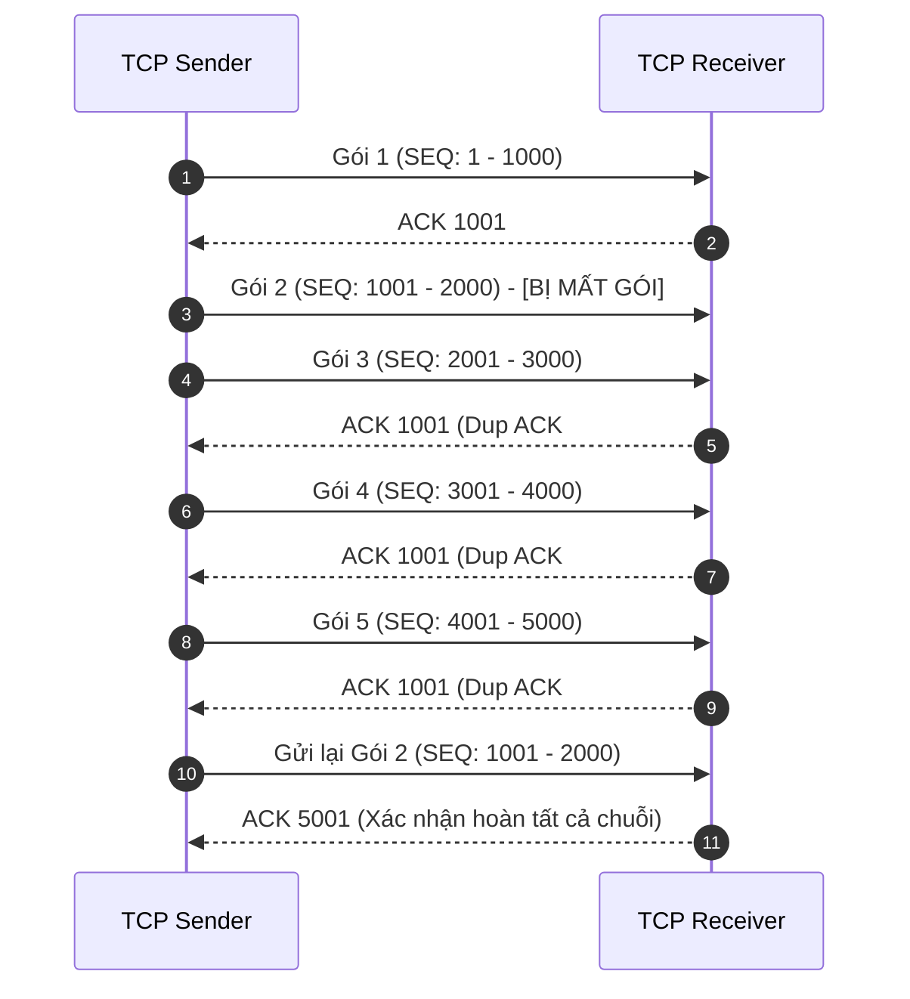
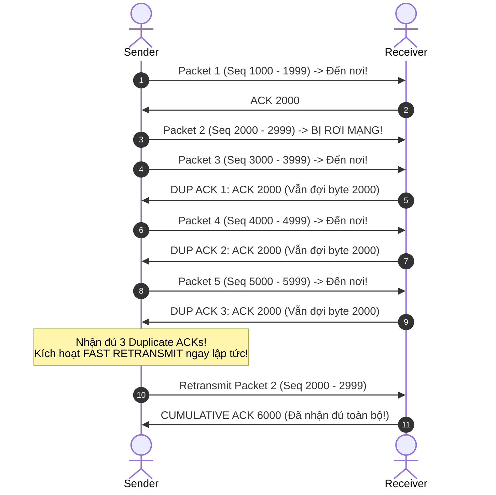
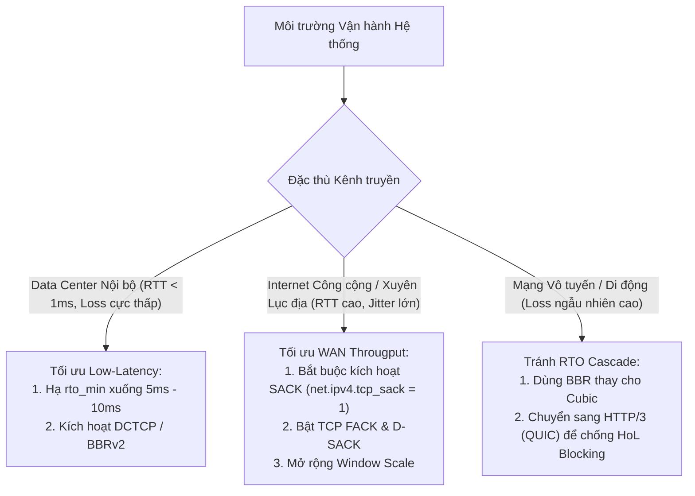

# 4.3. TCP Reliability and Sliding Window

> [!IMPORTANT]
> **Nếu bạn chỉ được nhớ một điều duy nhất:** Cơ chế Cửa sổ trượt (Sliding Window) biến dòng byte thô thành một kênh truyền tin cậy hai chiều liên tục: mỗi byte dữ liệu đều được đánh số Sequence Number tuyệt đối; máy nhận sử dụng Cumulative ACK hoặc Selective ACK (SACK) để xác nhận từng dải byte, cho phép bên gửi liên tục bơm dữ liệu vào đường truyền mà không cần chờ đợi xác nhận từng gói riêng rẽ.

---

## 1. Đơn giản nhưng phải chi tiết (Intuitive & Deep Breakdown)

### 1.1. Đoạn Code Dẫn Nhập & Vấn Đề Thực Tế
Làm sao TCP có thể truyền tải hàng gigabytes dữ liệu qua đường truyền cáp quang xuyên đại dương với tốc độ cao mà không phải dừng lại chờ xác nhận cho từng gói tin đơn lẻ?

```python
# Minh họa sự khác biệt giữa Stop-and-Wait vs. Sliding Window (Pipelining)
RTT_SEC = 0.1 # Độ trễ khứ hồi 100ms (xuyên đại dương)
PACKET_SIZE_BYTES = 1460

# Cơ chế Stop-and-Wait: Gửi 1 gói -> Chờ ACK -> Gửi tiếp
throughput_stop_and_wait = PACKET_SIZE_BYTES / RTT_SEC # ~ 14.6 KB/s (Cực kỳ chậm chạp!)

# Cơ chế Sliding Window: Bắn liên tục 64KB dữ liệu trước khi cần chờ ACK đầu tiên
WINDOW_SIZE_BYTES = 65535
throughput_sliding_window = WINDOW_SIZE_BYTES / RTT_SEC # ~ 655 KB/s (Gấp 45 lần!)
```

Nếu không có Cửa sổ Trượt (Sliding Window), một đường truyền băng thông dù rộng tới 10 Gbps cũng chỉ đạt tốc độ như mạng quay số dial-up thập niên 90 vì phần lớn thời gian đường cáp quang bị bỏ không để chờ tín hiệu xác nhận (ACK).

### 1.2. Ẩn Dụ Đời Sống & Phân Tích Cơ Chế Hoạt Động
Cơ chế Cửa sổ Trượt và Báo nhận Lũy tích (Cumulative ACK) giống như **Quy trình Thanh toán tại Băng Chuyền Siêu thị**:
- **Băng chuyền (Sliding Window)**: Thu ngân có thể đặt cùng lúc 10 món hàng lên băng chuyền chuyển về phía người đóng gói.
- **Báo nhận Lũy tích (Cumulative ACK)**:
  - Khi người đóng gói kiểm tra món hàng thứ 5, người đó không cần hét lên 5 lần: *"Đã nhận món 1, món 2, món 3, món 4, món 5"*. Người đó chỉ cần hô lớn: *"Tôi đã nhận xong đến món số 5, hãy đưa tiếp món số 6!"* (ACK = 6).
  - Thu ngân lập tức đẩy băng chuyền trượt về phía trước 5 nấc, nạp thêm 5 món mới vào băng chuyền.
- **Mất món hàng giữa chừng (Selective Repeat / SACK)**:
  - Nếu món hàng số 3 bị rơi khỏi băng chuyền nhưng món 4 và 5 vẫn tới tay người đóng gói.
  - Người đóng gói hô: *"Tôi vẫn chỉ mới hoàn tất đến món 2 (ACK = 3), nhưng ghi nhận thêm là đã cầm tạm món 4 và 5 (SACK blocks: 4-5)!"*.
  - Thu ngân nhìn vào băng chuyền và **chỉ gửi lại duy nhất món số 3** mà không cần tốn công nạp lại toàn bộ các món 4 và 5.

### 1.3. Mô Phỏng Dữ Liệu Số Nhỏ Từng Bước (Toy Walkthrough)
Mô phỏng cơ chế Fast Retransmit khi có 3 Duplicate ACKs xuất hiện:

| Bước | Phía Gửi (Sender) | Phía Nhận (Receiver) | Trạng thái Mạng | Phản hồi từ Phía Nhận | Hành động Phía Gửi |
| :--- | :--- | :--- | :--- | :--- | :--- |
| **1** | Bắn Gói 1 (`SEQ 1-1000`) | Nhận tốt Gói 1 | Bình thường | `ACK 1001` | Cửa sổ trượt sang phải |
| **2** | Bắn Gói 2 (`SEQ 1001-2000`) | **Bị rớt giữa đường** | Mất gói trên Router | Không có phản hồi | Chờ ACK |
| **3** | Bắn Gói 3 (`SEQ 2001-3000`) | Nhận Gói 3 (Lệch thứ tự) | Đệm tạm Gói 3 vào RAM | `ACK 1001` (Dup ACK 1) | Ghi nhận |
| **4** | Bắn Gói 4 (`SEQ 3001-4000`) | Nhận Gói 4 (Lệch thứ tự) | Đệm tạm Gói 4 vào RAM | `ACK 1001` (Dup ACK 2) | Ghi nhận |
| **5** | Bắn Gói 5 (`SEQ 4001-5000`) | Nhận Gói 5 (Lệch thứ tự) | Đệm tạm Gói 5 vào RAM | `ACK 1001` (**Dup ACK 3**) | **Kích hoạt Fast Retransmit!** |
| **6** | **Gửi lại Gói 2 ngay lập tức** | Nhận được Gói 2 | Ghép nối Gói 2,3,4,5 | **`ACK 5001`** (Lũy tích) | Trượt cửa sổ vọt qua 5000 |

Không cần chờ bộ đếm thời gian RTO (Retransmission Timeout) đếm lùi hàng trăm mili-giây, cơ chế 3 Dup ACKs giúp khôi phục gói tin tức thì!

### 1.4. Tác Động Thực Tế Tầng Backend & Systems
- **Tầm quan trọng sống còn của TCP SACK (Selective Acknowledgment)**: Nếu không có SACK, khi mất 1 gói trong chuỗi, cơ chế Go-Back-N cổ điển buộc sender phải gửi lại TOÀN BỘ các gói tin đi sau nó. Với đường truyền băng thông cao (BDP lớn), điều này gây lãng phí hàng trăm Megabytes băng thông và làm sụp đổ thông lượng.
- **Tính toán RTT và RTO Động (Karn / Partridge Algorithm)**: Kernel liên tục đo lường Smooth RTT (SRTT) và độ lệch RTT ($RTTVAR$) bằng công cụ timestamp của TCP Header. Nếu RTO bị tính toán sai quá nhỏ, hệ thống sẽ gửi lại thừa thãi; nếu quá lớn, hệ thống sẽ bị treo khi mất gói.

### 1.5. Sơ Đồ Tư Duy & Kiến Trúc Hệ Thống (Mermaid)


---

## 2. Chi tiết từng Keyword (Under-the-Hood Deep Dive)

### 2.1. Cumulative ACK vs Selective Acknowledgment (SACK)

#### A. Cumulative ACK (Xác nhận Dồn tích - Chuẩn RFC 793 Cổ điển)
- Số `ACK` trong TCP Header luôn đại diện cho: **$N$ = Số thứ tự byte tiếp theo mà bên nhận mong muốn**. Nó ngầm định xác nhận rằng **tất cả các byte từ 0 đến $N - 1$ đã được nhận hoàn hảo**.
- **Nhược điểm chí tử**: Khi có nhiều gói tin bị mất rải rác trong một cửa sổ, bên nhận chỉ có thể liên tục ACK lại byte đầu tiên bị thiếu. Bên gửi không có cách nào biết các gói tin phía sau đã đến đích an toàn hay chưa, dẫn đến thuật toán **Go-Back-N**: bên gửi buộc phải truyền lại toàn bộ các gói tin kể từ gói bị mất, gây lãng phí nghiêm trọng tài nguyên mạng.

#### B. Selective Acknowledgment (SACK - RFC 2018 / TCP SACK Option)
Để giải quyết nhược điểm trên, hai đầu mút đàm phán bật tùy chọn `SACK Permitted` trong gói tin SYN Handshake.
- Khi xuất hiện khoảng trống (Gap) do mất gói tin, bên nhận vẫn gửi `Cumulative ACK` tại điểm khuyết đầu tiên, nhưng đính kèm thêm **SACK Option** trong Header để liệt kê các khối dữ liệu rời rạc đã nhận thành công:
```text
+-------------------------------------------------------------+
| TCP Header | Cumulative ACK = 5000                          |
| Options    | SACK Block 1: [Left Edge=6000, Right Edge=7500]|
|            | SACK Block 2: [Left Edge=8000, Right Edge=9000]|
+-------------------------------------------------------------+
```
- Phía gửi đọc các khối SACK này, đánh dấu các byte trong khoảng `[6000-7500]` và `[8000-9000]` là đã đến đích, và **chỉ retransmit lại dải byte bị khuyết: `[5000-5999]` và `[7501-7999]`**.
- **D-SACK (Duplicate SACK - RFC 2883)**: Biến thể dùng khối SACK đầu tiên để báo hiệu cho bên gửi biết một gói tin bị trùng lặp, giúp bên gửi phát hiện hiện tượng mạng tự ý đảo thứ tự gói (Packet Reordering) thay vì coi là mất gói thật.

---

### 2.2. Thuật toán Tính toán Thời gian Chờ Phát lại (RTO - Retransmission Timeout)

Nếu gửi một gói tin mà không bao giờ nhận được ACK, sau bao lâu thì TCP được phép gửi lại?
- Nếu đặt RTO **quá ngắn**: TCP sẽ gửi lại những gói tin chưa kịp về đích (Spurious Retransmissions), gây nghẽn mạng giả tạo.
- Nếu đặt RTO **quá dài**: Khi mất gói thật, kết nối sẽ bị đơ (stall) hàng giây, làm suy giảm thảm hại throughput của ứng dụng.

#### Thuật toán Jacobson/Karels (RFC 6298) trong Linux Kernel:
RTO không thể là một hằng số cố định vì độ trễ mạng liên tục thay đổi. Kernel đo thời gian thực của từng gói tin (**SampleRTT**) và liên tục tính toán độ lệch chuẩn:

1. **Tính độ trễ RTT làm mịn (Smoothed RTT - SRTT)**:
   $$\text{SRTT}_{new} = (1 - \alpha) \times \text{SRTT}_{old} + \alpha \times \text{SampleRTT} \quad (\text{với } \alpha = \frac{1}{8} = 0.125)$$
2. **Tính độ biến thiên RTT (RTT Variation - RTTVAR)**:
   $$\text{RTTVAR}_{new} = (1 - \beta) \times \text{RTTVAR}_{old} + \beta \times |\text{SRTT} - \text{SampleRTT}| \quad (\text{với } \beta = \frac{1}{4} = 0.25)$$
3. **Tính toán giá trị RTO cuối cùng**:
   $$\text{RTO} = \text{SRTT} + \max(G, 4 \times \text{RTTVAR})$$
   *(Trong đó $G$ là độ phân giải xung nhịp clock tick của Kernel; Linux kẹp giá trị tối thiểu $\text{RTO}_{min} = 200\text{ms}$ và tối đa $\text{RTO}_{max} = 120\text{s}$).*

#### Bổ đề Karn (Karn's Algorithm):
- Khi một gói tin được phát lại (Retransmitted Segment), nếu sau đó nhận được ACK, **tuyệt đối KHÔNG ĐƯỢC dùng mẫu RTT này để cập nhật SRTT và RTTVAR** (vì ta không thể biết ACK này thuộc về gói tin gửi lần đầu hay gói tin phát lại!).
- Thay vào đó, mỗi khi timeout xảy ra, RTO sẽ được nhân đôi theo cấp số nhân (**Exponential Backoff**):
  $$\text{RTO}_{new} = 2 \times \text{RTO}_{old}$$

---

### 2.3. Fast Retransmit & Fast Recovery (Phát lại Nhanh qua 3 Duplicate ACKs)

Việc chờ đợi bộ đếm RTO hết hạn là biện pháp quá chậm chạp (mất ít nhất 200ms). Để tăng tốc độ phục hồi, TCP phát minh cơ chế **Fast Retransmit**:



#### Tại sao lại là 3 Duplicate ACKs mà không phải 1 hay 2?
- Trong mạng Internet, hiện tượng các gói tin đi qua các đường cáp khác nhau dẫn đến **đảo lộn thứ tự nhẹ (Reordering)** là rất phổ biến (ví dụ gói 3 đến trước gói 2).
- Nếu chỉ nhận được 1 hoặc 2 Duplicate ACKs, khả năng cao là do gói tin bị đến chậm một chút.
- Nếu bên nhận đã gửi tới **3 Duplicate ACKs liên tiếp**, điều đó chứng tỏ đã có ít nhất 3 gói tin phía sau vượt mặt thành công mà gói tin kia vẫn chưa tới. Khả năng gói tin đó bị rơi thật sự là trên $99.9\%$.
- Lúc này, bên gửi phát lại ngay gói bị mất mà **không cần chờ RTO Timer**!

---

### 2.4. Sliding Window Protocol (Giao thức Cửa sổ Trượt)

Cửa sổ trượt là cơ chế đồng bộ hóa giữa hai đầu mút dựa trên dung lượng bộ đệm và trạng thái dòng byte:

#### Trạng thái Phía Nhận (Receiver State)
- Phía nhận duy trì hai con trỏ cốt lõi:
  - `RCV.NXT`: Số thứ tự byte tiếp theo mong đợi nhận được.
  - `RCV.WND`: Dung lượng bộ đệm nhận còn trống hiện tại (**Receive Window**).
- Mép dưới của cửa sổ nhận là `RCV.NXT`.
- Mép trên của cửa sổ nhận là `RCV.NXT + RCV.WND`.
- Bất kỳ gói tin nào có số thứ tự nằm ngoài phạm vi này đều bị từ chối hoặc drop để bảo vệ bộ nhớ RAM của Kernel.

#### Sự Vận Động của Cửa Sổ (Window Movement)
1. **Mở rộng (Window Opens)**: Khi tiến trình ứng dụng gọi `read()` lấy bớt dữ liệu ra khỏi Kernel Buffer, `RCV.WND` tăng lên, mép trên của cửa sổ dạt sang phải.
2. **Khép lại (Window Closes)**: Khi dữ liệu đến liên tục nhưng ứng dụng bận CPU không kịp đọc, bộ đệm bị đầy dần, `RCV.WND` giảm về 0 (**Zero Window**).
3. **Trượt đi (Window Slides)**: Khi bên gửi nhận được ACK mới cho các byte đã gửi, `SND.UNA` tiến lên phía trước, giải phóng bộ đệm gửi và cho phép đẩy thêm các byte dữ liệu mới ra dây cáp.

---

## 3. Thực thi Mã nguồn & Mô phỏng Chuyên sâu (Dual-Engine Implementation)

### 3.1. C++20: Jacobson/Karels RTO Engine & Sliding Window Sender

File `sliding_window_rto.cpp` mô phỏng đầy đủ thuật toán cập nhật SRTT, RTTVAR, tính toán RTO động và quản lý con trỏ Cửa sổ trượt.

```cpp
#include <iostream>
#include <vector>
#include <cmath>
#include <iomanip>
#include <cstdint>
#include <algorithm>

class JacobsonKarelsRTO {
private:
    double srtt_;    // Smoothed Round Trip Time (ms)
    double rttvar_;  // RTT Variation (ms)
    double rto_;     // Retransmission Timeout (ms)
    bool first_sample_;

    const double alpha_ = 0.125; // 1/8
    const double beta_ = 0.25;   // 1/4
    const double rto_min_ = 200.0;  // Linux minimum clamp (200ms)
    const double rto_max_ = 120000.0; // 120s

public:
    JacobsonKarelsRTO() : srtt_(0.0), rttvar_(0.0), rto_(1000.0), first_sample_(true) {}

    void update_rtt_sample(double sample_rtt_ms) {
        if (first_sample_) {
            srtt_ = sample_rtt_ms;
            rttvar_ = sample_rtt_ms / 2.0;
            rto_ = srtt_ + std::max(10.0, 4.0 * rttvar_);
            first_sample_ = false;
        } else {
            // RTTVAR = (1 - beta) * RTTVAR + beta * |SRTT - SampleRTT|
            rttvar_ = (1.0 - beta_) * rttvar_ + beta_ * std::abs(srtt_ - sample_rtt_ms);
            // SRTT = (1 - alpha) * SRTT + alpha * SampleRTT
            srtt_ = (1.0 - alpha_) * srtt_ + alpha_ * sample_rtt_ms;
            // RTO = SRTT + 4 * RTTVAR
            rto_ = srtt_ + 4.0 * rttvar_;
        }

        // Clamp RTO
        rto_ = std::clamp(rto_, rto_min_, rto_max_);
    }

    void on_timeout_backoff() {
        rto_ = std::min(rto_ * 2.0, rto_max_); // Exponential backoff (Karn)
    }

    double get_rto() const { return rto_; }
    double get_srtt() const { return srtt_; }
    double get_rttvar() const { return rttvar_; }
};

struct SlidingWindowSender {
    uint32_t snd_una; // Byte cu nhat chua duoc ACK
    uint32_t snd_nxt; // Byte tiep theo se gui
    uint32_t snd_wnd; // Do rong cua so nhan (bytes)

    SlidingWindowSender(uint32_t start_seq, uint32_t window_size)
        : snd_una(start_seq), snd_nxt(start_seq), snd_wnd(window_size) {}

    uint32_t bytes_in_flight() const {
        return snd_nxt - snd_una;
    }

    uint32_t available_window() const {
        if (bytes_in_flight() >= snd_wnd) return 0;
        return snd_wnd - bytes_in_flight();
    }

    bool can_send(uint32_t num_bytes) const {
        return available_window() >= num_bytes;
    }

    void transmit(uint32_t num_bytes) {
        if (!can_send(num_bytes)) {
            std::cout << "[!] KHONG DU CUA SO de gui " << num_bytes << " bytes!\n";
            return;
        }
        snd_nxt += num_bytes;
        std::cout << "[>] Gui " << num_bytes << " bytes -> In-Flight: " << bytes_in_flight() 
                  << "B | Con lai: " << available_window() << "B\n";
    }

    void on_ack_received(uint32_t ack_num, uint32_t new_rwnd) {
        if (ack_num > snd_una) {
            uint32_t acked_bytes = ack_num - snd_una;
            snd_una = ack_num;
            snd_wnd = new_rwnd;
            std::cout << "[<] Nhan ACK " << ack_num << " (Giai phong " << acked_bytes 
                      << "B) -> Cua so truot! In-Flight: " << bytes_in_flight() << "B\n";
        }
    }
};

int main() {
    std::cout << "=== JACOBSON/KARELS RTO & SLIDING WINDOW SIMULATOR (C++20) ===" << std::endl;

    // 1. Kiem thu RTO Calculator
    JacobsonKarelsRTO rto_calc;
    std::vector<double> rtt_samples = {100.0, 110.0, 95.0, 250.0, 105.0}; // Spike o 250ms

    std::cout << std::fixed << std::setprecision(2);
    for (double rtt : rtt_samples) {
        rto_calc.update_rtt_sample(rtt);
        std::cout << "Sample RTT: " << std::setw(6) << rtt << "ms | SRTT: " << std::setw(6) << rto_calc.get_srtt()
                  << "ms | RTTVAR: " << std::setw(6) << rto_calc.get_rttvar() 
                  << "ms | Calculated RTO: " << std::setw(6) << rto_calc.get_rto() << "ms\n";
    }

    // 2. Kiem thu Sliding Window
    std::cout << "\n--- MO PHONG CUA SO TRUOT PHIA GUI (SENDER WINDOW) ---\n";
    SlidingWindowSender sender(1000, 3000); // Window 3000 bytes

    sender.transmit(1000);
    sender.transmit(1000);
    sender.transmit(1000); // Full window
    sender.transmit(500);  // Se bi chan

    // Nhan ACK cho 2000 bytes dau
    sender.on_ack_received(3000, 3000);
    // Gio co the gui tiep
    sender.transmit(1500);

    return 0;
}
```

### 3.2. Python 3.11: Fast Retransmit & SACK Block Generation Engine

File `fast_retransmit_sack.py` mô phỏng một phiên truyền nhận TCP xử lý hiện tượng mất gói tin giữa chừng, tự động sinh 3 Duplicate ACKs kèm các khối SACK để phía gửi chỉ retransmit đúng byte bị khuyết.

```python
from dataclasses import dataclass, field
from typing import List, Tuple

@dataclass
class TCPPacket:
    seq: int
    length: int
    payload: str

class SACKReceiver:
    """Mo phong bo dem nhan TCP tao cac khoi SACK blocks."""
    def __init__(self, initial_seq: int = 1000):
        self.rcv_nxt = initial_seq
        self.out_of_order_buffers: List[Tuple[int, int]] = [] # Cac khoi [start_seq, end_seq]

    def receive_packet(self, pkt: TCPPacket) -> Tuple[int, List[Tuple[int, int]], bool]:
        """Tra ve: (cumulative_ack, sack_blocks, is_dup_ack)"""
        pkt_end = pkt.seq + pkt.length
        
        if pkt.seq == self.rcv_nxt:
            # Dung thu tu mong doi
            self.rcv_nxt = pkt_end
            # Kiem tra xem co the merge voi out_of_order buffer khong
            self._merge_buffers()
            return self.rcv_nxt, self.out_of_order_buffers, False
        elif pkt.seq > self.rcv_nxt:
            # Den som (Out-of-order) -> Day la DUPLICATE ACK!
            self.out_of_order_buffers.append((pkt.seq, pkt_end))
            self.out_of_order_buffers.sort()
            return self.rcv_nxt, list(self.out_of_order_buffers), True
        else:
            # Goi tin cu da nhan roi
            return self.rcv_nxt, self.out_of_order_buffers, True

    def _merge_buffers(self):
        while self.out_of_order_buffers and self.out_of_order_buffers[0][0] <= self.rcv_nxt:
            start, end = self.out_of_order_buffers.pop(0)
            if end > self.rcv_nxt:
                self.rcv_nxt = end

if __name__ == "__main__":
    print("=== FAST RETRANSMIT & SACK ENGINE SIMULATOR (Python 3.11) ===")
    receiver = SACKReceiver(initial_seq=1000)

    # Tao 5 packets (moi packet 1000 bytes)
    packets = [
        TCPPacket(1000, 1000, "Packet 1"),
        TCPPacket(2000, 1000, "Packet 2 [BỊ RƠI MẠNG]"),
        TCPPacket(3000, 1000, "Packet 3"),
        TCPPacket(4000, 1000, "Packet 4"),
        TCPPacket(5000, 1000, "Packet 5"),
    ]

    dup_ack_count = 0
    print("[*] Gui Packet 1:")
    ack, sack, is_dup = receiver.receive_packet(packets[0])
    print(f"    Receiver ACK: {ack} | SACK Blocks: {sack} | DupACK: {is_dup}")

    print("\n[!] Packet 2 bi mat giua duong (Loss)!")

    # Gui cac packet tiep theo (3, 4, 5)
    for p in packets[2:]:
        print(f"\n[*] Gui {p.payload} (Seq={p.seq}, Len={p.length}):")
        ack, sack, is_dup = receiver.receive_packet(p)
        if is_dup:
            dup_ack_count += 1
        print(f"    Receiver phan hoi: Cumulative ACK={ack} | SACK={sack} (Dup #{dup_ack_count})")
        
        if dup_ack_count == 3:
            print("\n[>>> KÍCH HOẠT FAST RETRANSMIT <<<]")
            print(f"    -> Phía gửi nhận đủ 3 Dup ACKs cho Seq {ack}!")
            print(f"    -> Nhờ SACK {sack}, phía gửi biết chỉ cần phát lại đúng Packet [Seq {ack} -> {sack[0][0]}]!")
            
            # Phat lai goi so 2
            retransmit_pkt = TCPPacket(2000, 1000, "Packet 2 [RETRANSMITTED]")
            print(f"\n[*] Sender phat lai: {retransmit_pkt.payload}")
            final_ack, final_sack, _ = receiver.receive_packet(retransmit_pkt)
            print(f"    Receiver phan hoi: CUMULATIVE ACK={final_ack} (Hoan tat giai phong toan bo chuoi!)")
```

### 3.3. Terminal Output Mẫu

```text
$ clang++ -std=c++20 -O3 sliding_window_rto.cpp -o sliding_window_rto && ./sliding_window_rto
=== JACOBSON/KARELS RTO & SLIDING WINDOW SIMULATOR (C++20) ===
Sample RTT: 100.00ms | SRTT: 100.00ms | RTTVAR:  50.00ms | Calculated RTO: 300.00ms
Sample RTT: 110.00ms | SRTT: 101.25ms | RTTVAR:  40.00ms | Calculated RTO: 261.25ms
Sample RTT:  95.00ms | SRTT: 100.47ms | RTTVAR:  31.56ms | Calculated RTO: 226.72ms
Sample RTT: 250.00ms | SRTT: 119.16ms | RTTVAR:  61.05ms | Calculated RTO: 363.36ms
Sample RTT: 105.00ms | SRTT: 117.39ms | RTTVAR:  49.33ms | Calculated RTO: 314.70ms

--- MO PHONG CUA SO TRUOT PHIA GUI (SENDER WINDOW) ---
[>] Gui 1000 bytes -> In-Flight: 1000B | Con lai: 2000B
[>] Gui 1000 bytes -> In-Flight: 2000B | Con lai: 1000B
[>] Gui 1000 bytes -> In-Flight: 3000B | Con lai: 0B
[!] KHONG DU CUA SO de gui 500 bytes!
[<] Nhan ACK 3000 (Giai phong 2000B) -> Cua so truot! In-Flight: 1000B
[>] Gui 1500 bytes -> In-Flight: 2500B | Con lai: 500B

$ python3 fast_retransmit_sack.py
=== FAST RETRANSMIT & SACK ENGINE SIMULATOR (Python 3.11) ===
[*] Gui Packet 1:
    Receiver ACK: 2000 | SACK Blocks: [] | DupACK: False

[!] Packet 2 bi mat giua duong (Loss)!

[*] Gui Packet 3 (Seq=3000, Len=1000):
    Receiver phan hoi: Cumulative ACK=2000 | SACK=[(3000, 4000)] (Dup #1)

[*] Gui Packet 4 (Seq=4000, Len=1000):
    Receiver phan hoi: Cumulative ACK=2000 | SACK=[(3000, 4000), (4000, 5000)] (Dup #2)

[*] Gui Packet 5 (Seq=5000, Len=1000):
    Receiver phan hoi: Cumulative ACK=2000 | SACK=[(3000, 4000), (4000, 5000), (5000, 6000)] (Dup #3)

[>>> KÍCH HOẠT FAST RETRANSMIT <<<]
    -> Phía gửi nhận đủ 3 Dup ACKs cho Seq 2000!
    -> Nhờ SACK [(3000, 4000), (4000, 5000), (5000, 6000)], phía gửi biết chỉ cần phát lại đúng Packet [Seq 2000 -> 3000]!

[*] Sender phat lai: Packet 2 [RETRANSMITTED]
    Receiver phan hoi: CUMULATIVE ACK=6000 (Hoan tat giai phong toan bo chuoi!)
```

---

## 4. Systems Engineering & Production Pitfalls

### 4.1. Lỗ hổng SACK Panic (Linux Kernel CVE-2019-11477)
- **Bản chất**: Kẻ tấn công cố tình gửi các chuỗi SACK bị phân mảnh cao độ (hàng nghìn khối SACK rời rạc 1 byte xen kẽ). Kernel Linux phải duy trì một danh sách liên kết các cấu trúc `sk_buff` trong hàng đợi phát lại (`tcp_rtx_queue`).
- Khi danh sách này bị phân mảnh vượt quá $2^{16}$ phần tử, trường đếm 16-bit bị tràn số (Integer Overflow), dẫn đến Kernel Panic (`BUG_ON()`) và sập máy chủ ngay lập tức.
- **Biện pháp xử lý khẩn cấp**:
  ```bash
  # Tắt tạm thời SACK nếu chưa kịp cập nhật kernel patch
  sudo sysctl -w net.ipv4.tcp_sack=0
  ```

### 4.2. RTO Min Clamp trong Trung tâm Dữ liệu Hiện đại (Data Center Low Latency)
Mặc định trong Linux Kernel, giá trị RTO tối thiểu bị chặn cứng ở mức **`TCP_RTO_MIN = 200ms`** (nguồn gốc từ thời mạng dial-up những năm 1980):
- Trong trung tâm dữ liệu hiện đại kết nối cáp quang 100Gbps, RTT thông thường chỉ khoảng **$50 - 200\mu\text{s}$ (microsecond)**.
- Khi xảy ra mất gói do tràn buffer switch (Incast Congestion), TCP bị đơ mất 200ms để chờ RTO, làm độ trễ P99.9 của các hệ thống microservices/database tăng vọt gấp 1,000 lần!
- **Khắc phục**: Sử dụng lệnh `ip route` để hạ `rto_min` trên mạng nội bộ:
  ```bash
  # Hạ RTO min xuống 5ms cho dải mạng nội bộ Data Center
  sudo ip route change 10.0.0.0/8 dev eth0 rto_min 5ms
  ```

### 4.3. Các lệnh CLI Giám sát Retransmission & RTT

```bash
# 1. Xem chi tiết RTT, RTO và số lượng gói retransmit trên từng socket
ss -ti dst 10.0.1.15

# 2. Thống kê tổng số gói tin phát lại trên toàn hệ điều hành
netstat -s | grep -i "segments retransmitted"

# 3. Theo dõi hiện tượng Retransmit thời gian thực bằng tcpdump
sudo tcpdump -i any -nn "tcp[tcpflags] & tcp-syn == 0 and tcp[tcpflags] & (tcp-rst|tcp-fin) == 0" -c 100
```

---

## 5. Bảng So sánh & Decision Matrix

### 5.1. Bảng So sánh: Cơ chế Khôi phục Dữ liệu Mất trong Transport Layer

| Tiêu chí So sánh | Stop-and-Wait | Go-Back-N (GBN) | Selective Repeat (SR) | TCP Chuẩn với SACK |
| :--- | :--- | :--- | :--- | :--- |
| **Kích thước Cửa sổ** | $W = 1$ | $W > 1$ | $W > 1$ | **$W > 1$ (Động theo rwnd/cwnd)** |
| **Băng thông Sử dụng** | Cực thấp ($< 1\%$) | Thấp khi mạng có packet loss | Cao | **Tối ưu tuyệt đối** |
| **Loại ACK Sử dụng** | Đơn lẻ từng gói | Cumulative ACK | ACK riêng cho từng gói | **Cumulative ACK + SACK Blocks** |
| **Chi phí Bộ nhớ Đích**| 1 buffer | 1 buffer (bỏ gói đến sớm) | Mảng buffer lưu gói đến sớm | **Mảng RB-Tree / sk_buff queue** |
| **Gói tin Phát lại** | 1 gói bị timeout | **Toàn bộ từ gói bị mất** | Chỉ đúng gói bị mất | **Chỉ đúng dải byte bị khuyết** |

### 5.2. Decision Matrix: Tối ưu Hóa Cơ chế Truyền Tin cậy cho Hệ thống Backend



| Tình huống Thực tế | Cấu hình / Khuyến nghị Kỹ thuật | Lý do & Hiệu quả Đem lại |
| :--- | :--- | :--- |
| **RPC Giữa các Microservices (gRPC/Redis)** | `ip route ... rto_min 10ms` | Tránh hiện tượng đuôi trễ (Tail Latency P99) bị kéo dài 200ms khi mất gói. |
| **Truyền Tải Dữ liệu Lớn Xuyên Quốc gia** | Bật `tcp_sack = 1` và `tcp_dsack = 1` | Giúp bên gửi không bao giờ phải retransmit lại những gigabyte dữ liệu đã tới nơi. |
| **Kênh truyền Vệ tinh / 4G Không Ổn định** | Triển khai QUIC (UDP) hoặc TCP BBR | Phân biệt chính xác giữa mất gói do nghẽn và mất gói do nhiễu sóng vô tuyến. |

---

## 6. Enterprise Production Checklist & Verification

### 6.1. Kiến Trúc & Cấu Hình Tối Ưu (Production-Ready Architecture)
- [ ] **Kích hoạt TCP SACK Bắt Buộc**: Luôn bật `net.ipv4.tcp_sack = 1` và `net.ipv4.tcp_dsack = 1` trên mọi server để kích hoạt Selective ACKs và Duplicate SACKs.
- [ ] **Bật TCP Timestamps**: Bật `net.ipv4.tcp_timestamps = 1` để đảm bảo kernel tính toán giá trị RTT chính xác đến từng micro-giây và bảo vệ kết nối chống trùng lặp Sequence Number (PAWS).
- [ ] **Tối ưu Kích thước Bộ nhớ Retransmission**: Đảm bảo bộ đệm ghi `net.ipv4.tcp_wmem` đủ rộng để lưu giữ toàn bộ dữ liệu đang bay (In-Flight) cho đến khi nhận được ACK.
- [ ] **Kích hoạt FACK / RACK Loss Detection**: Sử dụng thuật toán RACK (Recent Acknowledgment) mặc định trên Linux kernel hiện đại (`net.ipv4.tcp_recovery = 1`) để phát hiện mất gói dựa trên thời gian thay vì đếm số lượng ACK.

### 6.2. Giám Sát, Cảnh Báo & Xử Lý Sự Cố (Observability & Incident Response)
- [ ] **Cảnh báo Tỷ lệ Truyền lại (Retransmit Rate)**: Thiết lập cảnh báo Prometheus khi tỷ lệ gói tin truyền lại `RetransRate = (RetransSegs / OutSegs) * 100` vượt ngưỡng 1.5%.
- [ ] **Soi Chi tiết Kết nối bằng lệnh ss**: Sử dụng `ss -ti` để xem trực tiếp các trường `rtt`, `rto`, `retrans`, `sack` của từng socket riêng biệt trong thời gian thực.
- [ ] **Bắt Gói Tin Phân tích Bằng tcpdump**: Khi nghi ngờ lỗi truyền lại, bắt gói tin với tùy chọn: `tcpdump -nn -tt -i eth0 'tcp[tcpflags] & (tcp-syn|tcp-fin) != 0 or tcp[14:2] = 0'` để điều tra sâu.
