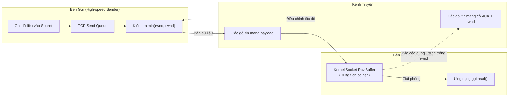
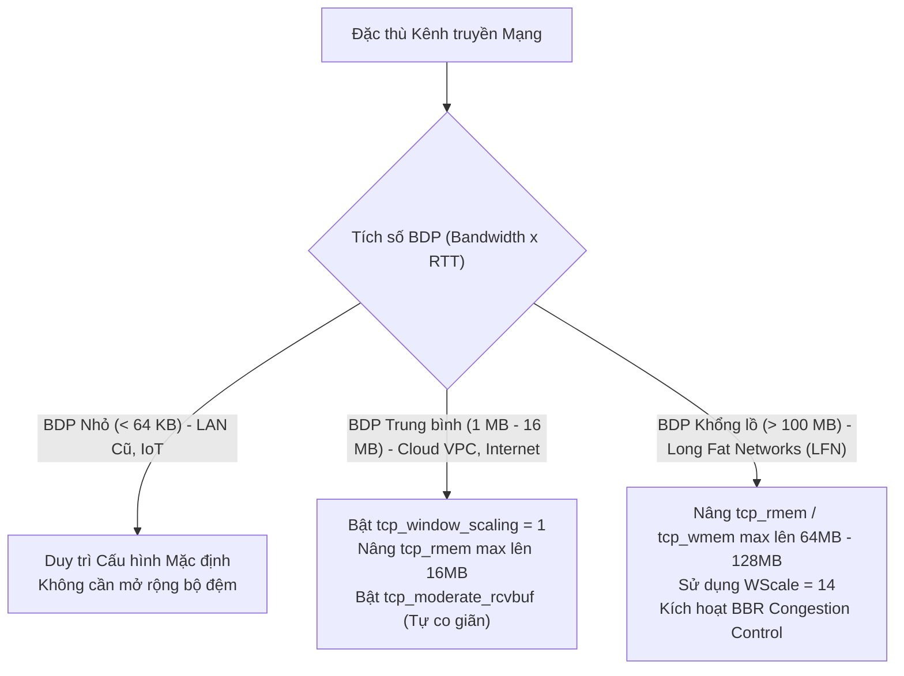

# 4.4. TCP Flow Control and Window Scaling

> [!IMPORTANT]
> **Nếu bạn chỉ được nhớ một điều duy nhất:** Kiểm soát luồng (Flow Control) bảo vệ bộ đệm của Bên Nhận khỏi bị tràn ngập dữ liệu bằng trường Receiver Window ($rwnd$): khi ứng dụng đọc chậm, $rwnd$ co về 0 (Zero Window) buộc bên gửi phải dừng lại và gửi Zero-Window Probes định kỳ; tùy chọn TCP Window Scale (RFC 7323) cho phép dịch chuyển bit trường 16-bit window lên tới 1GB, mở khóa hoàn toàn thông lượng trên các tuyến cáp quang xuyên đại dương có BDP khổng lồ.

---

## 1. Đơn giản nhưng phải chi tiết (Intuitive & Deep Breakdown)

### 1.1. Đoạn Code Dẫn Nhập & Vấn Đề Thực Tế
Chuyện gì xảy ra nếu một máy chủ mạnh mẽ gửi dữ liệu với tốc độ 10 Gbps vào một thiết bị nhúng hoặc điện thoại thông minh chỉ có khả năng đọc dữ liệu từ socket với tốc độ 100 Mbps?

```c
// Kiểm tra bộ đệm nhận (Receive Window) trên hệ điều hành Linux
int rcvbuf_size;
socklen_t optlen = sizeof(rcvbuf_size);
getsockopt(sock_fd, SOL_SOCKET, SO_RCVBUF, &rcvbuf_size, &optlen);
printf("Kích thước bộ đệm nhận Socket: %d bytes\n", rcvbuf_size);

// Nếu ứng dụng bận tính toán và không gọi recv(), bộ đệm này sẽ bị lấp đầy 100%!
// Khi đó, trường Receive Window (rwnd) trong TCP Header sẽ hạ về 0 (Zero Window Advertisement).
```

Nếu không có cơ chế Điều khiển Luồng (Flow Control), bộ đệm của thiết bị nhận sẽ bị ngập lụt ngay tức khắc, hàng triệu bytes dữ liệu bị đổ bỏ và bên gửi tiếp tục bắn dữ liệu trong vô vọng.

### 1.2. Ẩn Dụ Đời Sống & Phân Tích Cơ Chế Hoạt Động
Điều khiển Luồng (Flow Control) giống như **Ống Phễu Rót Dầu Vào Bình Chứa**:
- Người cầm can dầu 20 lít (**Phía Gửi - Sender**) có thể dốc ngược can để xả dầu cực nhanh.
- Miệng bình chứa được gắn một chiếc **Phễu nhỏ (Receive Buffer / Socket Buffer)**. Dưới đáy phễu có một lỗ nhỏ chảy từ từ vào bình (**Tiến trình Ứng dụng đọc dữ liệu**).
- **Cửa sổ Nhận (Receive Window - `rwnd`)** chính là **Vạch đo lượng dung tích còn trống trong lòng phễu**:
  - Khi phễu vơi: Người nhận hô: *"Phễu còn trống 500ml, cứ rót tiếp đi!"* (`rwnd = 500`).
  - Khi ứng dụng bận việc không đọc kịp, dầu dâng lên mép phễu: Người nhận hét lớn: *"DỪNG LẠI NGAY! Phễu đầy tràn rồi!"* (**Zero Window: `rwnd = 0`**).
  - Người gửi lập tức ngừng rót, đứng yên chờ đợi và thỉnh thoảng chọc nhẹ một que tăm (**Zero Window Probe**) để hỏi: *"Đã uống bớt tí dầu nào trong phễu chưa để tôi rót tiếp?"*.

### 1.3. Mô Phỏng Dữ Liệu Số Nhỏ Từng Bước (Toy Walkthrough)
Mô phỏng cơ chế Zero Window và Window Update với bộ đệm nhận ban đầu là 4,000 bytes:

| Thời Điểm | Sender Hành Động | Receiver Bộ Đệm (Socket Buffer) | Trường `rwnd` Phản Hồi | Trạng Thái Phía Gửi |
| :--- | :--- | :--- | :--- | :--- |
| $T_0$ | Gửi 2,000 bytes | Bộ đệm chứa 2,000 bytes (Còn trống 2,000) | `rwnd = 2000` | Được phép gửi thêm 2,000B |
| $T_1$ | Gửi tiếp 2,000 bytes | Bộ đệm chứa 4,000 bytes (**Đầy $100\%$**) | `rwnd = 0` (**Zero Window**) | **Khóa truyền hoàn toàn!** |
| $T_2$ | Chờ đợi... | Ứng dụng bận CPU, chưa đọc byte nào | - | Đếm timer chờ thăm dò |
| $T_3$ | **Bắn Zero Window Probe (1 byte)** | Bộ đệm vẫn đầy 4,000 bytes | `rwnd = 0` (Vẫn đầy) | Tiếp tục chờ |
| $T_4$ | Đang chờ... | Ứng dụng rảnh, gọi `read(3000)` giải phóng | `rwnd = 3000` (**Window Update**) | Mở khóa truyền |
| $T_5$ | Bắn tiếp 3,000 bytes | Bộ đệm chứa 3,000 bytes (Còn trống 1,000) | `rwnd = 1000` | Truyền bình thường |

### 1.4. Tác Động Thực Tế Tầng Backend & Systems
- **Hội chứng Cửa sổ Ngớ ngẩn (Silly Window Syndrome - SWS)**:
  - Nếu receiver cứ giải phóng được đúng 1 byte lại gửi thông báo `rwnd = 1`, sender lại hì hục đóng một gói tin TCP mang theo 1 byte dữ liệu + 40 bytes IP/TCP header (Overhead tới 4000%!).
  - *Giải pháp*: **Thuật toán Clark** (Receiver chỉ quảng bá khi window trống ít nhất bằng 1 MSS hoặc 50% buffer) và **Thuật toán Nagle** (Sender chỉ gom đủ MSS mới gửi đi).
- **Window Scaling Option (RFC 7323)**: Trường Window Size trong TCP Header gốc chỉ có 16 bits (tối đa 65,535 bytes). Trên mạng 10Gbps hiện đại với RTT 100ms, băng thông tối đa chỉ đạt $\approx 5.2\text{ Mbps}$ nếu không có Window Scale Factor mở rộng kích thước cửa sổ lên tới 1 Gigabyte!

### 1.5. Sơ Đồ Tư Duy & Kiến Trúc Hệ Thống (Mermaid)


---

## 2. Chi tiết từng Keyword (Under-the-Hood Deep Dive)

### 2.1. Cơ chế Cửa sổ Nhận (Receive Window - `rwnd`)

Trong Linux Kernel, mỗi socket TCP khi khởi tạo đều được cấp phát một vùng nhớ đệm nhận gọi là `sk_rcvbuf` (mặc định được kiểm soát bởi sysctl `net.ipv4.tcp_rmem`).

#### Công thức Tính toán Cửa sổ Nhận:
Tại bất kỳ thời điểm nào trong quá trình truyền nhận:
$$rwnd = \text{sk\_rcvbuf} - (\text{LastByteReceived} - \text{LastByteRead})$$
- $\text{LastByteReceived}$: Số thứ tự byte dữ liệu cao nhất mà card mạng đã đưa vào Kernel Buffer.
- $\text{LastByteRead}$: Số thứ tự byte cao nhất mà tiến trình ứng dụng (Node.js, Go, Java) đã lấy ra qua syscall `read()` hoặc `recv()`.
- Chênh lệch $(\text{LastByteReceived} - \text{LastByteRead})$ đại diện cho số byte dữ liệu đang nằm chờ trong hàng đợi hàng chờ của RAM.
- Giá trị $rwnd$ được kernel ghi vào trường **`Window Size` (16 bits)** trong mỗi gói tin TCP ACK gửi về bên phát.
- Phía phát bị ràng buộc bởi nguyên tắc:
  $$\text{Bytes in Flight} \le \min(cwnd, rwnd)$$
  Trong đó $cwnd$ là Cửa sổ Tắc nghẽn (Congestion Window do mạng quyết định), còn $rwnd$ là Cửa sổ Nhận (do máy đích quyết định). Bên phát **không bao giờ được phép gửi vượt quá $rwnd$ bytes**!

---

### 2.2. Zero Window và Zero Window Probe (ZWP)

#### 1. Hiện tượng Zero Window
Khi tiến trình ứng dụng bên nhận bị treo (Deadlock, Blocked I/O, Garbage Collection Stop-the-World kéo dài, hoặc CPU $100\%$), nó ngừng đọc dữ liệu từ Socket Buffer.
- Bộ đệm đầy hoàn toàn $\implies rwnd = 0$.
- Bên nhận gửi một gói tin ACK với trường `Window Size = 0` (**Zero Window Advertisement**).
- Bên gửi bắt buộc phải lập tức ngừng phát mọi dữ liệu mới.

#### 2. Nguy cơ Deadlock và Bộ đếm Kiên trì (Persist Timer)
- Sau một thời gian, ứng dụng bên nhận hồi phục và đọc bớt dữ liệu ra khỏi buffer. Kernel bên nhận gửi một gói tin ACK đặc biệt không mang payload gọi là **Window Update** để báo: *"Tôi đã có lại 32 KB trống, hãy gửi tiếp đi!"*.
- **Kịch bản Thảm họa**: Gói tin Window Update này là một gói tin ACK thuần túy (không mang dữ liệu), do đó **TCP không bao giờ gửi ACK để xác nhận một gói ACK khác**. Nếu gói Window Update này bị rớt mạng:
  - Bên nhận đinh ninh rằng mình đã thông báo rồi và ngồi chờ dữ liệu mới.
  - Bên gửi vẫn nghĩ rằng cửa sổ vẫn bằng 0 và ngồi chờ Window Update.
  - **Hệ quả**: Cả hai bên rơi vào tình trạng **Bế tắc vĩnh viễn (Deadlock)**, kết nối bị đóng băng!
- **Giải pháp: Persist Timer & Zero Window Probe (ZWP)**:
  - Ngay khi nhận được `rwnd = 0`, bên gửi kích hoạt một bộ đếm đặc biệt gọi là **Persist Timer**.
  - Khi timer hết hạn, bên gửi phát đi một gói tin thăm dò **Zero Window Probe (ZWP)** chứa đúng **1 byte dữ liệu** (byte cũ hoặc byte tiếp theo).
  - Gói tin ZWP buộc Kernel bên nhận **phải gửi lại một gói tin ACK phản hồi**, mang theo giá trị $rwnd$ cập nhật mới nhất.
  - Nếu $rwnd$ vẫn bằng 0, Persist Timer tiếp tục tăng gấp đôi theo cấp số nhân (Exponential Backoff, tối đa thường là 60 giây) và gửi lại probe sau đó.

---

### 2.3. Window Scaling Option (RFC 1323 / RFC 7323)

#### 1. Nguồn gốc Vấn đề Lịch sử (Giới hạn 64 KB)
Khi giao thức TCP được chuẩn hóa trong RFC 793 (năm 1981), trường `Window Size` trong header chỉ được phân bổ độ dài **16 bits**:
$$\text{Max Window Size} = 2^{16} - 1 = 65,535\text{ bytes} \approx 64\text{ KB}$$
Vào thời kỳ đó, mạng ARPANET chạy với tốc độ vài chục Kbps nên 64 KB là một dung lượng khổng lồ. Tuy nhiên, trong kỷ nguyên cáp quang hiện đại:

#### 2. Tích số Băng thông - Độ trễ (Bandwidth-Delay Product - BDP)
BDP đại diện cho tổng dung lượng dữ liệu tối đa có thể nằm đồng thời trên đường truyền ("dữ liệu đang bay trên dây cáp"):
$$\text{BDP} = \text{Bandwidth} \times \text{RTT}$$

**Ví dụ Thực tế Minh họa**:
Xét một tuyến cáp quang xuyên Thái Bình Dương giữa Tokyo và California:
- Băng thông: $10\text{ Gbps} = 10 \times 10^9\text{ bits/giây}$.
- Độ trễ hai chiều (RTT): $100\text{ ms} = 0.1\text{ giây}$.
- Tính toán BDP:
  $$\text{BDP} = 10 \times 10^9 \times 0.1 = 1 \times 10^9\text{ bits} = 125\text{ Megabytes!}$$
- Để tận dụng tối đa $100\%$ đường truyền 10 Gbps này, bên gửi phải có khả năng bơm liên tục **$125\text{ MB}$ dữ liệu** trước khi dừng lại chờ ACK đầu tiên quay về.
- Nhưng nếu không có Window Scaling, TCP bị kẹt cứng ở giới hạn $64\text{ KB}$:
  $$\text{Max Throughput Thực tế} = \frac{\text{Max Window Size}}{\text{RTT}} = \frac{65,535 \times 8\text{ bits}}{0.1\text{ giây}} \approx 5.24\text{ Mbps}!$$
  *(Một đường truyền cáp quang $10\text{ Gbps}$ cực kỳ đắt đỏ nhưng bị bóp nghẹt xuống chỉ chạy được $5.24\text{ Mbps}$ – lãng phí hơn $99.9\%$ băng thông!)*.

#### 3. Giải pháp TCP Window Scaling (WScale)
- Trong bước bắt tay Three-Way Handshake (gói SYN), hai bên đàm phán tùy chọn **TCP Option: Window Scale (`WScale = S`)**, với số mũ $S \in [0, 14]$.
- Thay vì hiểu trường Window Size trong header là giá trị byte thô, Kernel sẽ **dịch bit sang trái $S$ lần (tương đương nhân với $2^S$)**:
  $$\text{Effective Window Size} = \text{Header Window Size} \times 2^S$$
- Với $S = 14$ (giá trị tối đa):
  $$\text{Max Effective Window} = 65,535 \times 2^{14} = 65,535 \times 16,384 \approx 1,073,725,440\text{ bytes} \approx 1\text{ GiB!}$$
- **Quy tắc Bắt buộc**: Window Scaling **chỉ được phép đàm phán duy nhất trong gói SYN/SYN-ACK**. Một khi kết nối đã chuyển sang `ESTABLISHED`, giá trị hệ số nhân $S$ bị khóa cứng và không bao giờ được phép thay đổi trong suốt vòng đời của phiên TCP.

---

### 2.4. Silly Window Syndrome (Hội chứng Cửa sổ Ngớ ngẩn - SWS)

#### 1. Hiện tượng SWS
Xảy ra khi lưu lượng mạng bị suy thoái nghiêm trọng do dữ liệu bị băm nhỏ thành **hàng loạt gói tin siêu nhỏ (vài bytes)**:
- **Tác nhân phía Nhận**: Ứng dụng đọc dữ liệu cực kỳ chậm chạp, mỗi lần chỉ gọi `read(1)` để đọc 1 byte. Cửa sổ nhận mở ra 1 byte $\implies$ Kernel bên nhận lập tức gửi ACK báo `rwnd = 1`.
- **Tác nhân phía Gửi**: Bên gửi thấy `rwnd = 1`, lập tức đóng gói 1 byte dữ liệu đó vào một TCP Segment và truyền đi.
- **Thảm họa Hiệu năng**: Để truyền 1 byte dữ liệu thực (Payload), hệ thống phải tiêu tốn:
  $$20\text{ bytes (IP Header)} + 20\text{ bytes (TCP Header)} + 1\text{ byte (Payload)} = 41\text{ bytes}$$
  Hiệu suất hữu ích của đường truyền chỉ đạt: $\frac{1}{41} \approx 2.44\%$! Mạng bị bão hòa bởi các header vô ích.

#### 2. Hai Giải pháp Phối hợp Triệt tiêu SWS:
1. **Giải pháp phía Nhận: Thuật toán Clark (Clark's Solution)**:
   - Bên nhận kiên quyết **không bao giờ thông báo mở cửa sổ nhỏ**.
   - Khi có dữ liệu được đọc ra, nếu dung lượng trống nhỏ hơn **$\min(\text{MSS}, \frac{\text{sk\_rcvbuf}}{2})$**, bên nhận tiếp tục quảng bá `rwnd = 0`.
   - Chỉ khi bộ đệm giải phóng được ít nhất một nửa dung lượng hoặc đủ chứa một gói tin MSS hoàn chỉnh (1460 bytes), bên nhận mới gửi Window Update mở cửa sổ!
2. **Giải pháp phía Gửi: Thuật toán Nagle (Nagle's Algorithm)**:
   - Phía gửi gom góp dữ liệu nhỏ trong bộ đệm nội bộ cho tới khi gom đủ kích thước một gói **MSS hoàn chỉnh** mới phát đi.
   - Nếu dữ liệu chưa đủ MSS, bên gửi chỉ được phép gửi nếu **tất cả các gói tin đã gửi trước đó đều đã nhận được ACK hoàn tất**.

---

## 3. Thực thi Mã nguồn & Mô phỏng Chuyên sâu (Dual-Engine Implementation)

### 3.1. C++20: Zero Window Probe & Buffer Flow Control Simulator

File `flow_control_sim.cpp` mô phỏng đầy đủ bộ đệm nhận có giới hạn, luồng xử lý ứng dụng chậm gây ra Zero Window, và cơ chế gửi Zero Window Probe của bên phát.

```cpp
#include <iostream>
#include <vector>
#include <thread>
#include <chrono>
#include <mutex>
#include <condition_variable>
#include <cstdint>
#include <iomanip>

class TCPReceiverBuffer {
private:
    const size_t capacity_;
    size_t current_usage_;
    std::mutex mtx_;
    std::condition_variable cv_read_;

public:
    TCPReceiverBuffer(size_t capacity) : capacity_(capacity), current_usage_(0) {}

    // Ghi du lieu vao buffer (Card mang / Kernel nhan)
    size_t write(size_t bytes) {
        std::lock_guard<std::mutex> lock(mtx_);
        size_t free_space = capacity_ - current_usage_;
        size_t to_write = std::min(bytes, free_space);
        current_usage_ += to_write;
        return to_write; // Tra ve so byte thuc su ghi duoc
    }

    // Doc du lieu ra khoi buffer (Backend App xu ly)
    size_t read(size_t bytes) {
        std::lock_guard<std::mutex> lock(mtx_);
        size_t to_read = std::min(bytes, current_usage_);
        current_usage_ -= to_read;
        return to_read;
    }

    size_t get_rwnd() {
        std::lock_guard<std::mutex> lock(mtx_);
        return capacity_ - current_usage_;
    }
};

class TCPSender {
private:
    TCPReceiverBuffer& recv_buf_;
    uint32_t persist_timer_ms_;

public:
    TCPSender(TCPReceiverBuffer& buf) : recv_buf_(buf), persist_timer_ms_(200) {}

    void send_stream(size_t total_bytes, size_t chunk_size) {
        size_t sent = 0;
        while (sent < total_bytes) {
            size_t rwnd = recv_buf_.get_rwnd();

            if (rwnd == 0) {
                std::cout << "[!] [ZERO WINDOW DETECTED] rwnd = 0! Sender dung phat, khoi dong Persist Timer ("
                          << persist_timer_ms_ << "ms)...\n";
                
                // Vong lap Zero Window Probe (ZWP)
                while (rwnd == 0) {
                    std::this_thread::sleep_for(std::chrono::milliseconds(persist_timer_ms_));
                    std::cout << "    [>] [ZWP SENT] Gui Zero Window Probe (1 Byte tham do)...\n";
                    rwnd = recv_buf_.get_rwnd();
                    std::cout << "    [<] [ZWP ACK] Receiver phan hoi: rwnd = " << rwnd << " Bytes\n";
                    if (rwnd == 0) {
                        persist_timer_ms_ = std::min(persist_timer_ms_ * 2, 1000u); // Backoff
                    }
                }
                persist_timer_ms_ = 200; // Reset timer
                std::cout << "[+] [WINDOW RESTORED] Tiep tuc phat du lieu!\n";
            }

            size_t can_send = std::min(chunk_size, rwnd);
            size_t actual = recv_buf_.write(can_send);
            sent += actual;
            std::cout << "[>] Sender truyen: " << actual << "B | Tong da gui: " << sent 
                      << "/" << total_bytes << "B | rwnd con lai: " << recv_buf_.get_rwnd() << "B\n";

            std::this_thread::sleep_for(std::chrono::milliseconds(50));
        }
    }
};

int main() {
    std::cout << "=== TCP FLOW CONTROL & ZERO WINDOW PROBE SIMULATOR (C++20) ===" << std::endl;
    // Buffer nhan nho 8KB de de dang quan sat hien tuong Zero Window
    TCPReceiverBuffer rx_buffer(8192);
    TCPSender sender(rx_buffer);

    // Luong Consumer cham: cu moi 300ms moi doc 2048 bytes
    std::atomic<bool> running(true);
    std::thread slow_consumer([&]() {
        while (running) {
            std::this_thread::sleep_for(std::chrono::milliseconds(250));
            size_t read_bytes = rx_buffer.read(2048);
            if (read_bytes > 0) {
                std::cout << "    [APP] Backend doc: " << read_bytes << "B -> Giai phong buffer!\n";
            }
        }
    });

    // Sender muon gui 20,480 bytes (20KB)
    sender.send_stream(20480, 2048);

    running = false;
    slow_consumer.join();
    std::cout << "\n[+] Hoan tat mo phong Flow Control an toan khong bi deadlock!\n";
    return 0;
}
```

### 3.2. Python 3.11: Bandwidth-Delay Product (BDP) & Window Scaling Calculator

File `bdp_scaling_calculator.py` tính toán chính xác kích thước cửa sổ nhận tối thiểu cần thiết để bão hòa đường truyền, xác định hệ số `WScale` tối ưu và tính toán thông lượng lý thuyết khi bị khóa ở giới hạn 64 KB cổ điển.

```python
import math
from dataclasses import dataclass

@dataclass
class NetworkLink:
    name: str
    bandwidth_gbps: float
    rtt_ms: float

class BDPCalculator:
    """Tinh toan BDP va he so Window Scaling Factor chuan RFC 7323."""
    
    @staticmethod
    def analyze_link(link: NetworkLink):
        bandwidth_bps = link.bandwidth_gbps * 1e9
        rtt_sec = link.rtt_ms / 1000.0
        
        # 1. Tinh BDP (Bytes)
        bdp_bits = bandwidth_bps * rtt_sec
        bdp_bytes = int(bdp_bits / 8)
        bdp_mb = bdp_bytes / (1024 * 1024)

        # 2. Thong luong neu khong co Window Scaling (khoa o 65,535 bytes)
        max_legacy_win = 65535
        legacy_throughput_bps = (max_legacy_win * 8) / rtt_sec
        legacy_throughput_mbps = legacy_throughput_bps / 1e6
        utilization_loss = (1 - (legacy_throughput_bps / bandwidth_bps)) * 100

        # 3. Tim Window Scale Factor nho nhat de chua du BDP
        # Effective Window = 65535 * (2 ** S) >= BDP
        if bdp_bytes <= max_legacy_win:
            wscale = 0
        else:
            required_multiplier = bdp_bytes / max_legacy_win
            wscale = math.ceil(math.log2(required_multiplier))
            wscale = min(wscale, 14) # Gioi han RFC 7323 toi da la 14

        effective_max_win = max_legacy_win * (2 ** wscale) / (1024 * 1024)

        print(f"==================================================")
        print(f"Lộ trình: {link.name}")
        print(f"  Băng thông       : {link.bandwidth_gbps} Gbps")
        print(f"  RTT              : {link.rtt_ms} ms")
        print(f"  BDP (Lý thuyết)  : {bdp_bytes:,} Bytes ({bdp_mb:.2f} MB)")
        print(f"--------------------------------------------------")
        print(f"  KHI KHÔNG CÓ WINDOW SCALING (Cổ điển 64 KB):")
        print(f"    Thông lượng tối đa : {legacy_throughput_mbps:.2f} Mbps")
        print(f"    Lãng phí băng thông: {utilization_loss:.2f}% !")
        print(f"--------------------------------------------------")
        print(f"  KHI KÍCH HOẠT WINDOW SCALING (RFC 7323):")
        print(f"    Đề xuất WScale (S) : {wscale} (Nhân 2^{wscale} = {2**wscale}x)")
        print(f"    Cửa sổ tối đa mới  : {effective_max_win:.2f} MB")
        print(f"    Hiệu suất khai thác: 100.00% Full Wire-Speed!")
        print(f"==================================================\n")

if __name__ == "__main__":
    links = [
        NetworkLink("Data Center Local LAN (Cáp quang 100G)", 100.0, 0.5),
        NetworkLink("AWS Cross-Region (Singapore - Tokyo 10G)", 10.0, 65.0),
        NetworkLink("Trans-Pacific Subsea Cable (Mỹ - Nhật 40G)", 40.0, 110.0),
    ]

    print("=== BDP & TCP WINDOW SCALING SYSTEM ANALYSIS (RFC 7323) ===\n")
    for l in links:
        BDPCalculator.analyze_link(l)
```

### 3.3. Terminal Output Mẫu

```text
$ clang++ -std=c++20 -O3 flow_control_sim.cpp -o flow_control_sim && ./flow_control_sim
=== TCP FLOW CONTROL & ZERO WINDOW PROBE SIMULATOR (C++20) ===
[>] Sender truyen: 2048B | Tong da gui: 2048/20480B | rwnd con lai: 6144B
[>] Sender truyen: 2048B | Tong da gui: 4096/20480B | rwnd con lai: 4096B
[>] Sender truyen: 2048B | Tong da gui: 6144/20480B | rwnd con lai: 2048B
    [APP] Backend doc: 2048B -> Giai phong buffer!
[>] Sender truyen: 2048B | Tong da gui: 8192/20480B | rwnd con lai: 2048B
[>] Sender truyen: 2048B | Tong da gui: 10240/20480B | rwnd con lai: 0B
[!] [ZERO WINDOW DETECTED] rwnd = 0! Sender dung phat, khoi dong Persist Timer (200ms)...
    [>] [ZWP SENT] Gui Zero Window Probe (1 Byte tham do)...
    [<] [ZWP ACK] Receiver phan hoi: rwnd = 0 Bytes
    [APP] Backend doc: 2048B -> Giai phong buffer!
    [>] [ZWP SENT] Gui Zero Window Probe (1 Byte tham do)...
    [<] [ZWP ACK] Receiver phan hoi: rwnd = 2048 Bytes
[+] [WINDOW RESTORED] Tiep tuc phat du lieu!
[>] Sender truyen: 2048B | Tong da gui: 12288/20480B | rwnd con lai: 0B
...
[+] Hoan tat mo phong Flow Control an toan khong bi deadlock!

$ python3 bdp_scaling_calculator.py
=== BDP & TCP WINDOW SCALING SYSTEM ANALYSIS (RFC 7323) ===

==================================================
Lộ trình: Data Center Local LAN (Cáp quang 100G)
  Băng thông       : 100.0 Gbps
  RTT              : 0.5 ms
  BDP (Lý thuyết)  : 6,250,000 Bytes (5.96 MB)
--------------------------------------------------
  KHI KHÔNG CÓ WINDOW SCALING (Cổ điển 64 KB):
    Thông lượng tối đa : 1048.56 Mbps
    Lãng phí băng thông: 98.95% !
--------------------------------------------------
  KHI KÍCH HOẠT WINDOW SCALING (RFC 7323):
    Đề xuất WScale (S) : 7 (Nhân 2^7 = 128x)
    Cửa sổ tối đa mới  : 8.00 MB
    Hiệu suất khai thác: 100.00% Full Wire-Speed!
==================================================

==================================================
Lộ trình: Trans-Pacific Subsea Cable (Mỹ - Nhật 40G)
  Băng thông       : 40.0 Gbps
  RTT              : 110.0 ms
  BDP (Lý thuyết)  : 550,000,000 Bytes (524.52 MB)
--------------------------------------------------
  KHI KHÔNG CÓ WINDOW SCALING (Cổ điển 64 KB):
    Thông lượng tối đa : 4.77 Mbps
    Lãng phí băng thông: 99.99% !
--------------------------------------------------
  KHI KÍCH HOẠT WINDOW SCALING (RFC 7323):
    Đề xuất WScale (S) : 14 (Nhân 2^14 = 16384x)
    Cửa sổ tối đa mới  : 1024.00 MB
    Hiệu suất khai thác: 100.00% Full Wire-Speed!
==================================================
```

---

## 4. Systems Engineering & Production Pitfalls

### 4.1. Cảnh báo Zero Window Alert và Suy thoái Ứng dụng Backend
Trong các hệ thống giám sát (Prometheus, Datadog), xuất hiện metric `TCP ZeroWindow` là dấu hiệu báo động đỏ về sức khỏe ứng dụng:
- **Nguyên nhân gốc rễ**: Không phải do mạng nghẽn, mà do **tiến trình ứng dụng (Application Layer) ngừng tiêu thụ socket buffer**.
  - Các nguyên nhân thường gặp: JVM Full GC Stop-the-World kéo dài 5-10 giây; Deadlock trên database connection pool; Event loop Node.js bị block bởi tính toán CPU nặng; hoặc luồng ghi file đĩa bị tắc nghẽn (I/O Wait 100%).
- **Kiểm tra tức thời bằng tcpdump / tshark**:
  ```bash
  # Lọc các gói tin Zero Window trên giao diện mạng
  sudo tshark -i eth0 -Y "tcp.analysis.zero_window"
  # Hoặc xem bằng ss xem bộ đệm nhận có bị nghẹt không (Recv-Q tăng cao)
  ss -tan '( dport = :80 or sport = :80 )'
  ```
  Nếu cột `Recv-Q` liên tục ở mức vài chục KB đến vài MB, chắc chắn ứng dụng backend đang bị nghẽn CPU/GC.

### 4.2. Tinh chỉnh Bộ đệm Socket Buffer cho Card Mạng Tốc độ Cao (10G/40G/100G)
Mặc định trên nhiều bản phân phối Linux cũ, bộ đệm tối đa bị giới hạn ở 4MB, không đủ để lấp đầy BDP của đường truyền liên lục địa.
- **Cấu hình tối ưu chuẩn hạ tầng Enterprise**:
```bash
# 1. Bắt buộc bật Window Scaling
sudo sysctl -w net.ipv4.tcp_window_scaling=1

# 2. Tinh chỉnh bộ đệm nhận: min, default, max (16MB max)
# 4096 (min)  87380 (default)  16777216 (max 16MB)
sudo sysctl -w net.ipv4.tcp_rmem="4096 87380 16777216"

# 3. Tinh chỉnh bộ đệm gửi: min, default, max (16MB max)
sudo sysctl -w net.ipv4.tcp_wmem="4096 65536 16777216"

# 4. Tăng giới hạn bộ đệm toàn cục của hệ thống
sudo sysctl -w net.core.rmem_max=16777216
sudo sysctl -w net.core.wmem_max=16777216
```

---

## 5. Bảng So sánh & Decision Matrix

### 5.1. Bảng So sánh: Flow Control (`rwnd`) vs Congestion Control (`cwnd`)

| Tiêu chí Đánh giá | Kiểm soát Luồng (Flow Control - `rwnd`) | Kiểm soát Tắc nghẽn (Congestion Control - `cwnd`) |
| :--- | :--- | :--- |
| **Đối tượng Bảo vệ** | **Máy Đích (Receiver)** không bị tràn RAM | **Toàn bộ Mạng Internet** (Switch/Router trung gian) |
| **Bên Quyết định** | Máy nhận đo đạc và thông báo qua TCP Header | Máy gửi tự ước lượng và điều chỉnh dựa trên RTT/Loss |
| **Cơ chế Đo đạc** | Dung lượng bộ đệm còn trống ($sk\_rcvbuf$) | Mất gói tin (Loss-based) hoặc Gia tăng RTT (Delay-based) |
| **Tín hiệu Báo động**| Gói tin **Zero Window Advertisement** | 3 Duplicate ACKs, RTO Timeout, ECN bits |
| **Cơ chế Phục hồi** | **Zero Window Probe (Persist Timer)** | Slow Start, Congestion Avoidance, Fast Recovery |

### 5.2. Decision Matrix: Tối ưu Cửa sổ Nhận theo Hạ tầng Mạng



| Môi trường Hệ thống | Cấu hình Đề xuất | Lý do & Ý nghĩa Thực tiễn |
| :--- | :--- | :--- |
| **Web Server Phục vụ Khách hàng (SaaS)** | `net.ipv4.tcp_window_scaling = 1`<br/>`net.ipv4.tcp_moderate_rcvbuf = 1` | Kernel tự động đo đạc và điều chỉnh `rwnd` linh hoạt theo từng client, tiết kiệm RAM server. |
| **Sao chép Cơ sở Dữ liệu Xuyên Lục địa (Cross-Region)** | `tcp_rmem = "4096 87380 33554432"` (32MB) | Đảm bảo tốc độ đồng bộ MySQL/PostgreSQL streaming replication không bị nghẽn bởi RTT 100ms. |
| **Big Data / AI Model Training Cluster (RDMA/RoCE)** | Bật Jumbo Frames MTU 9000 + Window Scale | Giảm số lần ngắt CPU (Interrupts) và bơm đầy băng thông 100Gbps giữa các GPU nodes. |

---

## 6. Enterprise Production Checklist & Verification

### 6.1. Kiến Trúc & Cấu Hình Tối Ưu (Production-Ready Architecture)
- [ ] **Bật Window Scaling Bắt Buộc**: Luôn đảm bảo sysctl `net.ipv4.tcp_window_scaling = 1` trên mọi máy chủ Linux để hỗ trợ cửa sổ nhận vượt qua ranh giới 64KB.
- [ ] **Kích hoạt Kernel Socket Auto-Tuning**: Đảm bảo sysctl `net.ipv4.tcp_moderate_rcvbuf = 1` để Linux tự động điều chỉnh bộ đệm nhận dựa trên BDP thực tế của từng kết nối.
- [ ] **Mở Rộng Kích Thước tcp_rmem và tcp_wmem**: Cấu hình bộ nhớ đệm: `net.ipv4.tcp_rmem = 4096 87380 16777216` và `net.ipv4.tcp_wmem = 4096 65536 16777216` trên các server mạng 10GbE / 40GbE.
- [ ] **Tránh Lạm Dụng SO_RCVBUF Thủ Công**: Không set cứng kích thước `SO_RCVBUF` trong code ứng dụng trừ khi có lý do đặc biệt, vì việc set cứng sẽ vô hiệu hóa cơ chế tự động mở rộng Window Scaling của kernel.

### 6.2. Giám Sát, Cảnh Báo & Xử Lý Sự Cố (Observability & Incident Response)
- [ ] **Giám sát Hiện tượng Zero Window**: Bắt và theo dõi metric `TCPZeroWindow` từ `netstat -st` hoặc công cụ giám sát eBPF; đây là dấu hiệu cho thấy ứng dụng backend đang bị nghẽn CPU hoặc disk I/O.
- [ ] **Kiểm tra Recv-Q Ứng dụng Bằng ss**: Chạy lệnh `ss -lnt` để xem cột `Recv-Q`. Nếu `Recv-Q` của socket đang ở trạng thái lớn liên tục, ứng dụng đang đọc không kịp lưu lượng gửi đến.
- [ ] **Cảnh báo Window Scale Mismatch**: Sử dụng tcpdump để xác minh trong gói SYN/SYN-ACK ban đầu cả hai bên đều trao đổi tùy chọn `Window Scale (WScale)` thành công.
