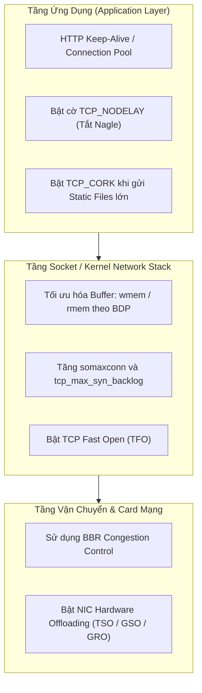
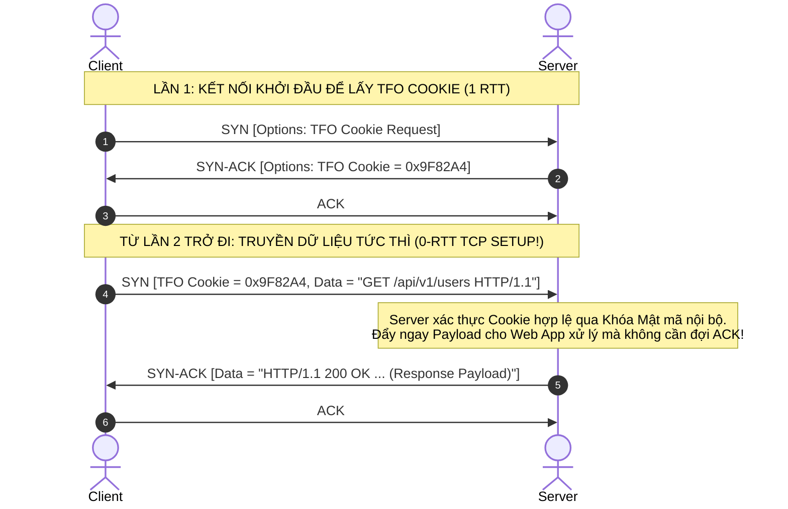
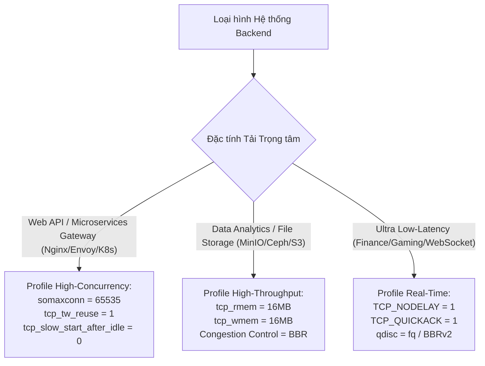

# 4.6. TCP Performance Optimization and Tuning

> [!IMPORTANT]
> **Nếu bạn chỉ được nhớ một điều duy nhất:** Tinh chỉnh TCP ở cấp độ Kernel là đòn bẩy quyết định hiệu năng của các hệ thống Backend quy mô lớn: vô hiệu hóa thuật toán Nagle bằng cờ `TCP_NODELAY` để triệt tiêu độ trễ 40ms của Delayed ACK trên các microservice RPC; kích hoạt TCP Fast Open (TFO) để gửi dữ liệu ngay trong gói SYN đầu tiên, và mở rộng kích thước buffer `net.ipv4.tcp_rmem` / `tcp_wmem` phù hợp với BDP.

---

## 1. Đơn giản nhưng phải chi tiết (Intuitive & Deep Breakdown)

### 1.1. Đoạn Code Dẫn Nhập & Vấn Đề Thực Tế
Tại sao một API microservice viết bằng Go hoặc Node.js có thể xử lý hàng trăm nghìn request/giây trên môi trường Localhost nhưng khi đem lên Production lại bị treo cứng và sụt giảm hiệu năng thảm hại?

```c
// Vấn đề tương tác tai hại giữa Nagle Algorithm và Delayed ACK
// Sender bật Nagle (mặc định), Receiver bật Delayed ACK (chờ 40ms mới gửi ACK)
int enable_nodelay = 1;
// Tắt thuật toán Nagle để gửi gói tin đi ngay lập tức không cần chờ gom đủ dữ liệu
setsockopt(socket_fd, IPPROTO_TCP, TCP_NODELAY, &enable_nodelay, sizeof(enable_nodelay));

// Nếu không bật TCP_NODELAY, request RPC nhỏ sẽ bị đóng băng đúng 40ms!
```

Sự kết hợp giữa **Thuật toán Nagle** (Sender giữ lại gói tin nhỏ chờ ACK) và **Delayed ACK** (Receiver đợi 40ms gom ACK) tạo ra một "hố đen độ trễ" nhân tạo 40ms cho mỗi lượt gọi RPC, làm tăng vọt độ trễ $p99$ của toàn bộ hệ sinh thái microservices!

### 1.2. Ẩn Dụ Đời Sống & Phân Tích Cơ Chế Hoạt Động
Tối ưu hóa hiệu năng TCP giống như **Quy hoạch Hệ thống Xe buýt Đô thị giờ Cao điểm**:
- **Bắt tay TCP 3-way Handshake** giống như **Thủ tục Đăng kiểm Xe trước mỗi chuyến đi**: Nếu mỗi hành khách lên xe lại phải đăng kiểm lại xe một lần thì bến xe sẽ tắc nghẽn hoàn toàn. Do đó, hệ thống cần **Connection Pooling (HTTP Keep-Alive)** để xe chạy liên tục qua lại phục vụ nhiều đợt khách mà không tắt máy.
- **Thuật toán Nagle** giống như **Tài xế đợi kín hết 45 chỗ mới nổ máy chạy**:
  - Tốt cho tiết kiệm xăng trên tuyến đường dài liên tỉnh (tiết kiệm băng thông mạng WAN).
  - Nhưng với dịch vụ xe ôm chở thư khẩn (**API Microservices / Redis Query**), việc ngồi đợi gom đủ thư sẽ làm khách hàng nổi giận. Cờ **`TCP_NODELAY`** chính là lệnh: *"Có thư là nổ máy chạy ngay lập tức, không được phép chần chừ!"*.

### 1.3. Mô Phỏng Dữ Liệu Số Nhỏ Từng Bước (Toy Walkthrough)
Mô phỏng bẫy độ trễ 40ms do Nagle + Delayed ACK trong một giao dịch Write-Write-Read:

| Thời Điểm | Bên Gửi (API Client) | Mạng Truyền Dẫn | Bên Nhận (Database / Server) | Độ Trễ Tích Lũy |
| :--- | :--- | :--- | :--- | :--- |
| $T_0$ | Gửi Header HTTP (Gói nhỏ 150B) | Bay trên mạng | Nhận được Header | 1ms |
| $T_0 + 1\text{ms}$ | Chuẩn bị gửi Body JSON (100B) | **Nagle kích hoạt!** Có gói 1 đang bay chưa nhận ACK -> **Chờ!** | Nhận xong Header, bật timer **Delayed ACK (40ms)** chờ xem còn gói nào tới không | 1ms (Tắc nghẽn bắt đầu) |
| $T_0 + 41\text{ms}$ | Vẫn đang kẹt chờ ACK... | **Hết 40ms timer**, Receiver hết kiên nhẫn bèn gửi gói `ACK` rỗng | Nhận ACK về -> Mở khóa Nagle | **41ms (Độ trễ vô nghĩa!)** |
| $T_0 + 42\text{ms}$ | Bắn tiếp Body JSON (100B) | Bay trên mạng | Nhận nốt Body và xử lý | 42ms |

Chỉ bằng cách thiết lập cờ `TCP_NODELAY = 1`, thời gian giao dịch giảm từ $42\text{ms}$ xuống còn đúng $2\text{ms}$!

### 1.4. Tác Động Thực Tế Tầng Backend & Systems
- **Tuning BDP (Bandwidth-Delay Product) cho Tuyến Cáp Quang Quốc tế**: Với đường truyền 10 Gbps xuyên Thái Bình Dương (RTT = 160ms), lượng dữ liệu bay trên dây là:
  $$BDP = \frac{10 \times 10^9}{8} \times 0.160 = 200\text{ Megabytes}$$
  Nếu sysctl `net.ipv4.tcp_rmem` và `net.ipv4.tcp_wmem` trên Linux chỉ để mặc định ở mức vài Megabytes, kết nối sẽ không bao giờ tận dụng được quá 5% băng thông của đường truyền 10Gbps!
- **Hội chứng Thắt Cổ Chai Ephemeral Port (Port Exhaustion)**: Khi các reverse proxy như NGINX hoặc Envoy kết nối tới upstream servers mà không bật `keepalive`, hệ thống sẽ nhanh chóng dùng cạn 28,000 ephemeral ports, khiến các request tiếp theo bị fail với lỗi `Cannot assign requested address`.

### 1.5. Sơ Đồ Tư Duy & Kiến Trúc Hệ Thống (Mermaid)


---

## 2. Chi tiết từng Keyword (Under-the-Hood Deep Dive)

### 2.1. Cuộc Xung đột Chết người: Nagle's Algorithm vs Delayed ACK (Cạm bẫy 40ms)

#### A. Nagle's Algorithm (John Nagle, 1984 - RFC 896)
- **Mục đích**: Chống tắc nghẽn đường truyền do ứng dụng gửi các gói tin siêu nhỏ (Tinygrams - ví dụ mỗi lần gõ bàn phím SSH gửi 1 byte payload nhưng tốn 40 bytes L3/L4 Header).
- **Quy tắc Vận hành**:
  ```text
  IF (Dữ liệu gửi >= MSS) THEN
      Gửi gói tin ngay lập tức.
  ELSE
      IF (Tất cả dữ liệu gửi trước đó đã nhận được ACK) THEN
          Gửi gói tin ngay lập tức.
      ELSE
          GIỮ LẠI TRONG BỘ ĐỆM GỬI cho tới khi nhận được ACK hoặc gom đủ 1 MSS!
      END IF
  END IF
  ```

#### B. Delayed ACK (RFC 1122)
- **Mục đích**: Thay vì gửi gói tin ACK rỗng (chỉ có header) ngay sau mỗi segment nhận được, bên nhận **trì hoãn gửi ACK trong một khoảng thời gian $\Delta t$ (Linux mặc định là $40\text{ ms}$, RFC cho phép tới $200\text{ ms}$)**.
- Mục tiêu là chờ ứng dụng bên nhận sinh ra dữ liệu phản hồi (Response Payload) để "cõng" luôn cờ ACK vào chung một gói tin (**Piggybacking**), giúp giảm một nửa số lượng gói tin chạy trên toàn mạng Internet.

#### C. Kịch bản Xảy ra Thảm họa 40ms
Hầu hết các thư viện HTTP hoặc RPC client cổ điển gửi một request theo 2 lần gọi hàm `write()`:
1. `write(socket, http_header, len);` (Kích thước $\sim 300\text{ bytes} < \text{MSS}$)
2. `write(socket, http_body, len);` (Kích thước $\sim 500\text{ bytes} < \text{MSS}$)
- **Bước 1**: Gói 1 (Header) đi ra mạng thành công vì trước đó đường truyền rảnh rỗi.
- **Bước 2**: Gói 2 (Body) bị Nagle giữ lại trong socket buffer vì nó nhỏ hơn MSS và Gói 1 **chưa nhận được ACK**.
- **Bước 3**: Server nhận Gói 1, nhưng vì chưa có phản hồi nên Delayed ACK giữ lại, chờ 40ms!
- **Hệ quả**: Toàn bộ chuỗi RPC bị treo cứng đúng **$40\text{ ms}$**.

#### D. Giải pháp Cốt tử: `TCP_NODELAY` vs `TCP_CORK`
1. **`TCP_NODELAY` (Vô hiệu hóa Nagle)**:
   - Ra lệnh cho Linux Kernel: *"Bất kỳ dữ liệu nào ứng dụng đẩy xuống socket, hãy truyền ra dây cáp ngay lập tức mà không cần chờ đợi!"*.
   - Đây là cấu hình bắt buộc trên mọi máy chủ Web, Microservices, API Gateway hiện đại.
   ```cpp
   int enable = 1;
   setsockopt(sockfd, IPPROTO_TCP, TCP_NODELAY, &enable, sizeof(enable));
   ```
2. **`TCP_CORK` (Nút chai đóng chặt)**:
   - Ngược lại với `TCP_NODELAY`, `TCP_CORK` ép Kernel khóa chặt bộ đệm lại, không cho bất kỳ gói tin nào thoát ra ngoài (dù có ACK hay không) cho tới khi bộ đệm gom đầy đúng 1 MSS hoặc cho đến khi ứng dụng mở nút chai.
   - Thường dùng trong các Web Server khi gửi file tĩnh lớn kết hợp với syscall `sendfile()`.

---

### 2.2. TCP Fast Open (TFO - RFC 7413)

Trong mô hình TCP truyền thống, quá trình Three-Way Handshake làm tiêu tốn đúng **1 vòng RTT vô ích** trước khi client có thể gửi byte dữ liệu ứng dụng đầu tiên (HTTP GET / TLS Client Hello):
$$\text{Độ trễ Kết nối Cổ điển} = 1 \text{ RTT (TCP)} + 1 \text{ RTT (TLS 1.3)} = 2 \text{ RTTs}$$



- **Cơ chế Bảo mật Cookie**: TFO Cookie là một mã MAC được Server tạo ra bằng cách mã hóa `(Client IP, Secret Key)`. Cookie này bảo vệ server khỏi bị tấn công Reflection / Amplification DDoS.
- **Kích hoạt trên Linux**:
  ```bash
  # 1 = Bật TFO cho Client, 2 = Bật TFO cho Server, 3 = Bật cho cả hai
  sudo sysctl -w net.ipv4.tcp_fastopen=3
  ```

#### Sự Kết hợp Giữa TCP Fast Open và TLS 1.3 0-RTT:
Khi triển khai Web hiện đại (HTTPS), sự kết hợp giữa hai cơ chế 0-RTT ở cả Layer 4 và Layer 7 tạo ra sức mạnh phi thường:
- **TFO (Layer 4)**: Cho phép gửi ngay bản tin TLS Client Hello ngay trong gói tin TCP SYN.
- **TLS 1.3 0-RTT (Layer 7)**: Sử dụng Pre-Shared Key (PSK) để mã hóa luôn HTTP Request Payload đặt ngay sau TLS Client Hello.
- **Kết quả**: Toàn bộ quá trình bắt tay TCP Handshake, đàm phán bảo mật TLS Handshake và truyền nhận HTTP Request/Response được hoàn tất **ngay trong 1 lượt RTT duy nhất**, tương đương với trải nghiệm lướt web tức thì của HTTP/3 (QUIC) trên nền tảng TCP cổ điển!

---

### 2.3. Hai Hàng đợi Kết nối trong Linux Kernel: SYN Backlog vs Listen Backlog

Một máy chủ khi gọi hàm `listen(sockfd, backlog)` sẽ được Kernel duy trì hai cấu trúc hàng đợi riêng biệt:

#### 1. SYN Backlog (SYN-RECEIVED Queue / Half-Open Connections)
- Chứa các kết nối đang ở bước lơ lửng: Client mới gửi `SYN`, Server đã gửi lại `SYN-ACK`, và đang chờ gói `ACK` cuối cùng.
- Kích thước hàng đợi được điều khiển bởi:
  $$\text{Dung lượng SYN Queue} = \text{net.ipv4.tcp_max_syn_backlog}$$
- **Xử lý khi bị tràn**: Nếu hàng đợi này bị lấp đầy (do tấn công SYN Flood hoặc mạng bị lag), Linux kích hoạt **`SYN Cookies`** (`net.ipv4.tcp_syncookies = 1`). Server ngừng lưu trữ thông tin kết nối trong RAM mà mã hóa toàn bộ trạng thái vào Sequence Number của gói SYN-ACK.

#### 2. Accept Queue (ESTABLISHED Queue / Full Backlog)
- Chứa các kết nối đã hoàn tất trọn vẹn 3-Way Handshake và đang chờ tiến trình ứng dụng gọi hàm `accept()` để nhận File Descriptor.
- Kích thước hàng đợi tối đa thực tế là:
  $$\text{Max Accept Queue Size} = \min(\text{tham số backlog trong hàm } listen(), \; \text{net.core.somaxconn})$$
- ⚠️ **Nguy cơ Drop Âm thầm (ListenDrops)**:
  - Nếu ứng dụng Backend bị chậm và không kịp gọi `accept()`, hàng đợi này sẽ bị đầy $100\%$.
  - Khi một client gửi gói ACK hoàn tất handshake đến một server có Accept Queue đã đầy, mặc định Linux (`net.ipv4.tcp_abort_on_overflow = 0`) sẽ **lặng lẽ hủy bỏ (drop) gói ACK đó**!
  - Phía Client tin rằng mình đã kết nối thành công (`ESTABLISHED`), nhưng Server thì hoàn toàn không biết gì. Client gửi HTTP Request đi và bị treo cứng (hang) cho tới khi hết hạn timeout!

---

### 2.4. Bảng Tra cứu Cấu hình Tối ưu Hóa TCP trong Linux (`/etc/sysctl.conf`)

Dưới đây là bảng thông số chuẩn mực dành cho máy chủ High-Concurrency Production (API Gateway, Nginx, K8s Ingress, Database):

| Tham số Kernel (`sysctl`) | Giá trị Mặc định | Đề xuất Production | Ý nghĩa & Tác động Kỹ thuật |
| :--- | :---: | :---: | :--- |
| **`net.core.somaxconn`** | 128 / 4096 | **`65535`** | Nâng trần giới hạn tối đa cho Accept Queue của mọi tiến trình server. |
| **`net.ipv4.tcp_max_syn_backlog`** | 128 / 512 | **`65535`** | Nâng dung lượng hàng đợi kết nối nửa mở (SYN Queue) chống nghẽn handshake. |
| **`net.ipv4.tcp_syncookies`** | 1 | **`1`** | Bật cơ chế phòng vệ tự động chống tấn công từ chối dịch vụ SYN Flood. |
| **`net.ipv4.tcp_tw_reuse`** | 0 | **`1`** | Cho phép tái sử dụng an toàn các socket ở trạng thái `TIME_WAIT` cho kết nối mới. |
| **`net.ipv4.ip_local_port_range`**| 32768 60999 | **`10240 65535`**| Mở rộng dải cổng Ephemeral từ $\sim 28,000$ lên tới hơn **$55,000$ cổng**. |
| **`net.ipv4.tcp_fin_timeout`** | 60 | **`15`** | Rút ngắn thời gian giải phóng socket ở trạng thái `FIN_WAIT_2` từ 60s xuống 15s. |
| **`net.ipv4.tcp_rmem`** | 4096 87380 6M | **`4096 87380 16777216`** | Mở rộng trần bộ đệm nhận lên 16MB để lấp đầy BDP của cáp quang 10G/40G. |
| **`net.ipv4.tcp_wmem`** | 4096 65536 4M | **`4096 65536 16777216`** | Mở rộng trần bộ đệm gửi lên 16MB hỗ trợ truyền file dung lượng lớn. |
| **`net.core.default_qdisc`** | fq_codel | **`fq`** | Kích hoạt Fair Queuing scheduler bắt buộc cho Google BBR Pacing. |
| **`net.ipv4.tcp_congestion_control`**| cubic | **`bbr`** | Kích hoạt thuật toán kiểm soát tắc nghẽn BBR thế hệ mới. |
| **`net.ipv4.tcp_slow_start_after_idle`**| 1 | **`0`** | Ngăn chặn TCP reset `cwnd` về mức tối thiểu sau một khoảng thời gian idle. |

---

## 3. Thực thi Mã nguồn & Mô phỏng Chuyên sâu (Dual-Engine Implementation)

### 3.1. C++20: Low-Latency Socket Tuning & Diagnostics Suite

File `socket_tuner.cpp` minh họa toàn bộ các thiết lập Socket Options tối thượng chuẩn POSIX (`TCP_NODELAY`, `TCP_QUICKACK`, `SO_REUSEPORT`, và tinh chỉnh Socket Buffer).

```cpp
#include <iostream>
#include <cstring>
#include <cstdint>
#include <sys/types.h>
#include <sys/socket.h>
#include <netinet/in.h>
#include <netinet/tcp.h>
#include <arpa/inet.h>
#include <unistd.h>

class LowLatencySocketBuilder {
public:
    static int create_tuned_server(uint16_t port, int backlog = 65535) {
        int sockfd = socket(AF_INET, SOCK_STREAM, 0);
        if (sockfd < 0) {
            perror("Loi khoi tao socket");
            return -1;
        }

        int enable = 1;

        // 1. SO_REUSEADDR & SO_REUSEPORT: Cho phep nhieu process bind chung 1 port
        if (setsockopt(sockfd, SOL_SOCKET, SO_REUSEADDR, &enable, sizeof(enable)) < 0) {
            perror("Loi setsockopt SO_REUSEADDR");
        }
#ifdef SO_REUSEPORT
        if (setsockopt(sockfd, SOL_SOCKET, SO_REUSEPORT, &enable, sizeof(enable)) < 0) {
            perror("Loi setsockopt SO_REUSEPORT");
        }
#endif

        // 2. TCP_NODELAY: Triet tieu thuat toan Nagle chong cam bay 40ms
        if (setsockopt(sockfd, IPPROTO_TCP, TCP_NODELAY, &enable, sizeof(enable)) < 0) {
            perror("Loi setsockopt TCP_NODELAY");
        }

        // 3. Tang Socket Receive/Send Buffer len 8MB
        int buf_size = 8 * 1024 * 1024;
        setsockopt(sockfd, SOL_SOCKET, SO_RCVBUF, &buf_size, sizeof(buf_size));
        setsockopt(sockfd, SOL_SOCKET, SO_SNDBUF, &buf_size, sizeof(buf_size));

        // 4. Bind va Listen
        sockaddr_in addr{};
        addr.sin_family = AF_INET;
        addr.sin_addr.s_addr = INADDR_ANY;
        addr.sin_port = htons(port);

        if (bind(sockfd, reinterpret_cast<const sockaddr*>(&addr), sizeof(addr)) < 0) {
            perror("Loi bind socket");
            close(sockfd);
            return -1;
        }

        if (listen(sockfd, backlog) < 0) {
            perror("Loi listen socket");
            close(sockfd);
            return -1;
        }

        std::cout << "[+] Server da khoi tao thanh cong tai port " << port << "!\n";
        std::cout << "    - TCP_NODELAY    : ENABLED (No 40ms Nagle delay)\n";
        std::cout << "    - SO_REUSEPORT   : ENABLED (Multi-threaded scaling)\n";
        std::cout << "    - Socket Buffers : 8 MB (Optimized for 10GbE)\n";
        std::cout << "    - Listen Backlog : " << backlog << " (Accept Queue)\n";

        return sockfd;
    }
};

int main() {
    std::cout << "=== HIGH-PERFORMANCE TCP SOCKET TUNER (C++20) ===" << std::endl;
    int srv = LowLatencySocketBuilder::create_tuned_server(8080, 4096);
    if (srv >= 0) {
        close(srv);
        std::cout << "[*] Dong server an toan.\n";
    }
    return 0;
}
```

### 3.2. Python 3.11: 40ms Nagle vs Delayed ACK Interaction Simulator

File `nagle_delayed_ack_sim.py` tái hiện chính xác thời điểm xuất hiện hiện tượng trễ $40\text{ ms}$ khi chia nhỏ bản tin HTTP/RPC, đồng thời kiểm chứng giải pháp sửa chữa bằng `TCP_NODELAY`.

```python
import time
from dataclasses import dataclass

@dataclass
class PacketTrace:
    time_ms: float
    description: str

class NagleDelayedACKSimulator:
    """Mo phong tuong tac giua Nagle's Algorithm (Sender) va Delayed ACK (Receiver)."""

    def __init__(self, enable_tcp_nodelay: bool = False, delayed_ack_timeout_ms: float = 40.0):
        self.enable_tcp_nodelay = enable_tcp_nodelay
        self.delayed_ack_timeout_ms = delayed_ack_timeout_ms
        self.traces: list[PacketTrace] = []

    def simulate_two_writes_rpc(self, header_bytes: int = 300, body_bytes: int = 200):
        current_time_ms = 0.0
        self.traces.append(PacketTrace(current_time_ms, f"App goi write(Header, {header_bytes}B)"))
        
        # 1. Goi Header di ngay vi truoc do duong truyen ranh
        self.traces.append(PacketTrace(current_time_ms, f"-> [CARD MẠNG] Header {header_bytes}B duoc truyen ngay!"))
        header_in_flight = True
        
        # 2. Ngay sau do, App goi write Body
        current_time_ms += 0.5
        self.traces.append(PacketTrace(current_time_ms, f"App goi write(Body, {body_bytes}B)"))

        if self.enable_tcp_nodelay:
            self.traces.append(PacketTrace(current_time_ms, f"-> [TCP_NODELAY = 1] Body {body_bytes}B duoc truyen ngay lap tuc!"))
            current_time_ms += 1.0 # 1ms RTT den Server
            self.traces.append(PacketTrace(current_time_ms, "<- [RECEIVER] Nhan du 2 segments -> Phuc vu xong request!"))
        else:
            self.traces.append(PacketTrace(current_time_ms, f"-> [NAGLE BLOCKED] Body < MSS va Header chua ACK -> GIỮ TRONG BUFFER!"))
            
            # Receiver ben kia nhan duoc Header tai t = 1.5ms
            current_time_ms = 1.5
            self.traces.append(PacketTrace(current_time_ms, "<- [RECEIVER] Nhan Header -> Khoi dong Delayed ACK Timer (40ms)..."))
            
            # Khong co du lieu nguoc lai, timer 40ms bi chay het
            current_time_ms += self.delayed_ack_timeout_ms
            self.traces.append(PacketTrace(current_time_ms, f"<- [RECEIVER] Delayed ACK Timer het han ({self.delayed_ack_timeout_ms}ms) -> Gui ACK!"))
            
            # Sender nhan ACK tai t + 1ms
            current_time_ms += 1.0
            self.traces.append(PacketTrace(current_time_ms, "-> [SENDER] Nhan duoc ACK cho Header -> Giai phong Nagle!"))
            self.traces.append(PacketTrace(current_time_ms, f"-> [CARD MẠNG] Body {body_bytes}B cuoi cung cung duoc phat di!"))
            
            current_time_ms += 1.0
            self.traces.append(PacketTrace(current_time_ms, "<- [RECEIVER] Nhan Body -> Hoan tat request!"))

        total_latency = current_time_ms
        return total_latency

if __name__ == "__main__":
    print("=== NAGLE'S ALGORITHM vs DELAYED ACK SIMULATOR (Python 3.11) ===\n")

    # Truong hop 1: Mac dinh (Co Nagle, Khong co TCP_NODELAY)
    sim_bad = NagleDelayedACKSimulator(enable_tcp_nodelay=False)
    lat_bad = sim_bad.simulate_two_writes_rpc()

    print("--- TRƯỜNG HỢP 1: MẶC ĐỊNH (CÓ THUẬT TOÁN NAGLE) ---")
    for t in sim_bad.traces:
        print(f"[{t.time_ms:6.1f} ms] {t.description}")
    print(f">> TỔNG ĐỘ TRỄ YÊU CẦU: {lat_bad:.1f} ms (BỊ DELAY 40MS VÔ LÝ!)\n")

    # Truong hop 2: Bat TCP_NODELAY
    sim_good = NagleDelayedACKSimulator(enable_tcp_nodelay=True)
    lat_good = sim_good.simulate_two_writes_rpc()

    print("--- TRƯỜNG HỢP 2: TỐI ƯU VỚI TCP_NODELAY = 1 ---")
    for t in sim_good.traces:
        print(f"[{t.time_ms:6.1f} ms] {t.description}")
    print(f">> TỔNG ĐỘ TRỄ YÊU CẦU: {lat_good:.1f} ms (TĂNG TỐC GẤP {lat_bad/lat_good:.1f} LẦN!)")
```

### 3.3. Terminal Output Mẫu

```text
$ clang++ -std=c++20 -O3 socket_tuner.cpp -o socket_tuner && ./socket_tuner
=== HIGH-PERFORMANCE TCP SOCKET TUNER (C++20) ===
[+] Server da khoi tao thanh cong tai port 8080!
    - TCP_NODELAY    : ENABLED (No 40ms Nagle delay)
    - SO_REUSEPORT   : ENABLED (Multi-threaded scaling)
    - Socket Buffers : 8 MB (Optimized for 10GbE)
    - Listen Backlog : 4096 (Accept Queue)
[*] Dong server an toan.

$ python3 nagle_delayed_ack_sim.py
=== NAGLE'S ALGORITHM vs DELAYED ACK SIMULATOR (Python 3.11) ===

--- TRƯỜNG HỢP 1: MẶC ĐỊNH (CÓ THUẬT TOÁN NAGLE) ---
[   0.0 ms] App goi write(Header, 300B)
[   0.0 ms] -> [CARD MẠNG] Header 300B duoc truyen ngay!
[   0.5 ms] App goi write(Body, 200B)
[   0.5 ms] -> [NAGLE BLOCKED] Body < MSS va Header chua ACK -> GIỮ TRONG BUFFER!
[   1.5 ms] <- [RECEIVER] Nhan Header -> Khoi dong Delayed ACK Timer (40ms)...
[  41.5 ms] <- [RECEIVER] Delayed ACK Timer het han (40.0ms) -> Gui ACK!
[  42.5 ms] -> [SENDER] Nhan duoc ACK cho Header -> Giai phong Nagle!
[  42.5 ms] -> [CARD MẠNG] Body 200B cuoi cung cung duoc phat di!
[  43.5 ms] <- [RECEIVER] Nhan Body -> Hoan tat request!
>> TỔNG ĐỘ TRỄ YÊU CẦU: 43.5 ms (BỊ DELAY 40MS VÔ LÝ!)

--- TRƯỜNG HỢP 2: TỐI ƯU VỚI TCP_NODELAY = 1 ---
[   0.0 ms] App goi write(Header, 300B)
[   0.0 ms] -> [CARD MẠNG] Header 300B duoc truyen ngay!
[   0.5 ms] App goi write(Body, 200B)
[   0.5 ms] -> [TCP_NODELAY = 1] Body 200B duoc truyen ngay lap tuc!
[   1.5 ms] <- [RECEIVER] Nhan du 2 segments -> Phuc vu xong request!
>> TỔNG ĐỘ TRỄ YÊU CẦU: 1.5 ms (TĂNG TỐC GẤP 29.0 LẦN!)
```

---

## 4. Systems Engineering & Production Pitfalls

### 4.1. Chẩn đoán Tràn Hàng đợi `ListenDrops` & `ListenOverflows`
Khi hàng triệu người dùng cùng truy cập trong đợt Flash Sale hoặc bùng nổ traffic, ứng dụng backend không kịp gọi `accept()` khiến Accept Queue bị tràn.
- **Kiểm tra thông số thống kê Kernel**:
  ```bash
  # Xem số lượng kết nối bị drop do tràn Accept Queue
  netstat -s | grep -E "listen queue|overflowed"
  # Output mẫu:
  # 25148 times the listen queue of a socket overflowed
  # 25148 SYNs to LISTEN sockets dropped
  ```
- **Kiểm tra độ dài hàng đợi hiện tại bằng `ss`**:
  ```bash
  # Cột Send-Q là giới hạn backlog, Recv-Q là số kết nối đang chờ accept()
  ss -lnt '( sport = :80 or sport = :443 )'
  # State      Recv-Q Send-Q Local Address:Port
  # LISTEN     129    128    0.0.0.0:80    <-- NGUY HIỂM: Recv-Q > Send-Q!
  ```
- **Hành động Khắc phục**:
  1. Nâng `sysctl -w net.core.somaxconn=65535`.
  2. Nâng tham số `backlog` trong file cấu hình web server (ví dụ trong Nginx: `listen 80 backlog=65535;`).

### 4.2. Tránh Hiện tượng Reset `cwnd` Sau Thời gian Nghỉ (`tcp_slow_start_after_idle`)
Mặc định trong Linux Kernel: `net.ipv4.tcp_slow_start_after_idle = 1`.
- **Cơ chế**: Nếu một kết nối TCP không có dữ liệu trao đổi trong một khoảng thời gian RTO (ví dụ connection pooling giữ kết nối HTTP Keep-Alive rảnh rỗi giữa các requests), Linux sẽ **tự động hạ `cwnd` về mức khởi đầu (10 MSS)**!
- **Hậu quả**: Khi request tiếp theo xuất hiện, kết nối phải trải qua lại toàn bộ pha Slow Start chậm chạp từ đầu.
- **Khắc phục**:
  ```bash
  # Tắt tính năng tự reset cwnd sau idle
  sudo sysctl -w net.ipv4.tcp_slow_start_after_idle=0
  ```

### 4.3. Cạm bẫy Tấn công và Vô hiệu hóa `tcp_tw_recycle` (Lịch sử Đẫm máu)
Trong các tài liệu tối ưu hóa Linux cũ trên mạng, nhiều bài viết khuyên bật `net.ipv4.tcp_tw_recycle = 1` để dọn nhanh `TIME_WAIT`.
- **Cơ chế Lỗi**: Khi bật cờ này, Kernel sẽ lưu lại Timestamp của gói tin cuối cùng từ mỗi địa chỉ IP. Nếu có một gói tin mới đến từ cùng IP đó nhưng có Timestamp nhỏ hơn, Kernel sẽ **drop thẳng tay**!
- **Thảm họa**: Hàng triệu người dùng di động hoặc văn phòng cùng chia sẻ một địa chỉ Public IP thông qua thiết bị NAT (Carrier-Grade NAT / Corporate NAT). Do đồng hồ trên các điện thoại/laptop của người dùng không bao giờ đồng bộ hoàn hảo với nhau, gói tin của người này sẽ có Timestamp nhỏ hơn người kia, khiến **toàn bộ người dùng trong cùng một công ty hoặc mạng 4G bị rớt mạng hoàn toàn**!
- **Hành động**: Tùy chọn này đã bị coi là lỗi thời và bị gỡ bỏ vĩnh viễn khỏi Linux Kernel kể từ phiên bản 4.12. Giải pháp duy nhất chuẩn mực là sử dụng **`net.ipv4.tcp_tw_reuse = 1`**.

### 4.4. Các lệnh CLI Giám sát và Chẩn đoán Chuyên sâu

```bash
# 1. Kiểm tra trạng thái các hàng đợi Listen Backlog
ss -lnt '( sport = :80 or sport = :443 )'

# 2. Thống kê số lượng kết nối bị drop do tràn Accept Queue
netstat -s | grep -E "listen queue|overflowed"

# 3. Xem các socket có bật TCP_NODELAY hay không (thông qua trường timer/nodelay)
ss -ti '( sport = :80 )'

# 4. Giám sát độ trễ bắt tay TCP Handshake bằng tcpdump
sudo tcpdump -i any -nn -tttt "tcp[tcpflags] & (tcp-syn) != 0"
```

---

## 5. Bảng So sánh & Decision Matrix

### 5.1. Bảng So sánh: Socket Options Tối ưu Hóa Hiệu năng TCP

| Socket Option | Mức Cấu hình | Mục đích Cốt lõi | Trường hợp Áp dụng Chuẩn |
| :--- | :--- | :--- | :--- |
| **`TCP_NODELAY`** | `IPPROTO_TCP` | Tắt thuật toán Nagle, gửi dữ liệu nhỏ ngay lập tức | **Bắt buộc cho mọi Web Server, Microservices, RPC** |
| **`TCP_CORK`** | `IPPROTO_TCP` | Giữ dữ liệu lại cho tới khi đầy 1 MSS hoặc tắt cờ | Tải file tĩnh lớn kết hợp với `sendfile()` |
| **`SO_REUSEPORT`**| `SOL_SOCKET` | Cho phép đa tiến trình/luồng bind chung 1 port | Nginx / Netty scaling trên CPU nhiều Cores |
| **`TCP_QUICKACK`**| `IPPROTO_TCP` | Buộc bên nhận gửi ACK ngay lập tức, tắt Delayed ACK | Tạm thời kích hoạt khi cần phản hồi tức thì |
| **`TCP_FASTOPEN`**| `IPPROTO_TCP` | Gửi dữ liệu ứng dụng ngay trong gói tin SYN | Client-Server có tần suất kết nối lại cao |

### 5.2. Decision Matrix: Hồ sơ Cấu hình Sysctl theo Loại Hình Tải (Profile Tuning)



| Loại hình Ứng dụng | Cấu hình Kernel Trọng tâm | Lợi ích Đạt được |
| :--- | :--- | :--- |
| **API Gateway / Ingress Controller** | `somaxconn = 65535`<br/>`tcp_max_syn_backlog = 65535`<br/>`tcp_tw_reuse = 1` | Chịu được các đợt bùng nổ truy cập 100,000 RPS mà không rớt gói ACK; chống cạn kiệt cổng ephemeral. |
| **Video Streaming / CDN PoP** | `default_qdisc = fq`<br/>`tcp_congestion_control = bbr`<br/>`tcp_fastopen = 3` | Bơm tối đa công suất cáp quang, triệt tiêu bufferbloat giúp video 4K phát mượt mà tức thì. |
| **Cơ sở Dữ liệu (PostgreSQL/MySQL)** | `tcp_keepalive_time = 300`<br/>`tcp_keepalive_intvl = 15`<br/>`tcp_keepalive_probes = 5` | Phát hiện và dọn dẹp các kết nối chết từ client bị ngắt mạng đột ngột chỉ trong vòng hơn 1 phút. |

---

## 6. Enterprise Production Checklist & Verification

### 6.1. Kiến Trúc & Cấu Hình Tối Ưu (Production-Ready Architecture)
- [ ] **Bật TCP_NODELAY Mặc Định Cho Mọi Microservice**: Đảm bảo tất cả HTTP/gRPC/Database clients đều kích hoạt cờ `TCP_NODELAY` để triệt tiêu độ trễ 40ms của Nagle.
- [ ] **Thiết Lập HTTP Keep-Alive và Connection Pool**: Cấu hình Max Idle Connections và Idle Timeout phù hợp trên Reverse Proxy (NGINX/Envoy) để tái sử dụng kết nối TCP hiện hữu.
- [ ] **Kích hoạt NIC Hardware Offloading**: Kiểm tra bằng `ethtool -k eth0` và đảm bảo các tính năng TCP Segmentation Offload (TSO), Generic Segmentation Offload (GSO), Generic Receive Offload (GRO) được bật (`on`) để đẩy việc chia gói tin xuống chip card mạng.
- [ ] **Cấu hình BDP Buffer cho Mạng Băng Thông Cao**: Trên các server truyền tải dữ liệu lớn, tính toán BDP và thiết lập `net.ipv4.tcp_wmem` và `net.ipv4.tcp_rmem` tối đa lên tới 64MB hoặc 128MB.

### 6.2. Giám Sát, Cảnh Báo & Xử Lý Sự Cố (Observability & Incident Response)
- [ ] **Đo Lường Độ Trễ TCP RTT Bằng ss**: Định kỳ thu thập trường `rtt` và `rttvar` từ lệnh `ss -it` để phát hiện biến động độ trễ của từng phân vùng mạng.
- [ ] **Giám sát Hiện tượng Connection Refused**: Theo dõi bộ đếm `ListenDrops` trong `/proc/net/netstat` để cảnh báo khi backlog socket bị tràn do tải đột biến.
- [ ] **Phân Tích Bằng eBPF tcprstat**: Sử dụng các script eBPF trong bộ công cụ BCC/bpftrace (như `tcpconnect`, `tcplife`, `tcpretrans`) để giám sát vòng đời và độ trễ của từng socket ở cấp độ kernel.
