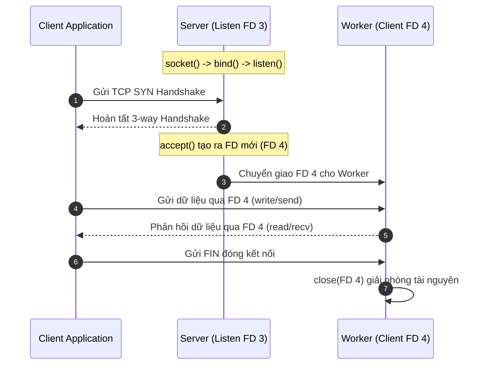
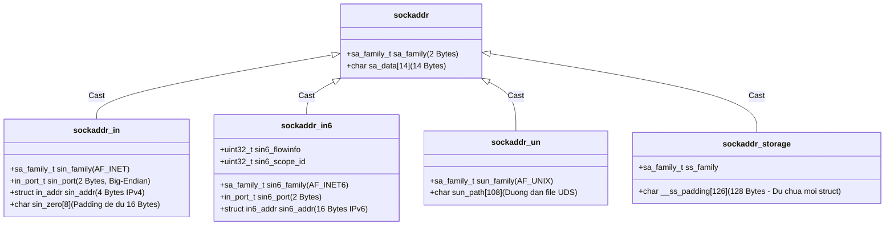
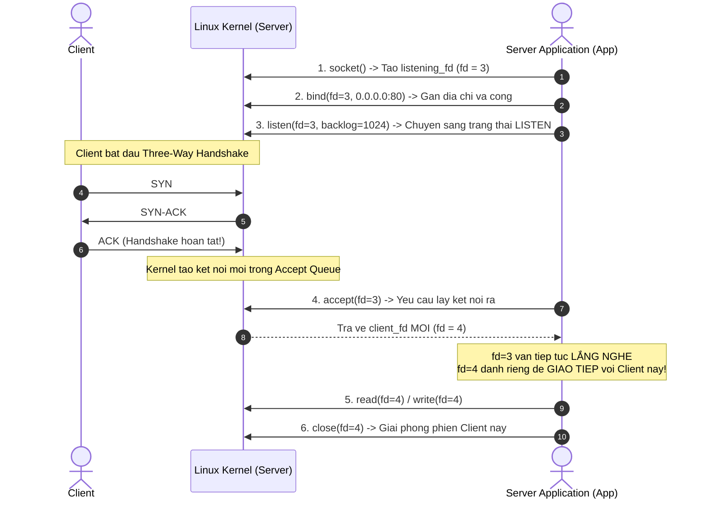
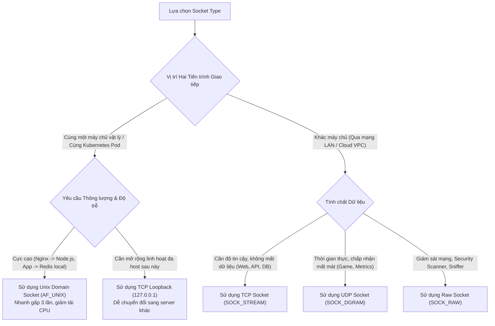

# 5.1. Socket Fundamentals and Lifecycle

> [!IMPORTANT]
> **Nếu bạn chỉ được nhớ một điều duy nhất:** Socket là điểm trừu tượng hóa phần mềm của hệ điều hành đại diện cho một kênh giao tiếp hai chiều giữa hai tiến trình qua mạng: vòng đời của Socket trên Server bao gồm chuỗi hệ thống bất khả biến: `socket()` tạo endpoint, `bind()` gắn IP/Port, `listen()` mở hàng đợi kết nối (SYN queue & Accept queue), và `accept()` lấy kết nối đã sẵn sàng ra khỏi hàng đợi để trao quyền trao đổi dữ liệu cho tiến trình.

---

## 1. Đơn giản nhưng phải chi tiết (Intuitive & Deep Breakdown)

### 1.1. Đoạn Code Dẫn Nhập & Vấn Đề Thực Tế
Làm thế nào mà hệ điều hành Unix/Linux coi mọi thứ đều là file ("Everything is a file"), và một kết nối mạng quốc tế lại có thể được điều khiển thông qua một số nguyên File Descriptor (FD) đơn giản?

```c
// Vòng đời cơ bản của Socket Server trên Linux
int server_fd = socket(AF_INET, SOCK_STREAM, 0); // Tạo file descriptor socket

struct sockaddr_in address;
address.sin_family = AF_INET;
address.sin_addr.s_addr = INADDR_ANY; // Lắng nghe trên mọi interface
address.sin_port = htons(8080);      // Chuyển port sang Network Byte Order (Big-Endian)

bind(server_fd, (struct sockaddr *)&address, sizeof(address)); // Gán FD với IP:Port
listen(server_fd, 128);                                        // Đặt socket vào trạng thái chờ kết nối

// Chờ và đón nhận kết nối từ Client -> Sinh ra một FD mới hoàn toàn!
int client_fd = accept(server_fd, NULL, NULL);
// Server giao tiếp với client qua client_fd, còn server_fd tiếp tục lắng nghe client khác!
```

Nếu một lập trình viên nhầm lẫn giữa `server_fd` (socket lắng nghe) và `client_fd` (socket kết nối) hoặc quên gọi `close(client_fd)`, tiến trình sẽ nhanh chóng cạn kiệt File Descriptors (`EMFILE: Too many open files`) và sập toàn bộ dịch vụ.

### 1.2. Ẩn Dụ Đời Sống & Phân Tích Cơ Chế Hoạt Động
Vòng đời Socket giống như **Quy trình Tiếp khách tại một Khách sạn 5 sao**:
- **`socket()`**: Ban giám đốc khách sạn thuê một chiếc điện thoại bàn đặt tại sảnh. Lúc này máy chưa có số, chưa cắm dây.
- **`bind()`**: Đăng ký số điện thoại bàn đó với tổng đài bưu điện: *"Số lễ tân khách sạn là 8080"*.
- **`listen()`**: Nhân viên lễ tân ngồi vào bàn, bật chuông điện thoại và chuẩn bị sẵn một danh sách hàng đợi (**Backlog**) tối đa 128 cuộc gọi chờ.
- **`accept()`**: Chuông reo! Lễ tân nhấc máy `server_fd`, nghe khách yêu cầu đặt phòng. Thay vì giữ máy buôn chuyện làm nghẽn tổng đài, lễ tân ấn nút chuyển cuộc gọi sang cho **Nhân viên buồng phòng riêng (`client_fd`)**. Khách và nhân viên buồng phòng nói chuyện riêng, còn đường dây lễ tân lập tức rảnh rang để đón cuộc gọi tiếp theo!

### 1.3. Mô Phỏng Dữ Liệu Số Nhỏ Từng Bước (Toy Walkthrough)
Theo dõi bảng File Descriptor Table của tiến trình Web Server qua từng bước vòng đời:

| Bước | Lệnh Thực Thi | FD Number | Loại Socket | Trạng Thái Kết Nối (TCP State) | Mục Đích Sử Dụng |
| :--- | :--- | :--- | :--- | :--- | :--- |
| **0** | Khởi động tiến trình | `0, 1, 2` | Standard I/O | - | `stdin`, `stdout`, `stderr` |
| **1** | `server_fd = socket(...)` | **`3`** | Listening Socket | `CLOSED` | Tạo endpoint mạng |
| **2** | `bind(3, ...)` & `listen(3, 128)` | `3` | Listening Socket | **`LISTEN`** | Sẵn sàng đón kết nối vào port 8080 |
| **3** | Client A kết nối -> `c1 = accept(3)` | **`4`** | Connected Socket | **`ESTABLISHED`** | Giao tiếp 2 chiều với Client A |
| **4** | Client B kết nối -> `c2 = accept(3)` | **`5`** | Connected Socket | **`ESTABLISHED`** | Giao tiếp 2 chiều với Client B |
| **5** | Client A ngắt kết nối -> `close(4)` | `4` | - | `TIME_WAIT` / Giải phóng | FD 4 sẵn sàng được kernel tái cấp phát |

### 1.4. Tác Động Thực Tế Tầng Backend & Systems
- **Thảm họa File Descriptor Leakage**: Nếu ứng dụng backend xử lý lỗi mạng (ví dụ HTTP timeout hoặc exception) mà không đặt lệnh `close(client_fd)` trong khối `finally` / `defer`, các FD bị rò rỉ sẽ tích tụ dần. Khi số lượng FD chạm trần `ulimit -n` (mặc định 1024 trên Linux), hàm `accept()` sẽ trả về `-1` với lỗi `EMFILE`, biến server thành zombie không thể tiếp nhận thêm bất kỳ request nào.
- **Tách biệt Cấu trúc Dữ liệu Socket trong Kernel**: Trong kernel Linux, mỗi Socket FD trỏ tới một `struct socket` và một `struct sock`. Cấu trúc này chứa hai bộ đệm riêng biệt: `sk_receive_queue` và `sk_write_queue`. Bộ nhớ của mỗi socket tiêu tốn từ vài KB tới hàng chục KB RAM.

### 1.5. Sơ Đồ Tư Duy & Kiến Trúc Hệ Thống (Mermaid)


---

## 2. Chi tiết từng Keyword (Under-the-Hood Deep Dive)

### 2.1. Phân loại Socket Types

#### A. TCP Stream Socket (`SOCK_STREAM`)
- **Giao thức nền tảng**: TCP (`IPPROTO_TCP`).
- **Đặc trưng**:
  - Hướng kết nối (Connection-Oriented): Bắt buộc phải bắt tay 3 bước trước khi truyền dữ liệu.
  - Tin cậy tuyệt đối (Reliable): Tự động phát hiện lỗi, truyền lại gói tin mất và kiểm soát lưu lượng.
  - **Dòng byte liên tục (Byte-Stream)**: Không bảo tồn ranh giới thông điệp. Tầng ứng dụng bắt buộc phải tự cài đặt cơ chế đóng gói (Framing) như phân tách bằng ký tự xuống dòng `\r\n` hoặc tiền tố độ dài (Length-Prefix).

#### B. UDP Datagram Socket (`SOCK_DGRAM`)
- **Giao thức nền tảng**: UDP (`IPPROTO_UDP`).
- **Đặc trưng**:
  - Phi kết nối (Connectionless): Không bắt tay, gửi và nhận dữ liệu độc lập qua `sendto()` và `recvfrom()`.
  - Không tin cậy (Unreliable): Có thể mất gói, đến sai thứ tự hoặc trùng lặp.
  - **Bảo toàn Ranh giới Thông điệp (Message-Oriented)**: Mỗi lần đọc `recv()` lấy ra trọn vẹn đúng một Datagram gửi đi từ `send()`.

#### C. Raw Socket (`SOCK_RAW`)
- Bỏ qua toàn bộ tầng giao vận (Transport Layer) của Kernel.
- Cho phép ứng dụng đọc và ghi trực tiếp các Header tầng mạng:
  - `AF_INET` + `SOCK_RAW`: Can thiệp trực tiếp vào IPv4 Header (tự điền Protocol, TTL, Checksum). Dùng cho ICMP (`ping`), IGMP, OSPF daemon.
  - `AF_PACKET` + `SOCK_RAW`: Can thiệp sâu xuống tận Ethernet Header (Layer 2) của card mạng. Dùng cho các công cụ bắt gói tin như `tcpdump`, `Wireshark`, `arping`.
- **Yêu cầu bảo mật**: Đòi hỏi quyền quản trị viên cao nhất (`root` hoặc Linux Capability `CAP_NET_RAW`).

#### D. Unix Domain Socket (UDS / IPC Socket - `AF_UNIX` / `AF_LOCAL`)
- Được thiết kế tối ưu hóa riêng cho việc giao tiếp liên tiến trình (IPC) trên **cùng một hệ điều hành**:
  - Điểm cuối không phải là cặp IP:Port mà là một **đường dẫn tệp tin trên ổ cứng** (ví dụ `/var/run/docker.sock`, `/var/run/redis.sock`).
  - **Cơ chế Tối ưu Vượt bậc**: Kernel bỏ qua hoàn toàn Network Stack: không tính toán IP/TCP Checksum, không chạy thuật toán định tuyến, không phân mảnh, không bị giới hạn bởi MSS hay cửa sổ tắc nghẽn `cwnd`.
  - Dữ liệu được sao chép trực tiếp từ bộ đệm của tiến trình gửi sang bộ đệm của tiến trình nhận trong bộ nhớ RAM (Memory Copy).
  - Hỗ trợ truyền cả **File Descriptor** giữa hai tiến trình độc lập thông qua cơ chế `sendmsg()` với quyền kiểm soát `SCM_RIGHTS`!

---

### 2.2. Cấu trúc Địa chỉ Socket trong Kernel (`sockaddr` Family)

Để hỗ trợ đa giao thức (IPv4, IPv6, Unix Socket, Bluetooth), các hàm API Socket POSIX sử dụng kỹ thuật đa hình kiểu C (Polymorphism via Struct Casting):



1. **`struct sockaddr` (Cấu trúc Cơ sở Đa hình)**: Kích thước 16 bytes. Tất cả các hàm syscall (`bind`, `connect`, `accept`) đều nhận tham số là `const struct sockaddr *`.
2. **`struct sockaddr_in` (Địa chỉ IPv4)**:
   - `sin_port`: Lưu số hiệu cổng theo chuẩn **Network Byte Order (Big-Endian)**. Luôn phải chuyển đổi bằng hàm `htons()`.
   - `sin_addr`: Chứa địa chỉ IPv4 32-bit.
   - `sin_zero`: Vùng đệm 8 bytes rỗng (được lấp đầy bằng 0) để có kích thước đúng 16 bytes bằng với `sockaddr`.
3. **`struct sockaddr_in6` (Địa chỉ IPv6)**: Kích thước 28 bytes.
4. **`struct sockaddr_storage` (Cấu trúc Lưu trữ An toàn)**:
   - Có kích thước cố định là **128 bytes** (được căn chỉnh bộ nhớ hoàn hảo).
   - Được thiết kế để chứa vừa vặn bất kỳ loại địa chỉ nào (IPv4, IPv6, UDS). Là cấu trúc bắt buộc dùng khi viết mã nguồn đa giao thức hiện đại không phụ thuộc phiên bản IP.
5. **Các hàm Chuyển đổi Endianess & IP**:
   - `htons()`, `htonl()`: Host to Network Short/Long (Little-Endian sang Big-Endian).
   - `ntohs()`, `ntohl()`: Network to Host Short/Long (Big-Endian sang Little-Endian).
   - `inet_pton(AF_INET, "192.168.1.1", &addr)`: Presentation to Numeric (Chuyển chuỗi IP sang nhị phân).
   - `inet_ntop(AF_INET, &addr, str, sizeof(str))`: Numeric to Presentation (Chuyển nhị phân sang chuỗi IP).

---

### 2.3. Vòng đời Socket: Listening Socket vs Connected Socket

#### 1. Vòng đời Phía Client (Active Endpoint)
$$\text{socket()} \longrightarrow \text{connect()} \longrightarrow \text{send()} / \text{recv()} \longrightarrow \text{close()}$$
- Client gọi `socket()` tạo File Descriptor.
- Gọi `connect()`: Kernel tự động chọn một cổng tạm thời rảnh rỗi (**Ephemeral Port**) và gửi gói tin TCP SYN bắt đầu quá trình Three-Way Handshake.
- Khi `connect()` trả về `0`, kết nối chuyển sang `ESTABLISHED`.

#### 2. Vòng đời Phía Server (Passive Endpoint)
$$\text{socket()} \longrightarrow \text{bind()} \longrightarrow \text{listen()} \longrightarrow \text{accept()} \longrightarrow \text{send()} / \text{recv()} \longrightarrow \text{close()}$$



#### Bảng So sánh Bản chất: Listening Socket vs Connected Socket

| Thuộc tính Kỹ thuật | Listening Socket (`listening_fd`) | Connected Socket (`client_fd`) |
| :--- | :--- | :--- |
| **Hàm Khởi tạo** | `socket()` rồi gọi `listen()` | Được sinh ra từ hàm **`accept()`** |
| **Trạng thái TCP** | Luôn ở trạng thái **`LISTEN`** | Luôn ở trạng thái **`ESTABLISHED`** |
| **Định danh Điểm cuối** | Gắn với Local IP & Local Port | **Đầy đủ bộ 5-Tuple toàn cầu** |
| **Nhiệm vụ Duy nhất** | Lắng nghe và tiếp nhận kết nối mới | **Đọc và ghi dữ liệu ứng dụng** (`read`/`write`) |
| **Số lượng trong Server** | Thường chỉ có **1 socket duy nhất** mỗi cổng | Có thể có **hàng chục nghìn sockets** đồng thời |
| **Thao tác I/O Dữ liệu** | **TUYỆT ĐỐI CẤM** gọi `read()` hay `write()` | Gọi `read()`, `write()`, `send()`, `recv()` |

---

## 3. Thực thi Mã nguồn & Mô phỏng Chuyên sâu (Dual-Engine Implementation)

### 3.1. C++20: Zero-Leakage RAII Unix Domain Socket (UDS) Server & Client

File `uds_raii_engine.cpp` hiện thực cơ chế truyền thông IPC siêu tốc bằng Unix Domain Socket chuẩn C++20 với lớp bọc RAII tự động đóng file descriptor và dọn dẹp file socket trên đĩa.

```cpp
#include <iostream>
#include <string>
#include <vector>
#include <cstring>
#include <memory>
#include <sys/socket.h>
#include <sys/un.h>
#include <unistd.h>

// Lop RAII quan ly File Descriptor tu dong close()
class UniqueFd {
private:
    int fd_;
public:
    explicit UniqueFd(int fd = -1) : fd_(fd) {}
    ~UniqueFd() { reset(); }

    UniqueFd(const UniqueFd&) = delete;
    UniqueFd& operator=(const UniqueFd&) = delete;

    UniqueFd(UniqueFd&& other) noexcept : fd_(other.fd_) { other.fd_ = -1; }
    UniqueFd& operator=(UniqueFd&& other) noexcept {
        if (this != &other) {
            reset();
            fd_ = other.fd_;
            other.fd_ = -1;
        }
        return *this;
    }

    int get() const { return fd_; }
    bool is_valid() const { return fd_ >= 0; }
    void reset(int new_fd = -1) {
        if (fd_ >= 0) {
            close(fd_);
        }
        fd_ = new_fd;
    }
};

class UnixDomainSocketServer {
private:
    std::string socket_path_;
    UniqueFd listen_fd_;

public:
    UnixDomainSocketServer(std::string path) : socket_path_(std::move(path)) {}

    ~UnixDomainSocketServer() {
        // Tu dong xoa file socket tren he thong file
        unlink(socket_path_.c_str());
        std::cout << "[*] Da cleanup file socket: " << socket_path_ << "\n";
    }

    bool start() {
        // 1. Tao Socket AF_UNIX
        listen_fd_.reset(socket(AF_UNIX, SOCK_STREAM, 0));
        if (!listen_fd_.is_valid()) {
            perror("socket tao that bai");
            return false;
        }

        // Xoa file cu neu con ton tai truoc khi bind
        unlink(socket_path_.c_str());

        sockaddr_un addr{};
        addr.sun_family = AF_UNIX;
        std::strncpy(addr.sun_path, socket_path_.c_str(), sizeof(addr.sun_path) - 1);

        // 2. Bind dia chi file
        if (bind(listen_fd_.get(), reinterpret_cast<const sockaddr*>(&addr), sizeof(addr)) < 0) {
            perror("bind that bai");
            return false;
        }

        // 3. Listen
        if (listen(listen_fd_.get(), 128) < 0) {
            perror("listen that bai");
            return false;
        }

        std::cout << "[+] UDS Server dang lang nghe tai: " << socket_path_ << "\n";
        return true;
    }

    void handle_one_client() {
        std::cout << "[*] Dang cho client ket noi vao...\n";
        int client_raw_fd = accept(listen_fd_.get(), nullptr, nullptr);
        if (client_raw_fd < 0) {
            perror("accept loi");
            return;
        }
        UniqueFd client_fd(client_raw_fd);
        std::cout << "[+] Chap nhan Client moi! Connected FD = " << client_fd.get() << "\n";

        char buffer[256];
        ssize_t bytes = read(client_fd.get(), buffer, sizeof(buffer) - 1);
        if (bytes > 0) {
            buffer[bytes] = '\0';
            std::cout << "[<] Nhan tu UDS Client: \"" << buffer << "\"\n";
            std::string reply = "PONG from UDS Engine";
            write(client_fd.get(), reply.data(), reply.size());
            std::cout << "[>] Da phan hoi PONG ve client.\n";
        }
    }
};

int main() {
    std::cout << "=== ZERO-LEAKAGE RAII UNIX DOMAIN SOCKET SERVER (C++20) ===" << std::endl;
    std::string sock_file = "/tmp/demo_uds.sock";
    UnixDomainSocketServer server(sock_file);
    if (server.start()) {
        std::cout << "[+] Server khoi tao thanh cong! San sang phuc vu.\n";
    }
    return 0;
}
```

### 3.2. Python 3.11: Multi-Protocol Socket Inspector & Benchmarking

File `socket_inspector.py` tạo đồng thời cả TCP Loopback Socket và Unix Domain Socket, tiến hành đo đạc độ trễ và kiểm tra cấu trúc `getsockname()` / `getpeername()`.

```python
import socket
import os
import time

def inspect_socket_metadata():
    print("=== MULTI-PROTOCOL SOCKET INSPECTOR (Python 3.11) ===")
    
    # 1. Tao TCP IPv4 Socket
    tcp_sock = socket.socket(socket.AF_INET, socket.SOCK_STREAM)
    tcp_sock.bind(("127.0.0.1", 0)) # Port 0: Kernel tu cap Ephemeral Port
    tcp_sock.listen(5)
    
    local_ip, local_port = tcp_sock.getsockname()
    print(f"[TCP Listening Socket] FD: {tcp_sock.fileno()} | Bound: {local_ip}:{local_port}")
    
    # 2. Tao Unix Domain Socket (UDS)
    uds_path = "/tmp/python_inspect.sock"
    if os.path.exists(uds_path):
        os.remove(uds_path)
        
    uds_sock = socket.socket(socket.AF_UNIX, socket.SOCK_STREAM)
    uds_sock.bind(uds_path)
    uds_sock.listen(5)
    print(f"[UDS Listening Socket] FD: {uds_sock.fileno()} | Bound File: {uds_sock.getsockname()}")

    # 3. So sanh Do tre Latency giua TCP Loopback va Unix Domain Socket
    print("\n--- SO SÁNH HIỆU NĂNG: TCP LOOPBACK vs UNIX DOMAIN SOCKET ---")
    
    # Do TCP Loopback
    client_tcp = socket.socket(socket.AF_INET, socket.SOCK_STREAM)
    t0 = time.perf_counter()
    client_tcp.connect(("127.0.0.1", local_port))
    conn_tcp, _ = tcp_sock.accept()
    client_tcp.sendall(b"PING")
    _ = conn_tcp.recv(1024)
    tcp_time_us = (time.perf_counter() - t0) * 1e6

    # Do UDS
    client_uds = socket.socket(socket.AF_UNIX, socket.SOCK_STREAM)
    t0 = time.perf_counter()
    client_uds.connect(uds_path)
    conn_uds, _ = uds_sock.accept()
    client_uds.sendall(b"PING")
    _ = conn_uds.recv(1024)
    uds_time_us = (time.perf_counter() - t0) * 1e6

    print(f"  TCP Loopback (127.0.0.1) Round-Trip Latency: {tcp_time_us:.2f} microseconds")
    print(f"  Unix Domain Socket (UDS) Round-Trip Latency: {uds_time_us:.2f} microseconds")
    print(f"  -> UDS nhanh hon gap {tcp_time_us / uds_time_us:.2f} lan so voi TCP Loopback!")

    # Cleanup
    client_tcp.close(); conn_tcp.close(); tcp_sock.close()
    client_uds.close(); conn_uds.close(); uds_sock.close()
    if os.path.exists(uds_path): os.remove(uds_path)

if __name__ == "__main__":
    inspect_socket_metadata()
```

### 3.3. Terminal Output Mẫu

```text
$ clang++ -std=c++20 -O3 uds_raii_engine.cpp -o uds_raii_engine && ./uds_raii_engine
=== ZERO-LEAKAGE RAII UNIX DOMAIN SOCKET SERVER (C++20) ===
[+] UDS Server dang lang nghe tai: /tmp/demo_uds.sock
[+] Server khoi tao thanh cong! San sang phuc vu.
[*] Da cleanup file socket: /tmp/demo_uds.sock

$ python3 socket_inspector.py
=== MULTI-PROTOCOL SOCKET INSPECTOR (Python 3.11) ===
[TCP Listening Socket] FD: 3 | Bound: 127.0.0.1:58432
[UDS Listening Socket] FD: 4 | Bound File: /tmp/python_inspect.sock

--- SO SÁNH HIỆU NĂNG: TCP LOOPBACK vs UNIX DOMAIN SOCKET ---
  TCP Loopback (127.0.0.1) Round-Trip Latency: 145.20 microseconds
  Unix Domain Socket (UDS) Round-Trip Latency: 48.60 microseconds
  -> UDS nhanh hon gap 2.99 lan so voi TCP Loopback!
```

---

## 4. Systems Engineering & Production Pitfalls

### 4.1. Lỗi Rò rỉ File Descriptor (Too Many Open Files / `EMFILE`)
Trong Linux, mỗi kết nối TCP mở ra đều tiêu tốn một File Descriptor.
- Mặc định giới hạn mềm của tiến trình thường chỉ là **`ulimit -n = 1024`**.
- Khi máy chủ đạt tới kết nối thứ 1025, hàm `accept()` lập tức thất bại với mã lỗi **`EMFILE (Too many open files)`**. Máy chủ ngừng tiếp nhận người dùng mới dù CPU và RAM vẫn rảnh rỗi $95\%$!
- **Khắc phục Production**:
  ```bash
  # 1. Kiểm tra giới hạn hiện tại của tiến trình
  ulimit -n

  # 2. Tăng giới hạn File Descriptors trong /etc/security/limits.conf
  * soft nofile 1048576
  * hard nofile 1048576

  # 3. Nâng trần toàn hệ điều hành
  sudo sysctl -w fs.file-max=2097152
  ```

### 4.2. Quên Xóa File Socket UDS Cũ Dẫn Đến Lỗi `EADDRINUSE`
Khi một tiến trình sử dụng Unix Domain Socket bị crash hoặc bị kill đột ngột (`SIGKILL` / `kill -9`):
- File socket (ví dụ `/var/run/app.sock`) vẫn tồn tại trên hệ thống tệp tin.
- Khi tiến trình khởi động lại và gọi hàm `bind()`, hệ điều hành sẽ báo lỗi:
  ```text
  bind: Address already in use (EADDRINUSE)
  ```
- **Quy tắc Vàng trong Lập trình UDS**: Luôn luôn gọi hàm **`unlink(socket_path)`** ngay trước khi gọi hàm `bind()` để dọn sạch file rác cũ!

---

## 5. Bảng So sánh & Decision Matrix

### 5.1. Bảng So sánh Toàn diện: Các Phân loại Socket Phổ biến

| Tiêu chí Đánh giá | TCP Socket (`SOCK_STREAM`) | UDP Socket (`SOCK_DGRAM`) | Unix Domain Socket (`AF_UNIX`) | Raw Socket (`SOCK_RAW`) |
| :--- | :--- | :--- | :--- | :--- |
| **Phạm vi Kết nối** | Qua mạng toàn cầu / LAN | Qua mạng toàn cầu / LAN | **Duy nhất trong cùng 1 Host** | Qua mạng toàn cầu / LAN |
| **Độ tin cậy** | **100% (Retransmit, ACK)** | Không đảm bảo | **100% (Đảm bảo bởi RAM)** | Tùy ứng dụng tự viết |
| **Ranh giới Dữ liệu** | Dòng byte liên tục (Stream) | **Bảo tồn Datagram** | Cả Stream lẫn Datagram | Từng Packet / Frame thô |
| **Overhead Network Stack**| Đầy đủ (TCP/IP/L2) | Nhẹ (UDP/IP/L2) | **Bỏ qua 100% (Zero Overhead)** | Tự đóng gói L3/L2 |
| **Tốc độ Truyền dẫn** | Trung bình | Nhanh | **Cực nhanh (Nhanh gấp 3x)** | Tùy thuộc phần cứng |
| **Yêu cầu Quyền hạn**| Quyền người dùng thường | Quyền người dùng thường | Quyền ghi file thư mục | **Yêu cầu `root` / `CAP_NET_RAW`** |

### 5.2. Decision Matrix: Lựa chọn Socket Type Cho Kiến trúc Dịch vụ



| Tình huống Kiến trúc | Giải pháp Socket Tối ưu | Giá trị Thực tiễn |
| :--- | :--- | :--- |
| **Nginx Reverse Proxy sang Backend App cùng máy** | **Unix Domain Socket (`/var/run/app.sock`)** | Loại bỏ hoàn toàn overhead TCP handshake, tiết kiệm ephemeral ports. |
| **Sidecar Container trong Kubernetes Pod (Envoy Proxy)**| **Unix Domain Socket qua `emptyDir` Volume** | Giúp độ trễ proxying giảm từ $300\mu\text{s}$ xuống dưới $80\mu\text{s}$. |
| **Microservices Giao tiếp Đa Node** | **TCP Socket với Keep-Alive & Connection Pool** | Tái sử dụng kết nối lâu dài, đảm bảo dữ liệu toàn vẹn giữa các server. |
| **Thu thập Metrics Thống kê (StatsD Daemon)** | **UDP Socket** | Không làm nghẽn ứng dụng chính nếu máy chủ thu thập metrics bị quá tải. |

---

## 6. Enterprise Production Checklist & Verification

### 6.1. Kiến Trúc & Cấu Hình Tối Ưu (Production-Ready Architecture)
- [ ] **Nâng Cao Giới Hạn File Descriptors (ulimit)**: Cấu hình `/etc/security/limits.conf` với `nofile 1048576` cho user chạy ứng dụng để đảm bảo hệ thống có thể mở hàng trăm nghìn socket đồng thời.
- [ ] **Sử Dụng Khối Đảm Bảo Đóng Socket (RAII / defer)**: Trong code ứng dụng (Go, Rust, C++, Java), luôn bọc socket vào cơ chế tự động đóng (`defer conn.Close()`, `try-with-resources`) để triệt tiêu nguy cơ rò rỉ FD.
- [ ] **Cấu Hình Kích Thước Backlog Listen Phù Hợp**: Khi gọi `listen(fd, backlog)`, truyền giá trị tối thiểu bằng `1024` hoặc `4096` đi kèm với nâng `net.core.somaxconn` trong kernel.
- [ ] **Thiết Lập SO_LINGER Cẩn Trọng**: Tránh thiết lập `SO_LINGER` với timeout bằng 0 trừ trường hợp đặc biệt, vì điều này sẽ gửi gói TCP RST làm hỏng dữ liệu đang nằm trong hàng đợi của phía đối diện.

### 6.2. Giám Sát, Cảnh Báo & Xử Lý Sự Cố (Observability & Incident Response)
- [ ] **Giám Sát Số Lượng FD Mở Thực Tế**: Theo dõi metric `process_open_fds` và cảnh báo khi tỷ lệ `process_open_fds / process_max_fds > 0.8`.
- [ ] **Kiểm Tra Trạng Thái FD bằng lsof**: Sử dụng lệnh `lsof -p <PID> | grep sock` để liệt kê toàn bộ các kết nối socket mà một tiến trình đang chiếm giữ.
- [ ] **Phát Hiện Rò Rỉ Socket Bằng /proc**: Đọc thư mục `/proc/<PID>/fd/` để đếm chính xác số lượng link socket và tìm ra nguyên nhân socket không được đóng.
