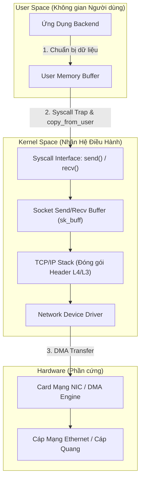
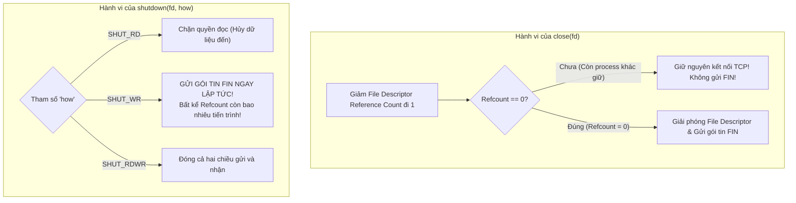
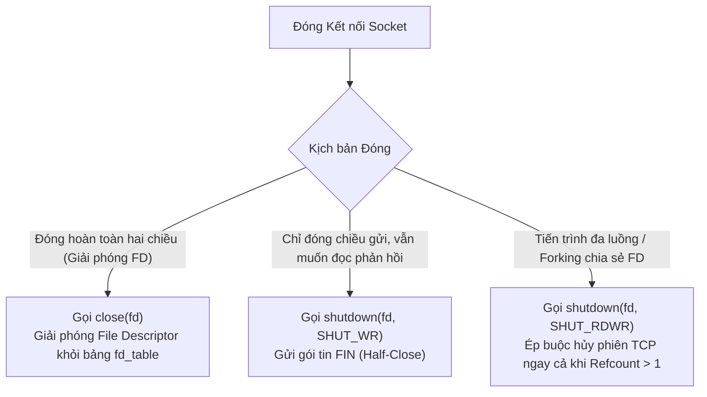

# 5.2. Socket API and Syscalls

> [!IMPORTANT]
> **Nếu bạn chỉ được nhớ một điều duy nhất:** Hiểu sâu về các tham số hàng đợi của Socket API giúp ngăn ngừa rớt kết nối bí ẩn trong mùa khuyến mãi: tham số `backlog` trong lời gọi `listen(fd, backlog)` quyết định độ sâu tối đa của hàng đợi kết nối đã hoàn tất bắt tay 3 bước (Accept Queue); khi hàng đợi này bị tràn (do tiến trình xử lý quá chậm), Kernel sẽ âm thầm thả rơi các gói SYN mới của khách hàng mà không hề gửi cảnh báo.

---

## 1. Đơn giản nhưng phải chi tiết (Intuitive & Deep Breakdown)

### 1.1. Đoạn Code Dẫn Nhập & Vấn Đề Thực Tế
Chuyện gì thực sự diễn ra khi một ứng dụng gọi hàm `send()` hoặc `recv()`? Liệu hàm `send()` có đẩy dữ liệu bay ngay lập tức qua dây cáp mạng sang máy bên kia hay không?

```c
// Lầm tưởng tai hại: Gửi dữ liệu qua mạng bằng send()
char buffer[1024] = "GET /index.html HTTP/1.1\r\n\r\n";
ssize_t bytes_sent = send(sockfd, buffer, strlen(buffer), 0);

// SỰ THẬT KỸ THUẬT:
// Hàm send() KHÔNG HỀ gửi dữ liệu tới máy nhận!
// Nó chỉ đơn thuần sao chép (memcpy) dữ liệu từ User Space vào Kernel Socket Send Buffer.
// Ngay khi copy xong vào RAM của nhân Linux, hàm send() trả về thành công tức thì!
```

Nếu một lập trình viên giả định `send()` trả về nghĩa là máy bên kia đã nhận được dữ liệu, họ sẽ viết sai toàn bộ logic ứng dụng: nếu mạng bị đứt ngay sau lệnh `send()`, dữ liệu trong bộ đệm kernel sẽ bị mất mà ứng dụng không hề hay biết!

### 1.2. Ẩn Dụ Đời Sống & Phân Tích Cơ Chế Hoạt Động
Các Syscalls Socket giống như **Quy trình Ký gửi Hàng hóa tại Bưu cục**:
- **`send()` / `write()`** giống như **Bỏ phong bì thư vào Hòm thư Bưu điện**:
  - Bạn thả thư vào khe hòm thư và quay gót ra về ngay lập tức. Hành động "thả vào hòm" chỉ mất 1 giây (`memcpy` vào Kernel Buffer).
  - Bưu tá khi nào gom đủ thư, xe tải bưu điện chạy lúc nào (cơ chế phân đoạn TCP, NIC ring buffer) là việc nội bộ của bưu điện, bạn không kiểm soát được.
- **`recv()` / `read()`** giống như **Mở Hộp thư nhà bạn xem có thư không**:
  - Nếu hộp thư trống: Bạn đứng tựa cửa ngóng người đưa thư (**Blocking IO** - luồng bị ngủ đóng băng).
  - Khi bưu tá thả 3 lá thư vào hộp: Bạn cầm cả 3 lá vào nhà đọc một lượt và tiếp tục làm việc.

### 1.3. Mô Phỏng Dữ Liệu Số Nhỏ Từng Bước (Toy Walkthrough)
Theo dõi dòng chảy dữ liệu qua ranh giới Không gian Người dùng (User Space) và Không gian Hạt nhân (Kernel Space) khi gọi `send(sockfd, data, 1000)`:

| Bước | Thực Thể Xử Lý | Vùng Nhớ / Tài Nguyên | Hành Động Kỹ Thuật | Trạng Thái Syscall |
| :--- | :--- | :--- | :--- | :--- |
| **1** | Tiến trình User | User Memory Buffer (`0x7ffd...`) | Chuẩn bị chuỗi 1,000 bytes trong Heap/Stack | Đang ở User Mode |
| **2** | CPU / Kernel Trap | Trap sang Ring 0 | Kích hoạt syscall `sys_sendto()` | Chuyển Context Switch |
| **3** | Linux Kernel | `sk_buff` / Socket Send Queue | Kiểm tra quyền FD, cấp phát `sk_buff` trong RAM kernel | Kernel Mode |
| **4** | Linux Kernel | Kernel Space | Thực thi **`copy_from_user()`** (Copy 1,000 bytes từ RAM User sang Kernel) | Tốn chu kỳ CPU RAM |
| **5** | CPU / Return | Trả về User Mode | Trả về số byte copy thành công: `1000` | **Hàm send() kết thúc!** |
| **6** | Network Driver (Chạy ngầm) | NIC Ring Buffer / DMA | Driver cấu hình DMA đẩy `sk_buff` ra chip mạng truyền lên cáp quang | Bất đồng bộ ngầm |

### 1.4. Tác Động Thực Tế Tầng Backend & Systems
- **Chi phí Copy Dữ liệu Kép (Data Copy Overhead)**: Trong một chu kỳ mạng thông thường, dữ liệu bị copy tới 4 lần (Disk -> Kernel -> User -> Kernel -> NIC) cùng 4 lần Context Switch. Với server truyền file 10 Gbps, CPU bị nghẽn 100% chỉ để copy RAM!
  - *Giải pháp tối ưu*: Dùng syscall **`sendfile()`** hoặc **`splice()`** (Zero-Copy) để kernel đẩy thẳng dữ liệu từ đĩa cứng sang card mạng mà không đi qua User Space.
- **Hiện tượng Partial Read / Partial Write**: Trên mạng stream TCP, hàm `send()` hoặc `recv()` có thể trả về số byte nhỏ hơn số byte bạn yêu cầu (ví dụ yêu cầu gửi 1000 bytes nhưng chỉ gửi được 350 bytes do buffer đầy). Ứng dụng bắt buộc phải viết vòng lặp kiểm tra và xử lý byte còn lại.

### 1.5. Sơ Đồ Tư Duy & Kiến Trúc Hệ Thống (Mermaid)


---

## 2. Chi tiết từng Keyword (Under-the-Hood Deep Dive)

### 2.1. Luồng Khởi tạo và Thiết lập Kết nối

#### A. `int socket(int domain, int type, int protocol)`
- **`domain` (Gia đình giao thức)**:
  - `AF_INET`: Mạng IPv4 (32-bit).
  - `AF_INET6`: Mạng IPv6 (128-bit).
  - `AF_UNIX` / `AF_LOCAL`: Unix Domain Socket (giao tiếp nội bộ cực nhanh).
- **`type` (Kiểu socket)**:
  - `SOCK_STREAM`: Dòng byte tin cậy hai chiều (TCP).
  - `SOCK_DGRAM`: Khối thông điệp không tin cậy (UDP).
  - Có thể kết hợp bitwise với các cờ hiện đại: `SOCK_NONBLOCK` (đặt non-blocking ngay khi tạo) và `SOCK_CLOEXEC` (tự động đóng khi tiến trình gọi `execve()`, chống rò rỉ socket sang tiến trình con).
- **`protocol`**: Thường đặt bằng `0` để Kernel tự chọn giao thức mặc định tương ứng với domain và type.

#### B. `int bind(int sockfd, const struct sockaddr *addr, socklen_t addrlen)`
- Gán một địa chỉ cục bộ (Local IP) và số hiệu cổng (Port) cho socket.
- Nếu Server gán `INADDR_ANY` (`0.0.0.0`), socket sẽ lắng nghe trên **tất cả các card mạng vật lý và ảo** của máy chủ.
- Nếu gán số cổng là `0`, Kernel sẽ tự động cấp phát ngẫu nhiên một cổng rảnh rỗi trong dải Ephemeral Port.

#### C. `int listen(int sockfd, int backlog)`
- Chuyển socket từ chế độ chủ động (Active) sang chế độ thụ động (Passive Listening).
- **`backlog`**: Xác định kích thước tối đa của hàng đợi kết nối đã hoàn thành bắt tay nhưng chưa được ứng dụng gọi `accept()` (**Accept Queue**). Thực tế giá trị này bị chặn trên bởi sysctl `net.core.somaxconn`.

#### D. `int accept(int sockfd, struct sockaddr *addr, socklen_t *addrlen)`
- Nhấc kết nối đầu tiên ra khỏi Accept Queue của Listening Socket.
- **Trả về**: Một **File Descriptor mới hoàn toàn (`conn_fd`)** đại diện cho kênh truyền dữ liệu độc lập với client đó.
- Cấu trúc `addr` và `addrlen` được Kernel điền thông tin IP và Port của Client vừa kết nối tới.
- Biến thể Linux hiện đại: **`accept4()`** cho phép truyền trực tiếp cờ `SOCK_NONBLOCK` và `SOCK_CLOEXEC` cho socket mới mà không cần tốn thêm syscall `fcntl()`.

#### E. `int connect(int sockfd, const struct sockaddr *addr, socklen_t addrlen)`
- Phía Client gọi hàm này để kích hoạt Kernel gửi gói tin TCP SYN tới Server.
- Nếu socket ở chế độ Blocking, hàm sẽ dừng chờ cho tới khi Three-Way Handshake hoàn tất (hoặc timeout sau khoảng 75 giây nếu server không phản hồi).
- **Kỹ thuật Non-Blocking Asynchronous Connect**:
  - Khi socket được gán cờ `O_NONBLOCK`, hàm `connect()` sẽ quay trở về ngay lập tức với mã lỗi **`EINPROGRESS`**.
  - Lúc này, kernel đang chạy ngầm quá trình bắt tay 3 bước ở phía dưới.
  - Ứng dụng đưa file descriptor vào `epoll()` hoặc `select()` để lắng nghe sự kiện ghi (**`EPOLLOUT`**).
  - Khi `epoll_wait()` báo socket sẵn sàng ghi, lập trình viên bắt buộc phải kiểm tra xem kết nối thực sự thành công hay bị từ chối bằng hàm `getsockopt()`:
    ```cpp
    int error = 0;
    socklen_t len = sizeof(error);
    getsockopt(sockfd, SOL_SOCKET, SO_ERROR, &error, &len);
    if (error != 0) {
        // Ket noi that bai (vi du ECONNREFUSED)
    }
    ```
  - Đây là nền tảng cốt lõi của mọi HTTP client không đồng bộ trong Node.js, Go và Nginx.

---

### 2.2. Luồng Truyền nhận Dữ liệu

#### A. `send()` / `write()` vs `recv()` / `read()` (Cho TCP Stream)
- Về cơ bản, `write(fd, buf, len)` tương đương với `send(fd, buf, len, 0)`.
- Tuy nhiên, `send()` và `recv()` cung cấp thêm tham số **`flags`** vô cùng mạnh mẽ:
  - **`MSG_NOSIGNAL`**: Yêu cầu Kernel không phát tín hiệu `SIGPIPE` nếu kết nối bị đứt gãy giữa chừng, mà chỉ trả về mã lỗi `EPIPE`. **Đây là cờ bắt buộc phải có trong mọi hàm `send()` trên Linux!**
  - **`MSG_DONTWAIT`**: Thực hiện thao tác I/O ở chế độ non-blocking chỉ riêng cho lần gọi này mà không cần sửa cấu hình socket.
  - **`MSG_PEEK`**: Đọc dữ liệu từ Socket Receive Buffer để kiểm tra nhưng **không xóa dữ liệu khỏi bộ đệm**, cho phép các lần đọc sau đọc lại y nguyên dữ liệu đó.
  - **`MSG_WAITALL`**: Yêu cầu hàm `recv()` chỉ trả về khi đã đọc đủ chính xác số bytes yêu cầu trong tham số `len`, trừ khi gặp lỗi hoặc kết nối bị đóng.

#### B. `sendto()` vs `recvfrom()` (Cho UDP Datagram)
- Do UDP là giao thức phi kết nối, mỗi lần truyền nhận đều phải chỉ định rõ hoặc tiếp nhận địa chỉ của đối tác:
  - `sendto(..., const struct sockaddr *dest_addr, ...)`
  - `recvfrom(..., struct sockaddr *src_addr, ...)`

---

### 2.3. Đóng và Giải phóng Kết nối: `shutdown()` vs `close()`

Đây là một trong những điểm khác biệt tinh tế nhất giữa mức File Descriptor và mức Giao thức TCP:



1. **`close(fd)`**:
   - Hoạt động ở tầng **VFS / File Descriptor**.
   - Khi một tiến trình gọi `fork()`, cả tiến trình cha và con đều sở hữu một FD trỏ tới cùng một `struct file` trong Kernel (Refcount = 2).
   - Nếu tiến trình cha gọi `close()`, Refcount giảm xuống 1. **TCP Connection vẫn giữ nguyên ở trạng thái ESTABLISHED, không hề có gói FIN nào được gửi đi!**
   - Chỉ khi tiến trình con cũng gọi `close()` (Refcount = 0), Kernel mới thực sự giải phóng socket và gửi FIN.
2. **`shutdown(fd, how)`**:
   - Hoạt động trực tiếp ở tầng **Giao thức TCP (Layer 4)**.
   - Bất kể Refcount của socket là bao nhiêu, gọi `shutdown(fd, SHUT_WR)` sẽ **ngay lập tức kích hoạt TCP gửi gói tin FIN** tới máy đích!
   - Hỗ trợ cơ chế **Đóng một nửa (Half-Close)**: Ứng dụng gửi xong dữ liệu có thể gọi `shutdown(fd, SHUT_WR)` để báo cho đối phương biết mình đã hết dữ liệu, nhưng vẫn có thể tiếp tục dùng `read()` để nhận dữ liệu phản hồi quay về!

---

### 2.4. Cấu hình Tham số Socket: `setsockopt()` và `getsockopt()`

Cú pháp chuẩn POSIX:
```c
int setsockopt(int sockfd, int level, int optname, const void *optval, socklen_t optlen);
int getsockopt(int sockfd, int level, int optname, void *optval, socklen_t *optlen);
```

#### Các Cấp độ (`level`) Thường Gặp:
1. **`SOL_SOCKET` (Mức Socket Cơ bản)**:
   - `SO_REUSEADDR`: Cho phép bind lại cổng ngay cả khi cổng đó đang nằm trong trạng thái `TIME_WAIT`.
   - `SO_REUSEPORT`: Cho phép nhiều tiến trình độc lập cùng bind vào cùng một cổng để phân tải lưu lượng (Kernel tự cân bằng tải).
   - `SO_RCVTIMEO` & `SO_SNDTIMEO`: Thiết lập timeout tối đa cho các thao tác đọc và ghi dữ liệu trên Blocking Socket.
   - `SO_KEEPALIVE`: Kích hoạt cơ chế gửi gói tin TCP Keep-Alive định kỳ để phát hiện kết nối chết.
2. **`IPPROTO_TCP` (Mức Giao thức TCP)**:
   - `TCP_NODELAY`: Vô hiệu hóa thuật toán Nagle.
   - `TCP_MAXSEG`: Giới hạn kích thước MSS tối đa cho kết nối này.

---

### 2.5. Phân giải Địa chỉ Hiện đại: `getaddrinfo()`

Các hàm phân giải cổ điển như `gethostbyname()` hay `inet_aton()` đã bị khai tử vì **không an toàn với đa luồng (Not Thread-Safe)** và **không hỗ trợ IPv6**.
- **`getaddrinfo()` (RFC 3493)** là giải pháp tiêu chuẩn hóa quốc tế:
  - Hỗ trợ phân giải tên miền (DNS) và tên dịch vụ (`http`, `ssh`) thành một **Danh sách liên kết (Linked List)** các cấu trúc `struct addrinfo`.
  - Tự động trừu tượng hóa hoàn toàn giữa IPv4 và IPv6: Lập trình viên chỉ cần duyệt qua danh sách liên kết và thử gọi `socket()` + `connect()` cho tới khi thành công.
  - Bắt buộc phải giải phóng danh sách bộ nhớ này bằng hàm **`freeaddrinfo()`** sau khi dùng xong để tránh rò rỉ RAM!

---

## 3. Thực thi Mã nguồn & Mô phỏng Chuyên sâu (Dual-Engine Implementation)

### 3.1. C++20: Robust Protocol-Independent TCP Client với `getaddrinfo()` & RAII

File `tcp_client_modern.cpp` hiện thực một TCP Client chuẩn công nghiệp, tự động thích ứng với cả IPv4 và IPv6 thông qua `getaddrinfo()`, phòng chống tín hiệu `SIGPIPE` bằng `MSG_NOSIGNAL` và thực thi cơ chế Half-Close qua `shutdown()`.

```cpp
#include <iostream>
#include <string>
#include <vector>
#include <cstring>
#include <sys/types.h>
#include <sys/socket.h>
#include <netdb.h>
#include <unistd.h>
#include <arpa/inet.h>

class ModernTCPClient {
private:
    int sockfd_;

public:
    ModernTCPClient() : sockfd_(-1) {}

    ~ModernTCPClient() {
        if (sockfd_ >= 0) {
            close(sockfd_);
            std::cout << "[*] Socket FD " << sockfd_ << " da duoc dong an toan.\n";
        }
    }

    bool connect_to_host(const std::string& host, const std::string& port_str) {
        addrinfo hints{};
        hints.ai_family = AF_UNSPEC;     // Cho phep ca IPv4 va IPv6
        hints.ai_socktype = SOCK_STREAM; // TCP Stream Socket

        addrinfo* result_list = nullptr;
        int status = getaddrinfo(host.c_str(), port_str.c_str(), &hints, &result_list);
        if (status != 0) {
            std::cerr << "[!] getaddrinfo loi: " << gai_strerror(status) << "\n";
            return false;
        }

        // Duyet qua danh sach lien ket de tim dia chi ket noi thanh cong dau tien
        addrinfo* rp = nullptr;
        for (rp = result_list; rp != nullptr; rp = rp->ai_next) {
            sockfd_ = socket(rp->ai_family, rp->ai_socktype, rp->ai_protocol);
            if (sockfd_ < 0) continue;

            // In thong tin dia chi dang thu nghiem
            char ip_str[INET6_ADDRSTRLEN];
            void* raw_addr = nullptr;
            if (rp->ai_family == AF_INET) {
                raw_addr = &reinterpret_cast<sockaddr_in*>(rp->ai_addr)->sin_addr;
            } else {
                raw_addr = &reinterpret_cast<sockaddr_in6*>(rp->ai_addr)->sin6_addr;
            }
            inet_ntop(rp->ai_family, raw_addr, ip_str, sizeof(ip_str));
            std::cout << "[*] Dang thu ket noi toi: " << ip_str << " (Protocol Family: " 
                      << (rp->ai_family == AF_INET ? "IPv4" : "IPv6") << ")...\n";

            if (connect(sockfd_, rp->ai_addr, rp->ai_addrlen) == 0) {
                std::cout << "[+] Ket noi thanh cong toi " << host << ":" << port_str << "!\n";
                break; // Thanh cong!
            }

            close(sockfd_);
            sockfd_ = -1;
        }

        freeaddrinfo(result_list); // Giai phong RAM bat buoc!
        return sockfd_ >= 0;
    }

    bool send_data_safely(const std::string& data) {
        if (sockfd_ < 0) return false;

        // Su dung co MSG_NOSIGNAL de chong crash boi tin hieu SIGPIPE
        ssize_t sent = send(sockfd_, data.data(), data.size(), MSG_NOSIGNAL);
        if (sent < 0) {
            perror("[!] send that bai (Co the broken pipe)");
            return false;
        }
        std::cout << "[>] Da gui an toan " << sent << " bytes du lieu.\n";
        return true;
    }

    void perform_half_close() {
        if (sockfd_ >= 0) {
            // Gui goi tin FIN bao het du lieu nhung van giu kenh doc
            shutdown(sockfd_, SHUT_WR);
            std::cout << "[*] Da thuc hien Half-Close (SHUT_WR): FIN da duoc phat di.\n";
        }
    }
};

int main() {
    std::cout << "=== PROTOCOL-INDEPENDENT ROBUST TCP CLIENT (C++20) ===" << std::endl;
    ModernTCPClient client;
    // Thu nghiem phan giai va ket noi toi DNS 1.1.1.1 port 80 (Cloudflare)
    if (client.connect_to_host("1.1.1.1", "80")) {
        std::string http_req = "HEAD / HTTP/1.1\r\nHost: 1.1.1.1\r\nConnection: close\r\n\r\n";
        client.send_data_safely(http_req);
        client.perform_half_close();
    }
    return 0;
}
```

### 3.2. Python 3.11: Syscall Behavior & Partial Read/Write Simulator

File `syscall_simulator.py` mô phỏng hành vi của các syscall tầng mạng: hiện tượng Partial Writes (chỉ ghi được một phần bộ đệm), phát hiện EOF khi nhận `0` byte, và cơ chế bắt tín hiệu `BrokenPipeError` (tương đương `SIGPIPE`).

```python
import socket
import sys

class SocketBehaviorSimulator:
    """Mo phong hanh vi thuc te cua cac Socket Syscall POSIX."""

    @staticmethod
    def demonstrate_partial_write_loop(sock: socket.socket, large_data: bytes):
        """Hien thuc vong lap ghi du lieu bao toan Partial Writes."""
        total_sent = 0
        total_bytes = len(large_data)
        print(f"\n[*] Bat dau truyen {total_bytes:,} bytes qua socket:")

        while total_sent < total_bytes:
            # Syscall write() / send() co the chi gui duoc mot phan nho (Partial Write)
            # vi Socket Send Buffer trong Kernel bi day!
            sent = sock.send(large_data[total_sent:])
            if sent == 0:
                raise RuntimeError("Ket noi socket bi ngat giua chung!")
            total_sent += sent
            print(f"    -> Syscall send() day thanh cong: {sent:,} bytes (Tich luy: {total_sent:,}/{total_bytes:,}B)")

        print("[+] Hoan tat gui 100% du lieu khong bi mat byte nao!")

    @staticmethod
    def demonstrate_eof_detection(sock: socket.socket):
        """Minh hoa phat hien dong ket noi (EOF) khi recv() tra ve b''."""
        print("\n[*] Dang doc du lieu tu Server:")
        while True:
            chunk = sock.recv(1024)
            if not chunk: # Tuong duong recv() tra ve 0 byte trong C
                print("[<] [EOF DETECTED] recv() tra ve 0 byte -> Phia ben kia da gui FIN de dong ket noi!")
                break
            print(f"[<] Nhan {len(chunk)} bytes: {chunk[:40]}...")

if __name__ == "__main__":
    print("=== SOCKET SYSCALL BEHAVIOR & INTEGRITY DEMO (Python 3.11) ===")
    
    # Tao cap socket cuc bo de mo phong
    server_sock = socket.socket(socket.AF_INET, socket.SOCK_STREAM)
    server_sock.bind(("127.0.0.1", 0))
    server_sock.listen(1)
    port = server_sock.getsockname()[1]

    client_sock = socket.socket(socket.AF_INET, socket.SOCK_STREAM)
    client_sock.connect(("127.0.0.1", port))
    conn, _ = server_sock.accept()

    # Thu nghiem 1: Gui du lieu
    sample_payload = b"X" * (500 * 1024) # 500 KB du lieu
    SocketBehaviorSimulator.demonstrate_partial_write_loop(client_sock, sample_payload)

    # Thu nghiem 2: Server gui shutdown(SHUT_WR) de phat FIN
    print("\n[*] Server thuc hien shutdown(SHUT_WR)...")
    conn.shutdown(socket.SHUT_WR)
    SocketBehaviorSimulator.demonstrate_eof_detection(client_sock)

    # Cleanup
    client_sock.close()
    conn.close()
    server_sock.close()
```

### 3.3. Terminal Output Mẫu

```text
$ clang++ -std=c++20 -O3 tcp_client_modern.cpp -o tcp_client_modern && ./tcp_client_modern
=== PROTOCOL-INDEPENDENT ROBUST TCP CLIENT (C++20) ===
[*] Dang thu ket noi toi: 1.1.1.1 (Protocol Family: IPv4)...
[+] Ket noi thanh cong toi 1.1.1.1:80!
[>] Da gui an toan 55 bytes du lieu.
[*] Da thuc hien Half-Close (SHUT_WR): FIN da duoc phat di.
[*] Socket FD 3 da duoc dong an toan.

$ python3 syscall_simulator.py
=== SOCKET SYSCALL BEHAVIOR & INTEGRITY DEMO (Python 3.11) ===

[*] Bat dau truyen 512,000 bytes qua socket:
    -> Syscall send() day thanh cong: 131,072 bytes (Tich luy: 131,072/512,000B)
    -> Syscall send() day thanh cong: 131,072 bytes (Tich luy: 262,144/512,000B)
    -> Syscall send() day thanh cong: 131,072 bytes (Tich luy: 393,216/512,000B)
    -> Syscall send() day thanh cong: 118,784 bytes (Tich luy: 512,000/512,000B)
[+] Hoan tat gui 100% du lieu khong bi mat byte nao!

[*] Server thuc hien shutdown(SHUT_WR)...

[*] Dang doc du lieu tu Server:
[<] [EOF DETECTED] recv() tra ve 0 byte -> Phia ben kia da gui FIN de dong ket noi!
```

---

## 4. Systems Engineering & Production Pitfalls

### 4.1. Thảm họa Sập Tiến trình bởi Tín hiệu `SIGPIPE`
Khi một client đột ngột ngắt kết nối (ví dụ người dùng tắt trình duyệt hoặc rút dây mạng), Kernel của máy khách gửi gói tin `RST` về server.
- Nếu server không hay biết và tiếp tục gọi syscall `write()` hoặc `send()` vào File Descriptor đó:
  1. Lần ghi đầu tiên: Kernel trả về mã lỗi thông thường `EPIPE`.
  2. Lần ghi thứ hai liên tiếp: Linux Kernel lập tức phát tín hiệu **`SIGPIPE`** tới tiến trình.
- Do hành vi mặc định của `SIGPIPE` trong Unix là **Hủy diệt tiến trình (Terminate Process)**, ứng dụng backend (Node.js, Go, Python, C++) sẽ **bị crash ngay lập tức mà không để lại bất kỳ dòng log hay stack trace nào**!
- **Biện pháp Phòng vệ Bắt buộc**:
  ```cpp
  // Cách 1: Bỏ qua tín hiệu SIGPIPE trên toàn tiến trình khi khởi động
  signal(SIGPIPE, SIG_IGN);

  // Cách 2: Luôn truyền cờ MSG_NOSIGNAL trong mọi hàm send()
  send(sockfd, buffer, len, MSG_NOSIGNAL);
  ```

### 4.2. Xử lý Hiện tượng Partial Read & Partial Write trên TCP Stream
- Khác với UDP, **TCP là một dòng byte không có ranh giới**. Khi bạn gọi `send(fd, buf, 10000)`, Kernel có thể chỉ ghi được 2048 bytes vào bộ đệm do Socket Send Buffer bị đầy.
- Tương tự, khi gọi `recv(fd, buf, 10000)`, bạn hoàn toàn có thể chỉ nhận được 100 bytes dữ liệu đầu tiên.
- **Lỗi ngây thơ**: Nhiều lập trình viên giả định rằng gọi `send(1000)` là đi đủ 1000 bytes, dẫn đến dữ liệu bị cụt đuôi hoặc hỏng giao thức.
- **Chuẩn mực**: Bắt buộc phải bọc thao tác đọc/ghi trong vòng lặp `while` kiểm tra số byte tích lũy cho tới khi đủ kích thước mong muốn!

### 4.3. Nghẽn Luồng (Thread Pool Starvation) do `getaddrinfo()` Đồng bộ
Trong chuẩn POSIX, hàm `getaddrinfo()` là một **lệnh gọi hàm đồng bộ (Synchronous / Blocking Syscall)**, không thể tích hợp trực tiếp vào vòng lặp sự kiện `epoll`:
- Các runtime bất đồng bộ (như Node.js qua thư viện `libuv`, Python `asyncio`, Go net runtime) buộc phải đẩy tác vụ `getaddrinfo()` sang một Thread Pool phụ chạy ngầm (`UV_THREADPOOL_SIZE` mặc định trong Node.js chỉ có **4 threads**!).
- Nếu ứng dụng gọi hàng trăm HTTP requests đồng thời tới các tên miền chưa được cache, toàn bộ 4 thread này sẽ bị tắc nghẽn chờ phản hồi DNS, khiến toàn bộ các tác vụ đọc ghi file ổ đĩa (`fs.readFile`) và mã hóa (`crypto`) bị đóng băng theo!
- **Khắc phục Production**: Nâng kích thước `UV_THREADPOOL_SIZE=64` hoặc sử dụng các thư viện DNS phân giải thuần Asynchronous không phụ thuộc hệ điều hành (như C-Ares).

### 4.4. Các lệnh CLI Giám sát và Tracing Syscall Mạng

```bash
# 1. Bắt và theo dõi toàn bộ các syscall mạng của một tiến trình đang chạy
sudo strace -p <PID> -e trace=network -s 256

# 2. Xem chi tiết các File Descriptors socket của tiến trình
ls -l /proc/<PID>/fd

# 3. Tra cứu socket kết nối tương ứng với FD trong kernel
ss -t -a -p | grep <PID>
```

---

## 5. Bảng So sánh & Decision Matrix

### 5.1. Bảng So sánh: Các Syscall Truyền Nhận Dữ liệu trong Linux

| Syscall | Thích hợp cho | Hỗ trợ Flags | Nhận/Ghi Địa chỉ Đối tác | Hành vi Đặc thù |
| :--- | :--- | :---: | :---: | :--- |
| **`read()` / `write()`** | TCP Stream / File chung | Không | Không | Syscall chuẩn POSIX VFS, không có tùy chỉnh cờ mạng. |
| **`recv()` / `send()`** | **TCP Stream Chuyên dụng** | **Có** | Không | Cho phép truyền **`MSG_NOSIGNAL`**, `MSG_PEEK`, `MSG_DONTWAIT`. |
| **`recvfrom()` / `sendto()`** | **UDP Datagram** | **Có** | **Có** | Bắt buộc truyền `sockaddr` để biết đích đến từng gói tin. |
| **`recvmsg()` / `sendmsg()`** | Mạng Phức hợp / UDS | **Có** | **Có** | Hỗ trợ Scatter/Gather I/O (`iovec`) và **truyền File Descriptor** (`SCM_RIGHTS`). |

### 5.2. Decision Matrix: Cơ chế Đóng và Chấm dứt Kết nối Socket



| Tình huống Kiến trúc | Giải pháp Khuyên dùng | Lý do & Khuyến nghị |
| :--- | :--- | :--- |
| **HTTP/1.1 Client gửi Request xong** | **`shutdown(fd, SHUT_WR)`** | Báo cho Web Server biết đã hết body, chuyển sang chờ nhận response. |
| **Xử lý Xong Phiên Client trong Worker** | **`close(conn_fd)`** | Giải phóng tài nguyên kernel và trả File Descriptor về pool hệ điều hành. |
| **Multi-Process Server (Master - Worker `fork()`)** | **`close()` socket lắng nghe trong con, đóng socket client trong cha** | Đảm bảo refcount giảm về 0 đúng thời điểm, tránh rò rỉ socket mở. |

---

## 6. Enterprise Production Checklist & Verification

### 6.1. Kiến Trúc & Cấu Hình Tối Ưu (Production-Ready Architecture)
- [ ] **Xử Lý Triệt Để Partial Send/Recv**: Luôn bọc hàm `send()` và `recv()` trong vòng lặp kiểm tra giá trị trả về cho tới khi toàn bộ chuỗi byte được truyền hết hoặc gặp lỗi thực sự.
- [ ] **Áp Dụng Zero-Copy với sendfile()**: Đối với các Web Server truyền tải file tĩnh dung lượng lớn (Nginx, Caddy), kích hoạt tính năng `sendfile on;` để loại bỏ chi phí context switch và bộ nhớ đệm user.
- [ ] **Kiểm Tra Mã Lỗi Khôi Phục (EAGAIN / EWOULDBLOCK)**: Trên Non-blocking socket, khi nhận mã lỗi `EAGAIN` hoặc `EINTR`, ứng dụng phải quay lại vòng lặp chờ sự kiện thay vì coi đó là sự cố rớt mạng.
- [ ] **Tối Ưu Hóa Kích Thước Batch I/O**: Sử dụng các syscall mở rộng như `sendmmsg()` và `recvmmsg()` để gửi/nhận hàng loạt gói tin UDP trong 1 lần syscall duy nhất, giảm thiểu context switch.

### 6.2. Giám Sát, Cảnh Báo & Xử Lý Sự Cố (Observability & Incident Response)
- [ ] **Đo Lường Tỷ Lệ Context Switch**: Sử dụng lệnh `vmstat 1` để theo dõi cột `cs` (Context Switches); nếu `cs` vượt quá 150,000 lần/giây, hệ thống đang bị lạm dụng quá nhiều syscall mạng nhỏ.
- [ ] **Soi Lỗi Socket Syscall Bằng strace**: Khi socket bị treo bí ẩn, dùng lệnh `strace -p <PID> -e trace=network` để thấy chính xác tham số và mã lỗi trả về của từng lệnh `read`, `write`, `poll`.
- [ ] **Theo Dõi Vùng Nhớ Socket Kernel**: Đọc file `/proc/net/sockstat` để giám sát số lượng socket đang dùng bộ nhớ và kích thước RAM kernel cấp phát cho buffer.
