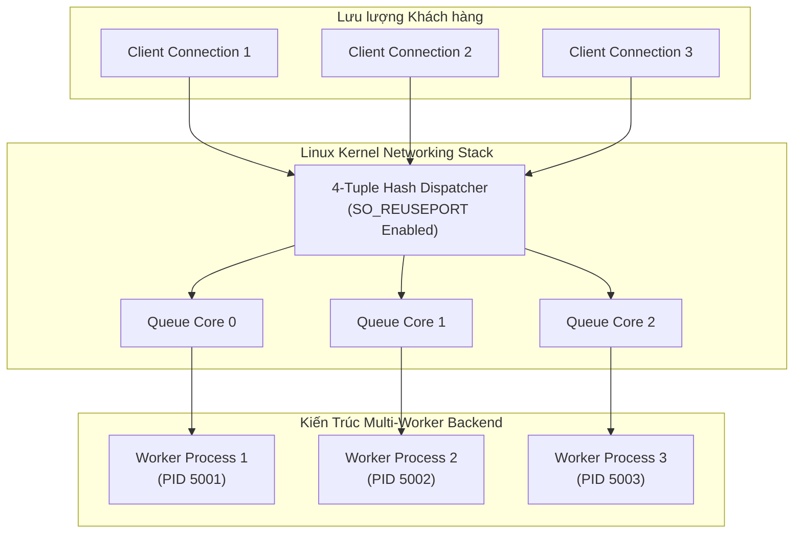
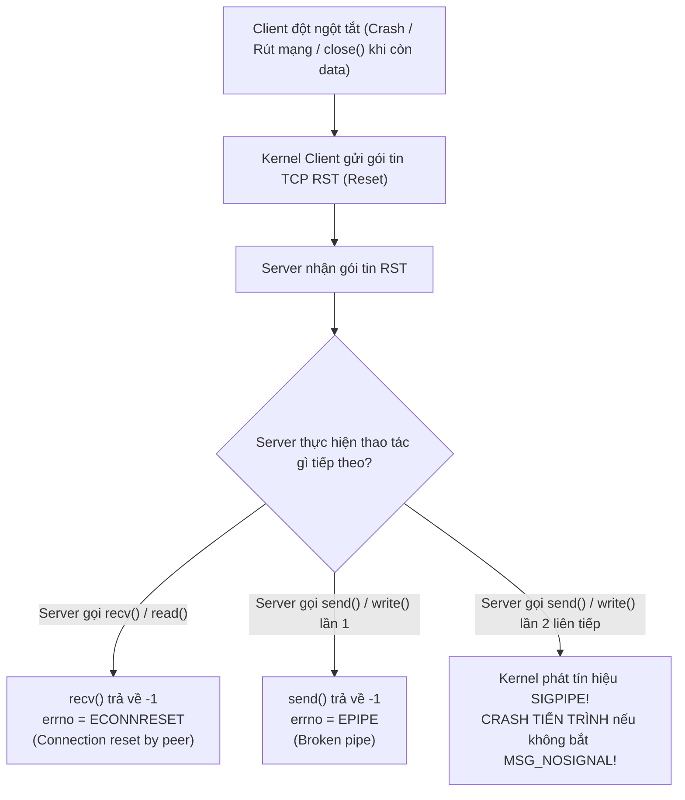
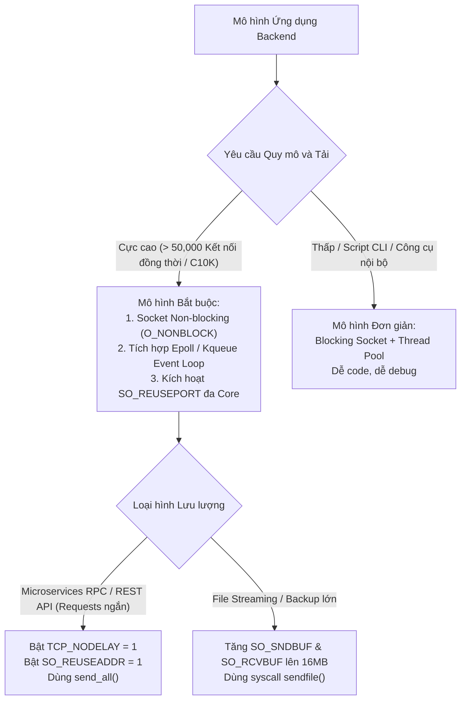

# 5.3. Socket Behaviors and Options

> [!IMPORTANT]
> **Nếu bạn chỉ được nhớ một điều duy nhất:** Cấu hình các Socket Options chính xác quyết định độ bền vững của dịch vụ mạng: `SO_REUSEADDR` cho phép server khởi động lại ngay lập tức mà không bị lỗi 'Address already in use' do các socket cũ còn kẹt trong `TIME_WAIT`; `SO_KEEPALIVE` tự động thăm dò các kết nối chết âm thầm (Dead/Zombies Peers); và bắt tín hiệu `SIGPIPE` để ngăn ngừa tiến trình bị sập đột ngột khi ghi dữ liệu vào một socket đã bị client đóng.

---

## 1. Đơn giản nhưng phải chi tiết (Intuitive & Deep Breakdown)

### 1.1. Đoạn Code Dẫn Nhập & Vấn Đề Thực Tế
Tại sao khi bạn khởi động lại một dịch vụ Web Server hoặc microservice vừa bị crash, hệ thống lại lập tức quăng lỗi cay đắng: `Address already in use (EADDRINUSE)` và từ chối khởi động?

```c
// Khắc phục lỗi Address already in use bằng Socket Option SO_REUSEADDR
int server_fd = socket(AF_INET, SOCK_STREAM, 0);

int opt = 1;
// Bật cờ SO_REUSEADDR cho phép bind ngay cả khi cổng đang kẹt ở trạng thái TIME_WAIT
if (setsockopt(server_fd, SOL_SOCKET, SO_REUSEADDR, &opt, sizeof(opt)) < 0) {
    perror("setsockopt SO_REUSEADDR failed");
    exit(EXIT_FAILURE);
}

// Giờ đây lệnh bind() sẽ luôn thành công ngay cả sau khi restart nóng!
bind(server_fd, (struct sockaddr *)&address, sizeof(address));
```

Nếu không cấu hình `SO_REUSEADDR`, quản trị viên hoặc hệ thống điều phối container (Kubernetes) sẽ phải ngồi chờ thụ động 1-2 phút cho trạng thái `TIME_WAIT` của kernel hết hạn trước khi có thể khởi động lại Pod thành công!

### 1.2. Ẩn Dụ Đời Sống & Phân Tích Cơ Chế Hoạt Động
Các Socket Options giống như **Công tắc Điều chỉnh Tính năng trên một Chiếc Xe Ô tô Hiện đại**:
- Mặc định chiếc xe xuất xưởng ở chế độ tiêu chuẩn, nhưng tùy cung đường bạn có thể gạt các công tắc chuyên dụng:
- **`SO_REUSEPORT`** giống như **Mở nhiều quầy soát vé cùng 1 làn xe**: Cho phép nhiều tiến trình (worker processes) độc lập cùng lắng nghe trên 1 cổng duy nhất. Khi xe tới, nhân kernel sẽ tự động bốc thăm chia xe đều cho các quầy mà không sợ giẫm chân lên nhau.
- **`SO_KEEPALIVE`** giống như **Chiếc vòng đeo tay theo dõi nhịp tim bệnh nhân**: Cứ 2 giờ (hoặc vài phút cấu hình lại), máy gửi một nhịp tim nhỏ sang phía đối diện. Nếu đối diện bị mất điện, rút dây mạng âm thầm không báo trước, chiếc vòng sẽ kêu bíp bíp và ra lệnh khai tử kết nối, giải phóng giường bệnh!
- **`TCP_NODELAY`** giống như **Chế độ xe cấp cứu**: Tắt việc gom hàng chờ đủ xe, có 1 bệnh nhân cũng nổ còi chạy ngay lập tức!

### 1.3. Mô Phỏng Dữ Liệu Số Nhỏ Từng Bước (Toy Walkthrough)
Mô phỏng cơ chế chia tải phần cứng của `SO_REUSEPORT` với 3 Worker Processes trên máy chủ 3 CPU Cores:

| Kết Nối Client Mới | Cặp Socket Tuple (Src IP:Port -> Dst IP:Port) | Hàm Băm Kernel 4-Tuple Hash | CPU Core Xử Lý | Worker Process Đón Nhận |
| :--- | :--- | :--- | :--- | :--- |
| **Client 1** | `192.168.1.50:41230 -> 10.0.0.1:80` | `hash(...) % 3 = 0` | Core 0 | **Worker 0** (`PID 1001`) |
| **Client 2** | `192.168.1.51:41231 -> 10.0.0.1:80` | `hash(...) % 3 = 1` | Core 1 | **Worker 1** (`PID 1002`) |
| **Client 3** | `192.168.1.52:41232 -> 10.0.0.1:80` | `hash(...) % 2 = 2` | Core 2 | **Worker 2** (`PID 1003`) |
| **Client 4** | `192.168.1.53:41233 -> 10.0.0.1:80` | `hash(...) % 3 = 0` | Core 0 | **Worker 0** (`PID 1001`) |

Nhờ `SO_REUSEPORT`, kernel Linux phân bổ kết nối trực tiếp tại tầng mạng mà không cần bất kỳ tiến trình Master trung gian nào, triệt tiêu tranh chấp khóa (Lock Contention) giữa các workers!

### 1.4. Tác Động Thực Tế Tầng Backend & Systems
- **Vấn đề Kết Nối Chết Vô Hình (Half-Open TCP Connections)**: Khi một máy khách bị mất điện đột ngột hoặc rớt cáp mạng, nó không kịp gửi gói tin `FIN` hoặc `RST`. Nếu server không bật `SO_KEEPALIVE`, socket này sẽ nằm vĩnh viễn trong RAM server hàng tháng trời, chiếm dụng tài nguyên bộ nhớ và thread connection pool.
- **Hiện tượng Thundering Herd Problem**: Trước khi có `SO_REUSEPORT`, khi có 1 kết nối mới tới, kernel sẽ đánh thức TOÀN BỘ 16 worker processes đang cùng chờ trên socket chung. 16 workers tranh giành nhau 1 kết nối, 1 worker thắng và 15 workers còn lại ngậm ngùi ngủ tiếp, gây lãng phí nghiêm trọng tài nguyên CPU.

### 1.5. Sơ Đồ Tư Duy & Kiến Trúc Hệ Thống (Mermaid)


---

## 2. Chi tiết từng Keyword (Under-the-Hood Deep Dive)

### 2.1. Blocking vs Non-blocking Sockets

#### A. Blocking Sockets (Mặc định khi tạo socket)
- Khi gọi `recv()`: Nếu Socket Receive Buffer rỗng, luồng xử lý bị đưa vào hàng đợi chờ đợi của Kernel (`wait_queue_head_t`) và dừng thực thi cho tới khi có ít nhất 1 byte dữ liệu từ card mạng chuyển vào.
- Khi gọi `send()`: Nếu Socket Send Buffer bị đầy (do bên nhận đọc chậm hoặc mạng nghẽn), luồng bị dừng chờ cho tới khi bên nhận gửi ACK giải phóng bớt bộ đệm.
- **Hạn chế**: Mỗi kết nối client đòi hỏi một Thread riêng biệt (**Thread-per-Connection**). Khi số lượng client vượt quá vài nghìn, hệ điều hành cạn kiệt RAM cho Thread Stack và sụp đổ do chi phí chuyển ngữ cảnh (Context Switching Overhead).

#### B. Non-blocking Sockets (Cốt lõi của High-Performance Event Loops)
- Kích hoạt thông qua syscall `fcntl()`:
  ```cpp
  int flags = fcntl(sockfd, F_GETFL, 0);
  fcntl(sockfd, F_SETFL, flags | O_NONBLOCK);
  ```
- **Hành vi khi gọi hàm I/O**:
  - `recv()`: Nếu không có dữ liệu, trả về `-1` kèm `errno == EAGAIN || errno == EWOULDBLOCK`.
  - `send()`: Nếu bộ đệm đầy, trả về `-1` kèm `errno == EAGAIN || errno == EWOULDBLOCK`.
  - `accept()`: Nếu Accept Queue rỗng, trả về `-1` kèm `EAGAIN`.
- **Nguồn gốc Lịch sử giữa `EAGAIN` và `EWOULDBLOCK`**:
  - Trong hệ điều hành System V cũ, Kernel trả về `EAGAIN` (Try Again). Trong BSD Unix cổ điển, Kernel trả về `EWOULDBLOCK` (Operation Would Block).
  - Chuẩn POSIX.1 cho phép hai mã lỗi này có cùng giá trị số hoặc khác nhau tùy hệ điều hành.
  - Trên Linux, hai hằng số này được định nghĩa hoàn toàn giống nhau (`#define EWOULDBLOCK EAGAIN`). Tuy nhiên, để đảm bảo mã nguồn portable 100% trên cả Solaris, AIX, macOS và FreeBSD, code chuẩn công nghiệp luôn luôn viết:
    ```cpp
    if (errno == EAGAIN || errno == EWOULDBLOCK) { ... }
    ```
- **Nguyên tắc Sống còn**: Tuyệt đối không được chạy vòng lặp vô tận (Busy-waiting loop) để liên tục gọi `recv()` trên non-blocking socket vì sẽ đốt cháy $100\%$ CPU! Bắt buộc phải kết hợp non-blocking socket với cơ chế **I/O Multiplexing (`epoll` trên Linux, `kqueue` trên macOS/BSD)** để Kernel chỉ đánh thức khi socket thực sự sẵn sàng đọc/ghi.

---

### 2.2. Partial Read và Partial Write (Đọc và Ghi Một Phần)

Do TCP là một dòng byte liên tục không có ranh giới khối, việc đọc/ghi dữ liệu luôn có nguy cơ bị phân mảnh:

#### A. Partial Read (Đọc Một Phần)
- Giả sử client gửi một gói JSON kích thước $4096\text{ bytes}$.
- Khi server gọi `recv(fd, buf, 4096, 0)`, server hoàn toàn có thể chỉ nhận được $1460\text{ bytes}$ (kích thước của 1 gói tin TCP MSS đến trước).
- **Quy tắc**: Bên nhận bắt buộc phải lưu trữ dữ liệu vào một bộ đệm tích lũy (Accumulation Buffer) và tiếp tục gọi `recv()` nhiều lần cho tới khi phân tích cú pháp (Parse) được trọn vẹn thông điệp ứng dụng.

#### B. Partial Write (Ghi Một Phần)
- Giả sử ứng dụng muốn gửi một khối dữ liệu lớn $10\text{ MB}$ qua mạng.
- Khi gọi `send(fd, big_buf, 10 * 1024 * 1024, 0)`:
  - Nếu Socket Send Buffer của Kernel chỉ còn trống $131,072\text{ bytes}$ ($128\text{ KB}$), Kernel sẽ ghi hết 128 KB đó và hàm `send()` lập tức trả về số **`131072`**.
  - Phần còn lại gần $9.87\text{ MB}$ **vẫn chưa hề được gửi đi**!
- **Chuẩn mực Xử lý**: Bắt buộc phải hiện thực hàm `send_all()` bọc vòng lặp cộng dồn con trỏ:
```cpp
ssize_t send_all(int sockfd, const char* data, size_t len) {
    size_t total_sent = 0;
    while (total_sent < len) {
        ssize_t sent = send(sockfd, data + total_sent, len - total_sent, MSG_NOSIGNAL);
        if (sent < 0) {
            if (errno == EAGAIN || errno == EWOULDBLOCK) {
                // Chờ epoll báo socket ghi được tiếp
                continue;
            }
            return -1; // Lỗi thật sự
        }
        total_sent += sent;
    }
    return total_sent;
}
```

---

### 2.3. Cạm bẫy Lỗi Kết nối: `ECONNRESET` vs `EPIPE` (Broken Pipe)

Hai mã lỗi này thường gây nhầm lẫn nghiêm trọng cho các lập trình viên backend:



1. **`ECONNRESET` (Connection reset by peer)**:
   - Xảy ra khi một đầu mút nhận được gói tin **TCP RST** từ đối phương và sau đó cố gắng **ĐỌC dữ liệu (`read()` / `recv()`)**.
   - Nguyên nhân phổ biến: Ứng dụng client bị crash đột ngột; hoặc client gọi `close()` trong khi trong bộ đệm nhận vẫn còn dữ liệu chưa đọc hết (buộc TCP phải gửi RST thay vì FIN).
2. **`EPIPE` (Broken pipe) & Tín hiệu `SIGPIPE`**:
   - Xảy ra khi một đầu mút cố gắng **GHI dữ liệu (`write()` / `send()`)** vào một kết nối đã bị đóng ở đầu bên kia.
   - Khi ghi lần đầu vào socket đã đóng, Kernel trả về lỗi `EPIPE`.
   - Nếu tiến trình tiếp tục ghi lần thứ hai, Linux Kernel sẽ gửi tín hiệu sát thủ **`SIGPIPE`** hủy diệt tiến trình ngay lập tức nếu không bật cờ `MSG_NOSIGNAL`!

---

### 2.4. Các Tùy chọn Socket Sống còn (`setsockopt`)

#### A. `SO_REUSEADDR` (Tái sử dụng Địa chỉ Mạng)
- **Vấn đề**: Khi một máy chủ web (như Node.js hoặc C++ server) bị khởi động lại, cổng mạng vừa dùng thường bị kẹt ở trạng thái **`TIME_WAIT` kéo dài 60 giây**. Nếu gọi hàm `bind()` ngay lập tức, OS sẽ báo lỗi:
  ```text
  bind: Address already in use (EADDRINUSE)
  ```
- **Giải pháp**: Thiết lập `SO_REUSEADDR = 1`. Tùy chọn này ra lệnh cho Kernel: *"Cho phép tiến trình mới bind ngay vào cổng này miễn là socket cũ đang nằm trong trạng thái TIME_WAIT và không có tiến trình nào khác đang chủ động lắng nghe (LISTEN)"*.
```cpp
int opt = 1;
setsockopt(sockfd, SOL_SOCKET, SO_REUSEADDR, &opt, sizeof(opt));
```

#### B. `SO_REUSEPORT` (Linux 3.9+ Load Balancing Đa Tiến trình)
- Cho phép **nhiều tiến trình hoặc luồng hoàn toàn độc lập cùng bind vào CHÍNH XÁC một địa chỉ IP và Port duy nhất**.
- **Cơ chế Cân bằng Tải Dưới Kernel**: Linux Kernel tự động tính toán hàm băm 4-tuple của gói tin TCP SYN đến và phân phối đều kết nối vào Accept Queue của các tiến trình lắng nghe mà không cần một Proxy trung gian!
- Triệt tiêu hoàn toàn hiện tượng thắt cổ chai đơn luồng (**Single-listener bottleneck**) và loại bỏ hiện tượng **Thundering Herd** (tất cả các luồng cùng thức giấc khi có 1 kết nối tới).

#### C. `SO_KEEPALIVE` (TCP Keepalive ở Tầng Giao vận)
- Khi hai máy chủ thiết lập kết nối TCP nhưng không có dữ liệu trao đổi trong nhiều ngày, các Firewall / NAT Router trung gian sẽ tự động xóa phiên conntrack sau 30-60 phút rảnh rỗi.
- Kết quả: Kết nối rơi vào trạng thái **"Chết treo" (Half-Open Connection)**: Hai máy chủ vẫn nghĩ kết nối còn sống, nhưng thực tế dây mạng đã đứt.
- Bật `SO_KEEPALIVE = 1` yêu cầu Kernel tự động phát các gói tin thăm dò không mang payload (Probe Packets) theo 3 thông số tinh chỉnh:
  - `tcp_keepalive_time`: Thời gian socket rảnh rỗi trước khi bắt đầu gửi probe (Linux mặc định: 7200s = 2 giờ $\to$ Nên hạ xuống 300s).
  - `tcp_keepalive_intvl`: Khoảng cách giữa các lần probe liên tiếp (mặc định 75s $\to$ Nên hạ xuống 15s).
  - `tcp_keepalive_probes`: Số lần probe không nhận được ACK trước khi Kernel chính thức tuyên bố kết nối đã chết (mặc định 9 lần $\to$ Nên đặt 5 lần).

#### D. `SO_LINGER` (Kiểm soát Hành vi Đóng Socket)
Cấu trúc `struct linger` gồm hai trường:
```c
struct linger {
    int l_onoff; // 0 = Tắt, 1 = Bật
    int l_linger; // Thời gian chờ (giây)
};
```
- **Kịch bản 1 (`l_onoff = 0` - Mặc định)**: Hàm `close()` quay trở về ngay lập tức. Kernel sẽ âm thầm tiếp tục gửi nốt dữ liệu còn tồn trong bộ đệm ra mạng ở chế độ background.
- **Kịch bản 2 (`l_onoff = 1, l_linger > 0`)**: Hàm `close()` sẽ bị chặn (block) tối đa `l_linger` giây để chờ toàn bộ dữ liệu được bên kia ACK xong mới thoát.
- **Kịch bản 3 (`l_onoff = 1, l_linger = 0` - Abrupt Close)**:
  - Khi gọi `close()`, Kernel **lập tức xóa sạch toàn bộ dữ liệu chưa gửi trong bộ đệm**, bỏ qua hoàn toàn quy trình đóng 4 bước (không gửi FIN), và **phát ngay một gói tin TCP RST** tới máy đối diện!
  - Socket nhảy thẳng sang trạng thái `CLOSED` mà **hoàn toàn không phải trải qua `TIME_WAIT`**!
  > [!WARNING]
  > Mặc dù `SO_LINGER (0, 0)` giúp tránh kẹt cổng `TIME_WAIT`, nhưng nó là một hành vi bạo lực (Violent abort) phá vỡ tính toàn vẹn dữ liệu và gây ra lỗi `ECONNRESET` tại máy khách!

#### E. `SO_RCVTIMEO` và `SO_SNDTIMEO` (Giới hạn Thời gian Chờ cho Blocking Sockets)
Trong các trường hợp ứng dụng sử dụng Blocking Socket (như các kết nối Database Driver, CLI tool), việc một syscall `read()` hoặc `connect()` bị treo vĩnh viễn do đứt cáp là nguyên nhân gây cạn kiệt luồng (Thread Starvation).
- Tùy chọn `SO_RCVTIMEO` (Receive Timeout) và `SO_SNDTIMEO` (Send Timeout) cho phép thiết lập thời gian chờ tối đa bằng cấu trúc `struct timeval`:
```cpp
struct timeval tv;
tv.tv_sec = 5;  // 5 giay timeout
tv.tv_usec = 0;
setsockopt(sockfd, SOL_SOCKET, SO_RCVTIMEO, (const char*)&tv, sizeof(tv));
```
- Khi hết thời gian quy định mà không có dữ liệu, hàm `recv()` sẽ trả về `-1` kèm mã lỗi **`EAGAIN` hoặc `EWOULDBLOCK`**, giúp luồng ứng dụng kịp thời giải phóng tài nguyên thay vì bị kẹt vĩnh viễn.

#### F. `SO_BINDTODEVICE` (Buộc Socket Gắn Chặt vào Interface Vật Lý)
- Trong các máy chủ có nhiều cổng mạng (Multi-homed Server) hoặc hệ thống kết nối VPN:
- Ứng dụng có thể ép buộc toàn bộ lưu lượng của socket này **chỉ được phép đi ra từ một card mạng vật lý cố định** (ví dụ `eth1` hoặc `wg0`):
```cpp
const char* if_name = "eth1";
setsockopt(sockfd, SOL_SOCKET, SO_BINDTODEVICE, if_name, strlen(if_name));
```
- Giúp bảo mật thông tin nội bộ, ngăn ngừa rò rỉ dữ liệu qua cổng mạng công cộng (Interface Leakage).

---

## 3. Thực thi Mã nguồn & Mô phỏng Chuyên sâu (Dual-Engine Implementation)

### 3.1. C++20: Non-blocking Socket Manager & Multi-threaded `SO_REUSEPORT` Engine

File `nonblocking_reuseport_server.cpp` hiện thực máy chủ socket đa luồng chuẩn C++20, cấu hình non-blocking thông qua `fcntl()`, kích hoạt `SO_REUSEPORT` và cài đặt hàm truyền dữ liệu chống Partial Write `send_all()`.

```cpp
#include <iostream>
#include <vector>
#include <thread>
#include <cstring>
#include <cstdint>
#include <fcntl.h>
#include <sys/types.h>
#include <sys/socket.h>
#include <netinet/in.h>
#include <netinet/tcp.h>
#include <unistd.h>

class RobustNonBlockingSocket {
public:
    static bool set_nonblocking(int fd) {
        int flags = fcntl(fd, F_GETFL, 0);
        if (flags == -1) return false;
        return fcntl(fd, F_SETFL, flags | O_NONBLOCK) != -1;
    }

    static ssize_t send_all(int fd, const char* buffer, size_t length) {
        size_t total_sent = 0;
        while (total_sent < length) {
            ssize_t sent = send(fd, buffer + total_sent, length - total_sent, MSG_NOSIGNAL);
            if (sent < 0) {
                if (errno == EAGAIN || errno == EWOULDBLOCK) {
                    // Trong server thuc te, day la luc tra quyen dieu khien cho Epoll
                    std::this_thread::sleep_for(std::chrono::milliseconds(5));
                    continue;
                }
                return -1; // Loi nghiem trong
            }
            total_sent += sent;
        }
        return total_sent;
    }
};

void run_worker(int worker_id, uint16_t port) {
    int sockfd = socket(AF_INET, SOCK_STREAM, 0);
    if (sockfd < 0) return;

    int enable = 1;
    setsockopt(sockfd, SOL_SOCKET, SO_REUSEADDR, &enable, sizeof(enable));
#ifdef SO_REUSEPORT
    setsockopt(sockfd, SOL_SOCKET, SO_REUSEPORT, &enable, sizeof(enable));
#endif
    // Bat TCP_NODELAY chong cam bay 40ms
    setsockopt(sockfd, IPPROTO_TCP, TCP_NODELAY, &enable, sizeof(enable));

    sockaddr_in addr{};
    addr.sin_family = AF_INET;
    addr.sin_addr.s_addr = INADDR_ANY;
    addr.sin_port = htons(port);

    if (bind(sockfd, reinterpret_cast<const sockaddr*>(&addr), sizeof(addr)) < 0) {
        perror("Loi bind worker");
        close(sockfd);
        return;
    }

    listen(sockfd, 1024);
    RobustNonBlockingSocket::set_nonblocking(sockfd);

    std::cout << "[Worker #" << worker_id << "] Khoi tao SO_REUSEPORT thanh cong tren Port " << port 
              << " (Listening FD: " << sockfd << ")\n";

    // Demo ket thuc sau khi khoi tao an toan
    close(sockfd);
}

int main() {
    std::cout << "=== NON-BLOCKING & SO_REUSEPORT ENGINE (C++20) ===" << std::endl;
    uint16_t port = 8888;
    
    // Khoi chay 2 luong worker cung bind chung vao mot Port
    std::thread w1(run_worker, 1, port);
    std::thread w2(run_worker, 2, port);

    w1.join();
    w2.join();

    std::cout << "[+] Ca hai Worker da bind dong thoi vao port " << port << " ma khong he bi xung dot!\n";
    return 0;
}
```

### 3.2. Python 3.11: `SO_LINGER` (RST Abort vs Graceful Close) Simulator

File `linger_behavior_sim.py` mô phỏng sự khác biệt giữa việc đóng kết nối êm đẹp gửi FIN và việc sử dụng `SO_LINGER` phát gói tin RST hủy kết nối lập tức.

```python
import socket
import struct
import time

def simulate_linger_modes():
    print("=== SO_LINGER BEHAVIOR SIMULATOR (Python 3.11) ===")
    
    # Khoi tao server cuc bo
    srv = socket.socket(socket.AF_INET, socket.SOCK_STREAM)
    srv.setsockopt(socket.SOL_SOCKET, socket.SO_REUSEADDR, 1)
    srv.bind(("127.0.0.1", 0))
    srv.listen(1)
    port = srv.getsockname()[1]

    # Kich ban 1: Dong socket binh thuong (Graceful Close - Gui FIN)
    print("\n--- KỊCH BẢN 1: ĐÓNG KẾT NỐI BÌNH THƯỜNG (GRACEFUL CLOSE) ---")
    c1 = socket.socket(socket.AF_INET, socket.SOCK_STREAM)
    c1.connect(("127.0.0.1", port))
    conn1, _ = srv.accept()
    
    c1.close() # Gui FIN
    print("[Client 1] Da goi close() -> Kernel phat goi tin FIN hop le.")
    data = conn1.recv(1024)
    print(f"[Server] recv() doc duoc: {data} (b'' = EOF -> Phat hien dong em dep)")
    conn1.close()

    # Kich ban 2: Dong socket dot ngot voi SO_LINGER = (1, 0) -> Gui RST!
    print("\n--- KỊCH BẢN 2: ĐÓNG KẾT NỐI BẠO LỰC VỚI SO_LINGER = (1, 0) ---")
    c2 = socket.socket(socket.AF_INET, socket.SOCK_STREAM)
    c2.connect(("127.0.0.1", port))
    conn2, _ = srv.accept()

    # Cau hinh SO_LINGER: struct linger { l_onoff=1, l_linger=0 }
    # struct format: "ii" (2 integers)
    linger_opt = struct.pack("ii", 1, 0)
    c2.setsockopt(socket.SOL_SOCKET, socket.SO_LINGER, linger_opt)
    
    c2.close() # Xoa sach buffer va phat RST ngay!
    print("[Client 2] Da goi close() voi SO_LINGER (1, 0) -> Bỏ qua FIN, phát gói TCP RST!")
    
    try:
        data = conn2.recv(1024)
        print(f"[Server] Doc duoc: {data}")
    except ConnectionResetError as e:
        print(f"[Server] [BẮT ĐƯỢC LỖI]: ConnectionResetError (ECONNRESET)! Gói RST đã đánh sập socket bên nhận!")

    conn2.close()
    srv.close()

if __name__ == "__main__":
    simulate_linger_modes()
```

### 3.3. Terminal Output Mẫu

```text
$ clang++ -std=c++20 -O3 nonblocking_reuseport_server.cpp -o nonblocking_reuseport_server && ./nonblocking_reuseport_server
=== NON-BLOCKING & SO_REUSEPORT ENGINE (C++20) ===
[Worker #1] Khoi tao SO_REUSEPORT thanh cong tren Port 8888 (Listening FD: 3)
[Worker #2] Khoi tao SO_REUSEPORT thanh cong tren Port 8888 (Listening FD: 4)
[+] Ca hai Worker da bind dong thoi vao port 8888 ma khong he bi xung dot!

$ python3 linger_behavior_sim.py
=== SO_LINGER BEHAVIOR SIMULATOR (Python 3.11) ===

--- KỊCH BẢN 1: ĐÓNG KẾT NỐI BÌNH THƯỜNG (GRACEFUL CLOSE) ---
[Client 1] Da goi close() -> Kernel phat goi tin FIN hop le.
[Server] recv() doc duoc: b'' (b'' = EOF -> Phat hien dong em dep)

--- KỊCH BẢN 2: ĐÓNG KẾT NỐI BẠO LỰC VỚI SO_LINGER = (1, 0) ---
[Client 2] Da goi close() voi SO_LINGER (1, 0) -> Bỏ qua FIN, phát gói TCP RST!
[Server] [BẮT ĐƯỢC LỖI]: ConnectionResetError (ECONNRESET)! Gói RST đã đánh sập socket bên nhận!
```

---

## 4. Systems Engineering & Production Pitfalls

### 4.1. Lệch Tải Kết nối với `SO_REUSEPORT` (Connection Skew Problem)
Mặc dù `SO_REUSEPORT` phân phối kết nối rất tốt khi các worker threads có thời gian xử lý yêu cầu đồng đều (Uniform Request Duration), nhưng trong thực tế:
- Nếu Worker A nhận phải một kết nối thực hiện tác vụ nặng (như parse file 500MB hoặc query database chậm), trong khi Worker B rảnh rỗi:
  - Kernel vẫn tiếp tục phân phối các kết nối mới vào Accept Queue của Worker A theo hàm băm.
  - Các kết nối vào Worker A bị xếp hàng chờ đợi kéo dài độ trễ, trong khi Worker B hoàn toàn ngồi chơi!
- **Giải pháp**: Đối với các ứng dụng có độ dài request không đồng đều, nên sử dụng kiến trúc **Single Epoll Listener + Thread Pool Work Stealing** (như Nginx worker processes hoặc Tokio runtime) thay vì lạm dụng `SO_REUSEPORT`.

### 4.2. Quên Kiểm tra Giá trị Trả về của `send()` và `write()`
Nhiều lập trình viên ngây thơ viết code:
```cpp
write(fd, data, len); // RẤT NGUY HIỂM!
```
- Trên mạng non-blocking hoặc khi có độ trễ lớn, hàm `write()` có thể chỉ gửi được một nửa số byte (`sent < len`).
- Dữ liệu bị thất thoát âm thầm khiến bên nhận nhận được các gói tin JSON hoặc Protobuf bị cụt, dẫn đến lỗi cú pháp không thể giải mã (`SyntaxError: Unexpected end of JSON input`).
- **Quy tắc Bắt buộc**: Luôn kiểm tra `sent` và lặp lại cho tới khi `total_sent == len`.

### 4.3. Cạm bẫy Phá Vỡ Cơ chế Tự Động Co Giãn Buffer (`SO_RCVBUF` vs Dynamic Auto-Tuning)
Linux Kernel sở hữu tính năng **TCP Buffer Auto-Tuning** cực kỳ thông minh (`net.ipv4.tcp_moderate_rcvbuf = 1`):
- Kernel tự động theo dõi BDP và độ trễ RTT của từng kết nối để co giãn kích thước Receive Buffer linh hoạt giữa 3 mốc: `min`, `default`, `max` trong `net.ipv4.tcp_rmem`.
- **Cạm bẫy Tai hại**: Nếu trong code ứng dụng, bạn gọi thủ công hàm:
  ```cpp
  int size = 128 * 1024; // 128 KB
  setsockopt(sockfd, SOL_SOCKET, SO_RCVBUF, &size, sizeof(size));
  ```
- Kernel Linux sẽ hiểu rằng: *"Lập trình viên muốn áp đặt cứng kích thước này và không tin tưởng Kernel nữa!"*. Ngay lập tức, Kernel **vô hiệu hóa hoàn toàn cơ chế Dynamic Auto-Tuning** cho socket đó!
- Hậu quả: Cửa sổ nhận bị khóa chết ở mức 128 KB, làm sụt giảm nghiêm trọng thông lượng trên các mạng cáp quang tốc độ cao.
- **Khuyến nghị**: Hãy để Linux Kernel tự động quản lý buffer thông qua các thông số `sysctl`, trừ khi bạn có lý do đặc biệt cần cố định buffer trong môi trường nhúng.

### 4.4. Các lệnh CLI Giám sát Socket Options và Behaviors

```bash
# 1. Xem tất cả các socket đang mở kèm các tùy chọn timer và trạng thái
ss -options -t -a

# 2. Kiểm tra các thông số Keepalive của toàn hệ thống
sysctl -a | grep keepalive

# 3. Theo dõi số lượng tiến trình đang sử dụng SO_REUSEPORT trên một cổng
ss -lntp '( sport = :8888 )'
```

---

## 5. Bảng So sánh & Decision Matrix

### 5.1. Bảng So sánh Toàn diện: Các Tùy chọn Socket Cốt lõi

| Socket Option | Tham số Tương ứng | Giá trị Mặc định | Tác động Hệ thống khi Kích hoạt |
| :--- | :--- | :---: | :--- |
| **`O_NONBLOCK`** | `fcntl(fd, F_SETFL)` | Chặn (Blocking) | Hàm I/O trả về ngay lập tức với `EAGAIN` nếu chưa sẵn sàng. |
| **`SO_REUSEADDR`**| `SOL_SOCKET` | Tắt (`0`) | Cho phép bind lại cổng đang ở trạng thái `TIME_WAIT`. |
| **`SO_REUSEPORT`**| `SOL_SOCKET` | Tắt (`0`) | Cho phép đa tiến trình/luồng bind chung 1 port; Kernel tự chia tải. |
| **`SO_KEEPALIVE`**| `SOL_SOCKET` | Tắt (`0`) | Tự động phát hiện và dọn dẹp các kết nối chết qua Firewall. |
| **`SO_LINGER`** | `SOL_SOCKET` | `(0, 0)` (Tắt) | Khi gán `(1, 0)`: Đóng kết nối ngay lập tức bằng cờ RST, bỏ qua `TIME_WAIT`. |
| **`TCP_NODELAY`** | `IPPROTO_TCP` | Tắt (`0` - Bật Nagle) | Tắt thuật toán Nagle, triệt tiêu độ trễ 40ms của các gói tin nhỏ. |
| **`SO_RCVTIMEO`** | `SOL_SOCKET` | Không timeout | Thiết lập thời gian chờ tối đa cho các hàm `read()`/`recv()` trên Blocking Socket. |
| **`SO_SNDTIMEO`** | `SOL_SOCKET` | Không timeout | Thiết lập thời gian chờ tối đa cho các hàm `write()`/`send()` trên Blocking Socket. |
| **`SO_BINDTODEVICE`**| `SOL_SOCKET`| Mọi Card mạng | Ép buộc toàn bộ lưu lượng của socket chỉ được phép đi ra từ card mạng chỉ định. |

### 5.2. Decision Matrix: Cấu hình Socket cho Các Mô hình Ứng dụng Backend



| Nhu cầu Thực tiễn | Cấu hình Socket Khuyên dùng | Lý do & Giá trị Kỹ thuật |
| :--- | :--- | :--- |
| **Nginx / Envoy API Gateway** | `SO_REUSEPORT = 1`<br/>`SO_REUSEADDR = 1`<br/>`TCP_NODELAY = 1` | Tận dụng toàn bộ các CPU cores, khởi động lại server không bị nghẽn port, triệt tiêu trễ 40ms. |
| **WebSocket / Long-polling Server** | `SO_KEEPALIVE = 1`<br/>`tcp_keepalive_time = 300` | Giữ kết nối không bị router NAT tự ý ngắt phiên sau 30 phút rảnh rỗi. |
| **Hệ thống Đẩy Dữ liệu Thời gian thực**| `O_NONBLOCK` + Buffer vòng | Đảm bảo một client mạng chậm không bao giờ làm nghẽn luồng phát dữ liệu cho các client khác. |
| **Công cụ CLI & ETL Batch Script** | `SO_RCVTIMEO = 30s`<br/>`SO_SNDTIMEO = 30s` | Đảm bảo các tiến trình chạy hàng loạt không bị treo vô hạn nếu server đích bị mất mạng đột ngột. |
| **Hệ thống Multi-Homed VPN / Bastion Host**| `SO_BINDTODEVICE = "eth1"` | Khóa cứng luồng dữ liệu bảo mật chỉ đi qua đường truyền riêng, không lọt ra Internet công cộng. |

---

## 6. Enterprise Production Checklist & Verification

### 6.1. Kiến Trúc & Cấu Hình Tối Ưu (Production-Ready Architecture)
- [ ] **Bắt Buộc Bật SO_REUSEADDR Trên Mọi Server**: Đảm bảo mã nguồn backend luôn thiết lập `SO_REUSEADDR` trước khi gọi `bind()` để hỗ trợ zero-downtime rolling deployment.
- [ ] **Kích Hoạt SO_REUSEPORT Cho Multi-Core Web Servers**: Với các máy chủ chạy Nginx, Envoy hoặc Go multi-process, bật cờ `reuseport` để phân phối tải trực tiếp từ kernel đến các CPU cores.
- [ ] **Tối Ưu TCP Keepalive Timers**: Giảm thông số mặc định của Linux (2 giờ) xuống mức phản ứng nhanh: `sysctl -w net.ipv4.tcp_keepalive_time=300`, `net.ipv4.tcp_keepalive_intvl=15`, `net.ipv4.tcp_keepalive_probes=5`.
- [ ] **Cấu Hình SO_RCVTIMEO và SO_SNDTIMEO**: Luôn đặt timeout đọc/ghi ở cấp độ socket trong code ứng dụng để tránh trường hợp các luồng worker bị treo vĩnh viễn khi mạng phía đối diện bị đơ.

### 6.2. Giám Sát, Cảnh Báo & Xử Lý Sự Cố (Observability & Incident Response)
- [ ] **Kiểm Tra Cờ Socket Bằng ss**: Sử dụng lệnh `ss -t -e -o` để kiểm tra các tùy chọn `timer:(keepalive,...)` của từng kết nối đang hoạt động.
- [ ] **Phát Hiện Kết Nối Treo Bằng Metrics**: Đặt cảnh báo khi thời gian tồn tại (connection duration) của các socket HTTP thông thường vượt quá giới hạn nghiệp vụ (ví dụ > 10 phút).
- [ ] **Xác Minh Không Gian Bộ Nhớ SO_RCVBUF**: Chạy script kiểm tra xem các socket có đang bị gán kích thước buffer thủ công quá nhỏ làm hạn chế thông lượng mạng hay không.
