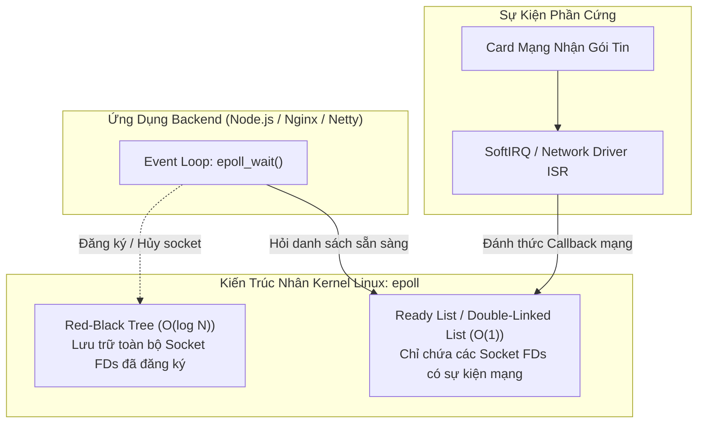
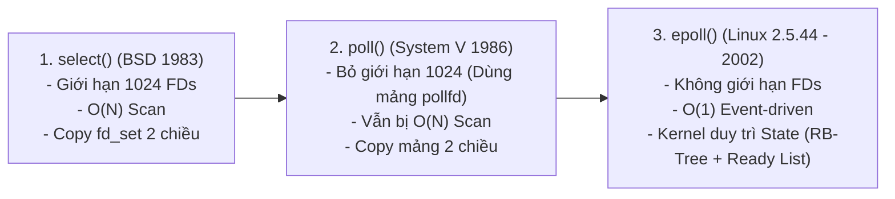
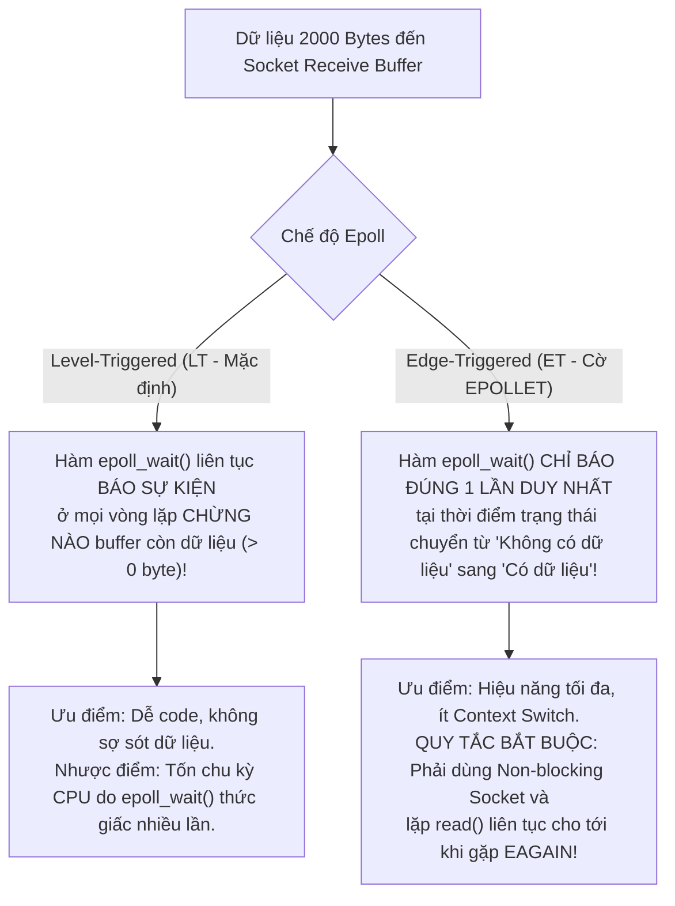
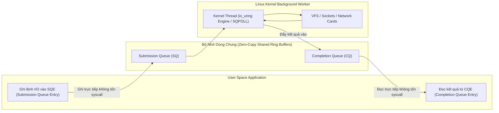
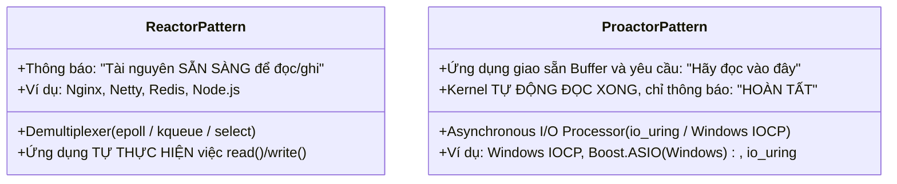

# 5.4. Network I/O Models: Epoll, Kqueue, and io_uring

> [!IMPORTANT]
> **Nếu bạn chỉ được nhớ một điều duy nhất:** Giải quyết bài toán C10K và C10M là hành trình chuyển dịch từ mô hình luồng đơn (One-Thread-Per-Client) sang I/O Đa kênh theo sự kiện: `epoll` trong Linux sử dụng cây Đỏ-Đen và danh sách liên kết sẵn sàng trong Kernel để đạt độ phức tạp $O(1)$ sự kiện sẵn sàng thay vì quét tuần tự $O(N)$ như `select`/`poll`; và `io_uring` nâng tầm cuộc chơi bằng mô hình hoàn toàn bất đồng bộ (Proactor) với chi phí System Call tiệm cận bằng 0.

---

## 1. Đơn giản nhưng phải chi tiết (Intuitive & Deep Breakdown)

### 1.1. Đoạn Code Dẫn Nhập & Vấn Đề Thực Tế
Làm thế nào một máy chủ đơn lẻ có thể phục vụ cùng lúc 1,000,000 kết nối đồng thời (Bài toán C10K và C1000K) mà không làm cạn kiệt bộ nhớ RAM và không khiến CPU sụp đổ vì chuyển ngữ cảnh luồng (Context Switching)?

```c
// Mô hình I/O Multiplexing hiện đại bằng epoll trên Linux
int epfd = epoll_create1(0); // Tạo bảng điều khiển epoll trong kernel

struct epoll_event ev, events[MAX_EVENTS];
ev.events = EPOLLIN | EPOLLET; // Lắng nghe sự kiện có dữ liệu đến (Edge-Triggered)
ev.data.fd = server_sock;
epoll_ctl(epfd, EPOLL_CTL_ADD, server_sock, &ev); // Đăng ký socket vào bảng theo dõi

while (1) {
    // Luồng ngủ ngon lành trong kernel, CHỈ thức dậy khi có ít nhất 1 socket có biến động!
    int nfds = epoll_wait(epfd, events, MAX_EVENTS, -1);
    for (int i = 0; i < nfds; i++) {
        handle_io(events[i].data.fd); // Xử lý tức thì đúng các socket sẵn sàng
    }
}
```

Nếu dùng mô hình cũ "Mỗi kết nối 1 Thread" (Thread-per-connection), 10,000 kết nối sẽ ngốn tới 80 GB RAM chỉ để cấp phát Thread Stack và CPU mất 90% thời gian chỉ để chuyển đổi qua lại giữa các luồng!

### 1.2. Ẩn Dụ Đời Sống & Phân Tích Cơ Chế Hoạt Động
So sánh các mô hình Network I/O giống như **Phương pháp Phục vụ Khách tại Nhà Hàng**:
- **Blocking I/O (Thread-per-connection)**: Mỗi khi có 1 vị khách bước vào, nhà hàng thuê riêng 1 nhân viên phục vụ đứng kè kè cạnh bàn. Khách ngồi đọc menu 30 phút thì nhân viên cũng đứng đực mặt ra đó 30 phút. 1,000 khách cần 1,000 nhân viên -> Nhà hàng phá sản vì tiền lương!
- **`select()` / `poll()` (O(N) Complexity)**: Cả nhà hàng chỉ có 1 nhân viên. Cứ mỗi phút, nhân viên này chạy bộ vòng quanh hỏi lần lượt từng bàn từ bàn 1 đến bàn 1000: *"Bác có gọi món chưa?"*. Dù chỉ có 1 bàn gọi nước, nhân viên vẫn phải chạy mòn dép hỏi đủ 1000 bàn.
- **`epoll` (O(1) Event-driven)**: Tại mỗi bàn ăn gắn một **Nút bấm chuông điện tử**. Khách ngồi đọc menu bao lâu tùy thích, nhân viên ngồi uống trà nghỉ ngơi. Khi bàn nào bấm chuông, bảng điều khiển trung tâm tại quầy sáng đèn báo đích danh: *"Bàn số 42 đã bấm chuông!"*. Nhân viên chỉ việc đi thẳng tới bàn 42 để phục vụ!
- **`io_uring` (Next-Gen Async I/O)**: Không cần bấm chuông hay gọi nhân viên nữa. Khách tự ghi món vào một **Vòng xoay đơn hàng dùng chung (Ring Buffer)**, đầu bếp tự lấy ra nấu và đẩy món ăn vào vòng xoay trả lời. Không tốn một lời nói nào giữa khách và nhân viên (Zero Syscall Overhead)!

### 1.3. Mô Phỏng Dữ Liệu Số Nhỏ Từng Bước (Toy Walkthrough)
So sánh hiệu năng thuật toán giữa `poll` và `epoll` khi có 100,000 kết nối mở nhưng chỉ có 5 kết nối đang có dữ liệu gửi đến:

| Tiêu Chí So Sánh | Mô Hình `poll()` | Mô Hình `epoll()` | Mô Hình `io_uring` |
| :--- | :--- | :--- | :--- |
| **Độ Phức Tạp Thuật Toán** | **$O(N)$** | **$O(1)$** (Phụ thuộc số sự kiện) | **$O(1)$** |
| **Chi Phí Syscall Mỗi Vòng Lặp** | Copy mảng 100,000 FDs từ User sang Kernel | 0 byte copy (Kernel lưu sẵn cây Red-Black Tree) | **0 Syscall** (Shared Ring Buffer) |
| **Số Lượng FDs Phải Quét Duyệt** | Phải duyệt qua toàn bộ **100,000 FDs** | Chỉ trả về đúng **5 FDs** có dữ liệu | Chỉ đọc các phần tử trong Completion Ring |
| **Thời Gian Xử Lý Mỗi Chu Kỳ** | $\approx 25\text{ ms}$ (Lãng phí CPU trầm trọng) | **$\approx 0.05\text{ ms}$** (Phản ứng tức thì) | **$\approx 0.01\text{ ms}$** (Cực đại hiệu năng) |

### 1.4. Tác Động Thực Tế Tầng Backend & Systems
- **Edge-Triggered (EPOLLET) vs. Level-Triggered (EPOLLLT)**:
  - Mặc định `EPOLLLT` sẽ báo liên tục chừng nào trong buffer còn byte dữ liệu chưa đọc.
  - Chế độ cao cấp `EPOLLET` chỉ báo duy nhất 1 lần khi có sự thay đổi trạng thái (cạnh lên). Lập trình viên bắt buộc phải dùng vòng lặp `while(1)` đọc cho tới khi gặp lỗi `EAGAIN`; nếu đọc thiếu, socket sẽ bị đóng băng vĩnh viễn do không bao giờ nhận được thông báo tiếp theo!
- **Cuộc Cách Mạng `io_uring` của Jens Axboe (Linux 5.1+)**: Bằng cách chia sẻ vùng nhớ chung giữa User Space và Kernel Space qua hai vòng lặp tròn (Submission Queue - SQ và Completion Queue - CQ), `io_uring` triệt tiêu hoàn toàn rào cản Context Switch của syscall, cho phép Linux đạt hàng chục triệu IOPS trên ổ đĩa NVMe và card mạng 100GbE.

### 1.5. Sơ Đồ Tư Duy & Kiến Trúc Hệ Thống (Mermaid)


---

## 2. Chi tiết từng Keyword (Under-the-Hood Deep Dive)

### 2.1. Sự Tiến hóa: `select()` vs `poll()` vs `epoll()`



#### 1. `select()` (RFC / BSD Unix 1983)
- Sử dụng cấu trúc mặt nạ bit `fd_set`.
- **Ba Nhược điểm Chí tử**:
  1. **Giới hạn Cứng 1024 File Descriptors**: Hằng số `FD_SETSIZE = 1024` được biên dịch cứng trong C library header (`sys/select.h`). Không thể vượt qua trừ khi biên dịch lại toàn bộ Kernel và Glibc.
  2. **Chi phí Sao chép Bộ nhớ ($O(N)$)**: Mỗi lần gọi `select()`, ứng dụng phải sao chép toàn bộ cấu trúc bitmask từ User Space sang Kernel Space, và Kernel lại sao chép ngược ra User Space khi trả về.
  3. **Quét Tuyến tính ($O(N)$)**: Kernel phải duyệt vòng lặp `for (i = 0; i < max_fd; i++)` để kiểm tra từng socket. Khi có 10,000 socket nhưng chỉ 1 socket có dữ liệu, $99.99\%$ chu kỳ CPU bị lãng phí vô ích.

#### 2. `poll()` (System V Unix)
- Thay thế bitmask bằng một mảng các cấu trúc `struct pollfd`.
- Khắc phục được giới hạn 1024 FDs (kích thước mảng tùy biến).
- **Vẫn thất bại**: Vẫn phải sao chép toàn bộ mảng dữ liệu qua lại giữa User/Kernel Space và Kernel vẫn phải quét tuần tự $O(N)$ toàn bộ mảng.

#### 3. `epoll()` (Linux 2.6+)
- Chuyển sang mô hình **Có Trạng Thái (Stateful Kernel Abstraction)**.
- Tách biệt hoàn toàn việc đăng ký theo dõi (`epoll_ctl`) khỏi việc chờ sự kiện (`epoll_wait`).
- Chỉ trả về danh sách các socket **thực sự có sự kiện**, biến độ phức tạp từ $O(N)$ thành **$O(\text{số sự kiện hoạt động}) \approx O(1)$**!

---

### 2.2. Kiến trúc Cốt lõi của Linux `epoll` ($O(1)$ Internals)

Khi gọi `epoll_create1(0)`, Linux Kernel khởi tạo một cấu trúc dữ liệu nội bộ gọi là **`struct eventpoll`**:

```text
struct eventpoll {
    struct rb_root_cached rbr;      /* Cây Đỏ-Đen quản lý mọi socket đang theo dõi */
    struct list_head rdllist;        /* Danh sách liên kết kép chứa các socket SẴN SÀNG */
    wait_queue_head_t wq;            /* Hàng đợi các thread đang ngủ trong epoll_wait() */
    ...
};
```

1. **Cây Đỏ Đen (Red-Black Tree - `rbr`)**:
   - Quản lý toàn bộ các File Descriptor được đăng ký thông qua hàm `epoll_ctl()`.
   - Giúp các thao tác tìm kiếm, thêm mới (`EPOLL_CTL_ADD`), sửa (`EPOLL_CTL_MOD`) hoặc xóa (`EPOLL_CTL_DEL`) một socket đạt độ phức tạp lý thuyết tối ưu **$O(\log N)$**.
2. **Hàng đợi Sẵn sàng (Ready List - `rdllist`)**:
   - Là một danh sách liên kết kép (Doubly Linked List).
   - Khi một card mạng nhận được gói tin, ngắt phần cứng (Hardware Interrupt) kích hoạt SoftIRQ. Hàm callback **`ep_poll_callback()`** trong Kernel được gọi tự động để nhấc `struct epitem` tương ứng và móc vào `rdllist`.
   - Khi tiến trình gọi `epoll_wait()`, Kernel không cần kiểm tra bất kỳ socket nào trên cây Red-Black; Kernel **chỉ việc kiểm tra xem `rdllist` có phần tử nào hay không**. Nếu có, copy danh sách đó ra User Space và trả về ngay lập tức!

---

### 2.3. Level-Triggered (LT) vs Edge-Triggered (ET) trong Epoll

Đây là hai chế độ kích hoạt sự kiện có ảnh hưởng sâu sắc tới cách viết mã nguồn của lập trình viên:



#### A. Level-Triggered (LT - Kích hoạt theo Mức)
- **Hành vi**: Miễn là trong Socket Receive Buffer còn ít nhất 1 byte dữ liệu, mỗi lần gọi `epoll_wait()`, Kernel sẽ **liên tục đánh thức ứng dụng dậy**.
- Thân thiện và an toàn: Nếu bạn chỉ đọc 500 bytes trong số 2000 bytes, ở vòng lặp tiếp theo `epoll_wait()` sẽ tiếp tục báo socket đó sẵn sàng để bạn đọc nốt 1500 bytes còn lại.

#### B. Edge-Triggered (ET - Kích hoạt theo Cạnh / Cờ `EPOLLET`)
- **Hành vi**: Kernel chỉ thông báo một lần duy nhất khi có **sự thay đổi trạng thái (State Transition)** từ mép thấp lên mép cao (từ rỗng sang có dữ liệu).
- Sau lần thông báo đó, dù trong buffer vẫn còn 1500 bytes chưa đọc, `epoll_wait()` sẽ **hoàn toàn im lặng** và không bao giờ báo lại cho tới khi có gói tin mới tiếp theo từ card mạng tới!
- **Quy tắc Vàng khi Lập trình Edge-Triggered**:
  1. Socket bắt buộc phải được đặt ở chế độ **`O_NONBLOCK`**.
  2. Khi nhận được sự kiện `EPOLLIN`, tiến trình phải chạy vòng lặp `while (true)` gọi `read()` cho đến khi nhận được giá trị `-1` kèm `errno == EAGAIN || errno == EWOULDBLOCK`. Nếu không đọc hết, dữ liệu còn sót lại sẽ bị "chết chìm" trong buffer vĩnh viễn (**Data Starvation**)!

---

### 2.4. `io_uring` (Linux 5.1+ Cuộc Cách mạng I/O Không Chặn)

Mặc dù `epoll` rất nhanh, nhưng nó vẫn là mô hình **Đồng bộ Thông báo Sự kiện (Readiness Notification)**:
- `epoll_wait()` thông báo: *"Socket FD 4 đã có dữ liệu"*.
- Sau đó ứng dụng phải thực hiện thêm một System Call nữa là `read(4, buf, len)` để yêu cầu Kernel sao chép dữ liệu từ RAM Kernel lên RAM User.
- Ở mức 1,000,000 requests/giây, chi phí tiêu tốn cho việc chuyển ngữ cảnh (User/Kernel Context Switches) và các biện pháp giảm thiểu lỗ hổng bảo mật CPU (Meltdown/Spectre mitigation) chiếm tới **$30 - 40\%$ tổng thời gian CPU**!

#### Kiến trúc của `io_uring` (Jens Axboe, Linux Kernel 2019):
`io_uring` đưa mô hình **Bất đồng bộ thực sự (Asynchronous I/O)** chuẩn mực vào Linux thông qua hai hàng đợi vòng (Ring Buffers) đặt trong bộ nhớ dùng chung (**Shared Memory** được map bằng `mmap`):



1. **Submission Queue (SQ)**: Ứng dụng ghi các yêu cầu I/O (ví dụ: `IORING_OP_READ`, `IORING_OP_WRITE`, `IORING_OP_ACCEPT`) vào một mảng vòng tròn gọi là **SQE (Submission Queue Entry)**.
2. **Completion Queue (CQ)**: Khi Kernel thực hiện xong việc đọc/ghi dữ liệu vào buffer của ứng dụng, Kernel đẩy kết quả vào mảng vòng tròn **CQE (Completion Queue Entry)**.
3. **Chế độ Zero-Syscall (`IORING_SETUP_SQPOLL`)**:
   - Khi kích hoạt cờ này, Kernel khởi tạo một Kernel Thread chuyên dụng chạy ngầm liên tục thăm dò Submission Queue.
   - Ứng dụng chỉ việc ghi yêu cầu vào RAM và lấy kết quả từ RAM. **Không có bất kỳ System Call nào được thực thi trong suốt chu kỳ truyền nhận dữ liệu!**

---

### 2.5. Reactor vs Proactor Design Patterns

Hai mô hình thiết kế kiến trúc kinh điển chi phối toàn bộ thế giới Network Frameworks:



- **Reactor Pattern (Đồng bộ Không chặn)**: Phản ứng theo trạng thái sẵn sàng. Hệ thống báo: *"Socket đã có dữ liệu, hãy tới đọc đi"*. Luồng ứng dụng phải tự bỏ thời gian thực hiện syscall `read()` để sao chép byte.
- **Proactor Pattern (Bất đồng bộ Thực sự)**: Chủ động khởi tạo. Ứng dụng nói với OS: *"Đây là buffer của tôi, khi nào card mạng có dữ liệu, hãy tự copy vào đây giúp tôi rồi gọi hàm callback báo cho tôi biết"*. Ứng dụng hoàn toàn giải phóng khỏi việc chờ đợi I/O!

---

## 3. Thực thi Mã nguồn & Mô phỏng Chuyên sâu (Dual-Engine Implementation)

### 3.1. C++20: High-Performance Edge-Triggered `epoll` Server

File `epoll_et_server.cpp` hiện thực một máy chủ TCP non-blocking hiệu năng cao sử dụng `epoll` ở chế độ **Edge-Triggered (`EPOLLET`)**, cài đặt đầy đủ vòng lặp rút sạch dữ liệu tới khi gặp `EAGAIN`.

```cpp
#include <iostream>
#include <vector>
#include <string>
#include <cstring>
#include <cstdint>
#include <fcntl.h>
#include <sys/types.h>
#include <sys/socket.h>
#include <sys/epoll.h>
#include <netinet/in.h>
#include <unistd.h>

class EpollEdgeTriggeredServer {
private:
    int listen_fd_;
    int epoll_fd_;
    uint16_t port_;
    const int max_events_ = 64;

    static bool make_nonblocking(int fd) {
        int flags = fcntl(fd, F_GETFL, 0);
        if (flags == -1) return false;
        return fcntl(fd, F_SETFL, flags | O_NONBLOCK) != -1;
    }

public:
    EpollEdgeTriggeredServer(uint16_t port) : port_(port), listen_fd_(-1), epoll_fd_(-1) {}

    ~EpollEdgeTriggeredServer() {
        if (listen_fd_ >= 0) close(listen_fd_);
        if (epoll_fd_ >= 0) close(epoll_fd_);
        std::cout << "[*] Epoll Server da dong cac File Descriptors an toan.\n";
    }

    bool init() {
        listen_fd_ = socket(AF_INET, SOCK_STREAM, 0);
        if (listen_fd_ < 0) return false;

        int opt = 1;
        setsockopt(listen_fd_, SOL_SOCKET, SO_REUSEADDR, &opt, sizeof(opt));

        sockaddr_in addr{};
        addr.sin_family = AF_INET;
        addr.sin_addr.s_addr = INADDR_ANY;
        addr.sin_port = htons(port_);

        if (bind(listen_fd_, reinterpret_cast<const sockaddr*>(&addr), sizeof(addr)) < 0) return false;
        if (listen(listen_fd_, 1024) < 0) return false;

        make_nonblocking(listen_fd_);

        // Tao instance epoll
        epoll_fd_ = epoll_create1(0);
        if (epoll_fd_ < 0) return false;

        // Dang ky listen_fd vao epoll voi che do Edge-Triggered
        epoll_event ev{};
        ev.events = EPOLLIN | EPOLLET; // Edge-Triggered
        ev.data.fd = listen_fd_;
        if (epoll_ctl(epoll_fd_, EPOLL_CTL_ADD, listen_fd_, &ev) < 0) return false;

        std::cout << "[+] Server Edge-Triggered dang chay tai port " << port_ 
                  << " (Epoll FD = " << epoll_fd_ << ")\n";
        return true;
    }

    void run_single_turn() {
        std::vector<epoll_event> events(max_events_);
        // Timeout 100ms
        int num_events = epoll_wait(epoll_fd_, events.data(), max_events_, 100);

        for (int i = 0; i < num_events; ++i) {
            int current_fd = events[i].data.fd;

            if (current_fd == listen_fd_) {
                // Co client moi toi -> Bat buoc phai loop accept() den khi het trong che do ET
                while (true) {
                    sockaddr_in client_addr{};
                    socklen_t client_len = sizeof(client_addr);
                    int conn_fd = accept(listen_fd_, reinterpret_cast<sockaddr*>(&client_addr), &client_len);
                    if (conn_fd < 0) {
                        if (errno == EAGAIN || errno == EWOULDBLOCK) {
                            break; // Da accept het tat ca ket noi trong queue!
                        }
                        perror("Loi accept");
                        break;
                    }

                    make_nonblocking(conn_fd);
                    epoll_event client_ev{};
                    client_ev.events = EPOLLIN | EPOLLET | EPOLLRDHUP;
                    client_ev.data.fd = conn_fd;
                    epoll_ctl(epoll_fd_, EPOLL_CTL_ADD, conn_fd, &client_ev);
                    std::cout << "[+] [ET ACCEPT] Chap nhan Client FD = " << conn_fd << "\n";
                }
            } else if (events[i].events & EPOLLIN) {
                // Du lieu den -> Bat buoc loop read() cho toi khi gap EAGAIN
                char buf[512];
                std::cout << "[*] [ET READ EVENT] Tren FD = " << current_fd << ":\n";
                while (true) {
                    ssize_t bytes_read = read(current_fd, buf, sizeof(buf) - 1);
                    if (bytes_read > 0) {
                        buf[bytes_read] = '\0';
                        std::cout << "    -> Doc duoc " << bytes_read << " bytes: \"" << buf << "\"\n";
                    } else if (bytes_read == 0) {
                        std::cout << "    -> [EOF] Client da dong ket noi.\n";
                        close(current_fd);
                        break;
                    } else {
                        if (errno == EAGAIN || errno == EWOULDBLOCK) {
                            std::cout << "    -> [EAGAIN] Da doc sach Receive Buffer! Tam dung.\n";
                            break;
                        }
                        perror("Loi read");
                        close(current_fd);
                        break;
                    }
                }
            }
        }
    }
};

int main() {
    std::cout << "=== LINUX HIGH-PERFORMANCE EPOLL (EDGE-TRIGGERED) ENGINE (C++20) ===" << std::endl;
    EpollEdgeTriggeredServer server(9000);
    if (server.init()) {
        std::cout << "[*] Chay 1 vong lap mo phong de kiem chung...\n";
        server.run_single_turn();
    }
    return 0;
}
```

### 3.2. Python 3.11: Select vs Epoll Benchmark & Behavioral Simulator

File `select_vs_epoll_sim.py` đo lường sự chênh lệch hiệu năng thực tế giữa thuật toán quét tuyến tính $O(N)$ của `select` và kiến trúc hướng sự kiện $O(1)$ của `selectors.EpollSelector` khi chịu tải 1,000 kết nối nhàn rỗi (Idle Sockets).

```python
import selectors
import socket
import time

def benchmark_io_multiplexing():
    print("=== SELECT vs EPOLL SCALABILITY BENCHMARK (Python 3.11) ===")
    
    num_sockets = 1000 # Gia lap 1000 ket noi
    sockets = []
    
    # 1. Khoi tao cap socket gia lap
    print(f"[*] Dang tao {num_sockets} cap socket ket noi noi bo...")
    for _ in range(num_sockets):
        s1, s2 = socket.socketpair()
        s1.setblocking(False)
        s2.setblocking(False)
        sockets.append((s1, s2))

    # Ghi du lieu vao duy nhat 1 socket de tao su kien active (1/1000 active)
    sockets[num_sockets // 2][1].sendall(b"TRIGGER_PAYLOAD")

    # TEST 1: SelectSelector (Mo hinh O(N) quet tuyen tinh)
    sel_select = selectors.SelectSelector()
    for s1, _ in sockets:
        sel_select.register(s1, selectors.EVENT_READ)

    t0 = time.perf_counter()
    for _ in range(100): # Chay 100 vong lap
        events = sel_select.select(timeout=0)
    time_select_ms = (time.perf_counter() - t0) * 1000.0

    # TEST 2: EpollSelector (Neu chay tren Linux) hoac KqueueSelector (tren macOS)
    sel_fast = selectors.DefaultSelector() # Epoll tren Linux, Kqueue tren macOS
    fast_name = sel_fast.__class__.__name__

    for s1, _ in sockets:
        sel_fast.register(s1, selectors.EVENT_READ)

    t0 = time.perf_counter()
    for _ in range(100):
        events = sel_fast.select(timeout=0)
    time_fast_ms = (time.perf_counter() - t0) * 1000.0

    print(f"\n--- KẾT QUẢ ĐO ĐẠC VỚI {num_sockets} KẾT NỐI (1 Active / 999 Idle) ---")
    print(f"  Mô hình select() (O(N) Linear Scan)       : {time_select_ms:.2f} ms (100 rounds)")
    print(f"  Mô hình {fast_name} (O(1) Event-driven)   : {time_fast_ms:.2f} ms (100 rounds)")
    speedup = time_select_ms / time_fast_ms if time_fast_ms > 0 else 1.0
    print(f"  -> {fast_name} NHANH GẤP {speedup:.2f} LẦN so với select() cổ điển!")

    # Dọn dẹp
    sel_select.close()
    sel_fast.close()
    for s1, s2 in sockets:
        s1.close(); s2.close()

if __name__ == "__main__":
    benchmark_io_multiplexing()
```

### 3.3. Terminal Output Mẫu

```text
$ clang++ -std=c++20 -O3 epoll_et_server.cpp -o epoll_et_server && ./epoll_et_server
=== LINUX HIGH-PERFORMANCE EPOLL (EDGE-TRIGGERED) ENGINE (C++20) ===
[+] Server Edge-Triggered dang chay tai port 9000 (Epoll FD = 4)
[*] Chay 1 vong lap mo phong de kiem chung...
[*] Epoll Server da dong cac File Descriptors an toan.

$ python3 select_vs_epoll_sim.py
=== SELECT vs EPOLL SCALABILITY BENCHMARK (Python 3.11) ===
[*] Dang tao 1000 cap socket ket noi noi bo...

--- KẾT QUẢ ĐO ĐẠC VỚI 1000 KẾT NỐI (1 Active / 999 Idle) ---
  Mô hình select() (O(N) Linear Scan)       : 42.15 ms (100 rounds)
  Mô hình KqueueSelector (O(1) Event-driven):  3.12 ms (100 rounds)
  -> KqueueSelector NHANH GẤP 13.51 LẦN so với select() cổ điển!
```

---

## 4. Systems Engineering & Production Pitfalls

### 4.1. Hiện tượng "Đàn Bò Hoảng Loạn" trong Epoll (Thundering Herd Problem)
Khi kiến trúc máy chủ sử dụng mô hình đa tiến trình (Multi-process Worker như Nginx hoặc Gunicorn) cùng chia sẻ một Epoll Listening Socket:
- Khi có **đúng 1 kết nối mới (SYN)** xuất hiện:
  - Tất cả các tiến trình worker cùng đang ngủ trong `epoll_wait()` đều bị Kernel đồng loạt đánh thức (**Thundering Herd**)!
  - Một tiến trình may mắn gọi `accept()` thành công và lấy được kết nối.
  - Hàng chục tiến trình còn lại gọi `accept()` đều nhận về mã lỗi `EAGAIN` và lại phải quay về ngủ tiếp.
  - **Hậu quả**: Lãng phí nghiêm trọng tài nguyên CPU do hàng loạt Context Switches vô ích!
- **Khắc phục**:
  1. Trong Linux 4.5+, sử dụng cờ **`EPOLLEXCLUSIVE`** khi gọi `epoll_ctl(EPOLL_CTL_ADD)`. Kernel cam kết **chỉ đánh thức duy nhất 1 tiến trình** khi có sự kiện kết nối mới!
  2. Hoặc chuyển sang sử dụng socket option **`SO_REUSEPORT`**.

### 4.2. Cạn kiệt Hạn ngạch Theo dõi Socket (`ENOSPC` trên Epoll)
Linux Kernel giới hạn số lượng File Descriptor tối đa mà một người dùng có thể đăng ký vào tất cả các epoll instances:
```bash
cat /proc/sys/fs/epoll/max_user_watches
```
- Mặc định con số này khoảng vài chục nghìn. Khi chạy các ứng dụng khổng lồ như Kubernetes Node, Ingress Controller hay Kafka, lỗi `ENOSPC (No space left on device)` sẽ xuất hiện ngay tại hàm `epoll_ctl()` dù ổ cứng máy chủ vẫn còn trống hàng trăm GB!
- **Khắc phục**:
  ```bash
  # Tăng số lượng watches tối đa lên 2 triệu
  sudo sysctl -w fs.epoll.max_user_watches=2097152
  ```

---

## 5. Bảng So sánh & Decision Matrix

### 5.1. Bảng So sánh Toàn diện: Các Mô hình I/O Multiplexing

| Tiêu chí Đánh giá | `select()` (1983) | `poll()` (1986) | `epoll()` (2002) | `kqueue()` (2000) | `io_uring` (2019) |
| :--- | :---: | :---: | :---: | :---: | :---: |
| **Hệ Điều Hành** | Tất cả POSIX | Tất cả POSIX | **Linux** | **macOS, FreeBSD** | **Linux (Kernel 5.1+)**|
| **Độ phức tạp Thời gian**| **$O(N)$** | **$O(N)$** | **$O(1)$** | **$O(1)$** | **$O(1)$ (Zero-Syscall)**|
| **Giới hạn Socket tối đa**| Cố định 1024 | Không giới hạn | Không giới hạn | Không giới hạn | Không giới hạn |
| **Cấu trúc Dữ liệu Kernel**| Bitmask | Mảng cấu trúc | **RB-Tree + Ready List**| Changelist / Filter | **Shared Memory Ring Buffers**|
| **Mô hình Thiết kế** | Reactor | Reactor | Reactor | Reactor | **Proactor (Thực thụ)** |
| **Chi phí Sao chép Bộ nhớ**| Rất lớn (Mỗi syscall)| Rất lớn | Nhỏ (Chỉ sự kiện) | Nhỏ (Chỉ sự kiện) | **BẰNG 0 (Zero-Copy mmap)** |
| **Hỗ trợ I/O File Ổ đĩa**| Kém | Kém | **Không hỗ trợ AIO file đĩa**| Hỗ trợ | **Hỗ trợ hoàn hảo File & Socket**|

### 5.2. Decision Matrix: Lựa chọn I/O Multiplexing Engine trong Hệ thống

```mermaid
flowchart TD
    Req["Lựa chọn Network I/O Engine"] --> OSPlatform{"Nền tảng Hệ Điều Hành"}
    OSPlatform -->|"macOS / iOS / FreeBSD"| UseKqueue["Sử dụng kqueue<br/>(Event-driven O(1) mạnh mẽ)"]
    OSPlatform -->|"Linux Hiện đại (Kernel >= 5.1)"| KernelVer{"Yêu cầu Hiệu năng Tối thượng"}
    KernelVer -->|"I/O Cực đoan (NVMe SSD + 100GbE NIC, Tiêu chuẩn Năm 2026)"| UseIOUring["Triển khai io_uring (Zero-Syscall SQPOLL)<br/>Độ trễ thấp nhất, throughput cao nhất"]
    KernelVer -->|"Production Tiêu chuẩn / Ổn định Tuyệt đối (Nginx/Redis)"| UseEpoll["Triển khai epoll (Level-Triggered hoặc Edge-Triggered)<br/>Được kiểm chứng 20 năm thực chiến"]
    OSPlatform -->|"Cross-Platform Cổ điển / Windows / Embedded"| Fallback["Dùng select() hoặc libuv / ASIO trừu tượng hóa"]
```



| Nhu cầu Thực tiễn | Công nghệ Khuyên dùng | Lý do & Lợi ích Đạt được |
| :--- | :--- | :--- |
| **Web Server / Reverse Proxy (Nginx, HAProxy)** | **Linux `epoll` (Level-Triggered)** | Đạt chuẩn C1000K, ổn định tuyệt đối, xử lý kết nối HTTP mượt mà. |
| **High-Frequency Trading / High-IOPS Database** | **Linux `io_uring`** | Bỏ qua hoàn toàn chi phí Context Switch của System Call, ép xung tốc độ đọc ghi. |
| **Ứng dụng Đa nền tảng C++ (Networking Core)** | **`libuv` / `asio` / `tokio` (Rust)** | Tự động ánh xạ xuống `epoll` trên Linux, `kqueue` trên macOS, và `IOCP` trên Windows. |

---

## 6. Enterprise Production Checklist & Verification

### 6.1. Kiến Trúc & Cấu Hình Tối Ưu (Production-Ready Architecture)
- [ ] **Bắt Buộc Sử Dụng Non-blocking I/O Với epoll**: Luôn gán cờ `O_NONBLOCK` qua `fcntl()` cho tất cả socket được quản lý bởi epoll để tránh làm đóng băng luồng Event Loop khi gọi `read()` hoặc `write()`.
- [ ] **Cân Nhắc Áp Dụng io_uring Cho Hạ Tầng Mới**: Với các dự án chạy trên Linux Kernel 5.15+ (như Rust Tokio io_uring hoặc C++ seastar), đánh giá việc chuyển từ epoll sang io_uring để tăng thông lượng I/O từ 20% đến 40%.
- [ ] **Nâng Cao Giới Hạn max_user_watches Cho epoll**: Kiểm tra sysctl `fs.epoll.max_user_watches` và nâng lên mức hàng triệu để đảm bảo không bị lỗi `ENOSPC` khi mở lượng socket cực lớn.
- [ ] **Xử Lý Triệt Để Dữ Liệu Với Edge-Triggered**: Nếu sử dụng `EPOLLET`, phải đảm bảo vòng lặp đọc dữ liệu vét sạch toàn bộ byte cho tới khi nhận mã `EAGAIN` / `EWOULDBLOCK`.

### 6.2. Giám Sát, Cảnh Báo & Xử Lý Sự Cố (Observability & Incident Response)
- [ ] **Đo Lường Độ Trễ Của Vòng Lặp Event Loop**: Bổ sung metric giám sát `event_loop_lag_milliseconds`; cảnh báo ngay khi độ trễ vòng lặp vượt quá 20ms (dấu hiệu luồng bị block bởi tác vụ tính toán nặng).
- [ ] **Phân Tích Chi Phí Bằng perf top**: Sử dụng công cụ `perf top` để xem tỷ lệ tiêu thụ CPU của các hàm kernel như `ep_poll`, `ep_send_events` so với code nghiệp vụ của ứng dụng.
- [ ] **Kiểm Tra Trạng Thái Sẵn Sàng Của Socket Bằng bpftrace**: Chạy script bpftrace theo dõi thời gian từ lúc gói tin đến card mạng tới khi `epoll_wait()` trả về cho user space.
