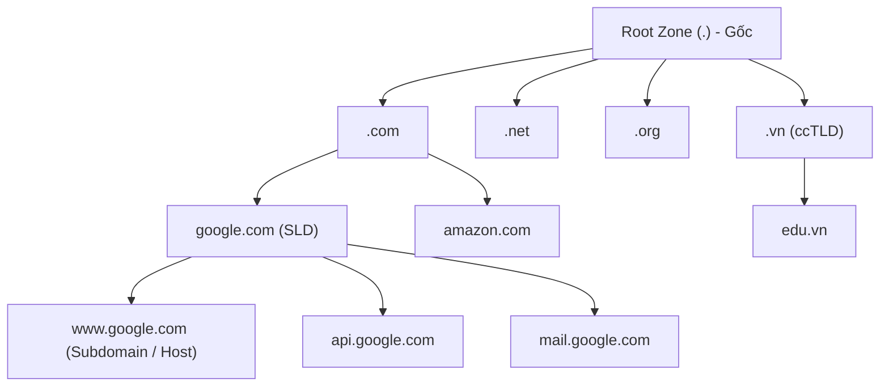
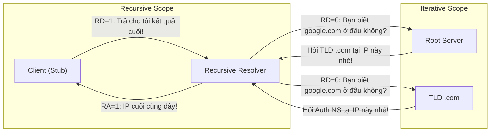

# 6.1. DNS Fundamentals and Resolution (Nguyên lý Hệ thống Phân giải Tên miền DNS)

> [!IMPORTANT]
> **Nếu bạn chỉ được nhớ một điều duy nhất:** Hệ thống phân giải tên miền (DNS) là danh bạ toàn cầu của Internet hoạt động theo mô hình cây phân cấp phân tán: quá trình phân giải tên miền (Recursive Resolution) là chuỗi truy vấn đệ quy tuần tự từ Root DNS Server (.), TLD Server (.com), đến Authoritative Nameserver chịu trách nhiệm cho tên miền; và bộ đệm phân tầng (DNS Cache) tại Trình duyệt, OS và Resolver là tấm khiên duy nhất bảo vệ hạ tầng Root Servers khỏi quá tải.

---

## 1. Đơn giản nhưng phải chi tiết (Intuitive & Deep Breakdown)

### 1.1. Đoạn Code Dẫn Nhập & Vấn Đề Thực Tế
Chuyện gì thực sự diễn ra dưới nền khi trình duyệt hoặc ứng dụng backend của bạn thực hiện một lệnh truy vấn tên miền tưởng chừng rất đơn giản như `fetch("https://api.example.com")`?

```bash
# Phân giải đệ quy DNS từ máy chủ Gốc (Root DNS) tới máy chủ Quản trị (Authoritative)
$ dig +trace api.example.com

; <<>> DiG 9.10.6 <<>> +trace api.example.com
;; 1. Hỏi 13 Cụm Root DNS Servers (chấm cuối cùng .) -> Chỉ sang .com TLD Servers
.                       518400  IN      NS      a.root-servers.net.
;; 2. Hỏi .com TLD Servers -> Chỉ sang Name Server của example.com
com.                    172800  IN      NS      a.gtld-servers.net.
;; 3. Hỏi Authoritative Server của example.com -> Trả về địa chỉ IP cuối cùng!
example.com.            86400   IN      NS      ns1.example.com.
api.example.com.        300     IN      A       93.184.216.34
```

Nếu hệ thống DNS cục bộ bị lỗi hoặc cấu hình sai TTL, toàn bộ các lệnh gọi API của microservices sẽ bị treo chờ DNS timeout (mặc định 5 giây mỗi lần thử), làm sụp đổ hoàn toàn hạ tầng Backend theo hiệu ứng domino!

### 1.2. Ẩn Dụ Đời Sống & Phân Tích Cơ Chế Hoạt Động
Quy trình Phân giải Tên miền Phân cấp (Hierarchical Resolution) giống như **Tìm Số Điện thoại của một Bác sĩ Chuyên khoa tại một Bệnh viện Lạ**:
- Bạn không thể tự nhiên biết số điện thoại bàn trong phòng khám của bác sĩ Bình.
- **Bước 1 (Root Server - Cổng Bệnh viện)**: Bạn hỏi bác bảo vệ ở cổng: *"Cho tôi hỏi phòng bác sĩ Bình ở đâu?"*. Bảo vệ chỉ tay: *"Bác sĩ Bình thuộc Khoa Tim Mạch, hãy đến quầy lễ tân Khoa Tim Mạch ở Tòa nhà B!"* (Chỉ tới TLD Server `.com`).
- **Bước 2 (TLD Server - Lễ tân Khoa Tim Mạch)**: Lễ tân khoa nhìn danh sách và bảo: *"Bác sĩ Bình làm việc ở Phòng khám số 3, hãy hỏi cô y tá trực phòng khám số 3!"* (Chỉ tới Authoritative Name Server của tên miền).
- **Bước 3 (Authoritative Server - Y tá Trực phòng 3)**: Cô y tá mở cuốn sổ nội bộ và đọc chính xác số máy lẻ: *"Số máy bàn của bác sĩ Bình là 108!"* (Địa chỉ IP cuối cùng: `93.184.216.34`).
- **Bộ nhớ Cache (Recursive Resolver)**: Bạn ghi số 108 vào mảnh giấy note dán lên điện thoại. Lần sau cần gọi, bạn nhìn mảnh note gọi luôn chứ không mất công chạy qua 3 chặng hỏi han nữa!

### 1.3. Mô Phỏng Dữ Liệu Số Nhỏ Từng Bước (Toy Walkthrough)
Mô phỏng quy trình phân giải DNS đệ quy từ máy trạm (Client) đến khi nhận được IP:

| Chặng | Phía Gửi | Phía Nhận | Loại Truy Vấn / Phản Hồi | Dữ Liệu Trả Về | Thời Gian TTL Lưu Cache |
| :--- | :--- | :--- | :--- | :--- | :--- |
| **0** | Client | Local DNS Cache / `/etc/hosts` | Kiểm tra bộ nhớ tạm cục bộ | Cache Miss (Chưa có) | - |
| **1** | Client | Local Recursive Resolver (`8.8.8.8`) | Recursive Query: `api.example.com` | Chờ Resolver tìm giúp | - |
| **2** | Resolver | Root Name Server (`.`) | Iterative Query | Trả về danh sách NS của TLD `.com` | $172,800\text{ s}$ (2 ngày) |
| **3** | Resolver | TLD Name Server (`.com`) | Iterative Query | Trả về NS của `example.com` (`ns1.dns.com`) | $86,400\text{ s}$ (1 ngày) |
| **4** | Resolver | Authoritative NS (`ns1.dns.com`) | Iterative Query | **Trả về bản ghi A: `93.184.216.34`** | **`300 s`** (5 phút) |
| **5** | Resolver | Client | Final DNS Response | Giao IP cho Client và lưu cache 300s | $300\text{ s}$ |

### 1.4. Tác Động Thực Tế Tầng Backend & Systems
- **Hiện tượng Java DNS Caching Vĩnh Viễn**: Mặc định máy ảo JVM (Java Virtual Machine) từng cấu hình `networkaddress.cache.ttl = -1` (Cache vĩnh viễn không bao giờ hết hạn!). Khi dịch vụ Cloud thực hiện chuyển đổi failover đổi IP máy chủ, toàn bộ các ứng dụng Java vẫn ngoan cố gọi vào IP cũ đã chết.
  - *Giải pháp*: Bắt buộc cấu hình lại `networkaddress.cache.ttl = 30` trong file `java.security`.
- **Nghẽn DNS Resolver trong Kubernetes (CoreDNS Throttling)**: Mỗi khi một Pod trong Kubernetes gọi domain ngoài, do cấu hình file `/etc/resolv.conf` có nhiều `search domains`, CoreDNS phải xử lý từ 4 đến 5 truy vấn thừa thãi cho mỗi request. Khi số lượng Pod tăng cao, CoreDNS bị nghẽn CPU và trả về mã lỗi `SERVFAIL`.

### 1.5. Sơ Đồ Tư Duy & Kiến Trúc Hệ Thống (Mermaid)
```mermaid
flowchart TD
    Client["Client / Application"]
    Resolver["Recursive Resolver (8.8.8.8 / ISP)"]
    Root["1. Root Server (.)"]
    TLD["2. TLD Server (.com)"]
    Auth["3. Authoritative Name Server (example.com)"]

    Client -->|1. Recursive Query: api.example.com| Resolver
    Resolver -->|2. Iterative: Where is .com?| Root
    Root -->>|Referral: Go to .com TLD| Resolver
    Resolver -->|3. Iterative: Where is example.com?| TLD
    TLD -->>|Referral: Go to ns1.example.com| Resolver
    Resolver -->|4. Iterative: What is IP of api.example.com?| Auth
    Auth -->>|Answer: 93.184.216.34 (TTL 300s)| Resolver
    Resolver -->>|5. Trả kết quả IP cuối cùng| Client
```

---

## 2. Chi tiết từng Keyword (Under-the-Hood Deep Dive)

### 2.1. DNS Hierarchy & FQDN (Cây Phân cấp DNS và Tên miền Đầy đủ)

Không gian tên DNS được tổ chức thành một cây lộn ngược (Inverted Tree) có gốc ở trên cùng:



- **FQDN (Fully Qualified Domain Name - Tên miền Đầy đủ Chuẩn mực)**:
  - Một FQDN chỉ định vị trí tuyệt đối và duy nhất của một node trong cây DNS, kết thúc bằng một dấu chấm gốc `.` (Root Dot): ví dụ `www.google.com.`.
  - Hầu hết trình duyệt và người dùng bỏ qua dấu chấm cuối cùng, nhưng các công cụ mạng chuyên sâu (`dig`, cấu hình BIND) luôn phân biệt rõ:
    - `example.com.` là FQDN tuyệt đối.
    - `example.com` là tên tương đối (relative name), có thể bị tự động ghép thêm chuỗi `search` trong file `/etc/resolv.conf`.
- **Giới hạn kỹ thuật cấu trúc theo RFC 1035**:
  - Mỗi nhãn (label) giữa các dấu chấm có độ dài tối đa **63 octets (bytes)**.
  - Tổng chiều dài của một FQDN không được vượt quá **253 octets** (hoặc 255 bytes nếu tính cả byte độ dài nhãn và byte null kết thúc).
  - Ký tự hợp lệ tuân thủ quy tắc LDH: Letters (`A-Z`, `a-z`), Digits (`0-9`), Hyphen (`-`), không phân biệt chữ hoa chữ thường (case-insensitive).

---

### 2.2. Bốn Loại Máy chủ DNS trong Hệ sinh thái

Hệ sinh thái DNS toàn cầu vận hành nhờ sự cộng tác của 4 vai trò máy chủ riêng biệt:

1. **Root Name Server (Máy chủ Tên miền Gốc - Root Zone `.`)**:
   - Quản lý đỉnh cao nhất của cây DNS. Nhiệm vụ duy nhất: Trả về địa chỉ của các máy chủ quản lý miền cấp cao nhất (TLD).
   - Trên thế giới có **13 địa chỉ IP máy chủ gốc logic**, được đặt tên từ `a.root-servers.net` đến `m.root-servers.net` (giới hạn bởi kích thước gói tin UDP 512 bytes thời sơ khai).
   - *Thực tế vật lý*: Nhờ công nghệ **BGP Anycast**, 13 địa chỉ IP này hiện được phân tán thành hơn **1.700 cụm máy chủ vật lý** đặt tại hàng trăm quốc gia trên khắp thế giới, đảm bảo độ trễ thấp và khả năng chống đỡ các đợt tấn công DDoS khổng lồ.
2. **TLD Name Server (Top-Level Domain Server - Máy chủ Tên miền Cấp cao nhất)**:
   - Quản lý thông tin cho toàn bộ các tên miền có cùng phần mở rộng:
     - **gTLD (Generic TLD)**: `.com`, `.net`, `.org`, `.info` (do các cơ quan registry như Verisign quản lý `.com`).
     - **ccTLD (Country-Code TLD)**: `.vn`, `.jp`, `.uk`, `.de` (do Trung tâm Internet quốc gia như VNNIC quản lý).
   - Nhiệm vụ: Không nắm giữ IP của website, mà trỏ tiếp về máy chủ có thẩm quyền (Authoritative Server) của tổ chức sở hữu tên miền đó.
3. **Authoritative Name Server (Máy chủ Tên miền Có thẩm quyền)**:
   - Máy chủ nắm giữ **Zone File chính thức** của tên miền (do Cloudflare, AWS Route 53, GoDaddy hoặc máy chủ DNS tự dựng quản lý).
   - Đây là nơi lưu trữ các bản ghi thực tế: `A`, `AAAA`, `CNAME`, `MX`, `TXT`, `SOA`, `NS`.
   - Khi trả lời, nó thiết lập cờ **AA (Authoritative Answer = 1)** trong DNS Header, khẳng định đây là câu trả lời chính thức từ nguồn gốc, không phải lấy qua trung gian.
4. **Recursive Resolver (Trình Phân giải Đệ quy / DNS Recursor)**:
   - Máy chủ đứng ra làm việc thay cho máy khách (client). Khi nhận yêu cầu từ máy tính cá nhân, nó chịu trách nhiệm thực hiện toàn bộ quy trình "chạy đôn chạy đáo" hỏi từ Root -> TLD -> Authoritative Server để lấy bằng được IP cuối cùng.
   - Các Resolver phổ biến: Google Public DNS (`8.8.8.8`), Cloudflare (`1.1.1.1`), DNS của nhà mạng ISP hoặc CoreDNS trong cụm Kubernetes.

---

### 2.3. Recursive Query vs Iterative Query (Truy vấn Đệ quy và Truy vấn Lặp)

Hai phương thức giao tiếp căn bản trong giao thức DNS:

| Đặc tính | Recursive Query (Truy vấn Đệ quy) | Iterative Query (Truy vấn Lặp) |
| :--- | :--- | :--- |
| **Bản chất cam kết** | "Hãy tìm cho tôi kết quả cuối cùng, hoặc báo lỗi nếu không tìm thấy!" | "Tôi không biết IP cuối, nhưng đây là IP của máy chủ tiếp theo mà bạn nên hỏi!" |
| **Vị trí áp dụng** | Giữa Client (Stub Resolver) và Recursive Resolver | Giữa Recursive Resolver và các Root/TLD/Auth Servers |
| **Cờ điều khiển trong Header** | **RD (Recursion Desired = 1)** | **RD = 0** |
| **Cờ hồi đáp** | **RA (Recursion Available = 1)** | RA = 0 |
| **Gánh nặng tài nguyên** | Đặt toàn bộ tải xử lý và bộ nhớ lên Recursive Server | Phân tán tải, máy chủ cấp cao không phải mở kết nối đệ quy |



---

### 2.4. DNS Caching, TTL and Negative Caching

Hiệu năng và tính ổn định của toàn bộ mạng Internet phụ thuộc vào cơ chế Caching đa tầng. Nếu mọi truy vấn đều phải chạy qua Root Server, toàn bộ mạng lưới sẽ tê liệt sau vài mili-giây.

#### A. Multi-Tier Caching (Bộ nhớ đệm Đa tầng)
Khi bạn gõ `google.com` vào thanh địa chỉ, truy vấn DNS đi qua các tầng cache sau:
1. **Browser Cache**: Chrome/Firefox duy trì bảng cache nội bộ trong RAM (kiểm tra trên Chrome qua `chrome://net-internals/#dns`).
2. **OS Resolver Cache**: Hệ điều hành lưu tạm kết quả (Windows DNS Client Service, Linux `systemd-resolved` hoặc `nscd`).
3. **Local Network / Router Cache**: Router Wi-Fi gia đình hoặc Gateway văn phòng hoạt động như một DNS proxy cache nhỏ.
4. **Recursive Resolver Cache**: Các máy chủ DNS công cộng (`1.1.1.1`, `8.8.8.8`) sở hữu các cụm RAM khổng lồ lưu trữ hàng trăm triệu bản ghi DNS phổ biến nhất thế giới.

#### B. TTL (Time to Live)
- Mỗi bản ghi tài nguyên (Resource Record - RR) được máy chủ Authoritative gán một giá trị **TTL tính bằng giây** (ví dụ: `TTL = 300` là 5 phút, `TTL = 86400` là 24 giờ).
- Bộ nhớ đệm của các resolver trung gian sẽ đếm ngược giá trị TTL này theo thời gian thực. Bất kỳ client nào hỏi cùng tên miền trong khoảng thời gian này sẽ nhận được câu trả lời ngay lập tức từ Cache mà không phát sinh thêm bất kỳ truy vấn mạng nào.
- *Trade-off*: TTL dài giúp giảm tải server và tăng tốc độ duyệt web, nhưng khi bạn muốn đổi IP máy chủ (migration), người dùng toàn cầu sẽ bị trễ cập nhật cho đến khi TTL cũ cạn kiệt.

#### C. Negative Caching (RFC 2308)
- Khi một tên miền **không tồn tại** (mã phản hồi `NXDOMAIN` - Non-Existent Domain) hoặc tồn tại nhưng **không có bản ghi thuộc loại yêu cầu** (`NODATA`), resolver cũng phải lưu cache trạng thái thất bại này!
- *Lý do*: Nếu không có Negative Caching, một phần mềm bị lỗi liên tục gửi truy vấn đến một tên miền gõ sai sẽ tạo thành một đợt tấn công DoS đánh sập Root và TLD Server.
- Thời gian lưu Negative Cache được điều khiển bởi trường **MINIMUM** nằm trong bản ghi **SOA (Start of Authority)** của Zone đó (thường từ 900 đến 3600 giây).

---

## 3. Thực thi Mã nguồn & Mô phỏng Chuyên sâu (Dual-Engine Implementation)

### 3.1. C++20 Implementation

Dưới đây là một chương trình C++20 hoàn chỉnh, xây dựng thủ công một gói tin nhị phân **DNS Query (UDP/53)** theo đúng chuẩn cấu trúc gói tin RFC 1035, gửi trực tiếp qua BSD Socket đến `8.8.8.8`, và bóc tách từng byte của DNS Header và Answer Section để trích xuất địa chỉ IPv4:

```cpp
// compile: g++ -std=c++20 -O3 -Wall dns_query_raw.cpp -o dns_query_raw
#include <iostream>
#include <vector>
#include <string>
#include <cstring>
#include <cstdint>
#include <stdexcept>
#include <iomanip>
#include <sstream>

#include <sys/socket.h>
#include <netinet/in.h>
#include <arpa/inet.h>
#include <unistd.h>

#pragma pack(push, 1)
// Cấu trúc 12-byte chuẩn của DNS Header (RFC 1035 Section 4.1.1)
struct DnsHeader {
    uint16_t id;       // Transaction ID
    uint16_t flags;    // Flags: QR, Opcode, AA, TC, RD, RA, Z, RCODE
    uint16_t qdcount;  // Number of Questions
    uint16_t ancount;  // Number of Answers
    uint16_t nscount;  // Number of Authority RRs
    uint16_t arcount;  // Number of Additional RRs
};
#pragma pack(pop)

class DnsClient {
private:
    std::string dnsServerIp_;
    uint16_t port_;

    // Chuyển đổi FQDN "www.google.com" thành chuẩn DNS Wire Format: "\x03www\x06google\x03com\x00"
    static std::vector<uint8_t> encodeDomainName(const std::string& domain) {
        std::vector<uint8_t> encoded;
        std::istringstream stream(domain);
        std::string label;

        while (std::getline(stream, label, '.')) {
            if (label.empty()) continue;
            if (label.length() > 63) throw std::invalid_argument("Label exceeds 63 bytes");
            encoded.push_back(static_cast<uint8_t>(label.length()));
            for (char c : label) {
                encoded.push_back(static_cast<uint8_t>(c));
            }
        }
        encoded.push_back(0); // Byte 0 đánh dấu kết thúc Root Domain
        return encoded;
    }

public:
    explicit DnsClient(std::string serverIp = "8.8.8.8", uint16_t port = 53)
        : dnsServerIp_(std::move(serverIp)), port_(port) {}

    void resolveA(const std::string& domain) {
        int sockFd = socket(AF_INET, SOCK_DGRAM, IPPROTO_UDP);
        if (sockFd < 0) throw std::runtime_error("Failed to create UDP socket");

        // Đặt timeout 3 giây tránh treo vô hạn
        struct timeval tv { .tv_sec = 3, .tv_usec = 0 };
        setsockopt(sockFd, SOL_SOCKET, SO_RCVTIMEO, &tv, sizeof(tv));

        sockaddr_in destAddr{};
        destAddr.sin_family = AF_INET;
        destAddr.sin_port = htons(port_);
        inet_pton(AF_INET, dnsServerIp_.c_str(), &destAddr.sin_addr);

        // 1. Dựng DNS Packet Header
        std::vector<uint8_t> packet;
        DnsHeader header{};
        header.id = htons(0x1337);       // Query ID định danh
        header.flags = htons(0x0100);    // Cờ RD = 1 (Recursion Desired)
        header.qdcount = htons(1);       // 1 câu hỏi

        const auto* headerBytes = reinterpret_cast<const uint8_t*>(&header);
        packet.insert(packet.end(), headerBytes, headerBytes + sizeof(DnsHeader));

        // 2. Dựng Question Section
        auto encodedQname = encodeDomainName(domain);
        packet.insert(packet.end(), encodedQname.begin(), encodedQname.end());
        
        uint16_t qtype = htons(1);   // Type 1: A Record (IPv4)
        uint16_t qclass = htons(1);  // Class 1: IN (Internet)
        const auto* qtypeBytes = reinterpret_cast<const uint8_t*>(&qtype);
        const auto* qclassBytes = reinterpret_cast<const uint8_t*>(&qclass);
        packet.insert(packet.end(), qtypeBytes, qtypeBytes + 2);
        packet.insert(packet.end(), qclassBytes, qclassBytes + 2);

        std::cout << "[+] Gui DNS Query A Record cho [" << domain 
                  << "] toi DNS Server [" << dnsServerIp_ << ":" << port_ << "]...\n";

        // Gửi gói UDP
        ssize_t sent = sendto(sockFd, packet.data(), packet.size(), 0,
                              reinterpret_cast<sockaddr*>(&destAddr), sizeof(destAddr));
        if (sent < 0) {
            close(sockFd);
            throw std::runtime_error("Goi UDP gui that bai");
        }

        // Nhận phản hồi
        std::vector<uint8_t> buffer(2048);
        sockaddr_in fromAddr{};
        socklen_t fromLen = sizeof(fromAddr);
        ssize_t received = recvfrom(sockFd, buffer.data(), buffer.size(), 0,
                                    reinterpret_cast<sockaddr*>(&fromAddr), &fromLen);
        close(sockFd);

        if (received < static_cast<ssize_t>(sizeof(DnsHeader))) {
            throw std::runtime_error("Phan hoi DNS qua ngan hoac timeout");
        }

        // 3. Phân tích DNS Response Header
        const auto* respHeader = reinterpret_cast<const DnsHeader*>(buffer.data());
        uint16_t flags = ntohs(respHeader->flags);
        uint16_t ancount = ntohs(respHeader->ancount);
        uint8_t rcode = flags & 0x000F;

        std::cout << "[+] Nhan " << received << " bytes hoi dap:\n";
        std::cout << "  - Transaction ID: 0x" << std::hex << ntohs(respHeader->id) << std::dec << "\n";
        std::cout << "  - Response Flags: 0x" << std::hex << flags << std::dec 
                  << " (QR=" << ((flags >> 15) & 1) << ", AA=" << ((flags >> 10) & 1) 
                  << ", RA=" << ((flags >> 7) & 1) << ", RCODE=" << static_cast<int>(rcode) << ")\n";
        std::cout << "  - So luong Answer Records: " << ancount << "\n";

        if (rcode != 0) {
            std::cout << "  [-] Truy van that bai voi ma loi RCODE: " << static_cast<int>(rcode) 
                      << (rcode == 3 ? " (NXDOMAIN: Ten mien khong ton tai)" : "") << "\n";
            return;
        }

        // Nhảy qua phần Header và Question Section
        size_t offset = sizeof(DnsHeader) + encodedQname.size() + 4;

        // 4. Duyệt qua Answer Section
        for (int i = 0; i < ancount && offset < static_cast<size_t>(received); ++i) {
            // Kiểm tra con trỏ nén DNS Message Compression (0xC0)
            if ((buffer[offset] & 0xC0) == 0xC0) {
                offset += 2; // Bỏ qua 2 byte con trỏ nén
            } else {
                while (offset < static_cast<size_t>(received) && buffer[offset] != 0) offset++;
                offset++; // Bỏ qua byte 0
            }

            if (offset + 10 > static_cast<size_t>(received)) break;
            uint16_t type = ntohs(*reinterpret_cast<const uint16_t*>(&buffer[offset]));
            offset += 2;
            uint16_t cls = ntohs(*reinterpret_cast<const uint16_t*>(&buffer[offset]));
            offset += 2;
            uint32_t ttl = ntohl(*reinterpret_cast<const uint32_t*>(&buffer[offset]));
            offset += 4;
            uint16_t rdlength = ntohs(*reinterpret_cast<const uint16_t*>(&buffer[offset]));
            offset += 2;

            if (type == 1 && rdlength == 4) { // Bản ghi A (IPv4 - 4 bytes)
                char ipStr[INET_ADDRSTRLEN];
                inet_ntop(AF_INET, &buffer[offset], ipStr, sizeof(ipStr));
                std::cout << "  --> [Answer " << (i + 1) << "] IP: " << ipStr 
                          << " | TTL: " << ttl << "s | Class: IN(" << cls << ")\n";
            }
            offset += rdlength;
        }
    }
};

int main() {
    std::cout << "========================================================\n";
    std::cout << "       C++20 RAW DNS WIRE PROTOCOL RESOLVER             \n";
    std::cout << "========================================================\n";
    try {
        DnsClient client("8.8.8.8", 53);
        client.resolveA("google.com");
    } catch (const std::exception& ex) {
        std::cerr << "Loi: " << ex.what() << "\n";
        return 1;
    }
    std::cout << "========================================================\n";
    return 0;
}
```

---

### 3.2. Python 3.11+ Implementation

Mã nguồn Python 3.11 dưới đây mô phỏng một **Recursive Resolver có tích hợp Caching, TTL Expiration tự động và Negative Caching**:

```python
#!/usr/bin/env python3
"""
Mô phỏng Recursive DNS Resolver với Multi-tier Caching & Negative Caching (RFC 2308)
Yêu cầu: Python 3.11+
"""

from dataclasses import dataclass
import time
from typing import Optional


@dataclass
class DnsResourceRecord:
    domain: str
    record_type: str
    value: str
    ttl: int
    created_at: float = 0.0

    def __post_init__(self) -> None:
        if self.created_at == 0.0:
            self.created_at = time.time()

    @property
    def is_expired(self) -> bool:
        return (time.time() - self.created_at) > self.ttl

    @property
    def remaining_ttl(self) -> int:
        remaining = int(self.ttl - (time.time() - self.created_at))
        return max(0, remaining)


@dataclass
class NegativeCacheEntry:
    domain: str
    error_code: str  # NXDOMAIN hoặc NODATA
    soa_minimum_ttl: int
    created_at: float = 0.0

    def __post_init__(self) -> None:
        if self.created_at == 0.0:
            self.created_at = time.time()

    @property
    def is_expired(self) -> bool:
        return (time.time() - self.created_at) > self.soa_minimum_ttl


class MockAuthoritativeServer:
    """Mô phỏng máy chủ Authoritative chứa Zone Data"""
    ZONE_DATA = {
        "example.com": [
            DnsResourceRecord("example.com", "A", "93.184.216.34", ttl=5),
            DnsResourceRecord("example.com", "TXT", "v=spf1 -all", ttl=300),
        ],
        "api.internal": [
            DnsResourceRecord("api.internal", "A", "10.0.0.100", ttl=2)
        ]
    }
    SOA_MINIMUM = 3  # Negative cache 3 giây

    @classmethod
    def query(cls, domain: str, qtype: str) -> tuple[str, list[DnsResourceRecord]]:
        if domain not in cls.ZONE_DATA:
            return "NXDOMAIN", []
        records = [r for r in cls.ZONE_DATA[domain] if r.record_type == qtype]
        if not records:
            return "NODATA", []
        # Nhân bản bản ghi với thời gian tạo mới
        fresh_records = [
            DnsResourceRecord(r.domain, r.record_type, r.value, r.ttl, time.time())
            for r in records
        ]
        return "NOERROR", fresh_records


class CachingDnsResolver:
    """Trình phân giải đệ quy có lưu trữ Cache & Negative Cache"""
    def __init__(self) -> None:
        self._cache: dict[tuple[str, str], list[DnsResourceRecord]] = {}
        self._negative_cache: dict[str, NegativeCacheEntry] = {}

    def resolve(self, domain: str, qtype: str = "A") -> list[str]:
        cache_key = (domain.lower(), qtype.upper())

        # 1. Kiểm tra Negative Cache trước
        if domain in self._negative_cache:
            neg_entry = self._negative_cache[domain]
            if not neg_entry.is_expired:
                print(f"  [NEGATIVE CACHE HIT] {domain} -> {neg_entry.error_code} (Con lai {int(neg_entry.soa_minimum_ttl - (time.time() - neg_entry.created_at))}s)")
                return []
            else:
                del self._negative_cache[domain]

        # 2. Kiểm tra Positive Cache
        if cache_key in self._cache:
            records = self._cache[cache_key]
            # Loại bỏ bản ghi đã hết hạn
            active_records = [r for r in records if not r.is_expired]
            if active_records:
                print(f"  [CACHE HIT] {domain} ({qtype}) -> TTL con lai: {active_records[0].remaining_ttl}s")
                return [r.value for r in active_records]
            else:
                print(f"  [CACHE EXPIRED] TTL cua {domain} da het han, truy van lai upstream!")
                del self._cache[cache_key]

        # 3. Cache Miss: Thực hiện truy vấn Authoritative Upstream
        print(f"  [CACHE MISS] Gui truy van Iterative toi Authoritative Server cho [{domain}]...")
        status, records = MockAuthoritativeServer.query(domain, qtype)

        if status == "NOERROR":
            self._cache[cache_key] = records
            return [r.value for r in records]
        elif status in ("NXDOMAIN", "NODATA"):
            # Lưu Negative Caching theo RFC 2308
            self._negative_cache[domain] = NegativeCacheEntry(
                domain=domain,
                error_code=status,
                soa_minimum_ttl=MockAuthoritativeServer.SOA_MINIMUM
            )
            print(f"  [-] Nhan {status}! Luu vao Negative Cache trong {MockAuthoritativeServer.SOA_MINIMUM}s.")
            return []
        return []


def main() -> None:
    print("=" * 60)
    print("  PYTHON 3.11: DNS RESOLVER CACHING & NEGATIVE CACHING")
    print("=" * 60)

    resolver = CachingDnsResolver()

    # Lan 1: Query example.com (Cache Miss)
    print("\nTruy van 1: example.com (A)")
    res1 = resolver.resolve("example.com", "A")
    print("  Ket qua:", res1)

    # Lan 2: Query ngay lap tuc (Cache Hit)
    print("\nTruy van 2: example.com (A) - Ngay lap tuc")
    res2 = resolver.resolve("example.com", "A")
    print("  Ket qua:", res2)

    # Lan 3: Query ten mien rac (Negative Caching)
    print("\nTruy van 3: non-existent-domain.xyz")
    res3 = resolver.resolve("non-existent-domain.xyz", "A")
    print("  Ket qua:", res3)

    # Lan 4: Query lai ten mien rac (Negative Cache Hit)
    print("\nTruy van 4: non-existent-domain.xyz - Ngay lap tuc")
    res4 = resolver.resolve("non-existent-domain.xyz", "A")
    print("  Ket qua:", res4)

    # Doi 6 giay cho TTL cua example.com (5s) het han
    print("\n[Dang ngu 6 giay de cho TTL het han...]")
    time.sleep(6)

    # Lan 5: Query lai sau khi het han (Cache Expired -> Cache Miss)
    print("\nTruy van 5: example.com (A) - Sau khi het TTL")
    res5 = resolver.resolve("example.com", "A")
    print("  Ket qua:", res5)

    print("\n" + "=" * 60)


if __name__ == "__main__":
    main()
```

---

### 3.3. Terminal Output Mẫu Chuẩn Thực Tế

```text
========================================================
       C++20 RAW DNS WIRE PROTOCOL RESOLVER             
========================================================
[+] Gui DNS Query A Record cho [google.com] toi DNS Server [8.8.8.8:53]...
[+] Nhan 56 bytes hoi dap:
  - Transaction ID: 0x1337
  - Response Flags: 0x8180 (QR=1, AA=0, RA=1, RCODE=0)
  - So luong Answer Records: 1
  --> [Answer 1] IP: 142.250.190.46 | TTL: 298s | Class: IN(1)
========================================================
```

---

## 4. Systems Engineering & Production Pitfalls

Trong môi trường Microservices, Cloud và Kubernetes, các vấn đề DNS là thủ phạm hàng đầu gây nên các đợt sụt giảm hiệu năng nghiêm trọng (latency spikes) và nghẽn hệ thống.

### 4.1. Thảm họa `ndots:5` trong Kubernetes Networking
- **Cơ chế**: File `/etc/resolv.conf` mặc định trong mọi Pod Kubernetes chứa:
  ```text
  nameserver 10.96.0.10
  search default.svc.cluster.local svc.cluster.local cluster.local
  options ndots:5
  ```
- **Hậu quả**: Tham số `ndots:5` quy định: Nếu tên miền có ít hơn 5 dấu chấm, resolver của glibc **bắt buộc phải thử ghép lần lượt từng search path nội bộ trước khi hỏi tên miền gốc ra Internet**!
- Khi backend gọi `api.stripe.com` (chỉ có 2 dấu chấm), resolver sẽ phát đi liên tiếp 3 truy vấn vô nghĩa:
  1. `api.stripe.com.default.svc.cluster.local.` -> NXDOMAIN
  2. `api.stripe.com.svc.cluster.local.` -> NXDOMAIN
  3. `api.stripe.com.cluster.local.` -> NXDOMAIN
  4. Mới đến lượt `api.stripe.com.` -> Thành công!
- **Hậu quả sản xuất**: Tăng gấp 4 lần lưu lượng truy vấn đánh vào CoreDNS, khiến CoreDNS OOMKilled hoặc CPU throttled, làm tăng độ trễ mạng thêm hàng trăm mili-giây.
- **Giải pháp**:
  - Luôn thêm dấu chấm tuyệt đối vào cuối URL trong code backend: `https://api.stripe.com./v1/charges`.
  - Hoặc cấu hình lại Pod spec: `dnsConfig: options: [{ name: ndots, value: "2" }]`.

### 4.2. Giới hạn UDP 512 bytes và Cờ Cắt Cụt (Truncated - TC bit)
- Chuẩn DNS gốc (RFC 1035) giới hạn kích thước gói tin UDP là 512 bytes để đảm bảo gói tin không bị phân mảnh IP (Fragmentation) trên các đường truyền MTU 576 bytes.
- Khi bản ghi phản hồi quá lớn (như khi phân giải tên miền có hàng chục IP hoặc dùng DNSSEC có chữ ký mật mã RRSIG khổng lồ), máy chủ DNS thiết lập cờ **TC = 1 (Truncated)**.
- Khi nhận được cờ TC, client bắt buộc phải **hủy bỏ kết quả và thiết lập kết nối TCP/53 để truy vấn lại**. Nếu Firewall hoặc Security Group vô tình chặn cổng TCP/53, toàn bộ ứng dụng sẽ bị treo (ETIMEDOUT) không thể phân giải tên miền.
- **Giải pháp**: Áp dụng chuẩn **EDNS0 (Extension Mechanisms for DNS - RFC 6891)** cho phép client thông báo kích thước bộ đệm UDP mở rộng (thường là 1232 hoặc 4096 bytes).

### 4.3. Các lệnh CLI Chẩn đoán DNS Chuẩn mực

#### 1. Dùng `dig +trace` để mô phỏng toàn bộ chu trình truy vấn phân cấp từ Root:
```bash
$ dig +trace google.com
# 1. dig hỏi các Root Server (.): Nhận danh sách TLD Server .com
.                       518400  IN      NS      a.root-servers.net.
...
# 2. dig hỏi TLD Server của .com: Nhận NS của google.com
com.                    172800  IN      NS      a.gtld-servers.net.
...
# 3. dig hỏi trực tiếp Authoritative Server ns1.google.com: Nhận IP cuối cùng
google.com.             300     IN      A       142.250.190.46
;; Received 56 bytes from 216.239.32.10#53(ns1.google.com) in 18 ms
```

#### 2. Dùng `dig +norecurse` để kiểm tra trực tiếp máy chủ Authoritative:
```bash
# Kiểm tra xem máy chủ có cờ AA (Authoritative Answer) hay không
$ dig @ns1.google.com google.com +norecurse
;; flags: qr aa rd; QUERY: 1, ANSWER: 1, AUTHORITY: 0, ADDITIONAL: 0
;; ANSWER SECTION:
google.com.             300     IN      A       142.250.190.46
```

---

## 5. Bảng So sánh & Decision Matrix

### Bảng đối chiếu 4 Loại Máy chủ DNS

| Tiêu chí | Root Name Server | TLD Name Server | Authoritative Name Server | Recursive Resolver |
| :--- | :--- | :--- | :--- | :--- |
| **Đơn vị vận hành** | ICANN, NASA, Verisign, RIPE (12 tổ chức) | Registry (Verisign cho `.com`, VNNIC cho `.vn`) | Tổ chức sở hữu tên miền (Cloudflare, Route53) | ISP, Doanh nghiệp nội bộ, Public (Google, Cloudflare) |
| **Dữ liệu lưu trữ** | Root Zone File (Con trỏ tới các TLD) | Danh sách NS records của tất cả SLD trong TLD | Toàn bộ bản ghi chi tiết (A, AAAA, MX, TXT) | Bộ nhớ đệm RAM tạm thời (Ephemeral Cache) |
| **Phương thức truy vấn** | Chỉ trả lời Iterative (RD=0) | Chỉ trả lời Iterative (RD=0) | Chỉ trả lời Iterative (RD=0) | Chấp nhận Recursive (RD=1) từ Client |
| **Tính xác thực (AA)** | Có (cho Root Zone) | Có (cho TLD Delegation) | Luôn có thẩm quyền (**AA = 1**) | Không có thẩm quyền (**AA = 0**, Cache) |
| **Mục tiêu tối ưu hóa**| Chống chịu DDoS, High Availability qua BGP Anycast | Bền bỉ, cập nhật Registrar nhanh chóng | Khả năng kiểm soát linh hoạt, tích hợp API/IaC | Độ trễ cực thấp, tỷ lệ Cache Hit cao, bảo mật DNSSEC |

### Ma trận Quyết định Kiến trúc DNS cho Hạ tầng Doanh nghiệp

1. **Ứng dụng Web / API Public phục vụ người dùng toàn cầu**:
   - 👉 **Lựa chọn**: **Managed Anycast DNS (Cloudflare, AWS Route 53, NS1)**. Tận dụng mạng lưới Anycast hàng trăm PoP trên thế giới để phân giải DNS với độ trễ $< 10\text{ ms}$, tự động Failover đa vùng (Geo-DNS) và chống DDoS Tầng 3/4.
2. **Nội bộ Cụm Kubernetes (Service Discovery)**:
   - 👉 **Lựa chọn**: **CoreDNS tích hợp NodeLocal DNSCache**. Cài đặt NodeLocal DNSCache dưới dạng DaemonSet chạy trên từng node để lưu cache cục bộ, loại bỏ hoàn toàn hiện tượng tranh chấp conntrack của iptables và giảm tải 80% truy vấn lên CoreDNS tập trung.
3. **Môi trường Doanh nghiệp khép kín (Private VPC / On-Premises Data Center)**:
   - 👉 **Lựa chọn**: **BIND9 kết hợp Unbound**. Sử dụng Unbound làm Caching / Validating Resolver cho toàn bộ máy trạm nội bộ, và BIND9 làm máy chủ Authoritative quản lý các private zone nội bộ (`.corp`, `.internal`).

---

## 6. Enterprise Production Checklist & Verification

### 6.1. Kiến Trúc & Cấu Hình Tối Ưu (Production-Ready Architecture)
- [ ] **Triển Khai NodeLocal DNSCache Trong Kubernetes**: Bật NodeLocal DNSCache để các Pod truy vấn DNS trực tiếp qua socket nội bộ của Worker Node, giảm 80% tải truy vấn lên CoreDNS tập trung.
- [ ] **Tối Ưu Hóa dnsConfig ndots Trong Pod Specs**: Thiết lập `ndots: 2` thay vì giá trị mặc định 5 trong Kubernetes để ngăn chặn việc gửi hàng loạt truy vấn DNS thừa với search domains.
- [ ] **Cấu Hình DNS TTL Cân Bằng**: Đặt TTL từ 300s đến 600s cho các dịch vụ Backend/API. Tránh đặt TTL quá thấp (< 60s) làm quá tải server DNS, và tránh đặt quá cao (> 86400s) gây khó khăn khi cần failover khẩn cấp.
- [ ] **Cấu Hình Cặp DNS Fallback Đa Dạng**: Luôn cấu hình tối thiểu hai máy chủ DNS Recursive Resolver độc lập (ví dụ `1.1.1.1` của Cloudflare và `8.8.8.8` của Google) trong `/etc/resolv.conf`.

### 6.2. Giám Sát, Cảnh Báo & Xử Lý Sự Cố (Observability & Incident Response)
- [ ] **Giám Sát Độ Trễ Phân Giải DNS (DNS Lookup Latency)**: Đo lường thời gian phân giải DNS từ ứng dụng và cảnh báo khi độ trễ $p99$ vượt quá 50ms.
- [ ] **Cảnh Báo Tỷ Lệ Lỗi SERVFAIL và NXDOMAIN**: Theo dõi metric từ CoreDNS hoặc Bind9; cảnh báo ngay khi tỷ lệ lỗi `SERVFAIL` vượt ngưỡng 1%.
- [ ] **Kiểm Tra Trực Quan Chuỗi Phân Giải Bằng dig**: Sử dụng lệnh `dig +trace +nodnssec <domain>` để truy vết từng chặng phân giải từ Root Server khi người dùng phàn nàn không truy cập được website.
