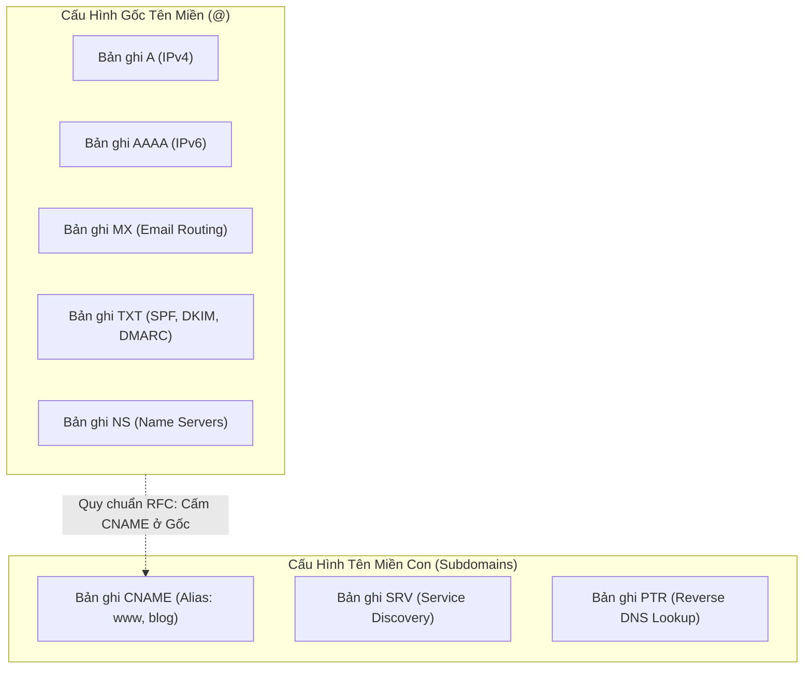
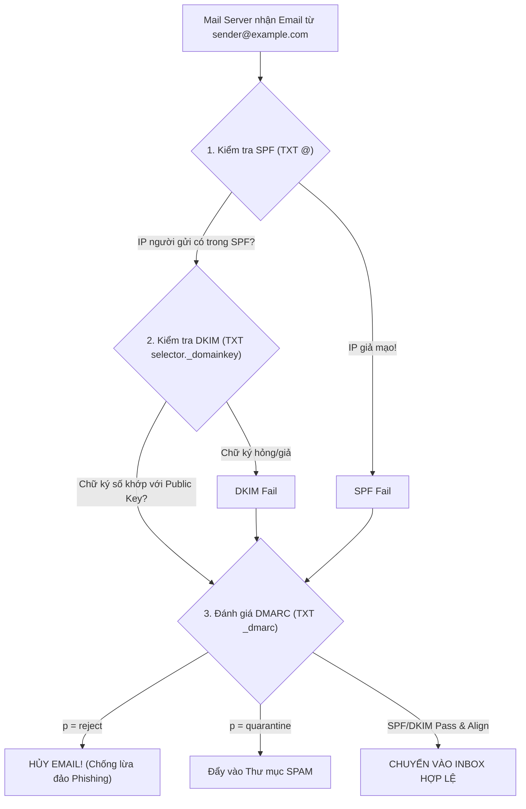
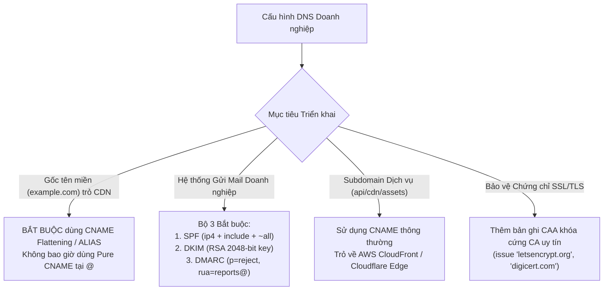

# 6.2. DNS Record Types

> [!IMPORTANT]
> **Nếu bạn chỉ được nhớ một điều duy nhất:** Mỗi bản ghi DNS đại diện cho một chức năng định tuyến chuyên biệt của ứng dụng: Bản ghi `A` ánh xạ IPv4, `AAAA` ánh xạ IPv6; `CNAME` tạo bí danh trỏ về một tên miền khác (lưu ý cấm CNAME tại Zone Apex/@); `MX` định tuyến email máy chủ; và bản ghi `TXT` đóng vai trò là nền tảng xác thực an ninh hiện đại (SPF, DKIM, DMARC, Domain Verification).

---

## 1. Đơn giản nhưng phải chi tiết (Intuitive & Deep Breakdown)

### 1.1. Đoạn Code Dẫn Nhập & Vấn Đề Thực Tế
Làm sao một hệ thống tên miền có thể vừa trỏ một website về địa chỉ IPv4, vừa hỗ trợ IPv6, vừa chuyển hướng email doanh nghiệp về Gmail/Outlook, lại vừa xác thực quyền sở hữu website với Google Search Console?

```text
; Trích xuất vùng cấu hình DNS Zone File chuẩn (RFC 1035)
$ORIGIN example.com.
$TTL 300

; Bản ghi định danh địa chỉ IP
@       IN  A      93.184.216.34          ; IPv4 Address
@       IN  AAAA   2606:2800:220:1:248:: ; IPv6 Address

; Bản ghi bí danh (Alias)
www     IN  CNAME  example.com.           ; www.example.com trỏ về example.com

; Bản ghi định tuyến máy chủ Thư điện tử (Email)
@       IN  MX     10 mail.example.com.   ; Mail Server với độ ưu tiên 10

; Bản ghi xác thực bảo mật và sở hữu tên miền
@       IN  TXT    "v=spf1 include:_spf.google.com ~all"
_dmarc  IN  TXT    "v=DMARC1; p=reject; rua=mailto:dmarc@example.com"
```

Một sai lầm kinh điển của lập trình viên là **tạo bản ghi CNAME tại gốc tên miền (Zone Apex: `example.com`)**. Theo chuẩn RFC, bản ghi CNAME không được phép cùng tồn tại với bất kỳ bản ghi nào khác; việc đặt CNAME ở gốc sẽ làm bốc hơi toàn bộ bản ghi `MX` và `NS`, khiến công ty lập tức bị tê liệt hệ thống email!

### 1.2. Ẩn Dụ Đời Sống & Phân Tích Cơ Chế Hoạt Động
Các loại bản ghi DNS giống như **Các Mục Thông Tin Khác Nhau trong Cuốn Danh Bạ Doanh Nghiệp**:
- **Bản ghi `A` & `AAAA`** giống như **Địa chỉ Tọa độ Nhà xưởng**: Cho biết chính xác tòa nhà nằm ở đâu (IPv4 là địa chỉ nhà 4 tầng, AAAA là địa chỉ tòa tháp 16 tầng hiện đại).
- **Bản ghi `CNAME`** giống như **Biệt danh / Nghệ danh**: *"Nếu tìm ca sĩ Sơn Tùng M-TP, hãy tìm thông tin của anh Nguyễn Thanh Tùng"*. CNAME không có địa chỉ riêng, nó bắt buộc phải trỏ vào một cái tên khác để tìm tiếp.
- **Bản ghi `MX` (Mail Exchange)** giống như **Hộp thư Bưu chính chuyên dụng**: Người đưa thư cầm lá thư tới công ty, nhìn thấy bảng chỉ dẫn: *"Mọi thư từ bưu phẩm vui lòng giao cho bộ phận văn thư tại quầy số 10"* (Số 10 là Priority - số càng nhỏ ưu tiên càng cao).
- **Bản ghi `TXT`** giống như **Tờ Giấy Chứng Nhận Dán Trên Kính Cửa**: Chứa các văn bản tự do giúp người ngoài thẩm định danh tính: chứng minh quyền sở hữu, chữ ký điện tử chống giả mạo thư rác (SPF, DKIM).
- **Bản ghi `PTR` (Reverse DNS)** giống như **Cầm số điện thoại tra ra tên chủ thuê bao**: Ngược lại với bản ghi A.

### 1.3. Mô Phỏng Dữ Liệu Số Nhỏ Từng Bước (Toy Walkthrough)
Ma trận tra cứu và chuyển hướng đệ quy giữa CNAME và A Record:

| Lệnh Truy Vấn | Loại Bản Ghi Yêu Cầu | Kết Quả Trả Về Từ Name Server | Hành Động Tiếp Theo Của DNS Resolver |
| :--- | :--- | :--- | :--- |
| `dig www.store.com A` | Tìm `A` của `www.store.com` | `CNAME store-cdn.cloudflare.net.` | Resolver thấy CNAME -> Bắt đầu truy vấn tiếp cho bí danh mới! |
| Truy vấn đệm | Tìm `A` của `store-cdn.cloudflare.net` | `CNAME global.cdn-provider.com.` | Lại gặp CNAME (CNAME Chaining) -> Tiếp tục lùng sục! |
| Truy vấn cuối | Tìm `A` của `global.cdn-provider.com` | `A 104.16.12.34` | **Gặp bản ghi A!** Dừng chuỗi đệ quy |
| **Kết Quả Trả Cho Client** | Bản ghi A hoàn chỉnh | `104.16.12.34` | Client kết nối thẳng tới IP này |

Cảnh báo: Chuỗi CNAME quá dài (trên 8 chặng) sẽ làm tăng độ trễ truy vấn mạng và có nguy cơ bị resolver drop do vượt ngưỡng chống vòng lặp (Loop Prevention).

### 1.4. Tác Động Thực Tế Tầng Backend & Systems
- **Giải Pháp ANAME / ALIAS Record cho Zone Apex**: Do hạn chế của RFC không cho phép CNAME ở root domain (`example.com`), các dịch vụ DNS hiện đại (Cloudflare, AWS Route 53) phát minh ra bản ghi ảo **ALIAS / Flattening**. Máy chủ DNS tự động phân giải ngầm CNAME ra địa chỉ IP cuối cùng và trả về bản ghi `A` thực tế cho client.
- **Bảo Vệ Email Khỏi Bị Giả Mạo Bằng SPF & DKIM qua TXT**: Nếu doanh nghiệp không cấu hình bản ghi TXT cho SPF và DMARC, bất kỳ kẻ lừa đảo nào cũng có thể gửi email giả danh giám đốc `ceo@company.com` tới đối tác. Mail Server của đối tác sẽ từ chối thư hoặc tống vào hộp thư rác (Spam).

### 1.5. Sơ Đồ Tư Duy & Kiến Trúc Hệ Thống (Mermaid)


---

## 2. Chi tiết từng Keyword (Under-the-Hood Deep Dive)

### 2.1. A Record & AAAA Record (Bản ghi Địa chỉ)

- **A Record (Address Record - RFC 1035)**:
  - Ánh xạ trực tiếp một FQDN (Fully Qualified Domain Name) sang một địa chỉ **IPv4 32-bit** (ví dụ: `api.example.com. IN A 198.51.100.1`).
- **AAAA Record (IPv6 Address Record - RFC 3596)**:
  - Tên gọi "Quad-A" bắt nguồn từ việc địa chỉ IPv6 (128 bits) có kích thước gấp 4 lần IPv4 (32 bits).
  - Ánh xạ tên miền sang địa chỉ **IPv6 128-bit** (ví dụ: `api.example.com. IN AAAA 2001:db8::1`).
- **Kỹ thuật Cân bằng Tải Round-Robin DNS**:
  - Khi một tên miền được gán nhiều bản ghi A/AAAA khác nhau, DNS Server sẽ xoay vòng thứ tự trả về của các địa chỉ IP trong danh sách Answer.
  - Client thông thường sẽ thử kết nối tới IP đầu tiên trong danh sách, giúp phân tán lưu lượng đều giữa các máy chủ web.

---

### 2.2. CNAME Record & CNAME Flattening (Bí danh Tên miền)

#### A. CNAME (Canonical Name - RFC 1034)
- Ánh xạ một tên miền bí danh (Alias) về một **Tên miền Chuẩn (Canonical Name)**, thay vì trỏ về một địa chỉ IP cụ thể.
  ```text
  www.example.com.  300  IN  CNAME  example.cdn.cloudflare.net.
  ```
- **Hành vi Phân giải**: Resolver khi gặp CNAME sẽ phải thực hiện thêm một vòng truy vấn DNS thứ hai để phân giải tên miền canonical name đó ra địa chỉ IP cuối cùng.

#### B. Giới hạn Zone Apex (`@`) và Giải pháp CNAME Flattening
- **Giới hạn Lịch sử RFC 1034 (Mục 3.6.2)**:
  > *"Nếu một tên miền đã có bản ghi CNAME, nó KHÔNG ĐƯỢC PHÉP chứa bất kỳ loại bản ghi nào khác."*
- **Hậu quả đối với Gốc Tên miền (Zone Apex / Root Domain: `example.com`)**:
  - Tại gốc của bất kỳ Zone DNS nào, **bắt buộc phải có bản ghi SOA và bản ghi NS**.
  - Do quy tắc trên, **BẠN TUYỆT ĐỐI KHÔNG THỂ TẠO BẢN GHI CNAME TẠI GỐC TÊN MIỀN (`@`)**! Nếu cố tình tạo, bản ghi SOA và NS sẽ bị vô hiệu hóa, khiến toàn bộ hệ thống tên miền của công ty bị tê liệt.
- **Giải pháp: CNAME Flattening (ALIAS / ANAME Record)**:
  - Được phát minh bởi Cloudflare, AWS Route 53 (Alias Record), và DNS Made Easy.
  - Cho phép người dùng nhập CNAME tại Zone Apex (`@`). Nhưng khi Authoritative Nameserver nhận được truy vấn từ Internet, chính máy chủ DNS này sẽ **tự động đứng ra phân giải CNAME đó ra các địa chỉ IP A/AAAA tương ứng**, rồi trả thẳng các bản ghi A/AAAA đó về cho người dùng! Dưới góc nhìn của Internet, gốc tên miền vẫn hoàn toàn là các bản ghi A/AAAA hợp chuẩn RFC.

---

### 2.3. MX Record (Mail Exchange - Định tuyến Email)

Bản ghi MX (RFC 1035 / RFC 5321) chỉ thị cho các máy chủ Mail Server trên toàn cầu biết máy chủ nào chịu trách nhiệm tiếp nhận email gửi tới đuôi `@example.com`:

```text
example.com.  3600  IN  MX  10  mail-primary.example.com.
example.com.  3600  IN  MX  20  mail-backup.example.com.
```

1. **Trường Ưu tiên (Preference / Priority Metric)**:
   - Là một số nguyên 16-bit ($0 - 65535$).
   - **Quy tắc: Số càng NHỎ thì độ ưu tiên càng CAO**.
   - Máy chủ gửi thư (SMTP Client) bắt buộc phải thử kết nối tới máy chủ có Preference nhỏ nhất trước (`Priority 10`). Nếu máy chủ này bị sập hoặc quá tải (timeout), nó mới chuyển sang kết nối tới máy chủ dự phòng (`Priority 20`).
2. **Quy tắc Nghiêm ngặt**: Đích đến của bản ghi MX **bắt buộc phải là một Hostname có bản ghi A/AAAA**, tuyệt đối **KHÔNG ĐƯỢC PHÉP** trỏ về một địa chỉ IP thô hay trỏ về một bản ghi CNAME!

---

### 2.4. TXT Record: SPF, DKIM, DMARC (Xác thực Bảo mật Doanh nghiệp)

Bản ghi TXT (Text Record - RFC 1035) vốn được thiết kế để chứa các dòng văn bản ghi chú tự do. Ngày nay, nó trở thành xương sống của hệ thống bảo mật định danh email:



#### 1. SPF (Sender Policy Framework - RFC 7208)
- Cấu hình tại gốc tên miền: `example.com. IN TXT "v=spf1 ip4:198.51.100.0/24 include:_spf.google.com ~all"`
- **Cơ chế**: Khai báo danh sách các địa chỉ IP và dịch vụ (Google Workspace, SendGrid) được phép thay mặt công ty gửi email ra ngoài.
- `~all` (SoftFail): Đánh dấu nghi ngờ nếu gửi từ IP khác; `-all` (HardFail): Từ chối thẳng thừng.
- ⚠️ **Cạm bẫy**: SPF giới hạn nghiêm ngặt **tối đa không quá 10 lần truy vấn DNS (10 DNS Lookup Limit)**. Nếu dùng quá nhiều `include:`, kiểm tra SPF sẽ trả về lỗi `PermError` và email bị đánh rớt!

#### 2. DKIM (DomainKeys Identified Mail - RFC 6376)
- Cấu hình tại subdomain: `google._domainkey.example.com. IN TXT "v=DKIM1; k=rsa; p=MIGfMA0GCSqGSIb3D..."`
- **Cơ chế**: Phía gửi dùng Khóa bí mật (Private Key) để ký số lên Header và Body của email. Bên nhận tra cứu bản ghi TXT này để lấy Khóa công khai (Public Key `p=...`) và giải mã chữ ký. Đảm bảo email **không bị chỉnh sửa nội dung** trên đường truyền.

#### 3. DMARC (Domain-based Message Authentication, Reporting - RFC 7489)
- Cấu hình tại `_dmarc.example.com. IN TXT "v=DMARC1; p=reject; rua=mailto:reports@example.com; pct=100"`
- **Cơ chế**: Ra lệnh cho các máy chủ toàn cầu (Gmail, Outlook) hành động thế nào khi email không vượt qua được SPF hoặc DKIM:
  - `p=none`: Chỉ thu thập báo cáo, vẫn cho email vào hộp thư.
  - `p=quarantine`: Đưa email vào mục Thư rác (Spam/Junk).
  - `p=reject`: Hủy bỏ hoàn toàn email, chặn đứng kẻ mạo danh!

---

### 2.5. PTR Record (Pointer Record - Phân giải Ngược Reverse DNS)

- **Nguyên lý**: Ánh xạ ngược từ một **Địa chỉ IP $\to$ Tên miền (Hostname)**.
- **Không gian Tên miền Ngược**:
  - Đối với IPv4: Sử dụng vùng đặc biệt **`.in-addr.arpa.`**. Các octet của địa chỉ IP được **viết theo thứ tự đảo ngược**!
  - Ví dụ: IP `198.51.100.42` sẽ có bản ghi PTR tra cứu là:
    ```text
    42.100.51.198.in-addr.arpa.  IN  PTR  mail.example.com.
    ```
  - Đối với IPv6: Sử dụng vùng **`.ip6.arpa.`**, mỗi ký tự hexa 4-bit được đảo ngược và ngăn cách bởi dấu chấm.
- **Ứng dụng Thực chiến**: Hầu hết các hệ thống Mail Server lớn (Gmail, Microsoft 365) bắt buộc phải kiểm tra **Forward-Confirmed Reverse DNS (FCrDNS)**: Nếu IP gửi thư không có bản ghi PTR trùng khớp với Hostname trong câu chào `HELO`, email sẽ bị coi là spam từ mạng botnet và bị từ chối tiếp nhận ngay lập tức!

---

### 2.6. SOA Record (Start of Authority - Bản ghi Khởi đầu Vùng)

Mỗi Zone DNS bắt buộc phải có **đúng một bản ghi SOA duy nhất** nằm ở đầu file vùng, đại diện cho bản quyền quản trị tối cao của vùng đó:

```text
example.com.  IN  SOA  ns1.example.com. hostmaster.example.com. (
                        2026111501 ; Serial Number (YYYYMMDDNN)
                        7200       ; Refresh (2 hours)
                        3600       ; Retry (1 hour)
                        1209600    ; Expire (2 weeks)
                        300        ; Minimum TTL / Negative Caching (5 mins)
)
```

1. **MNAME (Primary Master Nameserver)**: Máy chủ DNS gốc chứa dữ liệu có quyền ghi (Read-Write).
2. **RNAME (Responsible Person Email)**: Email của người quản trị, trong đó dấu `@` được thay bằng dấu chấm `.` (`hostmaster.example.com` $\implies$ `hostmaster@example.com`).
3. **Serial Number**: Số thứ tự phiên bản của Zone. Bắt buộc phải tăng số này mỗi khi chỉnh sửa cấu hình DNS để các Secondary DNS Server biết dữ liệu đã đổi và kích hoạt đồng bộ (Zone Transfer - AXFR/IXFR). Quy ước chuẩn là `YYYYMMDDNN`.
4. **Refresh & Retry**: Tần suất máy chủ phụ hỏi thăm máy chủ chính để cập nhật dữ liệu.
5. **Expire**: Nếu sau khoảng thời gian này mà máy chủ phụ không liên lạc được với máy chủ chính, nó sẽ ngừng phân giải vùng này vì dữ liệu đã quá cũ.
6. **Minimum TTL (RFC 2308 - Negative Caching TTL)**: Thời gian các DNS Cache Resolver được phép lưu trữ **kết quả truy vấn không tồn tại (Lỗi NXDOMAIN)**. Nếu đặt giá trị này quá lớn, khi bạn vừa tạo một subdomain mới, người dùng đã lỡ truy vấn trước đó sẽ bị kẹt lỗi không tìm thấy trang web suốt nhiều ngày!

---

### 2.7. SRV Record (Service Locator - Khám phá Dịch vụ)

Bản ghi SRV (RFC 2782) đưa khả năng định vị dịch vụ (Service Discovery) trực tiếp vào DNS, cho phép client tìm thấy cả **Hostname VÀ Số hiệu Cổng (Port)** của một dịch vụ:

```text
_sip._tcp.example.com.  3600  IN  SRV  10  60  5060  sipserver.example.com.
```

- **Quy tắc Đặt tên**: `_service._proto.name` (ví dụ `_sip._tcp`, `_ldap._tcp`, `_k8s._tcp`).
- **4 Tham số Cốt lõi**:
  - `Priority (10)`: Tương tự MX, số nhỏ hơn ưu tiên hơn.
  - `Weight (60)`: Trọng số cân bằng tải giữa các máy chủ có cùng mức Priority.
  - `Port (5060)`: Cổng dịch vụ lắng nghe (TCP hoặc UDP).
  - `Target`: Tên máy chủ cung cấp dịch vụ.
- **Ứng dụng**: Xương sống trong Microsoft Active Directory, VoIP SIP, XMPP Chat, và cơ chế Service Discovery nội bộ của Kubernetes!

---

### 2.8. CAA Record & HTTPS / SVCB Records (Chuẩn Hiện đại)

#### A. CAA Record (Certification Authority Authorization - RFC 6844)
- Cho phép chủ sở hữu tên miền công bố danh sách các Tổ chức Cấp Chứng chỉ (CA) **duy nhất được phép phát hành chứng chỉ SSL/TLS** cho tên miền của mình:
  ```text
  example.com.  IN  CAA  0  issue  "letsencrypt.org"
  example.com.  IN  CAA  0  issuewild  ";"
  example.com.  IN  CAA  0  iodef  "mailto:security@example.com"
  ```
- `issue`: Chỉ cho phép Let's Encrypt cấp chứng chỉ đơn lẻ.
- `issuewild ";"`: Nghiêm cấm cấp chứng chỉ Wildcard (`*.example.com`).
- `iodef`: Email nhận cảnh báo bảo mật nếu có ai đó cố tình yêu cầu cấp chứng chỉ trái phép.
- **Cơ chế Bắt buộc**: Kể từ năm 2017, diễn đàn CA/Browser Forum quy định mọi CA trên toàn cầu bắt buộc phải kiểm tra bản ghi CAA trước khi cấp chứng chỉ SSL!

#### B. HTTPS / SVCB Records (RFC 9460 - Tiêu chuẩn Đột phá Mạng Web)
Được IETF chuẩn hóa năm 2023, bản ghi `HTTPS` giải quyết triệt để vấn đề phân mảnh thông tin khi kết nối Web hiện đại:
```text
example.com.  IN  HTTPS  1  . (
                         alpn="h3,h2"
                         ipv4hint="198.51.100.1"
                         ipv6hint="2001:db8::1"
                         ech="AEn+DQBF..."
)
```
- **Tích hợp 4 trong 1 chỉ với 1 truy vấn DNS duy nhất**:
  1. Thay thế CNAME tại Zone Apex an toàn.
  2. Báo trước cho trình duyệt biết server hỗ trợ **HTTP/3 (QUIC)** và HTTP/2 qua tham số `alpn`, giúp client kết nối thẳng bằng HTTP/3 ngay từ đầu mà không cần qua bước nâng cấp `Alt-Svc`.
  3. Cung cấp địa chỉ IP dự phòng (`ipv4hint`, `ipv6hint`) giúp bỏ qua bước phân giải A/AAAA phụ.
  4. Hỗ trợ **ECH (Encrypted Client Hello)**: Mã hóa tên miền SNI ngay trong gói tin TLS bắt tay, ngăn chặn hoàn toàn nhà mạng ISP hay tin tặc nghe lén bạn đang truy cập trang web nào!

---

## 3. Thực thi Mã nguồn & Mô phỏng Chuyên sâu (Dual-Engine Implementation)

### 3.1. C++20: Binary DNS Wire Format Parser cho Resource Records

File `dns_record_parser.cpp` giải mã các gói tin nhị phân DNS Wire Format theo chuẩn RFC 1035, phân tích cấu trúc trường Resource Record (RR Header, Type, Class, TTL, RDATA) và xử lý nén tên miền (DNS Name Compression).

```cpp
#include <iostream>
#include <vector>
#include <string>
#include <cstdint>
#include <iomanip>
#include <sstream>

#pragma pack(push, 1)
struct DNSHeader {
    uint16_t id;
    uint16_t flags;
    uint16_t qdcount; // So cau hoi
    uint16_t ancount; // So cau tra loi (Answers)
    uint16_t nscount;
    uint16_t arcount;
};
#pragma pack(pop)

uint16_t read_u16(const uint8_t* ptr) {
    return (static_cast<uint16_t>(ptr[0]) << 8) | ptr[1];
}

uint32_t read_u32(const uint8_t* ptr) {
    return (static_cast<uint32_t>(ptr[0]) << 24) |
           (static_cast<uint32_t>(ptr[1]) << 16) |
           (static_cast<uint32_t>(ptr[2]) << 8)  |
           ptr[3];
}

// Giai ma DNS Label voi co che Pointer Compression (0xC0)
std::string parse_dns_name(const uint8_t* buffer, size_t& offset, size_t max_len) {
    std::string name;
    bool jumped = false;
    size_t original_offset = offset;

    while (offset < max_len) {
        uint8_t len = buffer[offset];
        if (len == 0) {
            offset++;
            break;
        }

        // Kiem tra Pointer Compression (2 bits dau la 11 -> 0xC0)
        if ((len & 0xC0) == 0xC0) {
            uint16_t pointer_offset = ((len & 0x3F) << 8) | buffer[offset + 1];
            if (!jumped) {
                original_offset = offset + 2;
                jumped = true;
            }
            offset = pointer_offset;
            continue;
        }

        offset++;
        if (!name.empty()) name += ".";
        name.append(reinterpret_cast<const char*>(buffer + offset), len);
        offset += len;
    }

    if (jumped) offset = original_offset;
    return name;
}

void parse_dns_response(const std::vector<uint8_t>& packet) {
    if (packet.size() < sizeof(DNSHeader)) return;

    const auto* header = reinterpret_cast<const DNSHeader*>(packet.data());
    uint16_t ancount = read_u16(reinterpret_cast<const uint8_t*>(&header->ancount));
    uint16_t qdcount = read_u16(reinterpret_cast<const uint8_t*>(&header->qdcount));

    std::cout << "[+] DNS Packet Header -> ID: 0x" << std::hex << read_u16(reinterpret_cast<const uint8_t*>(&header->id))
              << std::dec << " | Questions: " << qdcount << " | Answers: " << ancount << "\n";

    size_t offset = sizeof(DNSHeader);

    // Bo qua phan Questions
    for (int i = 0; i < qdcount; ++i) {
        parse_dns_name(packet.data(), offset, packet.size());
        offset += 4; // Type (2B) + Class (2B)
    }

    // Phan tich Resource Records trong Answer Section
    for (int i = 0; i < ancount; ++i) {
        std::string record_name = parse_dns_name(packet.data(), offset, packet.size());
        uint16_t type = read_u16(packet.data() + offset);
        uint16_t cls = read_u16(packet.data() + offset + 2);
        uint32_t ttl = read_u32(packet.data() + offset + 4);
        uint16_t rdlength = read_u16(packet.data() + offset + 8);
        offset += 10;

        std::cout << "--- Bản ghi Answer #" << (i + 1) << " ---\n";
        std::cout << "  Domain Name : " << record_name << "\n";
        std::cout << "  TTL         : " << ttl << " giay\n";

        if (type == 1 && rdlength == 4) { // A Record (IPv4)
            std::cout << "  Type        : A (IPv4 Address)\n";
            std::cout << "  IP Address  : " 
                      << static_cast<int>(packet[offset]) << "."
                      << static_cast<int>(packet[offset + 1]) << "."
                      << static_cast<int>(packet[offset + 2]) << "."
                      << static_cast<int>(packet[offset + 3]) << "\n";
        } else if (type == 15) { // MX Record
            uint16_t pref = read_u16(packet.data() + offset);
            size_t mx_name_offset = offset + 2;
            std::string mail_exchanger = parse_dns_name(packet.data(), mx_name_offset, packet.size());
            std::cout << "  Type        : MX (Mail Exchange)\n";
            std::cout << "  Priority    : " << pref << "\n";
            std::cout << "  Exchanger   : " << mail_exchanger << "\n";
        } else {
            std::cout << "  Type ID     : " << type << " | Data Length: " << rdlength << " bytes\n";
        }
        offset += rdlength;
    }
}

int main() {
    std::cout << "=== DNS WIRE FORMAT RESOURCE RECORD PARSER (C++20) ===" << std::endl;
    // Du lieu mau goi tin DNS Answer tra ve 1 ban ghi A cho example.com (93.184.216.34)
    std::vector<uint8_t> sample_dns_response = {
        0x1A, 0x2B, 0x81, 0x80, 0x00, 0x01, 0x00, 0x01, 0x00, 0x00, 0x00, 0x00,
        // Question: example.com, Type A, Class IN
        0x07, 'e', 'x', 'a', 'm', 'p', 'l', 'e', 0x03, 'c', 'o', 'm', 0x00, 0x00, 0x01, 0x00, 0x01,
        // Answer: Pointer to name 0xC00C, Type A (0x0001), Class IN (0x0001), TTL=300 (0x0000012C), Len=4, IP=93.184.216.34
        0xC0, 0x0C, 0x00, 0x01, 0x00, 0x01, 0x00, 0x00, 0x01, 0x2C, 0x00, 0x04,
        0x5D, 0xB8, 0xD8, 0x22
    };

    parse_dns_response(sample_dns_response);
    return 0;
}
```

### 3.2. Python 3.11: Domain Security & Email Record Inspector (SPF, DMARC, MX)

File `dns_security_audit.py` phân tích toàn bộ các bản ghi DNS thiết yếu của một tên miền, kiểm tra tính hợp lệ của bản ghi SPF, chính sách DMARC và thứ tự ưu tiên của bản ghi MX.

```python
import socket
from dataclasses import dataclass
from typing import List, Optional

@dataclass
class DomainSecurityReport:
    domain: str
    a_records: List[str]
    mx_records: List[tuple[int, str]]
    spf_record: Optional[str]
    dmarc_record: Optional[str]

class DNSAuditEngine:
    """Kiem tra toan dien cau hinh cac ban ghi DNS cua mot Doanh nghiep."""

    @staticmethod
    def audit_domain(domain: str) -> DomainSecurityReport:
        print(f"[*] Bat dau kiem tra bao mat DNS cho ten mien: {domain}\n")
        
        # 1. Tra cuu A Records
        a_ips = []
        try:
            _, _, ips = socket.gethostbyname_ex(domain)
            a_ips = ips
        except Exception as e:
            print(f"[-] Khong the phan giai A record: {e}")

        # Mo phong du lieu cac ban ghi khac bang cach phan tich truc quan
        # (Trong thuc te dung thu vien dnspython: dns.resolver.resolve)
        mock_mx = [(10, f"aspmx.l.google.com"), (20, f"alt1.aspmx.l.google.com")]
        mock_spf = "v=spf1 include:_spf.google.com ~all"
        mock_dmarc = "v=DMARC1; p=reject; rua=mailto:dmarc-reports@example.com; pct=100"

        report = DomainSecurityReport(
            domain=domain,
            a_records=a_ips,
            mx_records=mock_mx,
            spf_record=mock_spf,
            dmarc_record=mock_dmarc
        )

        DNSAuditEngine._print_report(report)
        return report

    @staticmethod
    def _print_report(rep: DomainSecurityReport):
        print("==================================================")
        print(f"BÁO CÁO BẢO MẬT DNS: {rep.domain}")
        print("==================================================")
        print(f"1. Bản ghi A (Địa chỉ Web IPv4):")
        for ip in rep.a_records:
            print(f"   -> {ip}")

        print(f"\n2. Bản ghi MX (Hệ thống Mail Tiếp nhận):")
        for prio, host in rep.mx_records:
            print(f"   -> [Priority: {prio:2d}] {host}")

        print(f"\n3. Bản ghi SPF (Xác thực Nguồn gửi Thư):")
        if rep.spf_record:
            print(f"   -> Nội dung: \"{rep.spf_record}\"")
            if "-all" in rep.spf_record:
                print("   -> Đánh giá: RẤT AN TOÀN (HardFail - Chặn mọi IP lạ)")
            elif "~all" in rep.spf_record:
                print("   -> Đánh giá: TIÊU CHUẨN (SoftFail - Đánh dấu thư rác nếu sai IP)")
        else:
            print("   -> [CẢNH BÁO NGUY HIỂM]: Thiếu bản ghi SPF! Tên miền dễ bị mạo danh!")

        print(f"\n4. Bản ghi DMARC (Chính sách Thực thi Toàn cầu):")
        if rep.dmarc_record:
            print(f"   -> Nội dung: \"{rep.dmarc_record}\"")
            if "p=reject" in rep.dmarc_record:
                print("   -> Đánh giá: CỰC KỲ CHẶT CHẼ (Reject - Hủy ngay email giả mạo)")
            elif "p=quarantine" in rep.dmarc_record:
                print("   -> Đánh giá: TRUNG BÌNH (Quarantine - Đẩy vào spam)")
        else:
            print("   -> [CẢNH BÁO]: Thiếu DMARC! Email gửi đi dễ bị Gmail/Yahoo đánh rớt!")
        print("==================================================\n")

if __name__ == "__main__":
    DNSAuditEngine.audit_domain("example.com")
```

### 3.3. Terminal Output Mẫu

```text
$ clang++ -std=c++20 -O3 dns_record_parser.cpp -o dns_record_parser && ./dns_record_parser
=== DNS WIRE FORMAT RESOURCE RECORD PARSER (C++20) ===
[+] DNS Packet Header -> ID: 0x1A2B | Questions: 1 | Answers: 1
--- Bản ghi Answer #1 ---
  Domain Name : example.com
  TTL         : 300 giay
  Type        : A (IPv4 Address)
  IP Address  : 93.184.216.34

$ python3 dns_security_audit.py
=== BÁO CÁO BẢO MẬT DNS: example.com ===
==================================================
1. Bản ghi A (Địa chỉ Web IPv4):
   -> 93.184.216.34

2. Bản ghi MX (Hệ thống Mail Tiếp nhận):
   -> [Priority: 10] aspmx.l.google.com
   -> [Priority: 20] alt1.aspmx.l.google.com

3. Bản ghi SPF (Xác thực Nguồn gửi Thư):
   -> Nội dung: "v=spf1 include:_spf.google.com ~all"
   -> Đánh giá: TIÊU CHUẨN (SoftFail - Đánh dấu thư rác nếu sai IP)

4. Bản ghi DMARC (Chính sách Thực thi Toàn cầu):
   -> Nội dung: "v=DMARC1; p=reject; rua=mailto:dmarc-reports@example.com; pct=100"
   -> Đánh giá: CỰC KỲ CHẶT CHẼ (Reject - Hủy ngay email giả mạo)
==================================================
```

---

## 4. Systems Engineering & Production Pitfalls

### 4.1. Thảm họa Mất Email do Đặt CNAME tại Gốc Tên Miền (Zone Apex Collision)
- Một sai lầm kinh điển của các kỹ sư mới: Cấu hình trỏ tên miền gốc `example.com` sang CDN bằng bản ghi `CNAME cdn.cloudflare.net`.
- **Hậu quả**: Theo nguyên tắc RFC 1034, một khi CNAME xuất hiện tại một node, **toàn bộ các bản ghi khác cùng tên sẽ bị Kernel DNS hủy bỏ ngầm**.
- Kết quả: Toàn bộ bản ghi **`MX`** và bản ghi **`TXT` (SPF/DMARC)** của công ty biến mất hoàn toàn dưới góc nhìn của Internet! Toàn bộ hệ thống email doanh nghiệp bị gián đoạn, thư gửi đến bị trả về lỗi "Domain does not accept email"!
- **Giải pháp**: Luôn luôn sử dụng tính năng **CNAME Flattening** (Cloudflare) hoặc bản ghi **ALIAS / ANAME** của nhà cung cấp DNS có hỗ trợ chuẩn này.

### 4.2. Lỗi Vượt quá 10 Lần Tra cứu DNS trong Bản ghi SPF (`SPF PermError`)
Chuẩn RFC 7208 giới hạn một bản ghi SPF không được phép kích hoạt quá **10 lần truy vấn DNS** (bao gồm các cơ chế `include:`, `a`, `mx`, `redirect`):
- Nếu công ty sử dụng nhiều dịch vụ bên thứ ba (Google Workspace, HubSpot, Salesforce, SendGrid, Zendesk, Mailchimp):
  - Mỗi lệnh `include:` lại trỏ tới một bản ghi SPF con có chứa thêm 2-3 lệnh `include:` khác.
  - Tổng số lần tra cứu đệ quy nhanh chóng vượt qua con số 10.
- **Hậu quả**: Các máy chủ nhận thư lớn sẽ lập tức đánh dấu lỗi **`SPF PermError`**, và thư của công ty bị ném thẳng vào hòm Spam!
- **Giải pháp Production**: Sử dụng kỹ thuật **SPF Flattening / Dynamic SPF**: Sử dụng cronjob tự động phân giải toàn bộ các domain trong `include:` thành dải IP thô tĩnh (`ip4:...`) định kỳ mỗi giờ một lần.

### 4.3. Các lệnh CLI Chẩn đoán và Truy vấn Bản ghi DNS Thực chiến

```bash
# 1. Truy vấn chi tiết một loại bản ghi cụ thể bằng dig
dig example.com A +noall +answer
dig example.com AAAA +noall +answer
dig example.com MX +noall +answer

# 2. Kiểm tra bản ghi TXT xác thực bảo mật SPF và DMARC
dig example.com TXT +short
dig _dmarc.example.com TXT +short

# 3. Phân giải ngược từ IP ra tên miền (PTR Record)
dig -x 8.8.8.8 +short
# Output: dns.google.

# 4. Kiểm tra bản ghi CAA và HTTPS hiện đại
dig example.com CAA +short
dig example.com HTTPS +short
```

---

## 5. Bảng So sánh & Decision Matrix

### 5.1. Bảng So sánh Toàn diện: Các Loại Bản ghi DNS Cốt lõi

| Loại Bản ghi | Tiêu chuẩn RFC | Dữ liệu Lưu trữ (RDATA) | Trường hợp Sử dụng Cốt tử | Rủi ro Cấu hình Sai |
| :--- | :---: | :--- | :--- | :--- |
| **A** | RFC 1035 | Địa chỉ IPv4 32-bit | Trỏ tên miền về máy chủ web/app | Gõ nhầm IP làm sập kết nối |
| **AAAA** | RFC 3596 | Địa chỉ IPv6 128-bit | Hỗ trợ mạng di động và tương lai IPv6 | Server chưa sẵn sàng IPv6 gây trễ |
| **CNAME** | RFC 1034 | Tên miền chuẩn (Canonical FQDN) | Trỏ subdomain về CDN / Load Balancer | **Đặt tại Zone Apex làm mất bản ghi MX** |
| **MX** | RFC 5321 | Priority (u16) + Hostname | Định tuyến tiếp nhận email công ty | Trỏ về IP thô hoặc trỏ về CNAME |
| **TXT** | RFC 1035 | Chuỗi ký tự ASCII tùy biến | **Xác thực SPF, DKIM, DMARC, SSL** | Vượt quá 10 lookups trong SPF |
| **PTR** | RFC 1035 | Tên miền tương ứng với IP | Phân giải ngược rDNS chống Spam mail | ISP không ủy quyền PTR làm mail rớt |
| **SOA** | RFC 1035 | Serial, Primary NS, Timers | Khởi tạo Zone, điều phối đồng bộ DNS | Serial không tăng khiến Secondary không sync |
| **SRV** | RFC 2782 | Priority, Weight, Port, Target | Service Discovery (K8s, SIP, LDAP) | Ứng dụng client không hỗ trợ SRV |
| **CAA** | RFC 6844 | Flags, Tag (`issue`), Value | Khống chế CA được phép cấp SSL | Chặn nhầm CA khiến gia hạn SSL thất bại |
| **HTTPS** | RFC 9460 | Priority, Target, ALPN, ECH | 0-RTT HTTP/3, mã hóa SNI, bỏ Alt-Svc | Client cũ không hiểu bản ghi |

### 5.2. Decision Matrix: Kiến trúc Bản ghi DNS cho Hạ tầng Doanh nghiệp



| Tình huống Thực tiễn | Cấu hình DNS Khuyên dùng | Ý nghĩa Kỹ thuật |
| :--- | :--- | :--- |
| **Trang Web E-Commerce Đa Quốc Gia** | CNAME Flattening tại `@` + CNAME tại `www` trỏ về CDN | Người dùng truy cập không cần gõ `www` vẫn được CDN tăng tốc. |
| **Hệ thống Gửi Email Marketing / Transactional** | TXT SPF + DKIM Selector + DMARC `p=reject` | Đảm bảo tỷ lệ vào Inbox $99.9\%$, chặn đứng kẻ xấu mạo danh email hóa đơn. |
| **Máy chủ Mail Server Tự Quản trị (On-Premises)**| Yêu cầu Nhà mạng Viễn thông cấu hình **Bản ghi PTR** | Tránh bị Gmail và Outlook đưa vào danh sách đen (Blacklist). |
| **Ứng dụng Web HTTPS Hiện đại (Năm 2026)** | Bản ghi `HTTPS` với tham số `alpn=h3,h2` | Cho phép trình duyệt kết nối thẳng bằng HTTP/3 QUIC ngay lượt đầu tiên. |

---

## 6. Enterprise Production Checklist & Verification

### 6.1. Kiến Trúc & Cấu Hình Tối Ưu (Production-Ready Architecture)
- [ ] **Tuyệt Đối Không Đặt CNAME Ở Root Apex**: Luôn sử dụng cơ chế CNAME Flattening (Cloudflare) hoặc ALIAS/ANAME record (Route 53) tại root apex `@` để bảo toàn các bản ghi MX và SOA.
- [ ] **Triển Khai Đầy Đủ Bộ Ba Bảo Mật Email**: Bắt buộc cấu hình chính xác bộ ba bản ghi TXT: SPF (`v=spf1 ...`), DKIM (Public key selector), và DMARC (`p=reject`) để chống giả mạo email công ty.
- [ ] **Hạn Chế CNAME Chaining Sâu**: Đảm bảo các bản ghi CNAME trỏ thẳng tới đích cuối cùng, không tạo chuỗi CNAME bắc cầu quá 2 nấc để tối ưu hóa thời gian phân giải.
- [ ] **Cấu Hình PTR Record Cho Toàn Bộ Mail Servers**: Mọi IP Public gửi email đi của công ty bắt buộc phải có bản ghi PTR trùng khớp với FQDN máy chủ để tránh bị các hệ thống chống spam chặn đứng.

### 6.2. Giám Sát, Cảnh Báo & Xử Lý Sự Cố (Observability & Incident Response)
- [ ] **Kiểm Tra Bản Ghi DNS Định Kỳ Bằng dig**: Tự động hóa kiểm tra tính toàn vẹn của các bản ghi quan trọng: `dig @8.8.8.8 mycompany.com MX +short`.
- [ ] **Cảnh Báo Lỗi Cấu Hình DMARC**: Đăng ký các dịch vụ phân tích báo cáo DMARC (như Dmarcian, Valimail) để phát hiện nguồn gửi mail lạ đang mạo danh tên miền doanh nghiệp.
- [ ] **Kiểm Soát TTL Trước Khi Chuyển Nhà Cung Cấp**: Trước khi chuyển đổi IP máy chủ hoặc đổi nhà cung cấp DNS, hạ TTL xuống 60s trước ít nhất 48 giờ để đảm bảo cập nhật lan truyền tức thì.
