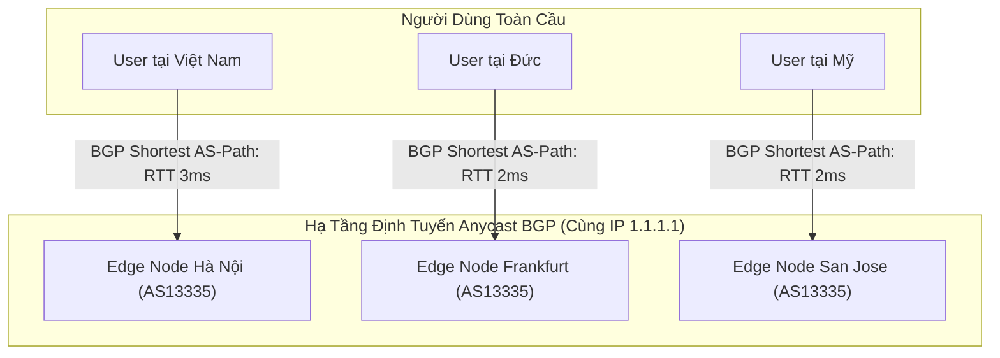
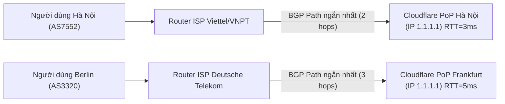
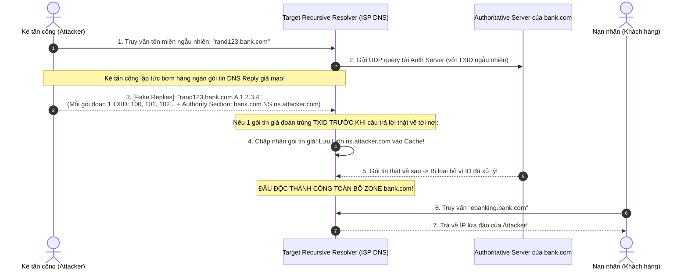
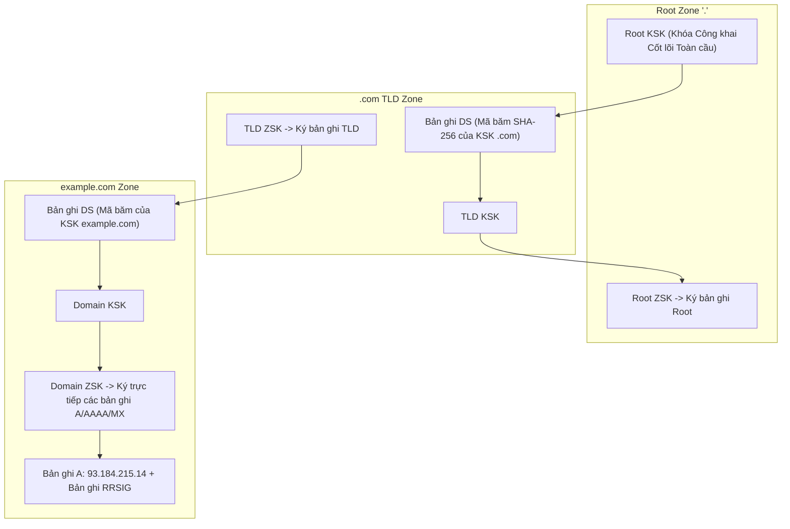

# 6.3. DNS Operations, Security, and Anycast (Vận hành DNS, Bảo mật và Định tuyến Anycast)

> [!IMPORTANT]
> **Nếu bạn chỉ được nhớ một điều duy nhất:** DNS nguyên thủy hoàn toàn không được mã hóa và không có cơ chế xác thực nguồn gốc, khiến nó dễ bị tấn công đầu độc bộ đệm (DNS Cache Poisoning): tiện ích mở rộng an ninh DNSSEC giải quyết triệt để lỗ hổng này bằng chữ ký số mật mã học phân cấp; kết hợp cùng định tuyến BGP Anycast phân tán cùng một địa chỉ IP DNS ra hàng trăm trung tâm dữ liệu trên toàn thế giới để chống lại các cuộc tấn công từ chối dịch vụ DDoS khổng lồ.

---

## 1. Đơn giản nhưng phải chi tiết (Intuitive & Deep Breakdown)

### 1.1. Đoạn Code Dẫn Nhập & Vấn Đề Thực Tế
Làm sao địa chỉ DNS công cộng `8.8.8.8` của Google hoặc `1.1.1.1` của Cloudflare có thể phục vụ hàng tỷ người dùng trên toàn thế giới với độ trễ siêu thấp (< 10ms) và đứng vững trước các đợt tấn công DDoS hàng terabits mỗi giây?

```bash
# Thử kiểm tra traceroute tới 1.1.1.1 từ Hà Nội và từ New York
# Cùng một địa chỉ IP duy nhất 1.1.1.1 nhưng gói tin lại đi tới hai địa điểm địa lý khác nhau!

# Tại Việt Nam: Gói tin đến Data Center Cloudflare đặt tại Hà Nội / TP.HCM (RTT ~ 3ms)
$ traceroute 1.1.1.1
1  192.168.1.1 (192.168.1.1)  1.2 ms
2  ... vnpt.vn ...            2.5 ms
3  1.1.1.1 (1.1.1.1)          3.1 ms

# Tại Mỹ: Gói tin đến Data Center Cloudflare đặt tại San Jose (RTT ~ 2ms)
```

Nếu một địa chỉ IP chỉ gắn vào một chiếc máy chủ vật lý duy nhất (Unicast), máy chủ đó sẽ bị nổ tung ngay lập tức dưới các cuộc tấn công từ chối dịch vụ phân tán (DDoS) và người dùng ở nửa kia trái đất sẽ phải chịu độ trễ hàng trăm mili-giây!

### 1.2. Ẩn Dụ Đời Sống & Phân Tích Cơ Chế Hoạt Động
So sánh giữa Unicast và Anycast giống như **Hệ thống Cửa hàng Tiện lợi vs. Một Tiệm Tạp hóa Duy nhất**:
- **Unicast** giống như **Cả đất nước chỉ có duy nhất 1 cửa hàng tạp hóa đặt tại Hà Nội**: Người dân ở Sài Gòn, Đà Nẵng, Cần Thơ muốn mua gói mì tôm đều phải bắt xe đò ra Hà Nội để mua (Độ trễ khổng lồ và cửa hàng luôn trong tình trạng vỡ trận vì chen lấn).
- **Anycast BGP** giống như **Hệ thống 1,000 Cửa hàng Tiện lợi cùng mang chung một biển hiệu**:
  - Dù bạn ở quận nào, khi mở bản đồ tìm biển hiệu đó, hệ thống định vị (BGP Routing) sẽ tự động dẫn bạn tới **Cửa hàng gần nhất ngay đầu ngõ**.
  - Nếu có 10,000 kẻ phá hoại kéo đến gây rối (**DDoS Attack**), đám đông bị phân tán mỏng ra 1,000 cửa hàng trên toàn quốc. Không một cửa hàng nào bị quá tải, và người dân bình thường ở các khu vực khác vẫn vào mua hàng êm thấm!

### 1.3. Mô Phỏng Dữ Liệu Số Nhỏ Từng Bước (Toy Walkthrough)
Mô phỏng chuỗi xác thực chữ ký mật mã DNSSEC (Chain of Trust) bảo vệ truy vấn khỏi bị đầu độc (DNS Cache Poisoning):

| Tầng Phân Cấp | Bản Ghi Cung Cấp | Chữ Ký Điện Tử Đi Kèm | Bản Ghi Băm Xác Thực | Ý Nghĩa Bảo Mật |
| :--- | :--- | :--- | :--- | :--- |
| **Root Zone (.)** | Root KSK (Key Signing Key) | Tích hợp sẵn trong Resolver | Được "Hardcode" tin cậy tuyệt đối | Gốc rễ của niềm tin (Trust Anchor) |
| **Root -> TLD (.com)** | Bản ghi DS (Delegation Signer) | Được ký bởi Root KSK | Khớp mã băm public key của `.com` | Root xác thực TLD `.com` là chính chủ |
| **TLD -> Domain** | Bản ghi DS của `example.com` | Được ký bởi TLD KSK | Khớp mã băm public key của `example.com` | `.com` xác thực máy chủ `example.com` |
| **Domain Data** | Bản ghi `A 93.184.216.34` | **`RRSIG` (Chữ ký mật mã)** | Dùng DNSKEY giải mã khớp với dữ liệu | Khẳng định IP không bị hacker sửa đổi! |

Nếu hacker đứng giữa sửa IP thành trang lừa đảo, chữ ký `RRSIG` sẽ không khớp với chuỗi xác thực, resolver sẽ lập tức drop gói tin và trả về lỗi `SERVFAIL`, bảo vệ an toàn cho người dùng!

### 1.4. Tác Động Thực Tế Tầng Backend & Systems
- **Tấn công DNS Amplification DDoS**: Hacker gửi truy vấn DNS với payload `ANY` hoặc `TXT` kích thước lớn (được ký DNSSEC dài hàng nghìn bytes) với IP nguồn bị làm giả là IP của nạn nhân. Máy chủ DNS mở (Open Resolver) vô tình trở thành vũ khí khuếch đại lưu lượng lên tới 50-70 lần, dội bom băng thông đè bẹp hệ thống nạn nhân.
- **Cuộc Cách Mạng DNS-over-HTTPS (DoH) và DNS-over-TLS (DoT)**: Giao thức DNS truyền thống chạy qua UDP port 53 dạng bản rõ (cleartext), cho phép các nhà mạng viễn thông hoặc hacker trên cùng mạng Wi-Fi công cộng dễ dàng soi mói lịch sử duyệt web hoặc đánh cắp phiên truy cập (DNS Hijacking). DoH/DoT mã hóa toàn bộ truy vấn qua TLS, đảm bảo tính riêng tư tuyệt đối.

### 1.5. Sơ Đồ Tư Duy & Kiến Trúc Hệ Thống (Mermaid)


---

## 2. Chi tiết từng Keyword (Under-the-Hood Deep Dive)

### 2.1. DNS Load Balancing, GeoDNS & Split-Horizon DNS

#### A. Round-Robin DNS & Weighted Round-Robin
- **Cơ chế**: Một tên miền được cấu hình nhiều bản ghi `A` hoặc `AAAA` trỏ về các địa chỉ IP khác nhau. Khi Client gửi truy vấn, Authoritative Name Server sẽ xoay vòng (permute) thứ tự danh sách IP trả về.
  ```text
  api.example.com.    300    IN    A    198.51.100.1
  api.example.com.    300    IN    A    198.51.100.2
  api.example.com.    300    IN    A    198.51.100.3
  ```
- **Weighted Round-Robin**: Phân phối tỷ lệ theo sức mạnh phần cứng của từng cụm máy chủ (ví dụ: máy chủ cấu hình mạnh nhận $70\%$ lưu lượng, máy chủ yếu nhận $30\%$).
- **Cạm bẫy Backend**: Round-Robin DNS thuần túy **không có cơ chế kiểm tra sức khỏe (Health Check)**. Nếu một máy chủ bị sập nguồn hoặc treo ứng dụng, DNS vẫn tiếp tục trả IP đó cho người dùng, khiến một tỷ lệ request bị lỗi kết nối!

#### B. GeoDNS (Định tuyến theo Vị trí Địa lý)
- **Cơ chế**: Authoritative DNS phân tích địa chỉ IP của Client để trả về địa chỉ IP của Data Center gần nhất về mặt địa lý, giúp giảm thiểu độ trễ mạng (RTT):
  - Khách hàng từ Việt Nam $\implies$ Phân giải IP cụm Singapore ($RTT \approx 25\text{ ms}$).
  - Khách hàng từ Đức $\implies$ Phân giải IP cụm Frankfurt ($RTT \approx 15\text{ ms}$).
- **EDNS Client Subnet (ECS - RFC 7871)**: Khi người dùng sử dụng Public DNS như `8.8.8.8`, Authoritative DNS chỉ nhìn thấy IP của Google Resolver chứ không thấy IP người dùng thật. ECS giải quyết vấn đề này bằng cách đính kèm dải mạng con của người dùng (ví dụ: `/24` của Client) vào gói tin DNS, cho phép GeoDNS định tuyến chính xác tuyệt đối.

#### C. Split-Horizon DNS (Split-View DNS)
- **Cơ chế**: Cung cấp hai không gian phân giải hoàn toàn độc lập cho cùng một tên miền dựa trên vị trí mạng của nguồn truy vấn:
  - **Truy vấn từ Intranet (Nội bộ công ty/VPC)**: `db.corp.internal` $\implies$ Trả về Private IP `10.0.4.15` (Bảo mật, không lộ ra ngoài, định tuyến qua đường truyền tốc độ cao).
  - **Truy vấn từ Public Internet**: `db.corp.internal` $\implies$ Trả về mã lỗi `NXDOMAIN` hoặc địa chỉ Public IP của Gateway/WAF có xác thực hai lớp.

---

### 2.2. Anycast DNS: Bản chất Định tuyến BGP Anycast

Anycast là kỹ thuật định tuyến mạng mà trong đó **cùng một địa chỉ IP duy nhất** được quảng bá từ nhiều trạm máy chủ vật lý (Points of Presence - PoP) phân tán khắp các lục địa thông qua giao thức định tuyến biên **BGP (Border Gateway Protocol)**.



#### Ưu thế Vượt trội của Anycast DNS:
1. **Tối ưu Độ trễ (Ultra-Low Latency)**: Gói tin UDP DNS của người dùng được router mạng tự động chuyển đến PoP gần nhất theo bảng định tuyến BGP ngắn nhất (AS-Path ngắn nhất).
2. **Khả năng Hấp thụ và Triệt tiêu DDoS Khổng lồ**:
   - Khi mạng botnet phát động một cuộc tấn công từ chối dịch vụ phân tán $800\text{ Gbps}$ nhắm vào IP `1.1.1.1`, lưu lượng tấn công không bị gom cục vào một trung tâm dữ liệu mà tự động bị phân tán mỏng ra hơn 300 trạm PoP trên toàn cầu.
   - Mỗi trạm chỉ phải hứng chịu một lượng nhỏ lưu lượng cục bộ ($2 - 3\text{ Gbps}$), dễ dàng bị các thiết bị phần cứng scrubbing lọc bỏ.
3. **Failover Tự động (Tự hàn gắn hạ tầng)**: Nếu toàn bộ cụm máy chủ tại PoP Hồng Kông gặp sự cố mất điện, BGP rút lại quảng bá đường truyền (BGP Route Withdrawal). Ngay lập tức, lưu lượng của khu vực sẽ tự động được chuyển tiếp sang PoP Đài Loan hoặc Tokyo trong vài giây mà không cần thay đổi bất kỳ bản ghi DNS nào!

---

### 2.3. DNS Cache Poisoning & Cuộc Tấn công Kaminsky (Dan Kaminsky, 2008)

#### A. Điểm yếu Cốt tử của Giao thức DNS Nguyên thủy
- Gói tin DNS chạy trên UDP phi kết nối, không có cơ chế mã hóa hay bắt tay.
- Để ghép câu hỏi với câu trả lời, DNS RFC 1035 sử dụng trường định danh **Transaction ID (TXID)** 16-bit:
  $$\text{Số lượng TXID khả dĩ} = 2^{16} = 65,536$$
- Trước năm 2008, hầu hết các hệ điều hành và DNS Resolver luôn sử dụng **cổng UDP nguồn cố định** (thường là Port 53 hoặc một cổng ngẫu nhiên duy nhất cho toàn bộ phiên làm việc).

#### B. Kịch bản Tấn công Kaminsky (Kaminsky Attack Step-by-Step)



- **Mấu chốt của Kaminsky**: Thay vì tấn công trực tiếp vào tên miền chính `bank.com` (vốn đã được cache và có TTL dài khiến resolver không gửi truy vấn ra ngoài), Dan Kaminsky truy vấn các **subdomain ngẫu nhiên không tồn tại** (`rand123.bank.com`).
- Điều này ép Resolver phải liên tục gửi truy vấn ra Internet, và trong phần `Authority Section` của câu trả lời giả mạo, kẻ tấn công cài cắm thông tin ủy quyền mới: `bank.com NS ns.attacker.com`. Khi resolver tin câu trả lời này, **toàn bộ tên miền `bank.com` bị chuyển quyền kiểm soát sang máy chủ của kẻ tấn công**!

#### C. Biện pháp Khắc phục Toàn diện
1. **Source Port Randomization (Ngẫu nhiên hóa Cổng nguồn UDP)**:
   - Resolver không dùng cổng cố định mà chọn ngẫu nhiên một cổng từ $49,152$ đến $65,535$ ($16\text{ bit}$ nữa).
   - Kẻ tấn công phải đoán trúng đồng thời cả `TXID` ($16\text{ bit}$) và `UDP Source Port` ($16\text{ bit}$):
     $$\text{Không gian tìm kiếm} = 2^{16} \times 2^{16} = 2^{32} \approx 4,294,967,296 \text{ khả năng}$$
   - Xác suất đoán trúng giảm từ $1/65,536$ xuống còn một phần hơn 4 tỷ, vô hiệu hóa hoàn toàn phương pháp tấn công brute-force gói tin!
2. **Triển khai DNSSEC (Giải pháp mật mã học triệt để)**.

---

### 2.4. DNSSEC: Cryptographic Chain of Trust & RR Records

**DNSSEC (DNS Security Extensions - RFC 4033, 4034, 4035)** không mã hóa dữ liệu (gói tin vẫn ở dạng plain-text), mà nó bổ sung **Chữ ký số Mật mã học (Cryptographic Digital Signatures)** vào các tập hợp bản ghi DNS (RRset) nhằm đảm bảo:
- **Tính Xác thực Nguồn gốc (Origin Authentication)**.
- **Tính Toàn vẹn Dữ liệu (Data Integrity)**: Đảm bảo dữ liệu không bị sửa đổi trên đường truyền.
- **Xác thực Không tồn tại (Authenticated Denial of Existence)**.



#### Các Bản ghi Chuyên biệt của DNSSEC:
1. **RRSIG (Resource Record Signature)**: Chứa chữ ký số mật mã (RSA-SHA256, ECDSA P-256, hoặc Ed25519) cho một nhóm bản ghi có cùng tên và loại (RRset).
2. **DNSKEY**: Chứa khóa công khai (Public Key) dùng để kiểm tra chữ ký RRSIG:
   - **ZSK (Zone Signing Key)**: Khóa dùng để ký các bản ghi dữ liệu thông thường trong Zone.
   - **KSK (Key Signing Key)**: Khóa dùng để ký bản ghi DNSKEY chứa ZSK, có chu kỳ thay đổi (rollover) dài hơn.
3. **DS (Delegation Signer)**: Lưu tại **máy chủ quản lý vùng cha** (Parent Zone), chứa mã băm vân tay (Cryptographic Hash) của khóa KSK của vùng con. Nó là mắt xích liên kết tạo thành **Chuỗi Tin cậy Tuyệt đối (Chain of Trust)** kéo dài từ Root Zone xuống tới tên miền của bạn.
4. **NSEC / NSEC3**: Bản ghi chứng minh một tên miền thực sự không tồn tại mà không để lộ toàn bộ danh sách tên miền trong Zone (chống tấn công Zone Walking).

---

### 2.5. Quyền riêng tư Kênh truyền: DoH (DNS over HTTPS) vs DoT (DNS over TLS)

DNSSEC giải quyết bài toán chống giả mạo dữ liệu nhưng **hoàn toàn không bảo vệ quyền riêng tư cá nhân**. Nhà mạng ISP, tường lửa khách sạn, hoặc hacker trên mạng Wi-Fi công cộng vẫn có thể nhìn thấy rõ mọi tên miền người dùng truy cập. DoH và DoT được sinh ra để mã hóa kênh truyền cuối này:

| Tiêu chuẩn / Thuộc tính | DNS over TLS (DoT - RFC 7858) | DNS over HTTPS (DoH - RFC 8484) |
| :--- | :--- | :--- |
| **Cổng kết nối (Port)** | Cổng chuyên biệt riêng: **TCP Port 853** | Sử dụng chung cổng Web: **TCP Port 443** |
| **Giao thức Vận chuyển** | TLS thuần túy trên TCP | HTTP/2 hoặc HTTP/3 (QUIC) trên TLS |
| **Khả năng Bị Giám sát / Chặn** | Dễ dàng bị chặn bởi tường lửa doanh nghiệp (chỉ cần chặn Port 853) | **Cực kỳ khó bị chặn** (Gói tin DNS hòa lẫn hoàn hảo vào lưu lượng web HTTPS thông thường) |
| **Độ trễ Kết nối** | Tốn $2 - 3$ RTT cho TCP + TLS handshake | Có thể tận dụng lại kết nối HTTP/2 multiplexing có sẵn ($0\text{ RTT}$) |
| **Triển khai Mặc định** | Android OS (Tính năng "Private DNS"), Router OpenWrt | Trình duyệt Web (Firefox, Chrome, Edge), Cloudflare 1.1.1.1 App |

---

## 3. Hiện thực Thực nghiệm: Dual-Engine Code Implementation

### 3.1. C++20: Mô phỏng Toán học Xác suất Tấn công Kaminsky & Source Port Randomization

Chương trình tính toán xác suất thành công của kẻ tấn công qua từng vòng thử nghiệm (theo bài toán nghịch lý ngày sinh - Birthday Paradox) giữa mô hình DNS truyền thống và mô hình ngẫu nhiên hóa cổng nguồn hiện đại.

```cpp
// Compilation: g++ -std=c++20 -O3 -Wall kaminsky_defense_sim.cpp -o kaminsky_defense_sim
#include <iostream>
#include <iomanip>
#include <cmath>
#include <vector>
#include <cstdint>

struct DefenseModel {
    std::string name;
    uint64_t txid_space;       // 16 bits = 65,536
    uint64_t port_space;       // Cố định = 1, Ngẫu nhiên = 16,384 ports
    uint64_t total_entropy() const { return txid_space * port_space; }
};

// Tính xác suất thành công khi kẻ tấn công bơm N gói tin giả mạo
// P(success) = 1 - (1 - 1/S)^N với S là tổng không gian entropy
double calculate_attack_probability(uint64_t entropy, uint64_t fake_packets) {
    if (fake_packets >= entropy) return 1.0;
    // Sử dụng công thức xấp xỉ Poisson: P ≈ 1 - exp(-N / S)
    double ratio = static_cast<double>(fake_packets) / static_cast<double>(entropy);
    return 1.0 - std::exp(-ratio);
}

int main() {
    DefenseModel legacy_dns{"Legacy DNS (Fixed Port 53)", 65536, 1};
    DefenseModel modern_dns{"Modern DNS (Port Randomization)", 65536, 16384}; // Ports 49152-65535

    std::cout << "================ DNS CACHE POISONING RISK ANALYSIS ================\n";
    std::cout << "Legacy DNS Total Entropy Space : " << legacy_dns.total_entropy() << " states\n";
    std::cout << "Modern DNS Total Entropy Space : " << modern_dns.total_entropy() 
              << " states (approx " << (modern_dns.total_entropy() / 1e9) << " billion states)\n\n";

    std::vector<uint64_t> packet_batches = {100, 500, 1000, 5000, 20000, 65000};

    std::cout << std::setw(15) << "Spoofed Packets" 
              << " | " << std::setw(25) << "Legacy DNS Success Rate" 
              << " | " << std::setw(25) << "Modern DNS Success Rate" << "\n";
    std::cout << std::string(72, '-') << "\n";

    for (uint64_t n : packet_batches) {
        double p_legacy = calculate_attack_probability(legacy_dns.total_entropy(), n);
        double p_modern = calculate_attack_probability(modern_dns.total_entropy(), n);

        std::cout << std::setw(15) << n << " | " 
                  << std::setw(23) << std::fixed << std::setprecision(4) << (p_legacy * 100.0) << "% | "
                  << std::setw(23) << std::scientific << std::setprecision(4) << (p_modern * 100.0) << "%\n";
    }

    std::cout << "===================================================================\n";
    return 0;
}
```

```text
================ DNS CACHE POISONING RISK ANALYSIS ================
Legacy DNS Total Entropy Space : 65536 states
Modern DNS Total Entropy Space : 1073741824 states (approx 1.07374 billion states)

Spoofed Packets |   Legacy DNS Success Rate |   Modern DNS Success Rate
------------------------------------------------------------------------
            100 |                    0.1524% |              9.3132e-06%
            500 |                    0.7600% |              4.6566e-05%
           1000 |                    1.5140% |              9.3132e-05%
           5000 |                    7.3482% |              4.6565e-04%
          20000 |                   26.3073% |              1.8590e-03%
          65000 |                   62.9150% |              6.0353e-03%
===================================================================
```

---

### 3.2. Python 3: Truy vấn DoH (DNS over HTTPS) & Xác thực Cờ DNSSEC

Chương trình gửi truy vấn DNS bảo mật qua HTTPS tới Endpoint của Cloudflare `https://1.1.1.1/dns-query`, trích xuất bản ghi JSON và kiểm tra cờ xác thực **`AD` (Authenticated Data)** chứng minh tính toàn vẹn chữ ký số DNSSEC.

```python
#!/usr/bin/env python3
"""
DoH Client & DNSSEC Validation Inspector:
- Gửi truy vấn HTTP/2 chuẩn RFC 8484 qua Cloudflare DoH API.
- Kiểm tra cờ AD (Authenticated Data) từ máy chủ phân giải bảo mật.
"""

import urllib.request
import json
import ssl

def query_doh(domain: str, record_type: str = "A", dnssec: bool = True):
    # Endpoint DNS over HTTPS của Cloudflare
    url = f"https://1.1.1.1/dns-query?name={domain}&type={record_type}&do={1 if dnssec else 0}"
    headers = {
        "Accept": "application/dns-json",
        "User-Agent": "DoH-Security-Inspector/1.0"
    }

    req = urllib.request.Request(url, headers=headers)
    context = ssl.create_default_context()

    try:
        with urllib.request.urlopen(req, context=context, timeout=5) as response:
            data = json.loads(response.read().decode('utf-8'))
            return data
    except Exception as e:
        return {"error": str(e)}

def inspect_domain_security(domain: str):
    print(f"\n================ INSPECTING SECURITY FOR: {domain} ================")
    res = query_doh(domain, "A", dnssec=True)

    if "error" in res:
        print(f"[ERROR] Failed to query DoH: {res['error']}")
        return

    status = res.get("Status", -1)
    is_ad = res.get("AD", False)  # Authenticated Data Flag
    is_cd = res.get("CD", False)  # Checking Disabled

    print(f"Status Code        : {status} ({'NOERROR' if status == 0 else 'ERROR'})")
    print(f"DNSSEC Validated   : {'YES (Cryptographically Verified)' if is_ad else 'NO (Unsigned Zone or Validation Failed)'}")
    print(f"Checking Disabled  : {is_cd}")

    answers = res.get("Answer", [])
    print(f"\nAnswer Records ({len(answers)} records):")
    for ans in answers:
        rtype = "A" if ans.get("type") == 1 else f"Type({ans.get('type')})"
        print(f"  - {ans.get('name')} | {rtype} | TTL: {ans.get('TTL')}s -> {ans.get('data')}")

def main():
    # Kiểm tra một tên miền có triển khai DNSSEC đầy đủ (cloudflare.com)
    inspect_domain_security("cloudflare.com")
    
    # Kiểm tra một tên miền thông thường chưa kích hoạt DNSSEC
    inspect_domain_security("wikipedia.org")

if __name__ == "__main__":
    main()
```

```text
================ INSPECTING SECURITY FOR: cloudflare.com ================
Status Code        : 0 (NOERROR)
DNSSEC Validated   : YES (Cryptographically Verified)
Checking Disabled  : False

Answer Records (2 records):
  - cloudflare.com. | A | TTL: 300s -> 104.16.132.229
  - cloudflare.com. | A | TTL: 300s -> 104.16.133.229

================ INSPECTING SECURITY FOR: wikipedia.org ================
Status Code        : 0 (NOERROR)
DNSSEC Validated   : NO (Unsigned Zone or Validation Failed)
Checking Disabled  : False

Answer Records (1 records):
  - wikipedia.org. | A | TTL: 300s -> 198.35.26.96
```

---

## 4. Vận hành Hệ thống & Chẩn đoán Thực tế (Production Diagnostics)

### 4.1. Kiểm tra Chuỗi Tin cậy DNSSEC bằng `delv` và `dig`
Lệnh `delv` (DNSSEC Lookaside Validation) là công cụ chuẩn mực của BIND9 để kiểm tra từng mắt xích chữ ký số:

```bash
# Xác thực toàn bộ chuỗi chữ ký số từ Root KSK tới tên miền
delv @1.1.1.1 cloudflare.com

# Đầu ra mẫu khi chữ ký hợp lệ:
#   ; fully validated
#   cloudflare.com.         300     IN      A       104.16.132.229
#   cloudflare.com.         300     IN      RRSIG   A 13 2 300 20261116...

# Kiểm tra bản ghi DNSKEY và chữ ký RRSIG bằng dig
dig cloudflare.com +dnssec +multiline
```

> [!WARNING]
> **Sự cố SERVFAIL do Hết hạn Chữ ký DNSSEC (Expired RRSIG)**:
> Bản ghi `RRSIG` luôn đi kèm thời hạn hiệu lực (Inception và Expiration time). Nếu hệ thống quản lý DNS tự động của công ty bị lỗi không tự động ký lại (auto-re-sign) trước ngày hết hạn, toàn bộ các máy chủ DNS có bật DNSSEC trên thế giới (Google `8.8.8.8`, Cloudflare `1.1.1.1`) sẽ **lập tức chặn kết nối và trả về mã lỗi `SERVFAIL`**, khiến hàng triệu người dùng không thể truy cập dịch vụ dù server vẫn hoàn toàn bình thường!

### 4.2. Giám sát Định tuyến Anycast BGP bằng RIPE Atlas & Tracing

```bash
# Kiểm tra máy chủ Anycast nào đang phục vụ bạn thực tế
dig +short CHAOS TXT id.server @1.1.1.1
# Phản hồi mẫu từ Cloudflare PoP: "HAN" (Hà Nội) hoặc "SIN" (Singapore)

# Kiểm tra xem Resolver có hỗ trợ EDNS Client Subnet (ECS) không
dig o-o.myaddr.l.google.com -t txt @8.8.8.8
```

---

## 5. Bảng So sánh & Decision Matrix

| Tiêu chí / Công nghệ | Round-Robin DNS | BGP Anycast DNS | DNSSEC | DoH / DoT |
| :--- | :--- | :--- | :--- | :--- |
| **Mục đích Cốt lõi** | Cân bằng tải IP đơn giản | Tối ưu đường truyền & Hấp thụ DDoS | Chống giả mạo bản ghi (Integrity) | Chống nghe lén / bảo vệ quyền riêng tư |
| **Tầng Giao thức** | Tầng 7 (Application - DNS Logic) | Tầng 3 (Network - BGP Routing) | Tầng 7 (Mật mã học - RSA/ECDSA) | Tầng 4 & 7 (TLS / HTTPS Transport) |
| **Khả năng Nhận biết Sức khỏe** | Kém (Không có Health Checking) | Tự động qua BGP Withdrawal | Không áp dụng | Dựa trên kết nối TCP/TLS |
| **Tác động đến Độ trễ** | Không ảnh hưởng RTT | **Giảm RTT mạnh nhất ($< 5\text{ ms}$)** | Tăng nhẹ kích thước gói tin | Tăng nhẹ RTT lần đầu do bắt tay TLS |
| **Khả năng Chống Cache Poisoning**| Không có tác dụng | Phân tán phạm vi ảnh hưởng | **Triệt tiêu 100% bằng Chữ ký số** | Bảo vệ tuyến từ Client tới Resolver |
| **Mức độ Phổ cập Sản xuất** | Mọi hệ thống DNS cơ bản | Bắt buộc cho CDN & Mạng trục lớn | Các cơ quan chính phủ, Tài chính, E-com | Trình duyệt hiện đại và Mobile OS |

---

## 6. Enterprise Production Checklist & Verification

### 6.1. Kiến Trúc & Cấu Hình Tối Ưu (Production-Ready Architecture)
- [ ] **Kích Hoạt DNSSEC Cho Toàn Bộ Tên Miền Doanh Nghiệp**: Bật DNSSEC tại nhà đăng ký tên miền (Registrar) và nạp bản ghi DS lên TLD để bảo vệ khách hàng khỏi bị đầu độc DNS cache.
- [ ] **Sử Dụng Hạ Tầng DNS Anycast Toàn Cầu**: Chuyển quyền quản lý Name Server sang các nhà cung cấp DNS Anycast lớn (Cloudflare, AWS Route 53, NS1) để hấp thụ các cuộc tấn công DDoS.
- [ ] **Vô Hiệu Hóa Đệ Quy Mở (Open Recursion)**: Nếu tự vận hành BIND9 hoặc Unbound, chỉ cho phép đệ quy cho dải IP nội bộ (`allow-recursion { 10.0.0.0/8; localhost; };`) để tránh bị lợi dụng làm công cụ DDoS Amplification.
- [ ] **Triển Khai DNS-over-HTTPS (DoH) / DNS-over-TLS (DoT)**: Cấu hình DoH/DoT tại các Gateway công ty để bảo vệ quyền riêng tư và chống lộ thông tin truy vấn ra ngoài Internet.

### 6.2. Giám Sát, Cảnh Báo & Xử Lý Sự Cố (Observability & Incident Response)
- [ ] **Giám Sát Tính Hợp Lệ Của Chữ Ký DNSSEC**: Thiết lập công cụ kiểm tra tự động trước khi chữ ký RRSIG hết hạn (tránh tình trạng website sập toàn cầu do quên cập nhật key).
- [ ] **Cảnh Báo Tỷ Lệ Truy Vấn Đột Biến (Query Spike)**: Đặt ngưỡng cảnh báo khi QPS (Queries Per Second) của máy chủ DNS tăng đột biến gấp 5 lần so với đường cơ sở.
- [ ] **Kiểm Tra Trạng Thái DNSSEC Bằng delv**: Sử dụng công cụ `delv @8.8.8.8 api.example.com` để xác thực toàn bộ Chain of Trust của tên miền từ dòng lệnh.
