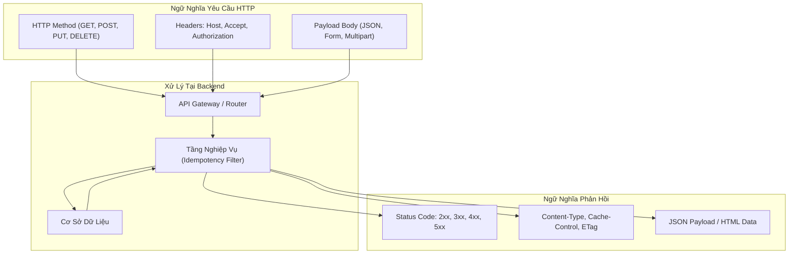
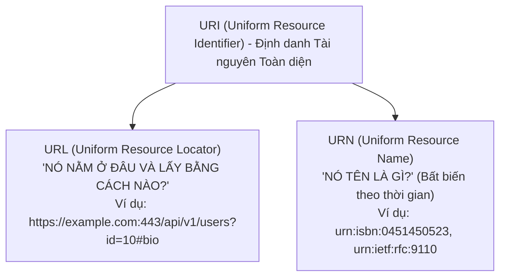
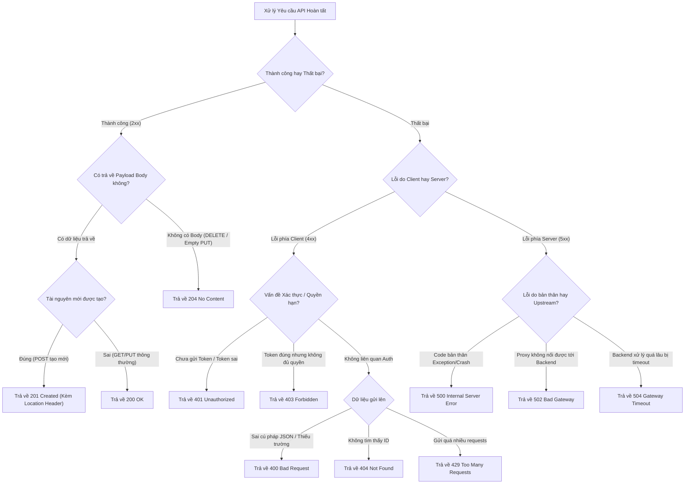

# 7.1. HTTP Fundamentals and Semantics

> [!IMPORTANT]
> **Nếu bạn chỉ được nhớ một điều duy nhất:** Giao thức HTTP là ngôn ngữ giao tiếp chuẩn mực của Web dựa trên mô hình Yêu cầu - Đáp ứng (Request-Response): tính Idempotent (Bất biến) là nguyên lý thiết kế tối thượng của RESTful API: các phương thức GET, PUT, DELETE phải đảm bảo gọi 1 lần hay 100 lần đều đem lại trạng thái hệ thống như nhau, trong khi POST không idempotent và đòi hỏi Idempotency Key riêng khi triển khai trong các giao dịch thanh toán tài chính.

---

## 1. Đơn giản nhưng phải chi tiết (Intuitive & Deep Breakdown)

### 1.1. Đoạn Code Dẫn Nhập & Vấn Đề Thực Tế
Tại sao việc hiểu đúng ngữ nghĩa (Semantics) và tính chất Lũy đẳng (Idempotency) của các phương thức HTTP lại là ranh giới giữa một hệ thống thanh toán an toàn và một thảm họa trừ tiền hai lần của khách hàng?

```http
POST /api/v1/payments HTTP/1.1
Host: payment.example.com
Content-Type: application/json
Idempotency-Key: 7b3a4f12-9c8e-4a6d-b5e1-8f2a3c4d5e6f

{
  "order_id": "ORD-99881",
  "amount": 500000,
  "currency": "VND"
}
```

Nếu một mạng di động bị chập chờn ngay khi client gửi yêu cầu thanh toán, client sẽ tự động gửi lại (retry). Nếu API thanh toán dùng `POST` mà **không có cơ chế Idempotency-Key**, hệ thống backend sẽ tạo thêm một giao dịch mới và tài khoản của khách hàng sẽ bị trừ tiền 2 lần!

### 1.2. Ẩn Dụ Đời Sống & Phân Tích Cơ Chế Hoạt Động
Các phương thức và mã trạng thái HTTP giống như **Quy tắc Ứng xử tại Quầy Thủ tục Hành chính**:
- **`GET` (Safe & Idempotent)**: Giống như **Đọc bảng thông báo công khai dán trên tường**: Bạn đọc 1 lần hay đọc 100 lần thì thông tin trên tường vẫn giữ nguyên như cũ, không làm thay đổi thế giới.
- **`POST` (Neither Safe nor Idempotent)**: Giống như **Nộp đơn xin cấp phép mới**: Mỗi lần bạn nộp 1 tờ đơn, một bộ hồ sơ mới được sinh ra trong kho lưu trữ. Nộp 3 lần là sinh ra 3 bộ hồ sơ độc lập!
- **`PUT` (Idempotent)**: Giống như **Thay mới toàn bộ tấm biển tên**: Dù bạn tháo biển cũ ra và gắn tấm biển *"Phòng Giám đốc"* lên cửa 1 lần hay 10 lần, kết quả cuối cùng trên cánh cửa vẫn y chang nhau.
- **Mã Trạng Thái (Status Codes)**:
  - `2xx`: Hồ sơ hợp lệ, đã xong việc!
  - `3xx`: Sang quầy bên cạnh làm thủ tục (Redirect).
  - `4xx`: Lỗi tại bạn (Quên ký tên, thiếu giấy tờ - Client Error).
  - `5xx`: Lỗi tại quầy (Máy in bị hỏng, nhân viên ngất xỉu - Server Error).

### 1.3. Mô Phỏng Dữ Liệu Số Nhỏ Từng Bước (Toy Walkthrough)
Phân tích tính chất An toàn (Safe) và Lũy đẳng (Idempotent) của các HTTP Methods:

| Phương Thức HTTP | Mục Đích Sử Dụng | Tính Chất An Toàn (Safe) | Tính Chất Lũy Đẳng (Idempotent) | Khả Năng Lưu Cache (Cacheable) |
| :--- | :--- | :--- | :--- | :--- |
| **`GET`** | Lấy dữ liệu tài nguyên | **CÓ** (Không sửa đổi DB) | **CÓ** ($f(f(x)) = f(x)$) | **Mặc định CÓ** |
| **`HEAD`** | Lấy Headers kiểm tra siêu dữ liệu | **CÓ** | **CÓ** | CÓ |
| **`POST`** | Tạo mới tài nguyên / Thực thi hành động | **KHÔNG** (Ghi thêm dữ liệu) | **KHÔNG** (Gọi $N$ lần sinh $N$ bản ghi) | Chỉ khi có Header phản hồi rõ ràng |
| **`PUT`** | Thay thế toàn bộ tài nguyên hiện có | **KHÔNG** | **CÓ** (Ghi đè nhiều lần vẫn 1 trạng thái) | KHÔNG |
| **`PATCH`** | Cập nhật một phần tài nguyên | **KHÔNG** | **KHÔNG** (Trừ khi thiết kế đặc thù) | KHÔNG |
| **`DELETE`** | Xóa tài nguyên | **KHÔNG** | **CÓ** (Xóa 1 lần hay 10 lần thì bản ghi vẫn mất) | KHÔNG |

### 1.4. Tác Động Thực Tế Tầng Backend & Systems
- **Tối Ưu Hóa Băng Thông Bằng HTTP Chunked Transfer Encoding**: Khi máy chủ sinh dữ liệu động lớn (như xuất báo cáo CSV hàng gigabytes hoặc streaming HTML), máy chủ không thể biết trước `Content-Length`. Header `Transfer-Encoding: chunked` cho phép máy chủ bắn từng khối dữ liệu kèm kích thước hex về phía client ngay khi vừa tạo xong, giảm độ trễ First Byte ($TTFB$) xuống mức tối thiểu.
- **Hội Chứng Thất Thoát Kết Nối Do Không Đọc Hết Response Body**: Trong các thư viện HTTP Client của Go (`resp.Body.Close()`) hay Python (`urllib3`), nếu ứng dụng đọc dở dang response rồi ngắt, kết nối TCP đó không thể tái sử dụng cho Connection Pool mà buộc phải bị kernel tiêu hủy và mở kết nối mới.

### 1.5. Sơ Đồ Tư Duy & Kiến Trúc Hệ Thống (Mermaid)


---

## 2. Chi tiết từng Keyword (Under-the-Hood Deep Dive)

### 2.1. Phân biệt URI, URL và URN

Trong kiến trúc mạng, ba khái niệm này thường bị sử dụng lẫn lộn dù có mối quan hệ tập hợp chặt chẽ:
$$\text{URI} = \text{URL} \cup \text{URN}$$



1. **URI (Uniform Resource Identifier - RFC 3986)**:
   - Là thuật ngữ bao trùm mọi chuỗi ký tự dùng để nhận diện một tài nguyên trừu tượng hoặc vật lý.
   - Cú pháp chuẩn tổng quát:
     ```text
     URI = scheme:[//authority]path[?query][#fragment]
     authority = [userinfo@]host[:port]
     ```
2. **URL (Uniform Resource Locator)**:
   - Là một URI xác định tài nguyên thông qua **phương thức truy cập (Giao thức: `https`, `ftp`)** và **vị trí trên mạng (Host, Port, Path)**. Nếu máy chủ chuyển nhà hoặc đổi đường dẫn, URL sẽ thay đổi.
3. **URN (Uniform Resource Name)**:
   - Định danh một tài nguyên bằng một cái tên vĩnh viễn, độc nhất toàn cầu và **hoàn toàn độc lập với vị trí hoặc giao thức**. Dù tài nguyên được di chuyển sang bất kỳ máy chủ nào trên thế giới, URN của nó vẫn giữ nguyên.

---

### 2.2. Cấu trúc Khung Thông điệp HTTP (Request and Response Message Format)

Giao thức HTTP/1.1 (RFC 9112) là một giao thức định dạng văn bản (Text-based). Mọi dòng trong thông điệp đều phải kết thúc bằng cặp ký tự điều khiển chuẩn **CRLF (`\r\n` - Carriage Return, Line Feed)**:

```text
+-------------------------------------------------------------+
| Start Line (Request Line hoặc Status Line)             \r\n |
+-------------------------------------------------------------+
| Header Name 1: Header Value 1                          \r\n |
| Header Name 2: Header Value 2                          \r\n |
| ...                                                    \r\n |
+-------------------------------------------------------------+
| \r\n (Empty Line - Bắt buộc để phân tách Header và Body)   |
+-------------------------------------------------------------+
| Message Body Payload (JSON, HTML, Binary Data...)           |
+-------------------------------------------------------------+
```

#### A. Cấu trúc HTTP Request Message
- **Request Line (Dòng Khởi đầu)** gồm đúng 3 thành phần ngăn cách bởi dấu cách:
  $$\text{Method} \quad \text{Request-Target} \quad \text{HTTP-Version} \quad \text{\textbackslash r\textbackslash n}$$
  Ví dụ: `GET /api/v1/users?limit=10 HTTP/1.1\r\n`
- **Headers**: Các cặp `Key: Value` chứa metadata điều khiển (`Host`, `Authorization`, `User-Agent`). Trong HTTP/1.1, header **`Host` là bắt buộc duy nhất**, thiếu header này server sẽ trả về lỗi `400 Bad Request`.
- **Dòng Trống (`\r\n`)**: Đánh dấu điểm kết thúc của metadata.
- **Body**: Dữ liệu gửi lên (chỉ có trong POST, PUT, PATCH).

#### B. Cấu trúc HTTP Response Message
- **Status Line (Dòng Trạng thái)** gồm đúng 3 thành phần:
  $$\text{HTTP-Version} \quad \text{Status-Code} \quad \text{Reason-Phrase} \quad \text{\textbackslash r\textbackslash n}$$
  Ví dụ: `HTTP/1.1 200 OK\r\n`
- **Headers**: Metadata phản hồi từ server (`Content-Type: application/json`, `Set-Cookie`, `Server`).
- **Body**: Dữ liệu tài nguyên trả về cho client.

---

### 2.3. HTTP Methods và Tính chất Ngữ nghĩa (Safe & Idempotent)

Chuẩn RFC 9110 định nghĩa sự khác biệt bản chất giữa các phương thức dựa trên hai tiêu chuẩn toán học:

#### 1. Tính An toàn (Safe Methods)
- Một phương thức được gọi là **Safe** nếu việc thực thi nó **không làm thay đổi trạng thái của tài nguyên trên máy chủ** (Chỉ là thao tác Read-Only dưới góc nhìn ngữ nghĩa).
- Các phương thức Safe: **`GET`**, **`HEAD`**, **`OPTIONS`**, **`TRACE`**.
- Cho phép trình duyệt và Proxy thoải mái gọi trước (Prefetching), lưu bộ nhớ đệm (Caching) mà không sợ gây hậu quả.

#### 2. Tính Bất biến (Idempotent Methods)
- Định nghĩa toán học: Một hàm $f$ được gọi là Idempotent nếu áp dụng nhiều lần liên tiếp cho ra kết quả trạng thái trên server y hệt như áp dụng 1 lần duy nhất:
  $$f(f(x)) = f(x)$$
- Nói cách khác: Gọi một phương thức Idempotent $N$ lần ($N \ge 1$) thì trạng thái dữ liệu trên database của máy chủ ở lần thứ $N$ **hoàn toàn giống hệt như sau lần gọi đầu tiên**.
- Các phương thức Idempotent: **`GET`**, **`HEAD`**, **`PUT`**, **`DELETE`**, **`OPTIONS`**.
  - `PUT /users/42 {"name": "Bob"}`: Ghi đè toàn bộ tài nguyên. Gọi 1 lần hay 10 lần thì tên của User 42 trên DB vẫn là "Bob".
  - `DELETE /users/42`: Lần 1 trả về `200/204`, các lần sau trả về `404 Not Found`. Nhưng **trạng thái trên database vẫn là: User 42 không còn tồn tại**!
- Các phương thức **Non-Idempotent**: **`POST`**, **`PATCH`**.
  - `POST /orders`: Gọi 3 lần sẽ tạo ra 3 đơn hàng mới với 3 mã ID khác nhau.

#### 3. Ý nghĩa Sống còn trong Hệ thống Phân tán (Distributed Systems)
Khi một kết nối mạng giữa Microservice A và Microservice B bị đứt gãy (Network Timeout):
- Nếu phương thức là **Idempotent** (như `GET`, `PUT`, `DELETE`), Service A **hoàn toàn có quyền tự động Retry ngay lập tức**!
- Nếu phương thức là **Non-Idempotent** (`POST`), Service A **TUYỆT ĐỐI KHÔNG ĐƯỢC RETRY TỰ ĐỘNG** trừ khi có sử dụng cơ chế bảo vệ **`Idempotency-Key`**!

---

### 2.4. HTTP Status Codes (Mã Trạng thái Phản hồi)

Status Code là một số nguyên 3 chữ số được chia thành 5 nhóm lớn:

#### A. 1xx: Informational (Thông tin - Tạm thời)
- `100 Continue`: Server đồng ý cho client tiếp tục gửi Body sau khi nhận header `Expect: 100-continue`.
- `101 Switching Protocols`: Server đồng ý nâng cấp giao thức (ví dụ chuyển từ HTTP sang **WebSocket**).

#### B. 2xx: Success (Thành công)
- `200 OK`: Yêu cầu thành công, dữ liệu nằm trong Body.
- `201 Created`: Tạo tài nguyên mới thành công (thường kèm header `Location: /items/123`).
- `204 No Content`: Thao tác thành công nhưng Response Body hoàn toàn rỗng (thường dùng cho `DELETE` hoặc `PUT`).
- `206 Partial Content`: Trả về một phần dữ liệu theo dải byte yêu cầu (`Range: bytes=0-1024` dùng cho download video).

#### C. 3xx: Redirection (Chuyển hướng)
- **`301 Moved Permanently` vs `308 Permanent Redirect`**:
  - `301`: Trình duyệt sẽ cache vĩnh viễn, nhưng có thể tự ý đổi phương thức từ `POST` sang `GET` (vi phạm chuẩn cũ).
  - `308` (Hiện đại): Yêu cầu client chuyển hướng nhưng **bắt buộc phải giữ nguyên phương thức** (POST vẫn là POST).
- **`302 Found` vs `307 Temporary Redirect`**:
  - `302`: Chuyển hướng tạm thời (lịch sử cũng hay bị đổi thành GET).
  - `307` (Hiện đại): Chuyển hướng tạm thời và **bắt buộc giữ nguyên phương thức ban đầu**.
- `304 Not Modified`: Báo cho client biết tài nguyên trong bộ nhớ đệm (Cache) vẫn còn mới, client hãy dùng cache cục bộ mà không cần tải lại dữ liệu.

#### D. 4xx: Client Error (Lỗi phía Người dùng)
- `400 Bad Request`: Cú pháp request bị lỗi (JSON hỏng, thiếu header bắt buộc).
- **`401 Unauthorized` vs `403 Forbidden`**:
  - `401`: Bạn là ai? (Chưa xác thực - Thiếu hoặc sai Token/Password).
  - `403`: Tôi biết bạn là ai, nhưng bạn không có quyền truy cập tài nguyên này (Phân quyền RBAC).
- `404 Not Found`: Không tìm thấy tài nguyên.
- `405 Method Not Allowed`: URL có tồn tại nhưng không hỗ trợ phương thức này (ví dụ URL chỉ hỗ trợ `GET` nhưng client gọi `POST`).
- `409 Conflict`: Xung đột trạng thái dữ liệu (ví dụ trùng lặp Unique Key trong cơ sở dữ liệu).
- `429 Too Many Requests`: Client đã vượt quá ngưỡng Rate Limit cho phép.

#### E. 5xx: Server Error (Lỗi phía Máy chủ)
- `500 Internal Server Error`: Code ứng dụng backend bị crash hoặc unhandled exception.
- `502 Bad Gateway`: Reverse Proxy (Nginx/Envoy) không thể kết nối tới hoặc nhận phản hồi hỏng từ ứng dụng backend (Node.js/Go bị chết).
- `503 Service Unavailable`: Server bị quá tải tạm thời hoặc đang bảo trì.
- `504 Gateway Timeout`: Reverse Proxy đợi ứng dụng backend phản hồi quá lâu và bị hết hạn thời gian chờ.

---

### 2.5. Content Negotiation & Transfer Encoding

#### A. Content Negotiation (Đàm phán Nội dung)
Cho phép client và server thỏa thuận định dạng dữ liệu tối ưu:
- `Accept: application/json, text/plain;q=0.9`: Định dạng mong muốn nhận được (kèm trọng số ưu tiên `q-factor`).
- `Accept-Encoding: gzip, deflate, br`: Các thuật toán nén dữ liệu mà client hỗ trợ (Gzip, Brotli).
- `Accept-Language: vi-VN, en;q=0.8`: Ngôn ngữ hiển thị.

#### B. `Content-Length` vs `Transfer-Encoding: chunked`
Làm thế nào bên nhận biết được khi nào một HTTP Message Body kết thúc?
1. **Dựa trên `Content-Length`**: Server tính toán chính xác tổng kích thước byte của body trước khi gửi.
2. **Dựa trên `Transfer-Encoding: chunked` (Phát sóng Trực tiếp - Streaming)**:
   - Khi server sinh dữ liệu động dung lượng khổng lồ hoặc stream dữ liệu thời gian thực (Server-Sent Events, xuất báo cáo CSV lớn), server không thể biết trước tổng kích thước là bao nhiêu.
   - Server gửi dữ liệu thành từng mảnh (Chunks). Mỗi mảnh gồm: **`[Độ dài Hex]\r\n[Dữ liệu]\r\n`**.
   - Khi luồng kết thúc, server gửi một mảnh đặc biệt có kích thước bằng 0: **`0\r\n\r\n`**.

---

## 3. Thực thi Mã nguồn & Mô phỏng Chuyên sâu (Dual-Engine Implementation)

### 3.1. C++20: Zero-Copy HTTP/1.1 Request Parser & Idempotency Router

File `http_parser_engine.cpp` hiện thực bộ phân tích cú pháp thông điệp HTTP/1.1 hiệu năng cao chuẩn C++20, sử dụng `std::string_view` (Zero-copy parsing), bóc tách Header và kiểm tra tính an toàn ngữ nghĩa của Method.

```cpp
#include <iostream>
#include <string>
#include <string_view>
#include <unordered_map>
#include <vector>
#include <iomanip>

enum class HTTPMethod {
    GET, HEAD, POST, PUT, DELETE, PATCH, OPTIONS, UNKNOWN
};

struct HTTPRequest {
    HTTPMethod method;
    std::string_view method_str;
    std::string_view path;
    std::string_view version;
    std::unordered_map<std::string_view, std::string_view> headers;
    std::string_view body;
    bool is_safe;
    bool is_idempotent;
};

class HTTPParser {
public:
    static HTTPRequest parse(std::string_view raw_request) {
        HTTPRequest req{};
        req.method = HTTPMethod::UNKNOWN;

        // 1. Tim dong Request Line dau tien
        size_t line_end = raw_request.find("\r\n");
        if (line_end == std::string_view::npos) return req;

        std::string_view request_line = raw_request.substr(0, line_end);
        
        // Cat Request Line thanh: Method, Path, Version
        size_t first_space = request_line.find(' ');
        size_t second_space = request_line.find(' ', first_space + 1);
        if (first_space == std::string_view::npos || second_space == std::string_view::npos) return req;

        req.method_str = request_line.substr(0, first_space);
        req.path = request_line.substr(first_space + 1, second_space - first_space - 1);
        req.version = request_line.substr(second_space + 1);

        // Xac dinh tinh chat ngu nghia
        evaluate_semantics(req);

        // 2. Parse Headers
        size_t current_pos = line_end + 2;
        while (current_pos < raw_request.size()) {
            size_t next_line = raw_request.find("\r\n", current_pos);
            if (next_line == std::string_view::npos) break;

            if (next_line == current_pos) {
                // Gap dong trong \r\n\r\n -> Ket thuc Headers, phia sau la Body!
                req.body = raw_request.substr(next_line + 2);
                break;
            }

            std::string_view header_line = raw_request.substr(current_pos, next_line - current_pos);
            size_t colon_pos = header_line.find(':');
            if (colon_pos != std::string_view::npos) {
                std::string_view key = header_line.substr(0, colon_pos);
                // Trim khoang trang
                size_t val_start = header_line.find_first_not_of(' ', colon_pos + 1);
                std::string_view val = (val_start != std::string_view::npos) ? header_line.substr(val_start) : "";
                req.headers[key] = val;
            }
            current_pos = next_line + 2;
        }

        return req;
    }

private:
    static void evaluate_semantics(HTTPRequest& req) {
        if (req.method_str == "GET") {
            req.method = HTTPMethod::GET; req.is_safe = true; req.is_idempotent = true;
        } else if (req.method_str == "HEAD") {
            req.method = HTTPMethod::HEAD; req.is_safe = true; req.is_idempotent = true;
        } else if (req.method_str == "PUT") {
            req.method = HTTPMethod::PUT; req.is_safe = false; req.is_idempotent = true;
        } else if (req.method_str == "DELETE") {
            req.method = HTTPMethod::DELETE; req.is_safe = false; req.is_idempotent = true;
        } else if (req.method_str == "POST") {
            req.method = HTTPMethod::POST; req.is_safe = false; req.is_idempotent = false;
        } else if (req.method_str == "PATCH") {
            req.method = HTTPMethod::PATCH; req.is_safe = false; req.is_idempotent = false;
        }
    }
};

int main() {
    std::cout << "=== ZERO-COPY HTTP/1.1 PROTOCOL PARSER (C++20) ===" << std::endl;

    std::string sample_raw = 
        "POST /api/v1/orders HTTP/1.1\r\n"
        "Host: api.example.com\r\n"
        "Content-Type: application/json\r\n"
        "Idempotency-Key: 7b8a-4c2e-991f\r\n"
        "\r\n"
        "{\"item_id\": 42, \"quantity\": 2}";

    HTTPRequest req = HTTPParser::parse(sample_raw);

    std::cout << "Method      : " << req.method_str << "\n";
    std::cout << "Path        : " << req.path << "\n";
    std::cout << "Version     : " << req.version << "\n";
    std::cout << "Safe?       : " << (req.is_safe ? "YES" : "NO (State Mutating)") << "\n";
    std::cout << "Idempotent? : " << (req.is_idempotent ? "YES (Safe to Auto-Retry)" : "NO (Requires Idempotency-Key)") << "\n";
    std::cout << "Headers Parsed:\n";
    for (const auto& [k, v] : req.headers) {
        std::cout << "  - [" << k << "] = \"" << v << "\"\n";
    }
    std::cout << "Payload Body: \"" << req.body << "\"\n";

    return 0;
}
```

### 3.2. Python 3.11: Raw TCP Socket HTTP Client & Chunked Transfer Decoder

File `chunked_decoder.py` sử dụng socket thô để kết nối và giải mã luồng dữ liệu HTTP `Transfer-Encoding: chunked` chuẩn xác theo cấu trúc `[Hex-Len]\r\n[Data]\r\n`.

```python
import io

class ChunkedTransferDecoder:
    """Giai ma du lieu HTTP duoc truyen theo co che Transfer-Encoding: chunked."""

    @staticmethod
    def decode_chunked_stream(raw_stream: bytes) -> bytes:
        print("[*] Bat dau giai ma du lieu HTTP Chunked Stream:")
        decoded_output = bytearray()
        reader = io.BytesIO(raw_stream)

        chunk_index = 1
        while True:
            # 1. Doc dong kich thuoc Hex length ket thuc boi \r\n
            length_line = reader.readline()
            if not length_line:
                break
            
            # Cat bo CRLF va lay gia tri Hex
            hex_str = length_line.strip().split(b';')[0] # Bo qua chunk extensions neu co
            chunk_length = int(hex_str, 16)
            
            print(f"  -> Chunk #{chunk_index}: Kích thước = {chunk_length} bytes (0x{hex_str.decode()})")

            # Chunk length = 0 danh dau ket thuc toan bo stream!
            if chunk_length == 0:
                print("  [+] Nhan Chunk 0 -> Hoan tat toan bo luong streaming!")
                break

            # 2. Doc dung so byte du lieu
            data = reader.read(chunk_length)
            decoded_output.extend(data)

            # 3. Bo qua ky tu CRLF (\r\n) o cuoi moi chunk
            crlf = reader.read(2)
            assert crlf == b"\r\n", "Du lieu chunked bi loi dinh dang CRLF!"
            chunk_index += 1

        return bytes(decoded_output)

if __name__ == "__main__":
    print("=== HTTP/1.1 CHUNKED TRANSFER ENCODING DECODER (Python 3.11) ===")
    
    # Mau du lieu mo phong do mot Streaming API phat ra
    raw_chunked_http = (
        b"7\r\nMozilla\r\n"
        b"9\r\nDeveloper\r\n"
        b"7\r\nNetwork\r\n"
        b"0\r\n\r\n"
    )

    result = ChunkedTransferDecoder.decode_chunked_stream(raw_chunked_http)
    print(f"\n[DỮ LIỆU ĐÃ LẮP GHÉP HOÀN CHỈNH]: \"{result.decode('utf-8')}\"")
```

### 3.3. Terminal Output Mẫu

```text
$ clang++ -std=c++20 -O3 http_parser_engine.cpp -o http_parser_engine && ./http_parser_engine
=== ZERO-COPY HTTP/1.1 PROTOCOL PARSER (C++20) ===
Method      : POST
Path        : /api/v1/orders
Version     : HTTP/1.1
Safe?       : NO (State Mutating)
Idempotent? : NO (Requires Idempotency-Key)
Headers Parsed:
  - [Host] = "api.example.com"
  - [Content-Type] = "application/json"
  - [Idempotency-Key] = "7b8a-4c2e-991f"
Payload Body: "{"item_id": 42, "quantity": 2}"

$ python3 chunked_decoder.py
=== HTTP/1.1 CHUNKED TRANSFER ENCODING DECODER (Python 3.11) ===
[*] Bat dau giai ma du lieu HTTP Chunked Stream:
  -> Chunk #1: Kích thước = 7 bytes (0x7)
  -> Chunk #2: Kích thước = 9 bytes (0x9)
  -> Chunk #3: Kích thước = 7 bytes (0x7)
  -> Chunk #4: Kích thước = 0 bytes (0x0)
  [+] Nhan Chunk 0 -> Hoan tat toan bo luong streaming!

[DỮ LIỆU ĐÃ LẮP GHÉP HOÀN CHỈNH]: "MozillaDeveloperNetwork"
```

---

## 4. Systems Engineering & Production Pitfalls

### 4.1. Thảm họa Retry Yêu cầu Non-Idempotent (Double Charging)
- **Sự cố thực tế**: Khi khách hàng ấn nút "Thanh toán Đơn hàng" (`POST /checkout`), máy chủ đã xử lý trừ tiền thành công từ thẻ ngân hàng, nhưng đúng lúc gói tin phản hồi `200 OK` đang quay về thì cáp quang biển bị lag khiến kết nối TCP timeout!
- Nếu Client (hoặc Mobile App SDK) cài đặt cơ chế tự động thử lại ngây thơ (`Retry on Timeout`):
  - Client gửi lại lệnh `POST /checkout` lần 2.
  - Máy chủ xử lý đơn hàng lần thứ hai $\implies$ **Khách hàng bị trừ tiền hai lần**!
- **Giải pháp Chuẩn mực**: Triển khai cơ chế **`Idempotency-Key` (Pattern do Stripe phát minh)**:
  - Client sinh một mã UUID ngẫu nhiên gắn vào header: `Idempotency-Key: 9b1deb4d-3b7d-4bad-9bdd-2b0d7b3dcb6d`.
  - Server lưu mã này vào Redis với khóa `SET key NX EX 86400`. Nếu nhận được request trùng key, server lập tức trả về kết quả cũ mà không thực hiện trừ tiền lại!

### 4.2. Cạm bẫy Bộ nhớ đệm Trình duyệt Vĩnh viễn với Mã `301 Moved Permanently`
- Khi cấu hình chuyển hướng web, nhiều admin chọn mã `301`:
  - Trình duyệt web của người dùng (Chrome, Firefox, Safari) sẽ **lưu vĩnh viễn quy tắc chuyển hướng này vào ổ cứng**.
  - Nếu sau này công ty muốn đổi lại đường dẫn cũ hoặc phát hiện cấu hình sai, **bạn hoàn toàn không có cách nào xóa cache trên máy tính của hàng triệu người dùng**! Mọi truy cập vào URL cũ đều tự động nhảy sang URL mới mà không hề gửi bất kỳ request nào lên server.
- **Quy tắc Vàng**: Luôn sử dụng mã **`302 Found`** hoặc **`307 Temporary Redirect`** khi thử nghiệm; chỉ chuyển sang `301` hoặc `308` khi đường dẫn đã cố định 100% trong tương lai nhiều năm.

---

## 5. Bảng So sánh & Decision Matrix

### 5.1. Bảng So sánh: Thuộc tính Ngữ nghĩa của các HTTP Methods

| Phương thức | Mục đích Thao tác | Safe? | Idempotent? | Cho phép Body? | Bộ nhớ Đệm (Cacheable)? |
| :---: | :--- | :---: | :---: | :---: | :---: |
| **`GET`** | Lấy dữ liệu tài nguyên | **CÓ** | **CÓ** | Không khuyên dùng | **CÓ (Mặc định)** |
| **`HEAD`** | Lấy Headers giống GET, không lấy Body | **CÓ** | **CÓ** | Không | **CÓ** |
| **`OPTIONS`** | Thăm dò khả năng hỗ trợ (CORS Preflight) | **CÓ** | **CÓ** | Tùy chọn | Không |
| **`PUT`** | Tạo mới hoặc **Ghi đè toàn bộ** tài nguyên | **KHÔNG** | **CÓ** | **BẮT BUỘC** | Không |
| **`DELETE`**| Xóa hoàn toàn tài nguyên chỉ định | **KHÔNG** | **CÓ** | Tùy chọn | Không |
| **`POST`** | Xử lý dữ liệu / Tạo tài nguyên con mới | **KHÔNG** | **KHÔNG** | **BẮT BUỘC** | Chỉ khi có Header Cache |
| **`PATCH`** | **Cập nhật một phần** tài nguyên | **KHÔNG** | **KHÔNG** | **BẮT BUỘC** | Không |

### 5.2. Decision Matrix: Cây Quyết định Lựa chọn Mã Trạng thái (Status Code) cho RESTful API



---

## 6. Enterprise Production Checklist & Verification

### 6.1. Kiến Trúc & Cấu Hình Tối Ưu (Production-Ready Architecture)
- [ ] **Bắt Buộc Idempotency Key Cho Các API Giao Dịch**: Thiết kế middleware kiểm tra header `Idempotency-Key` (lưu trữ trong Redis với TTL 24h) cho mọi endpoint `POST` thanh toán và tạo đơn hàng.
- [ ] **Tuân Thủ Tuyệt Đối Ngữ Nghĩa Mã Trạng Thái**: Trả về đúng `201 Created` cho POST tạo mới, `204 No Content` cho DELETE, `400 Bad Request` cho sai cú pháp, `401 Unauthorized` cho thiếu token, và `403 Forbidden` cho không đủ quyền.
- [ ] **Kích Hoạt Gzip / Brotli Nén Tự Động**: Cấu hình reverse proxy nén các phản hồi text/json có kích thước trên 1KB (`gzip_types application/json text/plain;`) để giảm 70% băng thông mạng.
- [ ] **Đảm Bảo Đọc Hết Response Body Trong Mã Nguồn**: Trong tất cả HTTP client code (Go/Java/NodeJS), luôn tiêu thụ hết body và đóng stream để bảo toàn kết nối trong Connection Pool.

### 6.2. Giám Sát, Cảnh Báo & Xử Lý Sự Cố (Observability & Incident Response)
- [ ] **Giám Sát Tỷ Lệ Lỗi 5xx và 4xx Thời Gian Thực**: Thiết lập cảnh báo Prometheus khi tỷ lệ lỗi `http_requests_total{status=~"5.."}` vượt ngưỡng 0.5% tổng lưu lượng.
- [ ] **Theo Dõi Thời Gian Phản Hồi TTFB (Time to First Byte)**: Đo lường TTFB tại Edge/CDN; cảnh báo khi TTFB trung bình vượt quá 200ms.
- [ ] **Kiểm Tra Header Phản Hồi Bằng curl CLI**: Sử dụng lệnh `curl -v -X POST https://api.example.com/health -H "Accept: application/json"` để xem đầy đủ chi tiết request/response headers.
