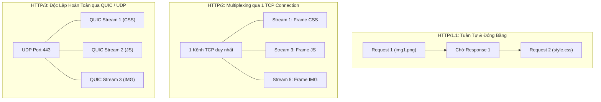
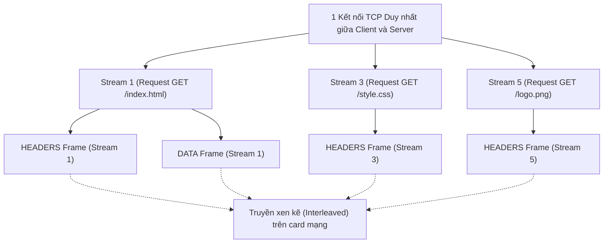
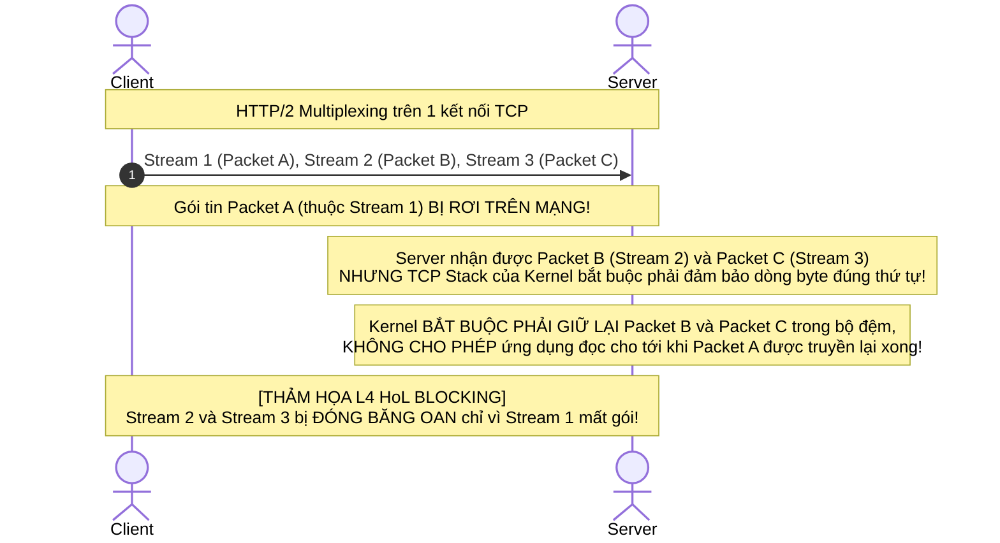
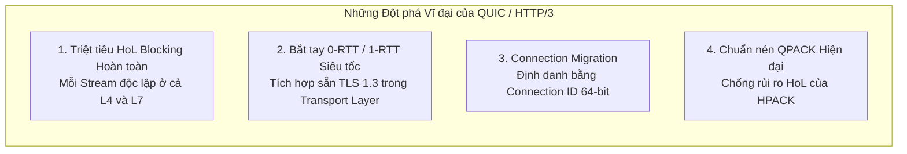
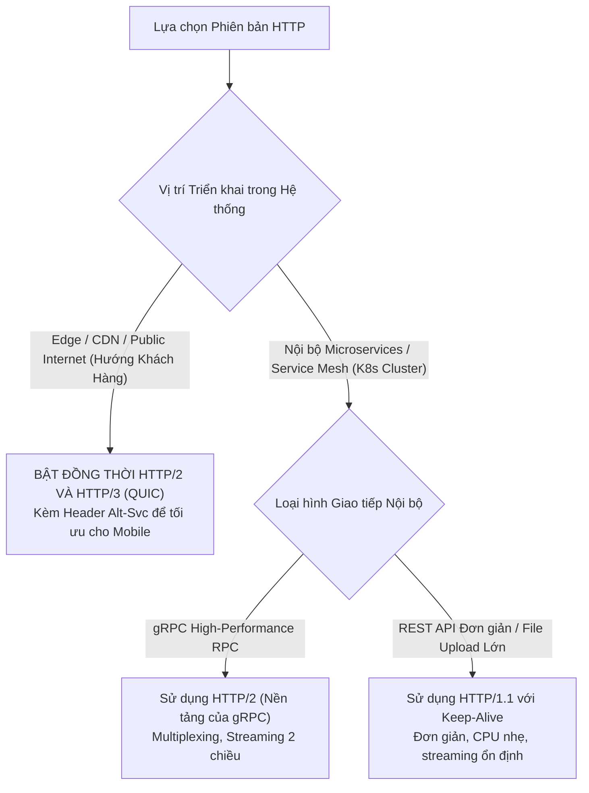

# 7.2. HTTP Evolution: HTTP/1.1, HTTP/2, HTTP/3, and QUIC

> [!IMPORTANT]
> **Nếu bạn chỉ được nhớ một điều duy nhất:** Lịch sử tiến hóa của giao thức HTTP là cuộc chiến không khoan nhượng chống lại hiện tượng Nghẽn đầu hàng (Head-of-Line Blocking): HTTP/1.1 bị nghẽn ở Tầng 7 do chỉ gửi tuần tự trên 1 kết nối; HTTP/2 giải quyết bằng Binary Framing và Ghép kênh (Multiplexing) nhiều luồng trên 1 TCP socket nhưng lại dính HoL Blocking ở Tầng 4 khi có 1 gói TCP bị mất; HTTP/3 chuyển hoàn toàn sang giao thức QUIC chạy trên nền UDP, giúp các luồng stream độc lập tuyệt đối và hỗ trợ Connection Migration mượt mà giữa Wifi và 4G.

---

## 1. Đơn giản nhưng phải chi tiết (Intuitive & Deep Breakdown)

### 1.1. Đoạn Code Dẫn Nhập & Vấn Đề Thực Tế
Tại sao một trang web hiện đại chứa hàng trăm file hình ảnh, CSS, JavaScript lại tải cực chậm trên HTTP/1.1 nhưng lại hiển thị gần như tức thì trên HTTP/2 và HTTP/3 QUIC?

```bash
# Kiểm tra phiên bản giao thức đang được phục vụ bởi máy chủ
$ curl -I --http2 https://www.google.com
HTTP/2 200
content-type: text/html; charset=ISO-8859-1

# Kiểm tra giao thức HTTP/3 chạy qua UDP (QUIC)
$ curl -I --http3 https://cloudflare.com
HTTP/3 200
content-type: text/html; charset=UTF-8
alt-svc: h3=":443"; ma=86400
```

Trên HTTP/1.1, trình duyệt chỉ có thể gửi một request duy nhất trên một kết nối TCP tại một thời điểm. Để tải 100 bức ảnh, trình duyệt phải mở song song 6 kết nối TCP và xếp hàng chờ đợi; nếu 1 bức ảnh đầu tiên tải chậm, toàn bộ các tài nguyên sau bị tắc nghẽn hoàn toàn (**HTTP Head-of-Line Blocking**)!

### 1.2. Ẩn Dụ Đời Sống & Phân Tích Cơ Chế Hoạt Động
Sự tiến hóa từ HTTP/1.1 lên HTTP/2 và HTTP/3 giống như **Sự Tiến Hóa của Hệ Thống Giao Thông Hàng Hóa**:
- **HTTP/1.1** giống như **Con đường làng hẹp chỉ vừa 1 chiếc xe tải**: Mỗi chiếc xe tải chở đúng 1 món hàng (1 ảnh logo). Chiếc xe đầu tiên bị chết máy giữa đường là 99 chiếc xe phía sau phải dừng bánh bấm còi vô vọng!
- **HTTP/2 (Multiplexing qua TCP)**: Giống như **Đoàn tàu hỏa cao tốc nhiều toa**:
  - Trên một đường ray duy nhất (1 TCP Connection), hệ thống băm nhỏ các món hàng thành các gói hàng có đánh số toa (**Binary Framing: Streams & Frames**).
  - Toa 1 chở ảnh, Toa 2 chở CSS, Toa 3 chở JS chạy đan xen lẫn nhau.
  - *Nhưng điểm yếu*: Nếu đường ray TCP bị sạt lở 1 đoạn (Mất 1 gói tin TCP), **cả đoàn tàu vẫn phải dừng lại** chờ sửa đường ray (**TCP-level Head-of-Line Blocking**)!
- **HTTP/3 (QUIC qua UDP)**: Giống như **Đội tàu bay Drone không người lái**:
  - Không cần đường ray TCP gò bó nữa. Mỗi stream là một chiếc drone độc lập bay tự do trên bầu trời UDP.
  - Nếu một chiếc drone bị gió thổi rơi, chỉ mình món hàng đó bị bay lại, 99 chiếc drone còn lại vẫn hạ cánh giao hàng êm ru tới tay người nhận!

### 1.3. Mô Phỏng Dữ Liệu Số Nhỏ Từng Bước (Toy Walkthrough)
Mô phỏng cơ chế Binary Framing Multiplexing trên HTTP/2 qua 1 kết nối TCP duy nhất:

| Thời Điểm | Stream ID | Loại Frame HTTP/2 | Cờ (Flags) | Dữ Liệu Tải (Payload) | Trạng Thái Nhận Tại Client |
| :--- | :--- | :--- | :--- | :--- | :--- |
| $T_0$ | **Stream 1** | `HEADERS` | `END_HEADERS` | Request URL: `/style.css` | Khởi tạo luồng CSS |
| $T_1$ | **Stream 3** | `HEADERS` | `END_HEADERS` | Request URL: `/script.js` | Khởi tạo luồng JS |
| $T_2$ | **Stream 1** | `DATA` | - | 1000 bytes đầu của CSS | Bắt đầu parse CSS |
| $T_3$ | **Stream 3** | `DATA` | - | 1500 bytes đầu của JS | Parse JS song song |
| $T_4$ | **Stream 1** | `DATA` | `END_STREAM` | 500 bytes cuối của CSS | **Hoàn tất `/style.css`** |
| $T_5$ | **Stream 3** | `DATA` | `END_STREAM` | 800 bytes cuối của JS | **Hoàn tất `/script.js`** |

Cả hai file được truyền đan xen mượt mà trên cùng một kết nối mà không cần đóng mở socket hay chờ đợi lẫn nhau.

### 1.4. Tác Động Thực Tế Tầng Backend & Systems
- **Tính Năng Connection Migration của QUIC / HTTP/3**: Khi người dùng smartphone đang dùng Wi-Fi trong nhà bước ra đường và chuyển sang mạng 4G, địa chỉ IP của thiết bị thay đổi hoàn toàn. Với TCP (HTTP/1.1 & HTTP/2), toàn bộ kết nối bị đứt và phải bắt tay lại từ đầu. Với QUIC, kết nối được định danh bằng **Connection ID (64-bit)** nằm trong header UDP chứ không phụ thuộc vào 4-tuple IP:Port, cho phép cuộc gọi video hoặc tải file tiếp diễn mà không rớt một khung hình!
- **Áp Lực Tiêu Thụ CPU Khi Chạy HTTP/3**: Do UDP truyền thống trong kernel Linux không được tối ưu hóa phần cứng mạnh mẽ như TCP (thiếu TCP Segmentation Offload), máy chủ chạy HTTP/3 QUIC ở quy mô lớn có thể ngốn CPU nhiều hơn khoảng 20-30% so với HTTP/2.

### 1.5. Sơ Đồ Tư Duy & Kiến Trúc Hệ Thống (Mermaid)


---

## 2. Chi tiết từng Keyword (Under-the-Hood Deep Dive)

### 2.1. HTTP/0.9 & HTTP/1.0 (Lịch sử Sơ khai)

#### A. HTTP/0.9 (Năm 1991 - Giao thức Một Dòng)
- Do Tim Berners-Lee thiết kế với mục tiêu tối giản tuyệt đối.
- Request chỉ có đúng một dòng duy nhất: `GET /index.html\r\n`.
- Không có Headers, không có Status Code, không có định dạng media. Server chỉ việc gửi file HTML thô về rồi lập tức ngắt kết nối TCP.

#### B. HTTP/1.0 (RFC 1945 - Năm 1996)
- Bổ sung HTTP Headers, Status Code (`200 OK`, `404 Not Found`), và hỗ trợ đa phương tiện thông qua `Content-Type`.
- **Điểm yếu Chí tử: Short-Lived Connections**:
  - Với mỗi một file tài nguyên (mỗi ảnh, file CSS, JS), client phải khởi tạo một kết nối TCP hoàn toàn mới:
    $$\text{Chi phí mỗi Request} = 1 \text{ RTT (TCP 3-Way Handshake)} + 1 \text{ RTT (HTTP Transfer)} = 2 \text{ RTTs}$$
  - Mỗi kết nối đều phải trải qua pha **Slow Start** chậm chạp của TCP, khiến việc tải một trang web có 50 bức ảnh trở thành một cực hình với hàng trăm giây trễ!

---

### 2.2. HTTP/1.1: Persistent Connections & Pipelining (RFC 2068 / RFC 7230)

Ra đời năm 1997, HTTP/1.1 là tiêu chuẩn thống trị Internet trong suốt gần 2 thập kỷ:

#### 1. Persistent Connections (`Connection: keep-alive`)
- Trở thành **hành vi mặc định** trong HTTP/1.1.
- Một kết nối TCP sau khi phục vụ xong Request 1 sẽ được giữ mở (Idle) để phục vụ tiếp Request 2, 3, 4... mà không phải bắt tay lại từ đầu.
- Giúp giảm tới $80\%$ số lượng kết nối TCP mới và tận dụng được cửa sổ `cwnd` đã mở rộng sau pha Slow Start.

#### 2. Thất bại của HTTP Pipelining
- HTTP/1.1 đề xuất cơ chế Pipelining: Client có quyền gửi liên tiếp các Request 1, 2, 3 mà không cần chờ Response 1 quay về.
- **Tại sao Pipelining Thất bại Toàn diện?**:
  - Chuẩn quy định: **Server bắt buộc phải trả về các Response đúng theo thứ tự các Request đã nhận** (FIFO).
  - Nếu Request 1 là một tác vụ tính toán nặng mất 5 giây (ví dụ: xuất báo cáo DB), các Request 2 và 3 (dù chỉ là lấy file ảnh 10ms) **đều phải đứng xếp hàng chờ đợi trọn vẹn 5 giây** (**Application Head-of-Line Blocking**)!
  - Hiện tượng này khiến các trình duyệt lớn (Chrome, Firefox) phải tắt mặc định Pipelining và áp dụng giải pháp tình thế: **Mở đồng thời tối đa 6 kết nối TCP song song** tới cùng một domain.

---

### 2.3. HTTP/2: Binary Framing & Multiplexing (RFC 7540)

Được phát triển từ giao thức SPDY của Google và chuẩn hóa năm 2015, HTTP/2 giải quyết triệt để vấn đề của HTTP/1.1 mà vẫn bảo lưu $100\%$ ngữ nghĩa (Methods, Status Codes, Headers):



#### A. Binary Framing Layer (Tầng Khung Nhị phân)
- HTTP/2 từ bỏ hoàn toàn định dạng văn bản thô ASCII (`\r\n`) dễ lỗi để chuyển sang **Khung nhị phân (Binary Frames)**.
- Mỗi frame có một **Header chuẩn cố định đúng 9 bytes**:
  - `Length (24 bits)`: Kích thước payload của frame.
  - `Type (8 bits)`: Loại frame (`HEADERS`, `DATA`, `SETTINGS`, `RST_STREAM`, `PING`, `GOAWAY`).
  - `Flags (8 bits)`: Các cờ điều khiển (`END_STREAM`, `END_HEADERS`).
  - `R (1 bit)`: Reserved.
  - `Stream Identifier (31 bits)`: Định danh luồng dữ liệu độc nhất.

#### B. Streams & Multiplexing (Đa công Ghép kênh)
- Một kết nối TCP duy nhất có thể chứa hàng trăm **Streams** hai chiều chạy đồng thời.
- Các frame từ nhiều stream khác nhau được truyền xen kẽ (interleaving) tự do trên đường truyền. Phía nhận đọc trường `Stream ID` để tự động ghép các mảnh dữ liệu lại đúng vị trí.
- **Xóa sổ hoàn toàn Application HoL Blocking**: Request nặng ở Stream 1 không bao giờ làm cản trở việc truyền nhận dữ liệu siêu tốc của Stream 3!

#### C. HPACK: Nén Header Hiện đại (RFC 7541)
Trong HTTP/1.1, mỗi request đều lặp đi lặp lại hàng nghìn bytes header giống hệt nhau (`User-Agent`, `Cookie`). HTTP/2 giải quyết bằng chuẩn nén **HPACK**:
- **Bảng Tĩnh (Static Table)**: Gồm 61 cặp header phổ biến nhất được định nghĩa cứng trong RFC (ví dụ: Index 2 = `GET`, Index 7 = `:scheme: https`). Thay vì truyền chuỗi chữ, client chỉ cần truyền **đúng 1 byte số index**!
- **Bảng Động (Dynamic Table)**: Duy trì một bộ đệm vòng tròn các header xuất hiện trong phiên kết nối. Header nào đã gửi một lần thì lần sau chỉ cần gửi số index tham chiếu.
- Kết hợp với mã hóa Huffman tĩnh, giúp **giảm tới $85 - 90\%$ dung lượng header**.

#### D. Stream Prioritization & Server Push
- **Stream Prioritization**: Cho phép client gán trọng số ưu tiên và sự phụ thuộc giữa các stream (ví dụ: ưu tiên tải file CSS chặn render trước khi tải ảnh đại diện).
- **Server Push**: Server tự động đẩy kèm các tài nguyên (như `style.css`) về client ngay khi client yêu cầu `index.html`. Tuy nhiên, trong thực tế sản xuất, Server Push **bị coi là một thất bại** (do khó đoán trước tài nguyên client đã lưu trong cache, gây lãng phí băng thông) và đã bị Chrome chính thức vô hiệu hóa từ năm 2022.

---

### 2.4. Vấn đề TCP Head-of-Line Blocking trong HTTP/2

Mặc dù HTTP/2 là một tuyệt tác kỹ thuật ở tầng ứng dụng, nó lại vấp phải một rào cản vật lý nghiệt ngã đến từ bản chất của tầng giao vận **TCP**:



- Trong môi trường mạng có tỷ lệ mất gói cao (như mạng 4G/5G sóng yếu hoặc Wi-Fi công cộng):
  - Khi mất dù chỉ **1 gói tin TCP**, toàn bộ các luồng dữ liệu khác (dù dữ liệu của chúng đã nằm sẵn trong card mạng) **đều bị phong tỏa hoàn toàn** chờ TCP retransmit.
  - Trong tình huống này, hiệu năng của HTTP/2 thậm chí còn **chậm hơn cả HTTP/1.1** (vì HTTP/1.1 dùng 6 kết nối TCP độc lập, mất gói trên kết nối này thì 5 kết nối kia vẫn chạy bình thường)!

---

### 2.5. HTTP/3 và Giao thức QUIC (RFC 9000 / RFC 9114)

Để giải phóng Internet khỏi chiếc gông cùm TCP, các kỹ sư nhận ra không thể nâng cấp giao thức TCP vì hàng triệu Router/Firewall trung gian (**Middleboxes**) trên thế giới sẽ tự động drop các gói tin có cờ TCP lạ (**Ossification Problem**).
- **Giải pháp Đột phá**: Xây dựng một giao thức giao vận hoàn toàn mới mang tên **QUIC (Quick UDP Internet Connections)** chạy trên nền tảng **UDP** (vốn được tất cả middlebox cho qua dễ dàng), và đặt **HTTP/3** lên trên đỉnh của QUIC.



1. **Triệt tiêu HoL Blocking Triệt để**:
   - Trong QUIC, mỗi Stream có không gian Sequence Number độc lập.
   - Nếu Stream 1 mất gói tin, chỉ riêng Stream 1 bị dừng lại chờ retransmit; các Stream 2, 3, 4 vẫn được chuyển giao thẳng lên ứng dụng ngay lập tức!
2. **Bắt tay 0-RTT / 1-RTT Cực nhanh**:
   - Trong TCP + TLS 1.3, bạn tốn 1 RTT cho TCP và 1 RTT cho TLS (tổng 2 RTTs).
   - Trong QUIC, bước bắt tay kết nối và bắt tay mã hóa được gộp làm một: **Chỉ mất đúng 1 RTT cho lần đầu**, và đạt **0-RTT tuyệt đối** cho các lần kết nối lại!
3. **Connection Migration (Chuyển vùng Mạng Không Đứt Kết Nối)**:
   - Kết nối TCP bị ràng buộc cứng bởi bộ 4: `(Src IP, Src Port, Dst IP, Dst Port)`. Khi bạn rời quán cafe (ngắt Wi-Fi sang 4G), IP thay đổi, kết nối TCP bị đứt ngay lập tức.
   - QUIC định danh phiên kết nối bằng một số ngẫu nhiên gọi là **Connection ID (CID - 64 bits)**. Dù IP và Port của điện thoại thay đổi, gói tin vẫn mang CID cũ, cuộc gọi video hay phiên download vẫn tiếp tục mượt mà mà không hề bị gián đoạn!
4. **QPACK (RFC 9204)**: Phiên bản nâng cấp của HPACK dành riêng cho HTTP/3, loại bỏ hoàn toàn sự phụ thuộc thứ tự giữa các stream khi nén header.

---

## 3. Thực thi Mã nguồn & Mô phỏng Chuyên sâu (Dual-Engine Implementation)

### 3.1. C++20: HTTP/2 Binary Frame Parser & Demultiplexer Engine

File `http2_frame_parser.cpp` mô phỏng đầy đủ cấu trúc giải mã 9-byte binary header của HTTP/2 chuẩn RFC 7540, trích xuất Stream ID, Frame Type, Flags và tách dữ liệu luồng độc lập.

```cpp
#include <iostream>
#include <vector>
#include <cstdint>
#include <iomanip>
#include <string>

#pragma pack(push, 1)
struct HTTP2FrameHeaderRaw {
    uint8_t length_high;  // 24 bits length
    uint8_t length_mid;
    uint8_t length_low;
    uint8_t type;         // 8 bits type
    uint8_t flags;        // 8 bits flags
    uint32_t stream_id;   // 1 bit R + 31 bits Stream ID (Big-Endian)
};
#pragma pack(pop)

enum class FrameType : uint8_t {
    DATA = 0x0,
    HEADERS = 0x1,
    PRIORITY = 0x2,
    RST_STREAM = 0x3,
    SETTINGS = 0x4,
    PUSH_PROMISE = 0x5,
    PING = 0x6,
    GOAWAY = 0x7,
    WINDOW_UPDATE = 0x8,
    CONTINUATION = 0x9
};

std::string frame_type_to_string(FrameType t) {
    switch (t) {
        case FrameType::DATA: return "DATA";
        case FrameType::HEADERS: return "HEADERS";
        case FrameType::SETTINGS: return "SETTINGS";
        case FrameType::RST_STREAM: return "RST_STREAM";
        case FrameType::GOAWAY: return "GOAWAY";
        default: return "OTHER_FRAME";
    }
}

struct HTTP2ParsedFrame {
    uint32_t length;
    FrameType type;
    uint8_t flags;
    uint32_t stream_id;
    std::vector<uint8_t> payload;
};

class HTTP2FrameParser {
public:
    static HTTP2ParsedFrame parse_frame(const std::vector<uint8_t>& raw_bytes) {
        if (raw_bytes.size() < 9) {
            throw std::runtime_error("Du lieu khong du 9 bytes Header cua HTTP/2!");
        }

        HTTP2ParsedFrame frame{};
        // Doc 24 bits Length
        frame.length = (static_cast<uint32_t>(raw_bytes[0]) << 16) |
                       (static_cast<uint32_t>(raw_bytes[1]) << 8)  |
                       static_cast<uint32_t>(raw_bytes[2]);

        frame.type = static_cast<FrameType>(raw_bytes[3]);
        frame.flags = raw_bytes[4];

        // Doc 31 bits Stream ID (Bo qua bit R dau tien)
        uint32_t raw_sid = (static_cast<uint32_t>(raw_bytes[5]) << 24) |
                           (static_cast<uint32_t>(raw_bytes[6]) << 16) |
                           (static_cast<uint32_t>(raw_bytes[7]) << 8)  |
                           static_cast<uint32_t>(raw_bytes[8]);
        frame.stream_id = raw_sid & 0x7FFFFFFF;

        // Copy Payload
        if (raw_bytes.size() >= 9 + frame.length) {
            frame.payload.assign(raw_bytes.begin() + 9, raw_bytes.begin() + 9 + frame.length);
        }

        return frame;
    }
};

int main() {
    std::cout << "=== HTTP/2 BINARY FRAME DEMULTIPLEXER (C++20) ===" << std::endl;

    // Du lieu mau: 1 HEADERS Frame tren Stream 1 (Length=4, Flags=END_STREAM|END_HEADERS)
    // 00 00 04 (Length = 4)
    // 01       (Type = HEADERS)
    // 05       (Flags = 0x01 | 0x04)
    // 00 00 00 01 (Stream ID = 1)
    // Payload: DE AD BE EF
    std::vector<uint8_t> sample_frame_bytes = {
        0x00, 0x00, 0x04,
        0x01,
        0x05,
        0x00, 0x00, 0x00, 0x01,
        0xDE, 0xAD, 0xBE, 0xEF
    };

    auto frame = HTTP2FrameParser::parse_frame(sample_frame_bytes);

    std::cout << "Frame Type    : " << frame_type_to_string(frame.type) << " (0x01)\n";
    std::cout << "Payload Length: " << frame.length << " bytes\n";
    std::cout << "Flags         : 0x" << std::hex << static_cast<int>(frame.flags) << std::dec << "\n";
    std::cout << "Stream ID     : " << frame.stream_id << " (Client Initiated Stream)\n";
    std::cout << "Payload Hex   : ";
    for (uint8_t b : frame.payload) {
        std::cout << "0x" << std::hex << std::uppercase << static_cast<int>(b) << " ";
    }
    std::cout << std::dec << "\n";

    return 0;
}
```

### 3.2. Python 3.11: HTTP/2 vs HTTP/3 Head-of-Line Blocking Simulator

File `hol_blocking_sim.py` mô phỏng trực quan hiện tượng mất 1 gói tin TCP làm tê liệt toàn bộ 10 streams trong HTTP/2, và đối chiếu với khả năng truyền nhận độc lập 100% của HTTP/3 (QUIC).

```python
from dataclasses import dataclass
from typing import List

@dataclass
class Packet:
    stream_id: int
    seq_in_stream: int
    is_dropped: bool = False

class HOLBlockingSimulator:
    """Mo phong so sanh anh huong cua mat goi tin giua HTTP/2 (TCP) va HTTP/3 (QUIC)."""

    @staticmethod
    def simulate_packet_drop():
        print("=== HEAD-OF-LINE BLOCKING SIMULATION: HTTP/2 vs HTTP/3 (Python 3.11) ===\n")
        
        # Gia lap 5 Streams truyen song song (Moi stream 2 packets)
        packets: List[Packet] = []
        for sid in range(1, 6):
            packets.append(Packet(sid, 1))
            packets.append(Packet(sid, 2))

        # Gia lap goi tin dau tien cua Stream 1 bi rot tren duong truyen!
        packets[0].is_dropped = True

        print(f"[*] Tong so goi tin gui di: {len(packets)} packets tren 5 Streams.")
        print(f"[!] Su co mang: Packet dau tien cua Stream 1 bi DROP!\n")

        # 1. MO PHONG HTTP/2 (Chay tren 1 ket noi TCP)
        print("--- 1. KẾT QUẢ TRÊN HTTP/2 (TCP TRANSPORT) ---")
        tcp_buffer_delivered = []
        tcp_blocked_in_kernel = []

        for p in packets:
            if p.is_dropped:
                print(f"  [X] Packet Stream {p.stream_id} Seq {p.seq_in_stream} BI MAT!")
                # Toan bo cac packet phia sau bi khoa trong TCP Receive Queue
                continue
            
            # Vi packet dau bi mat, TCP Kernel khong cho phep doc bat ky packet nao phia sau!
            tcp_blocked_in_kernel.append(p)

        print(f"  -> So packet duoc Ung dung tiep nhan ngay: {len(tcp_buffer_delivered)} packets")
        print(f"  -> So packet bi TREO TRONG KERNEL do L4 HoL Blocking: {len(tcp_blocked_in_kernel)} packets")
        print("  -> HẬU QUẢ: Toàn bộ Stream 2, 3, 4, 5 bị đóng băng oan uổng!\n")

        # 2. MO PHONG HTTP/3 (Chay tren QUIC / UDP)
        print("--- 2. KẾT QUẢ TRÊN HTTP/3 (QUIC / UDP TRANSPORT) ---")
        quic_delivered = []
        quic_waiting_retransmit = []

        for p in packets:
            if p.is_dropped:
                print(f"  [X] Packet Stream {p.stream_id} Seq {p.seq_in_stream} BI MAT!")
                quic_waiting_retransmit.append(p)
            else:
                # Cac stream khac van nhan binh thuong khong bi anh huong!
                quic_delivered.append(p)

        print(f"  -> So packet duoc Ung dung tiep nhan ngay: {len(quic_delivered)} packets")
        print(f"  -> Stream bi anh huong duy nhat: Stream 1")
        print(f"  -> KẾT LUẬN: Các Stream 2, 3, 4, 5 hoàn tất 100% không hề bị trễ dù chỉ 1 mili-giây!")

if __name__ == "__main__":
    HOLBlockingSimulator.simulate_packet_drop()
```

### 3.3. Terminal Output Mẫu

```text
$ clang++ -std=c++20 -O3 http2_frame_parser.cpp -o http2_frame_parser && ./http2_frame_parser
=== HTTP/2 BINARY FRAME DEMULTIPLEXER (C++20) ===
Frame Type    : HEADERS (0x01)
Payload Length: 4 bytes
Flags         : 0x5
Stream ID     : 1 (Client Initiated Stream)
Payload Hex   : 0xDE 0xAD 0xBE 0xEF 

$ python3 hol_blocking_sim.py
=== HEAD-OF-LINE BLOCKING SIMULATION: HTTP/2 vs HTTP/3 (Python 3.11) ===

[*] Tong so goi tin gui di: 10 packets tren 5 Streams.
[!] Su co mang: Packet dau tien cua Stream 1 bi DROP!

--- 1. KẾT QUẢ TRÊN HTTP/2 (TCP TRANSPORT) ---
  [X] Packet Stream 1 Seq 1 BI MAT!
  -> So packet duoc Ung dung tiep nhan ngay: 0 packets
  -> So packet bi TREO TRONG KERNEL do L4 HoL Blocking: 9 packets
  -> HẬU QUẢ: Toàn bộ Stream 2, 3, 4, 5 bị đóng băng oan uổng!

--- 2. KẾT QUẢ TRÊN HTTP/3 (QUIC / UDP TRANSPORT) ---
  [X] Packet Stream 1 Seq 1 BI MAT!
  -> So packet duoc Ung dung tiep nhan ngay: 9 packets
  -> Stream bi anh huong duy nhat: Stream 1
  -> KẾT LUẬN: Các Stream 2, 3, 4, 5 hoàn tất 100% không hề bị trễ dù chỉ 1 mili-giây!
```

---

## 4. Systems Engineering & Production Pitfalls

### 4.1. Cuộc Tấn công Kỷ lục: HTTP/2 Rapid Reset Attack (CVE-2023-44487)
Tháng 10/2023, tin tặc đã sử dụng lỗ hổng **Rapid Reset** để thực hiện cuộc tấn công từ chối dịch vụ (DDoS) lớn nhất lịch sử Internet lên tới **398 triệu Requests/giây** nhắm vào Google và Cloudflare:
- **Cơ chế Tấn công**:
  1. Kẻ tấn công gửi hàng triệu frame `HEADERS` để mở stream mới liên tục.
  2. Ngay lập tức gửi tiếp frame **`RST_STREAM`** để hủy stream đó.
  3. Quá trình mở và hủy diễn ra ngay trong 1 vòng RTT mà không bao giờ chờ server phản hồi.
- **Tại sao Server Sập?**:
  - Máy chủ web (Nginx, Envoy, Golang HTTP server) tốn rất nhiều CPU để cấp phát cấu trúc dữ liệu cho stream mới, nhưng client hủy ngay khiến server bị quá tải CPU giải phóng tài nguyên.
- **Biện pháp Phòng vệ Bắt buộc**: Cập nhật bản vá giới hạn số lượng `RST_STREAM` cho phép trong một khoảng thời gian trên mỗi kết nối (ví dụ trong Nginx: `http2_max_concurrent_streams 128;`).

### 4.2. Tường Lửa Doanh nghiệp Chặn Cổng UDP 443 và Cơ chế Fallback `Alt-Svc`
Nhiều mạng văn phòng công ty hoặc khách sạn chặn toàn bộ lưu lượng UDP ra ngoài (chỉ cho phép UDP port 53 cho DNS):
- Trình duyệt web sẽ không thể kết nối trực tiếp bằng HTTP/3 (QUIC).
- **Cơ chế Fallback Chuẩn mực**:
  - Trình duyệt luôn kết nối tới server bằng **HTTP/2 qua TCP trước**.
  - Server phản hồi đính kèm Header **`Alt-Svc` (Alternative Services)**:
    ```http
    Alt-Svc: h3=":443"; ma=86400
    ```
  - Trình duyệt ghi nhớ rằng server này có hỗ trợ HTTP/3. Ở các lần truy cập sau, trình duyệt sẽ thử kết nối song song cả QUIC (UDP) và TCP. Nếu cổng UDP bị tường lửa chặn, nó sẽ tự động rơi về TCP mà người dùng không hề nhận thấy lỗi!

---

## 5. Bảng So sánh & Decision Matrix

### 5.1. Bảng So sánh Toàn diện: Lịch sử Tiến hóa của Giao thức HTTP

| Tiêu chuẩn Đánh giá | HTTP/1.0 (1996) | HTTP/1.1 (1997) | HTTP/2 (2015) | HTTP/3 (2022) |
| :--- | :---: | :---: | :---: | :---: |
| **Giao thức Tầng dưới** | TCP | TCP | TCP | **QUIC (trên nền UDP)** |
| **Định dạng Thông điệp** | Văn bản ASCII | Văn bản ASCII | **Khung Nhị phân (Binary)** | **Khung Nhị phân (QUIC Frames)** |
| **Đa công Ghép kênh (Multiplexing)**| Không | Pipelining (Hỏng) | **Có (Trên 1 TCP)** | **Có (Độc lập tuyệt đối)** |
| **Nén Header** | Không có | Không có | **HPACK** (Bảng tĩnh/động) | **QPACK** (Chống HoL) |
| **Độ trễ Bắt tay (TLS)**| 2-3 RTTs | 2 RTTs | 1-2 RTTs | **0-RTT hoặc 1-RTT** |
| **HoL Blocking Tầng App**| Bị kẹt cứng | Bị kẹt cứng | **Đã xóa bỏ** | **Đã xóa bỏ** |
| **HoL Blocking Tầng L4**| Không (Do mở nhiều TCP)| Không (Dùng 6 TCPs)| **Bị ảnh hưởng rất nặng** | **TRIỆT TIÊU HOÀN TOÀN** |
| **Chuyển vùng Kết nối** | Đứt kết nối | Đứt kết nối | Đứt kết nối | **Connection Migration (CID)** |

### 5.2. Decision Matrix: Lựa chọn Phiên bản HTTP theo Tình huống Triển khai



| Môi trường Thực tế | Phiên bản Khuyên dùng | Lý do & Lợi ích Mang lại |
| :--- | :--- | :--- |
| **Ứng dụng Di động (Mobile App iOS/Android)** | **HTTP/3 (QUIC)** | 0-RTT giúp mở app cực nhanh; Connection Migration giữ nguyên phiên khi chuyển 4G/Wi-Fi. |
| **Cụm Microservices Nội bộ (gRPC)** | **HTTP/2 over mTLS** | Tận dụng kênh kết nối duy nhất giữa các Pod để truyền hàng nghìn RPC đồng thời. |
| **Hệ thống Nhúng / IoT / Thiết bị Cũ** | **HTTP/1.1** | Không tốn RAM giải mã HPACK; tương thích 100% với mọi phần cứng tối giản. |
| **Website Doanh nghiệp / Cổng Thương mại**| **HTTP/2 + HTTP/3 trên Cloudflare** | Tối đa hóa điểm Google Core Web Vitals và tăng tốc độ tải trang toàn cầu. |

---

## 6. Enterprise Production Checklist & Verification

### 6.1. Kiến Trúc & Cấu Hình Tối Ưu (Production-Ready Architecture)
- [ ] **Kích Hoạt HTTP/2 Trên Toàn Bộ Edge Ingress / Reverse Proxy**: Bật cờ `http2` trong block listen của Nginx (`listen 443 ssl http2;`) hoặc kích hoạt trên Cloudflare / AWS ALB.
- [ ] **Triển Khai Header Alt-Svc Cho HTTP/3 QUIC**: Cấu hình phản hồi HTTP Header: `add_header Alt-Svc 'h3=":443"; ma=86400';` để báo cho các trình duyệt hiện đại tự động nâng cấp kết nối sang HTTP/3.
- [ ] **Mở Port 443 Giao Thức UDP Tại Tường Lửa**: Khi bật HTTP/3, bắt buộc mở firewall cho cả hai giao thức TCP và UDP trên cổng 443 tại các Security Groups / Gateway.
- [ ] **Loại Bỏ Các Giải Pháp Vá Víu Thời HTTP/1.1**: Gỡ bỏ các kỹ thuật cũ như gộp file CSS/JS quá mức (Domain Sharding, Image Sprites) vì chúng làm giảm hiệu quả bộ nhớ cache độc lập của HTTP/2 và HTTP/3.

### 6.2. Giám Sát, Cảnh Báo & Xử Lý Sự Cố (Observability & Incident Response)
- [ ] **Phân Bổ Tỷ Lệ Giao Thức Theo Client**: Giám sát phân phối tỷ lệ phần trăm các kết nối HTTP/1.1, HTTP/2 và HTTP/3 để đánh giá mức độ tiếp nhận của người dùng.
- [ ] **Cảnh Báo Hiện Tượng HTTP/2 Reset Streams**: Theo dõi metric `http2_reset_stream` để phát hiện các cuộc tấn công DoS HTTP/2 Rapid Reset (CVE-2023-44487).
- [ ] **Xác Thực Kết Nối HTTP/3 Bằng cURL CLI**: Sử dụng lệnh `curl --http3 -IL https://yourdomain.com` để kiểm tra khả năng bắt tay QUIC thành công.
