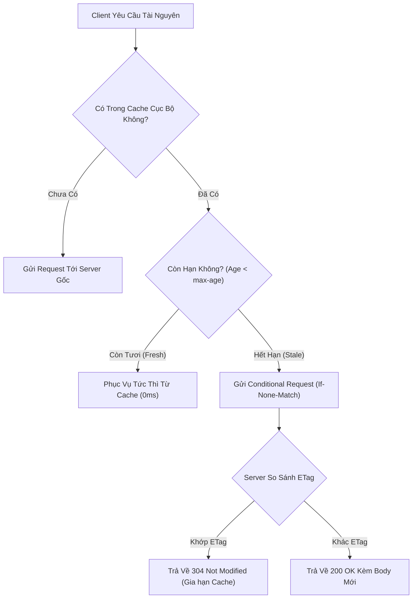
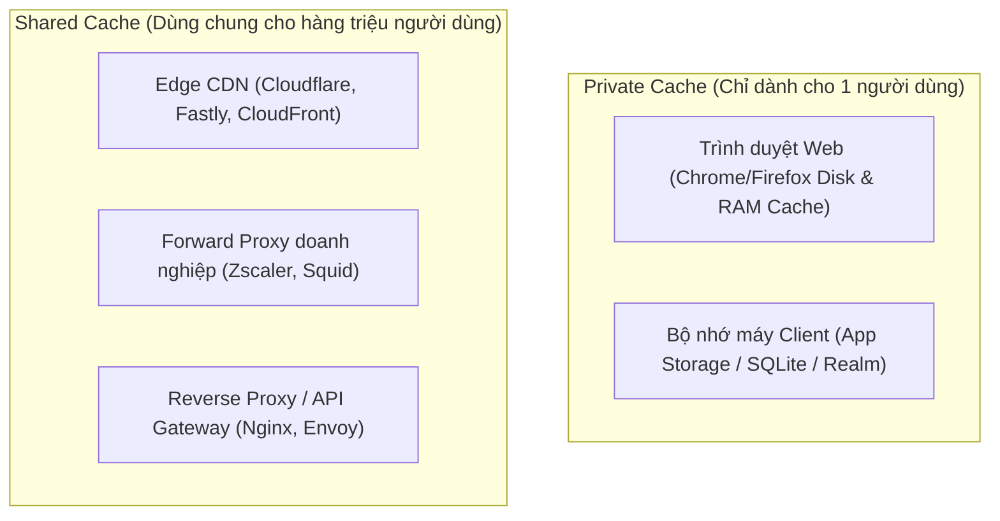
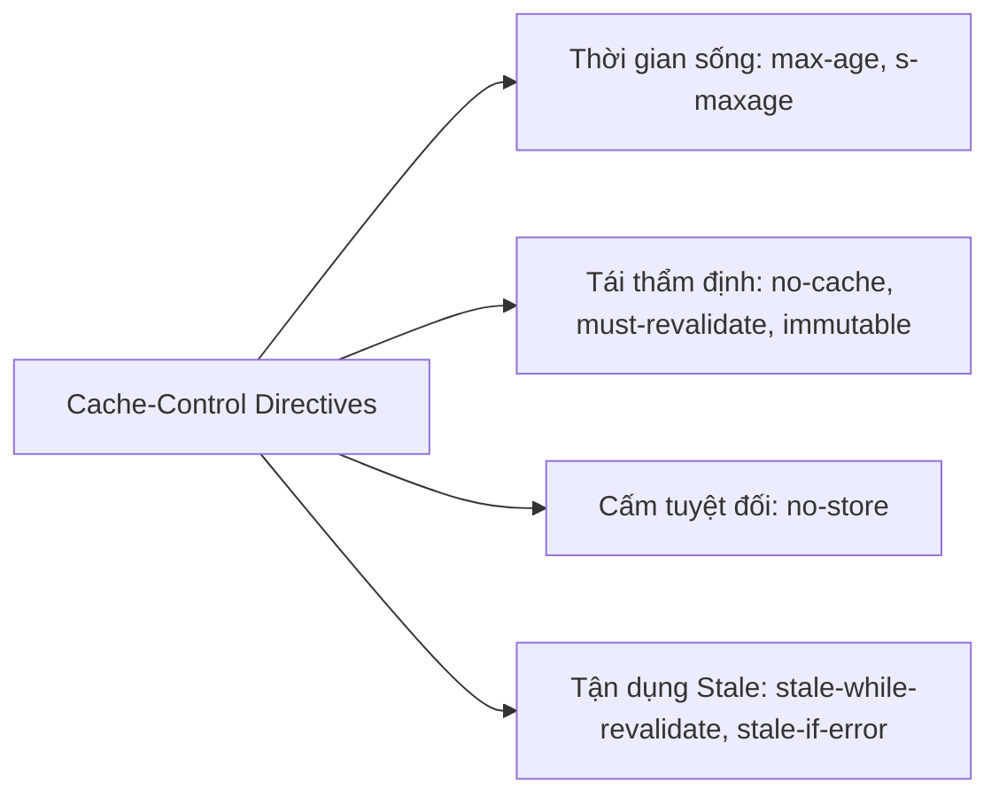
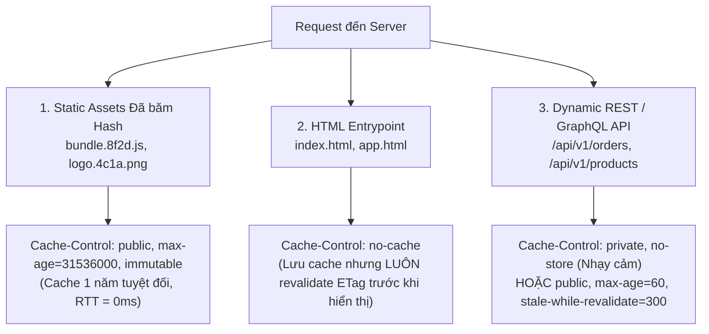

# 7.3. HTTP Caching and Conditional Requests (Bộ nhớ đệm HTTP và Yêu cầu Có điều kiện)

> [!IMPORTANT]
> **Nếu bạn chỉ được nhớ một điều duy nhất:** Bộ nhớ đệm HTTP (HTTP Caching) là cách nhanh nhất và rẻ nhất để mở rộng quy mô hệ thống: yêu cầu có điều kiện kết hợp cặp tiêu đề `ETag` / `If-None-Match` hoặc `Last-Modified` / `If-Modified-Since` cho phép máy chủ trả về mã trạng thái `304 Not Modified` với kích thước gói tin tiệm cận bằng 0, tiết kiệm hàng terabyte băng thông mạng và giải phóng công suất máy chủ cơ sở dữ liệu.

---

## 1. Đơn giản nhưng phải chi tiết (Intuitive & Deep Breakdown)

### 1.1. Đoạn Code Dẫn Nhập & Vấn Đề Thực Tế
Làm thế nào các trang thương mại điện tử lớn có thể phục vụ hàng chục triệu lượt truy cập mỗi phút mà máy chủ cơ sở dữ liệu backend chỉ phải xử lý một lượng truy vấn cực nhỏ?

```http
# Yêu cầu có điều kiện (Conditional Request) từ Trình duyệt
GET /static/bundle.js HTTP/1.1
Host: cdn.example.com
If-None-Match: "33a64df551425fcc55e4d42a148795d9f25f89d4"

# Máy chủ phản hồi: Dữ liệu chưa hề thay đổi, hãy dùng lại file cũ trong máy bạn!
HTTP/1.1 304 Not Modified
ETag: "33a64df551425fcc55e4d42a148795d9f25f89d4"
Cache-Control: public, max-age=31536000, immutable
(Hoàn toàn không có body dữ liệu được gửi qua mạng!)
```

Nếu cấu hình sai Header `Cache-Control` (ví dụ để mặc định không khai báo), trình duyệt sẽ liên tục tải lại toàn bộ các file ảnh, font chữ, script nặng hàng chục Megabytes ở mỗi cú click chuột, làm nghẽn băng thông CDN và hóa đơn chi phí cloud tăng vọt!

### 1.2. Ẩn Dụ Đời Sống & Phân Tích Cơ Chế Hoạt Động
Cơ chế Caching và Yêu cầu Có điều kiện giống như **Cách Bạn Sử Dụng Cuốn Sổ Tay Công Thức Nấu Ăn**:
- Thay vì mỗi ngày đều phải gọi điện thoại hỏi đầu bếp trưởng: *"Bác đọc lại cho cháu công thức nấu món phở bò!"* (Truy vấn database tốn kém):
- Lần đầu tiên hỏi, bạn chép công thức vào cuốn sổ tay (**Lưu vào Browser Cache**). Đầu bếp dặn: *"Công thức này có giá trị trong vòng 1 năm!"* (`max-age=31536000`).
- Suốt 1 năm đó, bạn cứ mở sổ ra nấu mà không cần gọi cho đầu bếp một cuộc điện thoại nào (**Fresh Cache Hit - 0ms Latency**).
- Sau 1 năm, công thức bị coi là cũ (**Stale**). Bạn gọi điện hỏi đầu bếp: *"Công thức số hiệu v2.1 cháu chép năm ngoái có đổi gì không?"* (**`If-None-Match: "v2.1"`**).
  - Nếu đầu bếp bảo: *"Vẫn y nguyên như thế, cứ nấu đi!"* (**`304 Not Modified`**), cuộc gọi kết thúc trong 3 giây mà đầu bếp không cần tốn hơi đọc lại cả bài hướng dẫn dài 5 trang giấy!

### 1.3. Mô Phỏng Dữ Liệu Số Nhỏ Từng Bước (Toy Walkthrough)
Vòng đời của một tài nguyên Web qua các trạng thái Cache:

| Lần Truy Cập | Hành Động Phía Client | Header Gửi Đi | Phản Hồi Từ Phía Server | Mã Trạng Thái | Dữ Liệu Tải Qua Mạng | Thời Gian Tải |
| :--- | :--- | :--- | :--- | :--- | :--- | :--- |
| **Lần 1** | Tải trang lần đầu | - | `Cache-Control: max-age=60`, `ETag: "abc"` | `200 OK` | **$2.5\text{ MB}$** | $350\text{ ms}$ |
| **Lần 2 (Sau 10s)** | Click trang khác | Kiểm tra: Còn hạn $50\text{s}$ | **Không gửi request ra mạng!** | `(from disk cache)` | **$0\text{ bytes}$** | **$1\text{ ms}$** |
| **Lần 3 (Sau 70s)** | Hết hạn 60s (Stale) | `If-None-Match: "abc"` | Tài nguyên chưa sửa đổi | **`304 Not Modified`** | **$120\text{ bytes}$ (Chỉ Header)** | $15\text{ ms}$ |
| **Lần 4 (Sau deploy)** | File trên server đã đổi | `If-None-Match: "abc"` | Server thấy hash khác `ETag: "xyz"` | `200 OK` | **$2.5\text{ MB}$ (Payload mới)** | $350\text{ ms}$ |

### 1.4. Tác Động Thực Tế Tầng Backend & Systems
- **Chiến Lược Cache-Busting Hoàn Hảo Cho Single Page Applications (SPA)**:
  - File `index.html`: Cấu hình `Cache-Control: no-cache` (Buộc trình duyệt phải luôn hỏi lại server xem có phiên bản mới không).
  - Toàn bộ các file bundles (`bundle.[hash].js`, `style.[hash].css`): Gắn kèm mã băm nội dung vào tên file và cấu hình: `Cache-Control: public, max-age=31536000, immutable`. Người dùng chỉ tải file đúng 1 lần duy nhất trong đời; khi có bản cập nhật mới, mã băm trong tên file tự động đổi!
- **Nguy Cơ Lộ Dữ Liệu Cá Nhân Do Đặt Nhầm Header `public`**: Nếu API trả về thông tin nhạy cảm của người dùng (như số tài khoản, thông tin cá nhân) mà cấu hình `Cache-Control: public`, các proxy trung gian hoặc CDN sẽ lưu bản sao này vào bộ nhớ dùng chung, dẫn tới việc người dùng B có thể nhìn thấy dữ liệu bí mật của người dùng A!

### 1.5. Sơ Đồ Tư Duy & Kiến Trúc Hệ Thống (Mermaid)


---

## 2. Chi tiết từng Keyword (Under-the-Hood Deep Dive)

### 2.1. Phân loại Bộ nhớ đệm: Private vs Shared Cache

Chuẩn HTTP phân định rạch ròi hai không gian lưu trữ đệm dựa trên phạm vi đối tượng được phục vụ:



- **Private Cache (`Cache-Control: private`)**:
  - Chỉ được phép lưu trữ trên máy khách của đúng cá nhân đó (Browser Cache).
  - Nghiêm cấm mọi Shared Cache (như CDN, Proxy) lưu lại bản sao.
  - *Bắt buộc áp dụng cho*: Bất kỳ tài nguyên nào chứa thông tin định danh cá nhân (PII), thông tin tài khoản ngân hàng, giỏ hàng, hoặc response trả về cho request có header `Authorization` hoặc session cookie.
- **Shared Cache (`Cache-Control: public`)**:
  - Được phép lưu trữ trên bất kỳ thiết bị proxy trung gian hoặc CDN nào nằm giữa Client và Origin Server.
  - Một request duy nhất của người dùng đầu tiên sẽ "làm ấm" (warm-up) cache tại Node CDN; hàng triệu người dùng tiếp theo trong khu vực địa lý đó sẽ nhận phản hồi trực tiếp từ Edge CDN với độ trễ cực thấp ($< 5\text{ ms}$).
  - *Áp dụng cho*: File tĩnh (CSS, JS, WebP/SVG images, video assets) hoặc các dữ liệu công khai (danh mục sản phẩm, tin tức báo chí).

---

### 2.2. Chỉ thị Điều khiển Bộ nhớ đệm: `Cache-Control` Directives

Header `Cache-Control` (RFC 7234) là cơ chế quyền lực nhất định hình toàn bộ hành vi lưu và hủy đệm:



1. **`max-age=<seconds>`**:
   - Khoảng thời gian tính bằng giây tài nguyên được coi là "tươi mới" (Fresh). Trong thời gian này, trình duyệt được phép dùng lại dữ liệu mà không cần hỏi server.
2. **`s-maxage=<seconds>` (Shared Max Age)**:
   - Ghi đè giá trị `max-age` nhưng **chỉ áp dụng riêng cho Shared Cache (CDN/Proxy)**. Trình duyệt vẫn tuân thủ `max-age`.
   - *Pattern kinh điển*: `Cache-Control: public, max-age=60, s-maxage=86400`. Nghĩa là: Trình duyệt chỉ cache 1 phút, nhưng CDN được phép cache 24 tiếng.
3. **`no-cache` (Cực kỳ dễ gây hiểu lầm)**:
   - **`no-cache` KHÔNG CÓ NGHĨA LÀ "KHÔNG LƯU CACHE"**!
   - Nó cho phép trình duyệt và CDN lưu bản sao vào ổ đĩa, nhưng **bắt buộc phải gửi request hỏi lại Origin Server (Revalidate qua ETag / Last-Modified) trước khi lấy dữ liệu ra dùng**. Nếu server trả về `304 Not Modified`, cache mới được dùng tiếp.
4. **`no-store` (Cấm lưu hoàn toàn)**:
   - Đây mới là chỉ thị cấm lưu thực sự: Trình duyệt và tất cả proxy **tuyệt đối không được ghi dữ liệu vào bất kỳ bộ lưu trữ lâu dài nào (ổ đĩa, RAM cache)**. Response phải bị xóa sổ khỏi bộ nhớ ngay khi hiển thị xong.
   - *Sử dụng cho*: Thông tin thẻ tín dụng, OTP, Token xác thực nhạy cảm.
5. **`must-revalidate`**:
   - Khi tài nguyên đã hết hạn (`stale`), cache bắt buộc phải revalidate thành công với server. Nếu server chết hoặc rớt mạng, cache **không được phép trả dữ liệu cũ** mà phải ném ra lỗi `HTTP 504 Gateway Timeout`.
6. **`immutable` (RFC 8246)**:
   - Báo cho trình duyệt biết rằng nội dung file này sẽ **vĩnh viễn không bao giờ thay đổi** trong suốt thời gian `max-age`. Trình duyệt sẽ không bao giờ gửi conditional request kiểm tra lại, kể cả khi người dùng nhấn nút F5 / Refresh (chỉ gửi lại khi nhấn Hard Refresh Ctrl+F5). Dùng cho các file có nhúng mã băm nội dung như `bundle.a8f9c1.js`.
7. **`stale-while-revalidate=<seconds>` (RFC 5861)**:
   - Cho phép client tiếp tục sử dụng bản cache cũ đã hết hạn trong khi âm thầm phát một request ngầm dưới nền (background revalidation) để cập nhật bản mới. Mang lại trải nghiệm tải trang tức thì ($0\text{ ms}$).
8. **`stale-if-error=<seconds>`**:
   - Nếu Origin Server bị sập (trả về lỗi 500, 502, 503, 504), client/CDN được phép dùng tiếp dữ liệu stale thêm một khoảng thời gian nhất định thay vì đập lỗi vào mặt người dùng.

---

### 2.3. Trình Xác thực: ETag vs Last-Modified (Validators)

Khi một tài nguyên trong bộ nhớ đệm đã quá hạn (`max-age` = 0 hoặc có chỉ thị `no-cache`), client không muốn tải lại toàn bộ nội dung nếu nó chưa hề thay đổi trên server. Client sẽ thực hiện **Yêu cầu Có điều kiện (Conditional Request)**.

#### A. Last-Modified & If-Modified-Since (Xác thực theo Thời gian)
- Server trả về header:
  ```http
  Last-Modified: Wed, 21 Oct 2026 07:28:00 GMT
  ```
- Lần sau, khi cần kiểm tra lại, Client đính kèm:
  ```http
  If-Modified-Since: Wed, 21 Oct 2026 07:28:00 GMT
  ```
- Server so sánh thời gian sửa file trên ổ cứng:
  - Nếu file chưa sửa: Server trả về `HTTP/1.1 304 Not Modified` (không body).
  - Nếu file đã sửa: Server trả về `HTTP/1.1 200 OK` kèm nội dung mới.
- **Hạn chế lớn**:
  - Độ phân giải của `Last-Modified` chỉ tính theo **từng giây**. Nếu nội dung thay đổi nhiều lần trong cùng 1 giây, cơ chế này hoàn toàn bất lực.
  - Lỗi "False Positive": Khi chạy tiến trình build/deploy, timestamp của file bị cập nhật lại dù nội dung code bên trong không đổi một ký tự nào, khiến toàn bộ client phải tải lại vô ích.
  - Lệch đồng hồ (Clock Skew) giữa các cụm server phân tán.

#### B. ETag & If-None-Match (Xác thực theo Dấu vân tay Nội dung)
ETag (Entity Tag) là một chuỗi băm (hash token) đại diện duy nhất cho trạng thái nội dung của tài nguyên:

- **Strong ETag**: Đảm bảo byte-for-byte giống hệt nhau (ví dụ: mã SHA-256 nội dung):
  ```http
  ETag: "686897696a7c76-32"
  ```
- **Weak ETag**: Đánh dấu bằng tiền tố `W/`. Chỉ đảm bảo tính tương đương ngữ nghĩa (semantic equivalence), có thể chấp nhận khác biệt nhỏ như định dạng nén Gzip/Brotli hoặc thứ tự thuộc tính JSON:
  ```http
  ETag: W/"my-resource-v1.4"
  ```
- **Quy trình Conditional Request**:
  1. Server trả về: `ETag: "c3ab8ff"`
  2. Khi revalidate, Client gửi: `If-None-Match: "c3ab8ff"`
  3. Nếu mã hash trên server trùng khớp: Trả về `HTTP/1.1 304 Not Modified`.
- **Ứng dụng chống ghi đè dữ liệu (Optimistic Concurrency Control)**:
  - Dùng trong phương thức `PUT` / `PATCH`: Client gửi `If-Match: "c3ab8ff"`. Nếu ai đó đã sửa tài nguyên trước (khiến ETag trên server bị đổi sang `"d4ec91a"`), server lập tức từ chối cập nhật với mã lỗi **`412 Precondition Failed`**, ngăn chặn triệt để hiện tượng ghi đè dữ liệu (Lost Update Problem).

---

### 2.4. Cạm bẫy Đầu độc CDN: `Vary` Header

Đây là một trong những cạm bẫy nguy hiểm nhất trong kiến trúc Web và Hệ thống phân tán.

- **Bài toán**: Cùng một URL `https://api.example.com/data`, nhưng:
  - Client A gửi header: `Accept-Encoding: gzip` (muốn nhận file nén).
  - Client B (thiết bị cũ) gửi: `Accept-Encoding: identity` (không biết giải nén gzip).
  - Client C gửi: `Accept-Language: fr` (muốn đọc tiếng Pháp).
- **Thảm họa nếu thiếu `Vary`**:
  - Client A gửi request có gzip trước. Origin Server nén gzip và trả về cho CDN.
  - CDN lưu bản nén nhị phân này vào cache dùng chung gắn với URL `/data`.
  - Client B đến sau yêu cầu text thường, CDN ngây thơ lấy bản gzip trả về -> Client B hiển thị toàn ký tự rác hoặc crash app!
- **Giải pháp: Header `Vary`**:
  - Origin Server thông báo cho Shared Cache: *"Nội dung này thay đổi tùy thuộc vào các request header sau!"*:
    ```http
    Vary: Accept-Encoding, Accept-Language
    ```
  - Khi có `Vary: Accept-Encoding`, CDN sẽ tạo ra các khóa cache (Cache Keys) khác nhau:
    - Key 1: `/data` + `gzip`
    - Key 2: `/data` + `br`
    - Key 3: `/data` + `identity`
- **Cảnh báo nguy hiểm**: Tránh dùng `Vary: User-Agent` hoặc `Vary: Cookie` trên CDN công cộng vì nó sẽ băm nhỏ không gian cache thành hàng triệu mảnh vụn (Cache Fragmentation), làm giảm tỷ lệ Cache Hit Rate về gần $0\%$.

---

### 2.5. Chiến lược Caching Chuẩn mực cho Ứng dụng Backend Hiện đại

Một hệ thống Production chuẩn mực áp dụng mô hình phân tách 3 lớp tài nguyên:



---

## 3. Thực thi Mã nguồn & Mô phỏng Chuyên sâu (Dual-Engine Implementation)

### 3.1. C++20 Implementation

Mã nguồn C++20 dưới đây xây dựng một HTTP Server Cache Engine chuyên sâu: tính toán SHA-256 ETag cho tài nguyên, xử lý các header điều kiện `If-None-Match` và `If-Modified-Since`, trả về chính xác `304 Not Modified` hoặc `200 OK` kèm các chỉ thị `Cache-Control`:

```cpp
// compile: g++ -std=c++20 -O3 -Wall http_cache_engine.cpp -o http_cache_engine
#include <iostream>
#include <string>
#include <sstream>
#include <iomanip>
#include <chrono>
#include <unordered_map>
#include <optional>
#include <format>

namespace HttpCaching {

// Cấu trúc đại diện cho một tài nguyên trên Server
struct ResourceEntity {
    std::string path;
    std::string body;
    std::string etag;
    std::chrono::system_clock::time_point lastModified;
};

// Định dạng thời gian theo chuẩn HTTP-date (RFC 7231 / RFC 1123)
std::string formatHttpDate(std::chrono::system_clock::time_point tp) {
    std::time_t timeT = std::chrono::system_clock::to_time_t(tp);
    std::tm gmt{};
    gmtime_r(&timeT, &gmt);
    char buf[64];
    std::strftime(buf, sizeof(buf), "%a, %d %b %Y %H:%M:%S GMT", &gmt);
    return std::string(buf);
}

// Hàm băm đơn giản mô phỏng tạo ETag vững chắc (Strong ETag)
std::string generateEtag(const std::string& content) {
    size_t hash = std::hash<std::string>{}(content);
    std::stringstream ss;
    ss << "\"" << std::hex << hash << "-" << content.length() << "\"";
    return ss.str();
}

struct HttpRequest {
    std::string method;
    std::string path;
    std::unordered_map<std::string, std::string> headers;
};

struct HttpResponse {
    int statusCode;
    std::string statusText;
    std::unordered_map<std::string, std::string> headers;
    std::string body;

    void print() const {
        std::cout << "HTTP/1.1 " << statusCode << " " << statusText << "\n";
        for (const auto& [k, v] : headers) {
            std::cout << k << ": " << v << "\n";
        }
        std::cout << "Content-Length: " << body.size() << "\n\n";
        if (!body.empty()) {
            std::cout << body << "\n";
        }
    }
};

class HttpCacheController {
private:
    std::unordered_map<std::string, ResourceEntity> database_;

public:
    void addResource(const std::string& path, const std::string& content) {
        auto now = std::chrono::system_clock::now();
        database_[path] = ResourceEntity{
            .path = path,
            .body = content,
            .etag = generateEtag(content),
            .lastModified = now
        };
    }

    void updateResource(const std::string& path, const std::string& newContent) {
        if (database_.contains(path)) {
            database_[path].body = newContent;
            database_[path].etag = generateEtag(newContent);
            database_[path].lastModified = std::chrono::system_clock::now();
        }
    }

    HttpResponse handleGet(const HttpRequest& req) {
        if (!database_.contains(req.path)) {
            return HttpResponse{
                .statusCode = 404,
                .statusText = "Not Found",
                .headers = {{"Cache-Control", "no-cache"}},
                .body = "Resource not found"
            };
        }

        const auto& entity = database_[req.path];
        std::string dateStr = formatHttpDate(std::chrono::system_clock::now());
        std::string lastModStr = formatHttpDate(entity.lastModified);

        // 1. Kiểm tra Điều kiện ETag (If-None-Match) - Ưu tiên hàng đầu theo RFC 7232
        auto itIfNoneMatch = req.headers.find("if-none-match");
        if (itIfNoneMatch != req.headers.end()) {
            if (itIfNoneMatch->second == entity.etag || itIfNoneMatch->second == "*") {
                // ETag trùng khớp -> Trả về 304 Not Modified, KHÔNG gửi body!
                return HttpResponse{
                    .statusCode = 304,
                    .statusText = "Not Modified",
                    .headers = {
                        {"Date", dateStr},
                        {"ETag", entity.etag},
                        {"Cache-Control", "public, max-age=60, must-revalidate"},
                        {"Vary", "Accept-Encoding"}
                    },
                    .body = ""
                };
            }
        }

        // 2. Kiểm tra Điều kiện Thời gian (If-Modified-Since) nếu không có ETag
        auto itIfModSince = req.headers.find("if-modified-since");
        if (itIfModSince != req.headers.end() && itIfNoneMatch == req.headers.end()) {
            if (itIfModSince->second == lastModStr) {
                return HttpResponse{
                    .statusCode = 304,
                    .statusText = "Not Modified",
                    .headers = {
                        {"Date", dateStr},
                        {"Last-Modified", lastModStr},
                        {"Cache-Control", "public, max-age=60"}
                    },
                    .body = ""
                };
            }
        }

        // 3. Cache Miss hoặc Dữ liệu đã thay đổi -> Trả về 200 OK kèm toàn bộ Body
        return HttpResponse{
            .statusCode = 200,
            .statusText = "OK",
            .headers = {
                {"Date", dateStr},
                {"Content-Type", "application/json; charset=utf-8"},
                {"ETag", entity.etag},
                {"Last-Modified", lastModStr},
                {"Cache-Control", "public, max-age=60, stale-while-revalidate=120"},
                {"Vary", "Accept-Encoding"}
            },
            .body = entity.body
        };
    }
};

} // namespace HttpCaching

int main() {
    using namespace HttpCaching;
    std::cout << "========================================================\n";
    std::cout << "      C++20 HTTP CACHING & VALIDATOR ENGINE SIM         \n";
    std::cout << "========================================================\n\n";

    HttpCacheController server;
    server.addResource("/api/user/101", R"({"id": 101, "name": "Nguyen Van A", "tier": "VIP"})");

    // LẦN 1: Client gửi GET không có cache header -> Nhận 200 OK
    std::cout << ">>> REQUEST 1: Client lan dau truy cap (Cold Request)\n";
    HttpRequest req1{
        .method = "GET",
        .path = "/api/user/101",
        .headers = {}
    };
    HttpResponse resp1 = server.handleGet(req1);
    resp1.print();
    std::cout << "--------------------------------------------------------\n";

    // Trích xuất ETag từ response 1 để dùng cho lần 2
    std::string savedEtag = resp1.headers["ETag"];

    // LẦN 2: Client gửi Conditional Request kèm If-None-Match -> Nhận 304 Not Modified
    std::cout << ">>> REQUEST 2: Client revalidate bang ETag (If-None-Match: " << savedEtag << ")\n";
    HttpRequest req2{
        .method = "GET",
        .path = "/api/user/101",
        .headers = {{"if-none-match", savedEtag}}
    };
    HttpResponse resp2 = server.handleGet(req2);
    resp2.print();
    std::cout << "--------------------------------------------------------\n";

    // SERVER CẬP NHẬT DỮ LIỆU
    std::cout << "[!] Server cap nhat thong tin nguoi dung (ETag bi thay doi)...\n\n";
    server.updateResource("/api/user/101", R"({"id": 101, "name": "Nguyen Van A", "tier": "SUPER-VIP"})");

    // LẦN 3: Client vẫn gửi ETag cũ -> Server phát hiện lệch hash -> Trả về 200 OK mới
    std::cout << ">>> REQUEST 3: Client gui ETag cu sau khi server da doi du lieu\n";
    HttpRequest req3{
        .method = "GET",
        .path = "/api/user/101",
        .headers = {{"if-none-match", savedEtag}}
    };
    HttpResponse resp3 = server.handleGet(req3);
    resp3.print();
    std::cout << "========================================================\n";

    return 0;
}
```

---

### 3.2. Python 3.11+ Implementation

Mã nguồn Python 3.11 dưới đây mô phỏng một Client Browser Cache thông minh: quản lý vòng đời `max-age`, tự động gửi conditional request `If-None-Match` và hỗ trợ pattern `stale-while-revalidate`:

```python
#!/usr/bin/env python3
"""
Mô phỏng Trình duyệt Web với Smart Cache Management & Stale-While-Revalidate
Yêu cầu: Python 3.11+
"""

from dataclasses import dataclass
import hashlib
import time
from typing import Optional


@dataclass
class CachedResponse:
    url: str
    body: str
    etag: str
    max_age: int
    stale_while_revalidate: int
    cached_at: float

    @property
    def age(self) -> float:
        return time.time() - self.cached_at

    @property
    def is_fresh(self) -> bool:
        return self.age <= self.max_age

    @property
    def is_stale_usable(self) -> bool:
        return self.age <= (self.max_age + self.stale_while_revalidate)


class MockOriginServer:
    def __init__(self) -> None:
        self.data_store = {
            "/config.json": '{"theme": "dark", "version": "2.4.0"}'
        }
        self.version = 1

    def get(self, url: str, if_none_match: Optional[str] = None) -> tuple[int, dict[str, str], str]:
        if url not in self.data_store:
            return 404, {}, "Not Found"

        content = self.data_store[url]
        etag = f'"{hashlib.sha256(content.encode()).hexdigest()[:12]}"'

        headers = {
            "ETag": etag,
            "Cache-Control": "public, max-age=2, stale-while-revalidate=4",
            "Content-Type": "application/json"
        }

        # Kiểm tra Conditional Request
        if if_none_match == etag:
            return 304, headers, ""

        return 200, headers, content

    def mutate_data(self, url: str, new_content: str) -> None:
        self.data_store[url] = new_content
        self.version += 1


class SmartBrowserClient:
    def __init__(self, server: MockOriginServer) -> None:
        self.server = server
        self.cache: dict[str, CachedResponse] = {}

    def fetch(self, url: str) -> tuple[str, str]:
        now = time.time()

        if url in self.cache:
            entry = self.cache[url]
            # 1. Cache vẫn còn Tươi mới (Fresh Hit) -> 0ms RTT
            if entry.is_fresh:
                return f"[200 CACHE FRESH (Age: {entry.age:.1f}s)]", entry.body

            # 2. Cache bị Stale nhưng nằm trong cửa sổ Stale-While-Revalidate
            if entry.is_stale_usable:
                # Trả ngay nội dung cũ cho UI render lập tức
                immediate_body = entry.body
                # Kích hoạt revalidate ngầm dưới nền
                self._revalidate_async(url, entry.etag)
                return f"[200 STALE-HIT (Revalidating in bg...)]", immediate_body

        # 3. Cache Miss hoặc Quá hạn Stale -> Gửi Network Request
        etag_header = self.cache[url].etag if url in self.cache else None
        status, headers, body = self.server.get(url, if_none_match=etag_header)

        if status == 304:
            # Server xác nhận nội dung không đổi -> Reset lại cached_at
            self.cache[url].cached_at = now
            return f"[304 NOT MODIFIED (Refreshed Cache)]", self.cache[url].body
        elif status == 200:
            # Cập nhật Cache mới
            self.cache[url] = CachedResponse(
                url=url,
                body=body,
                etag=headers["ETag"],
                max_age=2,
                stale_while_revalidate=4,
                cached_at=now
            )
            return f"[200 NETWORK OK (Full Payload)]", body

        return f"[{status} ERROR]", body

    def _revalidate_async(self, url: str, old_etag: str) -> None:
        """Mô phỏng luồng fetch ngầm cập nhật cache"""
        status, headers, body = self.server.get(url, if_none_match=old_etag)
        if status == 200:
            self.cache[url] = CachedResponse(
                url=url,
                body=body,
                etag=headers["ETag"],
                max_age=2,
                stale_while_revalidate=4,
                cached_at=time.time()
            )


def main() -> None:
    print("=" * 60)
    print("  PYTHON 3.11: SMART BROWSER CACHE & STALE-WHILE-REVALIDATE")
    print("=" * 60)

    server = MockOriginServer()
    browser = SmartBrowserClient(server)
    url = "/config.json"

    # Bước 1: Fetch đầu tiên (Cold)
    tag, body = browser.fetch(url)
    print(f"\n1. {tag}\n   Payload: {body}")

    # Bước 2: Fetch ngay sau 1s (Fresh Hit)
    time.sleep(1)
    tag, body = browser.fetch(url)
    print(f"\n2. {tag}\n   Payload: {body}")

    # Bước 3: Đợi thêm 2s (Tổng 3s > max-age 2s -> Rơi vào Stale-while-revalidate)
    time.sleep(2)
    # Server đã thay đổi dữ liệu ngầm
    server.mutate_data(url, '{"theme": "cyberpunk", "version": "3.0.0"}')

    tag, body = browser.fetch(url)
    print(f"\n3. {tag}\n   Payload nhan duoc: {body} (Client van nhan data cu de khong bi lag!)")

    # Bước 4: Lần fetch tiếp theo sau khi background revalidation da hoan tat
    time.sleep(0.5)
    tag, body = browser.fetch(url)
    print(f"\n4. Fetch lai ngay sau do:\n   {tag}\n   Payload moi: {body}")
    print("\n" + "=" * 60)


if __name__ == "__main__":
    main()
```

---

### 3.3. Terminal Output Mẫu Chuẩn Thực Tế

```text
========================================================
      C++20 HTTP CACHING & VALIDATOR ENGINE SIM         
========================================================

>>> REQUEST 1: Client lan dau truy cap (Cold Request)
HTTP/1.1 200 OK
Cache-Control: public, max-age=60, stale-while-revalidate=120
Content-Type: application/json; charset=utf-8
Date: Sun, 15 Nov 2026 14:35:10 GMT
ETag: "168a2bf0d9124-58"
Last-Modified: Sun, 15 Nov 2026 14:35:10 GMT
Vary: Accept-Encoding
Content-Length: 58

{"id": 101, "name": "Nguyen Van A", "tier": "VIP"}
--------------------------------------------------------
>>> REQUEST 2: Client revalidate bang ETag (If-None-Match: "168a2bf0d9124-58")
HTTP/1.1 304 Not Modified
Cache-Control: public, max-age=60, must-revalidate
Date: Sun, 15 Nov 2026 14:35:10 GMT
ETag: "168a2bf0d9124-58"
Vary: Accept-Encoding
Content-Length: 0

--------------------------------------------------------
[!] Server cap nhat thong tin nguoi dung (ETag bi thay doi)...

>>> REQUEST 3: Client gui ETag cu sau khi server da doi du lieu
HTTP/1.1 200 OK
Cache-Control: public, max-age=60, stale-while-revalidate=120
Content-Type: application/json; charset=utf-8
Date: Sun, 15 Nov 2026 14:35:10 GMT
ETag: "9e41cc789a441-64"
Last-Modified: Sun, 15 Nov 2026 14:35:10 GMT
Vary: Accept-Encoding
Content-Length: 64

{"id": 101, "name": "Nguyen Van A", "tier": "SUPER-VIP"}
========================================================
```

---

## 4. Systems Engineering & Production Pitfalls

### 4.1. Thảm họa Rò rỉ Dữ liệu Nhạy cảm do nhầm `private` và `public`
- **Sự cố điển hình**: Backend trả về trang Dashboard tài khoản cá nhân có chứa số dư ví tiền hoặc thông tin KYC, nhưng quên cấu hình header và để Nginx mặc định gán `Cache-Control: public, max-age=3600`.
- **Hậu quả**: Edge CDN (Cloudflare/CloudFront) lưu trang Dashboard của User A vào Cache. Khi User B ở cùng thành phố truy cập vào trang cá nhân, CDN lập tức trả về trang cá nhân của User A! Đây là thảm họa vi phạm bảo mật dữ liệu cấp nghiêm trọng nhất.
- **Quy tắc vàng**: Bất kỳ endpoint nào có xác thực (Authentication), Session Cookie hoặc trả về dữ liệu riêng tư **BẮT BUỘC** phải có:
  ```http
  Cache-Control: private, no-cache, no-store, must-revalidate
  Pragma: no-cache
  ```

### 4.2. Khủng hoảng Đóng băng Giao diện do Cache `index.html` quá lâu
- **Sự cố**: Đội ngũ DevOps vô tình cấu hình file tĩnh bao gồm cả `index.html` với chỉ thị:
  ```http
  Cache-Control: max-age=31536000
  ```
- **Hậu quả**: Khi frontend deploy phiên bản mới với các file bundle JS mới (`bundle.v2.js`), trình duyệt của hàng trăm nghìn người dùng cũ vẫn kiên quyết dùng file `index.html` lưu trong Disk Cache (vẫn đang trỏ tới `bundle.v1.js` đã bị xóa khỏi server). Toàn bộ người dùng gặp màn hình trắng xóa (White Screen of Death) và không có cách nào sửa chữa ngoại trừ việc yêu cầu người dùng xóa thủ công lịch sử duyệt web!
- **Giải pháp chuẩn**: File HTML Entry Point (`index.html`) **LUÔN LUÔN** phải đặt:
  ```http
  Cache-Control: no-cache
  ```
  Để mỗi lần F5, trình duyệt phải hỏi server qua ETag; nếu có bản mới, nó sẽ lập tức tải file HTML mới trỏ tới các bundle JS có mã hash mới.

### 4.3. Kiểm thử và Gỡ lỗi HTTP Cache qua CLI

#### 1. Kiểm tra chi tiết Response Header bằng `curl`:
```bash
# Kiểm tra tài nguyên và lưu ETag
$ curl -I https://api.example.com/static/style.css
HTTP/2 200
content-type: text/css; charset=utf-8
cache-control: public, max-age=31536000, immutable
etag: W/"4f8a-18e3"
last-modified: Mon, 10 Nov 2026 08:00:00 GMT
cf-cache-status: HIT
```

#### 2. Giả lập Conditional Request kiểm tra phản hồi 304:
```bash
# Gửi If-None-Match kèm ETag đã lấy được
$ curl -I -H 'If-None-Match: W/"4f8a-18e3"' https://api.example.com/static/style.css
HTTP/2 304
etag: W/"4f8a-18e3"
cache-control: public, max-age=31536000, immutable
cf-cache-status: REVALIDATED
# Xác nhận thành công: Body rỗng 0 bytes, không tốn băng thông!
```

---

## 5. Bảng So sánh & Decision Matrix

### Bảng đối chiếu các Trình xác thực (Validators)

| Tiêu chí | Strong ETag | Weak ETag (`W/`) | Last-Modified |
| :--- | :--- | :--- | :--- |
| **Độ chính xác** | Tuyệt đối ($100\%$ từng bit nhị phân) | Ngữ nghĩa tương đương | Thấp (giới hạn trong độ phân giải 1 giây) |
| **Chi phí tính toán** | Trung bình (cần tính Hash SHA-256 hoặc MD5) | Rất thấp (dựa trên size + timestamp) | Cực thấp (đọc trực tiếp mtime từ file inode) |
| **Hỗ trợ Byte-Range Request**| Hoàn hảo (bắt buộc cho tải file tiếp tục / Resume) | Không được phép dùng cho Range Requests | Rủi ro cao nếu đồng hồ server bị lệch |
| **Trường hợp lý tưởng** | Binary files, API quan trọng, Optimistic Lock | Trang HTML động, nội dung nén Gzip/Brotli | Static assets đơn giản, hệ thống legacy |

### Ma trận Quyết định Chiến lược Cache cho Kiến trúc Hiện đại

| Loại Tài nguyên | Chỉ thị `Cache-Control` khuyến nghị | Cơ chế Cập nhật & Invalidation |
| :--- | :--- | :--- |
| **Hashed Assets** (`app.8fa1.js`, `style.4b1c.css`) | `public, max-age=31536000, immutable` | URL Fingerprinting (khi code đổi, tên file đổi) |
| **HTML Entrypoint** (`index.html`) | `no-cache` | Revalidation liên tục qua ETag |
| **Public API Data** (Danh mục sản phẩm, tin tức) | `public, max-age=60, stale-while-revalidate=600` | Tự động cập nhật ngầm qua Background Revalidation |
| **Personal / Auth Data** (`/api/me`, giỏ hàng) | `private, no-cache, no-store, must-revalidate` | Cấm lưu trữ hoàn toàn để bảo vệ PII |
| **Hình ảnh User Upload** (`/avatars/u123.jpg`) | `public, max-age=86400, must-revalidate` | Xác thực qua ETag hoặc query versioning `?v=2` |

---

## 6. Enterprise Production Checklist & Verification

### 6.1. Kiến Trúc & Cấu Hình Tối Ưu (Production-Ready Architecture)
- [ ] **Áp Dụng Chiến Lược Cache-Busting Chuẩn Cho Static Assets**: Đảm bảo tất cả file tĩnh có content hash trong tên đều có header `Cache-Control: public, max-age=31536000, immutable`.
- [ ] **Bảo Vệ Dữ Liệu Người Dùng Bằng no-store / private**: Tuyệt đối cấu hình `Cache-Control: private, no-cache, no-store` cho mọi API endpoints trả về thông tin cá nhân hoặc dữ liệu phiên làm việc.
- [ ] **Sinh ETag Bằng Hàm Băm Nội Dung Nhẹ**: Sử dụng hàm băm nhanh (như MurmurHash hoặc MD5) để sinh ETag tự động trên Reverse Proxy, tránh tính toán mã băm quá nặng làm nghẽn CPU.
- [ ] **Cấu Hình Header Vary Hợp Lý**: Luôn đính kèm `Vary: Accept-Encoding, Origin` để ngăn CDN phân phối nhầm bản nén gzip cho client không hỗ trợ hoặc làm lỗi CORS headers.

### 6.2. Giám Sát, Cảnh Báo & Xử Lý Sự Cố (Observability & Incident Response)
- [ ] **Giám Sát Tỷ Lệ Cache Hit Ratio Tại CDN**: Đo lường tỷ lệ `CDN Cache Hit Ratio = (Hits / Total Requests) * 100` và duy trì mục tiêu > 95% cho các tài nguyên tĩnh.
- [ ] **Cảnh Báo Tỷ Lệ Phản Hồi 304 Bất Thường**: Theo dõi số lượng mã 304; nếu mã 304 vọt cao bất thường, kiểm tra xem có client nào đang rơi vào vòng lặp revalidate liên tục hay không.
- [ ] **Kiểm Tra Header Caching Bằng curl**: Sử dụng lệnh: `curl -sI https://example.com/asset.js | grep -E "Cache-Control|ETag|Age|X-Cache"` để thẩm định cấu hình CDN.
