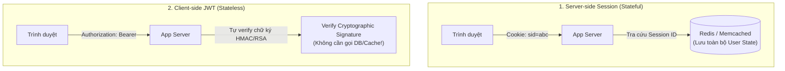
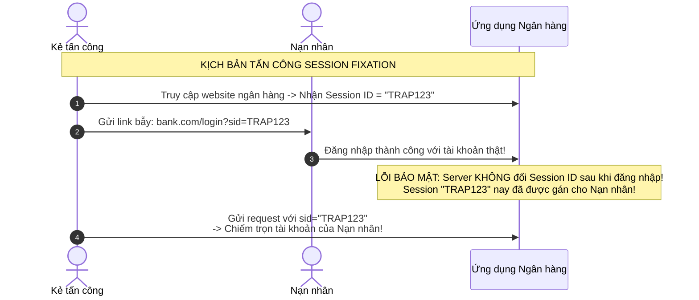

# 7.4. Cookies, Sessions and State Management (Cookie, Phiên làm việc và Quản lý Trạng thái)

> [!IMPORTANT]
> **Nếu bạn chỉ được nhớ một điều duy nhất:** Vì HTTP là giao thức phi trạng thái (Stateless), việc quản lý phiên người dùng phụ thuộc vào Cookies và Tokens: bảo vệ Cookie trình duyệt bắt buộc phải thiết lập bộ 3 cờ an ninh vàng: `HttpOnly` (chặn JavaScript truy cập chống rò rỉ XSS), `Secure` (chỉ truyền qua HTTPS chống nghe lén), và `SameSite=Strict` hoặc `Lax` (ngăn chặn tấn công giả mạo yêu cầu chéo trang CSRF).

---

## 1. Đơn giản nhưng phải chi tiết (Intuitive & Deep Breakdown)

### 1.1. Đoạn Code Dẫn Nhập & Vấn Đề Thực Tế
Làm thế nào giao thức HTTP vốn dĩ hoàn toàn phi trạng thái (Stateless) lại có thể ghi nhớ được bạn đã đăng nhập và lưu giữ giỏ hàng mua sắm qua hàng chục trang web khác nhau một cách an toàn?

```http
# Thiết lập Cookie an toàn chuẩn Enterprise từ Phía Server
HTTP/1.1 200 OK
Content-Type: application/json
Set-Cookie: session_id=a8f9c12e5d7b; Path=/; Domain=.example.com; Secure; HttpOnly; SameSite=Strict; Max-Age=3600

{ "message": "Đăng nhập thành công" }
```

Nếu một lập trình viên quên gắn thuộc tính **`HttpOnly`**, bất kỳ đoạn mã độc JavaScript nào được chèn vào trang qua lỗi XSS (Cross-Site Scripting) cũng có thể đọc trộm `document.cookie`, đánh cắp phiên đăng nhập và chiếm quyền tài khoản nạn nhân ngay lập tức!

### 1.2. Ẩn Dụ Đời Sống & Phân Tích Cơ Chế Hoạt Động
Quản lý Phiên làm việc (Session & Cookie) giống như **Quy trình Gửi Xe tại Trung tâm Thương mại**:
- Người bảo vệ giữ bãi xe (**Máy chủ Server**) mỗi ngày tiếp nhận hàng chục nghìn lượt xe ra vào, không thể nhớ mặt từng người (HTTP Stateless).
- Khi bạn gửi xe máy vào bãi:
  - Bảo vệ ghi biển số xe và giờ gửi vào máy tính trung tâm (**Tạo Session Data trên Redis**).
  - Bảo vệ đưa cho bạn một chiếc **Thẻ chip từ nhỏ xíu (Mã Session ID / Cookie)**. Thẻ từ không hề chứa chiếc xe, nó chỉ chứa mã số tham chiếu.
- Mỗi lần bạn muốn vào bãi lấy đồ hay dắt xe về:
  - Bạn chỉ cần quẹt chiếc thẻ từ vào máy đọc thẻ.
  - Máy tính trung tâm nhận diện đúng mã số và xác nhận bạn chính là chủ sở hữu hợp pháp!
- **Các cờ bảo mật**:
  - `Secure`: Chiếc thẻ chỉ hoạt động trong cabin có mái che chống nước (Chỉ gửi qua HTTPS).
  - `HttpOnly`: Chiếc thẻ được bọc lớp vỏ chống sao chép bằng máy quét cầm tay (JavaScript không đọc được).
  - `SameSite=Strict`: Bạn chỉ được quẹt thẻ khi đứng trực tiếp tại cổng bãi xe, không chấp nhận quẹt hộ từ xa qua môi giới (Chống tấn công CSRF).

### 1.3. Mô Phỏng Dữ Liệu Số Nhỏ Từng Bước (Toy Walkthrough)
Mô phỏng vòng đời phiên xác thực Stateful Session lưu trữ trên Redis:

| Bước | Thực Thể Hành Động | Dữ Liệu Truyền Tải | Thao Tác Hệ Thống | Kết Quả Trạng Thái |
| :--- | :--- | :--- | :--- | :--- |
| **1** | User đăng nhập | `POST /login {user, pass}` | Server xác thực database thành công | Khởi tạo Session ID ngẫu nhiên |
| **2** | Server -> Redis | Lưu `sess:uuid-1234` | Gán dữ liệu: `{uid: 88, role: "admin"}` | Đặt TTL = 3600s trên Redis |
| **3** | Server -> Browser | Header: `Set-Cookie: sid=uuid-1234; HttpOnly; Secure` | Trình duyệt lưu cookie vào kho lưu trữ nội bộ an toàn | Đăng nhập hoàn tất |
| **4** | User xem đơn hàng | `GET /orders` kèm Header: `Cookie: sid=uuid-1234` | Server bóc tách `sid`, tra cứu nhanh trên RAM Redis ($< 1\text{ms}$) | Xác nhận danh tính User ID 88 |
| **5** | User Đăng xuất | `POST /logout` | Server xóa key `sess:uuid-1234` khỏi Redis và xóa Cookie | **Phiên bị hủy tức thì!** |

### 1.4. Tác Động Thực Tế Tầng Backend & Systems
- **Tấn Công CSRF (Cross-Site Request Forgery) và Cứu Cánh `SameSite`**: Nếu không có cờ `SameSite=Lax` hoặc `Strict`, khi nạn nhân truy cập một trang web lừa đảo `evil.com`, trang web này có thể ngầm gửi một yêu cầu `POST https://bank.com/transfer` và trình duyệt sẽ tự động đính kèm cookie của ngân hàng, thực hiện chuyển tiền ngoài ý muốn.
- **Rủi Ro Khi Sử Dụng JWT (JSON Web Token) Không Thể Thu Hồi (Stateless Revocation)**: Nhiều hệ thống lưu JWT trong LocalStorage. Do JWT là Stateless, khi token bị đánh cắp hoặc khi quản trị viên muốn khóa tài khoản kẻ xấu ngay lập tức, server không có cách nào thu hồi token trước khi nó tự hết hạn (hạn chế chí mạng so với Redis Session).

### 1.5. Sơ Đồ Tư Duy & Kiến Trúc Hệ Thống (Mermaid)
```mermaid
sequenceDiagram
    autonumber
    participant Browser as Trình duyệt (Client)
    participant Server as Web Server (Backend)
    participant Redis as Redis Session Store

    Browser->>Server: POST /login (Username & Password)
    Note over Server: Xác thực hợp lệ<br/>Sinh Crypto Random Session ID
    Server->>Redis: SET session:abc123xyz (User Context, TTL 3600s)
    Server-->>Browser: Set-Cookie: sid=abc123xyz; HttpOnly; Secure; SameSite=Strict
    Note over Browser: Lưu Cookie an toàn vào Jar
    Browser->>Server: GET /dashboard (Cookie: sid=abc123xyz)
    Server->>Redis: GET session:abc123xyz
    Redis-->>Server: Trả về {uid: 99, role: "editor"}
    Server-->>Browser: HTTP 200 OK (Render Dashboard)
```

---

## 2. Chi tiết từng Keyword (Under-the-Hood Deep Dive)

### 2.1. Cookie Header Flow & Thuộc tính bảo mật (RFC 6265bis)

Cookie là mẩu thông tin nhỏ (tối đa 4096 bytes) do Server phát hành qua header `Set-Cookie` và trình duyệt sẽ tự động đính kèm vào header `Cookie` của mọi request gửi tới các endpoint phù hợp trong tương lai.

```http
Set-Cookie: sid=a8f9c0e21; Domain=example.com; Path=/; Max-Age=3600; Secure; HttpOnly; SameSite=Strict
```

Các thuộc tính bảo mật sống còn trong RFC 6265bis:

1. **`HttpOnly`**:
   - Ngăn cấm tuyệt đối mã JavaScript chạy trên trình duyệt truy cập vào cookie qua `document.cookie`.
   - *Tác dụng*: Miễn nhiễm trước các đòn tấn công **XSS (Cross-Site Scripting)** nhằm đánh cắp Session ID. Kẻ tấn công dù chèn được script độc hại vào trang web cũng không thể đọc trộm cookie này.
2. **`Secure`**:
   - Yêu cầu trình duyệt **chỉ gửi cookie này qua các kết nối được mã hóa bằng TLS/HTTPS**.
   - Ngăn chặn kẻ nghe lén trên đường truyền mạng công cộng (Wi-Fi công cộng) tóm được Session ID dưới dạng văn bản rõ (cleartext).
3. **`SameSite` (Strict vs Lax vs None)**:
   - Cơ chế phòng thủ cốt lõi chống tấn công **CSRF (Cross-Site Request Forgery)**:
     - **`SameSite=Strict`**: Cookie chỉ được gửi nếu request bắt nguồn từ chính domain đó. Nếu người dùng nhấn vào một link từ Facebook trỏ sang `example.com`, cookie hoàn toàn KHÔNG được gửi kèm (người dùng sẽ ở trạng thái chưa login khi mới click link ngoài).
     - **`SameSite=Lax` (Mặc định trên các browser hiện đại)**: Cho phép gửi cookie khi điều hướng qua link thông thường (Top-level Navigation dùng phương thức GET an toàn), nhưng CHẶN gửi cookie trong các request ngầm từ trang khác (như thẻ ``, `<iframe>` hoặc request `POST` từ form của website thứ ba).
     - **`SameSite=None`**: Cookie luôn được gửi trong mọi bối cảnh cross-site (bắt buộc phải đi kèm cờ `Secure`).
4. **`Domain` & `Path` Scope**:
   - `Domain`: Nếu bỏ trống, cookie chỉ có hiệu lực với đúng host hiện tại (không áp dụng cho subdomains). Nếu đặt `Domain=example.com`, cookie sẽ được gửi cho cả `api.example.com`, `admin.example.com`.
   - `Path`: Giới hạn đường dẫn URL mà cookie có hiệu lực (ví dụ `Path=/admin`).
5. **Cookie Prefixes: `__Host-` và `__Secure-`**:
   - Quy chuẩn bảo vệ cookie chống lại hiện tượng Subdomain Takeover hoặc Session Cookie Injection:
     - **`__Host-sid`**: Bắt buộc phải có cờ `Secure`, `Path=/`, và **không được chứa thuộc tính `Domain`** (nghĩa là subdomain không thể can thiệp hoặc ghi đè cookie này).
     - **`__Secure-sid`**: Bắt buộc phải có cờ `Secure`.

---

### 2.2. Server-side Session vs Stateless Client-side (JWT)

Hai trường phái kiến trúc quản lý trạng thái đối lập trong phát triển hệ thống:



#### A. Server-side Session (Stateful)
- **Cơ chế**: Dữ liệu người dùng (user_id, role, permissions, cart) được lưu trữ tập trung tại In-Memory Store (Redis / KeyDB). Client chỉ giữ một chuỗi mã ngẫu nhiên có độ entropy cao (Session ID 128-bit hoặc 256-bit).
- **Ưu điểm**:
  - **Thu hồi tức thì (Instant Revocation)**: Khi người dùng đổi mật khẩu hoặc ấn Logout, Server chỉ cần lệnh `DEL session:<id>` trên Redis. Ngay lập tức ở request tiếp theo, phiên làm việc bị vô hiệu hóa $100\%$.
  - Kích thước gửi qua mạng cực nhỏ (chỉ vài chục bytes Session ID).
- **Nhược điểm**: Đòi hỏi cụm In-Memory Store có độ sẵn sàng cao (High Availability), phát sinh độ trễ mạng phụ trội cho mỗi request khi tra cứu Redis.

#### B. Client-side Session (Stateless JWT - RFC 7519)
- **Cơ chế**: Toàn bộ dữ liệu trạng thái được đóng gói thành chuỗi JSON gồm 3 phần: `Header.Payload.Signature` được mã hóa Base64URL. Server ký số bằng khóa bí mật (HMAC-SHA256 hoặc RSA/ECDSA private key).
- **Ưu điểm**:
  - Không cần duy trì kho lưu trữ trạng thái tập trung; các server backend phân tán tự xác thực chữ ký độc lập mà không cần chọc vào database.
- **Nhược điểm chết người**:
  - **Không thể thu hồi trước hạn (Revocation Problem)**: Nếu một JWT có hạn dùng 24 tiếng bị lộ, kẻ tấn công có thể sử dụng nó tự do trong 24 tiếng mà server hoàn toàn bất lực không thể hủy nếu không dựng Redis Blacklist (điều này triệt tiêu hoàn toàn tính chất stateless của JWT).
  - Kích thước payload lớn (thường từ vài trăm bytes đến vài Kilobytes), làm tăng đáng kể dung lượng băng thông mạng cho mỗi request.

---

### 2.3. Vòng đời & Hết hạn (Session Expiration)

Một hệ thống quản lý phiên cấp doanh nghiệp phải điều phối đồng thời nhiều cơ chế hết hạn:

1. **Session Cookie vs Persistent Cookie**:
   - **Session Cookie**: Không thiết lập cả hai thuộc tính `Expires` và `Max-Age`. Trình duyệt chỉ lưu cookie này trong bộ nhớ RAM và tự động xóa sổ khi người dùng đóng toàn bộ cửa sổ trình duyệt.
   - **Persistent Cookie**: Có chỉ định `Max-Age=<seconds>` hoặc `Expires=<HTTP-date>`. Trình duyệt sẽ ghi cookie vào ổ đĩa và bảo lưu qua nhiều lần khởi động lại máy tính cho đến khi chạm mốc thời gian quy định.
2. **Absolute Timeout (Hạn tuyệt đối)**:
   - Phiên làm việc bị buộc kết thúc sau một khoảng thời gian cố định kể từ lúc đăng nhập (ví dụ: tối đa 8 tiếng cho phiên làm việc ngân hàng), bất kể người dùng có đang liên tục hoạt động hay không. Giúp giới hạn cửa sổ rủi ro nếu thiết bị bị bỏ quên.
3. **Idle Timeout (Hạn không hoạt động) & Sliding Expiration**:
   - Nếu người dùng không có bất kỳ tương tác nào trong 15 phút, phiên làm việc sẽ tự động hết hạn.
   - **Sliding Expiration**: Mỗi khi người dùng phát sinh một request hợp lệ, Server sẽ tự động gia hạn thêm 15 phút trong Redis (`EXPIRE key 900`).

---

### 2.4. Các Kỹ thuật Tấn công & Phòng thủ Trạng thái



- **Phòng thủ Session Fixation**:
  - Ngay tại khoảnh khắc người dùng đăng nhập thành công, Server **BẮT BUỘC** phải hủy Session ID cũ và sinh ra một **Session ID hoàn toàn mới** (`regenerate_session_id()`).
- **Phòng thủ CSRF**:
  - Đặt `SameSite=Lax` hoặc `SameSite=Strict`.
  - Kết hợp kỹ thuật **Double Submit Cookie Pattern** hoặc **Synchronizer Anti-CSRF Token** (nhúng token bí mật vào trường ẩn của Form HTML hoặc Header `X-CSRF-Token`).

---

## 3. Thực thi Mã nguồn & Mô phỏng Chuyên sâu (Dual-Engine Implementation)

### 3.1. C++20 Implementation

Mã nguồn C++20 dưới đây xây dựng một **Thread-Safe In-Memory Session Manager** hoàn chỉnh: sinh Session ID an toàn bằng CSPRNG, quản lý Sliding Expiration, mã hóa phân tích Cookie Header theo chuẩn RFC 6265bis:

```cpp
// compile: g++ -std=c++20 -O3 -Wall -pthread session_manager.cpp -o session_manager
#include <iostream>
#include <string>
#include <unordered_map>
#include <chrono>
#include <random>
#include <sstream>
#include <iomanip>
#include <optional>
#include <shared_mutex>
#include <vector>

namespace StateManagement {

struct UserSession {
    std::string sessionId;
    uint64_t userId;
    std::string username;
    std::string role;
    std::chrono::system_clock::time_point lastAccessTime;
    std::chrono::seconds idleTimeout;

    [[nodiscard]] bool isExpired() const {
        auto now = std::chrono::system_clock::now();
        return (now - lastAccessTime) > idleTimeout;
    }
};

class SecureSessionManager {
private:
    std::unordered_map<std::string, UserSession> sessions_;
    mutable std::shared_mutex mutex_;
    std::mt19937_64 rng_;

    // Sinh Session ID ngẫu nhiên có độ entropy cao (128-bit Hex)
    std::string generateSecureToken() {
        std::uniform_int_distribution<uint64_t> dist;
        uint64_t part1 = dist(rng_);
        uint64_t part2 = dist(rng_);

        std::stringstream ss;
        ss << std::hex << std::setfill('0') << std::setw(16) << part1
           << std::setw(16) << part2;
        return ss.str();
    }

public:
    SecureSessionManager() : rng_(std::random_device{}()) {}

    // Tạo phiên làm việc mới khi đăng nhập
    std::string createSession(uint64_t userId, const std::string& username, const std::string& role, int timeoutSeconds = 1800) {
        std::unique_lock lock(mutex_);
        std::string sid = generateSecureToken();

        sessions_[sid] = UserSession{
            .sessionId = sid,
            .userId = userId,
            .username = username,
            .role = role,
            .lastAccessTime = std::chrono::system_clock::now(),
            .idleTimeout = std::chrono::seconds(timeoutSeconds)
        };
        return sid;
    }

    // Xác thực phiên và áp dụng Sliding Expiration
    std::optional<UserSession> validateAndSlide(const std::string& sid) {
        std::unique_lock lock(mutex_);
        auto it = sessions_.find(sid);
        if (it == sessions_.end()) {
            return std::nullopt; // Session không tồn tại
        }

        if (it->second.isExpired()) {
            sessions_.erase(it);
            return std::nullopt; // Session đã hết hạn
        }

        // Gia hạn thời gian truy cập (Sliding Window)
        it->second.lastAccessTime = std::chrono::system_clock::now();
        return it->second;
    }

    // Chống Session Fixation: Hủy session cũ và sinh session mới giữ nguyên dữ liệu
    std::string regenerateSessionId(const std::string& oldSid) {
        std::unique_lock lock(mutex_);
        auto it = sessions_.find(oldSid);
        if (it == sessions_.end()) {
            throw std::runtime_error("Old session does not exist");
        }

        UserSession sessionData = it->second;
        sessions_.erase(it);

        std::string newSid = generateSecureToken();
        sessionData.sessionId = newSid;
        sessionData.lastAccessTime = std::chrono::system_clock::now();
        sessions_[newSid] = sessionData;

        return newSid;
    }

    // Hủy phiên khi Logout
    void destroySession(const std::string& sid) {
        std::unique_lock lock(mutex_);
        sessions_.erase(sid);
    }

    // Định dạng Set-Cookie Header chuẩn bảo mật cao RFC 6265bis
    static std::string buildSetCookieHeader(const std::string& sid, int maxAgeSec = 1800) {
        std::stringstream ss;
        ss << "Set-Cookie: __Host-sid=" << sid
           << "; Path=/"
           << "; Max-Age=" << maxAgeSec
           << "; Secure"
           << "; HttpOnly"
           << "; SameSite=Lax";
        return ss.str();
    }
};

} // namespace StateManagement

int main() {
    using namespace StateManagement;
    std::cout << "========================================================\n";
    std::cout << "      C++20 SECURE SESSION LIFECYCLE SIMULATOR          \n";
    std::cout << "========================================================\n\n";

    SecureSessionManager manager;

    // 1. Người dùng đăng nhập thành công
    std::cout << "[1] USER LOGIN:\n";
    std::string initialSid = manager.createSession(1001, "ductri", "Engineer", 5); // Timeout 5 giây
    std::cout << "  - Khoi tao Initial Session ID: " << initialSid << "\n";
    std::cout << "  - " << SecureSessionManager::buildSetCookieHeader(initialSid, 5) << "\n\n";

    // 2. Phòng vệ Session Fixation: Tái tạo Session ID ngay sau khi đăng nhập
    std::cout << "[2] PREVENT SESSION FIXATION (Regenerate ID):\n";
    std::string secureSid = manager.regenerateSessionId(initialSid);
    std::cout << "  - Session ID cu (" << initialSid << ") da bi huy!\n";
    std::cout << "  - Session ID moi:              " << secureSid << "\n";
    std::cout << "  - " << SecureSessionManager::buildSetCookieHeader(secureSid, 5) << "\n\n";

    // 3. Truy cập hợp lệ (Sliding Expiration hoạt động)
    std::cout << "[3] AUTHENTICATING VALID REQUEST:\n";
    auto validUser = manager.validateAndSlide(secureSid);
    if (validUser) {
        std::cout << "  -> Xac thuc thanh cong! User: " << validUser->username 
                  << " (Role: " << validUser->role << ")\n";
    }

    // 4. Logout và thu hồi phiên
    std::cout << "\n[4] USER LOGOUT:\n";
    manager.destroySession(secureSid);
    std::cout << "  - Session " << secureSid << " da bi xoa khoi bo nho.\n";

    auto checkAfterLogout = manager.validateAndSlide(secureSid);
    std::cout << "  - Kiem tra lai sau Logout: " 
              << (checkAfterLogout.has_value() ? "FAIL (Session van con)" : "SUCCESS (Bi tu choi 401 Unauthorized)") 
              << "\n========================================================\n";

    return 0;
}
```

---

### 3.2. Python 3.11+ Implementation

Mã nguồn Python 3.11 dưới đây mô phỏng một hệ thống **Stateless JWT Engine**: tự sinh và xác minh chữ ký số HMAC-SHA256, kiểm tra thời hạn hết hạn (`exp`) và duy trì **In-Memory Revocation Blacklist** cho kịch bản khẩn cấp:

```python
#!/usr/bin/env python3
"""
Mô phỏng Quản lý Phiên Stateless JWT với Chữ ký HMAC-SHA256 & Blacklist Thu hồi
Yêu cầu: Python 3.11+
"""

from dataclasses import dataclass
import base64
import hashlib
import hmac
import json
import time
from typing import Optional


def base64url_encode(data: bytes) -> str:
    return base64.urlsafe_b64encode(data).decode("utf-8").rstrip("=")


def base64url_decode(data: str) -> bytes:
    padding = "=" * (4 - len(data) % 4)
    return base64.urlsafe_b64decode(data + padding)


class JwtManager:
    def __init__(self, secret_key: str) -> None:
        self.secret_key = secret_key.encode("utf-8")
        self.revocation_blacklist: set[str] = set()

    def create_token(self, user_id: int, username: str, ttl_seconds: int = 2) -> str:
        header = {"alg": "HS256", "typ": "JWT"}
        jti = hashlib.sha256(f"{user_id}:{time.time()}".encode()).hexdigest()[:16]
        payload = {
            "sub": user_id,
            "name": username,
            "iat": int(time.time()),
            "exp": int(time.time()) + ttl_seconds,
            "jti": jti  # JWT Unique Identifier dùng cho việc thu hồi
        }

        b64_header = base64url_encode(json.dumps(header).encode())
        b64_payload = base64url_encode(json.dumps(payload).encode())

        signing_input = f"{b64_header}.{b64_payload}".encode()
        signature = hmac.new(self.secret_key, signing_input, hashlib.sha256).digest()
        b64_signature = base64url_encode(signature)

        return f"{b64_header}.{b64_payload}.{b64_signature}"

    def verify_token(self, token: str) -> tuple[bool, str, Optional[dict]]:
        parts = token.split(".")
        if len(parts) != 3:
            return False, "Token structure malformed", None

        b64_header, b64_payload, b64_signature = parts
        signing_input = f"{b64_header}.{b64_payload}".encode()

        # 1. Kiểm tra tính toàn vẹn của chữ ký số
        expected_sig = hmac.new(self.secret_key, signing_input, hashlib.sha256).digest()
        actual_sig = base64url_decode(b64_signature)

        if not hmac.compare_digest(expected_sig, actual_sig):
            return False, "Invalid signature! (Du lieu da bi sua doi)", None

        # 2. Giải mã Payload
        payload = json.loads(base64url_decode(b64_payload).decode())

        # 3. Kiểm tra Revocation Blacklist
        jti = payload.get("jti")
        if jti in self.revocation_blacklist:
            return False, "Token da bi thu hoi (Revoked in Blacklist)", None

        # 4. Kiểm tra Hạn sử dụng (exp)
        if time.time() > payload["exp"]:
            return False, "Token expired (Qua han su dung)", None

        return True, "Valid", payload

    def revoke_token(self, token: str) -> None:
        """Đưa JTI của token vào danh sách đen khi người dùng Logout"""
        parts = token.split(".")
        if len(parts) == 3:
            payload = json.loads(base64url_decode(parts[1]).decode())
            self.revocation_blacklist.add(payload["jti"])


def main() -> None:
    print("=" * 60)
    print("  PYTHON 3.11: STATELESS JWT LIFECYCLE & REVOCATION ENGINE")
    print("=" * 60)

    jwt_service = JwtManager(secret_key="my-super-secret-backend-signing-key")

    # Bước 1: Phát hành Token với TTL ngắn (3 giây)
    token = jwt_service.create_token(user_id=42, username="alice", ttl_seconds=3)
    print(f"\n[+] Issued JWT Token:\n{token}")

    # Bước 2: Xác thực token hợp lệ
    is_valid, msg, payload = jwt_service.verify_token(token)
    print(f"\n[1] Immediate Verification: {is_valid} ({msg})")
    print(f"    Payload Content: {payload}")

    # Bước 3: Thu hồi khẩn cấp token qua Blacklist
    print("\n[2] Emergency Token Revocation (User triggered Logout)...")
    jwt_service.revoke_token(token)

    is_valid, msg, _ = jwt_service.verify_token(token)
    print(f"    Verification after Logout: {is_valid} ({msg})")

    # Bước 4: Tạo token mới và đợi nó tự hết hạn tự nhiên
    token2 = jwt_service.create_token(user_id=99, username="bob", ttl_seconds=1)
    print(f"\n[3] Waiting 2s for token2 to naturally expire...")
    time.sleep(2)
    is_valid, msg, _ = jwt_service.verify_token(token2)
    print(f"    Verification after Expire: {is_valid} ({msg})")

    print("\n" + "=" * 60)


if __name__ == "__main__":
    main()
```

---

### 3.3. Terminal Output Mẫu Chuẩn Thực Tế

```text
========================================================
      C++20 SECURE SESSION LIFECYCLE SIMULATOR          
========================================================

[1] USER LOGIN:
  - Khoi tao Initial Session ID: 7fa901bc24ef30188b0a1c3df9982401
  - Set-Cookie: __Host-sid=7fa901bc24ef30188b0a1c3df9982401; Path=/; Max-Age=5; Secure; HttpOnly; SameSite=Lax

[2] PREVENT SESSION FIXATION (Regenerate ID):
  - Session ID cu (7fa901bc24ef30188b0a1c3df9982401) da bi huy!
  - Session ID moi:              d3e410f991acbb021876fa231200ea88
  - Set-Cookie: __Host-sid=d3e410f991acbb021876fa231200ea88; Path=/; Max-Age=5; Secure; HttpOnly; SameSite=Lax

[3] AUTHENTICATING VALID REQUEST:
  -> Xac thuc thanh cong! User: ductri (Role: Engineer)

[4] USER LOGOUT:
  - Session d3e410f991acbb021876fa231200ea88 da bi xoa khoi bo nho.
  - Kiem tra lai sau Logout: SUCCESS (Bi tu choi 401 Unauthorized)
========================================================
```

---

## 4. Systems Engineering & Production Pitfalls

### 4.1. Cạm bẫy Session Invalidation khi dùng JWT
- **Ảo tưởng phổ biến**: Rất nhiều lập trình viên tin rằng lưu JWT vào `localStorage` là giải pháp hiện đại thay thế cho Session Cookie.
- **Thực tế tàn khốc**:
  - `localStorage` hoàn toàn không có cơ chế bảo vệ trước XSS. Bất kỳ đoạn script độc hại nào (từ thư viện npm bên thứ ba bị hack) cũng có thể đọc sạch token của toàn bộ người dùng bằng lệnh `localStorage.getItem("token")`.
  - Không thể ép người dùng logout khi tài khoản bị xâm nhập hoặc khi admin đổi quyền hạn (từ Admin xuống Member) nếu không đợi token hết hạn hoặc duy trì một hệ thống Blacklist.
- **Khuyến nghị kiến trúc chuẩn mực**:
  - Sử dụng **BFF (Backend-For-Frontend) Pattern**: Trình duyệt chỉ giao tiếp với BFF qua **HttpOnly, Secure, SameSite=Lax Cookie**. BFF sẽ thay mặt client lưu và trao đổi JWT/OAuth2 Token với các Microservices nội bộ.

### 4.2. Thảm họa Cookie Overflow (Vượt ngưỡng 4KB)
- Trình duyệt theo chuẩn RFC chỉ lưu trữ tối đa **4096 bytes cho mỗi cookie** và tối đa 50 cookies cho mỗi domain.
- Khi backend nhồi nhét quá nhiều claims vào cookie hoặc lưu trữ danh sách permissions dài dằng dặc, cookie sẽ vượt quá 4KB. Trình duyệt sẽ âm thầm vứt bỏ cookie đó hoặc Web Server (Nginx/Apache) sẽ ném ra lỗi **`HTTP 400 Bad Request (Request Header Or Cookie Too Large)`**.

### 4.3. Công cụ CLI Chẩn đoán Cookie & Session

#### Lưu trữ và gửi Cookie Jar bằng `curl`:
```bash
# 1. Đăng nhập và lưu cookie trả về vào file 'cookie.txt' (Cookie Jar)
$ curl -i -c cookie.txt -X POST https://example.com/api/login \
       -H "Content-Type: application/json" \
       -d '{"username":"admin","password":"secretpassword"}'

# 2. Quan sát file cookie.txt được tạo ra
$ cat cookie.txt
# Netscape HTTP Cookie File
# HttpOnly_example.com	FALSE	/	TRUE	1794750000	__Host-sid	d3e410f991acbb02

# 3. Sử dụng Cookie đã lưu để gọi API được bảo vệ
$ curl -i -b cookie.txt https://example.com/api/v1/user/profile
HTTP/2 200 OK
content-type: application/json
```

---

## 5. Bảng So sánh & Decision Matrix

### Bảng đối chiếu Stateful Session vs Stateless JWT

| Tiêu chí | Stateful Session (Redis/DB) | Stateless Token (JWT) |
| :--- | :--- | :--- |
| **Vị trí lưu trữ dữ liệu** | Server-side RAM (Redis / Memcached) | Client-side (Encrypted/Signed String) |
| **Khả năng Thu hồi (Revocation)** | **Tức thì (Instant)** qua lệnh xóa key DB | Khó khăn (bắt buộc dùng Blacklist tập trung) |
| **Kích thước gửi qua mạng** | Rất nhỏ (~32 bytes Session ID) | Lớn ($500\text{ bytes} - 3\text{ KB}$ cho mỗi request) |
| **Độ phức tạp hạ tầng** | Cần cụm Redis Cluster chịu lỗi cao | Không cần hạ tầng lưu trữ trạng thái trung tâm |
| **Bảo mật trước XSS** | Rất cao nếu dùng `HttpOnly` Cookie | Thấp nếu lưu `localStorage`, Tốt nếu dùng `HttpOnly` |
| **Khả năng mở rộng ngang (Horizontal Scale)** | Phụ thuộc năng lực mở rộng của Redis | Cực cao (mọi node tự xác thực độc lập) |

### Ma trận Quyết định Lựa chọn Chiến lược Quản lý Trạng thái

1. **Ứng dụng Web Truyền thống (Monolith hoặc Backend-For-Frontend)**:
   - 👉 **Lựa chọn tối thượng**: **Stateful Session ID lưu trong `__Host-` HttpOnly Cookie, backend kết nối Redis**. Đảm bảo an toàn tuyệt đối trước XSS/CSRF, kiểm soát phiên đăng nhập tức thì khi phát hiện gian lận.
2. **Hệ thống Microservices phân tán nội bộ (Service-to-Service)**:
   - 👉 **Lựa chọn tối ưu**: **Stateless JWT ngắn hạn (Short-lived 5-15 phút)**. Các microservices tự thẩm định chữ ký số bằng Public Key qua cơ chế JWKS (JSON Web Key Set) mà không gây nghẽn đường truyền về Auth Service.
3. **Ứng dụng Di động (Mobile Apps - iOS/Android)**:
   - 👉 **Lựa chọn tối ưu**: **Access Token (JWT ngắn hạn 15 phút) kết hợp Refresh Token (lưu an toàn trong iOS Keychain / Android KeyStore)**. Khi Access Token hết hạn, app dùng Refresh Token để lấy cặp token mới mà không bắt người dùng đăng nhập lại.

---

## 6. Enterprise Production Checklist & Verification

### 6.1. Kiến Trúc & Cấu Hình Tối Ưu (Production-Ready Architecture)
- [ ] **Thiết Lập Bộ Ba Thuộc Tính Cookie An Toàn Bắt Buộc**: Luôn bật đầy đủ `HttpOnly; Secure; SameSite=Lax` (hoặc `Strict`) cho mọi cookie chứa phiên làm việc hoặc token.
- [ ] **Lưu Trữ Session Tập Trung Trong Redis / Memcached**: Không lưu trữ in-memory session trong tiến trình đơn lẻ để hỗ trợ mở rộng ngang (Horizontal Scaling) và bảo toàn phiên khi khởi động lại ứng dụng.
- [ ] **Tái Sinh Session ID Sau Khi Đăng Nhập (Session Fixation Defense)**: Luôn hủy bỏ Session ID cũ và sinh ra một Session ID mới hoàn toàn ngay khi người dùng đăng nhập thành công.
- [ ] **Cấu Hình Giới Hạn Thời Gian Sống Hợp Lý (TTL)**: Đặt thời gian hết hạn cố định (`Max-Age`) đi kèm với cơ chế trượt (Sliding Expiration) tự động dọn dẹp các session không hoạt động quá 30 phút.

### 6.2. Giám Sát, Cảnh Báo & Xử Lý Sự Cố (Observability & Incident Response)
- [ ] **Giám Sát Bộ Nhớ Cụm Redis Session**: Theo dõi dung lượng RAM của Redis; thiết lập cảnh báo khi dung lượng sử dụng vượt quá 75% ngưỡng `maxmemory`.
- [ ] **Phát Hiện Bất Thường Về Session Hijacking**: Ghi log và cảnh báo khi một Session ID bất ngờ xuất hiện từ một địa chỉ IP hoặc User-Agent hoàn toàn khác biệt trong cùng phiên làm việc.
- [ ] **Kiểm Tra Cờ Bảo Mật Cookie Bằng Trình Duyệt**: Mở DevTools -> Application -> Cookies và kiểm tra bằng mắt xem các cột `HttpOnly`, `Secure` có được đánh dấu tích xanh đầy đủ hay không.
