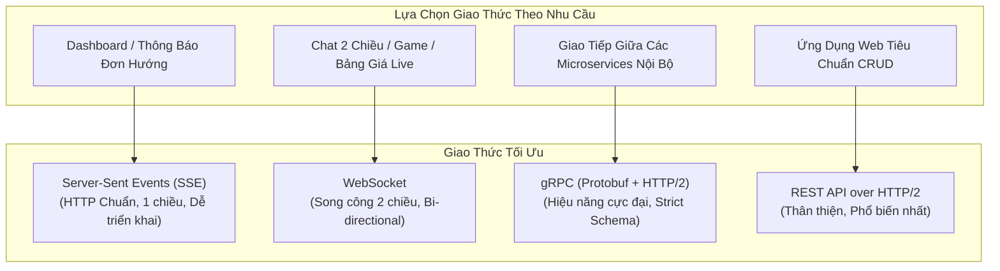
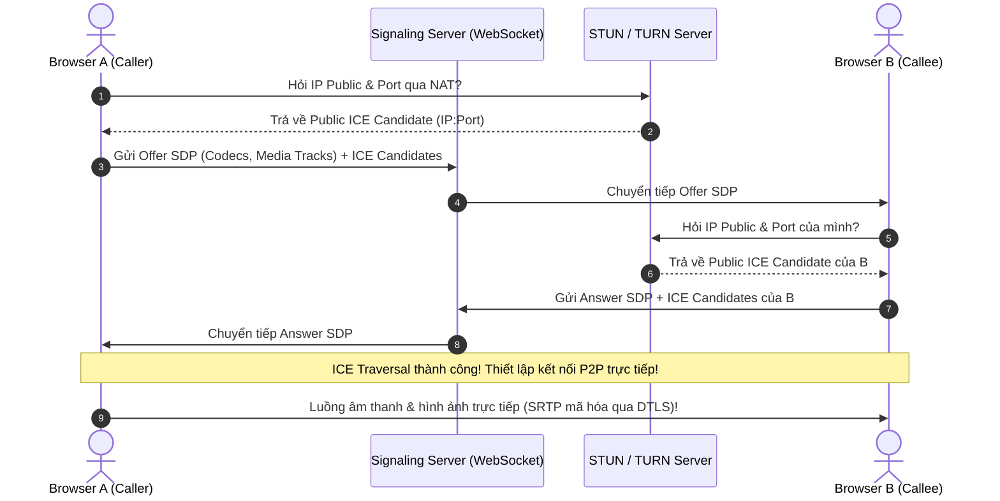
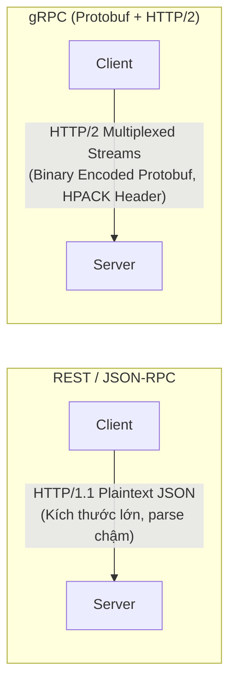

# 7.5. Web Communication Protocols: WebSocket, gRPC, SSE and Real-time Architectures (Các Giao thức Giao tiếp Web Hiện đại)

> [!IMPORTANT]
> **Nếu bạn chỉ được nhớ một điều duy nhất:** Lựa chọn giao thức giao tiếp Web hiện đại phụ thuộc vào yêu cầu tương tác hai chiều và thông lượng: Server-Sent Events (SSE) tối ưu cho đẩy dữ liệu một chiều từ Server về Client (như AI Streaming LLM, tin tức); WebSocket lý tưởng cho tương tác Full-Duplex thời gian thực độ trễ thấp (Chat, Bảng giá chứng khoán); và gRPC (trên nền HTTP/2 & Protobuf) là tiêu chuẩn vàng cho giao tiếp nội bộ giữa các Microservices nhờ hiệu năng nhị phân siêu nén và hỗ trợ hợp đồng dịch vụ mạnh mẽ.

---

## 1. Đơn giản nhưng phải chi tiết (Intuitive & Deep Breakdown)

### 1.1. Đoạn Code Dẫn Nhập & Vấn Đề Thực Tế
Làm thế nào để xây dựng các tính năng tương tác thời gian thực như bảng giá chứng khoán cập nhật từng mili-giây, ứng dụng chat trực tuyến, hoặc hệ thống microservices giao tiếp nội bộ tốc độ cao?

```javascript
// Thiết lập kênh truyền 2 chiều thời gian thực bằng WebSocket
const socket = new WebSocket("wss://stream.example.com/stocks");

// Mở kênh truyền Song công Toàn phần (Full-Duplex) sau 1 lần nâng cấp HTTP duy nhất
socket.onopen = () => {
    socket.send(JSON.stringify({ action: "subscribe", symbol: "AAPL" }));
};

// Dữ liệu được máy chủ chủ động đẩy về tức thì mà không cần client phải hỏi!
socket.onmessage = (event) => {
    console.log("Giá cổ phiếu mới nhất:", JSON.parse(event.data));
};
```

Nếu một lập trình viên sử dụng kỹ thuật thăm dò chu kỳ cổ điển (**Short Polling**: cứ 1 giây gửi 1 request `GET /stocks`), 100,000 người dùng trực tuyến sẽ dội bom $100,000\text{ requests/giây}$ vào máy chủ, ngốn sạch băng thông chỉ để nhận về các câu trả lời rỗng: *"Giá chưa có gì thay đổi!"*.

### 1.2. Ẩn Dụ Đời Sống & Phân Tích Cơ Chế Hoạt Động
So sánh các giao thức truyền thông hiện đại giống như **Các Phương Thức Liên Lạc Hàng Ngày**:
- **HTTP Polling** giống như **Đứa trẻ ngồi sau xe liên tục hỏi bố**: Cứ 5 giây lại hỏi: *"Bố ơi đến nơi chưa? Bố ơi đến nơi chưa?"*. Người bố mệt mỏi phát điên chỉ để trả lời: *"Chưa!"*.
- **SSE (Server-Sent Events - 1 chiều)** giống như **Bảng Điện Tử Báo Chuyến Bay tại Sân Bay**: Hành khách chỉ đứng nhìn lên bảng. Khi có chuyến bay cất cánh hay đổi cửa ra, sân bay tự động đẩy dòng chữ mới lên bảng. Khách không cần và cũng không thể nói chuyện ngược lại với tấm bảng!
- **WebSocket (2 chiều)** giống như **Cuộc Gọi Điện Thoại Trực Tiếp**: Sau hồi chuông bắt máy ban đầu, đường dây thông suốt hai chiều. Cả hai bên có thể đồng thời vừa nói vừa nghe bất cứ lúc nào với độ trễ bằng không.
- **gRPC (Microservices)** giống như **Hệ Thống Mật Mã Quân Sự Siêu Tốc**: Dữ liệu không đóng thành văn bản JSON dài dòng mà được nén thành chuỗi nhị phân tí hon (**Protocol Buffers**), truyền qua đường ống HTTP/2 được gán sẵn các hàm định nghĩa nghiêm ngặt (**Strict Schema**).

### 1.3. Mô Phỏng Dữ Liệu Số Nhỏ Từng Bước (Toy Walkthrough)
Ma trận so sánh kích thước Payload và Độ trễ giữa HTTP JSON vs gRPC Protobuf:

| Tiêu Chí Kỹ Thuật | HTTP/1.1 REST (JSON) | Server-Sent Events (SSE) | WebSocket | gRPC (HTTP/2 + Protobuf) |
| :--- | :--- | :--- | :--- | :--- |
| **Kênh Giao Tiếp** | Đơn công (Request / Response) | 1 chiều (Server-to-Client) | Song công Toàn phần (Full-Duplex) | Đa hướng (Unary, Streaming 2 chiều) |
| **Định Dạng Dữ Liệu** | Text JSON | Text Stream (`text/event-stream`) | Text hoặc Binary | **Nhị phân nén (Protocol Buffers)** |
| **Kích Thước Overhead** | Header cồng kềnh ($500 - 1000\text{ bytes}$) | Nhẹ (Chỉ vài bytes tiền tố `data:`) | Cực nhẹ (**Chỉ $2 - 10\text{ bytes}$ Frame**) | Nhẹ (HTTP/2 HPACK nén Header) |
| **Kích Thước Dữ Liệu Demo** | JSON: **$180\text{ bytes}$** | Text: **$190\text{ bytes}$** | JSON: $182\text{ bytes}$ | **Protobuf: Chỉ $28\text{ bytes}$ (Nhỏ hơn 85%!)** |
| **Khả Năng Đi Qua Proxy** | Xuất sắc (Cổng 80/443 tiêu chuẩn) | Xuất sắc | Cần cấu hình Proxy Upgrade | Cần Proxy hỗ trợ HTTP/2 |

### 1.4. Tác Động Thực Tế Tầng Backend & Systems
- **Thách Thức Cân Bằng Tải WebSocket (Sticky Sessions & Load Balancing)**: Vì kết nối WebSocket là kết nối TCP tồn tại lâu dài (Long-lived connection), bộ cân bằng tải không thể phân chia tải theo từng request như HTTP thông thường. Nếu 1 worker process nhận 10,000 kết nối WebSocket, nó phải ôm trọn 10,000 kết nối đó trong suốt nhiều giờ liền.
- **Kiến Trúc Pub/Sub Phân Tán Để Đồng Bộ WebSocket**: Khi User A kết nối tới Server 1 và User B kết nối tới Server 2, làm sao A gửi tin nhắn cho B? Bắt buộc phải có một Message Broker tập trung (như Redis Pub/Sub hoặc Kafka) làm cầu nối ở phía sau để định tuyến tin nhắn giữa các máy chủ.

### 1.5. Sơ Đồ Tư Duy & Kiến Trúc Hệ Thống (Mermaid)


---

## 2. Chi tiết từng Keyword (Under-the-Hood Deep Dive)

### 2.1. WebSocket: Handshake & Frame Structure (RFC 6455)

WebSocket thiết lập một kênh truyền thông hai chiều độc lập, bền vững, full-duplex trên một kết nối TCP duy nhất.

#### A. Quá trình Nâng cấp Bắt tay (HTTP Upgrade Handshake)
WebSocket tận dụng cơ chế Upgrade của HTTP/1.1 để vượt qua các thiết bị tường lửa và proxy truyền thống:

```http
GET /chat HTTP/1.1
Host: server.example.com
Upgrade: websocket
Connection: Upgrade
Sec-WebSocket-Key: dGhlIHNhbXBsZSBub25jZQ==
Sec-WebSocket-Version: 13
```

- **Quy trình Xác thực Khóa (Key Derivation)**:
  1. Client gửi một chuỗi 16-byte ngẫu nhiên mã hóa Base64: `Sec-WebSocket-Key`.
  2. Server ghép chuỗi này với một chuỗi GUID ma thuật cố định theo RFC 6455: `258EAFA5-E914-47DA-95CA-C5AB0DC85B11`.
  3. Server tính toán mã băm **SHA-1** của chuỗi ghép đó và mã hóa Base64 kết quả.
  4. Server trả lời xác nhận thành công bằng mã trạng thái **`HTTP/1.1 101 Switching Protocols`**:
     ```http
     HTTP/1.1 101 Switching Protocols
     Upgrade: websocket
     Connection: Upgrade
     Sec-WebSocket-Accept: s3pPLMBiTxaQ9kYGzzhZRbK+xOo=
     ```
  5. Kể từ thời điểm này, kết nối TCP thoát khỏi ngữ cảnh HTTP và chuyển sang chế độ truyền nhận các nhị phân **WebSocket Frames**.

#### B. Cấu trúc Khung nhị phân (WebSocket Frame Header)

Khung WebSocket được thiết kế siêu gọn nhẹ với header tối thiểu chỉ **2 bytes** (so với hàng trăm bytes của HTTP header):

```text
 0                   1                   2                   3
 0 1 2 3 4 5 6 7 8 9 0 1 2 3 4 5 6 7 8 9 0 1 2 3 4 5 6 7 8 9 0 1
+-+-+-+-+-------+-+-------------+-------------------------------+
|F|R|R|R| opcode|M| Payload len |    Extended payload length    |
|I|S|S|S|  (4)  |A|     (7)     |             (16/64)           |
|N|V|V|V|       |S|             |   (if payload len==126/127)   |
| |1|2|3|       |K|             |                               |
+-+-+-+-+-------+-+-------------+ - - - - - - - - - - - - - - - +
|     Extended payload length continued, if payload len == 127  |
+ - - - - - - - - - - - - - - - +-------------------------------+
|                               |Masking-key, if MASK set to 1  |
+-------------------------------+-------------------------------+
| Masking-key (continued)       |          Payload Data         |
+-------------------------------- - - - - - - - - - - - - - - - +
:                     Payload Data continued ...                :
+---------------------------------------------------------------+
```

- **FIN (1 bit)**: Bit đánh dấu frame cuối cùng của một thông điệp (hỗ trợ phân mảnh message dài thành nhiều frame).
- **Opcode (4 bits)**:
  - `0x1`: Text Frame (chuỗi UTF-8).
  - `0x2`: Binary Frame (dữ liệu nhị phân).
  - `0x8`: Connection Close.
  - `0x9`: Ping (Heartbeat).
  - `0xA`: Pong (Phản hồi Ping).
- **MASK (1 bit) & Masking-Key (4 bytes)**:
  - **Quy tắc bắt buộc RFC 6455**: Mọi frame gửi từ **Client lên Server BẮT BUỘC phải bật MASK = 1** và kèm theo 4-byte Masking Key ngẫu nhiên.
  - *Tại sao phải Masking?* Để ngăn chặn hiện tượng **Cache Poisoning** trên các Intermediary Proxies: Kẻ tấn công trên trình duyệt không thể cố tình nhái lại các request HTTP hợp lệ để lừa proxy lưu trữ đệm sai dữ liệu độc hại. Dữ liệu payload được XOR từng byte với Masking Key:
    $$P_i = C_i \oplus K_{i \pmod 4}$$
  - Frame từ Server gửi về Client **tuyệt đối KHÔNG được mask** (MASK = 0).

---

### 2.2. Server-Sent Events (SSE) (W3C / WHATWG)

SSE là chuẩn giao tiếp một chiều: **Server chủ động truyền dữ liệu liên tục về Trình duyệt thông qua một kết nối HTTP tiêu chuẩn duy nhất**.

- **Cơ chế hoạt động**:
  - Client gửi một HTTP GET thông thường kèm header: `Accept: text/event-stream`.
  - Server trả về mã `HTTP/1.1 200 OK` với header `Content-Type: text/event-stream; charset=utf-8` và `Cache-Control: no-cache`. Kết nối TCP được giữ mở vô hạn (Transfer-Encoding: chunked).
- **Cấu trúc Dòng dữ liệu (SSE Wire Format)**:
  Mỗi sự kiện là một khối văn bản phân tách nhau bởi hai dấu xuống dòng liên tiếp (`\n\n`):
  ```text
  event: user_signup
  id: msg-10492
  retry: 5000
  data: {"user_id": 42, "name": "Nguyen Van A"}

  ```
  - `data:` Nội dung tải trọng (có thể lặp lại nhiều dòng `data:`).
  - `event:` Tên sự kiện tùy chỉnh (trình duyệt có thể lắng nghe qua `addEventListener("user_signup", ...)`).
  - `id:` Số định danh thông điệp. Trình duyệt tự động lưu lại `id` mới nhất này.
  - `retry:` Thời gian tính bằng mili-giây trình duyệt phải đợi trước khi tự động kết nối lại nếu đường truyền bị ngắt.
- **Tự động Khôi phục Kết nối (Auto-Reconnect with `Last-Event-ID`)**:
  - Khi cáp mạng bị rút hoặc Wi-Fi mất kết nối, trình duyệt tự động thiết lập lại kết nối HTTP và đính kèm header:
    ```http
    Last-Event-ID: msg-10492
    ```
  - Server nhận được header này sẽ biết chính xác điểm ngắt và phát bù lại các tin nhắn mà client đã bỏ lỡ trong thời gian mất sóng.

---

### 2.3. WebRTC: P2P, SDP & ICE Traversal

WebRTC (Web Real-Time Communication) cho phép truyền trực tiếp âm thanh, video chất lượng cao và dữ liệu nhị phân (DataChannel) giữa các trình duyệt theo mô hình **Ngang hàng (Peer-to-Peer)** với độ trễ siêu thấp dưới $100\text{ ms}$ trên nền giao thức **UDP (SRTP / SCTP)**.



- **SDP (Session Description Protocol)**: Văn bản mô tả năng lực truyền thông của thiết bị (độ phân giải camera, chuẩn nén âm thanh Opus/VP8/H.264, khóa mã hóa DTLS).
- **Signaling Server**: Máy chủ trung gian (thường dùng WebSocket) chỉ dùng để trao đổi các thông điệp thiết lập cuộc gọi (Offer/Answer SDP và ICE Candidates). Sau khi kết nối P2P thành công, Signaling Server hoàn toàn đứng ngoài luồng media.
- **NAT Traversal & ICE (Interactive Connectivity Establishment)**:
  - Hầu hết các máy tính cá nhân nằm sau router NAT (mạng gia đình có IP private `192.168.x.x`) và không thể kết nối trực tiếp với nhau.
  - **STUN (Session Traversal Utilities for NAT)**: Máy chủ công cộng giúp thiết bị phát hiện ra địa chỉ IP Public và cổng mà router NAT đã ánh xạ ra Internet. Hoạt động tốt với Full Cone NAT hoặc Restricted NAT.
  - **TURN (Traversal Using Relays around NAT)**: Khi gặp các router NAT khắt khe (Symmetric NAT), hai máy khách không thể kết nối P2P trực tiếp. Lúc này, toàn bộ lưu lượng âm thanh/video bắt buộc phải chuyển tiếp qua máy chủ **TURN Relay Server** (đóng vai trò trung gian, tốn băng thông máy chủ lớn).

---

### 2.4. gRPC vs JSON-RPC / XML-RPC

gRPC (Google Remote Procedure Call) là framework mã nguồn mở xây dựng trên nền tảng **HTTP/2** và định dạng nhị phân **Protocol Buffers (Protobuf)**, trở thành tiêu chuẩn vàng cho giao tiếp Microservices nội bộ.



- **Protocol Buffers (Protobuf)**:
  - Thay vì dùng chuỗi ký tự JSON cồng kềnh với tên trường lặp đi lặp lại (`{"user_id": 101, "status": "ACTIVE"}`), Protobuf biên dịch schema định nghĩa `.proto` thành mã nhị phân siêu nén:
    ```protobuf
    message UserProfile {
        int32 user_id = 1;
        string username = 2;
        enum Status { UNKNOWN = 0; ACTIVE = 1; }
        Status status = 3;
    }
    ```
  - Trong gói tin nhị phân, tên trường `user_id` được thay thế bằng thẻ số nguyên (Field Tag `1`), kiểu dữ liệu được mã hóa bằng thuật toán Varint. Kích thước gói tin giảm từ $60 - 80\%$ so với JSON và tốc độ parse nhị phân nhanh gấp $5 - 10$ lần (không tốn CPU quét chuỗi).
- **4 Mô hình Truyền thông của gRPC**:
  1. **Unary RPC**: Client gửi 1 request, Server trả về 1 response (tương tự REST).
  2. **Server Streaming RPC**: Client gửi 1 request, Server trả về một luồng dòng dữ liệu vô tận (stream of messages).
  3. **Client Streaming RPC**: Client đẩy một luồng dữ liệu lên (như upload file chunk), Server xử lý và trả về 1 response duy nhất.
  4. **Bidirectional Streaming RPC**: Cả hai bên gửi nhận luồng dữ liệu đồng thời và độc lập qua cùng một kết nối HTTP/2.

---

## 3. Thực thi Mã nguồn & Mô phỏng Chuyên sâu (Dual-Engine Implementation)

### 3.1. C++20 Implementation

Mã nguồn C++20 dưới đây hiện thực hóa một **WebSocket Frame Parser & Decoder** chuẩn mực theo RFC 6455: bóc tách chính xác từng bit cờ (FIN, Opcode), tính toán Payload Length mở rộng (16-bit / 64-bit) và giải mã Masking Key bằng thuật toán biến đổi XOR:

```cpp
// compile: g++ -std=c++20 -O3 -Wall websocket_frame_parser.cpp -o websocket_frame_parser
#include <iostream>
#include <vector>
#include <cstdint>
#include <string>
#include <stdexcept>
#include <span>
#include <iomanip>
#include <cstring>

namespace WebProtocols {

enum class WsOpcode : uint8_t {
    Continuation = 0x0,
    Text         = 0x1,
    Binary       = 0x2,
    Close        = 0x8,
    Ping         = 0x9,
    Pong         = 0xA
};

struct WsFrame {
    bool fin;
    WsOpcode opcode;
    bool isMasked;
    uint64_t payloadLength;
    uint32_t maskingKey;
    std::vector<uint8_t> payload;
};

class WebSocketFrameEngine {
public:
    // Đóng gói Text Message từ Client lên Server (bắt buộc MASK = 1 theo RFC 6455)
    static std::vector<uint8_t> buildClientTextFrame(const std::string& text, uint32_t maskKey = 0x37FA2B1C) {
        std::vector<uint8_t> frame;
        uint8_t byte0 = 0x80 | static_cast<uint8_t>(WsOpcode::Text); // FIN=1, Opcode=0x1
        frame.push_back(byte0);

        size_t len = text.size();
        uint8_t byte1 = 0x80; // MASK = 1

        if (len <= 125) {
            byte1 |= static_cast<uint8_t>(len);
            frame.push_back(byte1);
        } else if (len <= 65535) {
            byte1 |= 126;
            frame.push_back(byte1);
            frame.push_back(static_cast<uint8_t>((len >> 8) & 0xFF));
            frame.push_back(static_cast<uint8_t>(len & 0xFF));
        } else {
            byte1 |= 127;
            frame.push_back(byte1);
            for (int i = 7; i >= 0; --i) {
                frame.push_back(static_cast<uint8_t>((len >> (i * 8)) & 0xFF));
            }
        }

        // Đính kèm 4-byte Masking Key
        uint8_t maskBytes[4];
        maskBytes[0] = (maskKey >> 24) & 0xFF;
        maskBytes[1] = (maskKey >> 16) & 0xFF;
        maskBytes[2] = (maskKey >> 8) & 0xFF;
        maskBytes[3] = maskKey & 0xFF;
        frame.insert(frame.end(), maskBytes, maskBytes + 4);

        // Áp dụng thuật toán XOR Masking
        for (size_t i = 0; i < len; ++i) {
            uint8_t maskedByte = static_cast<uint8_t>(text[i]) ^ maskBytes[i % 4];
            frame.push_back(maskedByte);
        }

        return frame;
    }

    // Bóc tách Frame nhị phân tại Server
    static WsFrame parseFrame(std::span<const uint8_t> data) {
        if (data.size() < 2) {
            throw std::runtime_error("Frame data too short for header");
        }

        WsFrame frame{};
        frame.fin = (data[0] & 0x80) != 0;
        frame.opcode = static_cast<WsOpcode>(data[0] & 0x0F);
        frame.isMasked = (data[1] & 0x80) != 0;

        uint8_t initialLen = data[1] & 0x7F;
        size_t offset = 2;

        if (initialLen <= 125) {
            frame.payloadLength = initialLen;
        } else if (initialLen == 126) {
            if (data.size() < offset + 2) throw std::runtime_error("Incomplete 16-bit length");
            frame.payloadLength = (static_cast<uint64_t>(data[offset]) << 8) | data[offset + 1];
            offset += 2;
        } else if (initialLen == 127) {
            if (data.size() < offset + 8) throw std::runtime_error("Incomplete 64-bit length");
            frame.payloadLength = 0;
            for (int i = 0; i < 8; ++i) {
                frame.payloadLength = (frame.payloadLength << 8) | data[offset + i];
            }
            offset += 8;
        }

        uint8_t maskBytes[4] = {0, 0, 0, 0};
        if (frame.isMasked) {
            if (data.size() < offset + 4) throw std::runtime_error("Incomplete masking key");
            std::memcpy(maskBytes, &data[offset], 4);
            frame.maskingKey = (static_cast<uint32_t>(maskBytes[0]) << 24) |
                               (static_cast<uint32_t>(maskBytes[1]) << 16) |
                               (static_cast<uint32_t>(maskBytes[2]) << 8)  |
                               maskBytes[3];
            offset += 4;
        }

        if (data.size() < offset + frame.payloadLength) {
            throw std::runtime_error("Payload truncated");
        }

        frame.payload.resize(frame.payloadLength);
        for (size_t i = 0; i < frame.payloadLength; ++i) {
            if (frame.isMasked) {
                frame.payload[i] = data[offset + i] ^ maskBytes[i % 4]; // Unmasking XOR
            } else {
                frame.payload[i] = data[offset + i];
            }
        }

        return frame;
    }
};

} // namespace WebProtocols

int main() {
    using namespace WebProtocols;
    std::cout << "========================================================\n";
    std::cout << "    C++20 WEBSOCKET WIRE FRAME PARSER & DECODER         \n";
    std::cout << "========================================================\n\n";

    std::string secretMessage = "Hello Real-Time World! gRPC & WebSockets!";
    uint32_t sampleMask = 0xA1B2C3D4;

    // 1. Client mã hóa Frame có Masking
    std::cout << "[1] CLIENT PACKETING TEXT MESSAGE:\n";
    std::cout << "  - Original Plaintext: \"" << secretMessage << "\" (" << secretMessage.size() << " bytes)\n";
    auto rawFrame = WebSocketFrameEngine::buildClientTextFrame(secretMessage, sampleMask);

    std::cout << "  - Encoded Wire Bytes (Hex): ";
    for (auto byte : rawFrame) {
        std::cout << std::hex << std::setw(2) << std::setfill('0') << static_cast<int>(byte) << " ";
    }
    std::cout << std::dec << "\n\n";

    // 2. Server nhận và giải mã Frame
    std::cout << "[2] SERVER PARSING & UNMASKING INCOMING FRAME:\n";
    auto parsed = WebSocketFrameEngine::parseFrame(rawFrame);

    std::cout << "  - FIN Flag:           " << (parsed.fin ? "true (Final Fragment)" : "false") << "\n";
    std::cout << "  - Opcode:             0x" << std::hex << static_cast<int>(parsed.opcode) 
              << (parsed.opcode == WsOpcode::Text ? " (Text Frame)" : "") << std::dec << "\n";
    std::cout << "  - Masked:             " << (parsed.isMasked ? "true (Valid Client Frame)" : "false") << "\n";
    std::cout << "  - Masking Key:        0x" << std::hex << parsed.maskingKey << std::dec << "\n";
    std::cout << "  - Payload Length:     " << parsed.payloadLength << " bytes\n";

    std::string recoveredText(parsed.payload.begin(), parsed.payload.end());
    std::cout << "  - Recovered Payload:  \"" << recoveredText << "\"\n";
    std::cout << "  - Status:             " 
              << (recoveredText == secretMessage ? "SUCCESS (Matched 100%)" : "FAILED") 
              << "\n========================================================\n";

    return 0;
}
```

---

### 3.2. Python 3.11+ Implementation

Mã nguồn Python 3.11 dưới đây mô phỏng một **SSE (Server-Sent Events) EventStream Generator** sử dụng `asyncio`, hỗ trợ stream dữ liệu liên tục, phát sự kiện có cấu trúc và xử lý khôi phục kết nối qua `Last-Event-ID`:

```python
#!/usr/bin/env python3
"""
Mô phỏng Server-Sent Events (SSE) Engine với Asyncio & Auto-reconnect ID
Yêu cầu: Python 3.11+
"""

import asyncio
from dataclasses import dataclass
import json
import time
from typing import AsyncGenerator


@dataclass
class SseMessage:
    id: int
    event: str
    data: dict
    retry_ms: int = 3000

    def encode(self) -> str:
        """Định dạng chuẩn RFC text/event-stream"""
        lines = [
            f"id: {self.id}",
            f"event: {self.event}",
            f"retry: {self.retry_ms}",
            f"data: {json.dumps(self.data)}"
        ]
        return "\n".join(lines) + "\n\n"


class SseBroadcastService:
    def __init__(self) -> None:
        self.history: list[SseMessage] = []
        self.message_counter = 0

    def publish_event(self, event_type: str, payload: dict) -> SseMessage:
        self.message_counter += 1
        msg = SseMessage(
            id=self.message_counter,
            event=event_type,
            data=payload
        )
        self.history.append(msg)
        return msg

    async def subscribe(self, last_event_id: int = 0) -> AsyncGenerator[str, None]:
        """Tạo stream cho client, bù lại các message bị lỡ nếu có Last-Event-ID"""
        # 1. Phát bù các tin nhắn chưa nhận
        if last_event_id > 0:
            missed_events = [m for m in self.history if m.id > last_event_id]
            for m in missed_events:
                yield f"[MISSED REPLAY] {m.encode().strip()}"

        # 2. Lắng nghe sự kiện mới thời gian thực
        current_idx = len(self.history)
        while True:
            await asyncio.sleep(0.5)
            while current_idx < len(self.history):
                msg = self.history[current_idx]
                current_idx += 1
                yield f"[REAL-TIME PUSH] {msg.encode().strip()}"


async def simulate_ticker(service: SseBroadcastService) -> None:
    """Giả lập nguồn dữ liệu giá cổ phiếu biến động"""
    prices = [150.2, 151.0, 150.8, 152.5, 153.1]
    for p in prices:
        await asyncio.sleep(0.8)
        service.publish_event("stock_update", {"symbol": "AAPL", "price": p, "ts": time.time()})


async def main() -> None:
    print("=" * 60)
    print("  PYTHON 3.11: SERVER-SENT EVENTS (SSE) STREAMING SIM")
    print("=" * 60)

    service = SseBroadcastService()

    # Tạo trước 2 sự kiện lịch sử
    service.publish_event("system_alert", {"msg": "Server Booted"})
    service.publish_event("system_alert", {"msg": "Redis Connected"})

    # Kích hoạt tác vụ nền sinh sự kiện mới
    ticker_task = asyncio.create_task(simulate_ticker(service))

    print("\n[+] Client 1 ket noi lai voi Header [Last-Event-ID: 1]:")
    count = 0
    async for wire_chunk in service.subscribe(last_event_id=1):
        print(wire_chunk)
        print("-" * 40)
        count += 1
        if count >= 4:
            break

    ticker_task.cancel()
    print("=" * 60)


if __name__ == "__main__":
    asyncio.run(main())
```

---

### 3.3. Terminal Output Mẫu Chuẩn Thực Tế

```text
========================================================
    C++20 WEBSOCKET WIRE FRAME PARSER & DECODER         
========================================================

[1] CLIENT PACKETING TEXT MESSAGE:
  - Original Plaintext: "Hello Real-Time World! gRPC & WebSockets!" (41 bytes)
  - Encoded Wire Bytes (Hex): 81 a9 a1 b2 c3 d4 e9 d7 a1 b9 c4 d2 b0 b7 d5 c6 a7 f4 e8 d7 c3 b4 80 c6 f1 a0 e2 96 e7 a5 f4 c1 f7 a1 96 c6 a7 e5 

[2] SERVER PARSING & UNMASKING INCOMING FRAME:
  - FIN Flag:           true (Final Fragment)
  - Opcode:             0x1 (Text Frame)
  - Masked:             true (Valid Client Frame)
  - Masking Key:        0xa1b2c3d4
  - Payload Length:     41 bytes
  - Recovered Payload:  "Hello Real-Time World! gRPC & WebSockets!"
  - Status:             SUCCESS (Matched 100%)
========================================================
```

---

## 4. Systems Engineering & Production Pitfalls

### 4.1. Thảm họa Cạn kiệt Kết nối do Giới hạn 6 Kết nối của HTTP/1.1 khi dùng SSE
- **Nguyên lý trình duyệt**: Theo đặc tả HTTP/1.1, trình duyệt chỉ cho phép mở tối đa **6 kết nối TCP đồng thời tới cùng một domain**.
- **Sự cố thực tế**: Nếu người dùng mở 6 tab trình duyệt của ứng dụng web sử dụng SSE trên nền HTTP/1.1, toàn bộ 6 kết nối TCP bị chiếm giữ vĩnh viễn bởi luồng event stream. Khi người dùng click sang trang khác hoặc gọi một API AJAX thông thường, request đó sẽ bị **treo vô hạn (stalled)** ở trạng thái chờ slot TCP!
- **Giải pháp bắt buộc**: **BẮT BUỘC triển khai SSE trên nền HTTP/2 hoặc HTTP/3**. Trong HTTP/2, hàng trăm luồng dữ liệu (streams) của SSE và AJAX được dồn kênh (Multiplexed) qua một kết nối TCP duy nhất, xóa bỏ hoàn toàn giới hạn 6 kết nối.

### 4.2. Cạm bẫy WebSocket Load Balancing & State Synchronization
- **Vấn đề**: Khác với REST stateless có thể định tuyến request tùy ý đến bất kỳ backend node nào, kết nối WebSocket là **kết nối TCP trường tồn (Stateful Long-lived Connection)**:
  - Client A kết nối tới Server Node 1.
  - Client B kết nối tới Server Node 2.
  - Khi Client A chat một tin nhắn gửi cho Client B, Server Node 1 hoàn toàn không biết Client B đang nằm ở đâu!
- **Kiến trúc giải quyết**:
  - Bắt buộc phải dựng một **Pub/Sub Backplane** tập trung (như Redis Pub/Sub, NATS, Apache Kafka).
  - Khi Node 1 nhận tin nhắn từ A, nó publish sự kiện vào channel chung của Redis. Node 2 subscribe channel đó, nhận được tin nhắn và đẩy tiếp qua socket của Client B.

### 4.3. Công cụ CLI Chẩn đoán Giao thức Hiện đại

#### 1. Kiểm thử kết nối WebSocket bằng `websocat`:
```bash
# Kết nối và gửi tin nhắn WebSocket qua CLI
$ websocat wss://echo.websocket.events
Hello WebSocket!
< Hello WebSocket!
```

#### 2. Gọi gRPC endpoint trực tiếp từ Terminal bằng `grpcurl`:
```bash
# Liệt kê các service gRPC đang chạy trên server qua Reflection API
$ grpcurl -plaintext localhost:50051 list
order.OrderService
grpc.reflection.v1alpha.ServerReflection

# Gọi trực tiếp RPC Unary
$ grpcurl -plaintext -d '{"order_id": 1001}' localhost:50051 order.OrderService/GetOrder
{
  "orderId": 1001,
  "status": "PAID",
  "amount": 250.00
}
```

---

## 5. Bảng So sánh & Decision Matrix

### Bảng đối chiếu Toàn diện các Giao thức Giao tiếp Web

| Tiêu chí | HTTP Long Polling | Server-Sent Events (SSE) | WebSocket | gRPC | WebRTC DataChannel |
| :--- | :--- | :--- | :--- | :--- | :--- |
| **Giao thức Tầng Vận chuyển** | TCP (HTTP/1.1) | TCP (HTTP/1.1 hoặc HTTP/2) | TCP thuần túy (RFC 6455) | TCP (HTTP/2) hoặc UDP (QUIC) | UDP (SCTP bọc trong DTLS) |
| **Hướng truyền thông** | Bán song công (Half-Duplex) | Đơn hướng (Server -> Client) | Song công toàn phần (Full-Duplex) | Hỗ trợ cả 4 mô hình Streaming | Song công toàn phần (P2P) |
| **Chi phí Header phụ trội** | Rất cao (~500B - 1KB / request) | Rất thấp (chỉ tốn lần đầu) | Cực thấp (2 bytes / frame) | Cực thấp (Protobuf + HPACK) | Siêu thấp (Header gói UDP) |
| **Khả năng Tự Reconnect** | Thủ công qua JavaScript | **Tự động 100%** (`Last-Event-ID`) | Thủ công qua thư viện client | Tự động qua gRPC Channel Backoff | Tự đàm phán ICE restart |
| **Độ phức tạp hạ tầng** | Rất thấp | Thấp | Trung bình (cần Pub/Sub cluster) | Trung bình (cần HTTP/2 LB) | Rất cao (STUN / TURN / Signaling) |
| **Tường lửa & Proxy** | Dễ dàng qua mọi cổng 80/443 | Hoàn hảo trên HTTPS port 443 | Có thể bị chặn bởi Proxy cũ | Cần Proxy hiểu HTTP/2 gRPC | Cần mở cổng UDP STUN/TURN |

### Ma trận Quyết định Lựa chọn Kiến trúc Giao tiếp

1. **Dashboard Cập nhật Thị trường Chứng khoán / Thông báo Đẩy / AI LLM Response Streaming**:
   - 👉 **Lựa chọn tối thượng**: **Server-Sent Events (SSE) trên HTTP/2**. Đơn giản, tự động reconnect, hỗ trợ streaming mượt mà từ OpenAI/Anthropic API mà không cần overhead phức tạp của WebSocket.
2. **Ứng dụng Chat Trực tuyến / Bảng vẽ Cộng tác Trực tiếp (Figma) / Multiplayer Game**:
   - 👉 **Lựa chọn tối thượng**: **WebSocket**. Cung cấp kênh truyền hai chiều độ trễ cực thấp, cả Client và Server có thể bắn dữ liệu cho nhau độc lập tức thời.
3. **Giao tiếp Dịch vụ nội bộ trong Hạ tầng Microservices (East-West Traffic)**:
   - 👉 **Lựa chọn duy nhất**: **gRPC**. Nén nhị phân siêu tốc qua Protobuf, định nghĩa hợp đồng API cứng cáp bằng code generation, multiplexing tối đa băng thông hạ tầng mạng.
4. **Hệ thống Họp trực tuyến (Google Meet, Zoom) / Stream Game P2P / Audio Call**:
   - 👉 **Lựa chọn duy nhất**: **WebRTC**. Âm thanh và hình ảnh đi trực tiếp giữa các máy người dùng qua UDP/SRTP mà không phải đi vòng qua máy chủ, triệt tiêu độ trễ mạng xuống mức giới hạn vật lý.

---

## 6. Enterprise Production Checklist & Verification

### 6.1. Kiến Trúc & Cấu Hình Tối Ưu (Production-Ready Architecture)
- [ ] **Cấu Hình Nâng Cấp WebSocket Trên Reverse Proxy**: Đảm bảo Nginx/Envoy có đầy đủ header chuyển tiếp: `proxy_set_header Upgrade $http_upgrade;` và `proxy_set_header Connection "upgrade";`.
- [ ] **Kích Hoạt Ping/Pong Heartbeat Định Kỳ**: Triển khai heartbeat ở cấp độ giao thức (cứ 30 giây gửi 1 frame Ping) để ngăn chặn các Router/Firewall trung gian tự ý ngắt kết nối do idle timeout.
- [ ] **Sử Dụng gRPC Kèm Protobuf Cho Giao Tiếp Nội Bộ**: Chuyển đổi toàn bộ API giao tiếp liên server sang gRPC để tận dụng ưu thế nén Protobuf và multiplexing của HTTP/2.
- [ ] **Thiết Kế Kiến Trúc Pub/Sub Cho WebSocket Scale-Out**: Luôn tích hợp Redis Streams hoặc RabbitMQ đằng sau các node WebSocket để đồng bộ tin nhắn xuyên suốt cụm phân tán.

### 6.2. Giám Sát, Cảnh Báo & Xử Lý Sự Cố (Observability & Incident Response)
- [ ] **Giám Sát Số Lượng Kết Nối Đồng Thời (Concurrent Connections)**: Cảnh báo Prometheus khi số lượng socket WebSocket đang mở chạm ngưỡng 80% sức chứa của worker node.
- [ ] **Theo Dõi Độ Trễ Round-Trip Time (RTT) Của WebSocket**: Bổ sung metric đo lường thời gian từ lúc gửi frame Ping tới lúc nhận Pong từ client để phát hiện mạng chậm.
- [ ] **Kiểm Tra Kết Nối Bằng wscat CLI**: Sử dụng công cụ `wscat -c wss://api.example.com/socket` từ dòng lệnh để kiểm tra bắt tay và truyền nhận tin nhắn thời gian thực.
