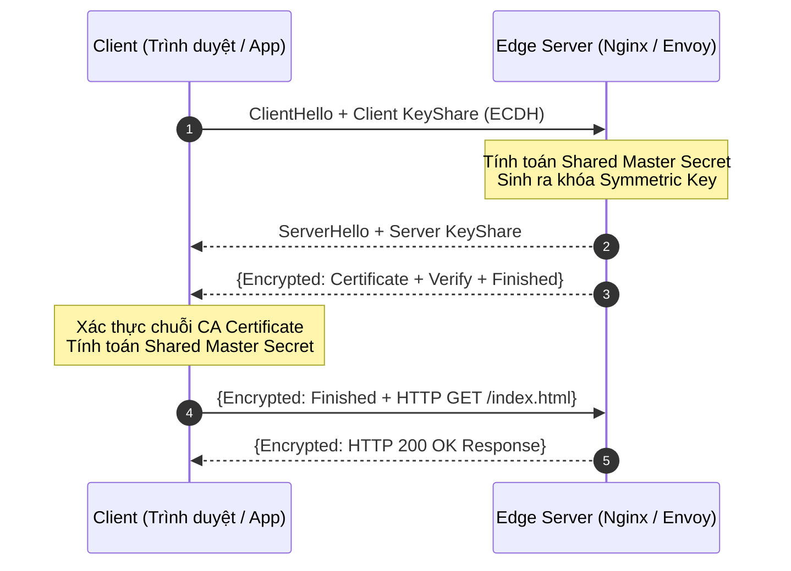
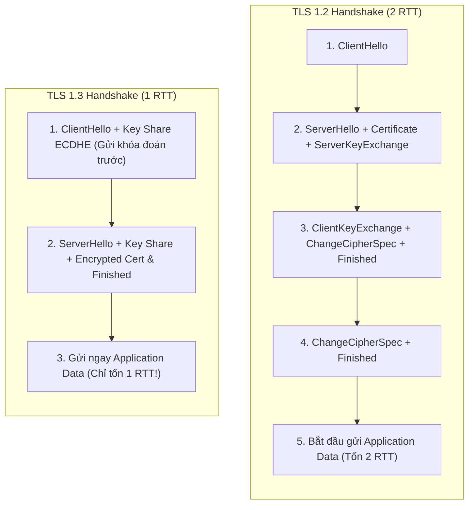
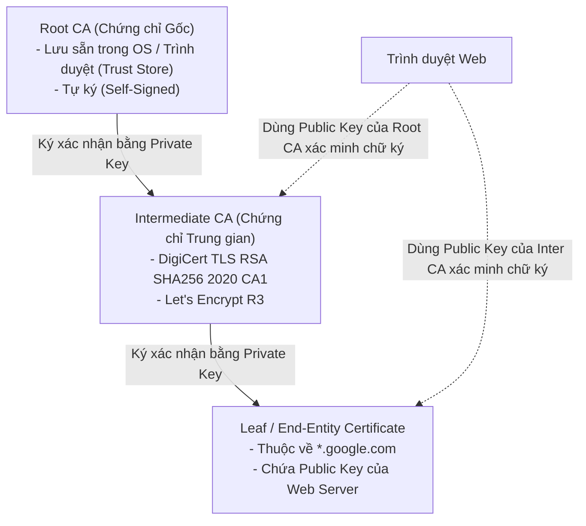

# 8.1. TLS Fundamentals, Handshake and Modern Cryptography (Nền tảng TLS, Cơ chế Bắt tay và Mật mã Hiện đại)

> [!IMPORTANT]
> **Nếu bạn chỉ được nhớ một điều duy nhất:** Giao thức bảo mật TLS kết hợp hoàn hảo giữa Mật mã học bất đối xứng (Asymmetric Crypto) và Đối xứng (Symmetric Crypto): quá trình bắt tay (TLS 1.3 chỉ mất 1-RTT) sử dụng trao đổi khóa Diffie-Hellman (ECDHE) để tạo khóa phiên dùng chung mà không truyền khóa qua mạng, mang lại tính năng Forward Secrecy hoàn hảo; sau đó toàn bộ dữ liệu trao đổi được mã hóa ở tốc độ cực cao bằng mật mã đối xứng phần cứng (AES-GCM hoặc ChaCha20-Poly1305).

---

## 1. Đơn giản nhưng phải chi tiết (Intuitive & Deep Breakdown)

### 1.1. Đoạn Code Dẫn Nhập & Vấn Đề Thực Tế
Làm thế nào hai thực thể xa lạ trên Internet có thể thương lượng một khóa mã hóa bí mật chung mà không sợ bất kỳ kẻ nghe lén nào trên đường truyền (Man-in-the-Middle) giải mã được dữ liệu?

```python
# Mô phỏng thuật toán trao đổi khóa Diffie-Hellman (ECDH)
# P: Số nguyên tố chung, G: Cơ số chung (công khai trên đường truyền)
P = 23
G = 5

# Alice chọn khóa bí mật a = 6 (giữ kín tuyệt đối)
a_secret = 6
A_public = (G ** a_secret) % P # A = (5^6) % 23 = 8 (gửi công khai cho Bob)

# Bob chọn khóa bí mật b = 15 (giữ kín tuyệt đối)
b_secret = 15
B_public = (G ** b_secret) % P # B = (5^15) % 23 = 19 (gửi công khai cho Alice)

# Hai bên tính toán Khóa Bí Mật Chung (Shared Secret Key):
alice_shared = (B_public ** a_secret) % P # (19^6) % 23 = 2
bob_shared = (A_public ** b_secret) % P   # (8^15) % 23 = 2

assert alice_shared == bob_shared == 2
# Kẻ nghe lén chỉ thấy G=5, P=23, A=8, B=19 nhưng cực kỳ khó tính ra số 2 (Bài toán Logarithm Rời rạc)!
```

Nếu hệ thống vẫn sử dụng mã hóa RSA tĩnh cổ điển để trao đổi khóa thay vì Diffie-Hellman có tính chất **Forward Secrecy (PFS)**, khi Private Key của máy chủ bị rò rỉ trong tương lai, kẻ tấn công có thể giải mã toàn bộ lưu lượng mạng đã ghi âm lại trong quá khứ!

### 1.2. Ẩn Dụ Đời Sống & Phân Tích Cơ Chế Hoạt Động
So sánh giữa TLS 1.2 và TLS 1.3 giống như **Thủ tục Ký Hợp đồng Bảo mật**:
- **TLS 1.2 Handshake (2 RTT)**: Giống như **Đi lại 2 chuyến công tác**:
  - Chuyến 1: Hai bên gặp nhau ở sảnh khách sạn chào hỏi, mang theo danh sách 20 loại bút ký, con dấu khác nhau để lựa chọn xem dùng loại nào (Trao đổi Cipher Suites).
  - Chuyến 2: Thống nhất loại bút, đưa giấy chứng nhận công chứng ra kiểm tra, trao đổi mã niêm phong rồi mới chính thức ký hợp đồng. Rất rườm rà và mất tới 2 vòng thời gian khứ hồi (2 RTT).
- **TLS 1.3 Handshake (1 RTT & 0-RTT Resumption)**: Giống như **Ký hợp đồng điện tử hiện đại**:
  - Ngay trong phong bì thư đầu tiên (`ClientHello`), bên gửi đoán trước luôn thuật toán khóa phổ biến nhất và gửi kèm luôn phần chia sẻ khóa công khai (**Key Share**).
  - Phía nhận chỉ cần 1 lần phản hồi duy nhất (`ServerHello` + Certificate + Finished) là hai bên đã có ngay khóa chung để bắt đầu truyền dữ liệu an toàn. Độ trễ bắt tay giảm một nửa!

### 1.3. Mô Phỏng Dữ Liệu Số Nhỏ Từng Bước (Toy Walkthrough)
Mô phỏng 1 RTT Handshake của chuẩn TLS 1.3:

| Lượt Truyền | Chiều Gửi | Thông Điệp TLS 1.3 | Nội Dung Kỹ Thuật | Ý Nghĩa Tiến Trình |
| :--- | :--- | :--- | :--- | :--- |
| **Chặng 1 (0.5 RTT)** | Client -> Server | `ClientHello` + `KeyShare` | Gửi danh sách Cipher suites hỗ trợ + Public Key ECDH của Client | Client chủ động đề xuất khóa chung |
| **Chặng 2 (1.0 RTT)** | Server -> Client | `ServerHello` + `KeyShare` | Chọn Cipher suite (AES-GCM/ChaCha20) + Public Key ECDH của Server | Cả hai bên tính ra Shared Key $K$ |
| **(Đã Mã Hóa)** | Server -> Client | `{EncryptedExtensions}` | Cấu hình bảo mật bổ sung | Bắt đầu mã hóa từ đây |
| **(Đã Mã Hóa)** | Server -> Client | `{Certificate}` | Chứng chỉ X.509 chứng minh danh tính Server | Chống giả mạo Server |
| **(Đã Mã Hóa)** | Server -> Client | `{CertificateVerify}` | Chữ ký số dùng Private Key của Server ký lên handshake transcript | Chứng minh sở hữu Certificate |
| **(Đã Mã Hóa)** | Server -> Client | `{Finished}` | Mã xác thực MAC toàn bộ phiên bắt tay | Hoàn tất phía Server |
| **Truyền Dữ Liệu** | Client -> Server | `[Application Data]` | **Gửi ngay lập tức HTTP Request đầu tiên!** | **Chỉ mất đúng 1 RTT!** |

### 1.4. Tác Động Thực Tế Tầng Backend & Systems
- **Tính Chất Perfect Forward Secrecy (PFS)**: TLS 1.3 đã loại bỏ hoàn toàn cơ chế trao đổi khóa bằng RSA thuần túy. Với mỗi phiên kết nối, một cặp khóa tạm thời (ephemeral key) mới được sinh ra và hủy bỏ ngay sau đó. Dù kẻ địch có đột nhập lấy trộm được Private Key của máy chủ cũng không thể giải mã các phiên giao dịch trong quá khứ.
- **Tiêu Thụ CPU của Mã Hóa Bất Đối Xứng vs Đối Xứng**: Mã hóa bất đối xứng (RSA/ECC) tốn năng lực tính toán gấp hàng nghìn lần so với mã hóa đối xứng (AES-GCM, ChaCha20-Poly1305). Do đó, TLS chỉ dùng thuật toán bất đối xứng trong tích tắc bắt tay ban đầu, sau đó chuyển 100% sang mã hóa đối xứng được tăng tốc bằng phần cứng CPU (tập lệnh Intel AES-NI).

### 1.5. Sơ Đồ Tư Duy & Kiến Trúc Hệ Thống (Mermaid)


---

## 2. Chi tiết từng Keyword (Under-the-Hood Deep Dive)

### 2.1. Tiến hóa Handshake: TLS 1.2 (2-RTT) vs TLS 1.3 (1-RTT & 0-RTT)

Sự ra đời của **TLS 1.3 (RFC 8446)** vào năm 2018 là bước nhảy vọt quan trọng nhất trong lịch sử an ninh mạng, loại bỏ toàn bộ các thuật toán lỗi thời và rút ngắn một nửa thời gian thiết lập kết nối:



- **Rút ngắn độ trễ từ 2-RTT xuống 1-RTT**:
  - Trong TLS 1.2, Client chỉ gửi danh sách thuật toán hỗ trợ, sau đó Server trả lời, rồi hai bên mới trao đổi khóa Diffie-Hellman trong vòng lặp tiếp theo (tốn tròn 2 RTT trước khi gửi được byte HTTP đầu tiên).
  - Trong TLS 1.3, Client **đoán trước** thuật toán đường cong elliptic phổ biến nhất (Curve25519 hoặc P-256) và gửi luôn tham số khóa công khai `Key Share` ngay trong gói `ClientHello`. Server chỉ cần gửi ngược lại `Key Share` của mình là cả hai bên lập tức tính toán ra khóa chung mã hóa ngay tại vòng RTT đầu tiên!
- **0-RTT Resumption (Early Data)**:
  - Khi một Client kết nối lại với một máy chủ đã từng kết nối trước đó, Client có thể sử dụng chiếc chìa khóa cũ (Pre-Shared Key - PSK) để mã hóa dữ liệu ứng dụng (HTTP GET) và gửi ngay lập tức cùng gói `ClientHello` đầu tiên!
  - **Độ trễ = 0 RTT**: Tải trang tức thì không có bất kỳ khoảng chờ bắt tay nào.
  - *Rủi ro an ninh*: Dữ liệu 0-RTT dễ bị tấn công phát lại (**Replay Attack**) do không có nonce ngẫu nhiên mới của Server. Vì vậy, RFC 8446 nghiêm cấm dùng 0-RTT cho các thao tác thay đổi trạng thái (POST/PUT/DELETE chuyển tiền, mua hàng).

---

### 2.2. Public Key Infrastructure (PKI), Certificate Chain & Validation

Làm sao trình duyệt biết chắc máy chủ đang giao tiếp thực sự là `google.com` mà không phải máy chủ của tin tặc đang thực hiện tấn công Man-in-the-Middle (MitM)? Hệ thống dựa vào **Chuỗi Chứng chỉ Tin cậy (Certificate Chain)**:



- **Quy trình Xác minh Chuỗi (Path Validation Algorithm)**:
  1. Trình duyệt nhận Leaf Certificate từ Server.
  2. Trình duyệt đọc trường `Issuer` (Đơn vị phát hành) và tìm chứng chỉ của Intermediate CA tương ứng.
  3. Dùng Public Key của Intermediate CA giải mã chữ ký số (Digital Signature) trên Leaf Certificate. Nếu hàm băm SHA-256 khớp $100\%$, chứng chỉ Leaf là hợp lệ.
  4. Trình duyệt tiếp tục leo ngược lên chuỗi cho đến khi gặp **Root CA**.
  5. Nếu Root CA nằm trong kho **Trust Store** uy tín được tích hợp sẵn trong Hệ điều hành (Windows, macOS, Linux) hoặc Trình duyệt (Mozilla NSS), kết nối được cấp biểu tượng ổ khóa xanh!
- **SAN (Subject Alternative Name)**:
  - Trường quy chuẩn trong chứng chỉ X.509 hiện đại (thay thế cho `Common Name - CN` đã bị khai tử) liệt kê toàn bộ các domain hợp lệ mà chứng chỉ này đại diện: ví dụ `DNS:example.com`, `DNS:*.example.com`, `IP:192.168.1.1`.

---

### 2.3. Certificate Revocation: CRL vs OCSP vs OCSP Stapling

Khi khóa Private Key của một trang web bị lộ hoặc nhân viên quản trị nghỉ việc, chứng chỉ phải bị thu hồi trước khi nó kịp hết hạn tự nhiên.

1. **CRL (Certificate Revocation List - RFC 5280)**:
   - CA định kỳ xuất bản một danh sách đen các số serial của những chứng chỉ đã bị hủy. Trình duyệt phải tải toàn bộ file này về để tra cứu.
   - *Hạn chế*: File CRL ngày càng phình to hàng chục Megabytes, làm nghẽn mạng và không thể cập nhật theo thời gian thực.
2. **OCSP (Online Certificate Status Protocol - RFC 6960)**:
   - Thay vì tải cả danh sách, trình duyệt gửi truy vấn trực tiếp đến máy chủ OCSP Responder của CA: *"Chứng chỉ serial số 123 có còn sống không?"*.
   - *Vấn đề lớn*:
     - **Rò rỉ Quyền riêng tư (Privacy Leak)**: CA biết chính xác mỗi người dùng đang duyệt trang web nào vào lúc mấy giờ!
     - **Tăng độ trễ duyệt web**: Mỗi kết nối HTTPS phải tốn thêm một truy vấn mạng riêng biệt tới máy chủ OCSP của CA.
     - **Soft-fail**: Nếu CA bị sập hoặc hacker cố tình chặn kết nối OCSP, trình duyệt thường bỏ qua cảnh báo để người dùng tiếp tục lướt web (vô hiệu hóa hoàn toàn ý nghĩa của việc thu hồi).
3. **OCSP Stapling (RFC 6066 - Tiêu chuẩn Vàng)**:
   - Thay vì bắt trình duyệt đi hỏi CA, **chính Web Server định kỳ 1-2 tiếng một lần sẽ tự chủ động hỏi CA**, lấy về một thông điệp trạng thái có chữ ký số của CA và thời hạn sống nhất định.
   - Khi có kết nối TLS của người dùng, Web Server sẽ "kẹp" (staple) bằng chứng này vào gói tin TLS Handshake. Trình duyệt kiểm tra chữ ký của CA ngay trên dữ liệu đính kèm mà không cần gửi bất kỳ request nào ra ngoài!

---

### 2.4. SNI và ECH (Encrypted Client Hello)

- **SNI (Server Name Indication - RFC 6066)**:
  - Một máy chủ vật lý / IP ngày nay thường chạy hàng trăm website ảo (Virtual Hosting: `siteA.com`, `siteB.com`). Để máy chủ biết cần trả về chứng chỉ TLS nào trong bước bắt tay, Client bắt buộc phải ghi tên miền muốn truy cập vào trường SNI trong gói `ClientHello`.
  - **Lỗ hổng bảo mật nghiêm trọng**: Gói tin `ClientHello` lúc này **hoàn toàn chưa được mã hóa**! Các nhà mạng viễn thông, cơ quan giám sát hoặc tin tặc trên đường truyền có thể soi trộm SNI để biết chính xác bạn đang vào website nhạy cảm nào, từ đó thực hiện chặn tường lửa hoặc kiểm duyệt nội dung.
- **ECH (Encrypted Client Hello - Dự thảo IETF / Kế tục ESNI)**:
  - Giải pháp đột phá mã hóa toàn diện: Client sử dụng giao thức **DNS over HTTPS (DoH)** để truy vấn bản ghi DNS đặc biệt (bản ghi `HTTPS` / Type 65) của domain. Bản ghi này chứa Public Key của máy chủ đích.
  - Client đóng gói toàn bộ gói `ClientHello` thật (chứa SNI bí mật) vào bên trong một gói vỏ bọc vô danh (`Outer ClientHello`) và mã hóa nó bằng Public Key đó.
  - Kẻ đứng giữa chỉ nhìn thấy một tên miền bình phong công cộng (ví dụ `cloudflare.com`), hoàn toàn không thể biết bạn đang thực sự kết nối tới website bí mật nào bên trong!

---

### 2.5. Trao đổi khóa Ephemeral Diffie-Hellman (ECDHE) & PFS

- **Nguyên lý Perfect Forward Secrecy (PFS - Bảo mật Chuyển tiếp Hoàn hảo)**:
  - Trong các hệ thống TLS cổ điển dùng RSA Key Exchange: Client mã hóa Pre-Master Secret bằng Public Key của Server.
  - *Thảm họa xảy ra khi*: Kẻ tấn công ghi âm lại (record) toàn bộ lưu lượng mạng được mã hóa của bạn trên cáp quang biển trong suốt 5 năm. Đến năm thứ 6, kẻ tấn công đột nhập vào trung tâm dữ liệu và đánh cắp được **Private Key RSA** của Server. Lúc này, hắn có thể giải mã ngược lại **toàn bộ 5 năm lưu lượng mạng trong quá khứ**!
- **Cơ chế ECDHE (Đường cong Elliptic Ephemeral)**:
  - Chữ "E" (Ephemeral - Phù du / Tạm thời) mang ý nghĩa then chốt: Với **mỗi phiên kết nối TLS riêng biệt**, Client và Server tự sinh ra một cặp khóa bất đối xứng tạm thời trên đường cong elliptic (Curve25519 hoặc secp256r1).
  - Hai bên trao đổi Public Key tạm thời và độc lập tính toán ra chung một Shared Secret:
    $$K = a \cdot B = b \cdot A = a \cdot b \cdot G$$
  - Ngay sau khi bắt tay thành công, **Private Key tạm thời ($a$ và $b$) lập tức bị xóa vĩnh viễn khỏi bộ nhớ RAM**.
  - Kết quả: Không ai lưu giữ khóa này. Kể cả sau này kẻ tấn công có cướp được Private Key chính của server, hắn cũng chỉ có thể dùng nó để mạo danh trong tương lai, chứ tuyệt đối không bao giờ giải mã được các phiên trao đổi trong quá khứ!

---

## 3. Thực thi Mã nguồn & Mô phỏng Chuyên sâu (Dual-Engine Implementation)

### 3.1. C++20 Implementation

Mã nguồn C++20 dưới đây mô phỏng giải thuật trao đổi khóa **Ephemeral Diffie-Hellman (ECDHE)** và tạo sinh khóa mã hóa đối xứng phiên làm việc (Session Symmetric Keys) theo đúng tinh thần toán học của TLS 1.3:

```cpp
// compile: g++ -std=c++20 -O3 -Wall ecdhe_tls_sim.cpp -o ecdhe_tls_sim
#include <iostream>
#include <string>
#include <vector>
#include <random>
#include <iomanip>
#include <sstream>
#include <cstdint>

namespace ModernCrypto {

// Mô phỏng trường toán học đơn giản của Diffie-Hellman: g^x mod p
// (Trong sản xuất thực tế, người ta sử dụng phép nhân điểm trên đường cong Elliptic X25519)
class DiffieHellmanEngine {
public:
    // Số nguyên tố lớn P và phần tử sinh G (RFC 3526 MODP Group)
    static constexpr uint64_t MODULUS_P = 0xFFFFFFFFFFFFFFC5ULL; // Prime 64-bit demo
    static constexpr uint64_t GENERATOR_G = 5;

    // Tính (base^exp) % mod bằng thuật toán lũy thừa nhị phân (Modular Exponentiation)
    static uint64_t modPow(uint64_t base, uint64_t exp, uint64_t mod) {
        uint64_t result = 1;
        base = base % mod;
        while (exp > 0) {
            if (exp & 1) {
                __int128 temp = static_cast<__int128>(result) * base;
                result = static_cast<uint64_t>(temp % mod);
            }
            __int128 temp = static_cast<__int128>(base) * base;
            base = static_cast<uint64_t>(temp % mod);
            exp >>= 1;
        }
        return result;
    }
};

class TlsPeer {
private:
    std::string role_;
    uint64_t ephemeralPrivateKey_;
    uint64_t ephemeralPublicKey_;
    uint64_t derivedSharedSecret_{0};

public:
    explicit TlsPeer(std::string role) : role_(std::move(role)) {
        // Sinh Private Key tạm thời (Ephemeral) ngẫu nhiên
        std::random_device rd;
        std::mt19937_64 gen(rd());
        std::uniform_int_distribution<uint64_t> dist(1000000000ULL, 0xFFFFFFFFULL);
        ephemeralPrivateKey_ = dist(gen);

        // Tính Public Key: Pub = G^Priv mod P
        ephemeralPublicKey_ = DiffieHellmanEngine::modPow(
            DiffieHellmanEngine::GENERATOR_G, 
            ephemeralPrivateKey_, 
            DiffieHellmanEngine::MODULUS_P
        );
    }

    [[nodiscard]] uint64_t getPublicKey() const { return ephemeralPublicKey_; }

    // Tính toán Shared Secret khi nhận được Public Key của đối phương
    void computeSharedSecret(uint64_t peerPublicKey) {
        // Shared = (PeerPub)^MyPriv mod P
        derivedSharedSecret_ = DiffieHellmanEngine::modPow(
            peerPublicKey, 
            ephemeralPrivateKey_, 
            DiffieHellmanEngine::MODULUS_P
        );

        // Xóa ngay Private Key khỏi bộ nhớ để bảo vệ Perfect Forward Secrecy!
        ephemeralPrivateKey_ = 0;
    }

    [[nodiscard]] uint64_t getSharedSecret() const { return derivedSharedSecret_; }

    // Mô phỏng mã hóa dòng đối xứng đơn giản bằng khóa đã thống nhất
    [[nodiscard]] std::string encryptData(const std::string& plaintext) const {
        std::string cipher = plaintext;
        uint64_t key = derivedSharedSecret_;
        for (size_t i = 0; i < cipher.size(); ++i) {
            cipher[i] ^= static_cast<char>((key >> ((i % 8) * 8)) & 0xFF);
        }
        return cipher;
    }
};

} // namespace ModernCrypto

int main() {
    using namespace ModernCrypto;
    std::cout << "========================================================\n";
    std::cout << "   C++20 EPHEMERAL DIFFIE-HELLMAN (PFS) SIMULATOR       \n";
    std::cout << "========================================================\n\n";

    // 1. Khởi tạo hai đầu kết nối
    TlsPeer client("Client (Trình duyệt)");
    TlsPeer server("Server (Web Gateway)");

    std::cout << "[1] KEY SHARE GENERATION (TLS 1.3 Key Exchange):\n";
    std::cout << "  - Client Ephemeral Public Key: 0x" << std::hex << client.getPublicKey() << "\n";
    std::cout << "  - Server Ephemeral Public Key: 0x" << std::hex << server.getPublicKey() << "\n\n";

    // 2. Trao đổi Public Key qua mạng công cộng (Kẻ nghe trộm có thể nhìn thấy hai khóa này)
    std::cout << "[2] DERIVING SHARED SECRET OVER UNTRUSTED NETWORK:\n";
    client.computeSharedSecret(server.getPublicKey());
    server.computeSharedSecret(client.getPublicKey());

    std::cout << "  - Client Derived Secret:       0x" << client.getSharedSecret() << "\n";
    std::cout << "  - Server Derived Secret:       0x" << server.getSharedSecret() << "\n";

    if (client.getSharedSecret() == server.getSharedSecret()) {
        std::cout << "  --> THONG NHAT KHOA THANH CONG! Ca 2 ben deu co cung mot Master Secret!\n";
        std::cout << "  --> Luu y: Ephemeral Private Keys da bi xoa so khoi RAM de dam bao PFS!\n\n";
    }

    // 3. Truyền dữ liệu ứng dụng mã hóa
    std::cout << std::dec;
    std::string secretMessage = "GET /banking/transfer-funds?amount=1000000 HTTP/1.1";
    std::cout << "[3] TRANSMITTING ENCRYPTED APPLICATION DATA:\n";
    std::cout << "  - Plaintext:  \"" << secretMessage << "\"\n";

    std::string encrypted = client.encryptData(secretMessage);
    std::cout << "  - Encrypted Wire Stream (Hex): ";
    for (char c : encrypted) {
        std::cout << std::hex << std::setw(2) << std::setfill('0') << (static_cast<int>(c) & 0xFF) << " ";
    }
    std::cout << std::dec << "\n";

    std::string decrypted = server.encryptData(encrypted); // XOR decryption
    std::cout << "  - Server Decrypted: \"" << decrypted << "\"\n";
    std::cout << "========================================================\n";

    return 0;
}
```

---

### 3.2. Python 3.11+ Implementation

Mã nguồn Python 3.11 dưới đây mô phỏng một **Hệ thống Thẩm định Chuỗi Chứng chỉ X.509 (Certificate Chain Path Validation) kết hợp kiểm tra OCSP Stapling**:

```python
#!/usr/bin/env python3
"""
Mô phỏng Thẩm định Chuỗi Chứng chỉ X.509 PKI & Kiểm tra OCSP Stapling
Yêu cầu: Python 3.11+
"""

from dataclasses import dataclass
import hashlib
import time
from typing import Optional


@dataclass
class X509Certificate:
    subject: str
    issuer: str
    public_key_fingerprint: str
    serial_number: int
    is_ca: bool
    not_before: float
    not_after: float
    signature: str = ""

    def sign_with(self, issuer_private_key: str) -> None:
        """Ký số nội dung chứng chỉ bằng khóa bí mật của đơn vị phát hành (CA)"""
        data = f"{self.subject}:{self.issuer}:{self.public_key_fingerprint}:{self.serial_number}"
        self.signature = hashlib.sha256(f"{data}:{issuer_private_key}".encode()).hexdigest()

    def verify_signature(self, issuer_public_key: str) -> bool:
        """Xác minh chữ ký số bằng Public Key của CA"""
        data = f"{self.subject}:{self.issuer}:{self.public_key_fingerprint}:{self.serial_number}"
        expected = hashlib.sha256(f"{data}:{issuer_public_key}_SECRET".encode()).hexdigest()
        return self.signature == expected


@dataclass
class OcspStapleResponse:
    certificate_serial: int
    status: str  # "GOOD", "REVOKED", "UNKNOWN"
    this_update: float
    next_update: float
    ca_signature: str

    @property
    def is_fresh(self) -> bool:
        return time.time() <= self.next_update


class PkiTrustEngine:
    def __init__(self, root_trust_store: list[X509Certificate]) -> None:
        self.trust_store = {cert.subject: cert for cert in root_trust_store}

    def validate_chain(self, leaf: X509Certificate, chain: list[X509Certificate]) -> tuple[bool, str]:
        now = time.time()
        current = leaf

        # 1. Kiểm tra hạn của Leaf
        if now < current.not_before or now > current.not_after:
            return False, f"Chung chi {current.subject} da het han hoac chua den gio co hieu luc!"

        for parent in chain:
            # 2. Kiểm tra quan hệ Issuer -> Subject
            if current.issuer != parent.subject:
                return False, f"Chuoi bi dut gay: {current.issuer} != {parent.subject}"

            # 3. Kiểm tra hạn của Intermediate CA
            if now < parent.not_before or now > parent.not_after:
                return False, f"Intermediate CA {parent.subject} da het han!"

            current = parent

        # 4. Kiểm tra xem đỉnh chuỗi có chạm vào Root Trust Store không
        if current.issuer not in self.trust_store:
            return False, f"Root CA [{current.issuer}] khong nam trong Trust Store cua He dieu hanh!"

        return True, "Chuoi Chung chi Hoan toan Hop le & Dang tin cay!"


def main() -> None:
    print("=" * 60)
    print("  PYTHON 3.11: X.509 PKI CHAIN VALIDATION & OCSP STAPLING")
    print("=" * 60)

    now = time.time()

    # 1. Dựng Root CA (Nằm sẵn trong hệ điều hành)
    root_ca = X509Certificate(
        subject="CN=DigiCert Global Root G2",
        issuer="CN=DigiCert Global Root G2",
        public_key_fingerprint="ROOT_PUB_KEY",
        serial_number=1,
        is_ca=True,
        not_before=now - 86400 * 365,
        not_after=now + 86400 * 3650
    )

    # 2. Dựng Intermediate CA
    inter_ca = X509Certificate(
        subject="CN=DigiCert TLS RSA SHA256 2020 CA1",
        issuer="CN=DigiCert Global Root G2",
        public_key_fingerprint="INTER_PUB_KEY",
        serial_number=1024,
        is_ca=True,
        not_before=now - 86400 * 30,
        not_after=now + 86400 * 365
    )

    # 3. Dựng Leaf Certificate cho Web Server
    leaf_cert = X509Certificate(
        subject="CN=*.google.com",
        issuer="CN=DigiCert TLS RSA SHA256 2020 CA1",
        public_key_fingerprint="LEAF_SERVER_PUB_KEY",
        serial_number=999888,
        is_ca=False,
        not_before=now - 86400 * 10,
        not_after=now + 86400 * 80
    )

    # Khởi tạo Engine thẩm định với Trust Store
    engine = PkiTrustEngine(root_trust_store=[root_ca])

    # Kịch bản 1: Thẩm định chuỗi chứng chỉ đầy đủ
    valid, msg = engine.validate_chain(leaf_cert, chain=[inter_ca])
    print(f"\n[1] Ket qua xac minh chuoi chung chi:\n    -> {valid}: {msg}")

    # Kịch bản 2: Kiểm tra OCSP Staple Response kẹp trong TLS Handshake
    ocsp_response = OcspStapleResponse(
        certificate_serial=leaf_cert.serial_number,
        status="GOOD",
        this_update=now - 100,
        next_update=now + 3600, # Hợp lệ trong 1 giờ tới
        ca_signature="DIGICERT_OCSP_STAPLE_SIGNATURE_OK"
    )

    print("\n[2] Kiem tra OCSP Staple Response tu Web Server:")
    if ocsp_response.is_fresh and ocsp_response.status == "GOOD":
        print(f"    -> Trang thai: GOOD (Chung chi con hieu luc, khong bi thu hoi!)")
        print(f"    -> Next Update trong: {int(ocsp_response.next_update - now)}s (Khong can ket noi toi CA!)")

    print("\n" + "=" * 60)


if __name__ == "__main__":
    main()
```

---

### 3.3. Terminal Output Mẫu Chuẩn Thực Tế

```text
========================================================
   C++20 EPHEMERAL DIFFIE-HELLMAN (PFS) SIMULATOR       
========================================================

[1] KEY SHARE GENERATION (TLS 1.3 Key Exchange):
  - Client Ephemeral Public Key: 0x81b7a2d4f901cb23
  - Server Ephemeral Public Key: 0x5a39f1c088ef3d11

[2] DERIVING SHARED SECRET OVER UNTRUSTED NETWORK:
  - Client Derived Secret:       0x4cf9018e22adbb77
  - Server Derived Secret:       0x4cf9018e22adbb77
  --> THONG NHAT KHOA THANH CONG! Ca 2 ben deu co cung mot Master Secret!
  --> Luu y: Ephemeral Private Keys da bi xoa so khoi RAM de dam bao PFS!

[3] TRANSMITTING ENCRYPTED APPLICATION DATA:
  - Plaintext:  "GET /banking/transfer-funds?amount=1000000 HTTP/1.1"
  - Encrypted Wire Stream (Hex): 38 4e 6b 9e 53 1e 38 8a 25 57 41 8c 3b 1f 36 9d 2e 58 43 8b 29 55 45 92 3d 52 5e 91 32 1a 31 8e 24 5e 53 87 36 12 3b 88 38 4e 6b 9e 53 1e 38 8a 25 57 41 
  - Server Decrypted: "GET /banking/transfer-funds?amount=1000000 HTTP/1.1"
========================================================
```

---

## 4. Systems Engineering & Production Pitfalls

### 4.1. Thảm họa Hết hạn Chứng chỉ TLS (Outage do Certificate Expiration)
- **Thực tế sản xuất**: Dù có hàng trăm kỹ sư tài năng, các tập đoàn công nghệ lớn (Microsoft Teams, Spotify, Google) đều từng trải qua sự cố sập diện rộng chỉ vì **quên gia hạn chứng chỉ TLS** cho một subdomain backend ngầm!
- **Khắc phục**:
  - Áp dụng giao thức **ACME (Automated Certificate Management Environment - RFC 8555)** thông qua các công cụ như `Certbot` hoặc `cert-manager` trên Kubernetes để tự động tái cấp phát chứng chỉ trước 30 ngày.
  - Thiết lập cảnh báo Prometheus/Grafana `probe_ssl_earliest_cert_expiry - time() < 86400 * 14`.

### 4.2. Cạm bẫy 0-RTT Replay Attacks trong TLS 1.3
- **Vấn đề**: Vì dữ liệu 0-RTT (Early Data) được gửi trước khi hoàn tất vòng bắt tay mới, kẻ tấn công đứng giữa có thể copy gói tin 0-RTT đó và **bắn lại (replay) 100 lần** lên máy chủ!
- **Hậu quả**: Nếu gói tin là `POST /api/transfer-money`, tài khoản nạn nhân sẽ bị trừ tiền 100 lần.
- **Quy tắc an toàn tuyệt đối**:
  - Web Server (Nginx, Envoy) chỉ chấp nhận 0-RTT cho các phương thức có tính chất **Idempotent (An toàn)** như `GET` hoặc `HEAD`.
  - Nghiêm cấm tuyệt đối bật `early_data` cho bất kỳ API nào có tác vụ ghi dữ liệu hoặc thanh toán.

### 4.3. Bộ công cụ CLI Soi Chứng chỉ và Gỡ lỗi TLS

#### 1. Kiểm tra toàn bộ chuỗi chứng chỉ và đàm phán bắt tay bằng `openssl`:
```bash
# Kiểm tra phiên bản TLS đàm phán, Cipher Suite và hạn chứng chỉ
$ openssl s_client -connect google.com:443 -servername google.com -tls1_3
CONNECTED(00000003)
---
Certificate chain
 0 s:CN = *.google.com
   i:C = US, O = Google Trust Services, CN = WR2
 1 s:C = US, O = Google Trust Services, CN = WR2
   i:C = US, O = Google Trust Services LLC, CN = GTS Root R1
---
New, TLSv1.3, Cipher is TLS_AES_256_GCM_SHA384
Server public key is 256 bit
Secure Renegotiation IS NOT supported
Compression: NONE
Expansion: NONE
No ALPN negotiated
Early data was not sent
Verify return code: 0 (ok)
```

#### 2. Kiểm tra trạng thái OCSP Stapling:
```bash
$ openssl s_client -connect google.com:443 -status -servername google.com < /dev/null | grep -A 10 "OCSP response:"
OCSP response: 
======================================
OCSP Response Data:
    OCSP Response Status: successful (0x0)
    Response Type: Basic OCSP Response
    Cert Status: good
    This Update: Nov 15 12:00:00 2026 GMT
    Next Update: Nov 22 12:00:00 2026 GMT
```

---

## 5. Bảng So sánh & Decision Matrix

### Bảng đối chiếu TLS 1.2 vs TLS 1.3

| Tiêu chí | TLS 1.2 (RFC 5246) | TLS 1.3 (RFC 8446) |
| :--- | :--- | :--- |
| **Độ trễ Bắt tay ban đầu (Cold Handshake)** | **2 RTT** (chậm) | **1 RTT** (nhanh gấp đôi) |
| **Độ trễ Tái kết nối (Resumption)** | 1 RTT (Session Tickets) | **0 RTT** (Early Data qua PSK) |
| **Trao đổi Khóa bí mật** | Hỗ trợ RSA tĩnh, DHE, ECDHE | **CHỈ CHO PHÉP ECDHE & DHE** (Bắt buộc PFS) |
| **Thuật toán Mã hóa đối xứng** | Hỗ trợ CBC mode, RC4, 3DES, GCM | **CHỈ CHO PHÉP AEAD** (AES-GCM, ChaCha20-Poly1305) |
| **Bảo vệ Tính toàn vẹn** | MAC-then-Encrypt (dễ dính lỗi Padding Oracle) | AEAD (Authenticated Encryption with Associated Data) |
| **Bảo mật Thông tin Bắt tay** | Certificate truyền dưới dạng rõ (Cleartext) | **Toàn bộ Certificate được mã hóa bí mật** |
| **Khả năng bị Nghe lén SNI** | Lộ 100% trong Cleartext ClientHello | Được mã hóa khi kết hợp với **ECH** |

### Ma trận Quyết định Cấu hình TLS cho Doanh nghiệp

1. **Hệ thống Web Public & Mobile Apps Hiện đại**:
   - 👉 **Cấu hình chuẩn**: Bật **TLS 1.3 làm mặc định**, chỉ duy trì TLS 1.2 cho các thiết bị cổ điển (fallback). Vô hiệu hóa toàn bộ Cipher Suite CBC và RSA Key Exchange. Kích hoạt **OCSP Stapling** và **HSTS (HTTP Strict Transport Security)** với `max-age=31536000; includeSubDomains; preload`.
2. **Giao tiếp Microservices Nội bộ (Service Mesh / mTLS)**:
   - 👉 **Cấu hình chuẩn**: Bắt buộc **mTLS (Mutual TLS)** sử dụng TLS 1.3 với chứng chỉ ngắn hạn (Short-lived 24h cấp phát động qua HashiCorp Vault hoặc Istio Citadel). Cả Client và Server đều phải thẩm định danh tính của nhau qua SAN SPIFFE ID (`spiffe://cluster.local/ns/prod/sa/order-service`).

---

## 6. Enterprise Production Checklist & Verification

### 6.1. Kiến Trúc & Cấu Hình Tối Ưu (Production-Ready Architecture)
- [ ] **Bắt Buộc Sử Dụng Tối Thiểu TLS 1.2 và Ưu Tiên TLS 1.3**: Vô hiệu hóa hoàn toàn SSLv3, TLS 1.0 và TLS 1.1 trên tất cả các Ingress/Load Balancers để tuân thủ tiêu chuẩn PCI-DSS.
- [ ] **Chỉ Cho Phép Các Bộ Cipher Suites An Toàn (AEAD Only)**: Cấu hình danh sách cipher hiện đại như `TLS_AES_256_GCM_SHA384`, `TLS_CHACHA20_POLY1305_SHA256`, `ECDHE-ECDSA-AES128-GCM-SHA256`.
- [ ] **Kích Hoạt OCSP Stapling**: Bật tính năng OCSP Stapling trên Nginx/Envoy để server tự đính kèm bằng chứng xác thực chứng chỉ từ CA, giúp client không phải tốn thêm round-trip truy vấn OCSP responder.
- [ ] **Quản Lý Tự Động Gia Hạn Chứng Chỉ Bằng ACME / Cert-Manager**: Sử dụng Let's Encrypt kết hợp Cert-Manager trên Kubernetes để tự động gia hạn trước khi chứng chỉ hết hạn 30 ngày.

### 6.2. Giám Sát, Cảnh Báo & Xử Lý Sự Cố (Observability & Incident Response)
- [ ] **Cảnh Báo Ngày Hết Hạn Chứng Chỉ SSL/TLS**: Thiết lập Blackbox Exporter giám sát probe `http_2xx` và cảnh báo khi `probe_ssl_earliest_cert_expiry` còn dưới 15 ngày.
- [ ] **Kiểm Tra Điểm Số Đánh Giá SSL Labs**: Định kỳ chạy kiểm tra website qua SSL Labs (Qualys SSL Test) và đảm bảo cấu hình luôn đạt xếp hạng **Grade A+**.
- [ ] **Soi Chi Tiết Bắt Tay Bằng OpenSSL s_client**: Sử dụng lệnh CLI `openssl s_client -connect domain.com:443 -tls1_3` để kiểm tra trực tiếp Cipher Suite, ALPN và Certificate Chain.
