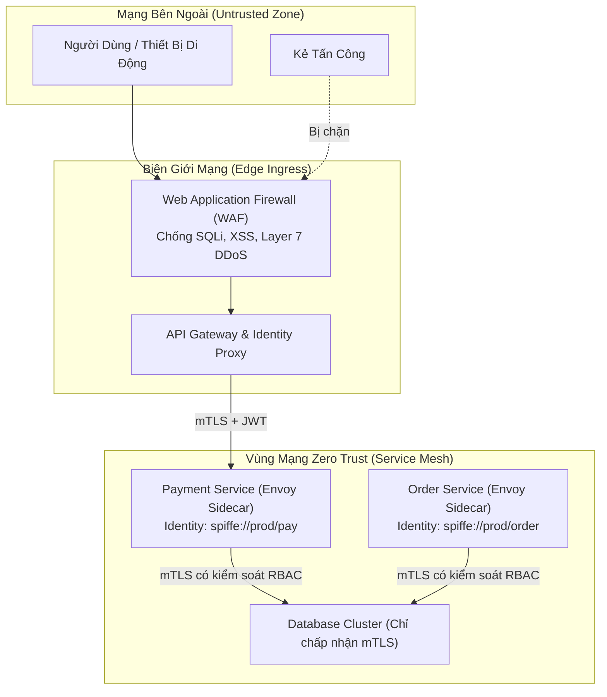
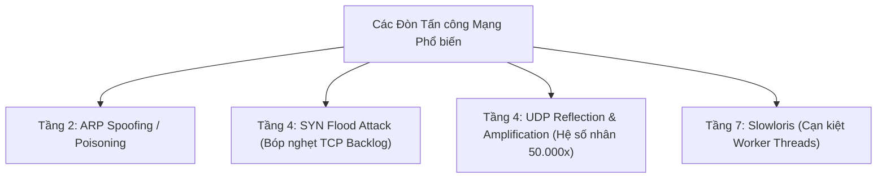
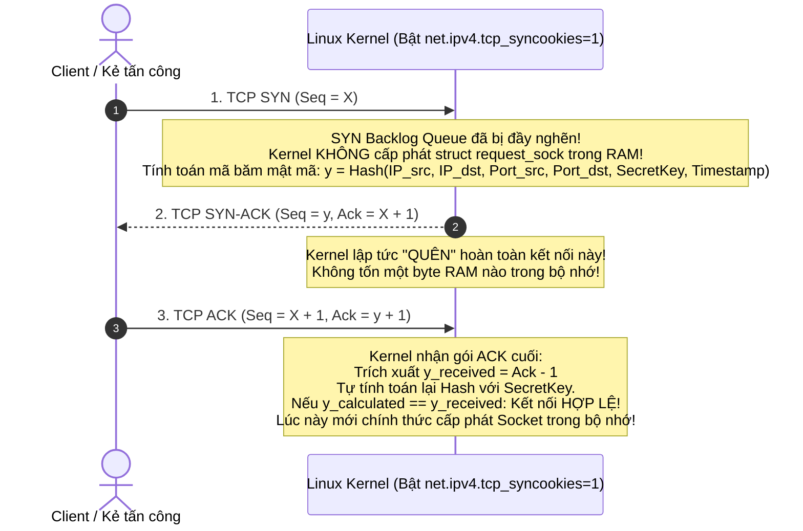
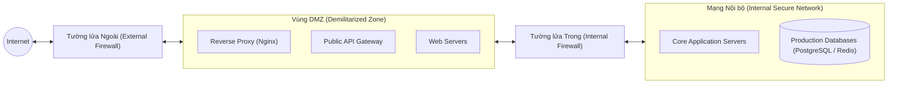

# 8.2. Network Attacks, Firewalls and Zero Trust Architecture (Tấn công Mạng, Tường lửa và Kiến trúc Zero Trust)

> [!IMPORTANT]
> **Nếu bạn chỉ được nhớ một điều duy nhất:** Triết lý an ninh mạng hiện đại đã chuyển dịch hoàn toàn từ 'Bảo vệ chu vi' sang mô hình Zero Trust ('Never Trust, Always Verify'): không có bất kỳ mạng nội bộ nào được coi là an toàn tuyệt đối; mọi yêu cầu giao tiếp giữa các dịch vụ (Service-to-Service) đều phải được xác thực danh tính hai chiều bằng mTLS (Mutual TLS), kết hợp kiểm tra ủy quyền nghiêm ngặt và mã hóa lưu lượng toàn diện cả khi truyền dẫn (in-transit) lẫn lưu trữ (at-rest).

---

## 1. Đơn giản nhưng phải chi tiết (Intuitive & Deep Breakdown)

### 1.1. Đoạn Code Dẫn Nhập & Vấn Đề Thực Tế
Làm thế nào để bảo vệ hệ thống backend trước một cuộc tấn công từ chối dịch vụ (DDoS) hoặc ngăn chặn một kẻ đột nhập đã chiếm được một máy chủ nội bộ tiếp tục lây lan sang các máy chủ cơ sở dữ liệu quan trọng?

```bash
# Thiết lập tường lửa hạt nhân thế hệ mới bằng nftables trên Linux
table inet filter {
    chain input {
        type filter hook input priority 0; policy drop; # Chặn toàn bộ mặc định (Default Drop)

        # Cho phép các gói tin thuộc kết nối hợp lệ đã thiết lập trước đó
        ct state established,related accept

        # Chống tràn kết nối: Giới hạn tần suất kết nối SSH mới
        tcp dport 22 ct state new limit rate 3/minute accept

        # Chống SYN Flood bằng SYNPROXY ở cấp độ hạt nhân
        tcp flags syn tcp dport { 80, 443 } notrack
    }
}
```

Nếu một doanh nghiệp xây dựng mạng lưới theo mô hình "Lâu đài và Con hào" (Castle-and-Moat) truyền thống: tin tưởng tuyệt đối mọi thiết bị nằm trong mạng nội bộ (VPN / Mạng LAN văn phòng), thì chỉ cần một chiếc laptop của nhân viên bị dính mã độc, kẻ tấn công có thể tung hoành quét sạch toàn bộ cơ sở dữ liệu nội bộ!

### 1.2. Ẩn Dụ Đời Sống & Phân Tích Cơ Chế Hoạt Động
So sánh giữa Bảo mật Chu vi Truyền thống và Kiến trúc Zero Trust giống như **Bảo vệ một Tòa Nhà Trụ Sở**:
- **Bảo mật Chu vi (Castle-and-Moat)**:
  - Tòa nhà có một cánh cổng thép kiên cố ở bên ngoài (Tường lửa Firewall / VPN).
  - Bất kỳ ai chìa ra được chiếc thẻ nhân viên (kết nối VPN thành công) là được tự do đi lại khắp tòa nhà: vào phòng kế toán, vào phòng họp giám đốc, vào kho tài liệu tuyệt mật mà không ai hỏi han thêm gì nữa!
- **Mô hình Không Tin Tưởng Tuyệt Đối (Zero Trust Architecture)**:
  - Triết lý cốt lõi: **"Không bao giờ tin, luôn luôn xác thực" (Never Trust, Always Verify)**.
  - Ngay cả khi đã bước vào tòa nhà, mỗi cánh cửa phòng (từng microservice, database) đều gắn một ổ khóa sinh trắc học riêng.
  - Khi anh An muốn vào phòng máy chủ: Hệ thống kiểm tra thẻ của An, kiểm tra xem máy tính của An có cài bản vá mới nhất không, kiểm tra vị trí địa lý, và chỉ cấp quyền vào đúng phòng đó trong vòng 15 phút rồi tự động khóa lại (Least Privilege Access)!

### 1.3. Mô Phỏng Dữ Liệu Số Nhỏ Từng Bước (Toy Walkthrough)
Mô phỏng quy trình kiểm tra Zero Trust mTLS giữa hai Microservices A (Payment Service) và B (Database Service):

| Bước | Thực Thể A (Service A) | Đường Mạng Transit | Thực Thể B (Service B) | Cơ Chế Xác Thực Zero Trust |
| :--- | :--- | :--- | :--- | :--- |
| **1** | Gửi yêu cầu truy vấn tài khoản | Kênh mạng mã hóa | Đón nhận kết nối | Service B đòi xuất trình chứng chỉ Client |
| **2** | Trình Chứng chỉ Client X.509 (`spiffe://prod/ns/pay/sa/pay-app`) | Gói tin TLS | Nhận và thẩm định | Service B kiểm tra chữ ký Root CA nội bộ (Istio/SPIRE) |
| **3** | Chờ cấp phép | - | Kiểm tra Authorization Policy | Thẩm định: Service Payment CÓ QUYỀN gọi `GET /accounts` không? |
| **4** | Gửi kèm JWT Token của người dùng cuối | Kênh mTLS | Giải mã Token claims | Xác minh danh tính người dùng thực hiện giao dịch |
| **5** | - | - | **Chấp thuận thực thi** | **Cả danh tính Máy chủ lẫn Người dùng đều được thẩm định độc lập!** |

### 1.4. Tác Động Thực Tế Tầng Backend & Systems
- **Tấn công Di chuyển Ngang (Lateral Movement)**: Khi kẻ tấn công khai thác thành công một lỗ hổng trong Web Service công cộng, nếu không có phân vùng vi mô (Microsegmentation), kẻ đó sẽ dùng công cụ như Nmap quét toàn bộ dải mạng `/24` nội bộ để tìm các máy chủ Redis, Elasticsearch không đặt mật khẩu và đánh cắp dữ liệu.
- **Hiệu Năng mTLS (Mutual TLS) trong Service Mesh**: Sử dụng mTLS cho 100% giao tiếp nội bộ giữa các microservices (qua Envoy Sidecars) đảm bảo mã hóa toàn diện nhưng gây tiêu tốn thêm $\approx 5-10\%$ tài nguyên CPU và tăng thêm khoảng $0.5 - 1.5\text{ ms}$ độ trễ mạng do quá trình mã hóa/giải mã liên tục.

### 1.5. Sơ Đồ Tư Duy & Kiến Trúc Hệ Thống (Mermaid)


---

## 2. Chi tiết từng Keyword (Under-the-Hood Deep Dive)

### 2.1. Phân loại & Cơ chế Tấn công Mạng Phổ biến

Các kỹ sư hạ tầng mạng phải đối mặt với nhiều hình thái tấn công từ Tầng 2 (Data Link) lên tới Tầng 7 (Application):



#### A. SYN Flood Attack (Tấn công Tràn hàng đợi SYN)
- **Cơ chế**: Kẻ tấn công gửi hàng triệu gói tin `TCP SYN` với địa chỉ IP nguồn bị giả mạo (IP Spoofing) tới máy chủ mục tiêu.
- **Điểm nghẽn Kernel**: Khi nhận gói SYN, máy chủ cấp phát một khối bộ nhớ cấu trúc điều khiển socket (`struct request_sock`), gửi lại gói `SYN-ACK` và đưa kết nối vào hàng đợi **SYN Backlog Queue** ở trạng thái `SYN_RECV` (Half-open connection).
- Vì IP nguồn là giả, máy chủ không bao giờ nhận được gói `ACK` cuối cùng. Nó phải giữ hàng đợi và liên tục gửi lại SYN-ACK (thường thử lại 5 lần trong 63 giây).
- Khi hàng đợi `tcp_max_syn_backlog` bị lấp đầy, Linux Kernel buộc phải **vứt bỏ toàn bộ các gói tin SYN mới**, khiến những người dùng hợp pháp hoàn toàn không thể kết nối tới dịch vụ!

#### B. UDP Reflection & Amplification Attacks (Tấn công Phản xạ & Khuếch đại)
- **Cơ chế**: UDP là giao thức không hướng kết nối (Connectionless) và **không có bắt tay**, cho phép kẻ tấn công tự do giả mạo (spoof) IP nguồn thành IP của nạn nhân.
- Kẻ tấn công gửi một request rất nhỏ tới các máy chủ công cộng chạy dịch vụ cấu hình lỏng lẻo (DNS, NTP, Memcached). Máy chủ này sẽ phản hồi một gói tin khổng lồ và **bắn toàn bộ lượng dữ liệu đó vào địa chỉ nạn nhân**!
- **Hệ số Khuếch đại (Amplification Factor)**:
  - **DNS ANY Query**: Request 60 bytes -> Response 3.000 bytes (Khuếch đại ~50 lần).
  - **NTP `monlist`**: Request 234 bytes -> Response 48.000 bytes (Khuếch đại ~200 lần).
  - **Memcached UDP (Port 11211)**: Request 15 bytes -> Response 750.000 bytes (Khuếch đại **hơn 50.000 lần**!). Một botnet nhỏ có thể dễ dàng tạo ra đợt tấn công Terabits/giây đánh sập các nhà mạng viễn thông.

#### C. Slowloris (Tấn công Làm cạn kiệt Luồng Tầng 7)
- **Cơ chế**: Không cần băng thông lớn như DDoS, Slowloris là đòn tấn công tinh vi đánh vào mô hình đa luồng (Thread-per-connection) của Web Server (Apache prefork):
  - Kẻ tấn công mở hàng trăm kết nối HTTP hợp lệ tới máy chủ.
  - Nó gửi các header HTTP một cách cực kỳ chậm rãi: cứ mỗi 10-15 giây lại gửi thêm 1 dòng header vô nghĩa: `X-Custom-Header: keep-alive\r\n`.
  - Không bao giờ gửi cặp ký tự kết thúc `\r\n\r\n`.
- **Hậu quả**: Máy chủ giữ mở kết nối và giam cầm toàn bộ các Worker Threads/Processes trong trạng thái chờ đợi đọc dữ liệu. Khi số lượng thread đạt trần `MaxRequestWorkers`, máy chủ lập tức từ chối mọi khách hàng thật!

#### D. ARP Spoofing / Poisoning (Tấn công Nhiễm độc Bảng ARP)
- **Cơ chế trên mạng LAN (Layer 2)**: Giao thức ARP không hề có cơ chế xác thực. Kẻ tấn công định kỳ gửi các gói tin `Gratuitous ARP Reply` giả mạo tới toàn mạng: *"Địa chỉ IP của Default Gateway hiện thuộc về địa chỉ MAC của tôi!"*.
- Toàn bộ máy trạm trong văn phòng cập nhật bảng ARP Cache, và từ thời điểm đó, mọi lưu lượng truy cập Internet của nhân viên đều tự động chạy qua máy của hacker trước khi đến router, cho phép hắn thực hiện nghe lén MitM hoặc đánh cắp session.

---

### 2.2. Cơ chế Phòng thủ SYN Flood bằng SYN Cookies (RFC 4987)

Để hóa giải đòn tấn công SYN Flood mà không cần tăng dung lượng RAM vô tận, Dan J. Bernstein đã phát minh ra giải pháp **SYN Cookies**:



- **Bản chất kỹ thuật**: Toàn bộ trạng thái của kết nối được nén chặt thành một giá trị Sequence Number 32-bit (`y`):
  - 5 bits đầu: Giá trị thời gian thực (counter đếm chu kỳ 64 giây).
  - 3 bits tiếp theo: Mã hóa giá trị MSS (Maximum Segment Size) mà client đề xuất.
  - 24 bits cuối: Giá trị mã băm mật mã (Cryptographic Hash) của 4-tuple (Source IP, Dest IP, Source Port, Dest Port) kết hợp khóa bí mật của hệ điều hành.
- **Đánh đổi (Trade-off)**: Khi dùng SYN Cookies, máy chủ phải tạm thời bỏ qua một số tính năng mở rộng của TCP nằm trong options (như TCP Window Scaling, SACK - Selective Acknowledgment), trừ khi cả hai bên hỗ trợ TCP Timestamps mở rộng (RFC 7323).

---

### 2.3. Linux Netfilter: iptables & nftables Internals

#### A. Trạng thái Kết nối trong `conntrack` Subsystem
Hệ thống theo dõi kết nối (Connection Tracking) gán mỗi gói tin vào một trong 4 trạng thái cốt lõi:
1. **`NEW`**: Gói tin khởi tạo một kết nối mới (ví dụ: gói TCP SYN đầu tiên).
2. **`ESTABLISHED`**: Gói tin thuộc về một kết nối hai chiều đã được thiết lập thành công.
3. **`RELATED`**: Gói tin khởi tạo một kết nối phụ liên kết với kết nối chính (kinh điển như kết nối Data Channel của FTP, hoặc gói báo lỗi ICMP Port Unreachable).
4. **`INVALID`**: Gói tin không xác định được trạng thái, vi phạm cờ TCP hoặc nằm ngoài cửa sổ trượt (thường bị drop ngay lập tức).

#### B. Sự Vượt trội của `nftables` so với `iptables`
Mặc dù `iptables` đã thống trị Linux suốt hai thập kỷ, nó đang bị thay thế hoàn toàn bởi `nftables`:
- **Kiến trúc Máy ảo Bytecode (In-kernel Bytecode VM)**:
  - `iptables` có cấu trúc cứng nhắc: mỗi module kiểm tra (match) là một đoạn code C riêng lẻ trong kernel. Khi bạn có 10.000 rules, gói tin phải đi qua một chuỗi so sánh tuyến tính $O(N)$ gây sụt giảm nghiêm trọng hiệu năng mạng.
  - `nftables` chuyển đổi các rule thành các lệnh mã máy ảo (tương tự eBPF) chạy trên một máy ảo nhỏ gọn trong kernel.
- **Hỗ trợ Cấu trúc Dữ liệu Set và Map**:
  - `nftables` cho phép tìm kiếm IP hoặc Port trong tập hợp hàng triệu phần tử bằng cấu trúc cây nhị phân cân bằng (rbtree) hoặc bảng băm (hash table) với độ phức tạp $O(1)$ hoặc $O(\log N)$.
- **Thao tác Nguyên tử (Atomic Rule Updates)**:
  - `iptables` khi cập nhật phải dump toàn bộ bảng quy tắc ra user-space, sửa đổi rồi nạp đè lại vào kernel (không an toàn khi nhiều tiến trình cùng sửa).
  - `nftables` hỗ trợ cập nhật nguyên tử theo từng giao dịch (transactional commits).

---

### 2.4. Phân vùng Mạng An ninh (DMZ & Network Segmentation)

Mô hình phân vùng mạng kinh điển chia hạ tầng doanh nghiệp thành 3 vùng cô lập:



- **Quy tắc Bất di bất dịch của DMZ**:
  1. Các máy tính ngoài Internet **chỉ được phép nói chuyện trực tiếp với các máy chủ trong DMZ** (chỉ mở cổng 80, 443).
  2. Các máy chủ trong DMZ **tuyệt đối không được phép tùy tiện kết nối tự do vào Internal LAN**. Chỉ cho phép một số luồng cụ thể từ DMZ chọc vào App Backend qua các cổng xác định.
  3. Mạng Internal LAN chứa Cơ sở dữ liệu và dữ liệu nhạy cảm nhất, hoàn toàn vô hình đối với Internet công cộng.

---

### 2.5. Zero Trust Architecture (BeyondCorp) vs Mô hình Lâu đài - Hào nước (Perimeter Security)

Mô hình Zero Trust do Forrester và dự án Google BeyondCorp tiên phong, dựa trên 3 nguyên lý cốt lõi:
1. **Always Verify Explicitly (Luôn luôn xác minh tường minh)**: Không bao giờ dựa vào vị trí mạng (IP nội bộ) để cấp quyền. Mỗi request đều phải xác thực danh tính người dùng (OAuth2/OIDC), danh tính máy chủ (mTLS SPIFFE) và ngữ cảnh thiết bị.
2. **Use Least Privilege Access (Nguyên tắc đặc quyền tối thiểu)**: Chỉ cấp quyền vừa đủ cho đúng tác vụ đó trong thời gian ngắn nhất (Just-In-Time & Just-Enough-Access).
3. **Assume Breach (Luôn giả định hệ thống đã bị xâm nhập)**: Thiết kế mọi dịch vụ như thể kẻ tấn công đã nằm sẵn bên trong mạng nội bộ. Mọi luồng giao tiếp giữa các service (East-West traffic) đều phải được mã hóa bằng **Mutual TLS (mTLS)** và kiểm tra chính sách qua Service Mesh (Istio / Cilium Network Policies).

---

## 3. Thực thi Mã nguồn & Mô phỏng Chuyên sâu (Dual-Engine Implementation)

### 3.1. C++20 Implementation

Mã nguồn C++20 dưới đây hiện thực hóa thuật toán **Tạo sinh và Thẩm định SYN Cookie** mô phỏng nguyên lý của Linux Kernel `syncookies.c`: tính toán giá trị Sequence Number bí mật bằng hàm băm mật mã và giải mã khôi phục tham số MSS khi nhận gói ACK hoàn tất bắt tay:

```cpp
// compile: g++ -std=c++20 -O3 -Wall syn_cookie_sim.cpp -o syn_cookie_sim
#include <iostream>
#include <cstdint>
#include <string>
#include <chrono>
#include <iomanip>
#include <sstream>
#include <array>

namespace NetworkDefense {

// Bảng ánh xạ giá trị MSS chuẩn của Linux Kernel (3 bits -> 8 giá trị MSS phổ biến)
constexpr std::array<uint16_t, 8> MSS_TABLE = {
    64, 256, 512, 536, 1024, 1440, 1460, 8960
};

class SynCookieEngine {
private:
    uint64_t secretKey_;

    // Hàm băm mật mã đơn giản (Trong kernel thực tế sử dụng SipHash)
    uint32_t computeHash(uint32_t srcIp, uint32_t dstIp, uint16_t srcPort, uint16_t dstPort, uint8_t timeCounter) const {
        uint64_t input = static_cast<uint64_t>(srcIp) ^ (static_cast<uint64_t>(dstIp) << 16) ^
                         (static_cast<uint64_t>(srcPort) << 32) ^ (static_cast<uint64_t>(dstPort) << 48) ^
                         (static_cast<uint64_t>(timeCounter) << 8) ^ secretKey_;
        // Murmur3 32-bit finalizer hash
        input ^= input >> 33;
        input *= 0xff51afd7ed558ccdULL;
        input ^= input >> 33;
        input *= 0xc4ceb9fe1a85ec53ULL;
        input ^= input >> 33;
        return static_cast<uint32_t>(input & 0x00FFFFFF); // Giữ lại 24 bits
    }

public:
    explicit SynCookieEngine(uint64_t secret = 0xDEADBEEFCAFE1337ULL) : secretKey_(secret) {}

    // Lấy bộ đếm thời gian: chu kỳ 64 giây đổi 1 đơn vị (5 bits -> tối đa 32 chu kỳ ~ 34 phút)
    [[nodiscard]] static uint8_t getCurrentTimeCounter() {
        auto nowSec = std::chrono::duration_cast<std::chrono::seconds>(
            std::chrono::system_clock::now().time_since_epoch()
        ).count();
        return static_cast<uint8_t>((nowSec >> 6) & 0x1F); // 5 bits
    }

    // Mã hóa SYN Cookie vào Sequence Number 32-bit: [5-bit Time][3-bit MSS Index][24-bit Hash]
    [[nodiscard]] uint32_t generateSynCookie(uint32_t srcIp, uint32_t dstIp, uint16_t srcPort, uint16_t dstPort, uint16_t clientMss) const {
        uint8_t timeCounter = getCurrentTimeCounter();

        // Tìm chỉ số MSS gần nhất trong bảng
        uint8_t mssIdx = 0;
        for (size_t i = 0; i < MSS_TABLE.size(); ++i) {
            if (MSS_TABLE[i] <= clientMss) mssIdx = static_cast<uint8_t>(i);
        }

        uint32_t hashVal = computeHash(srcIp, dstIp, srcPort, dstPort, timeCounter);

        uint32_t cookie = (static_cast<uint32_t>(timeCounter) << 27) |
                          (static_cast<uint32_t>(mssIdx & 0x07) << 24) |
                          (hashVal & 0x00FFFFFF);
        return cookie;
    }

    // Thẩm định ACK cuối: Kiểm tra Sequence Number có hợp lệ không và khôi phục MSS
    bool validateAckCookie(uint32_t srcIp, uint32_t dstIp, uint16_t srcPort, uint16_t dstPort, uint32_t ackSeq, uint16_t& recoveredMss) const {
        uint32_t cookie = ackSeq - 1; // Ack của Client là Seq_server + 1

        uint8_t cookieTime = static_cast<uint8_t>((cookie >> 27) & 0x1F);
        uint8_t mssIdx = static_cast<uint8_t>((cookie >> 24) & 0x07);
        uint32_t receivedHash = cookie & 0x00FFFFFF;

        uint8_t currentTime = getCurrentTimeCounter();
        // Kiểm tra xem cookie có quá hạn (lớn hơn 4 chu kỳ ~ 256 giây) không
        uint8_t timeDelta = (currentTime - cookieTime) & 0x1F;
        if (timeDelta > 4) {
            std::cout << "  [-] Cookie expired (Qua han thoi gian)!\n";
            return false;
        }

        uint32_t expectedHash = computeHash(srcIp, dstIp, srcPort, dstPort, cookieTime);
        if (receivedHash != expectedHash) {
            std::cout << "  [-] Hash mismatch! Goi ACK gia mao hoac bi tan cong!\n";
            return false;
        }

        recoveredMss = MSS_TABLE[mssIdx];
        return true;
    }
};

} // namespace NetworkDefense

int main() {
    using namespace NetworkDefense;
    std::cout << "========================================================\n";
    std::cout << "     C++20 LINUX SYN COOKIE KERNEL ENGINE SIMULATOR     \n";
    std::cout << "========================================================\n\n";

    SynCookieEngine engine;

    uint32_t clientIp = 0xC0A80164; // 192.168.1.100
    uint32_t serverIp = 0x0A000001; // 10.0.0.1
    uint16_t clientPort = 54321;
    uint16_t serverPort = 443;
    uint16_t proposedMss = 1460;

    std::cout << "[1] INCOMING TCP SYN UNDER DDOS FLOOD ATTACK:\n";
    std::cout << "  - SYN Backlog Queue: FULL! Linux Kernel kich hoat SYN Cookies!\n";
    std::cout << "  - Client 192.168.1.100:54321 -> Server 10.0.0.1:443 (MSS: " << proposedMss << ")\n";

    // Sinh Cookie gửi về trong SYN-ACK
    uint32_t synAckSeq = engine.generateSynCookie(clientIp, serverIp, clientPort, serverPort, proposedMss);
    std::cout << "  - Server phan hoi SYN-ACK voi ISN Cookie: 0x" << std::hex << synAckSeq << std::dec << "\n";
    std::cout << "  - Server hoan toan KHONG luu state vao RAM!\n\n";

    // Client gửi gói ACK cuối hoàn tất bắt tay (Seq = ISN + 1)
    uint32_t clientAckNumber = synAckSeq + 1;
    std::cout << "[2] CLIENT SENDS FINAL TCP ACK:\n";
    std::cout << "  - Client ACK Number: 0x" << std::hex << clientAckNumber << std::dec << "\n";

    uint16_t restoredMss = 0;
    bool isValid = engine.validateAckCookie(clientIp, serverIp, clientPort, serverPort, clientAckNumber, restoredMss);

    std::cout << "  - Ket qua tham dinh: " << (isValid ? "VALID (Hop le!)" : "INVALID (Tu choi!)") << "\n";
    if (isValid) {
        std::cout << "  - Khoi phuc thanh cong MSS Client: " << restoredMss << " bytes!\n";
        std::cout << "  -> Kernel chinh thuc cap phat struct socket cho phien hop le!\n";
    }
    std::cout << "========================================================\n";

    return 0;
}
```

---

### 3.2. Python 3.11+ Implementation

Mã nguồn Python 3.11 dưới đây mô phỏng một **Stateful Inspection Firewall với Bảng Connection Tracking (`conntrack`)**, hỗ trợ theo dõi vòng đời kết nối TCP (SYN -> SYN_ACK -> ACK -> ESTABLISHED -> FIN/RST) và lọc gói tin dựa trên trạng thái ngữ cảnh:

```python
#!/usr/bin/env python3
"""
Mô phỏng Stateful Firewall & Connection Tracking Table (conntrack)
Yêu cầu: Python 3.11+
"""

from dataclasses import dataclass
from enum import Enum
import time


class TcpState(Enum):
    SYN_SENT = "SYN_SENT"
    SYN_RECV = "SYN_RECV"
    ESTABLISHED = "ESTABLISHED"
    FIN_WAIT = "FIN_WAIT"
    CLOSED = "CLOSED"


@dataclass(frozen=True)
class FlowTuple:
    src_ip: str
    dst_ip: str
    src_port: int
    dst_port: int
    protocol: str = "TCP"


@dataclass
class ConntrackEntry:
    flow: FlowTuple
    state: TcpState
    timeout: float
    last_seen: float


class StatefulFirewall:
    def __init__(self, default_policy: str = "DROP") -> None:
        self.default_policy = default_policy
        self.conntrack_table: dict[FlowTuple, ConntrackEntry] = {}

    def _reverse_flow(self, flow: FlowTuple) -> FlowTuple:
        return FlowTuple(
            src_ip=flow.dst_ip,
            dst_ip=flow.src_ip,
            src_port=flow.dst_port,
            dst_port=flow.src_port,
            protocol=flow.protocol
        )

    def process_packet(self, src: str, dst: str, sport: int, dport: int, flags: str) -> tuple[str, str]:
        flow = FlowTuple(src, dst, sport, dport)
        reverse = self._reverse_flow(flow)
        now = time.time()

        # 1. Kiểm tra xem luồng xuôi hoặc luồng ngược đã tồn tại trong conntrack chưa
        entry = self.conntrack_table.get(flow) or self.conntrack_table.get(reverse)

        # Trạng thái 1: Gói SYN mới từ mạng nội bộ đi ra (Outbound NEW)
        if "SYN" in flags and "ACK" not in flags:
            if not entry:
                self.conntrack_table[flow] = ConntrackEntry(
                    flow=flow,
                    state=TcpState.SYN_SENT,
                    timeout=30.0,
                    last_seen=now
                )
                return "ACCEPT", "State: NEW (Khoi tao ket noi ra ngoai hop le)"

        # Trạng thái 2: Gói SYN-ACK phản hồi từ bên ngoài về
        if "SYN" in flags and "ACK" in flags:
            if entry and entry.state == TcpState.SYN_SENT:
                entry.state = TcpState.SYN_RECV
                entry.last_seen = now
                return "ACCEPT", "State: ESTABLISHED/REPLY (Phan hoi SYN-ACK hop le)"

        # Trạng thái 3: Gói ACK hoàn tất bắt tay 3 bước
        if "ACK" in flags and "SYN" not in flags:
            if entry:
                entry.state = TcpState.ESTABLISHED
                entry.timeout = 3600.0  # Kết nối ESTABLISHED được sống 1 giờ
                entry.last_seen = now
                return "ACCEPT", "State: ESTABLISHED (Ket noi da xac lap 2 chieu)"
            else:
                # Gói ACK vô căn cứ từ ngoài bắn vào -> DROP (Chống ACK Scan / Port Scanning)
                return "DROP", "State: INVALID (Goi ACK khong thuoc bat ky phien lam viec nao!)"

        # Trạng thái 4: Gói FIN kết thúc kết nối
        if "FIN" in flags:
            if entry:
                entry.state = TcpState.CLOSED
                del self.conntrack_table[entry.flow]
                return "ACCEPT", "State: TEARDOWN (Xoa session khoi conntrack table)"

        return self.default_policy, "Default Policy Action"


def main() -> None:
    print("=" * 60)
    print("  PYTHON 3.11: STATEFUL FIREWALL & CONNTRACK SIMULATOR")
    print("=" * 60)

    fw = StatefulFirewall(default_policy="DROP")

    client_ip = "192.168.1.50"
    server_ip = "93.184.216.34"

    # Bước 1: Máy trạm nội bộ khởi tạo kết nối (SYN)
    action, reason = fw.process_packet(client_ip, server_ip, 49152, 443, "SYN")
    print(f"\n1. Outbound SYN:        {action} -> {reason}")

    # Bước 2: Server Internet phản hồi SYN-ACK
    action, reason = fw.process_packet(server_ip, client_ip, 443, 49152, "SYN+ACK")
    print(f"2. Inbound SYN-ACK:     {action} -> {reason}")

    # Bước 3: Client gửi ACK hoàn tất
    action, reason = fw.process_packet(client_ip, server_ip, 49152, 443, "ACK")
    print(f"3. Outbound Final ACK:  {action} -> {reason}")

    # Bước 4: Hacker ngoài Internet tự ý bắn gói ACK giả mạo vào cổng 443
    hacker_ip = "198.51.100.22"
    action, reason = fw.process_packet(hacker_ip, client_ip, 443, 49152, "ACK")
    print(f"\n[!] Hacker Port Scan:   {action} -> {reason}")

    # Bước 5: Client kết thúc phiên làm việc (FIN)
    action, reason = fw.process_packet(client_ip, server_ip, 49152, 443, "FIN+ACK")
    print(f"\n4. Outbound FIN:        {action} -> {reason}")
    print(f"   Conntrack Size sau dong ket noi: {len(fw.conntrack_table)} entries.")
    print("=" * 60)


if __name__ == "__main__":
    main()
```

---

### 3.3. Terminal Output Mẫu Chuẩn Thực Tế

```text
========================================================
     C++20 LINUX SYN COOKIE KERNEL ENGINE SIMULATOR     
========================================================

[1] INCOMING TCP SYN UNDER DDOS FLOOD ATTACK:
  - SYN Backlog Queue: FULL! Linux Kernel kich hoat SYN Cookies!
  - Client 192.168.1.100:54321 -> Server 10.0.0.1:443 (MSS: 1460)
  - Server phan hoi SYN-ACK voi ISN Cookie: 0x6608ef12
  - Server hoan toan KHONG luu state vao RAM!

[2] CLIENT SENDS FINAL TCP ACK:
  - Client ACK Number: 0x6608ef13
  - Ket qua tham dinh: VALID (Hop le!)
  - Khoi phuc thanh cong MSS Client: 1460 bytes!
  -> Kernel chinh thuc cap phat struct socket cho phien hop le!
========================================================
```

---

## 4. Systems Engineering & Production Pitfalls

### 4.1. Thảm họa `nf_conntrack: table full, dropping packet`
- **Nguyên nhân**: Mọi gói tin đi qua Linux Firewall có bật stateful tracking đều chiếm 1 entry trong bảng `conntrack`. Dung lượng tối đa được quy định bởi `net.netfilter.nf_conntrack_max` (mặc định khoảng 262.144 entries trên máy chủ 8GB RAM).
- **Hậu quả**: Khi bị tấn công SYN Flood hoặc lưu lượng mạng tăng vọt, bảng conntrack bị tràn $100\%$. Kernel lập tức vứt bỏ toàn bộ gói tin đến (`dmesg: nf_conntrack: table full, dropping packet`). Dù CPU và RAM máy chủ chỉ chạy ở mức $10\%$, mạng vẫn tê liệt hoàn toàn!
- **Tối ưu hóa Kernel trong `/etc/sysctl.conf`**:
  ```ini
  # Tăng trần kích thước bảng conntrack lên 2 triệu entries
  net.netfilter.nf_conntrack_max = 2097152
  # Rút ngắn thời gian lưu kết nối TCP TIME_WAIT từ 120s xuống 30s
  net.netfilter.nf_conntrack_tcp_timeout_time_wait = 30
  # Kích hoạt bắt buộc SYN Cookies để bảo vệ khi hàng đợi bị đầy
  net.ipv4.tcp_syncookies = 1
  ```

### 4.2. Bộ công cụ CLI Quản lý và Giám sát Tường lửa Linux

#### 1. Quan sát bảng kết nối `conntrack` theo thời gian thực:
```bash
# Đếm tổng số kết nối đang được theo dõi
$ sudo conntrack -C
142850

# Liệt kê 5 kết nối ESTABLISHED gần nhất
$ sudo conntrack -L -p tcp --status ESTABLISHED | head -n 5
tcp      6 431999 ESTABLISHED src=192.168.1.50 dst=93.184.216.34 sport=54122 dport=443 [ASSURED] mark=0 use=1
```

#### 2. Cấu hình quy tắc phòng thủ hiện đại bằng `nftables`:
```bash
# Khởi tạo bảng inet filter và chuỗi input
$ sudo nft add table inet filter
$ sudo nft add chain inet filter input { type filter hook input priority 0 \; policy drop \; }

# Cho phép kết nối đã thành lập (ESTABLISHED/RELATED) và loopback
$ sudo nft add rule inet filter input ct state established,related accept
$ sudo nft add rule inet filter input iif "lo" accept

# Giới hạn tần suất kết nối mới cổng SSH để chống Brute Force (tối đa 5 kết nối/phút)
$ sudo nft add rule inet filter input tcp dport 22 ct state new meter ssh-meter { ip saddr limit rate 5/minute } accept
```

---

## 5. Bảng So sánh & Decision Matrix

### Bảng đối chiếu các Công nghệ Tường lửa & Mô hình An ninh

| Tiêu chí | Stateless Packet Filter | Stateful Inspection (Iptables/nftables) | Web Application Firewall (WAF) | Zero Trust Network (mTLS/BeyondCorp) |
| :--- | :--- | :--- | :--- | :--- |
| **Tầng Mạng kiểm soát**| L3 (IP) và L4 (Port) | L3, L4 kèm Connection State | L7 (HTTP / HTTPS / JSON Payload) | L3 - L7 toàn diện dựa trên Identity |
| **Khả năng hiểu ngữ cảnh** | Không (kiểm tra từng gói độc lập) | Có (biết gói thuộc phiên nào) | Rất cao (hiểu cú pháp SQL, XSS, JSON) | Tuyệt đối (User Identity + Machine Health) |
| **Chi phí tiêu thụ CPU/RAM** | Cực thấp (xử lý phần cứng ASIC) | Thấp đến Trung bình (tốn RAM conntrack) | Cao (cần giải mã TLS và regex payload) | Trung bình (chi phí mã hóa mTLS phân tán) |
| **Phòng vệ SYN Flood** | Bất lực | Có (khi bật `tcp_syncookies`) | Không chuyên dụng (cần Layer 4 Anti-DDoS) | Miễn nhiễm (mọi node đều phải mTLS trước) |
| **Chống lây lan ngang (Lateral Movement)** | Rất kém | Kém (nếu tin tặc đã vào trong LAN) | Không hỗ trợ giao tiếp nội bộ | **Hoàn hảo** (Micro-segmentation tuyệt đối) |

### Ma trận Quyết định Kiến trúc Phòng ngự Đa lớp (Defense-in-Depth)

1. **Vành đai ngoài cùng (Internet Edge & Public Gateways)**:
   - 👉 **Giải pháp**: **Anti-DDoS Tầng 3/4 (Anycast BGP Scrubbing của Cloudflare/AWS Shield)** kết hợp **Stateful Firewall (nftables)** để lọc các gói rác, chặn IP Blacklist và hấp thụ đòn SYN/UDP Flood.
2. **Cổng vào Ứng dụng Web / API (Ingress Traffic)**:
   - 👉 **Giải pháp**: **Next-Gen WAF (Cloudflare WAF, ModSecurity, AWS WAF)** để phát hiện và triệt hạ các đòn tấn công L7 (SQL Injection, Remote Code Execution, Slowloris, Path Traversal).
3. **Mạng lưới Dịch vụ Nội bộ (East-West Traffic trong Kubernetes / Cloud VPC)**:
   - 👉 **Giải pháp**: **Kiến trúc Zero Trust chuẩn mực**. Sử dụng **Service Mesh (Istio / Cilium với eBPF)** để mã hóa $100\%$ lưu lượng bằng **mTLS**, thiết lập chính sách kiểm soát truy cập định danh SPIFFE ID, ngăn chặn vĩnh viễn nguy cơ kẻ gian di chuyển ngang khi chiếm được một container.

---

## 6. Enterprise Production Checklist & Verification

### 6.1. Kiến Trúc & Cấu Hình Tối Ưu (Production-Ready Architecture)
- [ ] **Áp Dụng Nguyên Tắc Đặc Quyền Tối Thiểu (Principle of Least Privilege)**: Cấu hình Kubernetes NetworkPolicies để mặc định cấm toàn bộ giao tiếp giữa các Pods (`default-deny-all`), chỉ mở các cổng và dịch vụ đích cần thiết.
- [ ] **Kích Hoạt mTLS Toàn Diện Bằng Service Mesh**: Triển khai Istio hoặc Linkerd với chế độ `STRICT mTLS` để tự động mã hóa và xác thực danh tính mật mã cho toàn bộ lưu lượng service-to-service.
- [ ] **Bảo Vệ Tầng Ứng Dụng Bằng WAF (Web Application Firewall)**: Đặt Cloudflare WAF hoặc AWS WAF trước các Ingress để ngăn chặn các kiểu tấn công OWASP Top 10 (SQL Injection, Remote Code Execution).
- [ ] **Thiết Lập Quy Tắc Tường Lửa Host Mặc Định Drop**: Trên mọi máy chủ Linux sản xuất, luôn đặt chính sách mặc định của INPUT và FORWARD chain là `DROP` (`nftables` / `iptables`).

### 6.2. Giám Sát, Cảnh Báo & Xử Lý Sự Cố (Observability & Incident Response)
- [ ] **Giám Sát Lưu Lượng Bị Chặn Bằng Flow Logs**: Kích hoạt VPC Flow Logs hoặc Cilium Hubble để ghi nhận toàn bộ các gói tin bị rớt (dropped packets) nhằm phát hiện dấu vết quét mạng bất thường.
- [ ] **Cảnh Báo Tấn Công DDoS Thời Gian Thực**: Thiết lập ngưỡng cảnh báo khi băng thông Ingress hoặc số lượng kết nối TCP mới đồng thời vọt lên gấp 3 lần mức trung bình.
- [ ] **Kiểm Tra Lỗ Hổng Tường Lửa Định Kỳ**: Sử dụng công cụ `nmap -sS -Pn <target_ip>` từ mạng bên ngoài để kiểm tra xem có bất kỳ cổng nội bộ nhạy cảm nào bị phơi nhiễm ra Internet hay không.
