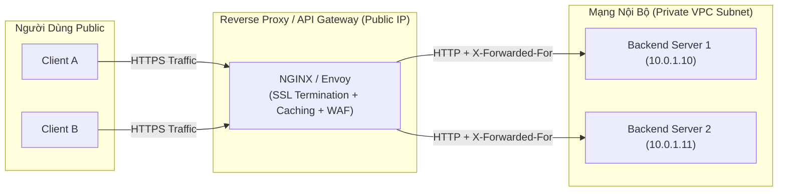
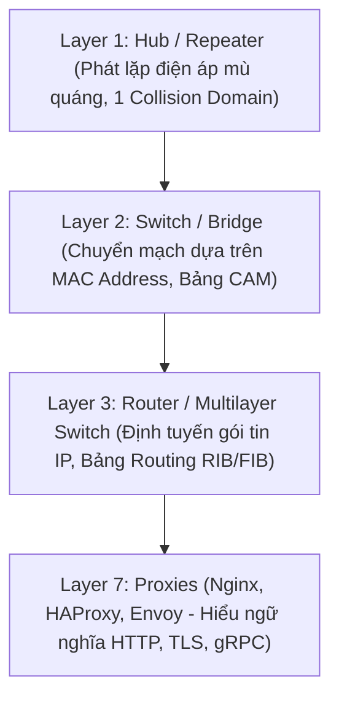
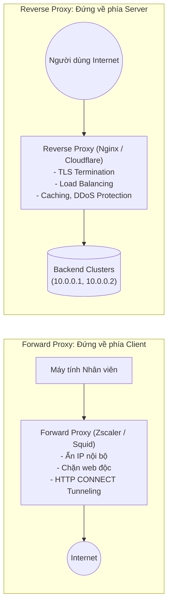
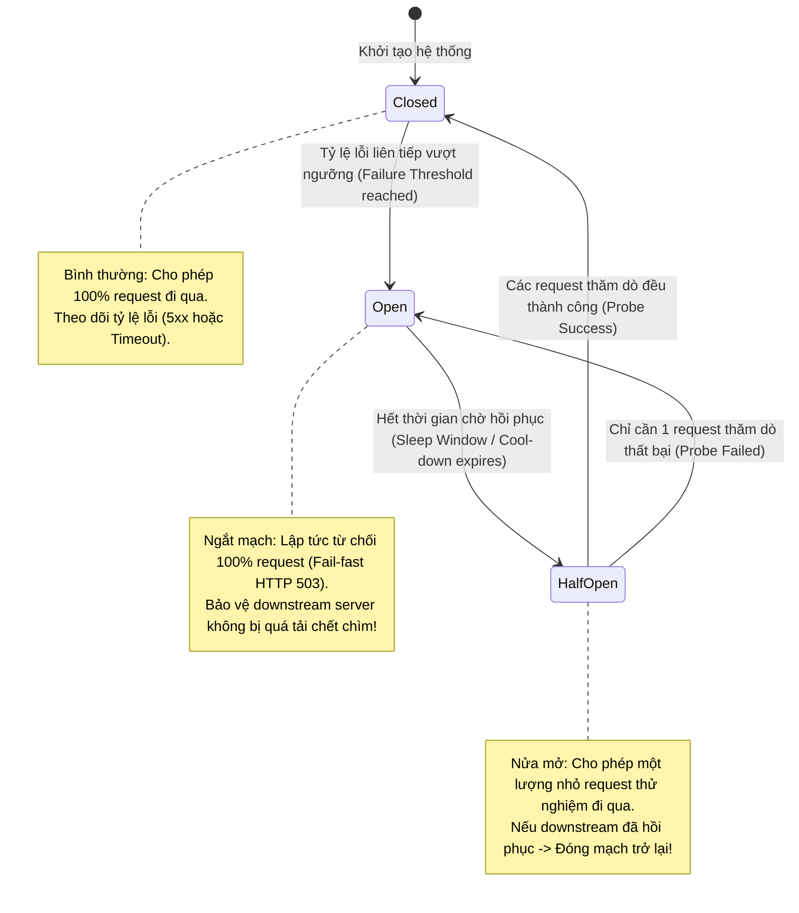

# 9.1. Core Network Appliances, Proxies and Service Mesh (Thiết bị Mạng Cốt lõi, Proxy và Kiến trúc Service Mesh)

> [!IMPORTANT]
> **Nếu bạn chỉ được nhớ một điều duy nhất:** Sự phân biệt giữa Forward Proxy và Reverse Proxy định hình toàn bộ kiến trúc biên mạng: Forward Proxy đại diện cho Client (ẩn danh client, lọc nội dung duyệt web của nhân viên công ty); trong khi Reverse Proxy đại diện cho Backend Servers (ẩn giấu cấu trúc mạng nội bộ, đảm nhận chấm dứt TLS Termination, kiểm soát WAF chống mã độc và điều phối lưu lượng truy cập).

---

## 1. Đơn giản nhưng phải chi tiết (Intuitive & Deep Breakdown)

### 1.1. Đoạn Code Dẫn Nhập & Vấn Đề Thực Tế
Làm thế nào để phân biệt giữa một Forward Proxy (Bảo vệ người dùng nội bộ) và một Reverse Proxy (Bảo vệ cụm máy chủ Backend)?

```nginx
# Cấu hình Reverse Proxy kinh điển bằng NGINX
server {
    listen 80;
    server_name api.example.com;

    location / {
        # Đóng gói và chuyển tiếp yêu cầu của client tới cụm máy chủ nội bộ
        proxy_pass http://backend_upstream_cluster;
        
        # Bắt buộc chuyển tiếp thông tin IP thực của Client qua các Headers
        proxy_set_header X-Real-IP $remote_addr;
        proxy_set_header X-Forwarded-For $proxy_add_x_forwarded_for;
        proxy_set_header Host $host;
    }
}
```

Nếu một Reverse Proxy không cấu hình chính xác header `X-Forwarded-For` và phía Backend tin tưởng mù quáng vào IP kết nối trực tiếp, hệ thống kiểm soát chống gian lận (Fraud Detection) sẽ coi toàn bộ hàng triệu người dùng trên thế giới đều đến từ một địa chỉ IP duy nhất của máy chủ Proxy!

### 1.2. Ẩn Dụ Đời Sống & Phân Tích Cơ Chế Hoạt Động
So sánh giữa Forward Proxy và Reverse Proxy giống như **Người Đại Diện Pháp Lý**:
- **Forward Proxy (Đại diện cho Người Mua Hàng)**:
  - Bạn là một tỷ phú giấu mặt muốn đi mua đất (**Client nội bộ**). Bạn không muốn người bán biết danh tính của mình.
  - Bạn thuê một Luật sư đại diện (**Forward Proxy**). Luật sư đứng tên đi mua và đàm phán với chủ đất. Chủ đất chỉ biết mặt luật sư mà không hề biết ai là người thực sự đứng sau giật dây!
- **Reverse Proxy (Đại diện cho Người Bán Hàng)**:
  - Một Ngôi sao Điện ảnh nổi tiếng có hàng triệu người hâm mộ muốn xin chữ ký (**Server Backend**).
  - Ngôi sao không thể ngồi ngoài vỉa hè tiếp đón từng người một. Ngôi sao thuê một **Người Quản lý (Reverse Proxy)** đứng ra ngoài sảnh nhận thư từ, quà tặng, lọc bỏ thư rác và các phần tử quá khích (**DDoS/WAF**), rồi mới chuyển các lá thư tử tế vào phòng kín cho ngôi sao ký. Người hâm mộ chỉ được gặp người quản lý!

### 1.3. Mô Phỏng Dữ Liệu Số Nhỏ Từng Bước (Toy Walkthrough)
Mô phỏng chuỗi biến đổi IP Header qua Reverse Proxy:

| Chặng Di Chuyển | Gói Tin Thực Tế | Source IP (L3) | Destination IP (L3) | HTTP Header `X-Forwarded-For` |
| :--- | :--- | :--- | :--- | :--- |
| **Chặng 1 (Internet)** | Client gửi yêu cầu | `203.0.113.88` (Client thật) | `198.51.100.1` (Reverse Proxy) | `(Chưa có)` |
| **Xử Lý Tại Proxy** | Proxy bóc tách L7, tạo kết nối mới | - | - | Thêm: `203.0.113.88` |
| **Chặng 2 (VPC Private)** | Proxy chuyển tiếp tới Backend | `10.0.1.10` (Proxy Private IP) | `10.0.2.50` (Backend App Server) | `X-Forwarded-For: 203.0.113.88` |
| **Backend Tiếp Nhận** | Backend đọc dữ liệu | Socket thấy IP: `10.0.1.10` | - | **Đọc Header lấy IP thật: `203.0.113.88`** |

Backend nhận diện đúng IP người dùng thông qua Header mà vẫn giữ cho máy chủ nằm hoàn toàn trong mạng Private an toàn.

### 1.4. Tác Động Thực Tế Tầng Backend & Systems
- **Tấn Công IP Spoofing qua `X-Forwarded-For`**: Nếu Reverse Proxy không chủ động gọt bỏ hoặc ghi đè header `X-Forwarded-For` từ client gửi lên, kẻ tấn công có thể tự chèn chuỗi `X-Forwarded-For: 127.0.0.1` để qua mặt các hệ thống kiểm tra IP Whitelist quản trị nội bộ.
- **Tiêu Hao CPU Trong Việc Giải Mã SSL Termination**: Khi Reverse Proxy đảm nhiệm việc giải mã SSL/TLS (SSL Offloading), nó giải phóng hàng nghìn chu kỳ CPU cho cụm backend phía sau. Các server backend chỉ cần xử lý HTTP bản rõ trong mạng private an toàn với tốc độ cực đại.

### 1.5. Sơ Đồ Tư Duy & Kiến Trúc Hệ Thống (Mermaid)


---

## 2. Chi tiết từng Keyword (Under-the-Hood Deep Dive)

### 2.1. Phân loại Thiết bị Mạng Cốt lõi (Network Appliances Hierarchy)

Tiến trình tiến hóa của các thiết bị mạng từ Tầng 1 đến Tầng 7:



1. **Hub / Repeater (Tầng 1 - Physical)**:
   - Hoạt động thuần túy ở mức điện áp: Khi nhận tín hiệu trên 1 cổng, nó khuếch đại và phát tràn (broadcast) tín hiệu ra tất cả các cổng còn lại.
   - *Hạn chế*: Toàn bộ mạng nằm trong **1 Collision Domain duy nhất** (xảy ra xung đột tín hiệu liên tục nếu hai máy cùng phát). Đã hoàn toàn bị đào thải.
2. **Layer 2 Switch (Tầng 2 - Data Link)**:
   - Thiết bị chuyển mạch thông minh kiểm tra trường địa chỉ đích **MAC Address** trong Ethernet Frame.
   - Duy trì bảng **CAM (Content Addressable Memory)** để ghi nhớ địa chỉ MAC nào gắn với cổng vật lý nào. Chia tách mỗi cổng thành một Collision Domain độc lập nhưng vẫn chia sẻ chung một **Broadcast Domain** (cho đến khi chia VLAN).
3. **Layer 3 Router (Tầng 3 - Network)**:
   - Thiết bị định tuyến kiểm tra **Địa chỉ IP Đích** trong gói tin.
   - Sử dụng các giao thức định tuyến động (OSPF, BGP) để xây dựng bảng định tuyến **RIB (Routing Information Base)** và biên dịch xuống phần cứng **FIB (Forwarding Information Base)** với chip ASIC chuyên dụng (TCAM) để định tuyến hàng trăm triệu gói tin mỗi giây với độ trễ nano-giây.

---

### 2.2. Forward Proxy vs Reverse Proxy

Mặc dù đều là các phần mềm proxy trung gian xử lý lưu lượng mạng, bản chất và mục đích của chúng đối lập nhau hoàn toàn:



#### A. Forward Proxy (Đại diện cho Client)
- **Vị trí**: Nằm cùng phía với người dùng hoặc trong cổng ngõ ra (Egress Gateway) của mạng doanh nghiệp.
- **Mục đích**:
  - Bảo vệ quyền riêng tư người dùng (ẩn địa chỉ IP thật của máy trạm).
  - Kiểm soát truy cập: Chặn nhân viên truy cập các trang mạng xã hội, cờ bạc hoặc website độc hại.
  - Lưu đệm tài nguyên dùng chung (Shared Caching) giúp tiết kiệm băng thông đường truyền ra Internet của văn phòng.
- **Phương thức HTTP `CONNECT` (HTTPS Tunneling)**:
  - Khi người dùng truy cập một trang web mã hóa HTTPS (`https://bank.com`), Client không thể gửi request GET thông thường vì proxy không có private key để giải mã.
  - Client gửi request `CONNECT bank.com:443 HTTP/1.1`. Forward Proxy mở một kết nối TCP thô (raw TCP socket) tới `bank.com:443` rồi mù quáng chuyển tiếp từng byte giữa Client và Server (TCP tunneling) mà không cần bóc tách dữ liệu TLS bên trong.

#### B. Reverse Proxy (Đại diện cho Server)
- **Vị trí**: Nằm ở cửa ngõ tiếp nhận (Ingress Gateway) ngay phía trước cụm máy chủ Backend.
- **Mục đích**:
  - **TLS Termination (Giải mã SSL tập trung)**: Giải phóng tải mã hóa/giải mã tiêu tốn CPU khỏi các máy chủ ứng dụng; chứng chỉ TLS chỉ cần cài đặt và quản lý tại 1 nơi duy nhất.
  - **Load Balancing**: Phân phối lưu lượng đồng đều tới các backend nodes (Round Robin, Least Connections, IP Hash).
  - **Che giấu Hạ tầng Nội bộ**: Khách hàng ngoài Internet chỉ nhìn thấy 1 địa chỉ IP duy nhất của Reverse Proxy; toàn bộ địa chỉ IP private của cụm server được giấu kín tuyệt đối.

---

### 2.3. Kiến trúc Service Mesh (Istio & Envoy Sidecar)

Trong kiến trúc Microservices phân tán với hàng trăm dịch vụ liên tục gọi chéo nhau, việc viết code xử lý Retry, Timeout, Circuit Breaking và mTLS thủ công trong từng ngôn ngữ lập trình (Java, Go, Python, Node.js) là một thảm họa bảo trì. **Service Mesh** ra đời để trừu tượng hóa toàn bộ tầng mạng thành một lớp hạ tầng độc lập.

Service Mesh chia thành 2 mặt phẳng rõ rệt:

1. **Data Plane (Mặt phẳng Dữ liệu - Envoy Proxy)**:
   - Chạy dưới dạng một **Sidecar Container** nằm ngay bên trong cùng một Pod Kubernetes với container ứng dụng (chia sẻ chung Network Namespace và `localhost`).
   - Mọi byte dữ liệu Inbound và Outbound của ứng dụng đều bị Envoy âm thầm đánh chặn để xử lý.
   - Được viết bằng C++ siêu tối ưu, tiêu thụ ít tài nguyên và xử lý hàng chục nghìn request mỗi giây với độ trễ dưới 1 mili-giây.
2. **Control Plane (Mặt phẳng Điều khiển - Istiod)**:
   - Bộ não chỉ huy trung tâm: Không bao giờ chạm trực tiếp vào các gói tin dữ liệu người dùng.
   - Chịu trách nhiệm theo dõi Kubernetes API Server, phát hiện các service mới sinh ra hoặc chết đi, biên dịch các chính sách an ninh mạng (VirtualServices, DestinationRules) thành các cấu hình chuẩn **xDS API** (LDS, RDS, CDS, EDS) và đẩy xuống hàng nghìn Envoy Sidecars theo thời gian thực.
   - Hoạt động như một **Certificate Authority (Citadel)** cấp phát và tự động xoay vòng chứng chỉ số mTLS ngắn hạn cho từng Pod.

---

### 2.4. Cơ chế Đánh chặn Lưu lượng: iptables vs eBPF

Làm thế nào Envoy Sidecar có thể "hút" toàn bộ lưu lượng của container ứng dụng mà ứng dụng không hề hay biết?

```mermaid
flowchart TD
    subgraph IPTables_Trap["Cơ chế iptables Redirect cổ điển"]
        AppOut["Ứng dụng gọi Socket TCP"] --> PodNet["Vào Pod Network Namespace"]
        PodNet --> IPT_Rule["iptables PREROUTING / OUTPUT<br/>REDIRECT to port 15006 / 15001"]
        IPT_Rule --> TCP_Stack1["Chạy qua Linux TCP/IP Stack"]
        TCP_Stack1 --> EnvoyListen["Envoy nhận gói tin tại cổng 15006"]
        EnvoyListen --> TCP_Stack2["Envoy mở kết nối ra ngoài"]
    end

    subgraph eBPF_Bypass["Cơ chế eBPF Socket Layer Enforcement (Cilium)"]
        AppOut2["Ứng dụng ghi vào Socket Descriptor"] --> eBPF_Hook["eBPF sock_ops hook<br/>(Bypass toàn bộ Linux Network Stack!)"]
        eBPF_Hook --> DirectCopy["Copy trực tiếp Socket Buffer sang Envoy Socket Buffer!<br/>(Giảm 50% độ trễ CPU)"]
    end
```



- **iptables Interception (Truyền thống của Istio init-container)**:
  - Khi Pod khởi động, một container đặc quyền (`istio-init`) chạy lệnh `iptables` để cài đặt các quy tắc chuyển hướng (REDIRECT) toàn bộ cổng mạng về cổng `15001` (Outbound) và `15006` (Inbound) của Envoy.
  - *Nhược điểm*: Gói tin phải đi qua toàn bộ ngăn xếp mạng Linux TCP/IP nhiều lần, phát sinh chi phí ngữ cảnh (Context Switching) và hao phí CPU.
- **eBPF Socket-level Interception (Cilium Service Mesh)**:
  - Sử dụng các chương trình **eBPF** nhúng trực tiếp vào các móc câu tầng socket (`sock_ops`, `sk_msg`) trong Linux Kernel.
  - Khi ứng dụng gọi `write()` vào socket, eBPF chuyển thẳng con trỏ dữ liệu sang hàng đợi nhận của Envoy socket mà **không cần đi qua ngăn xếp TCP/IP của kernel**, triệt tiêu gần như hoàn toàn chi phí độ trễ phụ trội của Sidecar!

---

### 2.5. Các Tính năng Nâng cao của Service Mesh

#### A. Máy trạng thái Circuit Breaker (Bộ ngắt mạch chống sụp đổ dây chuyền)
Ngăn chặn hiện tượng **Cascading Failure (Sụp đổ dây chuyền)** khi một microservice downstream bị quá tải hoặc chết:



#### B. Traffic Splitting & Canary Deployment
- Cho phép chia tách lưu lượng dựa trên tỷ lệ phần trăm chính xác: ví dụ $95\%$ người dùng đi vào phiên bản ổn định `v1`, $5\%$ đi vào phiên bản mới `v2`.
- Hoặc định tuyến dựa trên HTTP Header: Chỉ những người dùng nội bộ có header `X-Beta-Tester: true` mới được chuyển hướng sang bản `v2`.

#### C. Mutual TLS (mTLS) Tự động & SPIFFE Identity
- Mọi dịch vụ được gán một định danh chuẩn hóa: **SPIFFE ID** (ví dụ `spiffe://cluster.local/ns/prod/sa/order-service`).
- Envoy tự động mã hóa đường truyền bằng TLS 1.3 và thẩm định lẫn nhau: Service A biết chắc chắn Service B là ai và ngược lại, ngăn chặn hoàn toàn nguy cơ giả mạo bên trong mạng nội bộ.

---

## 3. Thực thi Mã nguồn & Mô phỏng Chuyên sâu (Dual-Engine Implementation)

### 3.1. C++20 Implementation

Mã nguồn C++20 dưới đây xây dựng một **Máy trạng thái Circuit Breaker Thread-Safe chuẩn Envoy / Netflix Hystrix**: quản lý 3 trạng thái Closed, Open, Half-Open với ngưỡng lỗi liên tiếp, thời gian hồi phục tự động (Cool-down Timeout) và kiểm định bằng các request thăm dò:

```cpp
// compile: g++ -std=c++20 -O3 -Wall -pthread circuit_breaker_sim.cpp -o circuit_breaker_sim
#include <iostream>
#include <string>
#include <chrono>
#include <mutex>
#include <atomic>
#include <functional>
#include <stdexcept>

namespace ServiceMesh {

enum class CircuitState {
    Closed,     // Mạch Đóng: Hoạt động bình thường
    Open,       // Mạch Mở: Đang gặp sự cố, từ chối mọi request (Fail-fast)
    HalfOpen    // Nửa Mở: Đang thử nghiệm một số request thăm dò
};

class CircuitBreaker {
private:
    std::string name_;
    size_t failureThreshold_;
    std::chrono::milliseconds recoveryTimeout_;
    size_t consecutiveSuccessThreshold_;

    std::mutex mutex_;
    CircuitState state_{CircuitState::Closed};
    size_t consecutiveFailures_{0};
    size_t consecutiveSuccesses_{0};
    std::chrono::steady_clock::time_point lastStateChangeTime_;

    void transitionTo(CircuitState newState) {
        state_ = newState;
        lastStateChangeTime_ = std::chrono::steady_clock::now();
        consecutiveFailures_ = 0;
        consecutiveSuccesses_ = 0;
    }

public:
    CircuitBreaker(std::string name, size_t failureThreshold, std::chrono::milliseconds recoveryTimeout, size_t successThreshold = 2)
        : name_(std::move(name)),
          failureThreshold_(failureThreshold),
          recoveryTimeout_(recoveryTimeout),
          consecutiveSuccessThreshold_(successThreshold),
          lastStateChangeTime_(std::chrono::steady_clock::now()) {}

    template <typename Func>
    decltype(auto) execute(Func&& protectedFunction) {
        {
            std::lock_guard lock(mutex_);
            auto now = std::chrono::steady_clock::now();

            // Nếu mạch đang MỞ, kiểm tra xem đã hết thời gian hạ nhiệt chưa
            if (state_ == CircuitState::Open) {
                if (now - lastStateChangeTime_ > recoveryTimeout_) {
                    std::cout << "  [CIRCUIT BREAKER] " << name_ << ": Timeout da het -> Chuyen sang trang thai HALF-OPEN (Thu nghiem)!\n";
                    transitionTo(CircuitState::HalfOpen);
                } else {
                    // Mạch vẫn Mở -> Từ chối ngay lập tức (Fail-fast) không gọi backend!
                    throw std::runtime_error("HTTP 503: Service Unavailable (Circuit Breaker OPEN)");
                }
            }
        }

        // Thực thi tác vụ được bảo vệ
        try {
            auto result = protectedFunction();
            onSuccess();
            return result;
        } catch (...) {
            onFailure();
            throw;
        }
    }

private:
    void onSuccess() {
        std::lock_guard lock(mutex_);
        if (state_ == CircuitState::HalfOpen) {
            consecutiveSuccesses_++;
            if (consecutiveSuccesses_ >= consecutiveSuccessThreshold_) {
                std::cout << "  [CIRCUIT BREAKER] " << name_ << ": Tham do thanh cong lien tiep -> DONG MACH TRO LAI (CLOSED)!\n";
                transitionTo(CircuitState::Closed);
            }
        } else if (state_ == CircuitState::Closed) {
            consecutiveFailures_ = 0;
        }
    }

    void onFailure() {
        std::lock_guard lock(mutex_);
        consecutiveFailures_++;
        std::cout << "  [!] " << name_ << " ghi nhan that bai (" << consecutiveFailures_ << "/" << failureThreshold_ << ")\n";

        if (state_ == CircuitState::Closed && consecutiveFailures_ >= failureThreshold_) {
            std::cout << "  [CIRCUIT BREAKER] " << name_ << ": Dat nguong loi! NGAT MACH NGAY LAP TUC (OPEN)!\n";
            transitionTo(CircuitState::Open);
        } else if (state_ == CircuitState::HalfOpen) {
            std::cout << "  [CIRCUIT BREAKER] " << name_ << ": Request tham do bi FAIL -> MO LAI MACH NGAY (OPEN)!\n";
            transitionTo(CircuitState::Open);
        }
    }
};

} // namespace ServiceMesh

int main() {
    using namespace ServiceMesh;
    std::cout << "========================================================\n";
    std::cout << "  C++20 SERVICE MESH CIRCUIT BREAKER STATE SIMULATOR    \n";
    std::cout << "========================================================\n\n";

    // Cấu hình: 3 lỗi liên tiếp sẽ mở mạch, thời gian hạ nhiệt 1.5 giây
    CircuitBreaker breaker("PaymentServiceBreaker", 3, std::chrono::milliseconds(1500), 2);

    auto mockRemoteCall = [](bool shouldFail) {
        return [shouldFail]() -> std::string {
            if (shouldFail) throw std::runtime_error("Database connection timeout");
            return "Transaction Success (200 OK)";
        };
    };

    // 1. Thao tác bình thường (Closed)
    std::cout << "[1] BINH THUONG (Circuit CLOSED):\n";
    try {
        auto res = breaker.execute(mockRemoteCall(false));
        std::cout << "  -> Ket qua: " << res << "\n\n";
    } catch (const std::exception& e) {
        std::cout << "  [-] Loi: " << e.what() << "\n";
    }

    // 2. Kích hoạt liên tiếp 3 lỗi để làm sập mạch
    std::cout << "[2] DOWNSTREAM BI SUP (Phat sinh 3 loi lien tiep):\n";
    for (int i = 0; i < 3; ++i) {
        try {
            breaker.execute(mockRemoteCall(true));
        } catch (const std::exception& e) {
            std::cout << "  [-] Request " << (i + 1) << " failed: " << e.what() << "\n";
        }
    }

    // 3. Request thứ 4 đến khi mạch đang MỞ -> Bị Fail-fast tức thì!
    std::cout << "\n[3] GOI KHI MACH DANG MO (Fail-fast test):\n";
    try {
        breaker.execute(mockRemoteCall(false));
    } catch (const std::exception& e) {
        std::cout << "  -> Chan dung ngay tu cua: " << e.what() << " (Khong lam ton tai nguyen backend!)\n\n";
    }

    // 4. Ngủ 1.6 giây để hết thời gian hồi phục
    std::cout << "[4] DANG CHO 1.6s DE MACH CHUYEN SANG HALF-OPEN...\n";
    std::this_thread::sleep_for(std::chrono::milliseconds(1600));

    // 5. Gửi 2 request thành công để đóng mạch trở lại
    std::cout << "\n[5] GUI 2 REQUEST THAM DO (Probing Requests):\n";
    try {
        auto r1 = breaker.execute(mockRemoteCall(false));
        std::cout << "  -> Tham do 1: " << r1 << "\n";
        auto r2 = breaker.execute(mockRemoteCall(false));
        std::cout << "  -> Tham do 2: " << r2 << "\n";
    } catch (const std::exception& e) {
        std::cout << "  [-] Loi: " << e.what() << "\n";
    }

    std::cout << "\n========================================================\n";
    return 0;
}
```

---

### 3.2. Python 3.11+ Implementation

Mã nguồn Python 3.11 dưới đây mô phỏng một **L7 Reverse Proxy & Dynamic Health Checker**: tự động cân bằng tải Round-Robin, định kỳ gửi Heartbeat kiểm tra sức khỏe và tự động cách ly các Node backend bị sập:

```python
#!/usr/bin/env python3
"""
Mô phỏng Reverse Proxy L7 với Round-Robin Load Balancing & Dynamic Health Checking
Yêu cầu: Python 3.11+
"""

from dataclasses import dataclass
import time


@dataclass
class BackendNode:
    name: str
    host: str
    port: int
    is_alive: bool = True
    consecutive_failures: int = 0

    @property
    def address(self) -> str:
        return f"{self.host}:{self.port}"


class L7ReverseProxy:
    def __init__(self, backends: list[BackendNode]) -> None:
        self.backends = backends
        self.current_idx = 0

    def route_request(self, path: str) -> tuple[int, str]:
        """Cân bằng tải Round-Robin chỉ qua các node đang còn sống (Healthy Nodes)"""
        healthy_nodes = [node for node in self.backends if node.is_alive]

        if not healthy_nodes:
            # Toàn bộ backend bị sập -> Trả về lỗi 502 Bad Gateway
            return 502, "HTTP 502: Bad Gateway (Khong con backend node nao kha dung!)"

        # Lựa chọn node theo Round-Robin
        selected_node = healthy_nodes[self.current_idx % len(healthy_nodes)]
        self.current_idx += 1

        # Mô phỏng chuyển tiếp request tới backend
        return 200, f"HTTP 200 OK: Phuc vu boi [{selected_node.name} at {selected_node.address}] path={path}"

    def run_health_check(self) -> None:
        """Định kỳ kiểm tra sức khỏe của từng node"""
        print("\n[+] DANG CHAY CHU TRINH HEALTH CHECK:")
        for node in self.backends:
            # Giả lập logic ping node: node 2 bị sập
            if node.name == "Node-2":
                node.consecutive_failures += 1
                if node.consecutive_failures >= 2 and node.is_alive:
                    node.is_alive = False
                    print(f"  [-] CANH BAO: {node.name} ({node.address}) khong phan hoi -> CACH LY KHOI POOL!")
            else:
                node.consecutive_failures = 0
                if not node.is_alive:
                    node.is_alive = True
                    print(f"  [+] {node.name} da hoi phuc -> DUA TRO LAI POOL!")
                else:
                    print(f"  [OK] {node.name} ({node.address}) hoat dong tot.")


def main() -> None:
    print("=" * 60)
    print("  PYTHON 3.11: REVERSE PROXY & ACTIVE HEALTH CHECK SIM")
    print("=" * 60)

    nodes = [
        BackendNode("Node-1", "10.0.1.10", 8080),
        BackendNode("Node-2", "10.0.1.11", 8080),
        BackendNode("Node-3", "10.0.1.12", 8080),
    ]

    proxy = L7ReverseProxy(nodes)

    # Đợt 1: Điều phối 3 request khi tất cả còn khỏe
    print("\n--- DOT 1: 3 Request dau tien (Tat ca deu khoe) ---")
    for i in range(3):
        status, resp = proxy.route_request("/api/v1/checkout")
        print(f"Request {i+1}: {resp}")

    # Đợt 2: Chạy Health Check -> Phát hiện Node-2 lỗi và cách ly
    proxy.run_health_check()
    proxy.run_health_check() # Lần 2 đạt ngưỡng lỗi

    # Đợt 3: Điều phối tiếp 4 request -> Node-2 hoàn toàn bị loại khỏi danh sách
    print("\n--- DOT 2: 4 Request tiep theo (Sau khi Node-2 bi cach ly) ---")
    for i in range(4):
        status, resp = proxy.route_request("/api/v1/checkout")
        print(f"Request {i+1}: {resp}")

    print("\n" + "=" * 60)


if __name__ == "__main__":
    main()
```

---

### 3.3. Terminal Output Mẫu Chuẩn Thực Tế

```text
========================================================
  C++20 SERVICE MESH CIRCUIT BREAKER STATE SIMULATOR    
========================================================

[1] BINH THUONG (Circuit CLOSED):
  -> Ket qua: Transaction Success (200 OK)

[2] DOWNSTREAM BI SUP (Phat sinh 3 loi lien tiep):
  [!] PaymentServiceBreaker ghi nhan that bai (1/3)
  [-] Request 1 failed: Database connection timeout
  [!] PaymentServiceBreaker ghi nhan that bai (2/3)
  [-] Request 2 failed: Database connection timeout
  [!] PaymentServiceBreaker ghi nhan that bai (3/3)
  [CIRCUIT BREAKER] PaymentServiceBreaker: Dat nguong loi! NGAT MACH NGAY LAP TUC (OPEN)!
  [-] Request 3 failed: Database connection timeout

[3] GOI KHI MACH DANG MO (Fail-fast test):
  -> Chan dung ngay tu cua: HTTP 503: Service Unavailable (Circuit Breaker OPEN) (Khong lam ton tai nguyen backend!)

[4] DANG CHO 1.6s DE MACH CHUYEN SANG HALF-OPEN...

[5] GUI 2 REQUEST THAM DO (Probing Requests):
  [CIRCUIT BREAKER] PaymentServiceBreaker: Timeout da het -> Chuyen sang trang thai HALF-OPEN (Thu nghiem)!
  -> Tham do 1: Transaction Success (200 OK)
  [CIRCUIT BREAKER] PaymentServiceBreaker: Tham do thanh cong lien tiep -> DONG MACH TRO LAI (CLOSED)!
  -> Tham do 2: Transaction Success (200 OK)

========================================================
```

---

## 4. Systems Engineering & Production Pitfalls

### 4.1. "Thuế" Độ trễ của Sidecar (The Sidecar Latency Tax)
- **Vấn đề**: Trong một luồng xử lý microservices phức tạp có độ sâu 5 hops (Service A -> B -> C -> D -> E), mỗi hop đều phải đi qua 2 Envoy Proxies (Envoy Outbound của caller và Envoy Inbound của callee). Tổng cộng gói tin phải đi qua **10 lần proxy**!
- **Hậu quả**: Nếu mỗi Envoy làm tăng $1.5\text{ ms}$, tổng độ trễ mạng bị đội thêm $15\text{ ms}$ cho mỗi giao dịch người dùng.
- **Giải pháp**:
  - Chuyển đổi sang kiến trúc **Ambient Mesh (Istio)** hoặc **Cilium eBPF Service Mesh**: Bỏ mô hình Sidecar gắn với từng Pod, thay bằng mô hình **Node-level Proxy (Ztunnel)** chia sẻ chung ở cấp độ máy chủ, giúp giảm 80% độ trễ và tiết kiệm hàng gigabytes RAM cho cụm Kubernetes.

### 4.2. Vòng lặp Định tuyến Vô tận do Cấu hình Sai iptables trong Pod
- Khi thiết lập iptables redirection thủ công mà không loại trừ tài khoản hệ thống của chính Envoy (`uid 1337`), gói tin do chính Envoy phát ra sẽ lại bị iptables "hút" ngược trở lại cổng vào của chính nó, tạo thành một **vòng lặp vô tận (Infinite Routing Loop)** khiến CPU đạt $100\%$ ngay lập tức.

### 4.3. Bộ công cụ CLI Quản lý và Gỡ lỗi Service Mesh

#### 1. Kiểm tra trạng thái đồng bộ xDS giữa Control Plane và Envoy qua `istioctl`:
```bash
# Kiểm tra phiên bản cấu hình đã được nạp xuống Pod chưa
$ istioctl proxy-status
NAME                                                   CDS        LDS        EDS        RDS          ISTIOD                      VERSION
order-service-7f9b8c-x12.prod                          SYNCED     SYNCED     SYNCED     SYNCED       istiod-6c9f7b-91            1.22.0
payment-service-5b4d1a-z99.prod                        SYNCED     SYNCED     SYNCED     SYNCED       istiod-6c9f7b-91            1.22.0

# Soi toàn bộ cấu hình Cluster Endpoint của một Pod cụ thể
$ istioctl proxy-config endpoints order-service-7f9b8c-x12.prod --cluster "outbound|8080||payment-service.prod.svc.cluster.local"
ENDPOINT             STATUS      OUTLIER CHECK     CLUSTER
10.244.2.45:8080     HEALTHY     OK                outbound|8080||payment-service.prod.svc.cluster.local
```

#### 2. Soi số liệu thống kê nội bộ qua Envoy Admin Interface (Port 15000):
```bash
# Xem số lần Circuit Breaker bị kích hoạt
$ kubectl exec -it order-service-7f9b8c-x12 -c istio-proxy -- curl -s http://localhost:15000/stats | grep "circuit_breakers"
cluster.payment-service.circuit_breakers.default.cx_open: 0
cluster.payment-service.circuit_breakers.default.rq_pending_open: 1
```

---

## 5. Bảng So sánh & Decision Matrix

### Bảng đối chiếu các Thiết bị & Proxy Mạng

| Tiêu chí | L2/L3 Switch & Router | API Gateway (Kong, Apisix) | Reverse Proxy (Nginx, HAProxy) | Service Mesh (Istio, Envoy) |
| :--- | :--- | :--- | :--- | :--- |
| **Vị trí Triển khai** | Phần cứng mạng biên / Rack | Vành đai ngoài cùng (Ingress) | Trước cụm Server / DMZ | Sâu bên trong từng Pod (Sidecar) |
| **Phạm vi Lưu lượng** | Mọi lưu lượng gói tin IP | North-South (Khách vào hệ thống) | North-South | **East-West (Service-to-Service)** |
| **Tính năng Cốt lõi** | Chuyển mạch, định tuyến L3 | Auth, Rate Limit, Monetization | TLS Termination, Caching | mTLS, Circuit Breaking, Tracing |
| **Độ phức tạp Vận hành** | Thấp đến Trung bình | Trung bình | Thấp | **Rất cao** |
| **Tiêu tốn Tài nguyên** | Rất thấp (Chip ASIC) | Trung bình | Thấp | Cao (mỗi Pod tốn thêm CPU/RAM cho Envoy) |

### Ma trận Quyết định Lựa chọn Công nghệ Mạng Trung gian

1. **Hệ thống Monolith hoặc Microservices nhỏ ($< 15$ dịch vụ)**:
   - 👉 **Lựa chọn tối thượng**: **Nginx hoặc HAProxy làm Reverse Proxy** kết hợp **Cloudflare Edge**. Tuyệt đối KHÔNG nên dùng Service Mesh vì độ phức tạp vận hành sẽ đè bẹp lợi ích mang lại.
2. **Cổng giao tiếp Công cộng đón nhận hàng triệu người dùng bên ngoài (North-South Traffic)**:
   - 👉 **Lựa chọn tối thượng**: **Cloud-native API Gateway (Kong, Envoy Gateway, Traefik)**. Quản lý xác thực OAuth2/JWT tập trung, kiểm soát hạn ngạch (Rate Limiting) và chuyển đổi giao thức (gRPC-JSON Transcoding).
3. **Hệ thống Ngân hàng, Viễn thông, Siêu ứng dụng ($> 50$ Microservices đa ngôn ngữ)**:
   - 👉 **Lựa chọn bắt buộc**: **Service Mesh (Istio / Cilium)**. Cung cấp tầm nhìn quan sát toàn diện (Observability), tự động mã hóa Zero Trust mTLS bắt buộc theo quy chuẩn bảo mật tài chính (PCI-DSS) mà không cần lập trình viên phải sửa code nghiệp vụ.

---

## 6. Enterprise Production Checklist & Verification

### 6.1. Kiến Trúc & Cấu Hình Tối Ưu (Production-Ready Architecture)
- [ ] **Bảo Vệ Header X-Forwarded-For Khỏi Bị Giả Mạo**: Cấu hình `proxy_set_header X-Forwarded-For $remote_addr;` tại Reverse Proxy tầng ngoài cùng để ghi đè mọi header giả mạo từ client.
- [ ] **Kích Hoạt Upstream Keep-Alive Connections**: Thiết lập `keepalive 64;` trong block upstream của Nginx để tái sử dụng các kết nối TCP giữa proxy và backend servers.
- [ ] **Triển Khai SSL Termination Chuẩn Xác**: Cấu hình chứng chỉ SSL tập trung tại Proxy và chuyển tiếp cờ nhận diện giao thức `proxy_set_header X-Forwarded-Proto $scheme;` cho backend.
- [ ] **Phân Vùng Mạng Rõ Ràng**: Chỉ cấp Public IP cho các máy chủ Reverse Proxy; toàn bộ các cụm backend bắt buộc nằm trong Private Subnet không có route ra Internet trực tiếp.

### 6.2. Giám Sát, Cảnh Báo & Xử Lý Sự Cố (Observability & Incident Response)
- [ ] **Giám Sát Thời Gian Upstream Response Time**: Theo dõi biến `$upstream_response_time` trong log Nginx để phân biệt độ trễ phát sinh do mạng hay do code backend chạy chậm.
- [ ] **Cảnh Báo Lỗi 502 Bad Gateway và 504 Gateway Timeout**: Thiết lập cảnh báo tức thời khi số lượng mã lỗi 502/504 tăng đột biến (dấu hiệu backend sập hoặc quá tải).
- [ ] **Kiểm Tra Trạng Thái Sức Khỏe Upstream Health Check**: Sử dụng công cụ giám sát kiểm tra liên tục trạng thái sống của từng node backend trong pool tải.
