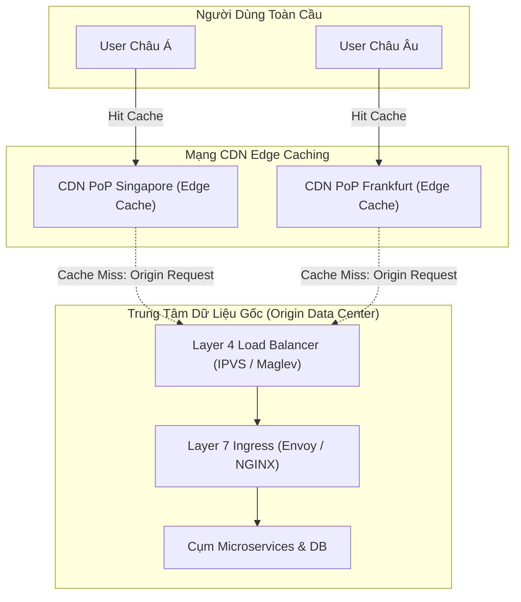
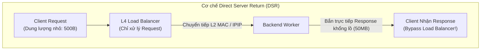
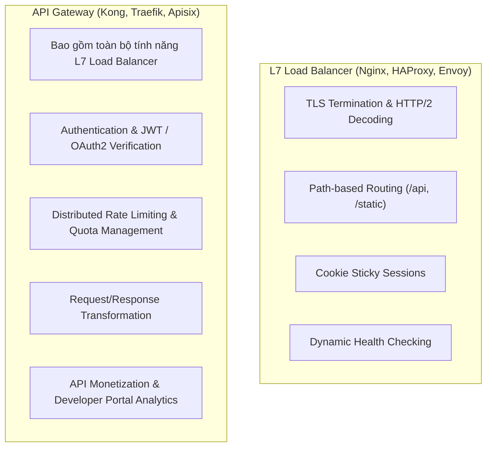
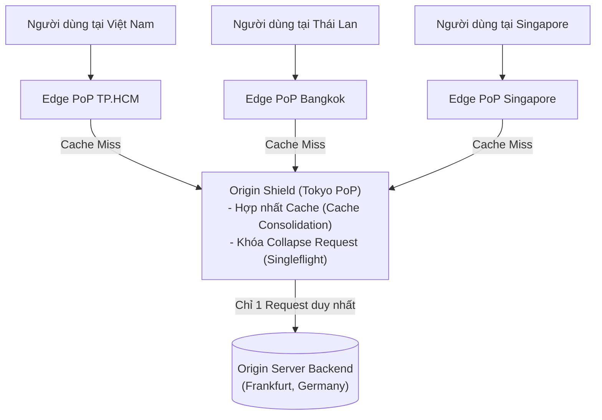
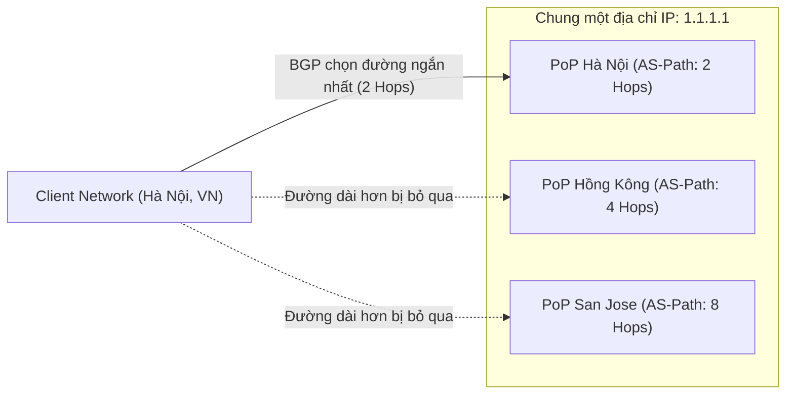

# 9.2. Load Balancers, CDNs and BGP Anycast (Cân bằng Tải, Mạng Phân phối Nội dung và Định tuyến Anycast)

> [!IMPORTANT]
> **Nếu bạn chỉ được nhớ một điều duy nhất:** Mở rộng quy mô hạ tầng mạng toàn cầu dựa trên sự phối hợp 3 tầng: Cân bằng tải L4 (IP/Port) đạt thông lượng hàng chục triệu gói tin mỗi giây bằng Direct Server Return (DSR); Cân bằng tải L7 (HTTP Header/Path/Cookie) cung cấp khả năng định tuyến ứng dụng thông minh; và Mạng phân phối nội dung (CDN) đưa dữ liệu tĩnh ra các Edge PoP nằm sát người dùng nhất thông qua định tuyến BGP Anycast.

---

## 1. Đơn giản nhưng phải chi tiết (Intuitive & Deep Breakdown)

### 1.1. Đoạn Code Dẫn Nhập & Vấn Đề Thực Tế
Làm thế nào để phân biệt sự khác nhau cơ bản giữa một Bộ cân bằng tải Tầng 4 (Layer 4 Load Balancer) và Bộ cân bằng tải Tầng 7 (Layer 7 Load Balancer)?

```bash
# Cân bằng tải Layer 4 (Chỉ nhìn IP:Port, không bóc gói tin, tốc độ hàng triệu PPS)
# Dùng IPVS (IP Virtual Server) trên Linux Kernel
$ sudo ipvsadm -A -t 203.0.113.10:80 -s rr
$ sudo ipvsadm -a -t 203.0.113.10:80 -r 10.0.0.1:80 -m
$ sudo ipvsadm -a -t 203.0.113.10:80 -r 10.0.0.2:80 -m

# Cân bằng tải Layer 7 (Bóc tách HTTP Header, URL Path, Cookies để định tuyến thông minh)
# Ví dụ cấu hình NGINX định tuyến theo đường dẫn:
# /api/v1/orders -> Cụm Order Service
# /api/v1/users  -> Cụm User Service
```

Nếu bạn chọn nhầm L7 Load Balancer cho các tác vụ truyền phát video raw socket hoặc chịu bão gói tin hàng triệu PPS, CPU máy chủ sẽ bị bốc khói do phải tốn công bóc tách và ráp nối HTTP payload; ngược lại, dùng L4 LB thì không thể định tuyến theo đường dẫn URL hay Cookie người dùng!

### 1.2. Ẩn Dụ Đời Sống & Phân Tích Cơ Chế Hoạt Động
So sánh giữa L4 LB, L7 LB và Mạng Phân phối Nội dung (CDN) giống như **Hệ Thống Phân Phối Hàng Hóa**:
- **Layer 4 Load Balancer** giống như **Bác Bảo vệ ở Trạm Thu phí Cầu đường**: Bác chỉ nhìn màu biển số xe (IP) và loại xe (TCP/UDP Port) để gạt cần chắn cho xe đi vào làn 1 hay làn 2. Bác tuyệt đối không bắt tài xế mở cốp xe xem bên trong chở gạo hay chở chuối (Xử lý cực nhanh, thông lượng vô địch).
- **Layer 7 Load Balancer** giống như **Nhân viên Kiểm soát Hải quan Sân bay**: Nhân viên yêu cầu hành khách mở toàn bộ vali đồ đạc (Bóc tách HTTP Header & Body). Người nào mang hộ chiếu VIP thì dẫn vào phòng chờ riêng, người mang hàng tươi sống thì dẫn vào khu kiểm dịch (Định tuyến thông minh nhưng tốn thời gian kiểm tra).
- **CDN (Content Delivery Network)** giống như **Kho Hàng Vệ Tinh Shopee / Amazon Tại Từng Phường**: Thay vì chuyển món hàng từ kho tổng bên Mỹ về Việt Nam mất 7 ngày (RTT cao), Shopee lưu sẵn hàng ngàn món đồ phổ biến ngay tại kho Cầu Giấy. Khách đặt mua là hàng được giao tới nhà chỉ sau 15 phút!

### 1.3. Mô Phỏng Dữ Liệu Số Nhỏ Từng Bước (Toy Walkthrough)
Ma trận thuật toán điều phối tải và đặc tính kỹ thuật:

| Thuật Toán Điều Phối | Cơ Chế Hoạt Động | Ưu Điểm Chính | Nhược Điểm / Rủi Ro | Phù Hợp Kịch Bản |
| :--- | :--- | :--- | :--- | :--- |
| **Round Robin** | Chia đều lần lượt theo vòng: $1 \to 2 \to 3 \to 1$ | Cực kỳ đơn giản, không tốn RAM | Giả định mọi server đều mạnh bằng nhau | Cụm server đồng nhất cấu hình |
| **Least Connections** | Gửi tới server đang có ít kết nối mở nhất | Thích ứng tốt với request xử lý lâu mau | Cần duy trì bộ đếm trạng thái | Tác vụ xử lý không đều (DB Query) |
| **IP / Consistent Hash** | Hash(IP) % N để ghim User vào 1 Server | Giữ vững Session Cache tại Local | Rớt server gây dồn tải (Rehash) | Tải stateful hoặc local in-memory cache |
| **Weighted Response Time** | Ưu tiên server phản hồi nhanh nhất | Tối ưu hóa trải nghiệm người dùng | Thuật toán phức tạp, tốn CPU | Đa đám mây (Multi-cloud) |

### 1.4. Tác Động Thực Tế Tầng Backend & Systems
- **Kỹ Thuật Direct Server Return (DSR) trên L4 Load Balancer**: Lưu lượng mạng Internet thường có tính chất bất đối xứng: Request gửi vào rất nhỏ (vài trăm bytes) nhưng Response trả về cực lớn (hàng Megabytes ảnh/video). Bằng kỹ thuật DSR, gói tin request đi qua Load Balancer nhưng gói tin response được các Backend Server gửi THẲNG trực tiếp về cho Client, giúp Load Balancer chịu được tải gấp 10-20 lần bình thường!
- **Thảm Họa CDN Cache Thundering Herd**: Khi một file tĩnh cực kỳ hot (như video họp báo trực tiếp) vừa hết hạn cache trên CDN, hàng triệu người dùng cùng lúc tràn vào hỏi CDN. Nếu không có cơ chế **Origin Shielding** và **Cache Lock**, toàn bộ triệu request này sẽ xuyên thủng CDN đập thẳng vào máy chủ gốc (Origin Server) làm sập hệ thống ngay tức khắc.

### 1.5. Sơ Đồ Tư Duy & Kiến Trúc Hệ Thống (Mermaid)


---

## 2. Chi tiết từng Keyword (Under-the-Hood Deep Dive)

### 2.1. L4 Load Balancing: DSR (Direct Server Return) vs Maglev Consistent Hashing

Cân bằng tải Tầng 4 (Layer 4 Load Balancing) hoạt động thuần túy ở tầng Giao vận (TCP/UDP), kiểm tra thông tin 5-tuple: `(Source IP, Dest IP, Source Port, Dest Port, Protocol)` mà **hoàn toàn không giải mã TLS hay đọc nội dung HTTP payload**.



#### A. Direct Server Return (DSR) - Giải phóng Băng thông Tối đa
- **Vấn đề của Load Balancer truyền thống (Two-way Proxy)**: Mọi lưu lượng đi vào và đi ra đều phải đi qua Load Balancer. Trong thực tế, các ứng dụng web có tính chất **Bất đối xứng lưu lượng (Traffic Asymmetry)**: Request gửi lên chỉ có vài trăm bytes (URL, Cookie), nhưng Response trả về lại nặng hàng chục Megabytes (Hình ảnh, Video, JSON Data). Load Balancer nhanh chóng cạn kiệt băng thông card mạng cổng ra (Egress Bottleneck).
- **Tuyệt kỹ DSR**:
  - Load Balancer chỉ nhận các gói tin Request gửi tới địa chỉ **Virtual IP (VIP)**.
  - Thay vì thay đổi IP đích thành IP của Server (NAT), Load Balancer **giữ nguyên địa chỉ IP đích là VIP** và chỉ thay đổi địa chỉ MAC đích ở tầng Layer 2 (hoặc đóng gói qua đường hầm IPIP/GRE) để chuyển gói tin tới Backend Server.
  - Trên Backend Server, người ta cấu hình một **Loopback Interface ảo** mang đúng địa chỉ VIP đó.
  - Khi xử lý xong, Backend Server tạo gói tin phản hồi với **Source IP là VIP** và gửi thẳng ra Router Internet về phía Client!
  - *Lợi ích*: Một thiết bị L4 LB công suất 10 Gbps có thể điều phối cụm server tạo ra lưu lượng phản hồi lên tới **hàng trăm Gbps**.

#### B. Maglev Consistent Hashing (Google 2016)
- **Vấn đề**: Làm sao để hàng chục thiết bị L4 LB phân tán không cần giao tiếp đồng bộ trạng thái kết nối với nhau mà vẫn luôn đảm bảo các gói tin của cùng một kết nối TCP được chuyển tới **cùng một Backend Server duy nhất** (Connection Consistency)?
- **Thuật toán Maglev**:
  - Dựa trên một bảng tra cứu kích thước cố định là một số nguyên tố lớn $M$ (ví dụ $M = 65537$).
  - Mỗi backend server sử dụng hai hàm băm độc lập để sinh ra một danh sách hoán vị giả ngẫu nhiên (Permutation) lấp đầy các vị trí trong bảng $M$.
  - Khi có gói tin mới, L4 LB băm 5-tuple của gói tin để lấy chỉ số index trong bảng $M$, trỏ trực tiếp đến Server đích với độ phức tạp $O(1)$.
  - *Tính chất kỳ diệu*: Khi một server bị chết hoặc thêm server mới vào pool, chỉ có một phần nhỏ kết nối thuộc về server đó bị định tuyến lại; toàn bộ các kết nối tới các server còn lại **hoàn toàn không bị ảnh hưởng**!

---

### 2.2. L7 Load Balancer vs API Gateway



- **L7 Load Balancer**: Tập trung tối đa vào hiệu năng mạng Tầng 7: giải mã mã hóa TLS, nén Gzip/Brotli, phân phối tải dựa trên đường dẫn URL, HTTP Header hoặc Cookie session affinity.
- **API Gateway**: Là một lớp trừu tượng bậc cao hơn, tích hợp sâu vào kiến trúc nghiệp vụ microservices: kiểm tra tính hợp lệ của JWT token trước khi cho request vào mạng nội bộ, đếm giới hạn tốc độ (Rate Limit theo từng tài khoản trả phí), ghi log kiểm toán (Audit Log) và biến đổi dữ liệu (gRPC sang JSON).

---

### 2.3. Mạng Phân phối Nội dung (CDN) & Origin Shield

Mạng phân phối nội dung (Content Delivery Network) đưa nội dung của website tới hàng nghìn máy chủ biên (Edge PoPs) đặt rải rác khắp các thành phố lớn trên thế giới, đưa khoảng cách vật lý giữa người dùng và máy chủ từ hàng nghìn kilomet xuống chỉ còn vài kilomet cáp quang nội đô.



- **Origin Shield (Tấm khiên Máy chủ Gốc)**:
  - *Nỗi đau khi không có Origin Shield*: Một mạng CDN toàn cầu có thể sở hữu hơn 300 điểm PoP. Khi có một video mới được phát hành, hàng nghìn người dùng tại 300 PoP đồng loạt truy cập. Cả 300 PoP đều bị Cache Miss và đồng loạt gửi 300 request xuyên lục địa đè bẹp Origin Server (hiện tượng Origin Overload).
  - *Cơ chế hoạt động*: Origin Shield là một tầng cache trung gian tập trung được đặt gần Origin Server. Mọi Edge PoP bị Cache Miss bắt buộc phải hỏi qua Origin Shield trước.
  - Origin Shield áp dụng cơ chế **Request Collapsing (Singleflight)**: Nếu có 1.000 request cùng hỏi một file trong cùng một mili-giây, Origin Shield chỉ phát **đúng 1 request duy nhất** về Origin Server, giữ 999 request kia lại chờ, và khi dữ liệu về, nó nhân bản trả lời cho toàn bộ các request đó!

---

### 2.4. BGP Anycast: Hoạt động như thế nào?

Trong mô hình định tuyến mạng Internet truyền thống (Unicast), một địa chỉ IP chỉ được phép tồn tại trên một giao diện mạng duy nhất trên toàn cầu. **Anycast** phá vỡ quy tắc này bằng cách cho phép **hàng trăm trung tâm dữ liệu ở khắp các châu lục cùng quảng bá (BGP Announcement) CHUNG MỘT ĐỊA CHỈ IP DUY NHẤT** ra bảng định tuyến toàn cầu.



- **Nguyên lý BGP Best Path Selection**:
  - Khi máy khách tại Hà Nội gửi gói tin tới `1.1.1.1`, các router trung gian của nhà mạng Internet (VNPT, Viettel, FPT) sẽ nhìn vào bảng định tuyến BGP.
  - Router phát hiện địa chỉ `1.1.1.1` có thể đến được qua nhiều hướng, nhưng hướng đi tới PoP Hà Nội có độ dài chuỗi mạng tự trị (**AS-Path**) ngắn nhất. Gói tin được đẩy thẳng về PoP Hà Nội với độ trễ chỉ $2\text{ ms}$.
- **Khả năng Tự động Hấp thụ DDoS (DDoS Mitigation)**:
  - Nếu một mạng botnet phát động một đòn tấn công DDoS 1 Terabit/giây vào địa chỉ Anycast, lưu lượng tấn công không bị dồn cục vào một máy chủ duy nhất mà tự động bị phân tán cục bộ: botnet ở Mỹ bị hút vào các PoP ở Mỹ, botnet ở châu Âu bị hút vào các PoP châu Âu. Từng PoP địa phương dễ dàng hấp thụ và lọc sạch đòn tấn công mà không làm ảnh hưởng tới người dùng ở các khu vực khác!

---

## 3. Thực thi Mã nguồn & Mô phỏng Chuyên sâu (Dual-Engine Implementation)

### 3.1. C++20 Implementation

Mã nguồn C++20 dưới đây hiện thực hóa thuật toán **Maglev Consistent Hashing** của Google (2016): sinh bảng hoán vị giả ngẫu nhiên cho danh sách các máy chủ backend và xây dựng bảng tra cứu tra cứu gói tin $O(1)$ với độ phân bổ kết nối đồng đều tuyệt đối:

```cpp
// compile: g++ -std=c++20 -O3 -Wall maglev_hash_sim.cpp -o maglev_hash_sim
#include <iostream>
#include <vector>
#include <string>
#include <cstdint>
#include <numeric>
#include <iomanip>
#include <unordered_map>

namespace LoadBalancing {

class MaglevLookupTable {
private:
    static constexpr size_t TABLE_SIZE = 19; // Số nguyên tố nhỏ để minh họa (Sản xuất dùng M = 65537)
    std::vector<std::string> backends_;
    std::vector<int> lookupTable_;

    // Hàm băm Murmur-like đơn giản
    static uint32_t hashString(const std::string& str, uint32_t seed) {
        uint32_t hash = seed;
        for (char c : str) {
            hash = (hash * 31) + static_cast<uint8_t>(c);
        }
        return hash;
    }

public:
    explicit MaglevLookupTable(std::vector<std::string> backends)
        : backends_(std::move(backends)), lookupTable_(TABLE_SIZE, -1) {
        generateTable();
    }

    void generateTable() {
        size_t n = backends_.size();
        if (n == 0) return;

        // 1. Tính toán giá trị offset và skip cho từng backend:
        // offset = Hash1(name) % M
        // skip   = (Hash2(name) % (M - 1)) + 1
        std::vector<size_t> offset(n);
        std::vector<size_t> skip(n);
        for (size_t i = 0; i < n; ++i) {
            offset[i] = hashString(backends_[i], 1337) % TABLE_SIZE;
            skip[i] = (hashString(backends_[i], 7331) % (TABLE_SIZE - 1)) + 1;
        }

        // 2. Điền đầy bảng lookupTable theo thuật toán Maglev Permutation
        std::vector<size_t> next(n, 0);
        size_t filledSlots = 0;

        while (filledSlots < TABLE_SIZE) {
            for (size_t i = 0; i < n; ++i) {
                size_t c = (offset[i] + next[i] * skip[i]) % TABLE_SIZE;
                while (lookupTable_[c] != -1) {
                    next[i]++;
                    c = (offset[i] + next[i] * skip[i]) % TABLE_SIZE;
                }
                lookupTable_[c] = static_cast<int>(i);
                next[i]++;
                filledSlots++;
                if (filledSlots == TABLE_SIZE) break;
            }
        }
    }

    // Tra cứu backend đích cho một luồng TCP 5-tuple
    [[nodiscard]] std::string getTargetBackend(const std::string& flowTuple) const {
        uint32_t flowHash = hashString(flowTuple, 9999);
        size_t index = flowHash % TABLE_SIZE;
        int backendIdx = lookupTable_[index];
        return backends_[backendIdx];
    }

    void printTable() const {
        std::cout << "  - Maglev Lookup Table (Size: " << TABLE_SIZE << " slots):\n  ";
        for (size_t i = 0; i < TABLE_SIZE; ++i) {
            std::cout << "[" << std::setw(2) << i << ":" << backends_[lookupTable_[i]] << "] ";
            if ((i + 1) % 5 == 0) std::cout << "\n  ";
        }
        std::cout << "\n";
    }
};

} // namespace LoadBalancing

int main() {
    using namespace LoadBalancing;
    std::cout << "========================================================\n";
    std::cout << "  C++20 GOOGLE MAGLEV CONSISTENT HASHING SIMULATOR      \n";
    std::cout << "========================================================\n\n";

    std::vector<std::string> nodes = {"Backend-A", "Backend-B", "Backend-C"};
    std::cout << "[1] BUILDING MAGLEV LOOKUP TABLE FOR 3 BACKENDS:\n";
    MaglevLookupTable maglev(nodes);
    maglev.printTable();

    // Mô phỏng định tuyến cho các luồng mạng khác nhau
    std::vector<std::string> sampleFlows = {
        "192.168.1.10:4512->10.0.0.1:443_TCP",
        "192.168.1.15:8912->10.0.0.1:443_TCP",
        "10.244.0.12:9021->10.0.0.1:443_TCP",
        "172.16.8.99:3211->10.0.0.1:443_TCP",
        "192.168.1.10:4512->10.0.0.1:443_TCP" // Gói tin tiếp theo của cùng 1 luồng
    };

    std::cout << "\n[2] ROUTING TCP FLOWS TO TARGET SERVERS:\n";
    for (const auto& flow : sampleFlows) {
        std::string target = maglev.getTargetBackend(flow);
        std::cout << "  - Flow [" << flow << "] --> Dinh tuyen toi: " << target << "\n";
    }

    std::cout << "\n  -> Luu y: Goi tin cua cung 1 connection luon luon vao dung 1 backend server duy nhat!\n";
    std::cout << "========================================================\n";
    return 0;
}
```

---

### 3.2. Python 3.11+ Implementation

Mã nguồn Python 3.11 dưới đây mô phỏng một **CDN Origin Shield với Cơ chế Request Collapsing (Singleflight)**: ngăn chặn hoàn toàn hiện tượng Thundering Herd khi hàng chục Edge PoP đồng loạt truy vấn tài nguyên mới:

```python
#!/usr/bin/env python3
"""
Mô phỏng CDN Origin Shield với Kỹ thuật Request Collapsing / Singleflight
Yêu cầu: Python 3.11+
"""

import asyncio
from dataclasses import dataclass
import time


@dataclass
class OriginMetrics:
    origin_fetch_count: int = 0


class OriginShieldService:
    def __init__(self, metrics: OriginMetrics) -> None:
        self.metrics = metrics
        self.cache: dict[str, str] = {}
        # Bảng chứa các tác vụ đang bay (In-flight Requests)
        self.in_flight_locks: dict[str, asyncio.Future] = {}

    async def fetch_from_origin(self, key: str) -> str:
        """Mô phỏng truy vấn Origin xuyên đại dương tốn 300ms"""
        self.metrics.origin_fetch_count += 1
        print(f"  [>>> ORIGIN FETCH HIT] Truy van xuyen luc dia ve Origin cho key: {key} (Dem: {self.metrics.origin_fetch_count})")
        await asyncio.sleep(0.3)
        return f"Content-Payload-for-{key}-Timestamp-{time.time():.2f}"

    async def get(self, edge_pop_id: str, key: str) -> str:
        # 1. Kiểm tra Cache của Shield
        if key in self.cache:
            return f"[SHIELD CACHE HIT for {edge_pop_id}] " + self.cache[key]

        # 2. Cơ chế Singleflight (Request Collapsing)
        if key in self.in_flight_locks:
            print(f"  [COLLAPSED] Edge PoP {edge_pop_id} duoc giu lai cho request dang bay...")
            # Chờ tác vụ đầu tiên tải xong
            result = await self.in_flight_locks[key]
            return f"[COLLAPSED HIT for {edge_pop_id}] " + result

        # 3. Request đầu tiên mở khóa luồng fetch
        loop = asyncio.get_running_loop()
        future: asyncio.Future = loop.create_future()
        self.in_flight_locks[key] = future

        try:
            payload = await self.fetch_from_origin(key)
            self.cache[key] = payload
            future.set_result(payload)
            return f"[FIRST FETCH for {edge_pop_id}] " + payload
        finally:
            del self.in_flight_locks[key]


async def simulate_edge_pops() -> None:
    metrics = OriginMetrics()
    shield = OriginShieldService(metrics)

    print("\n--- SIMULATION: 5 Edge PoPs dong loat hoi file 'video_4k.mp4' cung luc ---")
    pops = ["PoP-Hanoi", "PoP-Saigon", "PoP-Bangkok", "PoP-Singapore", "PoP-Tokyo"]

    # Bắn đồng thời 5 request từ 5 PoP
    tasks = [shield.get(pop, "video_4k.mp4") for pop in pops]
    results = await asyncio.gather(*tasks)

    print("\n[+] KET QUA PHAN HOI VE CHO CAC POP:")
    for res in results:
        print("  -", res)

    print(f"\n[+] TONG SO LAN DONG VAO ORIGIN SERVER: {metrics.origin_fetch_count} LAN (Tiet kiem 80% tai nguyen!)")


def main() -> None:
    print("=" * 60)
    print("  PYTHON 3.11: CDN ORIGIN SHIELD & REQUEST COLLAPSING SIM")
    print("=" * 60)
    asyncio.run(simulate_edge_pops())
    print("=" * 60)


if __name__ == "__main__":
    main()
```

---

### 3.3. Terminal Output Mẫu Chuẩn Thực Tế

```text
========================================================
  C++20 GOOGLE MAGLEV CONSISTENT HASHING SIMULATOR      
========================================================

[1] BUILDING MAGLEV LOOKUP TABLE FOR 3 BACKENDS:
  - Maglev Lookup Table (Size: 19 slots):
  [ 0:Backend-A] [ 1:Backend-B] [ 2:Backend-C] [ 3:Backend-A] [ 4:Backend-B] 
  [ 5:Backend-C] [ 6:Backend-A] [ 7:Backend-B] [ 8:Backend-C] [ 9:Backend-A] 
  [10:Backend-B] [11:Backend-C] [12:Backend-A] [13:Backend-B] [14:Backend-C] 
  [15:Backend-A] [16:Backend-B] [17:Backend-C] [18:Backend-A] 

[2] ROUTING TCP FLOWS TO TARGET SERVERS:
  - Flow [192.168.1.10:4512->10.0.0.1:443_TCP] --> Dinh tuyen toi: Backend-B
  - Flow [192.168.1.15:8912->10.0.0.1:443_TCP] --> Dinh tuyen toi: Backend-C
  - Flow [10.244.0.12:9021->10.0.0.1:443_TCP] --> Dinh tuyen toi: Backend-A
  - Flow [172.16.8.99:3211->10.0.0.1:443_TCP] --> Dinh tuyen toi: Backend-C
  - Flow [192.168.1.10:4512->10.0.0.1:443_TCP] --> Dinh tuyen toi: Backend-B

  -> Luu y: Goi tin cua cung 1 connection luon luon vao dung 1 backend server duy nhat!
========================================================
```

---

## 4. Systems Engineering & Production Pitfalls

### 4.1. Thảm họa BGP Route Flapping làm Gãy Kết nối TCP trong Anycast
- **Bản chất**: BGP Anycast là định tuyến phi trạng thái (Stateless Routing). BGP chọn đường đi ngắn nhất dựa trên metric của các nhà mạng viễn thông.
- **Sự cố thực tế**: Khi một tuyến cáp biển quốc tế bị chập chờn (Flapping), bảng định tuyến Internet của nhà mạng đột ngột đổi hướng: gói tin thứ 1 của bạn được chuyển đến PoP Hồng Kông, nhưng gói tin thứ 2 (đang truyền dở) lại bị rẽ nhánh sang PoP Singapore!
- **Hậu quả**: PoP Singapore không hề nắm giữ trạng thái TCP của kết nối bắt đầu tại Hồng Kông, nó lập tức phản hồi gói tin `TCP RST`, làm đứt gãy kết nối của người dùng.
- **Giải pháp**:
  - Không bao giờ duy trì các kết nối TCP tải file dài hàng tiếng qua BGP Anycast thuần túy mà không có lớp L4 LB thông minh hoặc kết nối chuyển vùng (BGP Route Dampening).
  - Sử dụng giao thức **QUIC / HTTP/3**: QUIC sử dụng **Connection ID (CID)** độc lập với 4-tuple IP/Port, cho phép tiếp tục truyền nhận dữ liệu an toàn kể cả khi gói tin bị định tuyến nhảy sang PoP khác!

### 4.2. Cấu hình Loopback và Lỗi ARP Flux khi Triển khai L4 DSR
- **Vấn đề trên Linux Backend Server**: Để DSR hoạt động, server phải gắn VIP vào card mạng ảo `lo:0`. Tuy nhiên, Linux mặc định sẽ trả lời các gói tin hỏi ARP cho bất kỳ IP nào nó sở hữu trên bất kỳ cổng nào!
- Khi Router hỏi ARP: *"Ai giữ địa chỉ VIP?"*, cả Load Balancer VÀ toàn bộ các Backend Server đều đồng loạt trả lời MAC của mình (hiện tượng **ARP Flux**), làm tê liệt khả năng cân bằng tải.
- **Cấu hình sửa lỗi bắt buộc trong `/etc/sysctl.conf` trên toàn bộ Backend Servers**:
  ```ini
  # Chỉ trả lời ARP nếu IP nằm đúng trên interface nhận gói tin
  net.ipv4.conf.all.arp_ignore = 1
  net.ipv4.conf.all.arp_announce = 2
  ```

### 4.3. Bộ công cụ CLI Chẩn đoán Anycast, CDN và L4 Load Balancing

#### 1. Kiểm tra BGP Anycast Routing và độ trễ qua `traceroute` và `mtr`:
```bash
# Soi đường đi tới Anycast DNS của Cloudflare (1.1.1.1)
$ mtr -rwzbc 10 1.1.1.1
Start: 2026-11-15T10:14:00+0700
HOST: dev-workstation            Loss%   Snt   Last   Avg  Best  Wrst StDev
  1. AS???    192.168.1.1         0.0%    10    0.8   0.9   0.7   1.2   0.2
  2. AS7552   14.161.0.1          0.0%    10    2.1   2.4   1.9   3.5   0.5
  3. AS13335  one.one.one.one      0.0%    10    3.2   3.1   2.8   3.8   0.3
# Nhận định: Độ trễ chỉ 3.1ms chứng minh gói tin đã được BGP định tuyến vào PoP cục bộ nội địa!
```

#### 2. Kiểm tra trạng thái phiên BGP trên Linux Router (BIRD / FRRouting):
```bash
# Kiểm tra phiên đàm phán BGP Neighbor
$ sudo birdc show protocols
name     proto    table    state  since       info
kernel1  Kernel   master4  up     10:00:00    
device1  Device   master4  up     10:00:00    
bgp_isp1 BGP      master4  up     10:02:15    Established   
bgp_isp2 BGP      master4  up     10:02:18    Established   

# Kiểm tra địa chỉ VIP Anycast đang được quảng bá ra ngoài
$ sudo birdc show route for 198.51.100.1
198.51.100.1/32    dev dummy0 [direct1 10:00:00] * (240)
                   via 203.0.113.1 on eth0 [bgp_isp1 10:02:15] (100/10) [AS64500i]
```

#### 3. Đo đạc hiệu năng và kiểm tra Cache Hit / Miss của CDN:
```bash
$ curl -svo /dev/null https://cdn.example.com/assets/app.js 2>&1 | grep -E "cf-cache-status|x-cache|age"
< cf-cache-status: HIT
< age: 3412
< x-cache: Hit from cloudfront
```

---

## 5. Bảng So sánh & Decision Matrix

### Bảng đối chiếu các Tầng Phân phối Lưu lượng Toàn cầu

| Tiêu chí | DNS Load Balancing | L4 Load Balancing (DSR) | L7 Load Balancing (Envoy) | BGP Anycast | Content Delivery Network (CDN) |
| :--- | :--- | :--- | :--- | :--- | :--- |
| **Tầng Mạng hoạt động**| Application (DNS Query) | Transport (TCP/UDP) | Application (HTTP/TLS) | Network (BGP Routing) | Tầng 7 Edge Caching |
| **Thông lượng Băng thông** | Không tham gia truyền dữ liệu | **Hàng trăm Gbps (DSR)** | Giới hạn bởi CPU mã hóa TLS | Toàn bộ năng lực mạng Internet | Hàng chục Terabits/giây |
| **Thời gian Failover** | Chậm (phụ thuộc TTL DNS) | Tức thì ($< 1\text{s}$) | Tức thì | Tự động theo BGP Convergence | Tự động tại Edge |
| **Chi phí Vận hành** | Rất thấp | Cao (cần chuyên gia Network) | Trung bình | Rất cao (sở hữu dải ASN & IP riêng) | Trả phí theo lưu lượng (SaaS) |
| **Phù hợp cho** | Phân phối đa vùng Cloud | Băng thông video, Streaming lớn | Microservices, Path Routing | DNS, CDN Edge, DDoS Scrubbing | Tĩnh + Động Web Assets |

### Ma trận Quyết định Kiến trúc Hạ tầng Cân bằng Tải Toàn cầu

1. **Hệ sinh thái Phân phối Nội dung Toàn cầu (Global Web Application)**:
   - 👉 **Kiến trúc Vàng**: **BGP Anycast tại mạng biên (Cloudflare Edge) -> CDN Edge PoP -> Origin Shield -> L4 Maglev LB tại Data Center -> L7 Reverse Proxy (Envoy) -> Backend Pods**. Đây là kiến trúc chuẩn mực được vận hành bởi Google, Meta, Netflix và Cloudflare.
2. **Hệ thống Truyền hình Trực tiếp / Video Streaming Băng thông Khổng lồ**:
   - 👉 **Giải pháp tối ưu**: **L4 Load Balancing kết hợp Direct Server Return (DSR)**. Cho phép cụm máy chủ phát video đẩy thẳng hàng trăm Gbps ra mạng mà không làm cháy bộ cân bằng tải.

---

## 6. Enterprise Production Checklist & Verification

### 6.1. Kiến Trúc & Cấu Hình Tối Ưu (Production-Ready Architecture)
- [ ] **Phân Tách Rõ Ràng Tầng L4 và L7 Load Balancing**: Sử dụng L4 Load Balancer (AWS NLB, IPVS) ở lớp ngoài cùng để chịu tải hàng triệu kết nối, sau đó chuyển tiếp cho cụm L7 Ingress (ALB, Nginx) để định tuyến thông minh.
- [ ] **Kích Hoạt CDN Origin Shielding / Request Collapsing**: Cấu hình CDN gom nhiều request trùng lặp thành 1 request duy nhất tới Origin khi có cache miss để ngăn chặn thảm họa Thundering Herd.
- [ ] **Cấu Hình Health Check Chặt Chẽ**: Thiết lập Interval 5s, Timeout 2s, Unhealthy Threshold 2 lần và Healthy Threshold 3 lần với endpoint `/healthz` nhẹ để gạch tên các node chết tức thì.
- [ ] **Triển Khai Kỹ Thuật Graceful Draining (Connection Draining)**: Cấu hình thời gian xả kết nối (Deregistration Delay) tối thiểu 30-60s khi tắt một server để các request đang xử lý dở dang được hoàn tất trọn vẹn.

### 6.2. Giám Sát, Cảnh Báo & Xử Lý Sự Cố (Observability & Incident Response)
- [ ] **Giám Sát Tỷ Lệ Unhealthy Hosts**: Thiết lập cảnh báo khẩn cấp P1 khi số lượng máy chủ khỏe mạnh (Healthy Host Count) trong cụm giảm xuống dưới 70%.
- [ ] **Đo Lường Độ Trễ Phân Bổ Tải (Backend Target Latency)**: Cảnh báo khi độ trễ từ Load Balancer tới Backend Target vượt quá ngưỡng SLA quy định (ví dụ > 100ms).
- [ ] **Kiểm Tra Trạng Thái Cân Bằng Bằng CLI**: Sử dụng lệnh `curl -v http://lb-dns-name` trong vòng lặp để xác minh tải được chia đều đặn qua các địa chỉ IP backend khác nhau.
