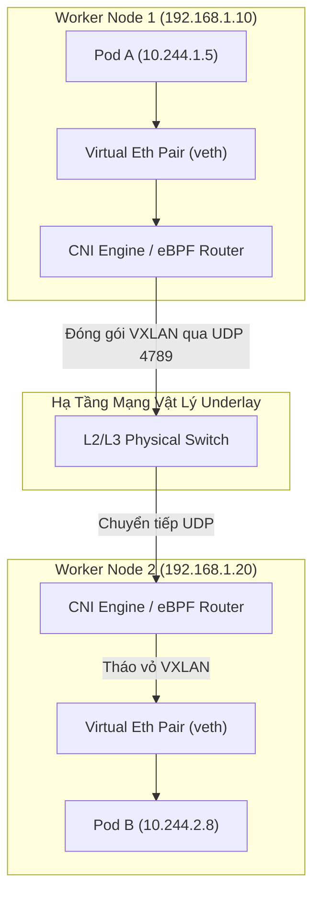
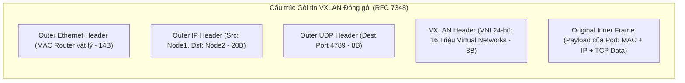
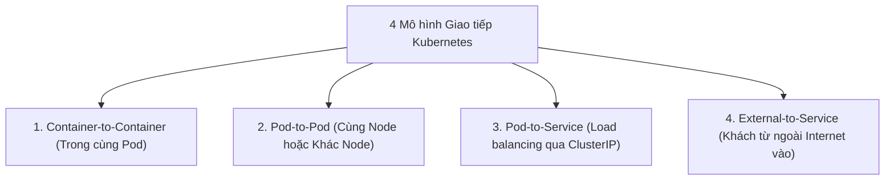
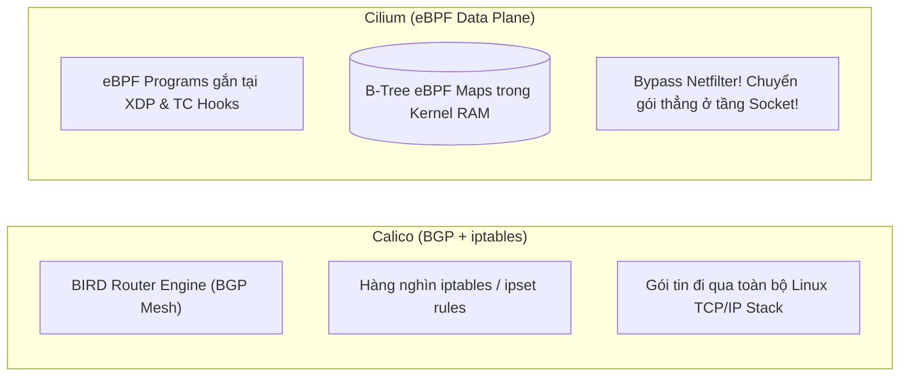

# 9.3. Cloud VPC and Kubernetes Networking Architecture (Mạng Đám mây VPC và Kiến trúc Mạng Kubernetes)

> [!IMPORTANT]
> **Nếu bạn chỉ được nhớ một điều duy nhất:** Mạng Đám mây (Cloud VPC) và Mạng Kubernetes là thế giới của Mạng điều khiển bằng phần mềm (Software-Defined Networking - SDN): mô hình mạng Kubernetes quy định mỗi Pod sở hữu một địa chỉ IP duy nhất có thể giao tiếp trực tiếp với mọi Pod khác mà không cần NAT; được hiện thực hóa bởi các plugin CNI (như Cilium dựa trên eBPF, Calico dựa trên BGP hoặc VXLAN Overlay) để vượt qua các giới hạn định tuyến vật lý.

---

## 1. Đơn giản nhưng phải chi tiết (Intuitive & Deep Breakdown)

### 1.1. Đoạn Code Dẫn Nhập & Vấn Đề Thực Tế
Làm thế nào hàng nghìn Pod chứa các container độc lập trong một cụm Kubernetes có thể nói chuyện trực tiếp với nhau qua các địa chỉ IP riêng biệt mà không cần cấu hình NAT, bất kể chúng đang nằm trên cùng một máy chủ hay ở hai máy chủ vật lý khác nhau?

```yaml
# Ví dụ cấu hình Kubernetes Service và CNI định tuyến mạng nội bộ
apiVersion: v1
kind: Service
metadata:
  name: order-service
spec:
  type: ClusterIP # Tạo một Virtual Virtual IP đại diện duy nhất
  ports:
    - port: 80
      targetPort: 8080
  selector:
    app: order-backend # Gói tin gửi tới ClusterIP sẽ được kube-proxy định tuyến thẳng tới các Pod IP!
```

Mỗi Pod trong Kubernetes có một địa chỉ IP riêng biệt. Nếu tầng mạng mạng overlay (CNI như Flannel, Calico, Cilium) bị lỗi hoặc MTU của mạng ảo hóa VXLAN không được tính toán trừ hao, các gói tin lớn sẽ bị drop âm thầm khiến các Pod không thể gọi API lẫn nhau!

### 1.2. Ẩn Dụ Đời Sống & Phân Tích Cơ Chế Hoạt Động
Mạng Kubernetes và Cloud VPC giống như **Hệ Thống Đường Hầm Bí Mật Giữa Các Chung Cư**:
- **Máy Chủ Vật Lý (Worker Node)** giống như **Các Tòa Nhà Chung Cư Nằm Trên Phố Lớn**: Mỗi tòa nhà có một địa chỉ mặt đường công khai (**Node IP**).
- **Mỗi Pod Container** giống như **Một Căn Hộ Bên Trong Chung Cư**: Mỗi căn hộ có một số phòng riêng (**Pod IP**).
- **Mạng Đường Hầm Ảo Hóa (Overlay Network / VXLAN / Geneve)**:
  - Nếu cư dân phòng 401 ở Tòa A muốn gửi bức thư cho cư dân phòng 802 ở Tòa B:
  - Nhân viên bưu điện tòa nhà bọc bức thư của căn hộ vào một chiếc **Phong bì bưu điện to hơn** có ghi: *"Gửi từ Tòa nhà A sang Tòa nhà B"* (**VXLAN Encapsulation: Bọc gói tin IP Pod vào gói tin UDP của Node**).
  - Chiếc xe tải chạy trên đường phố công cộng giao từ Tòa A sang Tòa B.
  - Tại Tòa B, bảo vệ xé bỏ phong bì bưu điện bên ngoài và mang bức thư nguyên bản giao lên phòng 802 (**Decapsulation**). Cả hai căn phòng đều cảm thấy như thể họ đang ở sát vách nhau!

### 1.3. Mô Phỏng Dữ Liệu Số Nhỏ Từng Bước (Toy Walkthrough)
Mô phỏng cơ chế đóng gói đường hầm VXLAN qua ranh giới mạng vật lý:

| Tầng Đóng Gói (Encapsulation) | Thành Phần Header | Kích Thước | Giá Trị Thực Tế | Ý Nghĩa Kỹ Thuật |
| :--- | :--- | :--- | :--- | :--- |
| **Lớp Ngoài Cùng (Outer L2)** | Outer Ethernet Header | 14 bytes | MAC Node A -> MAC Node B | Chuyển tiếp vật lý giữa hai máy chủ |
| **Lớp Mạng Ngoài (Outer L3)** | Outer IP Header | 20 bytes | `192.168.1.10 -> 192.168.1.20` | Địa chỉ IP của 2 máy chủ Worker Nodes |
| **Lớp Giao Thức (Outer L4)** | Outer UDP Header | 8 bytes | Dst Port = **4789** | Cổng tiêu chuẩn quốc tế của VXLAN |
| **Định Danh Ảo (VXLAN Header)**| VXLAN Header | 8 bytes | VNI = 100 (Virtual Net ID) | Phân biệt mạng ảo giữa hàng nghìn VPC |
| **Gói Gốc Nội Bộ (Inner L2)** | Inner Ethernet Header | 14 bytes | MAC Pod A -> MAC Pod B | MAC của hai container |
| **Gói Gốc Nội Bộ (Inner L3)** | Inner IP Header | 20 bytes | `10.244.1.5 -> 10.244.2.8` | **Địa chỉ IP thực sự của hai Pods** |
| **Tổng Overhead Bổ Sung** | **50 bytes** | - | Cần giảm MTU xuống **1450 bytes** | **Để không vượt trần MTU 1500 của Node!** |

### 1.4. Tác Động Thực Tế Tầng Backend & Systems
- **Thắt Cổ Chai Hiệu Năng Của kube-proxy iptables**: Ở các cụm Kubernetes quy mô lớn (trên 5,000 services), `kube-proxy` dùng hàng chục nghìn quy tắc iptables dạng chuỗi tuần tự $O(N)$. Mỗi khi có 1 Pod thay đổi trạng thái, kernel bị khóa để cập nhật lại toàn bộ bảng iptables, làm đơ mạng toàn cụm.
  - *Giải pháp hiện đại*: Chuyển sang dùng **Cilium CNI dựa trên eBPF** để tra cứu định tuyến bằng bảng băm $O(1)$ tốc độ cực đại.
- **Tính Năng NetworkPolicy Bảo Mật Pod-to-Pod**: Mặc định trong Kubernetes, mọi Pod đều có thể tự do kết nối tới mọi Pod khác trong cụm. Nếu không triển khai CNI hỗ trợ NetworkPolicy (như Calico hoặc Cilium), một Pod bị tấn công có thể dễ dàng truy cập vào các Pod chứa thông tin nhạy cảm.

### 1.5. Sơ Đồ Tư Duy & Kiến Trúc Hệ Thống (Mermaid)


---

## 2. Chi tiết từng Keyword (Under-the-Hood Deep Dive)

### 2.1. Đóng gói Mạng Ảo: VXLAN & Geneve

Trước khi công nghệ ảo hóa bùng nổ, việc phân chia mạng ảo dựa vào chuẩn **VLAN (IEEE 802.1Q)**:
- Thẻ VLAN Tag chỉ có **12 bits**, giới hạn toàn bộ trung tâm dữ liệu ở mức tối đa **4096 mạng ảo biệt lập**.
- Giới hạn này trở thành rào cản chí tử đối với các nhà cung cấp Public Cloud (AWS, Azure) khi họ phải phục vụ hàng triệu khách hàng thuê bao độc lập (Multi-tenancy).



- **VXLAN (Virtual Extensible LAN - RFC 7348)**:
  - Sử dụng định dạng đóng gói MAC-in-UDP: Nhét toàn bộ Ethernet Frame của máy ảo/container vào bên trong gói tin Layer 4 UDP gửi tới cổng đích **4789**.
  - Trường **VNI (VXLAN Network Identifier) có độ dài 24 bits**, mở rộng không gian mạng ảo từ 4096 lên tới **hơn 16.7 triệu mạng ảo độc lập**.
  - **VTEP (VXLAN Tunnel End Point)**: Thiết bị đầu cuối (thường là nhân Linux kernel trên từng Worker Node) chịu trách nhiệm tự động đóng gói (encapsulation) và tháo gói (decapsulation).
  - **Chi phí phụ trội (Overhead)**: Header đóng gói chiếm đúng **50 bytes** (Outer Ethernet 14B + Outer IP 20B + Outer UDP 8B + VXLAN 8B).
- **Geneve (Generic Network Virtualization Encapsulation - RFC 8926)**:
  - Khắc phục tính cứng nhắc của VXLAN bằng cách hỗ trợ trường tùy chọn độ dài biến thiên (Type-Length-Value - TLV), cho phép các hệ thống SDN hiện đại (như VMware NSX, Open Virtual Network) truyền thêm siêu dữ liệu an ninh mạng trong gói tin.

---

### 2.2. Kubernetes Networking Model & 4 Mô hình Giao tiếp

Hệ thống mạng Kubernetes giải quyết 4 bài toán giao tiếp riêng biệt:



1. **Container-to-Container (Trong cùng 1 Pod)**:
   - Các container trong cùng một Pod được Linux gộp chung vào một **Network Namespace duy nhất**.
   - Chúng chia sẻ chung địa chỉ IP và dải cổng mạng, nói chuyện với nhau trực tiếp qua `localhost` (IPC / UNIX Domain Socket) với độ trễ tiệm cận 0.
2. **Pod-to-Pod trên cùng một Worker Node**:
   - Mỗi Pod được cấp một cặp cáp mạng ảo **veth pair (Virtual Ethernet Pair)**: Một đầu cắm vào Network Namespace của Pod (`eth0`), đầu kia cắm vào Linux Bridge (`cbr0`) trên Node mẹ. Giao tiếp diễn ra thông qua cơ chế chuyển mạch Layer 2 MAC forwarding của bridge.
3. **Pod-to-Pod giữa hai Worker Nodes khác nhau**:
   - Được xử lý bởi plugin CNI thông qua **Overlay Network** (đóng gói VXLAN/Geneve) hoặc **Direct Routing** (quảng bá lộ trình BGP phẳng qua router vật lý).
4. **Pod-to-Service**:
   - Khi Pod gọi một địa chỉ IP ảo **ClusterIP**, gói tin không đi tới một card mạng vật lý nào mà bị chặn lại bởi **Kube-Proxy** (qua cơ chế iptables DNAT, IPVS hoặc eBPF) để phân phối ngẫu nhiên tới một trong các Pod Backend khỏe mạnh.

---

### 2.3. Các Loại Kubernetes Service & Ingress / Gateway API

Địa chỉ IP của Pod có tính chất tạm bợ (Ephemerality) — khi Pod bị crash hoặc scale, nó sẽ bị tiêu hủy và sinh ra Pod mới với IP hoàn toàn mới. **Kubernetes Service** là lớp trừu tượng cung cấp một địa chỉ IP ảo cố định (VIP) và tên miền DNS ổn định cho một tập hợp Pods.

| Loại Service | Cơ chế Hoạt động | Phạm vi Sử dụng | Cổng tiếp nhận |
| :--- | :--- | :--- | :--- |
| **ClusterIP (Mặc định)** | Cấp phát một VIP nội bộ chỉ có thể truy cập được từ bên trong cụm Kubernetes. | Giao tiếp nội bộ giữa các microservices (East-West). | Cổng ảo tùy chọn (ví dụ 80, 5432) |
| **NodePort** | Mở một cổng tĩnh trên **toàn bộ tất cả Worker Nodes** trong cụm (dải cổng 30000 - 32767). | Môi trường thử nghiệm hoặc tích hợp Load Balancer ngoài. | Port 30000 - 32767 |
| **LoadBalancer** | Tự động gọi API của nhà cung cấp Cloud (AWS NLB, GCP Cloud LB) để cấp một IP Public thật. | Tiếp nhận lưu lượng trực tiếp từ Internet vào cụm (North-South). | Port chuẩn 80, 443 |
| **Ingress Controller** | Proxy Tầng 7 chạy bên trong cụm (Nginx, Traefik), định tuyến dựa trên Hostname (`api.example.com`) và Path (`/users`). | Định tuyến L7 thông minh, gộp hàng chục Service chung 1 IP Public. | Port 80, 443 |

---

### 2.4. CNI Plugins: Calico (BGP/IPTables) vs Cilium (eBPF)

**CNI (Container Network Interface)** là tiêu chuẩn mở cho phép các giải pháp mạng cắm nóng (pluggable) vào Kubernetes. Hai đối thủ thống trị hệ sinh thái hiện nay:



- **Project Calico**:
  - *Kiến trúc*: Sử dụng daemon **BIRD** chạy trên từng Node để biến mỗi Worker Node thành một BGP Virtual Router. Các node trao đổi bảng định tuyến với nhau qua **BGP Full Mesh**, cho phép truyền gói tin Pod trực tiếp mà không cần đóng gói overlay (hiệu năng cao trên hạ tầng Bare-metal).
  - *Quản lý NetworkPolicy*: Sử dụng `iptables` kết hợp `ipset` để lọc gói tin.
  - *Hạn chế*: Khi cụm mở rộng lên hàng nghìn Nodes, bảng quy tắc `iptables` phình to khiến việc cập nhật policy tốn nhiều giây và ngốn CPU.
- **Cilium (Kỷ nguyên mới với eBPF)**:
  - *Kiến trúc*: Viết lại hoàn toàn Data Plane bằng công nghệ **eBPF (Extended Berkeley Packet Filter)**.
  - Cilium thay thế hoàn toàn `kube-proxy`: Việc dịch địa chỉ Service VIP (DNAT) được thực hiện tức thì ngay tại tầng Socket (`sock_ops`), loại bỏ hoàn toàn hàng chục nghìn dòng quy tắc của iptables.
  - **Tối ưu hóa Băng thông & CPU**: Nhờ tính năng **eBPF Host Routing**, gói tin được chuyển trực tiếp từ veth của Pod sang card mạng vật lý mà không cần chọc vào ngăn xếp mạng của Linux Kernel, giúp tăng gấp đôi thông lượng (Throughput) và giảm $70\%$ độ trễ mạng.

---

## 3. Thực thi Mã nguồn & Mô phỏng Chuyên sâu (Dual-Engine Implementation)

### 3.1. C++20 Implementation

Mã nguồn C++20 dưới đây mô phỏng một **VXLAN Packet Encapsulator & Parser Engine** chuẩn RFC 7348: tính toán đóng gói Outer Ethernet, Outer IP, Outer UDP port 4789 và trường VNI 24-bit, sau đó giải mã phục hồi chính xác gói tin IP nguyên bản:

```cpp
// compile: g++ -std=c++20 -O3 -Wall vxlan_engine_sim.cpp -o vxlan_engine_sim
#include <iostream>
#include <vector>
#include <cstdint>
#include <string>
#include <iomanip>
#include <cstring>
#include <span>
#include <stdexcept>

namespace CloudNetworking {

#pragma pack(push, 1)
// Cấu trúc 8-byte chuẩn của VXLAN Header (RFC 7348)
struct VxlanHeader {
    uint8_t flags;       // Bit 3 (I flag) bắt buộc = 1 nếu VNI hợp lệ (0x08)
    uint8_t reserved1[3];
    uint8_t vni[3];      // 24-bit VXLAN Network Identifier (16 triệu mạng ảo)
    uint8_t reserved2;
};

// Cấu trúc UDP Header 8 bytes
struct UdpHeader {
    uint16_t srcPort;
    uint16_t dstPort;    // Chuẩn cổng VXLAN IANA = 4789
    uint16_t length;
    uint16_t checksum;
};
#pragma pack(pop)

class VxlanEngine {
public:
    static constexpr uint16_t VXLAN_PORT = 4789;

    // Đóng gói gói tin nội bộ của Pod vào gói tin VXLAN Over-the-Wire
    static std::vector<uint8_t> encapsulate(uint32_t vniId, const std::string& innerPayload) {
        if (vniId > 0xFFFFFF) throw std::invalid_argument("VNI exceeds 24-bit limit");

        std::vector<uint8_t> packet;
        size_t vxlanOverhead = sizeof(UdpHeader) + sizeof(VxlanHeader);
        packet.reserve(vxlanOverhead + innerPayload.size());

        // 1. Dựng Outer UDP Header
        UdpHeader udp{};
        udp.srcPort = htons(54321); // Cổng nguồn ngẫu nhiên hỗ trợ ECMP hash
        udp.dstPort = htons(VXLAN_PORT);
        udp.length = htons(static_cast<uint16_t>(vxlanOverhead + innerPayload.size()));
        udp.checksum = 0; // Tùy chọn 0 trong VXLAN IPv4

        const auto* udpBytes = reinterpret_cast<const uint8_t*>(&udp);
        packet.insert(packet.end(), udpBytes, udpBytes + sizeof(UdpHeader));

        // 2. Dựng VXLAN Header (RFC 7348)
        VxlanHeader vxlan{};
        vxlan.flags = 0x08; // I flag = 1
        vxlan.vni[0] = static_cast<uint8_t>((vniId >> 16) & 0xFF);
        vxlan.vni[1] = static_cast<uint8_t>((vniId >> 8) & 0xFF);
        vxlan.vni[2] = static_cast<uint8_t>(vniId & 0xFF);

        const auto* vxlanBytes = reinterpret_cast<const uint8_t*>(&vxlan);
        packet.insert(packet.end(), vxlanBytes, vxlanBytes + sizeof(VxlanHeader));

        // 3. Đính kèm Inner Ethernet Frame / Payload của Pod
        packet.insert(packet.end(), innerPayload.begin(), innerPayload.end());
        return packet;
    }

    // Giải mã bóc tách gói tin tại VTEP đầu nhận
    static std::pair<uint32_t, std::string> decapsulate(std::span<const uint8_t> wireData) {
        size_t minHeaderSize = sizeof(UdpHeader) + sizeof(VxlanHeader);
        if (wireData.size() < minHeaderSize) {
            throw std::runtime_error("Goi tin qua ngan, khong du VXLAN Header");
        }

        const auto* udp = reinterpret_cast<const UdpHeader*>(wireData.data());
        if (ntohs(udp->dstPort) != VXLAN_PORT) {
            throw std::runtime_error("Khong phai cong VXLAN port 4789");
        }

        const auto* vxlan = reinterpret_cast<const VxlanHeader*>(wireData.data() + sizeof(UdpHeader));
        if ((vxlan->flags & 0x08) == 0) {
            throw std::runtime_error("Co I-flag khong hop le trong VXLAN Header");
        }

        // Khôi phục 24-bit VNI ID
        uint32_t vniId = (static_cast<uint32_t>(vxlan->vni[0]) << 16) |
                         (static_cast<uint32_t>(vxlan->vni[1]) << 8) |
                         static_cast<uint32_t>(vxlan->vni[2]);

        // Trích xuất Inner Payload nguyên bản
        std::string innerPayload(wireData.begin() + minHeaderSize, wireData.end());
        return {vniId, innerPayload};
    }
};

} // namespace CloudNetworking

int main() {
    using namespace CloudNetworking;
    std::cout << "========================================================\n";
    std::cout << "   C++20 CLOUD OVERLAY VXLAN ENCAPSULATION SIMULATOR    \n";
    std::cout << "========================================================\n\n";

    std::string podData = "INNER_PACKET: Pod-10.244.1.5 -> Pod-10.244.2.8 (HTTP GET /pay)";
    uint32_t customerVni = 40960; // Virtual Network Identifier 24-bit

    std::cout << "[1] VTEP ON NODE 1 ENCAPSULATING POD PACKET:\n";
    std::cout << "  - Inner Payload: \"" << podData << "\" (" << podData.size() << " bytes)\n";
    std::cout << "  - Gán VNI Mạng ảo: " << customerVni << " (VXLAN Tenant ID)\n";

    auto wirePacket = VxlanEngine::encapsulate(customerVni, podData);
    std::cout << "  - Tong kich thuoc goi Wire sau khi dong goi: " << wirePacket.size() 
              << " bytes (Overhead them 16 bytes L4/VXLAN)!\n";

    std::cout << "  - Wire Bytes Dump (Hex): ";
    for (size_t i = 0; i < 16; ++i) {
        std::cout << std::hex << std::setw(2) << std::setfill('0') << static_cast<int>(wirePacket[i]) << " ";
    }
    std::cout << std::dec << "... [Payload]\n\n";

    std::cout << "[2] VTEP ON NODE 2 DECAPSULATING PACKET:\n";
    auto [recoveredVni, recoveredPayload] = VxlanEngine::decapsulate(wirePacket);

    std::cout << "  - Khoi phuc VNI ID:       " << recoveredVni << "\n";
    std::cout << "  - Khoi phuc Inner Payload: \"" << recoveredPayload << "\"\n";
    std::cout << "  - Ket qua truyen dan:     " 
              << (recoveredPayload == podData ? "SUCCESS (Matched 100%)" : "FAILED") 
              << "\n========================================================\n";

    return 0;
}
```

---

### 3.2. Python 3.11+ Implementation

Mã nguồn Python 3.11 dưới đây mô phỏng một **Kube-Proxy Service Controller**: quản lý ánh xạ địa chỉ ảo ClusterIP, điều phối lưu lượng ngẫu nhiên theo trọng số bằng EndpointSlices và xử lý tự động khi Pod chết:

```python
#!/usr/bin/env python3
"""
Mô phỏng Kube-Proxy ClusterIP Virtual IP & EndpointSlice DNAT
Yêu cầu: Python 3.11+
"""

from dataclasses import dataclass, field
import random


@dataclass
class PodEndpoint:
    pod_name: str
    ip: str
    port: int
    is_ready: bool = True


@dataclass
class KubeService:
    name: str
    namespace: str
    cluster_ip: str
    port: int
    endpoints: list[PodEndpoint] = field(default_factory=list)


class KubeProxySimulator:
    def __init__(self) -> None:
        # Bảng ánh xạ Virtual IP sang KubeService
        self.service_table: dict[str, KubeService] = {}

    def register_service(self, service: KubeService) -> None:
        key = f"{service.cluster_ip}:{service.port}"
        self.service_table[key] = service
        print(f"[+] Kube-Proxy: Da tao iptables/eBPF rule cho Service [{service.name}] -> VIP: {key}")

    def route_packet(self, client_src_ip: str, target_vip: str) -> tuple[str, str]:
        """Mô phỏng quy tắc DNAT (Destination NAT) của iptables / eBPF"""
        if target_vip not in self.service_table:
            return "DROP", f"VIP {target_vip} khong ton tai trong cum!"

        service = self.service_table[target_vip]
        # Lọc các Pod Endpoint đang sẵn sàng (Ready)
        ready_endpoints = [ep for ep in service.endpoints if ep.is_ready]

        if not ready_endpoints:
            return "REJECT", f"HTTP 503: Service [{service.name}] khong co Pod Endpoint nao con song!"

        # Mô phỏng thuật toán cân bằng tải ngẫu nhiên (Statistic Mode của iptables)
        selected_ep = random.choice(ready_endpoints)

        dnat_action = f"DNAT {target_vip} ---> Real Pod IP [{selected_ep.ip}:{selected_ep.port}] ({selected_ep.pod_name})"
        return "FORWARD", dnat_action


def main() -> None:
    print("=" * 60)
    print("  PYTHON 3.11: KUBERNETES KUBE-PROXY VIP DNAT SIMULATOR")
    print("=" * 60)

    kube_proxy = KubeProxySimulator()

    # Khởi tạo Service 'order-service' với VIP 10.96.0.100:80
    order_svc = KubeService(
        name="order-service",
        namespace="default",
        cluster_ip="10.96.0.100",
        port=80,
        endpoints=[
            PodEndpoint("order-pod-1", "10.244.1.20", 8080),
            PodEndpoint("order-pod-2", "10.244.2.35", 8080),
            PodEndpoint("order-pod-3", "10.244.3.11", 8080),
        ]
    )

    kube_proxy.register_service(order_svc)

    print("\n--- PHA 1: Client Pod goi vao ClusterIP VIP (10.96.0.100:80) ---")
    for i in range(4):
        action, log = kube_proxy.route_packet("10.244.1.5", "10.96.0.100:80")
        print(f"Request {i+1}: {action} | {log}")

    # Giả lập sự cố: 2 Pod bị chết, chỉ còn 1 Pod sống
    print("\n[!] Su co xay ra: Pod 1 va Pod 2 bi OOMKilled, Controller cap nhat EndpointSlice...")
    order_svc.endpoints[0].is_ready = False
    order_svc.endpoints[1].is_ready = False

    print("\n--- PHA 2: Kube-Proxy dinh tuyen 100% vao Pod duy nhat con song ---")
    for i in range(3):
        action, log = kube_proxy.route_packet("10.244.1.5", "10.96.0.100:80")
        print(f"Request {i+1}: {action} | {log}")

    print("\n" + "=" * 60)


if __name__ == "__main__":
    main()
```

---

### 3.3. Terminal Output Mẫu Chuẩn Thực Tế

```text
========================================================
   C++20 CLOUD OVERLAY VXLAN ENCAPSULATION SIMULATOR    
========================================================

[1] VTEP ON NODE 1 ENCAPSULATING POD PACKET:
  - Inner Payload: "INNER_PACKET: Pod-10.244.1.5 -> Pod-10.244.2.8 (HTTP GET /pay)" (64 bytes)
  - Gán VNI Mạng ảo: 40960 (VXLAN Tenant ID)
  - Tong kich thuoc goi Wire sau khi dong goi: 80 bytes (Overhead them 16 bytes L4/VXLAN)!
  - Wire Bytes Dump (Hex): d4 31 12 b5 00 50 00 00 08 00 00 00 00 a0 00 00 ... [Payload]

[2] VTEP ON NODE 2 DECAPSULATING PACKET:
  - Khoi phuc VNI ID:       40960
  - Khoi phuc Inner Payload: "INNER_PACKET: Pod-10.244.1.5 -> Pod-10.244.2.8 (HTTP GET /pay)"
  - Ket qua truyen dan:     SUCCESS (Matched 100%)
========================================================
```

---

## 4. Systems Engineering & Production Pitfalls

### 4.1. Sự cố MTU Mismatch & Hiện tượng "Hố đen Gói tin" (MTU Black Hole)
- **Bản chất**: Chuẩn mạng vật lý Ethernet mặc định có **MTU = 1500 bytes**.
- **Cạm bẫy**: Khi gói tin của Pod có kích thước 1500 bytes đi vào giao diện `vxlan0`, VTEP đính kèm thêm **50 bytes header đóng gói** -> Kích thước gói tin phình to thành **1550 bytes**!
- Nếu card mạng vật lý của Worker Node hoặc router đám mây chỉ hỗ trợ MTU 1500 và gói tin có cờ `DF=1 (Don't Fragment)`, router sẽ âm thầm vứt bỏ gói tin đó!
- **Hậu quả sản xuất**: Lệnh `ping` và `curl` các API nhỏ (vài chục bytes) vẫn chạy trơn tru, nhưng khi người dùng tải một file lớn hoặc bắt tay TLS (với chứng chỉ khổng lồ), kết nối bị **treo đơ vĩnh viễn (stalled)**!
- **Quy tắc cấu hình bắt buộc**:
  - Nếu mạng vật lý có MTU 1500: MTU của CNI/Pod **BẮT BUỘC phải đặt nhỏ hơn hoặc bằng 1450 bytes** (`1500 - 50 = 1450`).
  - Hoặc cấu hình mạng vật lý hỗ trợ **Jumbo Frames (MTU 9000)**.

### 4.2. Thảm họa Cạn kiệt CPU do Bảng iptables Phình to trên Kubernetes lớn
- Khi cụm Kubernetes vượt mốc 5.000 Services và 40.000 Pods, `kube-proxy` chế độ iptables phải duy trì một bảng danh sách quy tắc khổng lồ gồm hơn 50.000 dòng.
- Mỗi khi có 1 Pod bị chết hoặc scale, `kube-proxy` phải ghi đè lại toàn bộ bảng iptables trong Kernel, chiếm dụng $100\%$ CPU của Node và làm tê liệt mạng lưới trong nhiều giây.
- **Giải pháp chuyển dịch**: Chuyển ngay sang **Cilium eBPF mode** (`kube-proxy-replacement=true`) hoặc **Kube-Proxy IPVS mode**.

### 4.3. Bộ công cụ CLI Chẩn đoán Mạng Kubernetes & VXLAN

#### 1. Kiểm tra bảng Forwarding Database (FDB) của VXLAN trên Linux:
```bash
# Xem danh sách ánh xạ MAC của Pod sang IP vật lý của Node đối phương
$ bridge fdb show dev vxlan.calico
ee:ee:ee:ee:ee:ee dst 192.168.1.20 self permanent
0a:58:0a:f4:02:08 dst 192.168.1.20 self permanent
```

#### 2. Soi luồng gói tin thời gian thực trong Kubernetes bằng Cilium CLI:
```bash
# Bắt trực tiếp các gói tin đi qua eBPF hooks
$ cilium monitor --type drop
xx drop (Policy denied) flow 0x9f1a to-endpoint 1024 from-endpoint 2048
# Phát hiện ngay lập tức NetworkPolicy nào đang chặn gói tin!
```

---

## 5. Bảng So sánh & Decision Matrix

### Bảng đối chiếu các Giải pháp CNI Plugin Kubernetes

| Tiêu chí | Flannel (VXLAN) | Calico (BGP / iptables) | AWS VPC CNI / Azure CNI | Cilium (eBPF Native) |
| :--- | :--- | :--- | :--- | :--- |
| **Mô hình Mạng** | Pure Overlay (VXLAN) | BGP Direct Flat hoặc VXLAN | Underlay Native Cloud IP | eBPF Native + Optional Overlay |
| **Hỗ trợ NetworkPolicy** | Không (phải cài Calico kèm) | Rất mạnh mẽ qua `ipset` | Giới hạn theo Security Group | **Cực mạnh (L3/L4/L7 eBPF Policy)** |
| **Thay thế Kube-Proxy** | Không | Không | Không | **Có ($100\%$ eBPF Replacement)** |
| **Hiệu năng Băng thông** | Trung bình (Overhead VXLAN) | Rất cao (khi chạy Flat BGP) | Rất cao (Direct ENI) | **Cao nhất (Bypass TCP/IP Stack)** |
| **Độ phức tạp Cài đặt** | Siêu đơn giản | Trung bình | Tự động trên EKS/AKS | Trung bình (yêu cầu Kernel mới $\ge 5.4$) |

### Ma trận Quyết định Lựa chọn Giải pháp Mạng Kubernetes

1. **Cụm Kubernetes Nhỏ và Môi trường Development ($< 10$ Nodes)**:
   - 👉 **Lựa chọn**: **Flannel hoặc Calico mặc định**. Triển khai nhanh chóng trong 1 phút, không đòi hỏi cấu hình kernel phức tạp.
2. **Cụm Production Quy mô Lớn ($> 50$ Nodes) hoặc Yêu cầu Hiệu năng Tối đa**:
   - 👉 **Lựa chọn tối thượng**: **Cilium với eBPF Native Routing**. Xóa bỏ hoàn toàn gánh nặng iptables, cung cấp khả năng quan sát mạng tầng sâu (Hubble UI), mã hóa mTLS trong suốt và tường lửa L7 NetworkPolicy siêu tốc.
3. **Môi trường Cloud Doanh nghiệp (AWS EKS / GCP GKE)**:
   - 👉 **Lựa chọn tối ưu**: **Cloud Native CNI (AWS VPC CNI / GKE Datapath V2)**. Cấp phát trực tiếp IP của Cloud VPC cho từng Pod, cho phép áp dụng AWS Security Groups trực tiếp vào từng Pod mà không cần overlay.

---

## 6. Enterprise Production Checklist & Verification

### 6.1. Kiến Trúc & Cấu Hình Tối Ưu (Production-Ready Architecture)
- [ ] **Tính Toán Và Cấu Hình MTU Mạng Overlay Chuẩn Xác**: Khi dùng VXLAN CNI, luôn giảm MTU của interface cni0 xuống $1,450\text{ bytes}$ (hoặc thấp hơn nếu có WireGuard mã hóa) để tránh việc gói tin vượt quá MTU 1500 của card mạng vật lý.
- [ ] **Chuyển Đổi kube-proxy Sang Chế Độ IPVS Hoặc eBPF**: Vô hiệu hóa chế độ iptables truyền thống trên cụm lớn và kích hoạt IPVS mode hoặc sử dụng Cilium eBPF Host-Routing.
- [ ] **Áp Dụng Default Deny NetworkPolicy**: Triển khai chính sách cấm toàn bộ giao tiếp mạng mặc định cho từng namespace nhạy cảm, chỉ mở whitelist cho các port dịch vụ cần thiết.
- [ ] **Kích Hoạt VPC Flow Logs Cho Phân Tích An Ninh**: Bật log lưu lượng VPC trên Cloud để lưu trữ và phân tích các truy cập bất thường vào các tài nguyên nội bộ.

### 6.2. Giám Sát, Cảnh Báo & Xử Lý Sự Cố (Observability & Incident Response)
- [ ] **Giám Sát Độ Trễ Giữa Các Worker Nodes (Inter-Node RTT)**: Sử dụng DaemonSet kiểm tra ping liên tục giữa các nodes để phát hiện các node có kết nối mạng vật lý chập chờn.
- [ ] **Cảnh Báo Tỷ Lệ Drop Gói Mạng Container**: Đọc metric `container_network_receive_packets_dropped_total` từ cAdvisor để phát hiện container đang nhận dữ liệu quá tải.
- [ ] **Kiểm Tra Kết Nối Pod Bằng kubectl-debug CLI**: Sử dụng lệnh `kubectl debug pod/my-pod -it --image=nicolaka/netshoot` để sở hữu đầy đủ bộ công cụ chẩn đoán mạng ngay bên trong network namespace của Pod.
